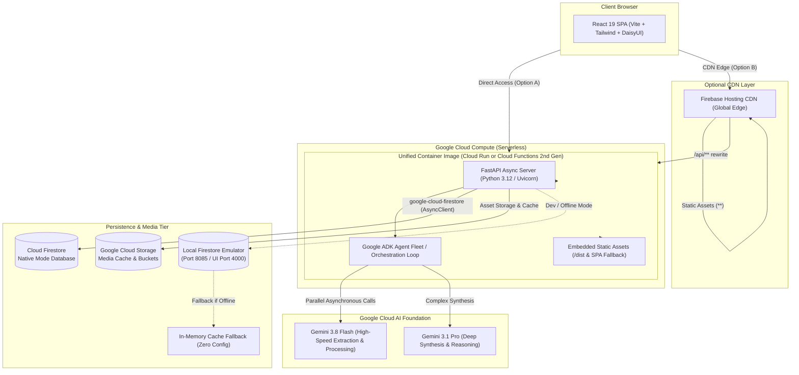

# Full-Stack Reusable Architecture Blueprint

> **Reference Architecture Blueprint**: High-Performance AI-Powered Full-Stack Application  
> **Core Stack**: React 19 (TypeScript + Vite + DaisyUI) + FastAPI (Python 3.12 + Google ADK + Gemini) + Cloud Firestore + Cloud Run / Cloud Functions (2nd Gen)

---

## 📋 Table of Contents

1. [Architecture Overview & System Topology](#1-architecture-overview--system-topology)
2. [Technology Stack Matrix](#2-technology-stack-matrix)
3. [Frontend Layer (React 19 + TypeScript + DaisyUI)](#3-frontend-layer-react-19--typescript--daisyui)
4. [Backend Layer (FastAPI + Google ADK + Gemini)](#4-backend-layer-fastapi--google-adk--gemini)
5. [Firebase Tier (Cloud Firestore, Rules & Emulator)](#5-firebase-tier-cloud-firestore-rules--emulator)
6. [Deployment Architecture (Cloud Run, Cloud Functions & Firebase Hosting)](#6-deployment-architecture-cloud-run-cloud-functions--firebase-hosting)
7. [Local Development Environment & Emulation](#7-local-development-environment--emulation)
8. [Step-by-Step Blueprint to Spin Up a New Project](#8-step-by-step-blueprint-to-spin-up-a-new-project)

---

## 1. Architecture Overview & System Topology

This architecture delivers a **production-grade, zero-CORS, highly scalable full-stack application**. It pairs a modern reactive Single Page Application (SPA) with an asynchronous Python backend capable of orchestrating autonomous AI agent fleets, backed by real-time NoSQL persistence in Google Cloud Firestore.

### 🏛️ System Topology Diagram



---

## 2. Technology Stack Matrix

| Tier | Technology | Version / Spec | Role & Purpose | Why This Was Chosen |
| :--- | :--- | :--- | :--- | :--- |
| **Frontend** | [React](https://react.dev/) | `^19.0.0` | UI framework & component rendering | Fine-grained rendering, optimistic UI updates, native async action handling for streaming agent updates without UI blocking. |
| **Frontend** | [TypeScript](https://www.typescriptlang.org/) | `^5.0.0` | Type safety & domain modeling | Shared DTO interfaces matching backend Pydantic schemas 1:1, preventing runtime payload bugs. |
| **Frontend** | [Vite](https://vite.dev/) | `^6.0.0` | Build tool & local HMR dev server | Sub-millisecond Hot Module Replacement (HMR) and optimized rollup production bundles. |
| **Frontend** | [Tailwind CSS](https://tailwindcss.com/) | `^3.4.0` | Utility-first responsive styling | Rapid layout design across breakpoints without stylesheet bloat. |
| **Frontend** | [DaisyUI](https://daisyui.com/) | `^4.12.0` | Semantic UI component library | Accessible widgets (cards, tabs, modals, badges, drawers) and dynamic dark/light/custom theming. |
| **Frontend** | [Lucide React](https://lucide.dev/) | `^1.0.0` | Vector iconography | Tree-shakeable, clean, standardized icons. |
| **Frontend** | [React Router](https://reactrouter.com/) | `^7.0.0` | Client-side routing | Full SPA navigation with path history mode. |
| **Backend** | [Python](https://www.python.org/) | `3.12+` | Backend runtime | Premier launchpad for AI developer kits, rich async ecosystem, and enterprise data validation. |
| **Backend** | [FastAPI](https://fastapi.tiangolo.com/) | `^0.115.0` | Async REST & streaming API server | Async I/O, native ASGI, high throughput, automatic OpenAPI documentation. |
| **Backend** | [Uvicorn](https://www.uvicorn.org/) | `^0.30.0` | Lightning-fast ASGI web server | Production-grade async HTTP/1.1 and WebSocket/SSE server implementation. |
| **Backend** | [Pydantic](https://docs.pydantic.dev/) | `^2.10.0` | Data validation & serialization | Strict JSON schema generation for LLM structured output and request/response validation. |
| **AI / Agent** | [Google ADK](https://github.com/google/agent-development-kit) | `^2.11.0` | Agent framework & workflow engine | Separation of Agent definitions, Runners, Session state, and Context with lifecycle callbacks. |
| **AI / GenAI** | [Google GenAI SDK](https://github.com/googleapis/python-genai) | `^1.0.0` | Gemini & Imagen foundation models | Official unified SDK for `gemini-3.8-flash`, `gemini-3.1-pro`, and multimodal capabilities. |
| **Database** | [Cloud Firestore](https://cloud.google.com/firestore) | Native Mode | Serverless real-time NoSQL store | Real-time queries, automatic multi-region replication, sub-second queries, and flexible schemas. |
| **DB Client** | `google-cloud-firestore` | `^2.19.0` | Async Python database client | Non-blocking database I/O (`firestore.AsyncClient`) inside FastAPI event loops. |
| **Storage** | [Cloud Storage (GCS)](https://cloud.google.com/storage) | Standard | Binary asset and media store | Cost-effective object storage for generated media, caches, and backups. |
| **Hosting** | [Google Cloud Run](https://cloud.google.com/run) | Fully Managed | Serverless container runtime | Autoscales 0 to N instances, zero idle cost, HTTP/2 & streaming support, zero CORS architecture. |
| **Functions** | [Cloud Functions (2nd Gen)](https://cloud.google.com/functions) | 2nd Generation | Event-driven or HTTP microservices | Built on Cloud Run and Eventarc, supporting concurrency, larger memory, and long timeouts. |
| **CDN / Edge** | [Firebase Hosting](https://firebase.google.com/docs/hosting) | Global CDN | Fast static asset delivery & rewrite proxy | SSL termination, global edge caching, and seamless path rewrites to Cloud Run or Cloud Functions. |

---

## 3. Frontend Layer (React 19 + TypeScript + DaisyUI)

### Architecture Highlights
1. **Zero-CORS Embedded Serving**: In production, the compiled static bundle (`dist/`) is served directly by the backend container. In development, Vite proxies `/api` calls to the local FastAPI port (`8080`).
2. **Strict Type Parity**: Frontend DTO models in `frontend/src/types.ts` mirror backend Pydantic models in `backend/shared/schemas.py`.
3. **Resilient Streaming**: Utilizes Server-Sent Events (SSE) or chunked HTTP streaming for real-time AI progress without polling.

### Recommended Directory Structure

```
frontend/
├── index.html
├── package.json
├── postcss.config.js
├── tailwind.config.js
├── tsconfig.json
├── vite.config.ts
└── src/
    ├── App.tsx                     # Main router & layout shell
    ├── main.tsx                    # React 19 bootstrap entrypoint
    ├── types.ts                    # Shared domain models & API response interfaces
    ├── api/
    │   └── client.ts               # Centralized fetch wrapper & SSE reader
    ├── components/
    │   ├── common/                 # Header, Footer, Navbar, LoadingSpinner
    │   ├── cards/                  # Data visualization cards & stat metrics
    │   └── dialogs/                # Modals, drawers, and form controls
    └── views/                      # Route-level page components
        ├── DashboardView.tsx
        ├── DetailView.tsx
        └── SettingsView.tsx
```

### Essential `vite.config.ts` (Proxy Setup for Development)

```typescript
import { defineConfig } from 'vite';
import react from '@vitejs/plugin-react';

export default defineConfig({
  plugins: [react()],
  server: {
    port: 5173,
    proxy: {
      '/api': {
        target: process.env.VITE_BACKEND_URL || 'http://127.0.0.1:8080',
        changeOrigin: true,
      },
    },
  },
  build: {
    outDir: 'dist',
    emptyOutDir: true,
    sourcemap: false,
  },
});
```

---

## 4. Backend Layer (FastAPI + Google ADK + Gemini)

### Architecture Highlights
1. **Asynchronous Non-Blocking Core**: All endpoints use `async def` and non-blocking I/O.
2. **Dual-Model Routing Pattern**:
   - `gemini-3.8-flash`: Rapid claim extraction, sentiment/bias analysis, timeline ordering, classification (low latency, low cost).
   - `gemini-3.1-pro-preview`: Multi-document synthesis, complex debate arbitration, root-cause diagnosis (deep reasoning).
3. **Scatter-Gather Parallel Fan-Out**: Uses `asyncio.gather` to execute multiple independent sub-agent tasks concurrently, slashing processing latency by 70–80%.
4. **Unified Static SPA Serving**: Mounts `/assets` and provides a catch-all route that resolves `index.html` for client-side routing while validating paths against directory traversal.

### Recommended Directory Structure

```
backend/
├── Dockerfile
├── requirements.txt
├── api_server.py                   # FastAPI app entrypoint, routes & static mounting
├── .env.example
└── shared/
    ├── __init__.py
    ├── config.py                   # Environment configs, model constants, logger
    ├── schemas.py                  # Pydantic v2 schemas and request/response models
    ├── firestore_service.py        # AsyncClient wrapper with in-memory fallback
    └── agents/                     # Google ADK agent definitions
        ├── __init__.py
        ├── orchestrator.py         # Root supervisor agent
        ├── extractor_agent.py      # High-speed processing agent
        └── reasoning_agent.py      # Deep synthesis agent
```

### Key Pattern: Unified SPA + API in `api_server.py`

```python
from pathlib import Path
from fastapi import FastAPI, HTTPException
from fastapi.middleware.cors import CORSMiddleware
from fastapi.staticfiles import StaticFiles
from fastapi.responses import FileResponse

app = FastAPI(title="Reusable Agentic API", version="1.0.0")

# Enable CORS for local cross-origin dev if Vite is running separately
app.add_middleware(
    CORSMiddleware,
    allow_origins=["*"],
    allow_credentials=True,
    allow_methods=["*"],
    allow_headers=["*"],
)

# API routes go here under /api
@app.get("/api/health")
async def health_check():
    return {"status": "healthy", "service": "agentic-api"}

# Mount frontend production build from dist/
DIST_DIR = Path(__file__).resolve().parent / "dist"
if (DIST_DIR / "index.html").exists():
    if (DIST_DIR / "assets").exists():
        app.mount("/assets", StaticFiles(directory=str(DIST_DIR / "assets")), name="assets")

    @app.get("/{full_path:path}")
    async def serve_spa(full_path: str):
        resolved_dist = DIST_DIR.resolve()
        file_path = (DIST_DIR / full_path).resolve()
        
        # Guard against directory traversal
        if not file_path.is_relative_to(resolved_dist):
            raise HTTPException(status_code=403, detail="Forbidden")
            
        if full_path and file_path.is_file():
            return FileResponse(str(file_path))
        return FileResponse(str(DIST_DIR / "index.html"))
```

---

## 5. Firebase Tier (Cloud Firestore, Rules & Emulator)

### Architecture Highlights
1. **Native Mode Firestore**: Document-collection NoSQL database for rapid JSON reads and writes.
2. **Three-Tier Fallback Storage Engine**:
   - **Production**: Cloud Firestore via Application Default Credentials (ADC).
   - **Local Dev / Testing**: Local Firestore Emulator (`127.0.0.1:8085`).
   - **Offline / CI**: In-memory dictionary fallback when neither is reachable, ensuring zero test flakiness.
3. **Declarative Security Rules (`firestore.rules`)**: Validates schema shapes, field types, and restricts public writes.
4. **Automated Headless Deployment (`deploy_rules.py`)**: Uses Google Cloud Rules REST API via `gcloud` access token, eliminating manual interactive browser logins in automated deployment scripts.

### Recommended Directory Structure

```
firebase/
├── firebase.json                   # Emulator & Firebase Hosting config
├── firestore.rules                 # Security rules definition
├── firestore.indexes.json          # Composite index specifications
├── deploy_rules.py                 # Headless automated rule deployer
└── emulator-data/                  # Exported test dataset for emulators
```

### Key Configuration: `firebase.json`

```json
{
  "hosting": {
    "public": "../frontend/dist",
    "ignore": ["firebase.json", "**/.*", "**/node_modules/**"],
    "rewrites": [
      {
        "source": "/api/**",
        "run": {
          "serviceId": "my-agentic-service",
          "region": "us-central1"
        }
      },
      {
        "source": "**",
        "destination": "/index.html"
      }
    ]
  },
  "firestore": {
    "rules": "firestore.rules",
    "indexes": "firestore.indexes.json"
  },
  "emulators": {
    "firestore": {
      "port": 8085,
      "host": "127.0.0.1"
    },
    "ui": {
      "enabled": true,
      "port": 4000,
      "host": "127.0.0.1"
    }
  }
}
```

### Robust Firestore Client Initializer (`shared/firestore_service.py`)

```python
import os
from typing import Optional, Any
from google.auth.credentials import AnonymousCredentials

_client: Optional[Any] = None

def get_firestore_client():
    global _client
    if _client is not None:
        return _client
        
    emulator_host = os.environ.get("FIRESTORE_EMULATOR_HOST")
    project_id = os.environ.get("FIREBASE_PROJECT_ID") or os.environ.get("GOOGLE_CLOUD_PROJECT", "dev-project")
    
    from google.cloud import firestore
    
    if emulator_host:
        # Connect to local emulator with dummy credentials
        _client = firestore.AsyncClient(project=project_id, credentials=AnonymousCredentials())
    else:
        # In Cloud Run / Cloud Functions, ADC automatically picks up project credentials
        _client = firestore.AsyncClient(project=project_id)
        
    return _client
```

---

## 6. Deployment Architecture (Cloud Run, Cloud Functions & Firebase Hosting)

You can deploy this architecture in one of two production modes depending on whether you prefer a **unified single-container service** or **modular micro-functions**.

### Option A: Unified Container on Google Cloud Run (Recommended)
This is the approach used in this reference project. The React frontend is compiled and packaged inside the container alongside FastAPI.

* **Advantages**:
  * Eliminates CORS entirely.
  * Single deploy command, single Cloud service to monitor.
  * Scales from 0 to N instances on demand.
  * Fast startup (~1-2 seconds with Python slim).
  * Direct HTTP/2 and Server-Sent Events (SSE) streaming support.

#### Production `backend/Dockerfile`

```dockerfile
FROM python:3.12-slim

ENV PYTHONUNBUFFERED=1 \
    PYTHONDONTWRITEBYTECODE=1 \
    PORT=8080

WORKDIR /app

RUN apt-get update && apt-get install -y --no-install-recommends \
    build-essential curl && \
    rm -rf /var/lib/apt/lists/*

COPY requirements.txt /app/requirements.txt
RUN pip install --no-cache-dir -r requirements.txt

# Copy backend code AND pre-compiled frontend static bundle in dist/
COPY . /app

EXPOSE 8080

CMD ["uvicorn", "api_server:app", "--host", "0.0.0.0", "--port", "8080"]
```

---

### Option B: Google Cloud Functions (2nd Gen) Deployment
Google Cloud Functions (2nd Gen) are powered by Cloud Run behind the scenes, allowing you to deploy the exact same FastAPI app or split specific agent background tasks into event-driven functions.

#### 1. Deploying FastAPI as an HTTP Cloud Function (2nd Gen)
Using the [Functions Framework for Python](https://github.com/GoogleCloudPlatform/functions-framework-python):

```bash
# Install functions-framework
pip install functions-framework

# In backend/main.py:
# from api_server import app
# The ASGI app can be wrapped or directly invoked
```

Deploy command:
```bash
gcloud functions deploy my-agentic-api \
    --gen2 \
    --runtime=python312 \
    --region=us-central1 \
    --source=./backend \
    --entry-point=app \
    --trigger-http \
    --allow-unauthenticated \
    --memory=2Gi \
    --cpu=2 \
    --timeout=300s \
    --set-env-vars "FIREBASE_PROJECT_ID=my-project-id,GEMINI_API_KEY=your-key"
```

#### 2. Event-Driven Cloud Functions (e.g. Firestore Document Triggers)
If your architecture requires background AI agents to run asynchronously whenever a new document is written to Firestore:

```python
import functions_framework
from cloudevents.http import CloudEvent

@functions_framework.cloud_event
def process_new_analysis(cloud_event: CloudEvent):
    """Triggered by a change to a Firestore document."""
    data = cloud_event.data
    # Run heavy multi-agent workflow asynchronously in background
    print(f"Triggered for document: {data['value']['name']}")
```

Deploying the Firestore trigger function:
```bash
gcloud functions deploy process-analysis-agent \
    --gen2 \
    --runtime=python312 \
    --region=us-central1 \
    --source=./backend \
    --entry-point=process_new_analysis \
    --trigger-event-filters="type=google.cloud.firestore.document.v1.written" \
    --trigger-event-filters="database=(default)" \
    --trigger-event-filters-path-pattern="document=analyses/{docId}" \
    --memory=2Gi \
    --timeout=540s
```

---

### Option C: Firebase Hosting Edge + Cloud Run / Cloud Functions Proxy
For global edge caching and custom domain routing:
1. Static assets are pushed to Firebase Hosting (`npx firebase-tools deploy --only hosting`).
2. Incoming traffic to `/api/**` is automatically rewritten by Firebase edge proxy to the Cloud Run service or Cloud Function.
3. All other paths serve the cached `index.html` Single Page Application.

---

### Security & IAM Identity

No private API service account keys need to be baked into containers. The Cloud Run or Cloud Function service account uses **Application Default Credentials (ADC)**:

| Required IAM Role | Granted To | Purpose |
| :--- | :--- | :--- |
| `roles/datastore.user` | Cloud Run Service Account | Full Read/Write access to Cloud Firestore |
| `roles/storage.objectAdmin` | Cloud Run Service Account | Reading/writing media files to Cloud Storage |
| `roles/run.invoker` | Public / `allUsers` (or restricted) | Allows HTTP clients to call the API |

---

## 7. Local Development Environment & Emulation

Run the entire stack locally with zero cloud dependencies or costs using three concurrent processes:

```
┌─────────────────────────────────────────────────────────────┐
│                   LOCAL DEV ORCHESTRATION                   │
│                                                             │
│  [1] Firebase Emulator Suite                                │
│      └─ Port 8085 (Firestore) & Port 4000 (UI)              │
│                                                             │
│  [2] FastAPI Backend Server (Python)                        │
│      └─ Port 8080 (REST, ADK Agents & Swagger /docs)        │
│                                                             │
│  [3] Vite React Dev Server                                  │
│      └─ Port 5173 (HMR & proxy /api -> :8080)               │
└─────────────────────────────────────────────────────────────┘
```

### Automation Script: `start_dev.bat` (Windows)

```bat
@echo off
start "Firestore Emulator" cmd /k "cd firebase && npx firebase-tools emulators:start --only firestore"
timeout /t 3 /nobreak >nul
start "FastAPI Backend" cmd /k "cd backend && set FIRESTORE_EMULATOR_HOST=127.0.0.1:8085 && python api_server.py"
start "React Frontend" cmd /k "cd frontend && npm run dev"
```

### Automation Script: `start_dev.sh` (Linux / macOS)

```bash
#!/usr/bin/env bash
set -e

# Start Firestore Emulator in background
cd firebase && npx firebase-tools emulators:start --only firestore &
EMULATOR_PID=$!
cd ..

sleep 3

# Start Backend in background
cd backend
export FIRESTORE_EMULATOR_HOST="127.0.0.1:8085"
python3 api_server.py &
BACKEND_PID=$!
cd ..

# Start Frontend
cd frontend
npm run dev

# Trap exit to kill background jobs
trap "kill $EMULATOR_PID $BACKEND_PID" EXIT
```

---

## 8. Step-by-Step Blueprint to Spin Up a New Project

Use this checklist to reuse this architecture for a brand new project:

### Step 1: Initialize Project Directory Structure
```bash
mkdir my-new-project && cd my-new-project
mkdir frontend backend firebase docs
```

### Step 2: Initialize the Frontend
```bash
cd frontend
npm create vite@latest . -- --template react-ts
npm install
npm install -D tailwindcss postcss autoprefixer daisyui
npx tailwindcss init -p
npm install lucide-react clsx react-router-dom
cd ..
```

### Step 3: Initialize the Backend
```bash
cd backend
python -m venv .venv
# Activate venv:
# Windows: .venv\Scripts\activate
# Linux/Mac: source .venv/bin/activate

cat << 'EOF' > requirements.txt
google-adk>=2.11.0
google-genai>=1.0.0
pydantic>=2.10.0
fastapi>=0.115.0
uvicorn[standard]>=0.30.0
google-cloud-firestore>=2.19.0
google-cloud-storage>=2.14.0
httpx>=0.27.0
python-dotenv>=1.0.0
pytest>=8.0.0
EOF

pip install -r requirements.txt
cd ..
```

### Step 4: Initialize Firebase
```bash
cd firebase
npx firebase-tools init firestore
npx firebase-tools init emulators
cd ..
```

### Step 5: Configure Environment (`backend/.env`)
```ini
GEMINI_API_KEY=your_gemini_api_key_here
FIREBASE_PROJECT_ID=your-gcp-project-id
GOOGLE_CLOUD_PROJECT=your-gcp-project-id
FIRESTORE_EMULATOR_HOST=127.0.0.1:8085
ADK_LOG_LEVEL=INFO
```

### Step 6: Create the One-Click Production Deployment Script (`deploy.sh`)

```bash
#!/usr/bin/env bash
set -e

PROJECT_ID=${1:-$(gcloud config get-value project)}
REGION="us-central1"
SERVICE_NAME="my-new-project-api"

echo "==> [1/4] Building Frontend..."
cd frontend
npm run build
cd ..

echo "==> [2/4] Syncing bundle into backend/dist..."
mkdir -p backend/dist
cp -r frontend/dist/* backend/dist/

echo "==> [3/4] Deploying Firestore Rules..."
python3 firebase/deploy_rules.py "$PROJECT_ID" || echo "Warning: Rules deploy bypassed"

echo "==> [4/4] Deploying to Cloud Run..."
cd backend
gcloud run deploy "$SERVICE_NAME" \
  --source . \
  --region "$REGION" \
  --project "$PROJECT_ID" \
  --platform managed \
  --allow-unauthenticated \
  --set-env-vars "FIREBASE_PROJECT_ID=$PROJECT_ID,GOOGLE_CLOUD_PROJECT=$PROJECT_ID" \
  --memory 2Gi \
  --cpu 2 \
  --min-instances 0 \
  --max-instances 10

echo "==> Deployment Complete!"
```

---

## 🎯 Architecture Summary & Key Takeaways

1. **Zero-CORS Simplicity**: Serving the compiled React Vite SPA from the FastAPI container completely eliminates complex CORS configuration, preflight overhead, and cookie security headaches.
2. **True Scale-to-Zero Serverless**: Powered by Cloud Run or Cloud Functions 2nd Gen, your application incurs $0 cost when idle and effortlessly scales to handle burst traffic.
3. **Resilient Three-Tier Persistence**: Code against `firestore.AsyncClient` while enjoying offline development through the Firebase Emulator Suite and an in-memory fallback cache.
4. **Agent Concurrency**: By leveraging Python's `asyncio.gather` with Google ADK and dual-tier Gemini models (Flash for speed, Pro for reasoning), complex multi-agent reasoning runs in seconds instead of minutes.
