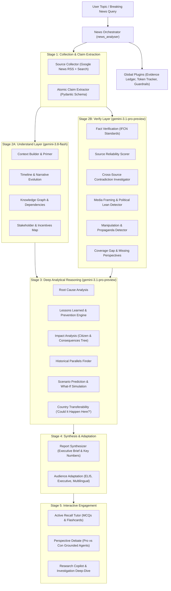

# Agentic News Analyser (ADK Web)

> **Google Cloud AI Builder Cup 2026 Submission**  
> **Theme**: Media, Content & Digital Experiences  
> **Runtime**: Google Agent Development Kit (ADK 2.0+ Python) & Google Gemini (`gemini-3.8-flash` & `gemini-3.1-pro-preview`)

---

## 1. Overview

The **Agentic News Analyser** is an autonomous multi-agent intelligence platform that transforms raw breaking news reporting into deeply audited, multi-dimensional intelligence briefs. It eliminates echo chambers, media bias blindspots, and misinformation by deploying a layered fleet of **25 specialized AI agents** coordinated through the Google Agent Development Kit (ADK).

Every claim is forensically audited under the International Fact-Checking Network (IFCN) principles, cross-referenced across competing publications, and immutably recorded in a transparent **Evidence Ledger**.

---

## 2. Multi-Agent Roster (6 Layers)



### Full Agent Fleet Inventory:
1. **Core & Platform Agents**:
   - `news_analyser`: Master Orchestrator coordinating all 23 specialist sub-agents.
   - `source_collector`: Multi-spectrum news collection across global & regional outlets.
   - `claim_extractor`: Decomposes articles into atomic verifiable factual propositions.
   - `evidence_ledger`: Cross-cutting audit service tracking tool provenance and citations.
   - `research_copilot`: Follow-up interactive Q&A and autonomous investigation mode.
2. **Understand Layer**:
   - `context_builder`: Who/Where/What plain-language primers and jargon glossaries.
   - `timeline_agent`: Chronological reconstruction and narrative evolution tracking.
   - `knowledge_graph_agent`: Entity relationship networks and event dependencies.
   - `stakeholder_map_agent`: Actor positions, underlying incentives, and net winners/losers.
3. **Verify Layer**:
   - `fact_verifier`: Evidentiary auditing using IFCN code of principles & confidence scores.
   - `source_reliability_agent`: Institutional scoring of media outlets and sourcing rigor.
   - `contradiction_analyst`: Side-by-side detection of conflicting numbers, dates, and causes.
   - `bias_analyst`: Nonpartisan political lean rating (5-point spectrum) and framing analysis.
   - `manipulation_detector`: Clickbait, sensationalism, and cognitive bias trigger detection.
   - `coverage_gap_agent`: Uncovers omitted perspectives and unanswered questions.
4. **Analyse & Learn Layer**:
   - `root_cause_agent`: Immediate triggers, contributing factors, and structural failure points.
   - `lessons_prevention_agent`: Actionable resilience measures for individuals, companies, and policymakers.
   - `impact_analyzer`: Macro economic effects, citizen impact ("what it means for me"), and 3-tier consequence cascades.
   - `historical_parallels_agent`: Compares contemporary developments against past historical analogues.
   - `scenario_prediction`: Plausible Best/Likely/Worst future forecasting with What-If assumptions.
   - `country_transferability_agent`: Cross-jurisdiction evaluation of whether foreign crises could occur locally.
5. **Synthesis & Adaptation**:
   - `report_synthesizer`: Assembles structured executive briefs and consensus matrices.
   - `audience_adaptation_agent`: Rewrites for diverse reading levels (ELI5, Teenager, Academic, Executive) and translates into multiple languages.
6. **Engage Layer**:
   - `tutor_agent`: Active recall comprehension quizzes (3 MCQs with explanations) and concept flashcards.
   - `perspective_debate`: Structured debate between strongest pro-and-con viewpoints with neutral synthesis.

---

## 3. Best Practices Compliance (`best-agents-architecture-guide.md`)

- **5-Pattern Professional Instruction Standard**: Every agent prompt strictly conforms to `# IDENTITY`, `# MISSION`, `# METHODOLOGY`, `# BOUNDARIES`, and `# OUTPUT SPECIFICATION`.
- **Strict Structured Outputs**: Pydantic v2 `BaseModel` schemas for all 25 agent roles in `shared/schemas.py`.
- **Strategic Model Selection**: High-throughput agents run on `gemini-3.8-flash`; deep multi-source reasoning runs on `gemini-3.1-pro-preview`.
- **Progressive Disclosure Skills**: Integrates `SkillToolset` loading specialized heuristic manuals (`fact-verification-heuristics`, `media-framing-heuristics`).
- **Telemetry & Guardrail Plugins**:
  - `EvidenceLedgerPlugin`: Logs tool provenance and links every assertion to source articles.
  - `TokenTrackerPlugin`: Monitors execution latency, agent calls, and model tokens.
  - `NewsGuardrailPlugin`: Screens malicious prompt injections and enforces editorial standards.
- **Live Retrieval**: Real-time Google News RSS and DuckDuckGo search with clean HTML scraping via `httpx` and `BeautifulSoup` (with dynamic adaptive fallback for offline testing).

---

## 4. Quickstart & Execution

### 1. Configure Environment
```bash
# In adk-web-news/.env
GEMINI_API_KEY=your_gemini_api_key_here
```

### 2. Run with ADK Web UI
From the project root:
```bash
adk web adk-web-news
```
The browser interface will discover and display all standalone agents in the dropdown:
- `news_analyser` (Master Multi-Agent Orchestrator)
- `fact_verifier` (Dedicated Fact Verification & Claim Audit)
- `tutor_agent` (Active Recall & News Literacy Tutor)
- `research_copilot` (Investigation Copilot)
- `perspective_debate` (Grounded Pro vs Con Debate)
- `timeline_agent` (Chronological & Narrative Evolution)
- `scenario_prediction` (Forward Scenarios & What-If Simulation)

### 3. Run with CLI Runner
```bash
# Run Master News Intelligence Brief on any live topic
python run_cli.py "U.S. Administration Halting PERM Program for Tech Companies H-1B"

# Run Dedicated Fact-Checker
python run_cli.py --agent fact_verifier "Trump administration freezes green cards for tech firms"

# Run Interactive Active Recall Tutor
python run_cli.py --agent tutor_agent "NASA Artemis Moon Mission"

# Run Perspective Debate Simulator
python run_cli.py --agent perspective_debate "Global Clean Energy Subsidies"
```

### 4. Run Automated Test Suite
```bash
python -m unittest discover tests
```
Runs 20 automated tests validating schema constraints, live tool parsing, plugin telemetry, and ADK Web discovery.
