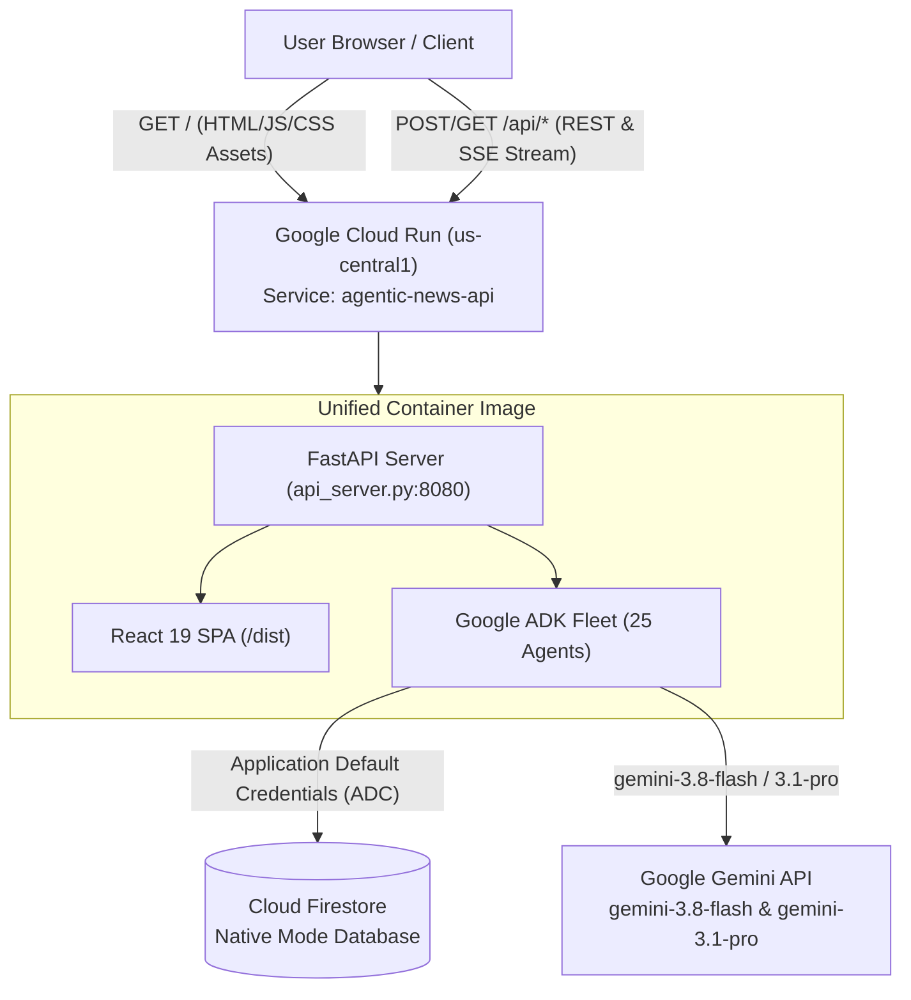

# Production Deployment & Operations Guide
> **Agentic News Analyser • Google Cloud AI Builder Cup 2026**

This document serves as the permanent reference manual and operations guide for deploying and maintaining **Agentic News Analyser** on **Google Cloud Run**, **Cloud Firestore**, and **Firebase**.

---

## 📌 1. Live Deployment Details

| Component | Target Platform | Details & URLs |
| :--- | :--- | :--- |
| **GCP Project** | Google Cloud | `project-4124e964-bf18-4c2d-936` (Number: `851051382437`) |
| **Web Dashboard** | React 19 + DaisyUI | **[https://agentic-news-api-851051382437.us-central1.run.app/](https://agentic-news-api-851051382437.us-central1.run.app/)** |
| **Backend API** | FastAPI + 25 ADK Agents | **[https://agentic-news-api-851051382437.us-central1.run.app/api/health](https://agentic-news-api-851051382437.us-central1.run.app/api/health)** |
| **Firestore Database** | Cloud Firestore Native | Region: `us-central1` • Database: `(default)` |
| **Models In Use** | Google Gemini API | `gemini-3.8-flash` (Fast Agents) & `gemini-3.1-pro-preview` (Reasoning) |

---

## 🚀 2. Deploying Updated Versions (Automated One-Click)

Whenever you update code in `frontend/`, `backend/`, or `firebase/`, use the automated deployment scripts:

### Windows:
Run from PowerShell or Command Prompt at the project root:
```cmd
deploy.bat
```
*Optional parameters:*
```cmd
deploy.bat <PROJECT_ID> <GEMINI_API_KEY>
```

### Linux / macOS:
Make executable and run from terminal:
```bash
chmod +x deploy.sh
./deploy.sh
```
*Optional parameters:*
```bash
./deploy.sh <PROJECT_ID> <GEMINI_API_KEY>
```

### What the Script Automates:
1. Compiles the React 19 frontend (`npm run build`).
2. Syncs the production bundle into `backend/dist/` for unified static serving.
3. Automatically publishes updated Firestore security rules using `firebase/deploy_rules.py`.
4. Rebuilds and deploys the container to Cloud Run with zero downtime traffic migration.
5. Prints the live health endpoint and web URL.

---

## 🏛️ 3. Architecture Topology



### Key Advantages:
- **Zero CORS**: Because the React frontend and the FastAPI backend are hosted together on the same origin, CORS issues are completely eliminated.
- **Serverless Scaling**: Autoscales between 0 and 10 instances based on traffic demand, keeping costs minimal while handling burst analysis tasks.
- **No Manual Service Account Keys**: Authenticates to Cloud Firestore via GCP Application Default Credentials (ADC).

---

## 🛠️ 4. Manual Step-by-Step Deployment Walkthrough

If you need to deploy components individually or debug a specific layer, follow these commands:

### Step 4.1: Rebuild Frontend
```bash
cd frontend
npm run build
cd ..

# Copy dist to backend
# Windows:
robocopy frontend\dist backend\dist /E /PURGE
# Linux/macOS:
cp -r frontend/dist/* backend/dist/
```

### Step 4.2: Deploy Firestore Security Rules
```bash
python firebase/deploy_rules.py project-4124e964-bf18-4c2d-936
```
*(Uses the Google Cloud Rules API directly, avoiding the need for browser-based OAuth).*

### Step 4.3: Deploy Cloud Run Backend
```bash
cd backend

gcloud run deploy agentic-news-api \
  --source . \
  --region us-central1 \
  --project project-4124e964-bf18-4c2d-936 \
  --platform managed \
  --allow-unauthenticated \
  --set-env-vars "FIREBASE_PROJECT_ID=project-4124e964-bf18-4c2d-936,GEMINI_API_KEY=<YOUR_KEY>,ADK_LOG_LEVEL=INFO" \
  --timeout 300 \
  --memory 2Gi \
  --cpu 2 \
  --min-instances 0 \
  --max-instances 10
```

---

## 🌐 5. (Optional) Adding Firebase Hosting CDN

If you want custom domain routing or global CDN caching via Firebase Hosting (`https://<project-id>.web.app`):

1. Go to the [Firebase Console](https://console.firebase.google.com/).
2. Click **Add Project** and select `project-4124e964-bf18-4c2d-936`.
3. In your terminal, authenticate the Firebase CLI:
   ```bash
   npx firebase-tools login
   ```
4. Deploy the hosting configuration:
   ```bash
   cd firebase
   npx firebase-tools deploy --only hosting
   ```
   Firebase Hosting will use the existing [`firebase.json`](file:///C:/tools/github/agentic-news/firebase/firebase.json) rewrite rule to proxy `/api/**` to Cloud Run.

---

## 📋 6. IAM Roles & Permissions Reference

The following IAM bindings are active on project `project-4124e964-bf18-4c2d-936`:

| Identity | Role | Purpose |
| :--- | :--- | :--- |
| `851051382437-compute@developer.gserviceaccount.com` | `roles/datastore.user` | Cloud Run access to Cloud Firestore collections |
| `851051382437-compute@developer.gserviceaccount.com` | `roles/storage.admin` | Cloud Build access to upload source packages |
| `851051382437@cloudbuild.gserviceaccount.com` | `roles/storage.admin` | Cloud Build container builder access |
| `851051382437-compute@developer.gserviceaccount.com` | `roles/artifactregistry.writer` | Storing container images in Artifact Registry |
| `gowtham.varma.buddy@gmail.com` | `roles/owner`, `roles/firebase.admin` | Project Administrator |

---

## 🔍 7. Troubleshooting & Operations Runbook

### Issue: Container fails to start (`PORT=8080 timeout`)
- **Cause**: Missing Python dependencies during container runtime or syntax error in imported agents.
- **Diagnostics**:
  ```bash
  gcloud logging read "resource.type=cloud_run_revision AND resource.labels.service_name=agentic-news-api" --limit=25 --format="value(textPayload)"
  ```
- **Fix**: Verify all third-party libraries (`beautifulsoup4`, `httpx`, `google-cloud-firestore`) are listed in `backend/requirements.txt`.

### Issue: Firestore `PermissionDenied` error
- **Cause**: Cloud Run service account lacks `roles/datastore.user` or Firestore rules reject document schema.
- **Fix**: Re-grant role:
  ```bash
  gcloud projects add-iam-policy-binding project-4124e964-bf18-4c2d-936 \
    --member="serviceAccount:851051382437-compute@developer.gserviceaccount.com" \
    --role="roles/datastore.user"
  ```

### Issue: Rolling back to a previous revision
Cloud Run automatically preserves revision history:
1. List revisions:
   ```bash
   gcloud run revisions list --service=agentic-news-api --region=us-central1
   ```
2. Roll traffic back immediately:
   ```bash
   gcloud run services update-traffic agentic-news-api --region=us-central1 --to-revisions=<REVISION_NAME>=100
   ```
