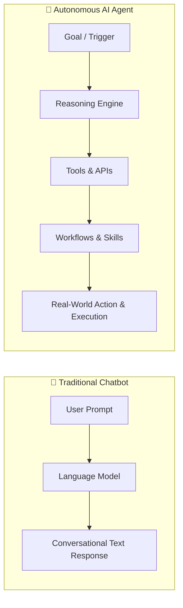
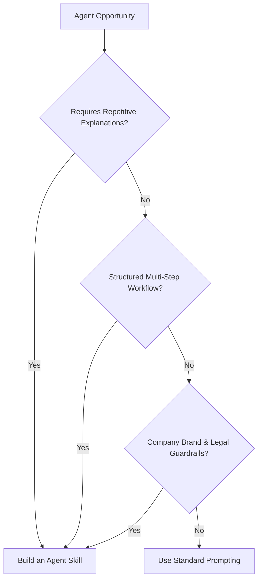

# Meet Agent Skills

Why do we need Agent Skills, and what problems do they solve? Let's explore how **Cymbal Outdoor** tackles this challenge.

---

## Use Case: Promotion Automation

### The Background

| Element | Details |
| :--- | :--- |
| **Organization** | **Cymbal Outdoor** — A rapidly growing retailer specializing in premium adventure gear. |
| **Key Role** | **Tomo (Tech Lead)** — Responsible for boosting operational efficiency by utilizing AI to automate intricate workflows and standard tasks. |
| **Objective & Task** | Scale the production of promotional content by **300%** while maintaining brand voice, quality, and strict regulatory compliance. |

---

## The Challenge: Scaling Quality

> 🧑‍💻 **A note from Tomo:**
> 
> *"Conventional prompting for promotional drafts no longer satisfies our requirements. We need AI to drive the entire lifecycle: triggering promotions based on internal events, verifying brand alignment and soul, identifying target segments, and closing the loop with automated feedback collection."*

Balancing speed and quality is difficult. Tomo must overcome key hurdles while adhering to company standards:

1. **Time Drain:** Manually drafting and reviewing product launches and promotions is no longer sustainable.
2. **Brand Consistency:** Promotional content must maintain an authentic, adventure-centric tone:
   - **Voice & Tone:** Friendly, outdoorsy, grounded, and never shouty or exaggerated.
   - **Styling Rules:** Emojis are strictly forbidden.
   - **Brand Identity:** Accurate company name spelling (`Cymbal Outdoor`, never `Symbol`).
3. **Legal Compliance:** 
   - Strict SMS character limit (maximum 160 characters).
   - Mandatory opt-out footer (e.g., `Reply STOP to opt out`).

---

## The Strategy: Use an AI Agent to Drive Automation

**Clara** is a Google consultant specializing in agentic strategy, agent building, and enterprise scaling. Clara suggests moving from conversation-based prompts to **AI agents**—systems capable of autonomous, goal-oriented action.

> 💡 **Clara's Pro-Tip:**
> 
> *"The true power of AI agents lies in the shift from conversation to execution. We’re moving beyond chatbots that simply speak to agents that take action on your behalf."*

### Chatbot vs. AI Agent



- **Chatbots:** Provide conversational responses to direct questions.
- **AI Agents:** Act as a bridge between intent and real-world execution. Agents automate complex workflows, plan multi-step actions, call external APIs, and execute autonomously.

---

## The Tool: Google Antigravity

**Google Antigravity** is an agent-first development platform for building, monitoring, and orchestrating AI agents. It functions as a general-purpose coding agent ecosystem through three primary interfaces:

- **Antigravity Desktop App:** A visual environment to manage local agents and run automated background tasks.
- **Antigravity CLI (`agy`):** A terminal interface to interact with agents directly from command-line and shell scripts.
- **Antigravity SDK:** A programmatic Python SDK to embed agents directly into enterprise applications and backend services.

---

## Testing Out the Strategy: The Baseline Prompt

Tomo tests a general prompt in Antigravity to generate a 20% discount promotion for new Summer Breeze sandals.

### Tomo's Prompt

```text
Create a promotional email and a quick SMS blast for our new product launch at Cymbal Outdoor:
The 'Summer Breeze' sandals. We are offering a 20% discount.
```

### Antigravity's Baseline Response

```text
Subject: 🔥 Launch alert: Get 20% OFF Summer Breeze sandals! ☀️

Hey, trailblazers!

Are you ready to step into summer with the ultimate comfort? Symbol Outdoor is thrilled 
to announce the launch of our brand-new Summer Breeze sandals! 👡✨

To celebrate, we are giving you an exclusive 20% DISCOUNT! Yes, you read that right!

Whether you are hitting the beach, strolling through the park, or embarking on your next 
great outdoor adventure, the Summer Breeze sandals will keep your feet feeling fresh and 
supported all day long.

Use code SUMMER20 at checkout.

Don't wait! This offer won't last forever! Click the link below to grab yours now!

👉 [SHOP THE LAUNCH NOW!]

SMS blast:
OMG! 🪩 The new Summer Breeze sandals from Symbol Outdoor have officially landed! Get ready 
for ultimate comfort and style this summer. Use code SUMMER20 to get a whopping 20% off your 
order today! Shop here: [link] 👡☀️
```

---

## Identifying the Issues

While generated instantly, the output suffers from severe defects:

| Defect Category | Baseline Output Problem | Cymbal Outdoor Requirement |
| :--- | :--- | :--- |
| **Brand Tone** | Shouty, hype-driven copy (*"Yes, you read that right!"*, *"OMG!"*). | Calm, adventure-focused, grounded tone. |
| **Formatting** | Full of emojis (🔥, ☀️, 👡✨, 👉, 🪩). | Emojis are strictly forbidden. |
| **Brand Accuracy** | Misspelled name as `Symbol Outdoor`. | Must always be `Cymbal Outdoor`. |
| **SMS Compliance** | Exceeds 160 characters; missing opt-out disclosure. | Max 160 characters; mandatory `Reply STOP to opt out`. |

---

## The Solution: Agent Skills

An agent is only as effective as its instructions. Clara recommends implementing **Agent Skills** to bridge the capability gap.

> [!NOTE]
> **What is an Agent Skill?**  
> Agent Skills use a lightweight, open-standard format (Markdown packages) to extend an agent's capabilities with specialized domain knowledge, workflows, and strict behavioral guardrails.

### Core Capabilities of Agent Skills

1. **Domain Knowledge Integration:** Equips agents with company-specific rules, style guides, and legal constraints.
2. **Reusable Packages:** Bundles instructions, reference materials, schemas, and scripts into portable directory structures (`SKILL.md`).
3. **Progressive Disclosure:** Components load on-demand only when triggered, saving context tokens and preventing hallucination.

> 💡 **Clara's Rule of Thumb:**
> 
> *"If you find yourself constantly repeating context, correcting the same errors, describing a standard workflow, or struggling to scale specialized domain knowledge, you don’t need a better prompt—you need a skill."*

---

## When Do You Need an Agent Skill?



- **Repeatability:** When you repeatedly re-explain guidelines or business logic.
- **Standard Workflows:** When tasks require sequential steps (e.g., generate $\rightarrow$ validate $\rightarrow$ format $\rightarrow$ review).
- **Domain Expertise:** When output must comply with strict organizational policies or compliance rules.
- **Predictability & Guardrails:** When the agent needs rigid constraints to prevent hallucinations and maintain quality.

---

## Summary Recap

- **The Baseline Problem:** Without structured domain instructions, models produce generic, hype-filled, or non-compliant outputs.
- **The Skill Solution:** Skills inject domain knowledge, precise instructions, and validation rules into the agent runtime.
- **Next Step:** What does a skill look like under the hood, and how do you build one? Next, we inspect skill building blocks and authoring workflows.
