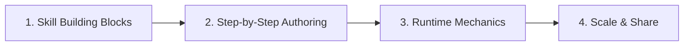

# Build Custom Skills

Previously, you explored why unguided AI agents act like overwhelmed new hires without domain context. Now, let's give your agent the ultimate onboarding. 

By the end of this module, you will be able to build a complete custom skill from end to end using tools like **Google Antigravity**.

---

## Module Overview

This module covers the architecture, authoring process, runtime mechanics, and enterprise lifecycle of custom agent skills:

---

## Lessons in This Module

| Lesson | Focus | Key Topics |
| :--- | :--- | :--- |
| [**1. Skill Building Blocks**](file:///c:/tools/github/agentic-news/docs/agents/skills/04_skill_building_blocks.md) | Architectural Anatomy | • Standard directory layout • The 3-tier architectural framework • Required vs. optional skill components |
| [**2. Step-by-Step Skill Building**](file:///c:/tools/github/agentic-news/docs/agents/skills/05_step_by_step_skill_building.md) | Hands-on Authoring | • Crafting `SKILL.md` (YAML frontmatter + body instructions) • Adding reference templates and style guides • Integrating executable scripts and automation |
| [**3. Skill Runtime Mechanics**](file:///c:/tools/github/agentic-news/docs/agents/skills/06_skill_runtime_mechanics.md) | Execution & Efficiency | • Progressive disclosure mechanics • Intent detection and keyword triggering • Context window optimization and token savings |
| [**4. Scale and Share**](file:///c:/tools/github/agentic-news/docs/agents/skills/07_scale_and_share.md) | Enterprise Lifecycle | • The 5 phases of the skill lifecycle • Google's centralized Skill Registry • Versioning, distribution, and governance |

---

> [!TIP]
> **Next Step:** Let's begin with the foundational structure: [Skill Building Blocks](file:///c:/tools/github/agentic-news/docs/agents/skills/04_skill_building_blocks.md).
