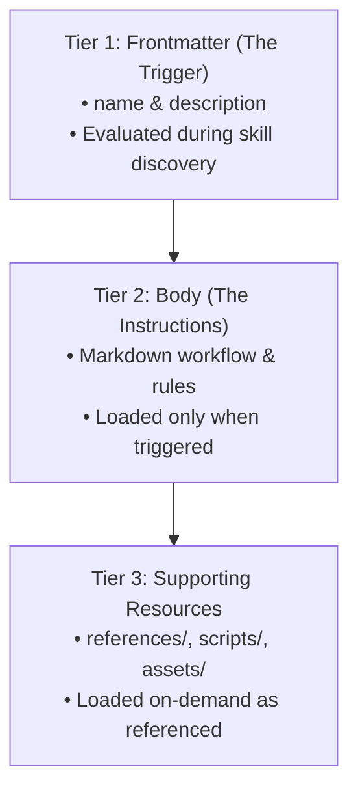

# Skill Building Blocks

Now that you know why unguided agents act like overwhelmed new hires, it is time to give your digital coworker its daily handbook.

---

## What Are Agent Skills?

Agent Skills turn raw model capabilities into reliable, repeatable enterprise outcomes through three core principles:

1. **Lightweight Folder:** At its core, a skill is a directory built around a single markdown specification file (`SKILL.md`). It packages instructions, documentation, and executable scripts.
2. **Modular Digital Handbook:** Instead of forcing an agent to process an exhaustive 100-page operational manual on every turn, skills provide modular, bite-sized recipes focused on executing one specific task exceptionally well.
3. **Open, Standardized Format:** By adhering to an open, standardized folder structure, skills are fully portable across the AI agent ecosystem, making domain expertise interoperable and future-proof.

### Skill Directory Layout

```text
my-skill/
├── SKILL.md        # Required: YAML metadata frontmatter + body instructions
├── references/     # Optional: guides, tone documents, schemas, style templates
├── scripts/        # Optional: deterministic validation or automation code
└── assets/         # Optional: visual resources, examples, or test fixtures
```

---

## The Three-Tier Anatomy of Agent Skills

Skills consist of three distinct tiers. While an AI coding assistant can scaffold these for you, understanding their internal structure enables you to debug, modify, and govern agent behavior effectively.



---

## Tier 1: The Frontmatter (The Trigger)

Located at the very top of `SKILL.md` delimited by triple-dashes (`---`), the frontmatter defines metadata used by the agent runtime during intent discovery.

> [!IMPORTANT]
> **Discovery Mechanism:**  
> The frontmatter is the **only part** the agent reads when deciding whether to activate your skill. If the description is vague or missing key triggers, the agent will fail to invoke the skill.

### 1. The `name` Field

The `name` field serves as the unique identifier for the skill.

```yaml
---
name: promo-writer
---
```

#### Formatting Rules for `name`
- **Kebab-case:** Use only lowercase letters, digits, and hyphens (`-`). Never use spaces, uppercase characters, or underscores (e.g., `promo-writer`, `data-analyzer-v2`).
- **Directory Consistency:** The name must **exactly match** the enclosing directory name (`promo-writer/` $\rightarrow$ `name: promo-writer`).
- **Concise & Distinct:** Keep the identifier short, descriptive, and focused on the job (typically 1–3 words).

### 2. The `description` Field

The description is the most critical piece of metadata because the model relies entirely on it for semantic matching and keyword triggering.

```yaml
---
name: promo-writer
description: >-
  Drafts structured promotional emails and SMS campaigns for retail marketing.
  Use when asked to write marketing promotions, product launch announcements,
  seasonal sales copy, or discount blasts for Cymbal Outdoor.
---
```

#### Best Practices for `description`
- **Structure Formula:** `[Action it performs] + Use when [Specific trigger conditions and keywords]`.
- **Third-Person Voice:** Write objectively in the third person (`"Drafts promotional emails..."`) rather than commanding the model (`"You must draft..."`).
- **Trigger Keyword Richness:** Include natural user phrasing, synonyms, domain terminology, and task variations (e.g., *promotion*, *discount*, *SMS blast*, *launch*).
- **Multi-Line Folded Strings:** For detailed descriptions with rich trigger sets, use YAML folded syntax (`>-`) for clean line wrapping.

> 💡 **Clara's Pro-Tip:**
> 
> *"Keywords within the description are the ultimate trigger. The agent relies entirely on this text to match user intent and decide whether to activate the skill, so choose your words carefully to ensure proper activation."*

---

## Tier 2: The Body (The Instructions)

The body contains the step-by-step operational instructions executed once the skill is activated. It begins immediately beneath the closing frontmatter delimiter (`---`).

### Instruction Authoring Best Practices

- **Concise & Focused:** Keep the body under 500 lines. Offload large reference templates, schemas, and brand guides into the `references/` directory.
- **Sequential Execution:** Use ordered steps (`1.`, `2.`, `3.`) to establish an explicit chronological workflow.
- **Strict Boundary Setting:** Define anti-patterns and non-negotiable constraints (e.g., *"SMS drafts must NEVER exceed 160 characters. Do NOT use emojis."*).
- **Relative Linking:** Reference external documents via portable relative links (`[Brand Voice](file://references/brand-voice.md)`).
- **Deterministic Script Invocations:** Instruct the agent to run validation scripts via command-line tools and interpret the exit codes.

### Example: `SKILL.md` Body

```markdown
# Brand Promo Copywriter Skill

Follow these steps sequentially to generate brand-compliant promotional copy.

## Workflow

1. **Read References:** You MUST read [Brand Voice](file://references/brand-voice.md) and [Email Template](file://references/email-template.txt) before drafting.
2. **Draft Content:** Write one promotional email and one SMS based on the user's campaign goals.
3. **Validate:** Save your draft to `draft.txt` and run the compliance checker:
   ```bash
   python3 scripts/check-compliance.py draft.txt
   ```
4. **Refine:** If the script exits with an error, read the feedback message, correct the draft, and re-run until it passes.
```

> 💡 **Clara's Pro-Tip:**
> 
> *"The agent only loads and reads these detailed rules after Tier 1 triggers the skill, keeping its memory fast and uncluttered. This is called progressive disclosure."*

---

## Tier 3: Supporting Resources (Optional Extras)

For simple prompts, `SKILL.md` is sufficient. For advanced enterprise workflows, bundle supporting files into dedicated subdirectories.

```text
promo-writer/
├── SKILL.md
├── references/
│   ├── brand-voice.md
│   └── email-template.txt
└── scripts/
    └── check-compliance.py
```

### 1. References (`references/`)
Plain text documents (`.md`, `.txt`, `.json`) that supply supplementary guidelines, schemas, and templates:
- **Topic Separation:** Keep files granular (e.g., `brand-voice.md` for tone, `email-template.txt` for layout) rather than consolidating into one oversized document.
- **Portability:** Always link using relative paths so the skill operates consistently across development, testing, and production environments.

### 2. Scripts (`scripts/`)
Executable scripts (typically Python or Bash) that perform deterministic operations, schema validation, linting, or calculations:
- **Standard Exit Codes:** Return exit code `0` for success (`PASS`) and non-zero (e.g., `1`) for failure (`FAIL`). The agent uses exit codes to confirm task completion.
- **Actionable Diagnostic Output:** Print clear, descriptive error messages to standard output so the agent understands precisely how to self-correct.
- **Zero-Dependency Footprint:** Keep scripts self-contained using standard library modules where possible.

#### Example Compliance Script (`scripts/check-compliance.py`)

```python
#!/usr/bin/env python3
import sys
import re

def validate_draft(filepath: str) -> None:
    try:
        with open(filepath, "r", encoding="utf-8") as f:
            content = f.read()
    except Exception as e:
        print(f"ERROR: Unable to read file {filepath}: {e}")
        sys.exit(1)

    # 1. Check forbidden emojis
    emoji_pattern = re.compile(r"[\U00010000-\U0010ffff]")
    if emoji_pattern.search(content):
        print("FAIL: Emojis are strictly forbidden by Cymbal Outdoor brand guidelines.")
        sys.exit(1)

    # 2. Check SMS length and opt-out compliance
    if "SMS:" in content:
        sms_body = content.split("SMS:")[1].strip()
        if len(sms_body) > 160:
            print(f"FAIL: SMS is {len(sms_body)} characters. The maximum allowed is 160.")
            sys.exit(1)
        if "STOP" not in sms_body:
            print("FAIL: Mandatory opt-out keyword 'STOP' is missing from the SMS draft.")
            sys.exit(1)

    print("PASS: Draft complies with all Cymbal Outdoor guidelines.")
    sys.exit(0)

if __name__ == "__main__":
    if len(sys.argv) < 2:
        print("Usage: python3 scripts/check-compliance.py <draft-file>")
        sys.exit(1)
    validate_draft(sys.argv[1])
```

---

## Summary & Review

| Tier | Component | File / Location | Primary Role |
| :--- | :--- | :--- | :--- |
| **Tier 1** | **Frontmatter** | `SKILL.md` (YAML header) | Trigger discovery via `name` and keyword-rich `description`. |
| **Tier 2** | **Body** | `SKILL.md` (Markdown body) | Sequential instructions, rules, constraints, and execution workflow. |
| **Tier 3** | **Resources** | `references/`, `scripts/`, `assets/` | Externalized knowledge guides, templates, and validation scripts. |

> 🧑‍💻 **Tomo:** *"This makes total sense! I'm ready to roll up my sleeves and build my first custom skill."*  
> 💡 **Clara:** *"That's the spirit! In the next lesson, we'll build Cymbal Outdoor's promo-writer skill step by step."*
