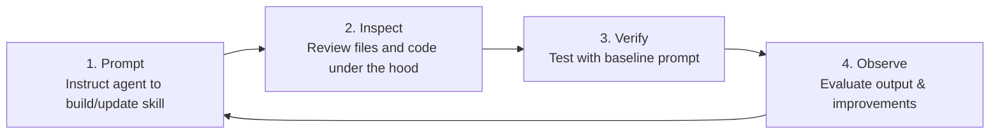
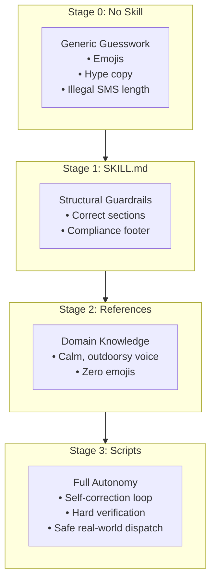

# Demo: Step-by-Step Skill Building

In the previous lesson, you uncovered the anatomy of a skill across its three tiers: Frontmatter (triggers), Body (instructions), and Resources (references and scripts). Now, it's time to build a custom skill from scratch.

This hands-on walkthrough follows Cymbal Outdoor's promotion automation use case across three progressive stages:
1. **Stage 1: `SKILL.md` Only** — Enforcing structural rules and guardrails.
2. **Stage 2: Adding References** — Infusing brand voice, styling, and email layouts.
3. **Stage 3: Adding Scripts** — Implementing deterministic validation and automated campaign dispatch.

---

## The Four-Part Development Loop

At each stage, we follow this iterative evaluation loop:



---

## Baseline Setup & The Control Prompt

Before adding any skills, establish a baseline using an unguided prompt in Google Antigravity.

### The Baseline Prompt

```text
Create a promotional email and a quick SMS blast for our new product launch at Cymbal Outdoor:
The 'Summer Breeze' sandals. We are offering a 20% discount.
```

### Baseline Output Analysis
- **Email Draft:** Generic sales copy with exclamation marks, aggressive urgency, and emojis.
- **SMS Draft:** Exceeds the 160-character limit, uses emojis, and lacks the mandatory `Reply STOP to opt out` compliance footer.
- **Root Cause:** Without a skill, the model relies on generic web data rather than enterprise brand standards and legal rules.

---

## Step 1: `SKILL.md` Only (Structural Guardrails)

We begin by establishing basic formatting rules and legal guardrails.

### 1. Prompt (Scaffold the Skill)

```text
Create a new skill folder named promo-writer. Inside it, create a SKILL.md file with rules stating 
that promotional messages must include both an Email and an SMS. The Email must have a subject line, 
the SMS must be under 160 characters, and both must end with 'Reply STOP to opt out.' Ensure it has 
valid YAML frontmatter.
```

### 2. Inspect (Generated Structure)

```text
promo-writer/
└── SKILL.md
```

#### `promo-writer/SKILL.md`

```markdown
---
name: promo-writer
description: Generates structured promotional copy for emails and SMS campaigns. Use when asked to write retail marketing messages.
---

# Brand Promo Copywriter Skill

When asked to generate promotional messages, you strictly adhere to the following formatting rules:

## Structure Rules

1. **Format:** You must generate both an **Email** and a **short SMS**.
2. **Email:** Must include a clear, engaging Subject Line.
3. **SMS:** Must be concise and strictly under 160 characters.
4. **Compliance:** Both the Email and SMS must end with the exact footer: `"Reply STOP to opt out."`
```

### 3. Verify

Re-run the exact baseline retail prompt:

```text
Create a promotional email and a quick SMS blast for our new product launch at Cymbal Outdoor:
The 'Summer Breeze' sandals. We are offering a 20% discount.
```

#### Output with `SKILL.md`

```text
Email:
Subject: Don't miss out: 20% OFF the new Summer Breeze sandals! ☀️

Hey trailblazers, summer is finally here, and Symbol Outdoor has just dropped the hottest footwear 
of the season! Step into ultimate comfort and awesome style with our brand-new Summer Breeze sandals. 
To celebrate this exciting launch, we're offering an exclusive 20% discount on your order! Whether 
you're heading to the beach or walking around town, these sandals are designed to keep your feet 
feeling great all day long.

Use promo code SUMMER20 at checkout to claim your savings! Hurry, get yours before they sell out!

[Shop Summer Breeze Sandals Now]

Reply STOP to opt out.

SMS:
Launch alert! ☀️ Get 20% OFF Symbol Outdoor's new Summer Breeze sandals. Ultimate summer comfort awaits! 
Use code SUMMER20 at checkout: [link] Reply STOP to opt out.
```

### 4. Observe

| Dimension | Result | Status |
| :--- | :--- | :--- |
| **SMS Length** | 158 characters (under the 160 limit) | ✅ Pass |
| **Legal Compliance** | Mandatory `Reply STOP to opt out.` present on both drafts | ✅ Pass |
| **Brand Tone** | Excessive hype, exclamation points, and emojis | ❌ Remaining Issue |
| **Brand Name** | Misspelled as `Symbol Outdoor` | ❌ Remaining Issue |

> 💡 **Clara's Pro-Tip:**  
> *"Think of a basic SKILL.md as a structural guardrail. Once in place, it reliably enforces formatting rules and compliance footers without needing to repeat them in prompts."*

---

## Step 2: References (Brand Voice & Templates)

Now enrich the skill by moving brand voice standards and layout guidelines into dedicated reference files.

### 1. Prompt (Add References)

```text
In the promo-writer skill folder, create a references/ subdirectory. Inside it, create two files:
1) brand-voice.md stating the tone is friendly, outdoorsy, never shouty, and strictly forbids emojis.
2) email-template.txt containing a standard layout (subject, greeting, hook, offer, link, footer).
Finally, update SKILL.md to instruct the agent to read these references before generating copy.
```

### 2. Inspect (Updated Structure)

```text
promo-writer/
├── SKILL.md
└── references/
    ├── brand-voice.md
    └── email-template.txt
```

#### `promo-writer/references/brand-voice.md`

```markdown
# Cymbal Outdoor – Brand Voice Guide

- **Tone:** Friendly, helpful, and outdoorsy. Speak like an experienced trail guide.
- **Formatting:** Use bold text for product names and promo codes.
- **Strict Antipatterns:**
  - Do NOT use uppercase shouting ("OMG", "BUY NOW!").
  - NEVER use emojis in email or SMS copy.
  - Always spell the brand name correctly as **Cymbal Outdoor**.
```

#### `promo-writer/references/email-template.txt`

```text
Subject: [Engaging, calm headline]

[Greeting: Hello trailblazer,]

[Hook: Warm intro connecting the outdoors with current season]

[Offer: Details of the discount or product announcement]

[Call to Action: Link to product page]

Reply STOP to opt out.
```

#### Updated `promo-writer/SKILL.md`

```markdown
---
name: promo-writer
description: Generates structured promotional copy for emails and SMS campaigns. Use when asked to write retail marketing messages.
---

# Brand Promo Copywriter Skill

## Workflow

1. **Read References:** You MUST read [Brand Voice](file://references/brand-voice.md) and [Email Template](file://references/email-template.txt) before generating any text.
2. **Draft Copy:** Generate an email and an SMS adhering strictly to the brand voice and layout guidelines.

## Structure Rules

- **SMS:** Must be concise and strictly under 160 characters.
- **Compliance:** Both messages must end with: `"Reply STOP to opt out."`
```

### 3. Verify

Re-run the baseline prompt.

#### Output with References

```text
Email:
Subject: Step into comfort: 20% off Summer Breeze sandals

Hello trailblazer,

Warm weather is calling, and dependable footwear makes all the difference on your journey. 
Cymbal Outdoor is proud to introduce our new Summer Breeze sandals.

To help you prepare for your next outing, we are offering a 20% discount on your purchase. 
Designed for supportive comfort, these sandals transition effortlessly from rugged trails to riverside walks.

Use code SUMMER20 at checkout to claim your offer.

[Shop Summer Breeze sandals]

Reply STOP to opt out.

SMS:
Prepare for warm weather! Get 20% off Cymbal Outdoor's new Summer Breeze sandals. 
Use code SUMMER20 at checkout: [link] Reply STOP to opt out.
```

### 4. Observe

| Dimension | Result | Status |
| :--- | :--- | :--- |
| **Brand Alignment** | Calm, outdoorsy tone; no shouty sales hype | ✅ Pass |
| **Emoji Restriction** | Zero emojis in subject line, body, or SMS | ✅ Pass |
| **Layout Structure** | Exactly follows `email-template.txt` | ✅ Pass |
| **Deterministic Counting** | LLMs cannot guarantee exact character counts every time | ⚠️ Limitation |
| **Automated Deployment** | Agent cannot verify exit codes or dispatch campaigns | ⚠️ Limitation |

---

## Step 3: Scripts (Validation & Execution Tools)

To solve LLM counting limitations and enable end-to-end automation, add executable Python scripts.

### 1. Prompt (Add Scripts)

```text
In the promo-writer/scripts/ folder, create two scripts:
1) check-compliance.py to validate SMS length (<160 characters) and the opt-out footer.
2) mock-dispatch.py to simulate broadcasting the campaign to our gateway.
Update SKILL.md to tell the agent: Save the draft, run check-compliance.py in a loop until it passes, 
and ONLY when compliance passes, execute mock-dispatch.py to broadcast the campaign.
```

### 2. Inspect (Complete Skill Structure)

```text
promo-writer/
├── SKILL.md
├── references/
│   ├── brand-voice.md
│   └── email-template.txt
└── scripts/
    ├── check-compliance.py
    └── mock-dispatch.py
```

#### `promo-writer/scripts/check-compliance.py`

```python
#!/usr/bin/env python3
import sys

# 1. Read the draft text file generated by the agent
with open(sys.argv[1], 'r', encoding='utf-8') as f:
    content = f.read()

errors = []

# Extract SMS section
sms_content = content
if "SMS:" in content:
    sms_content = content.split("SMS:")[1].strip()

# 2. Check SMS length constraint (<160 chars)
if len(sms_content) > 160:
    errors.append(f"FAIL: SMS is {len(sms_content)} characters. Must be strictly under 160.")

# 3. Check mandatory compliance footer
if "Reply STOP to opt out." not in sms_content:
    errors.append("FAIL: Missing mandatory footer: 'Reply STOP to opt out.'")

# 4. Return exit code to agent
if errors:
    for error in errors:
        print(error)
    sys.exit(1)  # Non-zero exit code: FAILED
else:
    print("PASS: Compliance check passed perfectly!")
    sys.exit(0)  # Exit code 0: PASSED
```

#### `promo-writer/scripts/mock-dispatch.py`

```python
#!/usr/bin/env python3
import sys

print("Connecting to Cymbal Outdoor Campaign Gateway...")
print("Dispatching SMS blast to 15,420 opted-in subscribers...")
print("Status: 200 OK | Carrier Queue: PROCESSED")
print("Broadcasting Email blast via SMTP Server...")
print("Status: DELIVERED (Campaign ID: #CYMB-2026-06)")
print("SUCCESS: Campaign broadcast completed without errors!")
sys.exit(0)
```

#### Final `promo-writer/SKILL.md`

```markdown
---
name: promo-writer
description: Generates structured promotional copy for emails and SMS campaigns. Use when asked to write retail marketing messages.
---

# Brand Promo Copywriter Skill

## Workflow

1. **Read References:** You MUST read [Brand Voice](file://references/brand-voice.md) and [Email Template](file://references/email-template.txt) before writing.
2. **Draft Copy:** Save your generated email and SMS to a temporary file named `draft.txt`.
3. **Validate & Iterate (CRITICAL):** Run the compliance script:
   ```bash
   python3 scripts/check-compliance.py draft.txt
   ```
   If the command returns a non-zero exit code, inspect the error output, modify `draft.txt`, and re-run until it passes.
4. **Broadcast Campaign:** ONLY when `check-compliance.py` returns exit code 0, execute the dispatch tool:
   ```bash
   python3 scripts/mock-dispatch.py draft.txt
   ```
5. **Final Response:** Present the passing copy and confirm to the user that the campaign has been broadcast successfully.

## Structure Rules

- **SMS:** Must be concise and strictly under 160 characters.
- **Compliance:** Both messages must end with: `"Reply STOP to opt out."`
```

### 3. Verify & Execution Trace

When the baseline prompt is submitted, the agent runs the autonomous loop:

```text
[Agent] Generating initial draft to draft.txt...
[Agent] Running tool: python3 scripts/check-compliance.py draft.txt
[Output] FAIL: SMS is 168 characters. Must be strictly under 160.

[Agent] Self-correcting draft... shortening SMS text...
[Agent] Running tool: python3 scripts/check-compliance.py draft.txt
[Output] PASS: Compliance check passed perfectly!

[Agent] Compliance verified! Triggering broadcast tool...
[Agent] Running tool: python3 scripts/mock-dispatch.py draft.txt
Connecting to Cymbal Outdoor Campaign Gateway...
Dispatching SMS blast to 15,420 opted-in subscribers...
Status: 200 OK | Carrier Queue: PROCESSED
Broadcasting Email blast via SMTP Server...
Status: DELIVERED (Campaign ID: #CYMB-2026-06)
SUCCESS: Campaign broadcast completed without errors!
```

---

## The Progression: Chatbot vs. Autonomous Agent



> 💡 **Clara's Pro-Tip:**  
> *"Pairing validation scripts with execution scripts creates a safe, autonomous loop. Let your agent audit its own work first, and once it passes, empower it to trigger real-world actions!"*

---

## Summary Recap

- **`SKILL.md` sets instructions:** Guides the agent step-by-step on what to do and rules to enforce.
- **`references/` provide domain knowledge:** Externalizes templates, brand guides, and policies on demand.
- **`scripts/` perform deterministic actions:** Runs executable code for character limits, compliance verification, and API dispatch.
