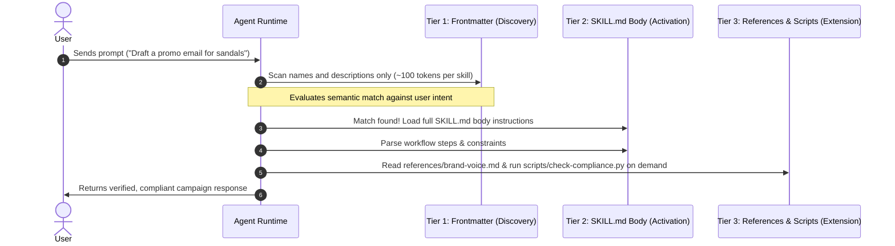
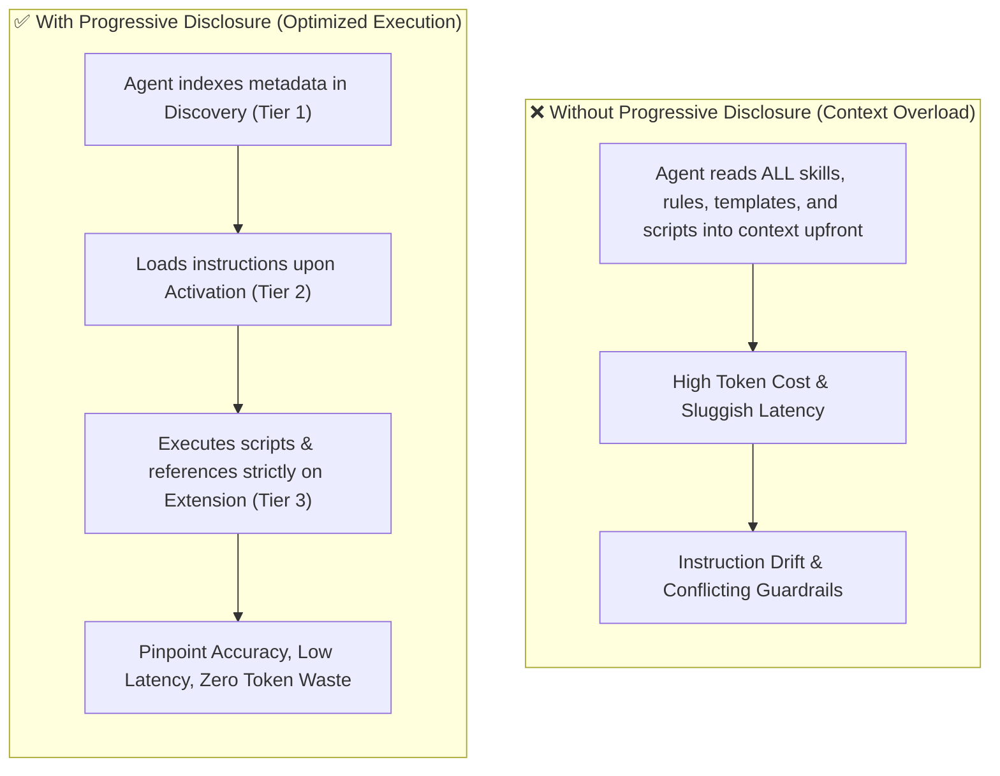

# Skill Runtime Mechanics

When an agent has dozens or hundreds of enterprise skills attached, how does it know which one to trigger without overflowing its context window?

This lesson explains the runtime mechanics governing skill execution:
- **Progressive Disclosure:** How agents load skills across three lightweight stages (Discovery, Activation, Extension).
- **Trigger Design:** The formula for writing YAML frontmatter descriptions that match user intent reliably.
- **Keyword Optimization:** Techniques to prevent false positives, context bloat, and memory degradation.

---

## Progressive Disclosure: The Three-Stage Triggering Mechanism

AI agents face severe constraints within their context window (working memory). Forcing an agent to ingest every handbook, style guide, and validation script on every conversation turn leads to token exhaustion, latency, and hallucinations.

To solve this, the agent runtime employs **Progressive Disclosure** across three stages:

### The Three Progressive Stages

| Stage | Trigger Level | Content Loaded | Impact on Context |
| :--- | :--- | :--- | :--- |
| **Stage 1: Discovery** | Initialization | **YAML Frontmatter Only** (`name`, `description`) | **Minimal:** Only lightweight metadata is indexed across all available skills. |
| **Stage 2: Activation** | Intent Match | **`SKILL.md` Body** | **Targeted:** Instructions and workflow steps are loaded into context only when triggered. |
| **Stage 3: Extension** | Step Execution | **References & Scripts** (`references/`, `scripts/`) | **On-Demand:** Specific reference guides are read, and scripts are executed via tool calls only when needed. |

---

## Architectural Comparison: Memory & Performance

| Metric | Without Progressive Disclosure | With Progressive Disclosure |
| :--- | :--- | :--- |
| **Token Consumption** | High (tens of thousands of tokens per turn) | Minimal (only active skill loaded) |
| **Latency / Response Time** | Slow (processing bloated prompts) | Fast (lean context window) |
| **Instruction Adherence** | Prone to drift and rule collisions | High accuracy and strict compliance |
| **Scalability** | Degrades quickly beyond 5–10 skills | Scales smoothly to hundreds of skills |

---

## Keyword Triggering & Optimization

Because the model relies entirely on semantic reasoning during Stage 1 (Discovery) to activate Stage 2, the `description` field in the YAML frontmatter is the most critical text you write.

> 🧑‍💻 **Tomo:**  
> *"The description acts like a handbook index. If I use vague terms like 'helper tools', the LLM won't know when to open the chapter and trigger the right workflow!"*

### Effective vs. Ineffective Description Formats

| Pattern | Example | Why It Fails / Succeeds |
| :--- | :--- | :--- |
| ❌ **Vague & Generic** | `description: Helps with marketing copy.` | Fails semantic matching; does not specify target tasks, triggers, or keywords. |
| ❌ **First-Person Command** | `description: I will help you write promotional messages.` | Reduces model reasoning accuracy; models match intent better against third-person capability descriptions. |
| ✅ **Optimized Third-Person** | `description: >- Drafts promotional emails and SMS campaigns for retail marketing. Use when asked to write sales promotions, product launches, or discount blasts for Cymbal Outdoor.` | **Optimal:** Combines objective action description with specific user trigger phrases and domain keywords. |

> 💡 **Clara's Pro-Tip:**  
> *"Always write descriptions in the objective, third-person format (`Drafts promotional copy...`). Include common synonyms, colloquial phrases, and exact task keywords that users are likely to submit in prompts."*

---

## Summary & Key Takeaways

1. **Three-Stage Lifecycle:** Discovery (frontmatter scan) $\rightarrow$ Activation (instruction loading) $\rightarrow$ Extension (reference reading and script execution).
2. **Context Efficiency:** Progressive disclosure prevents memory bloat by loading rules only when actively invoked.
3. **Keyword-Driven Triggers:** The `description` field in the frontmatter serves as the routing switchboard for the agent.

> 🧑‍💻 **Tomo:** *"Now that my skill works locally, how do I share and maintain it across the entire organization?"*  
> 💡 **Clara:** *"That is the final piece! Let's explore how to scale, share, and govern skills across the enterprise in our next lesson."*
