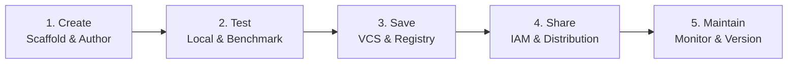
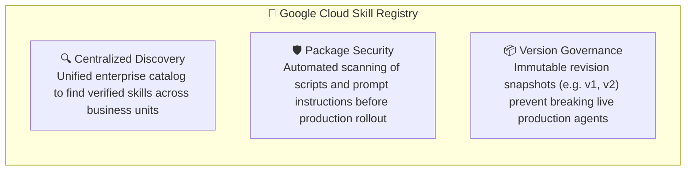

# Scale and Share

While your `promo-writer` skill runs smoothly on a local workstation, a skill locked on a single developer's machine delivers zero enterprise value.

How do you safely share, version, and govern skills across your entire organization without version drift or rogue edits?

This lesson covers:
- **The Five-Phase Enterprise Skill Lifecycle:** Moving from solo experimentation to enterprise-grade management.
- **Google Cloud Skill Registry:** Centralized catalog, security scanning, and snapshot versioning.
- **Skill Registry CLI Workflows:** Command-line operations to save, share, mount, and execute skills.

---

## The Challenge: Moving from Local to Enterprise

> 🧑‍💻 **Tomo:**  
> *"My marketing team is clamoring to use the `promo-writer` skill we just built! But if I just email them the folder or put it on a shared drive, people will make conflicting edits, break validation scripts, and cause chaos. How do we share skills safely?"*
> 
> 💡 **Clara:**  
> *"Never share production skills via email or shared drives! In Google Cloud, we treat skills exactly like production software. By following a structured five-phase lifecycle and publishing to a central Skill Registry, you can share skills globally while maintaining absolute governance and security."*

---

## The Five-Phase Enterprise Skill Lifecycle



| Phase | Core Objective | Key Activities |
| :--- | :--- | :--- |
| **1. Create** | Authoring & Scaffolding | Scaffold directory structure (`SKILL.md`, `references/`, `scripts/`) and write trigger-rich YAML frontmatter. |
| **2. Test** | Local Verification | Test against baseline prompts and automated test suites (`pytest`, web playground) to ensure predictable outputs. |
| **3. Save** | Version Control & Locking | Check into Git version control and publish immutable snapshots to the Skill Registry. |
| **4. Share** | Access Governance | Assign Cloud IAM roles and permissions so authorized developers and autonomous agents can discover and mount the skill. |
| **5. Maintain** | Lifecycle Management | Monitor real-world performance, update references as brand guidelines evolve, and publish versioned revisions (`v1`, `v2`). |

> 💡 **Clara's Pro-Tip:**  
> *"Always enforce mandatory peer code reviews before publishing a new skill revision to the registry. Having a teammate review your `SKILL.md` instructions guarantees alignment, security, and high output quality."*

---

## Google Cloud's Skill Registry

When dozens of teams author custom skills across an enterprise, storing folders locally causes duplicate effort, security vulnerabilities, and conflicting instructions.

Google Cloud's **Skill Registry** provides a private, centralized catalog that solves three primary enterprise challenges:



---

## Skill Registry CLI Workflows

The `agents-cli` tool provides a declarative interface for interacting with the Skill Registry:

### 1. Save (Publish a Snapshot)
Upload a local skill directory as an immutable revision in the corporate registry:

```bash
agents-cli skill publish ./promo-writer --project=cymbal-retail-prod
```

### 2. Share (Grant Access Permissions)
Grant Cloud IAM roles to team groups or production service accounts:

```bash
agents-cli skill grant promo-writer \
  --role=roles/skills.user \
  --member=group:marketing-team@cymbal.com
```

### 3. Access (Mount into Workspace)
Pull a specific published skill revision into a developer workspace or deployment pipeline:

```bash
agents-cli skill pull \
  projects/cymbal-retail-prod/locations/us-central1/skills/promo-writer/revisions/v1
```

### 4. Use (Execute with Runtime Skill)
Run a prompt with the mounted skill loaded into the agent's context memory:

```bash
agents-cli run --skill=promo-writer "Draft an alpine tent promo email"
```

---

## Summary Recap

- **Treat Skills as Software:** Apply CI/CD, version control, automated testing, and peer reviews to agent skills.
- **Centralized Governance:** The Skill Registry eliminates local divergence, secures scripts, and prevents unauthorized edits.
- **Next Step:** So far, we tested inside Google Antigravity. Can we build and deploy our own standalone agents in production? Next, we explore **Agents CLI**.
