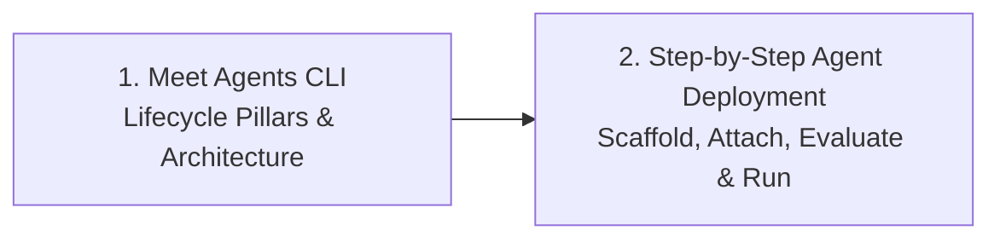

# Leverage Built-In Skills

Previously, you built custom skills to handle complex domain rules and deterministic validation. But how do you run them around the clock autonomously without sitting at an IDE typing prompts?

In this module, you will use Google's built-in **Agents CLI** toolkit to scaffold, evaluate, manage, and deploy standalone cloud agents—turning your skills into proactive, 24/7 digital coworkers.

---

## Module Overview

---

## Lessons in This Module

| Lesson | Focus Area | Description |
| :--- | :--- | :--- |
| [**1. Meet Agents CLI**](file:///c:/tools/github/agentic-news/docs/agents/skills/09_meet_gents_CLI.md) | Agent Lifecycle Management | • Why standalone agents are needed alongside skills • The four lifecycle pillars: Scaffold, Manage, Evaluate, Deploy • Out-of-the-box development workflows |
| [**2. Demo: Step-by-Step Agent Deployment**](file:///c:/tools/github/agentic-news/docs/agents/skills/10_Step-by-step_agent_deployment.md) | Cloud Production Walkthrough | • Scaffold a production agent project with `agents-cli init` • Attach the custom `promo-writer` skill via `SkillToolset` • Benchmark accuracy using local evaluation suites • Deploy containerized agents to Google Cloud for ambient 24/7 execution |

---

> [!TIP]
> **Next Step:** Proceed to [Meet Agents CLI](file:///c:/tools/github/agentic-news/docs/agents/skills/09_meet_gents_CLI.md) to explore the lifecycle tooling.
