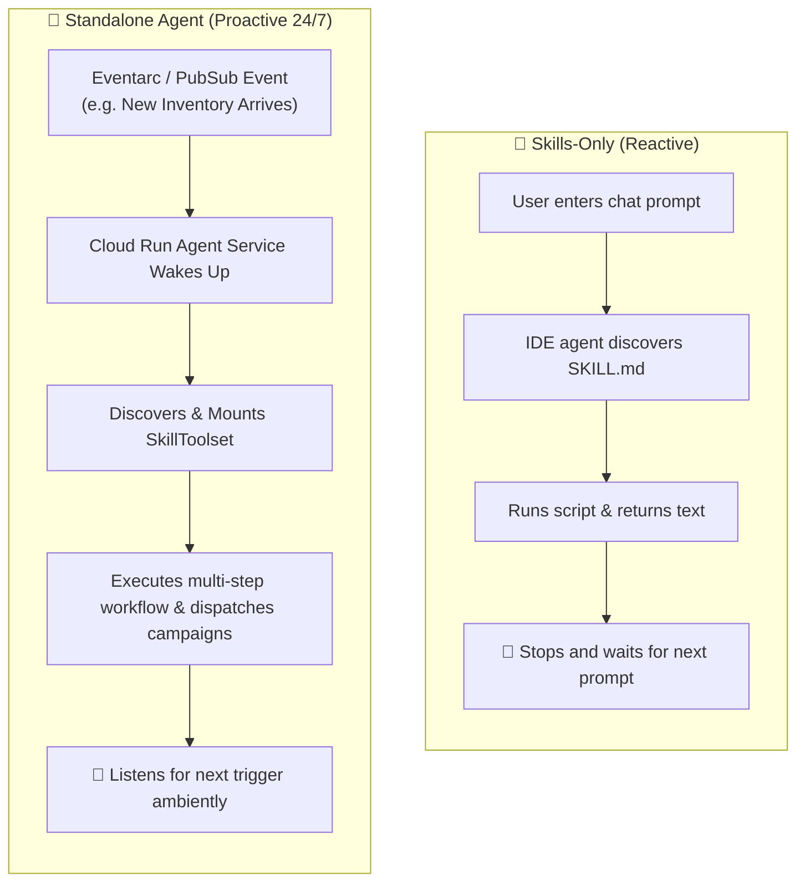
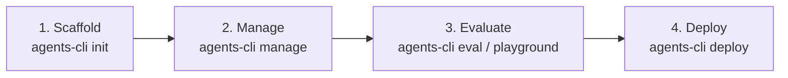

# Meet Agents CLI

Custom skills provide rich domain knowledge and execution recipes, but they need an autonomous execution engine to run continuously outside of a manual chat window.

This lesson explores:
- **Why Standalone Agents:** Moving from manual, reactive chat sessions to proactive, 24/7 cloud automation.
- **What is Agents CLI (`agents-cli`):** Google's developer toolchain built natively on the open-source Agent Development Kit (ADK).
- **The Four Core Lifecycle Commands:** Scaffold, Evaluate, Manage, and Deploy.

---

## Why Standalone Agents? (Skills-Only vs. Standalone)

While custom skills work brilliantly inside an IDE or chat window, they remain **reactive**—they require a human to manually trigger them with a prompt.

To scale across an enterprise, organizations require **autonomous standalone agents** that run continuously in the cloud, react to business events, load skills dynamically, and execute workflows without human intervention.



### Comparison Matrix

| Capability | Skills-Only (IDE / Chat) | Standalone Cloud Agent |
| :--- | :--- | :--- |
| **Execution Trigger** | Manual human prompt in chat window | Automated events, schedules, or API webhooks |
| **Operational Model** | Reactive (one-shot prompt/response) | Proactive (runs 24/7 as an ambient digital worker) |
| **Human Dependency** | Requires active human in the loop | Fully autonomous execution with escalation thresholds |
| **Ideal For** | Ad-hoc drafting, code editing, local testing | Enterprise marketing automation, ETL pipelines, alerts |

> 💡 **Clara's Pro-Tip:**  
> *"Building a standalone agent is powerful, but operationalizing it to the cloud demands significant backend scaffolding. That is why Google provides Agents CLI—an engineering toolkit that automates scaffolding, evaluation, and deployment."*

---

## What is Agents CLI?

**Agents CLI (`agents-cli`)** is a command-line toolchain built natively on Google's open-source **Agent Development Kit (ADK)**. It functions as a development assembly line, transforming local agent scripts into secure, production-grade cloud microservices without requiring custom DevOps infrastructure.

### Core Advantages

1. **Ready-Made Scaffolding:** Eliminates weeks of boilerplate coding. A single command generates standardized ADK architectures with security guardrails.
2. **Context Efficiency:** Built entirely around modular skills, it leverages progressive disclosure to prevent context window overload.
3. **Enterprise Safety & Governance:** Enforces data protection, security boundaries, and model evaluation from the very first line of code.

---

## The Four Lifecycle Pillars

Agents CLI standardizes the development lifecycle into four core operational pillars:



---

## Deep Dive: What Happens Under the Hood

### 1. Scaffold: `agents-cli init`
Activates built-in scaffolding skills to generate a standardized ADK project architecture:
- `app/agent.py`: Wires Gemini models, instruction sets, and `SkillToolset` discovery.
- `CONTEXT.md`: Defines persistent project boundaries and business rules.
- `skills/`: Creates the root directory configured for runtime progressive disclosure.

```bash
agents-cli init cymbal-promo-agent --yes
```

### 2. Manage: `agents-cli manage`
Functions as the agent's runtime reasoning conductor:
- Uses the progressive disclosure engine to load only YAML frontmatter during initialization.
- Reads `SKILL.md` instructions and connects Google system tools (e.g., Code Search, BigQuery) only when required by user intent.

### 3. Evaluate: `agents-cli eval` and `agents-cli playground`
Provides dual qualitative and quantitative validation:
- **Playground (`agents-cli playground`):** Launches a local web server with hot-reloading for human interaction and qualitative inspection.
- **Evaluation Suite (`agents-cli eval`):** Executes automated benchmarking against test datasets to quantitatively measure accuracy, track token consumption, and catch instruction drift.

```bash
# Launch interactive local testing environment
agents-cli playground

# Run quantitative regression benchmarks
agents-cli eval --dataset=./tests/benchmarks.json
```

### 4. Deploy: `agents-cli deploy`
Containerizes and ships the agent to Google Cloud:
- Packages the Python agent into an optimized container image.
- Deploys the service to **Google Cloud Run**.
- Automatically configures integration with **Google Cloud Eventarc** and **Cloud Pub/Sub** for 24/7 event-driven execution.

```bash
agents-cli deploy --project=cymbal-retail-prod --region=us-central1
```

---

## Summary Recap

- **Autonomous Evolution:** Standalone agents turn reactive prompt workflows into proactive, ambient cloud services.
- **ADK Foundation:** Agents CLI operates on the open-source Agent Development Kit to manage the complete lifecycle.
- **Four Core Pillars:**
  1. `init` $\rightarrow$ Standardized scaffolding.
  2. `manage` $\rightarrow$ Progressive disclosure runtime.
  3. `eval` / `playground` $\rightarrow$ Benchmarking and verification.
  4. `deploy` $\rightarrow$ Cloud Run containerization and event streaming.

> [!TIP]
> **Next Step:** In the final lesson, we watch Tomo execute each of these four commands to deploy Cymbal Outdoor's standalone promotional agent to Google Cloud!
