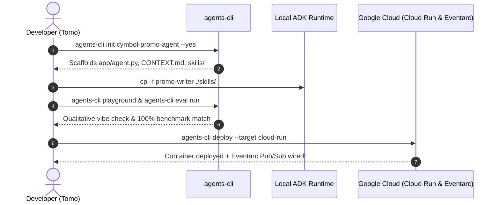

# Demo: Step-by-Step Agent Deployment

In the previous lesson, you explored the four core lifecycle pillars of Agents CLI. Now, observe how Cymbal Outdoor puts those exact pillars into action to deploy an autonomous marketing agent.

---

## What You'll Walk Through

1. **Scaffold:** Initialize a standardized ADK agent project using `agents-cli init`.
2. **Attach:** Link existing custom skills (`SKILL.md`) to the agent's runtime `SkillToolset`.
3. **Evaluate:** Verify agent accuracy and brand compliance using the local web playground and automated benchmarking suites (`eval`).
4. **Deploy:** Ship a containerized agent microservice to Google Cloud Run wired to Eventarc for ambient, 24/7 execution.

---

## From Chat Window to Cloud Production

> 🧑‍💻 **Tomo:**  
> *"Our custom `promo-writer` skill works wonders in my IDE, but my team can't sit around typing prompts 24/7. We need seasonal campaigns to launch automatically whenever new hiking gear arrives at our warehouse. How do we make it happen?"*
> 
> 💡 **Clara:**  
> *"That is where the four lifecycle pillars of Agents CLI shine! By using scaffold, manage, evaluate, and deploy, we can turn your skill into a standalone 24/7 cloud coworker. Let's see it in action!"*

---

## Guided Walkthrough: Deploying the Agent



---

## Task 1: Scaffold the Promotional Agent

To eliminate manual boilerplate setup, initialize a standardized ADK project architecture from the command line:

```bash
agents-cli init cymbol-promo-agent --yes
```

### Execution Log

```text
[INFO] Initializing new ADK agent project...
[SUCCESS] Created app/agent.py (Workflow root)
[SUCCESS] Created CONTEXT.md (Project guardrails)
[SUCCESS] Created skills/ directory (Skill discovery)
```

### Generated Code (`app/agent.py`)

Notice how `app/agent.py` wires the Gemini foundation model and configures `SkillToolset` for runtime progressive disclosure:

```python
from google.adk import Agent, Gemini
from google.adk.skills import SkillToolset

# Initialize the root workflow agent
root_agent = Agent(
    name="cymbol_promo_agent",
    model=Gemini(model="gemini-flash"),
    instruction="You are Cymbal Outdoor's 24/7 promotional copywriter agent.",
    toolset=SkillToolset(directory="./skills")
)
```

---

## Task 2: Attach the Custom Skill

With the agent foundation scaffolded, attach Cymbal Outdoor's domain knowledge into the agent's runtime memory by copying the skill folder:

```bash
cp -r ~/workspace/promo-writer ./cymbol-promo-agent/skills/
```

### Verified Project Structure

```text
cymbol-promo-agent/
├── app/
│   └── agent.py          # Root agent graph
├── CONTEXT.md            # Global enterprise constraints
└── skills/
    └── promo-writer/     # <-- Attached & auto-discovered!
        ├── SKILL.md
        ├── references/
        │   ├── brand-voice.md
        │   └── email-template.txt
        └── scripts/
            ├── check-compliance.py
            └── mock-dispatch.py
```

> 💡 **Clara's Pro-Tip:**  
> *"Because Agent Skills adhere to an open, modular standard, custom handbooks are 100% portable. You can unplug a skill from your local IDE and drop it straight into a standalone cloud agent without changing a single line of markdown!"*

---

## Task 3: Evaluate and Benchmark Locally

Before deploying to production, verify that the agent respects Cymbal Outdoor's brand voice and compliance guardrails using dual qualitative and quantitative testing.

### 1. Qualitative Evaluation: Local Web Playground

Launch the interactive local playground server:

```bash
agents-cli playground
```

```text
[INFO] Starting local playground server at http://localhost:8080...
```

#### Playground Interactive Chat Trace
- **Tomo's Test Prompt:**  
  *"We just received 500 Summit-Pro Alpine Tents in our warehouse. Draft a promotional email blast."*
- **Agent's Generated Response:**  
  *"Conquer the ridgeline! The Summit-Pro Alpine Tent is officially back in stock at Cymbal Outdoor. Built with reinforced ripstop nylon and tested in 60mph mountain winds, this is your ultimate shelter for high-altitude expeditions. Grab yours before the summit season kicks into high gear!"*

### 2. Quantitative Evaluation: Automated Benchmarking Suite

Execute automated regression benchmarks against historical datasets:

```bash
agents-cli eval run
```

#### Benchmark Report

```text
==================== EVALUATION RESULTS ====================
Dataset: cymbal_historical_promos.evalset.json
Total Tests: 10 | Passed: 10 | Failed: 0
------------------------------------------------------------
[PASS] Brand Voice (Rugged & Inspiring):     100% match
[PASS] Technical Spec Preservation:          100% match
[PASS] Formatting Compliance (Zero Emojis):  100% match
[PASS] SMS Compliance (<160 chars + STOP):   100% match
============================================================
Status: PRODUCTION READY
```

---

## Task 4: Deploy to Cloud Production for 24/7 Execution

Package the validated agent into an autonomous cloud microservice:

```bash
agents-cli deploy --target cloud-run
```

### Deployment Build & Streaming Logs

```text
[INFO] Containerizing cymbol-promo-agent via Cloud Build...
[INFO] Pushing Docker image to Google Cloud Artifact Registry...
[INFO] Deploying ambient microservice to Google Cloud Run...
[SUCCESS] Service live at: https://cymbol-promo-agent-xyz.a.run.app
[INFO] Wiring Eventarc trigger: pubsub-warehouse-inventory-updates -> cymbol-promo-agent
[SUCCESS] Agent deployed for 24/7 autonomous execution!
```

> 📝 **Tomo's Note:**  
> *"Our promotional agent is officially live on Google Cloud! Whenever our inventory database registers newly received gear, Eventarc wakes up this Cloud Run service at 3:00 AM. The agent loads our `promo-writer` skill and broadcasts branded campaigns automatically. We just automated our entire seasonal launch workflow!"*

---

## Summary Recap: The Four Lifecycle Pillars in Action

| Lifecycle Step | CLI Command | Outcome |
| :--- | :--- | :--- |
| **1. Scaffold** | `agents-cli init` | Generates standardized ADK project layout with `SkillToolset` discovery. |
| **2. Attach** | `cp -r <skill> ./skills/` | Mounts portable domain skills into the agent's runtime memory. |
| **3. Evaluate** | `agents-cli playground`<br>`agents-cli eval run` | Validates tone via local UI and verifies compliance via regression benchmarks. |
| **4. Deploy** | `agents-cli deploy` | Builds container image, deploys to Cloud Run, and wires Eventarc event streams. |
