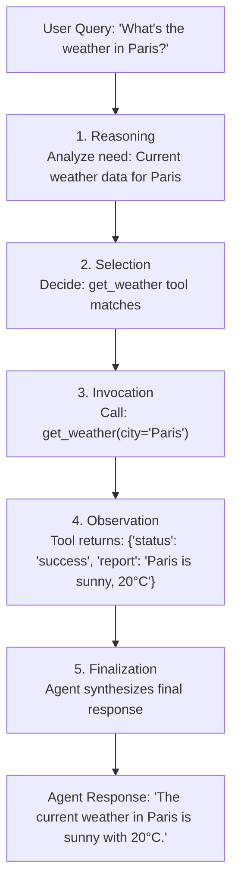

# The Solution: Tools

## Extending Agent Capabilities

> **Reference:** ADK Docs — What is a Tool?
>
> “In the context of ADK, a tool represents a specific capability provided to an AI agent, enabling it to perform actions and interact with the world beyond its core text generation and reasoning abilities.”
>
> — *ADK Docs*

### What Tools Enable

- **Access real-time information:** Web search, weather APIs, stock prices.
- **Perform calculations:** Execute code, run financial models, process data.
- **Query databases:** Retrieve customer orders, product inventory, user profiles.
- **Interact with external systems:** Send emails, book appointments, process payments.
- **Take actions in the world:** Update records, trigger workflows, control devices.

#### Simple Example

```python
def get_weather(city: str) -> dict:
    """Retrieves the current weather for a specified city."""
    # In a real implementation, this would call a weather API
    return {
        "status": "success",
        "report": f"Weather in {city} is sunny, 25°C"
    }

# This Python function becomes a tool when added to an agent
```

---

## Core Concepts

### 1. What is a Tool?

> **Reference:** ADK Docs — What is a Tool?
>
> “Technically, a tool is typically a modular code component—like a Python, Java, or TypeScript function, a class method, or even another specialized agent—designed to execute a distinct, predefined task.”
>
> — *ADK Docs*

#### Key Characteristics

- **Action-oriented:** Tools perform specific actions for an agent, such as searching for information, calling an API, or performing calculations.
- **Extends agent capabilities:** They empower agents to access real-time information, affect external systems, and overcome knowledge limitations inherent in their training data.
- **Execute predefined logic:** Crucially, tools execute specific, developer-defined logic. They do not possess their own independent reasoning capabilities like the agent's core LLM. The LLM reasons about *which* tool to use, *when*, and *with what inputs*, but the tool itself just executes its designated function.

#### Example: Simple Tool

```python
def get_capital_city(country: str) -> str:
    """Retrieves the capital city for a given country."""
    capitals = {
        "france": "Paris",
        "japan": "Tokyo",
        "canada": "Ottawa"
    }
    return capitals.get(
        country.lower(),
        f"Sorry, I don't know the capital of {country}."
    )
```

**What makes this a tool:**
1. It's a Python function (modular code component).
2. It performs a specific task (look up capital cities).
3. It has predefined logic (the `capitals` dictionary).
4. It extends the agent's capabilities (access to structured data).

---

### 2. How Agents Use Tools

> **Reference:** ADK Docs — How Agents Use Tools
>
> “Agents leverage tools dynamically through mechanisms often involving function calling. The process generally follows these steps:
>
> 1. **Reasoning:** The agent’s LLM analyzes its system instruction, conversation history, and user request.
> 2. **Selection:** Based on the analysis, the LLM decides on which tool, if any, to execute, based on the tools available to the agent and the docstrings that describe each tool.
> 3. **Invocation:** The LLM generates the required arguments (inputs) for the selected tool and triggers its execution.
> 4. **Observation:** The agent receives the output (result) returned by the tool.
> 5. **Finalization:** The agent incorporates the tool’s output into its ongoing reasoning process to formulate the next response, decide the subsequent step, or determine if the goal has been achieved.”
>
> — *ADK Docs*

#### Five-Step Process



> **Key Insight:** The LLM handles the **reasoning and decision-making**, while the tool handles the **action and data retrieval**. This separation of concerns is what makes agents powerful.

---

### 3. Tool Types in ADK

> **Reference:** ADK Docs — Tool Types in ADK
>
> “ADK offers flexibility by supporting several types of tools:
> - **Function Tools:** Tools created by you, tailored to your specific application's needs.
> - **Built-in Tools:** Ready-to-use tools provided by the framework for common tasks. Examples: Google Search, Code Execution, Retrieval-Augmented Generation (RAG).
> - **Third-Party Tools:** Integrate tools seamlessly from popular external libraries.”
>
> — *ADK Docs*

| Type | Complexity | Setup | Use When |
| :--- | :--- | :--- | :--- |
| **Built-in Tools** | Low | Import and use | You need common capabilities (search, code execution, RAG). |
| **Function Tools** | Medium | Write standard Python function | You need custom business logic or proprietary API integrations. |
| **Agent-as-Tool** | Medium–High | Create specialized agent | You need specialized reasoning or delegation for complex subtasks. |

- **Custom Function Tools:** Python functions you write, tailored to your specific business logic (e.g., `calculate_shipping_cost`, `lookup_order_status`).
- **Built-in Tools:** Ready-to-use tools provided and maintained by Google (e.g., Google Search, Code Execution).
- **Agent-as-Tool:** Delegate complex subtasks to another specialized agent (e.g., main triage agent calling a technical support agent).

---

### 4. The `tools` Parameter

> **Reference:** ADK Docs — Equipping the Agent: Tools
>
> “`tools` (Optional): Provide a list of tools the agent can use. Each item in the list can be:
> - A native function or method (wrapped as a `FunctionTool`)
> - An instance of a class inheriting from `BaseTool`
> - An instance of another agent (`AgentTool`)
>
> The LLM uses the function/tool names, descriptions (from docstrings or the description field), and parameter schemas to decide which tool to call based on the conversation and its instructions.”
>
> — *ADK Docs*

```python
from google.adk.agents import LlmAgent

# Step 1: Define a tool function
def get_capital_city(country: str) -> str:
    """Retrieves the capital city for a given country."""
    capitals = {"france": "Paris", "japan": "Tokyo", "canada": "Ottawa"}
    return capitals.get(country.lower(), f"Sorry, I don't know the capital of {country}.")

# Step 2: Add the tool to the agent
capital_agent = LlmAgent(
    model="gemini-flash-latest",
    name="capital_agent",
    description="Answers questions about capital cities.",
    instruction="You are an agent that provides the capital city of a country.",
    tools=[get_capital_city]  # ✨ tools parameter
)
```

#### What to Notice:
- **`tools` is a list:** `tools=[...]` allows supplying multiple tools to a single agent.
- **Function passed directly:** ADK automatically wraps native Python functions into a `FunctionTool`.
- **LLM uses metadata:** Function name, docstrings, type annotations, and parameter descriptions automatically generate the JSON schema for the LLM.
- **No manual boilerplate:** Python ADK handles schema extraction and dispatch automatically.

#### How the LLM Inspects the Tool Schema:
```text
Tool name: get_capital_city
Description: "Retrieves the capital city for a given country."
Parameters:
  - country (str): A country name
Returns: str
```

---

### 5. Tools and Session State (Preview)

Tools can collaborate with session state to provide personalized, context-aware behavior.

```python
def save_user_preference(preference_key: str, preference_value: str, ctx) -> dict:
    """Saves a user preference to session state.

    Args:
        preference_key: The preference name (e.g., "language", "theme")
        preference_value: The preference value (e.g., "Spanish", "dark")
        ctx: Tool context (provides access to session state)

    Returns:
        dict: Status message
    """
    # Save to user: namespace for cross-session persistence
    ctx.session.state[f"user:{preference_key}"] = preference_value

    return {
        "status": "success",
        "message": f"Saved {preference_key} = {preference_value}"
    }
```

#### What State Integration Enables:
- **Personalization:** Tools read saved preferences from user state.
- **Context awareness:** Tools inspect previous turns and state values.
- **Multi-step workflows:** Tools record intermediate progress into temporary or session state.
- **Cross-session memory:** Persistent state across conversations using the `user:` namespace.

#### Example Multi-Turn Flow:
```text
Turn 1: User says "Save my language preference as Spanish"
  ↳ Agent calls save_user_preference(preference_key="language", preference_value="Spanish", ctx=...)
  ↳ State updated: state["user:language"] = "Spanish"

Turn 2: Agent instruction: "Respond in {user:language?English}"
  ↳ Resolves to: "Respond in Spanish"
```

---

## Hands-On Example: Building Your First Tool-Enabled Agent

Build a geography assistant that helps users learn about world capitals using a custom tool.

### Step 1: Create the Project

```bash
adk create geography_assistant
cd geography_assistant
```

### Step 2: Write the Agent

Replace the contents of `agent.py` with:

```python
"""
Geography Assistant Agent
Demonstrates ADK's tools parameter with a simple custom function tool.

Reference: https://adk.dev/agents/llm-agents/#equip-the-agent-with-tools
"""

from google.adk.agents import LlmAgent

# Step 1: Define a tool function
def get_capital_city(country: str) -> str:
    """Retrieves the capital city for a specified country.

    Args:
        country (str): The name of the country.

    Returns:
        str: The capital city name or error message.
    """
    # Simulated capital city database
    capitals = {
        "france": "Paris",
        "japan": "Tokyo",
        "canada": "Ottawa",
        "germany": "Berlin",
        "brazil": "Brasília",
        "australia": "Canberra",
        "india": "New Delhi",
        "mexico": "Mexico City"
    }

    # Look up the capital
    return capitals.get(
        country.lower(),
        f"Sorry, I don't have information about the capital of {country}."
    )

# Step 2: Create agent with the tool
root_agent = LlmAgent(
    model="gemini-flash-latest",
    name="geography_assistant",
    description="Helps users learn about world geography.",
    instruction="""
    You are a geography assistant that helps users learn about world capitals.

    When a user asks about a capital city:
    1. Use the get_capital_city tool to find the answer
    2. Provide the information in a friendly, educational way
    3. You can add interesting facts if you know them

    If the tool returns an error message, politely tell the user you don't have that information.
    """,
    tools=[get_capital_city]  # Provide the function as a tool
)
```

### Step 3: Run and Test

```bash
adk web
```
Navigate to `http://localhost:8000` in your browser.

### Step 4: Test Scenarios

#### Test 1: Basic Capital Query
- **User:** *"What is the capital of Japan?"*
- **Execution:**
  1. Agent calls `get_capital_city(country="Japan")`
  2. Tool returns `"Tokyo"`
  3. Agent responds: *"The capital of Japan is Tokyo."*
- **Key Takeaway:** The agent automatically identifies the matching tool, extracts parameters, and translates the output into conversational language.

#### Test 2: Multiple Capitals
- **User:** *"What are the capitals of France, Germany, and Brazil?"*
- **Execution:**
  1. Agent orchestrates three tool calls: `get_capital_city(country="France")`, `get_capital_city(country="Germany")`, `get_capital_city(country="Brazil")`
  2. Tools return: `"Paris"`, `"Berlin"`, `"Brasília"`
  3. Agent synthesizes the results into a unified, formatted response.
- **Key Takeaway:** ADK handles multi-call tool orchestration automatically.

#### Test 3: Unknown Capital
- **User:** *"What is the capital of Iceland?"*
- **Execution:**
  1. Agent calls `get_capital_city(country="Iceland")`
  2. Tool returns: `"Sorry, I don't have information about the capital of Iceland."`
  3. Agent gracefully relays the message without hallucination.

#### Test 4: General Knowledge (No Tool Needed)
- **User:** *"Tell me about geography"*
- **Execution:** Agent answers using internal knowledge without invoking `get_capital_city`.
- **Key Takeaway:** Tools are only called when the agent's reasoning determines they are required.

---

## Key Takeaways

### Core Concepts
- Tools extend agent capabilities beyond static model knowledge to perform real-world actions and external lookups.
- Execution follows a 5-step loop: **Reasoning → Selection → Invocation → Observation → Finalization**.
- ADK supports Built-in Tools, Custom Function Tools, and Agent-as-Tool patterns.

### Development Best Practices
- **Descriptive Names:** Use explicit names like `get_capital_city` instead of ambiguous names like `lookup` or `get_data`.
- **Comprehensive Docstrings:** Clearly document what the tool does, argument formats, and return values.
- **Type Annotations:** Always annotate arguments and return types to generate precise JSON schemas.
- **Robust Error Handling:** Return informative, structured error messages instead of raising unhandled exceptions.
