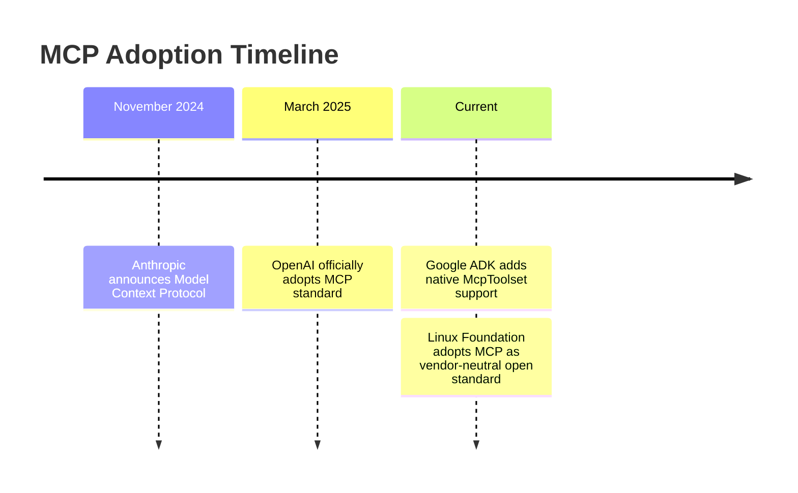
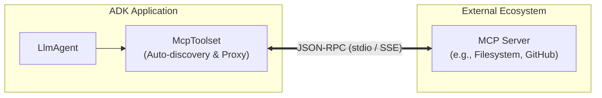
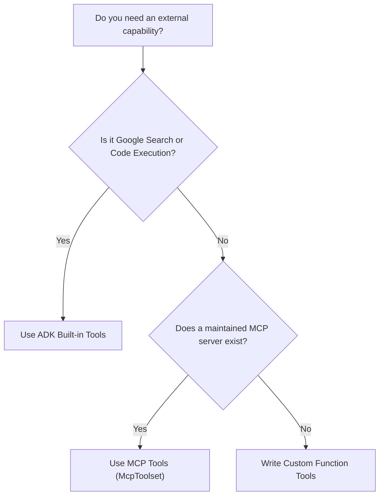

# The Solution: Model Context Protocol (MCP)

## A Universal Adapter for Tools

> **Reference:** ADK Docs — MCP Tools | Official MCP Documentation

### What is MCP?

**MCP (Model Context Protocol)** is an open standard created by Anthropic and hosted by The Linux Foundation. It enables AI agents to connect to external tool servers through a universal protocol. 

Think of MCP as the **USB-C for AI agents**—any MCP-compatible server can provide tools to any MCP-compatible client, regardless of the underlying model or framework.

---

## Two Integration Patterns with ADK

ADK supports two distinct MCP integration patterns:

1. **Pattern 1: Consuming Existing MCP Servers (Client Mode):** Your ADK agent acts as an MCP client, consuming pre-built tools from external servers (the primary focus of this module).
2. **Pattern 2: Exposing ADK Tools via MCP (Server Mode):** You build an MCP server that wraps your ADK tools, making them discoverable and usable by external clients like Claude Desktop or OpenAI agents.

---

## Why MCP Matters: The Power of Standardization

| Without MCP | With MCP |
| :--- | :--- |
| Each tool requires custom integration and plumbing code. | One standardized protocol works across all tools. |
| Tools are locked to proprietary AI frameworks. | Tools work seamlessly across Gemini, Claude, GPT, and custom agents. |
| You must maintain every connector and schema yourself. | Community authors and vendors maintain their own server implementations. |
| Restricted to what's built into your local agent framework. | Immediate access to a global ecosystem of hundreds of production tools. |

### Industry Adoption Timeline



---

## Finding MCP Servers

Before authoring custom tools from scratch, check if an existing MCP server already meets your needs:

- **[MCP Server Registry](https://registry.modelcontextprotocol.io/):** Official searchable catalog of published servers.
- **[Reference Servers GitHub](https://github.com/modelcontextprotocol/servers):** Official servers maintained by the core MCP team.
- **[MCP Documentation](https://modelcontextprotocol.io/):** Complete protocol specification and developer guides.

#### Common MCP Server Categories:
- **Filesystem:** Secure local filesystem reads and writes.
- **GitHub / GitLab:** Repository management, pull requests, issues, and diff inspection.
- **Slack / Discord:** Channel notifications, direct messages, search history.
- **PostgreSQL / MySQL / SQLite:** Direct SQL execution and schema inspection.
- **Cloud Storage:** Google Drive, AWS S3, Notion, and Jira.

---

## How MCP Works in ADK



1. **Exposure:** The MCP server exposes tools, descriptions, and JSON schemas over standard streams or HTTP.
2. **Connection:** ADK agents connect to the server using `McpToolset`.
3. **Discovery:** Available tools are discovered dynamically without manual class wrapping.
4. **Execution:** When the LLM issues a function call, ADK proxies the invocation to the MCP server and returns the result to the model loop.

---

## Core Concepts

### 1. The `McpToolset` Class

> **Reference:** ADK Docs — MCP Tools
>
> “The `McpToolset` class can be directly added to your agent’s tools list, enabling seamless connection to an MCP server, discovery of its tools, and making them available for your agent to use.”
>
> — *ADK Docs*

```python
from google.adk.agents import LlmAgent
from google.adk.tools.mcp_tool import McpToolset
from google.adk.tools.mcp_tool.mcp_session_manager import StdioConnectionParams
from mcp import StdioServerParameters

agent = LlmAgent(
    model="gemini-flash-latest",
    name="my_agent",
    instruction="Use available tools to help users.",
    tools=[
        McpToolset(
            connection_params=StdioConnectionParams(
                server_params=StdioServerParameters(
                    command="npx",
                    args=["-y", "@modelcontextprotocol/server-filesystem", "/path/to/folder"],
                ),
            ),
        )
    ],
)
```

---

### 2. Connection Types

| Connection Type | Transport | Best For | Typical Configuration |
| :--- | :--- | :--- | :--- |
| **`StdioConnectionParams`** | Subprocess `stdin`/`stdout` | Local dev, CLI tools, single-user | `StdioServerParameters(command="npx", args=[...])` |
| **`SseConnectionParams`** | Server-Sent Events over HTTP | Production, cloud servers, multi-tenant | `SseConnectionParams(url="https://...", headers={...})` |

#### Example: Stdio Connection (Local Subprocess)
```python
from google.adk.tools.mcp_tool.mcp_session_manager import StdioConnectionParams
from mcp import StdioServerParameters

connection = StdioConnectionParams(
    server_params=StdioServerParameters(
        command="npx",
        args=["-y", "@modelcontextprotocol/server-filesystem", "/safe/path"],
    ),
)
```

#### Example: SSE Connection (Remote HTTP Server)
```python
from google.adk.tools.mcp_tool.mcp_session_manager import SseConnectionParams

connection = SseConnectionParams(
    url="https://mcp-server.example.internal/sse",
    headers={"Authorization": "Bearer SECRETS"},
)
```

---

### 3. Tool Filtering (`tool_filter`)

Servers may expose dozens of tools, some with destructive side effects. Use `tool_filter` to enforce the principle of least privilege.

```python
# Safe: Read-only whitelist
McpToolset(
    connection_params=StdioConnectionParams(
        server_params=StdioServerParameters(
            command="npx",
            args=["-y", "@modelcontextprotocol/server-filesystem", "/safe/path"],
        ),
    ),
    tool_filter=["list_directory", "read_file"],  # Only expose safe read tools
)
```

#### Why Filter Tools?
- **Security:** Prevent agents from executing arbitrary writes, deletes, or mutations.
- **Accuracy:** Shrinks the prompt tool-definition footprint, reducing token costs and model confusion.
- **Focus:** Restricts the model strictly to capabilities relevant to the user's domain.

---

### 4. Tool Decision Framework



| Dimension | MCP Tools | Built-In Tools | Custom Function Tools |
| :--- | :--- | :--- | :--- |
| **Maintainer** | Community / Vendors | Google ADK Core Team | Your engineering team |
| **Setup** | Configure connection parameters | Direct import | Custom Python code + docstrings |
| **Portability** | Universal (cross-framework) | ADK specific | ADK specific |
| **Best For** | Databases, files, SaaS APIs | Web grounding, sandboxed math | Proprietary business algorithms & private APIs |

---

## Hands-On Example: Building a File Reader Assistant

Build an agent that safely inspects and reads local files using `@modelcontextprotocol/server-filesystem`.

### Prerequisites
Node.js and `npm` installed for `npx`.

### Step 1: Create Project & Sample Directory
```bash
adk create file_reader_assistant
cd file_reader_assistant
mkdir -p my_files
echo "Hello, this is a test file." > my_files/hello.txt
echo "This is another file with notes." > my_files/notes.txt
```

### Step 2: Implement Agent (`agent.py`)
```python
"""
File Reader Assistant Agent
Demonstrates MCP tools integration with ADK using the filesystem MCP server.

Reference: https://adk.dev/tools-custom/mcp-tools/
"""

import os
from google.adk.agents import LlmAgent
from google.adk.tools.mcp_tool import McpToolset
from google.adk.tools.mcp_tool.mcp_session_manager import StdioConnectionParams
from mcp import StdioServerParameters

# Define allowed path for sandbox access (must be absolute path)
ALLOWED_PATH = os.path.abspath("./my_files")
os.makedirs(ALLOWED_PATH, exist_ok=True)

root_agent = LlmAgent(
    model="gemini-flash-latest",
    name="file_reader_assistant",
    description="Helps users read and explore files using MCP tools.",
    instruction="""
    You are a file reader assistant that helps users explore files.

    Your capabilities:
    - List files in directories using list_directory
    - Read file contents using read_file

    When helping users:
    1. Use list_directory to show available files
    2. Use read_file to display file contents when asked
    3. Describe what you find in a helpful way

    Always be clear about which folder you're working with.
    """,
    tools=[
        McpToolset(
            connection_params=StdioConnectionParams(
                server_params=StdioServerParameters(
                    command="npx",
                    args=[
                        "-y",
                        "@modelcontextprotocol/server-filesystem",
                        ALLOWED_PATH,
                    ],
                ),
            ),
            # Filter to only expose safe, read-only tools
            tool_filter=["list_directory", "read_file"],
        )
    ],
)
```

### Step 3: Run and Test
```bash
adk web
```

### Step 4: Test Scenarios
1. **List Files:** *"What files are in the folder?"* → Agent executes `list_directory` and displays `hello.txt` and `notes.txt`.
2. **Read File:** *"Show me the contents of hello.txt"* → Agent calls `read_file(path=".../hello.txt")` and streams file contents.
3. **Sequential Orchestration:** *"List the files and then summarize notes.txt"* → Agent calls `list_directory`, executes `read_file`, and generates summary.

---

## Key Takeaways

- **MCP provides universal standardization:** Connect once, use across models and frameworks without custom glue code.
- **`McpToolset` handles lifecycle:** Manages discovery, schema translation, and proxy dispatch automatically.
- **Support for local and remote transport:** Use `StdioConnectionParams` for local subprocesses and `SseConnectionParams` for cloud deployments.
- **Enforce least privilege:** Whitelist allowed tools with `tool_filter` to safeguard systems against unprompted actions.
