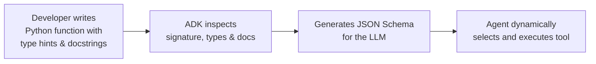

# The Solution: Custom Function Tools

## Write Python Functions, Get Agent Capabilities

> **Reference:** ADK Docs — Function Tools
>
> “Transforming a Python function into a tool is a straightforward way to integrate custom logic into your agents. When you assign a function to an agent’s tools list, the framework automatically wraps it as a `FunctionTool`.”
>
> — *ADK Docs*

### How It Works



#### Simple Example

```python
from google.adk.agents import LlmAgent

# Step 1: Write a native Python function
def calculate_shipping_cost(weight_kg: float, country: str) -> dict:
    """Calculates shipping cost based on package weight and destination."""
    rates = {"usa": 10, "canada": 12, "uk": 15}

    if country.lower() not in rates:
        return {"status": "error", "error_message": f"We don't ship to {country}"}

    cost = weight_kg * rates[country.lower()]
    return {"status": "success", "cost_usd": cost}

# Step 2: Add function to agent's tools list
agent = LlmAgent(
    model="gemini-flash-latest",
    instruction="You help customers with shipping cost estimates.",
    tools=[calculate_shipping_cost]  # ADK automatically wraps as FunctionTool
)
```

---

## Core Concepts

### 1. Function Signatures Matter

> **Reference:** ADK Docs — Function Tools
>
> “The ADK framework automatically inspects your Python function's signature—including its name, docstring, parameters, type hints, and default values—to generate a schema. This schema is what the LLM uses to understand the tool's purpose, when to use it, and what arguments it requires.”
>
> — *ADK Docs*

#### Critical Signature Requirements

1. **Descriptive Function Names (Verb-Noun Pattern):**
   ```python
   # Recommended: Clear, descriptive action names
   def get_shipping_cost(weight: float, destination: str) -> dict: ...
   def calculate_loyalty_points(purchase_amount: float) -> dict: ...
   def search_available_flights(destination: str, date: str) -> dict: ...

   # Avoid: Ambiguous or generic names
   def process(data: float) -> dict: ...
   def do_stuff(x: str) -> dict: ...
   def handler(amount: float) -> dict: ...
   ```

2. **Strict Type Hints:**
   ```python
   # Recommended: Type annotations on all parameters and return value
   def lookup_order(order_id: str, user_id: int) -> dict: ...
   def calculate_discount(price: float, customer_tier: str) -> dict: ...

   # Avoid: Missing type hints
   def lookup_order(order_id, user_id): ...  # LLM cannot infer payload schema
   ```

3. **JSON-Serializable Parameter Types:**
   - **Supported:** `str`, `int`, `float`, `bool`, `list`, `dict`.
   - **Avoid:** Custom OOP classes, datetime objects, and system sockets. Use standard strings (e.g., ISO-8601 date strings) for complex values.

4. **Required vs. Optional Parameters:**
   > Avoid defining default values unless truly optional. Optional defaults can lead models to omit necessary arguments. Explicit required parameters are the most reliable pattern.

---

### 2. Docstrings are Critical

> **Reference:** ADK Docs — Defining Effective Tool Functions
>
> “A parameter is considered required if it has a type hint but no default value. The LLM must provide a value for this argument when it calls the tool. The parameter's description is taken from the function's docstring.”
>
> — *ADK Docs*

#### Recommended Docstring Template

```python
def tool_name(param1: type1, param2: type2) -> dict:
    """[One-line summary of what this tool does]

    [Optional: Additional context about when to use this tool]

    Args:
        param1 (type1): [Description of param1]
        param2 (type2): [Description of param2]

    Returns:
        dict: [Description of return structure]
            On success: {'status': 'success', 'key': value}
            On error: {'status': 'error', 'error_message': 'explanation'}
    """
    pass
```

#### Production Example

```python
def calculate_shipping_cost(weight_kg: float, country: str) -> dict:
    """Calculates shipping cost based on package weight and destination country.

    Use this tool when a customer asks about shipping costs for their order.

    Args:
        weight_kg (float): The package weight in kilograms.
        country (str): The destination country name.

    Returns:
        dict: Shipping cost information.
            On success: {'status': 'success', 'cost_usd': 25.50, 'delivery_days': 5}
            On error: {'status': 'error', 'error_message': 'Country not supported'}
    """
    shipping_rates = {
        "usa": {"rate_per_kg": 10, "days": 3},
        "canada": {"rate_per_kg": 12, "days": 5},
        "uk": {"rate_per_kg": 15, "days": 7},
    }

    country_key = country.lower()
    if country_key not in shipping_rates:
        return {
            "status": "error",
            "error_message": f"Shipping to {country} is not currently supported."
        }

    rate_info = shipping_rates[country_key]
    cost = weight_kg * rate_info["rate_per_kg"]

    return {
        "status": "success",
        "cost_usd": round(cost, 2),
        "delivery_days": rate_info["days"],
        "destination": country
    }
```

---

### 3. Return Dictionaries with `status`

> **Reference:** ADK Docs — Function Tools
>
> “The preferred return type for a Function Tool is a dictionary in Python... As a best practice, include a 'status' key (e.g., 'success', 'error', 'pending') providing the LLM with a clear signal about the operation's state.”
>
> — *ADK Docs*

```python
# Standardized Tool Handler Skeleton
def your_tool(param1: str) -> dict:
    """Docstring explaining behavior and parameters."""
    # 1. Validate inputs
    if not is_valid(param1):
        return {
            "status": "error",
            "error_message": f"Invalid input: {param1}"
        }

    # 2. Execute business logic with error capture
    try:
        result = perform_operation(param1)
        return {
            "status": "success",
            "data": result
        }
    except Exception as e:
        return {
            "status": "error",
            "error_message": f"Operation failed: {str(e)}"
        }
```

---

### 4. Using State in Custom Tools (Preview)

Custom tools can access and mutate session state namespaces via the tool context (`ctx` parameter):

```python
def recommend_products(category: str, ctx) -> dict:
    """Recommends products based on user preferences stored in state.

    Args:
        category: Product category to search
        ctx: Tool context (provides access to session state)
    """
    # Read persisted user preference
    user_tier = ctx.session.state.get("user:tier", "standard")
    discount = 0.15 if user_tier == "premium" else 0.05

    # Store intermediate computation in temporary turn state
    ctx.session.state["temp:last_discount"] = discount

    return {
        "status": "success",
        "category": category,
        "discount_applied": discount
    }
```

---

### 5. Multi-Tool Orchestration

Multiple tools can be attached to a single agent to handle multi-step customer journeys:

```python
from google.adk.agents import LlmAgent

def check_inventory(product_id: str) -> dict:
    """Checks if a product is in stock."""
    return {"status": "success", "in_stock": True, "quantity": 5}

def get_product_price(product_id: str) -> dict:
    """Gets current retail price of a product."""
    return {"status": "success", "price_usd": 99.99}

def calculate_shipping(weight_kg: float, country: str) -> dict:
    """Calculates shipping cost."""
    return {"status": "success", "cost_usd": 25.50}

def calculate_total(product_price: float, shipping_cost: float) -> dict:
    """Calculates final combined cost."""
    return {
        "status": "success",
        "subtotal": product_price,
        "shipping": shipping_cost,
        "total": product_price + shipping_cost
    }

agent = LlmAgent(
    model="gemini-flash-latest",
    instruction="""
    When a customer asks for a purchase estimate:
    1. Check inventory using check_inventory
    2. Retrieve product pricing with get_product_price
    3. Calculate shipping costs with calculate_shipping
    4. Provide the final total using calculate_total
    """,
    tools=[check_inventory, get_product_price, calculate_shipping, calculate_total]
)
```

---

## Hands-On Example: Building a Travel Agent

Build a comprehensive travel agent that combines flight searching, hotel booking, and budget computation.

### Step 1: Create Project
```bash
adk create travel_agent
cd travel_agent
```

### Step 2: Implement Agent (`agent.py`)

```python
"""
Travel Agent with Custom Function Tools
Demonstrates multiple custom tools working together.

Reference: https://adk.dev/tools-custom/function-tools/
"""

from google.adk.agents import LlmAgent

# Tool 1: Search flights
def search_flights(destination: str, departure_date: str) -> dict:
    """Searches for available flights to a destination on a specific date.

    Use this tool when a customer wants to know flight options.

    Args:
        destination (str): The destination city (e.g., "Paris", "Tokyo").
        departure_date (str): Departure date in YYYY-MM-DD format.

    Returns:
        dict: Flight search results.
            On success: {'status': 'success', 'flights': [...], 'count': N}
            On error: {'status': 'error', 'error_message': 'explanation'}
    """
    available_flights = {
        "paris": [
            {"flight_number": "AF123", "price_usd": 450, "duration_hours": 8},
            {"flight_number": "BA456", "price_usd": 480, "duration_hours": 7.5},
        ],
        "tokyo": [
            {"flight_number": "JL789", "price_usd": 850, "duration_hours": 13},
            {"flight_number": "ANA101", "price_usd": 820, "duration_hours": 12.5},
        ],
    }

    dest_key = destination.lower()
    if dest_key not in available_flights:
        return {
            "status": "error",
            "error_message": f"No flights found to {destination}. Try Paris or Tokyo."
        }

    return {
        "status": "success",
        "destination": destination,
        "departure_date": departure_date,
        "flights": available_flights[dest_key],
        "count": len(available_flights[dest_key])
    }

# Tool 2: Search hotels
def search_hotels(city: str, check_in_date: str) -> dict:
    """Searches for available hotels in a city for a specific check-in date.

    Use this tool when a customer needs accommodation.

    Args:
        city (str): The city name (e.g., "Paris", "Tokyo").
        check_in_date (str): Check-in date in YYYY-MM-DD format.

    Returns:
        dict: Hotel search results.
            On success: {'status': 'success', 'hotels': [...], 'count': N}
            On error: {'status': 'error', 'error_message': 'explanation'}
    """
    available_hotels = {
        "paris": [
            {"name": "Hotel Eiffel", "price_per_night_usd": 150, "rating": 4.5},
            {"name": "Louvre Inn", "price_per_night_usd": 120, "rating": 4.2},
        ],
        "tokyo": [
            {"name": "Shibuya Grand", "price_per_night_usd": 180, "rating": 4.7},
            {"name": "Tokyo Bay Hotel", "price_per_night_usd": 140, "rating": 4.3},
        ],
    }

    city_key = city.lower()
    if city_key not in available_hotels:
        return {
            "status": "error",
            "error_message": f"No hotels found in {city}. Try Paris or Tokyo."
        }

    return {
        "status": "success",
        "city": city,
        "check_in_date": check_in_date,
        "hotels": available_hotels[city_key],
        "count": len(available_hotels[city_key])
    }

# Tool 3: Calculate trip budget
def calculate_trip_budget(flight_price: float, hotel_price: float, num_nights: int) -> dict:
    """Calculates total trip budget including flights and accommodation.

    Use this after finding flight and hotel prices to give the customer a total estimate.

    Args:
        flight_price (float): Round-trip flight cost in USD.
        hotel_price (float): Hotel cost per night in USD.
        num_nights (int): Number of nights staying.

    Returns:
        dict: Budget breakdown.
            Always returns: {'status': 'success', 'total_usd': X, 'breakdown': {...}}
    """
    hotel_total = hotel_price * num_nights
    total = flight_price + hotel_total

    return {
        "status": "success",
        "total_usd": round(total, 2),
        "breakdown": {
            "flight_cost": flight_price,
            "hotel_cost_per_night": hotel_price,
            "num_nights": num_nights,
            "hotel_total": round(hotel_total, 2)
        }
    }

# Create travel agent with all three tools
root_agent = LlmAgent(
    model="gemini-flash-latest",
    name="travel_agent",
    description="Helps users plan trips by finding flights and hotels.",
    instruction="""
    You are a helpful travel agent assistant.

    Your capabilities:
    - Search for flights using search_flights(destination, departure_date)
    - Search for hotels using search_hotels(city, check_in_date)
    - Calculate trip budgets using calculate_trip_budget(flight_price, hotel_price, num_nights)

    When helping users:
    1. If they ask about flights, use search_flights
    2. If they ask about hotels, use search_hotels
    3. If they want a full trip estimate, use both search tools, then calculate_trip_budget
    4. Always present options clearly with prices
    5. If a tool returns an error, apologize and suggest available destinations (Paris or Tokyo)

    Be friendly and help users plan their perfect trip!
    """,
    tools=[search_flights, search_hotels, calculate_trip_budget]
)
```

### Step 3: Run and Test
```bash
adk web
```

### Step 4: Test Scenarios
1. **Flight Search:** *"I want to fly to Paris on 2025-12-15"* → Invokes `search_flights(destination="Paris", departure_date="2025-12-15")` and formats flight options.
2. **Complete Journey:** *"Plan a 3-night trip to Tokyo starting 2025-12-20"* → Runs `search_flights`, runs `search_hotels`, runs `calculate_trip_budget`, and synthesizes complete quote.
3. **Graceful Failure:** *"Find hotels in London"* → Tool returns error status with helpful alternative destinations.
4. **Targeted Computation:** *"What's the total cost for a $450 flight and $150/night hotel for 4 nights?"* → Directly calls `calculate_trip_budget` without executing unnecessary searches.

---

## Key Takeaways

- **Automated Schema Generation:** ADK parses Python names, type hints, and docstrings directly into function-calling schemas.
- **Explicit Signature Design:** Always provide type hints and avoid optional default parameters for critical user inputs.
- **Consistent Dict Returns:** Return dictionaries containing `"status": "success"` or `"status": "error"` alongside descriptive error messages.
- **Chaining and Orchestration:** Multiple custom tools can be combined in `tools=[...]` to let the LLM orchestrate complex workflows.
