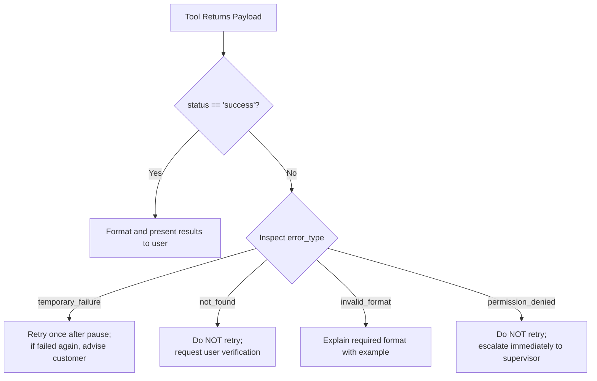

# The Solution: Strategic Instruction Design

## Instructions That Guide Tool Usage

> **Reference:** ADK Docs — Referencing Tools in Agent's Instructions
>
> “Within an agent’s instructions, you can directly reference a tool by using its function name... It is crucial to clearly instruct the agent on how to handle different return values that a tool might produce.”
>
> — *ADK Docs*

### What Strategic Instructions Provide

- **Tool Selection Guidance:** Precise triggers for when to select which tool.
- **Error Handling Paths:** Clear instructions for how to react to specific error codes and failure payloads.
- **Sequential Logic:** The required execution order for dependent multi-step workflows.
- **Result Integration:** How to digest tool output payloads into conversational responses.
- **Escalation Paths:** Deterministic criteria for when to escalate to human supervisors.

> **Key Principle:** System instructions should focus on **when, how, and in what sequence** to use tools. Tool docstrings define what individual tools do; instructions define how the agent governs them.

---

## Core Concepts

### 1. Instruction Patterns for Tool Usage

#### Pattern 1: Tool Selection Guide
Explicitly define matching criteria between user intent and tool invocation:

```text
## Tool Selection Guide
- Use check_order_status when the customer inquires about package progress or order status.
- Use process_refund when the customer explicitly requests a refund or return.
- Use lookup_customer when account verification or profile details are needed.

Always verify customer and order existence before taking financial actions.
```

#### Pattern 2: Result Handling
Define operational branching based on tool return values:

```text
When invoking check_order_status:
1. Pass the sanitized order ID.
2. If status is 'success':
   - Provide current shipment status and carrier tracking details.
3. If status is 'error' with error_type 'not_found':
   - Prompt customer to verify the order ID or offer lookup by registered email.
4. If status is 'error' with error_type 'invalid_format':
   - Clarify that order IDs must adhere to the format 'ORD-XXXXX'.
```

#### Pattern 3: Sequential Tool Workflows
Direct the model through multi-stage dependency chains:

```text
## For Refund Processing:
1. FIRST verify order existence using check_order_status.
2. If order is absent, STOP and prompt for corrections.
3. If order is found and status is 'delivered', execute process_refund with order_id and reason.
4. If refund succeeds, confirm the transaction reference number and refund amount.
5. If refund fails, explain policy constraints and offer supervisor escalation.
```

---

### 2. Error Handling Strategies in Instructions

> **Reference:** ADK Docs — Referencing Tools in Agent's Instructions
>
> “It is crucial to clearly instruct the agent on how to handle different return values that a tool might produce. For example, if a tool returns an error message, your instructions should specify whether the agent should retry the operation, give up on the task, or request additional information from the user.”
>
> — *ADK Docs*



| Strategy | Error Condition | System Instruction Behavior |
| :--- | :--- | :--- |
| **Retry vs. Give Up** | `temporary_failure` | Retry once; fail gracefully if downstream network is unresponsive. |
| **User Input Correction** | `invalid_format`, `not_found` | Do not retry with identical inputs. Provide an example format (e.g., `ORD123`) and ask for input. |
| **Immediate Escalation** | `permission_denied`, policy block | Halt execution and dispatch ticket to supervisor. Never hallucinate workarounds. |

---

### 3. Agent-as-Tool Pattern (Preview)

> Full coverage: *Orchestration & Multi-Agent Architecture*

When a subtask demands **complex domain reasoning, judgment, or policy evaluation** rather than fixed programmatic code, delegate the task to another specialized agent wrapped with `AgentTool`.

```python
from google.adk.agents import LlmAgent
from google.adk.tools.agent_tool import AgentTool

# Specialized domain agent
tech_support_agent = LlmAgent(
    model="gemini-flash-latest",
    name="tech_support",
    instruction="You are a technical support specialist. Diagnose hardware and software faults."
)

# Root triage agent delegating to the specialist
main_agent = LlmAgent(
    model="gemini-flash-latest",
    name="customer_service",
    instruction="Route technical diagnostic queries to the tech_support tool. Handle general inquiries directly.",
    tools=[AgentTool(agent=tech_support_agent)]
)
```

| Dimension | Function Tool | Agent-as-Tool |
| :--- | :--- | :--- |
| **Implementation** | Native Python code logic | Specialized `LlmAgent` instance |
| **Execution** | Deterministic calculations, database queries, API calls | Unstructured judgment, creative writing, multi-step sub-reasoning |
| **Example** | `calculate_shipping_cost()` | `tech_support_specialist`, `code_reviewer` |

---

### 4. Coordinating Tools with Session State (Preview)

Tools can coordinate multi-turn actions and enforce stateful constraints via the `tool_context` (`ctx` parameter):

```python
def check_order_status(order_id: str, ctx) -> dict:
    """Checks order status and persists snapshot into state."""
    order = database.get_order(order_id)

    # Cache state across conversation turns
    ctx.session.state["current_order_id"] = order_id
    ctx.session.state["current_order_status"] = order["status"]

    # Increment counter
    count = ctx.session.state.get("orders_checked", 0)
    ctx.session.state["orders_checked"] = count + 1

    return {
        "status": "success",
        "order_id": order_id,
        "order_status": order["status"]
    }
```

---

## Hands-On Example: Customer Support Agent with Coordinated Tools

Build a customer support agent that handles order inquiries, manages refund workflows, and handles escalations.

### Step 1: Create Project
```bash
adk create customer_support
cd customer_support
```

### Step 2: Implement Agent (`agent.py`)

```python
"""
Customer Support Agent with Coordinated Tools
Demonstrates strategic tool combination, error handling, and agent-as-tool pattern.

Reference: https://adk.dev/tools-custom/
"""

import random
from google.adk.agents import LlmAgent

# Simulated Database
ORDERS_DB = {
    "ORD123": {"status": "shipped", "total": 99.99, "customer": "john@email.com"},
    "ORD456": {"status": "processing", "total": 149.99, "customer": "jane@email.com"},
    "ORD789": {"status": "delivered", "total": 249.99, "customer": "bob@email.com"},
}

# Tool 1: Check order status
def check_order_status(order_id: str) -> dict:
    """Checks the current status of a customer's order.

    Use this when a customer asks about their order status or delivery.

    Args:
        order_id (str): The order ID (e.g., "ORD123").

    Returns:
        dict: Order status information.
            On success: {'status': 'success', 'order_status': '...', 'details': {...}}
            On error: {'status': 'error', 'error_type': 'not_found'/'invalid_format'}
    """
    if not order_id.startswith("ORD"):
        return {
            "status": "error",
            "error_type": "invalid_format",
            "error_message": "Order IDs must start with 'ORD' (e.g., ORD123)"
        }

    if order_id not in ORDERS_DB:
        return {
            "status": "error",
            "error_type": "not_found",
            "error_message": f"Order {order_id} not found in system"
        }

    order = ORDERS_DB[order_id]
    return {
        "status": "success",
        "order_id": order_id,
        "order_status": order["status"],
        "details": order
    }

# Tool 2: Process refund
def process_refund(order_id: str, reason: str) -> dict:
    """Processes a refund request for an order.

    Use this ONLY after verifying the order exists with check_order_status.

    Args:
        order_id (str): The order ID to refund.
        reason (str): Customer's reason for refund.

    Returns:
        dict: Refund processing result.
            On success: {'status': 'success', 'refund_amount': X, 'reference': 'REF###'}
            On error: {'status': 'error', 'error_type': 'order_not_found'/'cannot_refund'}
    """
    if order_id not in ORDERS_DB:
        return {
            "status": "error",
            "error_type": "order_not_found",
            "error_message": f"Cannot process refund - order {order_id} not found"
        }

    order = ORDERS_DB[order_id]

    if order["status"] == "delivered":
        return {
            "status": "success",
            "refund_amount": order["total"],
            "reference": f"REF{order_id[3:]}",
            "estimated_days": 5,
            "message": "Refund processed successfully"
        }
    else:
        return {
            "status": "error",
            "error_type": "cannot_refund",
            "error_message": f"Cannot refund order in '{order['status']}' status. Only delivered orders can be refunded."
        }

# Tool 3: Escalate to supervisor
def escalate_to_supervisor(issue_summary: str, order_id: str) -> dict:
    """Escalates complex issues to a human supervisor.

    Use this when you cannot resolve the customer's issue with available tools
    or when the customer explicitly requests to speak with a supervisor.

    Args:
        issue_summary (str): Brief summary of the issue (1-2 sentences).
        order_id (str): Related order ID if applicable.

    Returns:
        dict: Escalation confirmation.
            Always returns: {'status': 'success', 'ticket_id': 'TICKET###'}
    """
    ticket_id = f"TICKET{random.randint(1000, 9999)}"
    return {
        "status": "success",
        "ticket_id": ticket_id,
        "message": "Issue escalated to supervisor",
        "estimated_response": "within 2 hours",
        "order_id": order_id if order_id else "N/A"
    }

# Create customer support agent with strategic instructions
root_agent = LlmAgent(
    model="gemini-flash-latest",
    name="customer_support_agent",
    description="Handles customer inquiries about orders and refunds with comprehensive error handling.",
    instruction="""
    You are a helpful and empathetic customer support agent for an e-commerce company.

    # Your Capabilities
    You have three tools available:
    1. check_order_status(order_id) - Check the status of an order
    2. process_refund(order_id, reason) - Process refund requests
    3. escalate_to_supervisor(issue_summary, order_id) - Escalate complex issues

    # Workflow Guidelines

    ## For Order Status Inquiries:
    1. Greet the customer warmly
    2. Use check_order_status with the order ID they provide
    3. Handle the result:
       - If status='success': Provide clear status update with details
       - If error_type='not_found': Politely ask customer to verify the order ID
       - If error_type='invalid_format': Explain that order IDs start with "ORD" (example: ORD123)

    ## For Refund Requests:
    1. Express empathy for their situation
    2. FIRST use check_order_status to verify the order exists
    3. If order not found, cannot proceed with refund - ask customer to verify order ID
    4. If order exists, use process_refund with the order_id and customer's reason
    5. Handle refund result:
       - If status='success': Confirm the refund with reference number, amount, and timeframe
       - If error_type='cannot_refund': Explain why (order status) and offer alternatives or escalation
       - If error_type='order_not_found': This shouldn't happen if step 2 succeeded, but apologize and verify

    ## Error Handling Strategy:

    For 'not_found' errors:
    - Ask customer to double-check the order ID
    - Offer to search by email if they have it
    - Be patient and helpful

    For 'invalid_format' errors:
    - Politely explain the correct format: "ORD" followed by numbers
    - Provide an example: ORD123
    - Ask them to provide the order ID in correct format

    For 'cannot_refund' errors:
    - Explain the policy clearly (only delivered orders can be refunded)
    - Show empathy for their frustration
    - Offer to escalate to supervisor if they want an exception

    ## When to Escalate:
    Use escalate_to_supervisor when:
    - Customer is frustrated or angry and requests supervisor
    - Issue cannot be resolved with available tools
    - Customer requests policy exception
    - Multiple tool attempts have failed
    - Customer specifically asks to speak with a manager

    After escalating:
    - Provide the ticket ID
    - Tell them expected response time
    - Thank them for their patience

    # Communication Style
    - Always be polite, professional, and empathetic
    - Use the customer's name if you know it
    - Provide clear next steps
    - Acknowledge their feelings (frustration, concern)
    - Thank them for their patience
    - Never make promises you can't keep
    """,
    tools=[check_order_status, process_refund, escalate_to_supervisor]
)
```

### Step 3: Run and Test
```bash
adk web
```

### Step 4: Test Scenarios
1. **Format Validation:** *"Check order 123 for me"* → Calls `check_order_status("123")` → Catches `invalid_format` error and politely explains that IDs must start with `ORD`.
2. **Multi-Tool Sequence:** *"I'd like to refund order ORD789 because the product was damaged"* → Calls `check_order_status("ORD789")` first, confirms `delivered` status, then calls `process_refund`, and presents refund confirmation.
3. **Policy Enforcement & Escalation:** *"Refund order ORD456 please"* → Inspects order status (`processing`), returns `cannot_refund` policy error, and offers supervisor escalation with a ticket.

---

## Production Quality Checklist

### Tool Design
- [x] Descriptive function names adhering to verb-noun patterns (`check_order_status`, `process_refund`).
- [x] Full type hints for all parameters and return dictionaries.
- [x] Comprehensive docstrings documenting purpose, argument schemas, and return structures.
- [x] Standardized dictionary returns including `"status": "success"` or `"status": "error"`.
- [x] Granular `error_type` indicators in error responses.

### Instruction Design
- [x] Explicit tool selection triggers mapped to user intents.
- [x] Multi-step workflows documenting strict order of operations.
- [x] Concrete actions mapped to every error type.
- [x] Clear criteria and procedures for human escalation.
