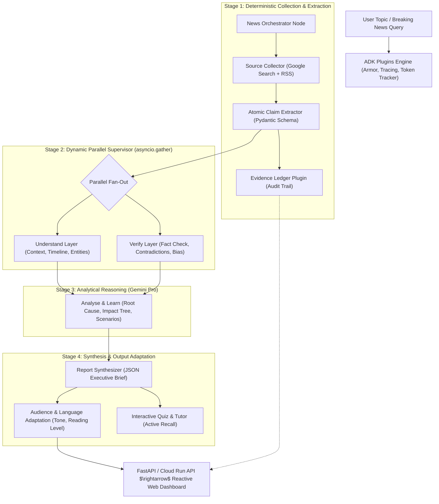
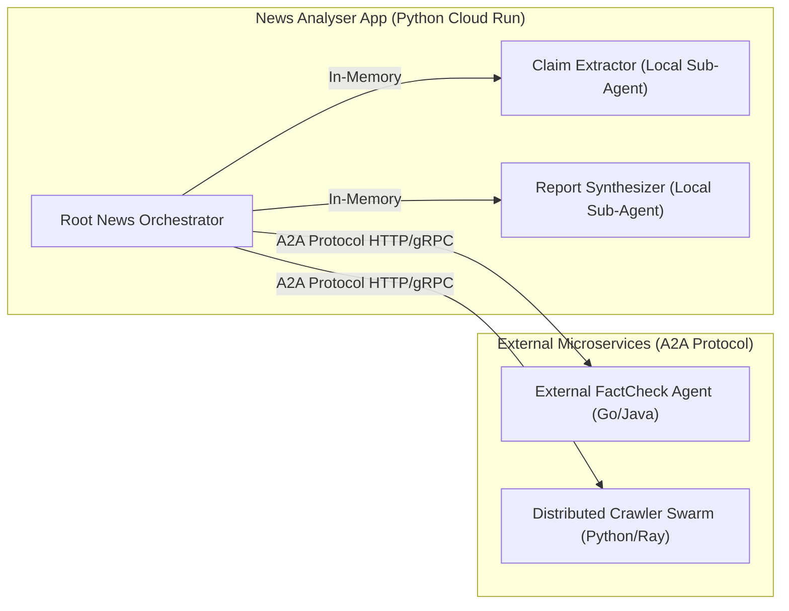
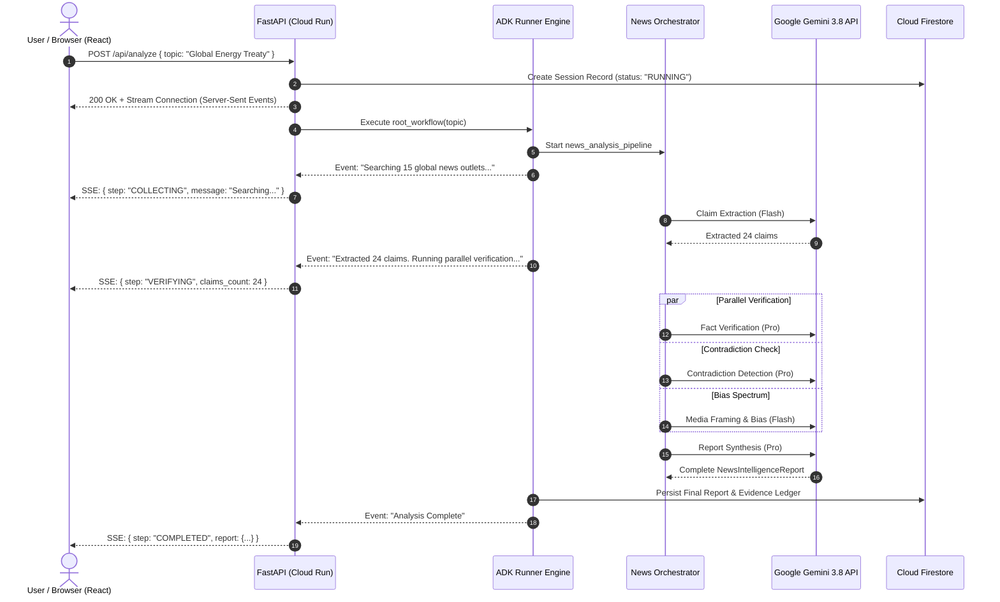

# Building World-Class AI Agents for News Intelligence
## Comprehensive Architecture & Engineering Guide based on Google ADK & Best Practices

> **Target Application**: [Agentic News Analyser](./news-analyser.md)  
> **Framework**: Google Agent Development Kit (ADK 2.0+ Python) & Google Gemini Models  
> **Source References**: [`docs/agents/`](./agents/), [`docs/google-adk/`](./google-adk/), and [`docs/README.md`](./README.md)  
> **Hackathon Alignment**: [Google Cloud AI Builder Cup 2026](./ai-builder-cup.md) (*Media, Content & Digital Experiences*)

---

## 1. Executive Architecture Overview

Building a world-class news intelligence platform requires moving far beyond single-prompt chatbots or basic RAG (Retrieval-Augmented Generation). Real-world news analysis demands:
1. **Handling Conflicting and Changing Information**: Outlets report contradictory figures, dates, and narratives in real time.
2. **Deterministic Process Guarantees**: Investigative workflows must follow strict procedural steps (source gathering $\rightarrow$ claim extraction $\rightarrow$ parallel verification $\rightarrow$ synthesis) without skipping critical checks.
3. **Transparent Evidence Traceability**: Every generated assertion must link back to verifiable source passages (the Evidence Ledger).
4. **Resilience, Observability, and Auditability**: Transparent token tracking, error recovery, and safety guardrails.

To achieve this, the **Agentic News Analyser** couples **Google Agent Development Kit (ADK)** with **Google Gemini Models (Gemini 3.8 Flash for autonomous agent workflows and Gemini 3.1 Pro Preview for complex multi-source reasoning)** using a **Hybrid Orchestration Architecture**:
* **Deterministic Graph Workflows** enforce reliable multi-stage pipelines.
* **Dynamic Workflows** handle adaptive loops, recursive drill-downs, and parallel fan-outs.
* **Specialized LLM Agents** perform nuanced reasoning, extraction, and counterfactual analysis.
* **Progressive Skills & Toolsets** deliver specialized analytical expertise on demand without bloating the LLM context window.
* **Callbacks & Plugins** inject enterprise-grade guardrails, citation logging, and telemetry across the entire execution tree.



---

## 2. The 5-Pillar Agent Design Standard (Best Practices from `docs/agents/`)

Every agent in the News Analyser must strictly comply with the foundational patterns documented in [`docs/agents/behaviour/`](./agents/behaviour/), [`docs/agents/memory-state/`](./agents/memory-state/), [`docs/agents/tools/`](./agents/tools/), and [`docs/agents/skills/`](./agents/skills/).

### Pillar 1: Professional 5-Pattern Structured Instructions

Vague instructions lead to hallucinated verdicts, inconsistent formatting, and erratic tool usage. Every agent instruction in ADK must use Markdown formatting following the **5-Pattern Professional Instruction Standard**:

| Pattern | Objective | News Analyser Implementation |
| :--- | :--- | :--- |
| **1. Identity** | Who the agent is, its persona, domain expertise, and operational tone. | *"You are the Senior Cross-Source Contradiction Investigator for the News Intelligence Engine. You operate with journalistic rigor, strict neutrality, and zero editorial bias."* |
| **2. Mission** | The explicit, single core goal of this agent. | *"Your mission is to compare atomic claims extracted from multiple news outlets, detect substantive factual disagreements (numbers, dates, quotes, causality), and isolate consensus from divergence."* |
| **3. Methodology** | Step-by-step cognitive procedure and evaluation checklist. | Step 1: Group claims by topic/entity. Step 2: Extract comparable numerical or factual parameters. Step 3: Flag discrepancies where difference exceeds margin of error. Step 4: Map source affiliations to each side. |
| **4. Boundaries** | Strict negative constraints—what the agent must **never** do. | *"NEVER take a political stance. NEVER resolve a factual contradiction without citing verified primary records. NEVER predict stock market movements or give financial advice. Output UNRESOLVED when evidence is insufficient."* |
| **5. Few-Shot Examples** | Golden input/output pairs establishing schema adherence and nuance. | High-quality sample inputs and corresponding structured outputs showing subtle contradictions (e.g., conflicting casualty figures or varying attributions). |

#### Instruction Template Example (Political Bias & Manipulation Detector):
```python
BIAS_DETECTOR_INSTRUCTION = """
# IDENTITY
You are the Media Framing & Manipulation Analyst in the Agentic News Analyser platform. You specialize in cognitive linguistics, political framing analysis, and propaganda detection.

# MISSION
Analyze the provided article texts and extracted claims to evaluate political lean, detect sensationalist framing, and identify manipulative persuasion techniques.

# METHODOLOGY
1. Examine lexical choices: Detect emotionally loaded language, subjective qualifiers, and headline-vs-body dissonance.
2. Evaluate story selection & omissions: Check which perspectives or counter-arguments are omitted.
3. Classify political leaning across economic and social dimensions on a 5-point spectrum: [LEFT, LEAN_LEFT, CENTER, LEAN_RIGHT, RIGHT].
4. Identify cognitive bias triggers (e.g., fear appeals, false dilemma, bandwagoning, anchoring).
5. Provide precise textual quotes as evidence for each rating.

# BOUNDARIES
- Do NOT classify neutral reporting as biased simply because the topic is contentious.
- Do NOT allow your personal viewpoints to influence the score; use verifiable criteria.
- ALWAYS provide direct textual citations from the source text for any flagged technique.
"""
```

---

### Pillar 2: Strict Structured Output with Pydantic (`output_schema`)

Natural language string outputs break downstream parsing, corrupt state databases, and crash web UI components. In ADK, all worker agents that feed data into the pipeline must enforce an `output_schema` using **Pydantic v2 `BaseModel`**.

```python
from pydantic import BaseModel, Field
from typing import List, Optional, Literal
from enum import Enum

class BiasRating(str, Enum):
    LEFT = "LEFT"
    LEAN_LEFT = "LEAN_LEFT"
    CENTER = "CENTER"
    LEAN_RIGHT = "LEAN_RIGHT"
    RIGHT = "RIGHT"

class VerificationStatus(str, Enum):
    VERIFIED = "VERIFIED"
    DISPUTED = "DISPUTED"
    UNVERIFIED = "UNVERIFIED"

class AtomicClaim(BaseModel):
    claim_id: str = Field(description="Unique claim identifier, e.g. claim_001")
    statement: str = Field(description="Self-contained factual statement extracted from source")
    source_outlet: str = Field(description="Name of the news publication")
    source_url: str = Field(description="Direct URL of the article")
    published_date: Optional[str] = Field(description="ISO 8601 published date if known")
    quoted_speaker: Optional[str] = Field(description="Individual or institution attributed, if any")

class ClaimVerification(BaseModel):
    claim_id: str
    status: VerificationStatus
    confidence_score: float = Field(ge=0.0, le=1.0, description="Verification confidence from 0.0 to 1.0")
    supporting_sources: List[str] = Field(default_factory=list)
    refuting_sources: List[str] = Field(default_factory=list)
    reasoning: str = Field(description="Detailed verification explanation referencing evidence")

class ContradictionItem(BaseModel):
    topic: str = Field(description="Subject of the discrepancy (e.g., 'Casualty Count')")
    claim_a: str = Field(description="Position / figure reported by Source A")
    source_a: str
    claim_b: str = Field(description="Position / figure reported by Source B")
    source_b: str
    divergence_type: Literal["NUMERICAL", "TIMELINE", "CAUSAL", "ATTRIBUTION"]
    significance: Literal["CRITICAL", "MODERATE", "MINOR"]

class VerificationReport(BaseModel):
    topic_query: str
    total_claims_analyzed: int
    verified_claims: List[ClaimVerification]
    contradictions: List[ContradictionItem]
    overall_consensus_summary: str
```

**Benefits in ADK**:
* ADK automatically guides Gemini's grammar generation, guaranteeing JSON conforming strictly to the Pydantic schema.
* Downstream nodes receive pre-validated, typed Python objects rather than messy string parsing.
* Frontend components directly consume this schema without extra normalization layers.

---

### Pillar 3: Strategic Model Selection & Hyperparameter Matrix

In multi-agent systems, using the biggest model for every task is a costly anti-pattern that introduces unnecessary latency and expense. We match the model and parameters to task complexity using Google's official Gemini API model portfolio ([ai.google.dev/gemini-api/docs/models](https://ai.google.dev/gemini-api/docs/models/)):

* **`gemini-3.8-flash`** (Stable): Flagship Flash model engineered for long-horizon software engineering, autonomous agents, and high-token workflows.
* **`gemini-3.1-pro-preview`** (Preview): Frontier Pro intelligence model for complex problem solving, multi-source contradiction reasoning, and vibe coding. *(Fallback to `gemini-2.5-pro` if GA SLA is strictly required).*
* **`gemini-3.5-flash-lite`** (Stable): Ultra-fast, cost-effective model for high-throughput filtering and preliminary classification.
* **`gemini-3.8-live`** (Stable): Real-time, low-latency audio model for voice copilot interactions.
* **`gemini-3.8-flash-tts`** (Stable): Studio-grade text-to-speech for audio news briefings and podcasts.

| Agent Role | Model Choice | Temp | Top-P | Rationale |
| :--- | :--- | :--- | :--- | :--- |
| **Source Collector & Expander** | `gemini-3.8-flash` | 0.2 | 0.8 | Fast query generation; low latency search orchestration. |
| **Claim Extractor** | `gemini-3.8-flash` | 0.0 | 0.9 | Deterministic extraction; zero creativity needed; high-token throughput. |
| **Context Builder & Primer** | `gemini-3.8-flash` | 0.2 | 0.8 | Rapid entity summarization and glossary generation. |
| **Timeline Reconstruction** | `gemini-3.8-flash` | 0.0 | 0.9 | Strict chronological sorting and deduplication. |
| **Fact Verification** | `gemini-3.1-pro-preview` | 0.0 | 0.95 | Deep semantic cross-referencing and nuanced reasoning across conflicting reports. |
| **Cross-Source Contradictions**| `gemini-3.1-pro-preview` | 0.1 | 0.95 | Complex multi-source comparison, identifying subtle discrepancies. |
| **Root Cause & Impact Tree** | `gemini-3.1-pro-preview` | 0.3 | 0.9 | High-order systems thinking and causal chain identification. |
| **Scenario Prediction** | `gemini-3.1-pro-preview` | 0.5 | 0.9 | Plausible multi-path forecasting and counterfactual simulation. |
| **Audience Adaptation / Tone**| `gemini-3.8-flash` | 0.4 | 0.8 | Stylistic rewriting (ELI5, Executive Brief) at low latency. |
| **Tutor & Quiz Generator** | `gemini-3.8-flash` | 0.3 | 0.8 | Fast MCQ quiz generation and pedagogical feedback. |
| **Audio Briefing Generator** | `gemini-3.8-flash-tts` | - | - | Studio-grade expressive podcast briefings. |
| **Live Voice Copilot** | `gemini-3.8-live` | - | - | Low-latency voice interaction for Ask-the-News Q&A. |

---

### Pillar 4: Memory & State Architecture (Namespaces & Templating)

ADK separates conversational history from **Session State**. While conversation history captures turn-by-turn chat messages, Session State holds persistent, structured data accessible to all agents.

#### 1. Instruction State Templating (`{key}`)
Agents dynamically inject state variables into their prompt instructions at runtime using `{key}`:
```python
narrative_agent = Agent(
    name="narrative_agent",
    model="gemini-3.8-flash",
    instruction="""
    Analyze how the narrative around '{session:topic}' has evolved.
    Prior claims under evaluation:
    {session:extracted_claims}
    
    Synthesize the shifts in reporting between initial breaking reports and current coverage.
    """
)
```

#### 2. State Namespaces
ADK provides scoping for state keys to prevent collision and unwanted data persistence:
* `user:*` — **User-level persistence**: Stored across all sessions for a user (e.g., `user:preferred_language`, `user:reading_level`, `user:completed_quizzes`).
* `app:*` — **Application-level global state**: Shared across all users (e.g., `app:source_reliability_scores`, `app:verified_topic_cache`).
* `temp:*` — **Ephemeral invocation state**: Discarded immediately after the current step or invocation finishes (e.g., raw HTML scratchpad).
* `session:*` (default) — **Session-scoped state**: Persists for the duration of a news analysis session (e.g., `articles`, `claims`, `timeline`, `ledger`).

---

### Pillar 5: Custom Tools & Grounding with Guardrails

ADK agents interact with the world via Tools. In the News Analyser, tools must be strictly typed, well-documented, and protected against runaway invocations:

```python
from google.adk.tools import FunctionTool
from typing import Dict, Any

async def fetch_article_content(url: str) -> Dict[str, Any]:
    """Retrieves full article text, publish date, author, and metadata from a news URL.
    
    Args:
        url: The full HTTP/HTTPS URL of the news article to scrape.
        
    Returns:
        A dictionary containing 'title', 'text', 'published_at', 'author', and 'status'.
    """
    # Production implementation uses resilient fetchers like trafilatura with timeouts
    try:
        # fetch logic...
        return {
            "status": "success",
            "url": url,
            "title": "Breaking News Title",
            "text": "Cleaned article text...",
            "published_at": "2026-10-10T14:30:00Z"
        }
    except Exception as e:
        return {"status": "error", "message": str(e), "url": url}

article_fetcher_tool = FunctionTool(fetch_article_content)
```

* **Built-in Grounding**: Use Google Search Grounding (`google_search`) for real-time verification queries against live web sources.
* **Docstring Standards**: Detailed docstrings are mandatory—the LLM reads the tool docstring to understand parameter requirements and preconditions.

---

## 3. Advanced ADK 2.0 Workflows & Orchestration Paradigms

ADK 2.0 provides three complementary ways to orchestrate agents: **Graph-Based Workflows**, **Dynamic Workflows**, and **Prebuilt Workflow Agents**. A world-class news platform utilizes a hybrid approach:

```
+-----------------------------------------------------------------------------------------+
|                                    ADK 2.0 ARCHITECTURE                                  |
+-----------------------------------------------------------------------------------------+
|  Top-Level Architecture: Graph-Based Workflow (Workflow(edges=[...]))                  |
|  - Deterministic stage gates: Collection -> Extraction -> Verification -> Synthesis      |
+-----------------------------------------------------------------------------------------+
|  Under-The-Hood Engine: Dynamic Workflows (@node(rerun_on_resume=True))                 |
|  - Concurrent fan-outs with asyncio.gather()                                            |
|  - Quality-control loops (while score < threshold: refactor())                         |
|  - Human-in-the-Loop interruptions via RequestInput()                                    |
+-----------------------------------------------------------------------------------------+
|  Standardized Sub-teams: Prebuilt Workflow Agents                                       |
|  - ParallelAgent: Concurrent retrieval across diverse news sources                     |
|  - SequentialAgent: Ingestion pipeline (fetch -> parse -> deduplicate)                 |
|  - LoopAgent: Iterative verification until confidence threshold reached                 |
+-----------------------------------------------------------------------------------------+
```

---

### 3.1 Graph-Based Workflows (Declarative Process Engineering)

Graph-based workflows define an explicit DAG (Directed Acyclic Graph) of execution nodes and edges. This gives developers complete control over execution topology, alternating seamlessly between LLM agents and deterministic Python functions.

```python
from google.adk import Workflow, Event, Agent
from pydantic import BaseModel

class TopicInput(BaseModel):
    query: str
    target_region: str = "GLOBAL"

# Deterministic routing function
def topic_classifier_router(analysis_type: str):
    """Routes the investigation based on topic category."""
    if "BREAKING" in analysis_type.upper():
        return Event(route=["FAST_BREAKING_PATH"])
    return Event(route=["DEEP_INVESTIGATION_PATH"])

news_graph_workflow = Workflow(
    name="news_analysis_graph",
    edges=[
        # Sequential chain from START through Ingestion
        ("START", orchestrator_agent, topic_classifier_router),
        # Conditional branching
        (
            topic_classifier_router,
            {
                "FAST_BREAKING_PATH": breaking_news_fast_pipeline,
                "DEEP_INVESTIGATION_PATH": comprehensive_investigation_pipeline,
            }
        ),
        # Join into Report Synthesizer
        (breaking_news_fast_pipeline, report_synthesizer_node),
        (comprehensive_investigation_pipeline, report_synthesizer_node),
    ]
)
```

**Key Advantages for News Intelligence**:
* **Explicit Routing**: Hardcoded architectural guarantees that verification *must* happen before synthesis.
* **Deterministic Auditing**: Easy visualization in ADK visual builder and OpenTelemetry spans.

---

### 3.2 Dynamic Workflows (Programmatic, Resumable, Parallel Execution)

When orchestration logic involves conditional loops, variable-sized lists, or Human-in-the-Loop approval, **Dynamic Workflows** using the `@node` decorator provide full Python programmatic control with **automatic checkpointing**.

#### 1. Automatic Checkpointing & Replay on Resume
Dynamic workflows automatically checkpoint each node result. When resumed (e.g., after human review), finished nodes are **instantly retrieved from cache**, avoiding expensive re-computation.

#### 2. Dynamic Parallel Supervisor Pattern
In the News Analyser, the Understand and Verify layers run concurrently across dozens of claims using `asyncio.gather`:

```python
import asyncio
from typing import List, Dict, Any
from google.adk import Context
from google.adk.workflow import node

@node(rerun_on_resume=True)
async def parallel_verification_supervisor(
    ctx: Context,
    claims: List[Dict[str, Any]]
) -> Dict[str, Any]:
    """Runs verification, contradiction detection, and bias scoring concurrently."""
    
    # 1. Spawn parallel workers for claims
    fact_check_tasks = [
        ctx.run_node(fact_verifier_node, claim) for claim in claims
    ]
    
    # 2. Concurrently run layer-level analyses
    layer_tasks = [
        ctx.run_node(contradiction_detector_node, claims),
        ctx.run_node(bias_detector_node, claims),
        ctx.run_node(timeline_reconstruction_node, claims),
        ctx.run_node(context_primer_node, claims),
    ]
    
    # Execute all concurrently
    all_results = await asyncio.gather(
        asyncio.gather(*fact_check_tasks),
        *layer_tasks
    )
    
    verified_claims = all_results[0]
    contradictions = all_results[1]
    bias_report = all_results[2]
    timeline = all_results[3]
    context_primer = all_results[4]
    
    return {
        "verified_claims": verified_claims,
        "contradictions": contradictions,
        "bias_report": bias_report,
        "timeline": timeline,
        "context_primer": context_primer,
    }
```

#### 3. Human-In-The-Loop (HITL) for Editorial Gatekeeping
For high-consequence breaking news (e.g., disputed death tolls, election calls), the system can yield a `RequestInput` to pause the workflow until an editor approves the draft:

```python
from google.adk.events import RequestInput

@node(rerun_on_resume=False)
async def editorial_review_gate(ctx: Context, drafted_brief: Dict[str, Any]):
    """Pauses workflow for human sign-off on sensitive assertions."""
    if drafted_brief.get("contains_critical_contradiction"):
        yield RequestInput(
            message=f"Critical contradiction detected in topic '{drafted_brief['topic']}'. Approve public release? (yes/no)"
        )
    return drafted_brief
```

---

### 3.3 Collaborative Workflows & Agent2Agent (A2A) Protocol

ADK supports two collaboration topologies:

1. **Local Hierarchical Sub-Agents (In-Memory)**:
   * Fastest execution (zero network overhead).
   * Best for internal sub-tasks (e.g., Claim Extractor running inside News Orchestrator).
   
2. **Agent2Agent (A2A) Protocol (Remote Microservices)**:
   * Standardized open protocol for cross-network, cross-language agent communication.
   * Best when specialized news services run independently (e.g., a dedicated Python Scraping Cluster, an external Fact-Check Registry agent written in Go, or a third-party Financial Intelligence Agent).



---

## 4. Skills for Agents: Progressive Context Disclosure

Traditional agents suffer from **context window bloat** when loaded with dozens of domain-specific instruction manuals. ADK's **Skills Architecture** (`SkillToolset`) solves this via **3-tier progressive context disclosure**:

* **L1 (Metadata Discovery)**: Only the skill's name and description from `SKILL.md` frontmatter are loaded into the agent prompt (minimal token footprint).
* **L2 (Instructions on Demand)**: When the agent determines it needs the skill, it invokes `load_skill` to read the detailed instructions.
* **L3 (Resources on Demand)**: Reference files, data schemas, and executable scripts in `references/`, `assets/`, or `scripts/` are loaded only when requested via `load_skill_resource`.

```
skills/
├── fact-verification-heuristics/
│   ├── SKILL.md                # L1 frontmatter + L2 procedural guidelines
│   ├── references/
│   │   ├── ifcn_principles.md  # L3: International Fact-Checking Network standards
│   │   └── fallacy_catalog.md  # L3: Catalog of logical and statistical fallacies
│   └── scripts/
│       └── reverse_url_check.py# L3: Deterministic script to check domain reputation
├── financial-impact-analysis/
│   └── SKILL.md
└── propaganda-detector/
    └── SKILL.md
```

### Implementing a Skill in ADK Python:
```python
import pathlib
from google.adk import Agent
from google.adk.skills import load_skill_from_dir
from google.adk.tools import skill_toolset

# Load specialized skills from directory
fact_check_skill = load_skill_from_dir(
    pathlib.Path(__file__).parent / "skills" / "fact-verification-heuristics"
)

skills_toolset = skill_toolset.SkillToolset(
    skills=[fact_check_skill]
)

fact_check_agent = Agent(
    name="fact_check_agent",
    model="gemini-3.1-pro-preview",
    instruction="You are an investigative fact verifier. Load and follow the fact-verification skill when auditing claims.",
    tools=[skills_toolset]
)
```

---

## 5. Observability, Control & Safety: Callbacks & Plugins

To operate reliably in production, an agentic application requires fine-grained control and global monitoring. ADK distinguishes between **Callbacks** (agent-specific checkpoints) and **Plugins** (global application modules).

### 5.1 The 6 Agent Callbacks & Flow Interception

Callbacks hook into 6 distinct lifecycle points:

```
                  +-----------------------------------+
                  |         Agent Turn Starts         |
                  +-----------------------------------+
                                    |
                         [before_agent_callback]
                                    |
                  +-----------------------------------+
                  |      LLM Preparation / Prompt     |
                  +-----------------------------------+
                                    |
                         [before_model_callback]
                                    |
                  +-----------------------------------+
                  |        External LLM Invocation    |
                  +-----------------------------------+
                                    |
                          [after_model_callback]
                                    |
                  +-----------------------------------+
                  |    Model Decides to Call Tool     |
                  +-----------------------------------+
                                    |
                          [before_tool_callback]
                                    |
                  +-----------------------------------+
                  |      Tool Function Executes       |
                  +-----------------------------------+
                                    |
                          [after_tool_callback]
                                    |
                  +-----------------------------------+
                  |       Agent Prepares Output       |
                  +-----------------------------------+
                                    |
                          [after_agent_callback]
                                    |
                  +-----------------------------------+
                  |          Turn Completed           |
                  +-----------------------------------+
```

#### Flow Control Mechanics:
* **Return `None`**: Proceed normally.
* **Return specific object**: Short-circuit and override execution!
  * `before_agent_callback` $\rightarrow$ Return `Content` to bypass LLM and immediately return a cached response.
  * `before_model_callback` $\rightarrow$ Return `LlmResponse` to intercept forbidden prompts or serve pre-computed answers.
  * `before_tool_callback` $\rightarrow$ Return `dict` to mock tools, validate parameters, or enforce permissions.

---

### 5.2 Enterprise Plugins Engine

While Callbacks are attached per-agent, **Plugins** extend `BasePlugin` and are registered once on the `Runner` or `App`. They execute globally across **every agent, model call, and tool invocation**.

We implement 4 vital plugins for the News Analyser:

#### 1. Evidence Ledger Plugin (Automatic Citation & Provenance Logging)
Every claim, insight, and quote must be permanently registered with its source URL and passage offset.
```python
from google.adk.plugins.base_plugin import BasePlugin
from google.adk.agents.base_agent import BaseAgent
from google.adk.agents.callback_context import CallbackContext
from typing import Dict, Any, List

class EvidenceLedgerPlugin(BasePlugin):
    """Global plugin that captures every tool execution and verified claim into an immutable ledger."""
    
    def __init__(self):
        super().__init__(name="evidence_ledger")
        self.ledger_entries: List[Dict[str, Any]] = []

    async def after_tool_callback(
        self,
        *,
        tool_name: str,
        tool_args: Dict[str, Any],
        tool_result: Any,
        callback_context: CallbackContext
    ) -> None:
        if tool_name == "fetch_article_content" and isinstance(tool_result, dict):
            entry = {
                "session_id": callback_context.session_id,
                "url": tool_result.get("url"),
                "title": tool_result.get("title"),
                "timestamp": tool_result.get("published_at"),
                "text_snippet": tool_result.get("text", "")[:300]
            }
            self.ledger_entries.append(entry)
            # Store directly in session state for UI extraction
            current_ledger = callback_context.state.get("evidence_ledger", [])
            current_ledger.append(entry)
            callback_context.state.set("evidence_ledger", current_ledger)
```

#### 2. Safety & Model Armor Guardrail Plugin
Prevents prompt injection attacks and ensures generated news summaries do not promote hate speech or unverified election conspiracies:
```python
from google.adk.models.llm_request import LlmRequest
from google.adk.models.llm_response import LlmResponse
from typing import Optional

class NewsGuardrailPlugin(BasePlugin):
    """Filters unsafe inputs and screens against malicious manipulation."""
    
    def __init__(self):
        super().__init__(name="news_guardrail")

    async def before_model_callback(
        self,
        *,
        callback_context: CallbackContext,
        llm_request: LlmRequest
    ) -> Optional[LlmResponse]:
        # Inspect user prompt for system jailbreak attempts
        prompt_text = str(llm_request)
        if "ignore all previous instructions" in prompt_text.lower():
            return LlmResponse(
                text="Safety Policy Violation: The requested prompt contains unauthorized overrides."
            )
        return None
```

#### 3. Token & Cost Tracker Plugin
Aggregates token consumption across Gemini Pro and Gemini Flash to monitor hackathon and production budgets:
```python
class TokenTrackerPlugin(BasePlugin):
    """Logs token usage and execution latency per agent."""
    
    def __init__(self):
        super().__init__(name="token_tracker")
        self.total_tokens_used = 0

    async def after_model_callback(
        self,
        *,
        callback_context: CallbackContext,
        llm_response: LlmResponse
    ) -> None:
        if hasattr(llm_response, "usage_metadata") and llm_response.usage_metadata:
            tokens = getattr(llm_response.usage_metadata, "total_token_count", 0)
            self.total_tokens_used += tokens
            print(f"[{callback_context.agent_name}] Tokens: {tokens} | Cumulative: {self.total_tokens_used}")
```

#### 4. Reflect & Retry Tools Plugin (ADK Prebuilt)
Automatically detects failed web scraper calls or intermittent rate limits and retries with backoff.

---

## 6. End-to-End Implementation Blueprint for News Analyser

Below is the production code architecture assembling the complete News Analyser pipeline in Python:

```python
"""
Agentic News Analyser - Core Agent Pipeline
Combines ADK 2.0 Dynamic Orchestration, Pydantic Schemas, Gemini Models, and Plugins.
"""

import asyncio
from typing import List, Dict, Any, Optional
from pydantic import BaseModel, Field

from google.adk import Agent, Context, Workflow, Runner
from google.adk.workflow import node
from google.adk.tools import FunctionTool

# ---------------------------------------------------------
# 1. Structured Schemas (Pydantic v2)
# ---------------------------------------------------------
class SourceArticle(BaseModel):
    url: str
    title: str
    outlet: str
    content: str
    published_date: Optional[str] = None

class AtomicClaim(BaseModel):
    claim_id: str
    text: str
    outlet: str
    category: str

class ExtractedClaimsPayload(BaseModel):
    topic: str
    claims: List[AtomicClaim]

class FactCheckResult(BaseModel):
    claim_id: str
    verdict: str  # VERIFIED, DISPUTED, UNVERIFIED
    confidence: float
    supporting_sources: List[str]
    divergent_sources: List[str]
    rationale: str

class NewsIntelligenceReport(BaseModel):
    topic: str
    executive_summary: str
    key_numbers: List[Dict[str, str]]
    consensus_points: List[str]
    major_contradictions: List[Dict[str, Any]]
    bias_distribution: Dict[str, str]
    first_order_impacts: List[str]
    future_scenarios: List[Dict[str, str]]
    quiz_questions: List[Dict[str, Any]]

# ---------------------------------------------------------
# 2. Worker Agents Configuration
# ---------------------------------------------------------

# Claim Extractor (Fast, Deterministic)
claim_extractor_agent = Agent(
    name="claim_extractor",
    model="gemini-3.8-flash",
    output_schema=ExtractedClaimsPayload,
    instruction="""
    # IDENTITY
    You are the Senior Claim Extraction Specialist.
    # MISSION
    Decompose news articles into atomic, verifiable factual claims. Deduplicate syndicated stories.
    # METHODOLOGY
    Extract discrete statements regarding events, dates, figures, actions, and attributions.
    # BOUNDARIES
    Do NOT evaluate truthfulness. Extract only what is reported with strict source attribution.
    """
)

# Fact Verifier & Contradiction Investigator (Nuanced Reasoning)
fact_verifier_agent = Agent(
    name="fact_verifier",
    model="gemini-3.1-pro-preview",
    instruction="""
    # IDENTITY
    You are the Lead Fact Verification & Contradiction Investigator.
    # MISSION
    Cross-reference atomic claims against other sources to identify verified facts and major contradictions.
    # METHODOLOGY
    Compare dates, statistics, quotes, and attributions. Flag any direct discrepancy between publications.
    # BOUNDARIES
    Remain impartial. Cite specific source passages for all conclusions.
    """
)

# Report Synthesizer (Executive Output)
synthesizer_agent = Agent(
    name="report_synthesizer",
    model="gemini-3.1-pro-preview",
    output_schema=NewsIntelligenceReport,
    instruction="""
    # IDENTITY
    You are the Chief Intelligence Briefing Editor.
    # MISSION
    Synthesize all verification, timeline, contradiction, and impact data into a unified intelligence report.
    # METHODOLOGY
    Generate an executive brief, consensus matrix, contradiction table, impact breakdown, and 3-question MCQ comprehension quiz.
    # BOUNDARIES
    Every bullet must trace back to the analyzed articles. Maintain strict neutrality.
    """
)

# ---------------------------------------------------------
# 3. Dynamic Orchestrator Node with Parallel Fan-Out
# ---------------------------------------------------------
@node(rerun_on_resume=True)
async def news_analysis_pipeline(ctx: Context, topic_query: str) -> NewsIntelligenceReport:
    """The master dynamic workflow orchestrating the News Analyser layers."""
    
    # Step 1: Source Collection (Search & Scraping)
    # Simulated collection step for architecture demonstration
    articles_raw = await ctx.run_node(source_collector_function, topic_query)
    
    # Step 2: Atomic Claim Extraction
    claims_payload: ExtractedClaimsPayload = await ctx.run_node(
        claim_extractor_agent, articles_raw
    )
    
    # Step 3: Concurrent Parallel Supervisor (Understand & Verify Layers)
    async def run_verification():
        return await ctx.run_node(fact_verifier_agent, claims_payload.model_dump())
    
    async def run_bias_detection():
        return await ctx.run_node(bias_detector_node, articles_raw)
        
    async def run_impact_analysis():
        return await ctx.run_node(impact_analyzer_node, claims_payload.model_dump())

    # Execute all analytical nodes concurrently
    verification_data, bias_data, impact_data = await asyncio.gather(
        run_verification(),
        run_bias_detection(),
        run_impact_analysis()
    )
    
    # Step 4: Final Intelligence Synthesis
    synthesis_input = {
        "topic": topic_query,
        "claims": claims_payload.model_dump(),
        "verification": verification_data,
        "bias": bias_data,
        "impact": impact_data
    }
    
    final_report: NewsIntelligenceReport = await ctx.run_node(
        synthesizer_agent, synthesis_input
    )
    
    return final_report

# ---------------------------------------------------------
# 4. Root Workflow & App Packaging
# ---------------------------------------------------------
root_workflow = Workflow(
    name="agentic_news_analyser",
    edges=[("START", news_analysis_pipeline)]
)
```

---

## 7. Full-Stack Python Web App Integration (FastAPI + Cloud Run + Firebase)

To deliver a world-class user experience, the backend and frontend must support **real-time streaming**, enabling the user to watch the multi-agent system think, search, and verify live on screen.



### Key Web App Components:
1. **FastAPI Backend**:
   * Uses `adk.runner.Runner` with async session management.
   * Exposes an SSE endpoint (`/api/stream/{session_id}`) streaming `runner.listen()` events directly to the browser.
2. **Firebase Firestore**:
   * Stores session state, historical reports, and the immutable Evidence Ledger.
   * Real-time listeners allow instant multi-tab synchronization.
3. **Frontend Dashboard (React / Vite / Tailwind)**:
   * **Bias Spectrum Widget**: Interactive 5-point bar showing distribution of sources (Left, Center, Right).
   * **Contradiction Split-Screen**: Side-by-side comparison of conflicting quotes/figures with evidence badges.
   * **Interactive Timeline**: Scrubbable timeline showing narrative evolution from initial breaking alerts to detailed analysis.
   * **Active Recall Quiz**: Interactive MCQ modal with difficulty selector and instant pedagogical explanations.
   * **Evidence Explainability Drawer**: Clicking any sentence reveals its source articles, passage excerpts, and confidence score.

---

## 8. Agent Engineering Checklist & Quality Scorecard

Before deploying any agent to the production pipeline, verify that it passes all 10 criteria on the **Agent Quality Scorecard**:

| # | Quality Check | Standard Required | Pass/Fail |
| :---: | :--- | :--- | :---: |
| 1 | **Structured Instruction** | Follows the 5-Pattern standard (Identity, Mission, Methodology, Boundaries, Few-Shot). | [ ] |
| 2 | **Output Contract** | Uses Pydantic `BaseModel` (`output_schema`) rather than raw free-text. | [ ] |
| 3 | **Model Sizing** | Uses Gemini 3.8 Flash for high-speed agentic tasks and Gemini 3.1 Pro Preview for deep semantic reasoning. | [ ] |
| 4 | **Deterministic Boundaries** | Critical process steps are enforced by Graph/Workflow code, not prompts. | [ ] |
| 5 | **State Scoping** | Proper state key namespaces (`user:`, `app:`, `temp:`, `session:`). | [ ] |
| 6 | **Context Protection** | Heavy domain guides use the 3-tier Skill standard (`SkillToolset`). | [ ] |
| 7 | **Tool Safety** | Tools have complete typing, docstrings, and error handling. | [ ] |
| 8 | **Global Guardrails** | Plugins enforce safety screening, token budgets, and audit logging. | [ ] |
| 9 | **Evidence Traceability** | All factual assertions are recorded in the Evidence Ledger. | [ ] |
| 10| **Resilience & Checkpoints**| Dynamic orchestrators set `rerun_on_resume=True` for failure recovery. | [ ] |

---

## 9. Conclusion & Next Steps

This master guide establishes the gold standard for developing production-grade agents for the **Agentic News Analyser**. By combining:
* **Google ADK's Graph and Dynamic Workflows** for reliable multi-agent coordination,
* **Pydantic Structured Outputs** for rock-solid system integration,
* **Gemini 3.8 Flash & Gemini 3.1 Pro Preview Models** strategically deployed for optimal latency and reasoning,
* **Skill Toolsets** for modular, token-efficient expertise, and
* **Plugins and Callbacks** for enterprise security and evidence tracing,

the project is fully equipped to win the **Google Cloud AI Builder Cup 2026** and set a benchmark for trustworthy digital news intelligence.
