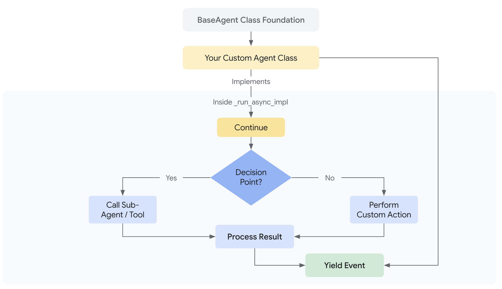

 [ Python](https://github.com/google/adk-python "adk-python on GitHub")[ JS ](https://github.com/google/adk-js "adk-js on GitHub")[ Go ](https://github.com/google/adk-go "adk-go on GitHub")[ Java ](https://github.com/google/adk-java "adk-java on GitHub")[ Kotlin](https://github.com/google/adk-kotlin "adk-kotlin on GitHub")

-   [Home](../..)
-    Build Agents
    
    Build Agents
    
    -   [Get Started](../../get-started/)
        
        Get Started
        
        -   [Python](../../get-started/python/)
        -   [TypeScript](../../get-started/typescript/)
        -   [Go](../../get-started/go/)
        -   [Java](../../get-started/java/)
        -   [Kotlin](../../get-started/kotlin/)
        -   [Agents CLI](../../get-started/agents-cli/)
        -   [Installation](../../get-started/installation/)
        -   [Google Cloud](../../get-started/google-cloud/)
        -   [Migrate to ADK](../../get-started/migrate/)
        
    -   [Build your Agent](../../tutorials/)
        
        Build your Agent
        
        -   [Multi-tool agent](../../tutorials/multi-tool-agent/)
        -   [Agent team](../../tutorials/agent-team/)
        -   [Code with AI](../../tutorials/coding-with-ai/)
        -   [Agent Config](../config/)
        
    -   [Agents](../)
        
        Agents
        
        -   [Simple agents](../llm-agents/)
        -   [Managed agents](../managed-agents/)
        
    -   [Graph Workflows](../../graphs/)
        
        Graph Workflows
        
        -   [Graph routes](../../graphs/routes/)
        -   [Data handling](../../graphs/data-handling/)
        -   [Human input](../../graphs/human-input/)
        -   [Dynamic workflows](../../graphs/dynamic/)
        
    -   [Multi-Agent Workflows](../../workflows/)
        
        Multi-Agent Workflows
        
        -   [Collaborative workflows](../../workflows/collaboration/)
        -   [Template workflows](../workflow-agents/)
            
            Template workflows
            
            -   [Sequential workflow](../workflow-agents/sequential-agents/)
            -   [Loop workflow](../workflow-agents/loop-agents/)
            -   [Parallel workflow](../workflow-agents/parallel-agents/)
            -    Custom template workflows [Custom template workflows](./)
                
                Table of contents
                
                -   [Overview](#overview)
                    
                    -   [Why build Custom Agents?](#why-build-custom-agents)
                    
                -   [Implementing custom logic](#implementing-custom-logic)
                    
                    -   [Key capabilities within the core asynchronous method](#key-capabilities-within-the-core-asynchronous-method)
                    
                -   [Managing sub-agents and state](#managing-sub-agents-and-state)
                -   [Agent-based workflow primitives](#agent-based-workflow-primitives)
                    
                    -   [Agent hierarchy: Parent agents and sub-agents](#agent-hierarchy-parent-agents-and-sub-agents)
                    -   [Workflow agents as orchestrators](#workflow-agents-as-orchestrators)
                    -   [Interaction and communication mechanisms](#interaction-and-communication-mechanisms)
                        
                        -   [Shared session state](#shared-session-state)
                        -   [LLM delegation and agent transfer](#delegation)
                        -   [Explicit invocation with AgentTool](#explicit-invocation-with-agenttool)
                        
                    
                -   [Design pattern example: StoryFlow Agent](#design-pattern-example-storyflow-agent)
                    
                    -   [Part 1: Simplified custom agent initialization](#part-1-simplified-custom-agent-initialization)
                    -   [Part 2: Define custom execution logic](#part-2-define-custom-execution-logic)
                    -   [Part 3: Define LLM sub-agents](#part-3-define-llm-sub-agents)
                    -   [Part 4: Instantiate and run the custom agent](#part-4-instantiate-and-run-the-custom-agent)
                    -   [Storyflow Agent code listing](#storyflow-agent-code-listing)
                    
                
            
        -   [Agent routing](../routing/)
        -   [Workflow patterns](../../workflows/patterns/)
        
    -   [Models for Agents](../models/)
        
        Models for Agents
        
        -   [Gemini](../models/google-gemini/)
            
            Gemini
            
            -   [Deferred scheduling](../models/google-gemini/deferred-schedule/)
            
        -   [Gemma](../models/google-gemma/)
        -   [Claude](../models/anthropic/)
        -   [Agent Platform hosted](../models/agent-platform/)
        -   [Apigee AI Gateway](../models/apigee/)
        -   [Model routing](../models/routing/)
        -   [OpenAI](../models/openai/)
        -   [Ollama](../models/ollama/)
        -   [vLLM](../models/vllm/)
        -   [LiteLLM](../models/litellm/)
        -   [LiteRT-LM](../models/litert-lm/)
        
    
-    Run Agents
    
    Run Agents
    
    -   [Agent Runtime](../../runtime/)
        
        Agent Runtime
        
        -   [Web Interface](../../runtime/web-interface/)
            
            Web Interface
            
            -   [Visual Builder](../../visual-builder/)
            
        -   [Command Line](../../runtime/command-line/)
        -   [API Server](../../runtime/api-server/)
        -   [Ambient Agents](../../runtime/ambient-agents/)
        -   [Resume Agents](../../runtime/resume/)
        -   [Cancel Agent Runs](../../runtime/cancel/)
        -   [Runtime Config](../../runtime/runconfig/)
        -   [Event Loop](../../runtime/event-loop/)
        
    -   [Deployment](../../deploy/)
        
        Deployment
        
        -   [Agent Runtime](../../deploy/agent-runtime/)
            
            Agent Runtime
            
            -   [Standard deployment](../../deploy/agent-runtime/deploy/)
            -   [agents-cli](../../deploy/agent-runtime/agents-cli/)
            -   [Test deployed agents](../../deploy/agent-runtime/test/)
            
        -   [Cloud Run](../../deploy/cloud-run/)
        -   [GKE](../../deploy/gke/)
        
    -   [Observability](../../observability/)
        
        Observability
        
        -   [Logging](../../observability/logging/)
        -   [Metrics](../../observability/metrics/)
        -   [Traces](../../observability/traces/)
        
    -   [Evaluation](../../evaluate/)
        
        Evaluation
        
        -   [Criteria](../../evaluate/criteria/)
        -   [User Simulation](../../evaluate/user-sim/)
        -   [Environment Simulation](../../evaluate/environment_simulation/)
        -   [Custom Metrics](../../evaluate/custom_metrics/)
        -   [Optimization](../../optimize/)
        
    -   [Safety and Security](../../safety/)
        
        Safety and Security
        
    
-    Components
    
    Components
    
    -   [Technical Overview](../../get-started/about/)
    -   [Custom Tools](../../tools-custom/)
        
        Custom Tools
        
        -    Function tools
            
            Function tools
            
            -   [Overview](../../tools-custom/function-tools/)
            -   [Tool performance](../../tools-custom/performance/)
            -   [Action confirmations](../../tools-custom/confirmation/)
            
        -   [MCP tools](../../tools-custom/mcp-tools/)
            
            MCP tools
            
            -   [Advanced configuration](../../tools-custom/mcp-tools/advanced/)
            -   [Deployment](../../tools-custom/mcp-tools/deployment/)
            -   [Agent as MCP server](../../tools-custom/mcp-tools/agent-as-server/)
            -   [Sub-agent delegation](../../tools-custom/mcp-tools/agent-managed/)
            
        -   [OpenAPI tools](../../tools-custom/openapi-tools/)
        -   [Authentication](../../tools-custom/authentication/)
        -   [Tool limitations](../../tools/limitations/)
        
    -   [Artifacts](../../artifacts/)
        
        Artifacts
        
    -   [Skills for Agents](../../skills/)
        
        Skills for Agents
        
    -   [App management](../../apps/)
        
        App management
        
        -   [Callbacks](../../callbacks/)
            
            Callbacks
            
            -   [Types of callbacks](../../callbacks/types-of-callbacks/)
            -   [Callback patterns](../../callbacks/design-patterns-and-best-practices/)
            
        -   [Plugins](../../plugins/)
        
    -   [Agent context](../../context/)
        
        Agent context
        
        -   [Conversational context](../../sessions/)
        -   [Sessions](../../sessions/session/)
            
            Sessions
            
            -   [Rewind sessions](../../sessions/session/rewind/)
            -   [Migrate sessions](../../sessions/session/migrate/)
            
        -   [State](../../sessions/state/)
        -   [Events](../../events/)
        -   [Memory](../../sessions/memory/)
        -   [Context compression](../../context/compaction/)
        -   [Model context caching](../../context/caching/)
        
    -   [A2A Protocol](../../a2a/)
        
        A2A Protocol
        
        -   [Introduction to A2A](../../a2a/intro/)
        -    A2A Quickstart (Exposing)
            
            A2A Quickstart (Exposing)
            
            -   [Python](../../a2a/quickstart-exposing/)
            -   [Go](../../a2a/quickstart-exposing-go/)
            -   [Java](../../a2a/quickstart-exposing-java/)
            
        -    A2A Quickstart (Consuming)
            
            A2A Quickstart (Consuming)
            
            -   [Python](../../a2a/quickstart-consuming/)
            -   [Go](../../a2a/quickstart-consuming-go/)
            -   [Java](../../a2a/quickstart-consuming-java/)
            -   [Kotlin](../../a2a/quickstart-consuming-kotlin/)
            
        -   [A2A Extension](../../a2a/a2a-extension/)
        
    -   [Live and Voice Agents](../../live/)
        
        Live and Voice Agents
        
        -   [Get started](../../live/get-started/)
            
            Get started
            
            -   [Python](../../live/get-started/streaming-python/)
            -   [Java](../../live/get-started/streaming-java/)
            
        -    Building
            
            Building
            
            -   [Workflows](../../live/workflows/)
            -   [Tools](../../live/tools/)
            -   [Sessions](../../live/sessions/)
            -   [Events](../../live/events/)
            -   [Audio and video](../../live/audio-video/)
            -   [Configuration](../../live/configuration/)
            
        -    Production
            
            Production
            
            -   [Guardrails](../../live/guardrails/)
            -   [Evaluation](../../live/evaluation/)
            -   [Build a custom server](../../live/custom-server/)
            
        -   [Supported models](../../live/models/)
        
    -   [Grounding](../../grounding/)
        
        Grounding
        
        -   [Google Search Grounding](../../grounding/google_search_grounding/)
        -   [Grounding with Search](../../grounding/grounding_with_search/)
        
    
-   [Integrations](../../integrations/)
    
    Integrations
    
-    Reference
    
    Reference
    
    -   [API Reference](../../api-reference/)
        
        API Reference
        
        -   [Python ADK](../../api-reference/python/)
        -   [TypeScript ADK](../../api-reference/typescript/)
        -    Go ADK
            
            Go ADK
            
            -   [Go v2.x](https://pkg.go.dev/google.golang.org/adk/v2)
            -   [Go v1.x](https://pkg.go.dev/google.golang.org/adk)
            
        -   [Java ADK](../../api-reference/java/)
        -   [Kotlin ADK](../../api-reference/kotlin/)
        -   [CLI Reference](../../api-reference/cli/)
        -   [Agent Config Reference](../../api-reference/agentconfig/)
        -   [REST API](../../api-reference/rest/)
        
    -   [Release Notes](../../release-notes/)
    
-   [Community](../../community/)
    
    Community
    
    -   [Contributing Guide](../../community/contributing-guide/)
    
-   [ADK 2.0](../../2.0/)
    
    ADK 2.0
    

Table of contents

-   [Overview](#overview)
    
    -   [Why build Custom Agents?](#why-build-custom-agents)
    
-   [Implementing custom logic](#implementing-custom-logic)
    
    -   [Key capabilities within the core asynchronous method](#key-capabilities-within-the-core-asynchronous-method)
    
-   [Managing sub-agents and state](#managing-sub-agents-and-state)
-   [Agent-based workflow primitives](#agent-based-workflow-primitives)
    
    -   [Agent hierarchy: Parent agents and sub-agents](#agent-hierarchy-parent-agents-and-sub-agents)
    -   [Workflow agents as orchestrators](#workflow-agents-as-orchestrators)
    -   [Interaction and communication mechanisms](#interaction-and-communication-mechanisms)
        
        -   [Shared session state](#shared-session-state)
        -   [LLM delegation and agent transfer](#delegation)
        -   [Explicit invocation with AgentTool](#explicit-invocation-with-agenttool)
        
    
-   [Design pattern example: StoryFlow Agent](#design-pattern-example-storyflow-agent)
    
    -   [Part 1: Simplified custom agent initialization](#part-1-simplified-custom-agent-initialization)
    -   [Part 2: Define custom execution logic](#part-2-define-custom-execution-logic)
    -   [Part 3: Define LLM sub-agents](#part-3-define-llm-sub-agents)
    -   [Part 4: Instantiate and run the custom agent](#part-4-instantiate-and-run-the-custom-agent)
    -   [Storyflow Agent code listing](#storyflow-agent-code-listing)
    

1.  [Home](../..)
2.  [Build Agents](../../get-started/)
3.  [Multi-Agent Workflows](../../workflows/)
4.  [Template workflows](../workflow-agents/)

# Custom agent template workflows[¶](#custom-agent-template-workflows "Permanent link")

Supported in ADKPython v0.1.0TypeScript v0.2.0Go v0.1.0Java v0.1.0Kotlin v0.1.0

Custom agents and agent-based workflows allow you to define arbitrary orchestration logic by inheriting directly from `BaseAgent` and implementing your own control flow. This approach allows you to create new execution patterns similar to `SequentialAgent`, `LoopAgent`, and `ParallelAgent`, enabling you to build highly specific and complex agentic workflows.

Alternative: graph-based workflows

Starting in ADK 2.0, agent-based workflows using `BaseAgent` have been superseded

by more flexible workflow structures, including [graph-based workflows](/workflows/graphs/) and [dynamic workflows](/workflows/dynamic/). You should evaluate the capabilities of these workflow mechanisms ***before*** building a custom agent for your target workflow.

Advanced Concept

Building custom agents by directly implementing `_run_async_impl`, or its equivalent in other languages, provides powerful control but is more complex than using the predefined `LlmAgent` or `WorkflowAgent` types. We recommend understanding those foundational agent types first before tackling custom orchestration logic.

## Overview[¶](#overview "Permanent link")

A Custom Agent is essentially any class you create that inherits from `google.adk.agents.BaseAgent` and implements its core execution logic within the `_run_async_impl` asynchronous method. You have complete control over how this method calls other sub-agents, manages state, and handles events.

Note

The specific method name for implementing an agent's core asynchronous logic may vary slightly by SDK language, such as `runAsyncImpl` in Java, `_run_async_impl` in Python, or `runAsyncImpl` in TypeScript. Refer to the language-specific API documentation for details.

### Why build Custom Agents?[¶](#why-build-custom-agents "Permanent link")

After reviewing exising ADK [agent workflow](/workflows/) approaches and architectures, you may want to consider building a custom workflow agent if those mechanisms cannot meet one or more of following requirements for your project:

-   **Conditional Logic:** Executing different sub-agents or taking different paths based on runtime conditions or the results of previous steps.
-   **Complex State Management:** Implementing intricate logic for maintaining and updating state throughout the workflow beyond simple sequential passing.
-   **External Integrations:** Incorporating calls to external APIs, databases, or custom libraries directly within the orchestration flow control.
-   **Dynamic Agent Selection:** Choosing which sub-agent(s) to run next based on dynamic evaluation of the situation or input.
-   **Unique Workflow Patterns:** Implementing orchestration logic that doesn't fit the standard sequential, parallel, or loop structures.

## Implementing custom logic[¶](#implementing-custom-logic "Permanent link")

The core of any custom agent is the method where you define its unique asynchronous behavior. This method allows you to orchestrate sub-agents and manage the flow of execution.

PythonTypeScriptGoJava

The heart of any custom agent is the `_run_async_impl` method. This is where you define its unique behavior.

-   **Signature:** `async def _run_async_impl(self, ctx: InvocationContext) -> AsyncGenerator[Event, None]:`
-   **Asynchronous Generator:** It must be an `async def` function and return an `AsyncGenerator`. This allows it to `yield` events produced by sub-agents or its own logic back to the runner.
-   **`ctx` (InvocationContext):** Provides access to crucial runtime information, most importantly `ctx.session.state`, which is the primary way to share data between steps orchestrated by your custom agent.

The heart of any custom agent is the `runAsyncImpl` method. This is where you define its unique behavior.

-   **Signature:** `async* runAsyncImpl(ctx: InvocationContext): AsyncGenerator<Event, void, undefined>`
-   **Asynchronous Generator:** It must be an `async` generator function (`async*`).
-   **`ctx` (InvocationContext):** Provides access to crucial runtime information, most importantly `ctx.session.state`, which is the primary way to share data between steps orchestrated by your custom agent.

In Go, you implement the `Run` method as part of a struct that satisfies the `agent.Agent` interface. The actual logic is typically a method on your custom agent struct.

-   **Signature:** `Run(ctx agent.InvocationContext) iter.Seq2[*session.Event, error]`
-   **Iterator:** The `Run` method returns an iterator (`iter.Seq2`) that yields events and errors. This is the standard way to handle streaming results from an agent's execution.
-   **`ctx` (InvocationContext):** The `agent.InvocationContext` provides access to the session, including state, and other crucial runtime information.
-   **Session State:** You can access the session state through `ctx.Session().State()`.

The heart of any custom agent is the `runAsyncImpl` method, which you override from `BaseAgent`.

-   **Signature:** `protected Flowable<Event> runAsyncImpl(InvocationContext ctx)`
-   **Reactive Stream (`Flowable`):** It must return an `io.reactivex.rxjava3.core.Flowable<Event>`. This `Flowable` represents a stream of events that will be produced by the custom agent's logic, often by combining or transforming multiple `Flowable` from sub-agents.
-   **`ctx` (InvocationContext):** Provides access to crucial runtime information, most importantly `ctx.session().state()`, which is a `java.util.concurrent.ConcurrentMap<String, Object>`. This is the primary way to share data between steps orchestrated by your custom agent.

### Key capabilities within the core asynchronous method[¶](#key-capabilities-within-the-core-asynchronous-method "Permanent link")

PythonTypeScriptGoJava

1.  **Calling Sub-Agents:** You invoke sub-agents (which are typically stored as instance attributes like `self.my_llm_agent`) using their `run_async` method and yield their events:
    
    `async for event in self.some_sub_agent.run_async(ctx):         # Optionally inspect or log the event        yield event # Pass the event up`
    
2.  **Managing State:** Read from and write to the session state dictionary (`ctx.session.state`) to pass data between sub-agent calls or make decisions:
    
    `# Read data set by a previous agent previous_result = ctx.session.state.get("some_key") # Make a decision based on state if previous_result == "some_value":         # ... call a specific sub-agent ... else:         # ... call another sub-agent ... # Store a result for a later step (often done via a sub-agent's output_key) # ctx.session.state["my_custom_result"] = "calculated_value"`
    
3.  **Implementing Control Flow:** Use standard Python constructs (`if`/`elif`/`else`, `for`/`while` loops, `try`/`except`) to create sophisticated, conditional, or iterative workflows involving your sub-agents.
    

1.  **Calling Sub-Agents:** You invoke sub-agents (which are typically stored as instance properties like `this.myLlmAgent`) using their `run` method and yield their events:
    
    `for await (const event of this.someSubAgent.runAsync(ctx)) {         // Optionally inspect or log the event        yield event; // Pass the event up to the runner }`
    
2.  **Managing State:** Read from and write to the session state object (`ctx.session.state`) to pass data between sub-agent calls or make decisions:
    
    `// Read data set by a previous agent const previousResult = ctx.session.state['some_key']; // Make a decision based on state if (previousResult === 'some_value') {     // ... call a specific sub-agent ... } else {     // ... call another sub-agent ... } // Store a result for a later step (often done via a sub-agent's outputKey) // ctx.session.state['my_custom_result'] = 'calculated_value';`
    
3.  **Implementing Control Flow:** Use standard TypeScript/JavaScript constructs (`if`/`else`, `for`/`while` loops, `try`/`catch`) to create sophisticated, conditional, or iterative workflows involving your sub-agents.
    

1.  **Calling Sub-Agents:** You invoke sub-agents by calling their `Run` method.
    
    `// Example: Running one sub-agent and yielding its events for event, err := range someSubAgent.Run(ctx) {         if err != nil {                // Handle or propagate the error                return        }        // Yield the event up to the caller        if !yield(event, nil) {            return        } }`
    
2.  **Managing State:** Read from and write to the session state to pass data between sub-agent calls or make decisions.
    
    ``// The `ctx` (`agent.InvocationContext`) is passed directly to your agent's `Run` function. // Read data set by a previous agent previousResult, err := ctx.Session().State().Get("some_key") if err != nil {         // Handle cases where the key might not exist yet } // Make a decision based on state if val, ok := previousResult.(string); ok && val == "some_value" {         // ... call a specific sub-agent ... } else {         // ... call another sub-agent ... } // Store a result for a later step if err := ctx.Session().State().Set("my_custom_result", "calculated_value"); err != nil {         // Handle error }``
    
3.  **Implementing Control Flow:** Use standard Go constructs (`if`/`else`, `for`/`switch` loops, goroutines, channels) to create sophisticated, conditional, or iterative workflows involving your sub-agents.
    

1.  **Calling Sub-Agents:** You invoke sub-agents (which are typically stored as instance attributes or objects) using their asynchronous run method and return their event streams:
    
    You typically chain `Flowable`s from sub-agents using RxJava operators like `concatWith`, `flatMapPublisher`, or `concatArray`.
    
    `// Example: Running one sub-agent // return someSubAgent.runAsync(ctx); // Example: Running sub-agents sequentially Flowable<Event> firstAgentEvents = someSubAgent1.runAsync(ctx)         .doOnNext(event -> System.out.println("Event from agent 1: " + event.id())); Flowable<Event> secondAgentEvents = Flowable.defer(() ->         someSubAgent2.runAsync(ctx)                .doOnNext(event -> System.out.println("Event from agent 2: " + event.id())) ); return firstAgentEvents.concatWith(secondAgentEvents);`
    
    The `Flowable.defer()` is often used for subsequent stages if their execution depends on the completion or state after prior stages.
    
2.  **Managing State:** Read from and write to the session state to pass data between sub-agent calls or make decisions. The session state is a `java.util.concurrent.ConcurrentMap<String, Object>` obtained via `ctx.session().state()`.
    
    `// Read data set by a previous agent Object previousResult = ctx.session().state().get("some_key"); // Make a decision based on state if ("some_value".equals(previousResult)) {         // ... logic to include a specific sub-agent's Flowable ... } else {         // ... logic to include another sub-agent's Flowable ... } // Store a result for a later step (often done via a sub-agent's output_key) // ctx.session().state().put("my_custom_result", "calculated_value");`
    
3.  **Implementing Control Flow:** Use standard language constructs (`if`/`else`, loops, `try`/`catch`) combined with reactive operators (RxJava) to create sophisticated workflows.
    
    -   **Conditional:** `Flowable.defer()` to choose which `Flowable` to subscribe to based on a condition, or `filter()` if you're filtering events within a stream.
    -   **Iterative:** Operators like `repeat()`, `retry()`, or by structuring your `Flowable` chain to recursively call parts of itself based on conditions (often managed with `flatMapPublisher` or `concatMap`).

## Managing sub-agents and state[¶](#managing-sub-agents-and-state "Permanent link")

Typically, a custom agent orchestrates other agents (like `LlmAgent`, `LoopAgent`, etc.).

-   **Initialization:** You usually pass instances of these sub-agents into your custom agent's constructor and store them as instance fields/attributes (e.g., `this.story_generator = story_generator_instance` or `self.story_generator = story_generator_instance`). This makes them accessible within the custom agent's core asynchronous execution logic (such as: `_run_async_impl` method).
-   **Sub Agents List:** When initializing the `BaseAgent` using it's `super()` constructor, you should pass a `sub agents` list. This list tells the ADK framework about the agents that are part of this custom agent's immediate hierarchy. It's important for framework features like lifecycle management, introspection, and potentially future routing capabilities, even if your core execution logic (`_run_async_impl`) calls the agents directly via `self.xxx_agent`. Include the agents that your custom logic directly invokes at the top level.
-   **State:** As mentioned, `ctx.session.state` is the standard way sub-agents (especially `LlmAgent`s using `output key`) communicate results back to the orchestrator and how the orchestrator passes necessary inputs down.

## Agent-based workflow primitives[¶](#agent-based-workflow-primitives "Permanent link")

The following sections detail the core ADK primitives—such as agent hierarchy, workflow agents, and interaction mechanisms—that enable you to construct and manage these multi-agent systems effectively. ADK provides core building blocks—primitives—that enable you to structure and manage interactions within your multi-agent system.

Note

The specific parameters or method names for the primitives may vary slightly by SDK language, for example `sub_agents` in Python, and `subAgents` in Java. Refer to the language-specific API documentation for details.

### Agent hierarchy: Parent agents and sub-agents[¶](#agent-hierarchy-parent-agents-and-sub-agents "Permanent link")

The foundation for structuring multi-agent systems is the parent-child relationship defined in `BaseAgent`.

-   **Establishing Hierarchy:** You create a tree structure by passing a list of agent instances to the `sub_agents` argument when initializing a parent agent. ADK automatically sets the `parent_agent` attribute on each child agent during initialization.
-   **Single Parent Rule:** An agent instance can only be added as a sub-agent once. Attempting to assign a second parent will result in a `ValueError`.
-   **Importance:** This hierarchy defines the scope for [Workflow Agents](#workflow-agents-as-orchestrators) and influences the potential targets for LLM-Driven Delegation. You can navigate the hierarchy using `agent.parent_agent` or find descendants using `agent.find_agent(name)`.

PythonTypeScriptGoJavaKotlin

`# Conceptual Example: Defining Hierarchy from google.adk.agents import LlmAgent, BaseAgent  # Define individual agents greeter = LlmAgent(name="Greeter", model="gemini-flash-latest") task_doer = BaseAgent(name="TaskExecutor") # Custom non-LLM agent  # Create parent agent and assign children via sub_agents coordinator = LlmAgent(         name="Coordinator",        model="gemini-flash-latest",        description="I coordinate greetings and tasks.",        sub_agents=[ # Assign sub_agents here                greeter,                task_doer        ] )  # Framework automatically sets: # assert greeter.parent_agent == coordinator # assert task_doer.parent_agent == coordinator`

`// Conceptual Example: Defining Hierarchy import { LlmAgent, BaseAgent, InvocationContext } from '@google/adk'; import type { Event, createEventActions } from '@google/adk'; class TaskExecutorAgent extends BaseAgent {     async *runAsyncImpl(context: InvocationContext): AsyncGenerator<Event, void, void> {        yield {            id: 'event-1',            invocationId: context.invocationId,            author: this.name,            content: { parts: [{ text: 'Task completed!' }] },            actions: createEventActions(),            timestamp: Date.now(),        };    }    async *runLiveImpl(context: InvocationContext): AsyncGenerator<Event, void, void> {        this.runAsyncImpl(context);    } } // Define individual agents const greeter = new LlmAgent({name: 'Greeter', model: 'gemini-flash-latest'}); const taskDoer = new TaskExecutorAgent({name: 'TaskExecutor'}); // Custom non-LLM agent // Create parent agent and assign children via subAgents const coordinator = new LlmAgent({         name: 'Coordinator',        model: 'gemini-flash-latest',        description: 'I coordinate greetings and tasks.',        subAgents: [ // Assign subAgents here                greeter,                taskDoer        ], }); // Framework automatically sets: // console.assert(greeter.parentAgent === coordinator); // console.assert(taskDoer.parentAgent === coordinator);`

`import (         "google.golang.org/adk/v2/agent"        "google.golang.org/adk/v2/agent/llmagent" ) // Conceptual Example: Defining Hierarchy // Define individual agents greeter, _ := llmagent.New(llmagent.Config{Name: "Greeter", Model: m}) taskDoer, _ := agent.New(agent.Config{Name: "TaskExecutor"}) // Custom non-LLM agent // Create parent agent and assign children via sub_agents coordinator, _ := llmagent.New(llmagent.Config{         Name:        "Coordinator",        Model:       m,        Description: "I coordinate greetings and tasks.",        SubAgents:   []agent.Agent{greeter, taskDoer}, // Assign sub_agents here })`

`// Conceptual Example: Defining Hierarchy import com.google.adk.agents.SequentialAgent; import com.google.adk.agents.LlmAgent;  // Define individual agents LlmAgent greeter = LlmAgent.builder().name("Greeter").model("gemini-flash-latest").build(); SequentialAgent taskDoer = SequentialAgent.builder().name("TaskExecutor").subAgents(...).build(); // Sequential Agent  // Create parent agent and assign sub_agents LlmAgent coordinator = LlmAgent.builder()         .name("Coordinator")        .model("gemini-flash-latest")        .description("I coordinate greetings and tasks")        .subAgents(greeter, taskDoer) // Assign sub_agents here        .build();  // Framework automatically sets: // assert greeter.parentAgent().equals(coordinator); // assert taskDoer.parentAgent().equals(coordinator);`

`class TaskExecutorAgent : BaseAgent(name = "TaskExecutor") {         override fun runAsyncImpl(context: InvocationContext): Flow<Event> {                return flowOf(                        Event(                                author = name,                                content = Content(parts = listOf(Part(text = "Task completed!"))),                        ),                )        } } val greeter = LlmAgent(name = "Greeter", model = model) val taskDoer = TaskExecutorAgent() val coordinator =         LlmAgent(                name = "Coordinator",                model = model,                description = "I coordinate greetings and tasks.",                subAgents = listOf(greeter, taskDoer),        )`

### Workflow agents as orchestrators[¶](#workflow-agents-as-orchestrators "Permanent link")

ADK includes specialized agents derived from `BaseAgent` that don't perform tasks themselves but orchestrate the execution flow of their `sub_agents`.

-   **[`SequentialAgent`](../workflow-agents/sequential-agents/):** Executes its `sub_agents` one after another in the order they are listed.
    -   **Context:** Passes the *same* [`InvocationContext`](../../runtime/) sequentially, allowing agents to easily pass results via shared state.

PythonTypeScriptGoJavaKotlin

`# Conceptual Example: Sequential Pipeline from google.adk.agents import SequentialAgent, LlmAgent step1 = LlmAgent(name="Step1_Fetch", output_key="data") # Saves output to state['data'] step2 = LlmAgent(name="Step2_Process", instruction="Process data from {data}.") pipeline = SequentialAgent(name="MyPipeline", sub_agents=[step1, step2]) # When pipeline runs, Step2 can access the state['data'] set by Step1.`

`// Conceptual Example: Sequential Pipeline import { SequentialAgent, LlmAgent } from '@google/adk'; const step1 = new LlmAgent({name: 'Step1_Fetch', outputKey: 'data'}); // Saves output to state['data'] const step2 = new LlmAgent({name: 'Step2_Process', instruction: 'Process data from {data}.'}); const pipeline = new SequentialAgent({name: 'MyPipeline', subAgents: [step1, step2]}); // When pipeline runs, Step2 can access the state['data'] set by Step1.`

`import (         "google.golang.org/adk/v2/agent"        "google.golang.org/adk/v2/agent/llmagent"        "google.golang.org/adk/v2/agent/workflowagents/sequentialagent" ) // Conceptual Example: Sequential Pipeline step1, _ := llmagent.New(llmagent.Config{Name: "Step1_Fetch", OutputKey: "data", Model: m}) // Saves output to state["data"] step2, _ := llmagent.New(llmagent.Config{Name: "Step2_Process", Instruction: "Process data from {data}.", Model: m}) pipeline, _ := sequentialagent.New(sequentialagent.Config{         AgentConfig: agent.Config{Name: "MyPipeline", SubAgents: []agent.Agent{step1, step2}}, }) // When pipeline runs, Step2 can access the state["data"] set by Step1.`

`// Conceptual Example: Sequential Pipeline import com.google.adk.agents.SequentialAgent; import com.google.adk.agents.LlmAgent; LlmAgent step1 = LlmAgent.builder().name("Step1_Fetch").outputKey("data").build(); // Saves output to state.get("data") LlmAgent step2 = LlmAgent.builder().name("Step2_Process").instruction("Process data from {data}.").build(); SequentialAgent pipeline = SequentialAgent.builder().name("MyPipeline").subAgents(step1, step2).build(); // When pipeline runs, Step2 can access the state.get("data") set by Step1.`

`val step1 = LlmAgent(name = "Step1_Fetch", model = model) val step2 =         LlmAgent(                name = "Step2_Process",                model = model,                instruction = Instruction("Process data from state."),        ) val pipeline = SequentialAgent(name = "MyPipeline", subAgents = listOf(step1, step2))`

-   **[`ParallelAgent`](../workflow-agents/parallel-agents/):** Executes its `sub_agents` in parallel. Events from sub-agents may be interleaved.
    -   **Context:** Modifies the `InvocationContext.branch` for each child agent (e.g., `ParentBranch.ChildName`), providing a distinct contextual path which can be useful for isolating history in some memory implementations.
    -   **State:** Despite different branches, all parallel children access the *same shared* `session.state`, enabling them to read initial state and write results (use distinct keys to avoid race conditions).

PythonTypeScriptGoJavaKotlin

`# Conceptual Example: Parallel Execution from google.adk.agents import ParallelAgent, LlmAgent fetch_weather = LlmAgent(name="WeatherFetcher", output_key="weather") fetch_news = LlmAgent(name="NewsFetcher", output_key="news") gatherer = ParallelAgent(name="InfoGatherer", sub_agents=[fetch_weather, fetch_news]) # When gatherer runs, WeatherFetcher and NewsFetcher run concurrently. # A subsequent agent could read state['weather'] and state['news'].`

`// Conceptual Example: Parallel Execution import { ParallelAgent, LlmAgent } from '@google/adk'; const fetchWeather = new LlmAgent({name: 'WeatherFetcher', outputKey: 'weather'}); const fetchNews = new LlmAgent({name: 'NewsFetcher', outputKey: 'news'}); const gatherer = new ParallelAgent({name: 'InfoGatherer', subAgents: [fetchWeather, fetchNews]}); // When gatherer runs, WeatherFetcher and NewsFetcher run concurrently. // A subsequent agent could read state['weather'] and state['news'].`

`import (         "google.golang.org/adk/v2/agent"        "google.golang.org/adk/v2/agent/llmagent"        "google.golang.org/adk/v2/agent/workflowagents/parallelagent" ) // Conceptual Example: Parallel Execution fetchWeather, _ := llmagent.New(llmagent.Config{Name: "WeatherFetcher", OutputKey: "weather", Model: m}) fetchNews, _ := llmagent.New(llmagent.Config{Name: "NewsFetcher", OutputKey: "news", Model: m}) gatherer, _ := parallelagent.New(parallelagent.Config{         AgentConfig: agent.Config{Name: "InfoGatherer", SubAgents: []agent.Agent{fetchWeather, fetchNews}}, }) // When gatherer runs, WeatherFetcher and NewsFetcher run concurrently. // A subsequent agent could read state["weather"] and state["news"].`

`// Conceptual Example: Parallel Execution import com.google.adk.agents.LlmAgent; import com.google.adk.agents.ParallelAgent;  LlmAgent fetchWeather = LlmAgent.builder()         .name("WeatherFetcher")        .outputKey("weather")        .build();  LlmAgent fetchNews = LlmAgent.builder()         .name("NewsFetcher")        .instruction("news")        .build();  ParallelAgent gatherer = ParallelAgent.builder()         .name("InfoGatherer")        .subAgents(fetchWeather, fetchNews)        .build();  // When gatherer runs, WeatherFetcher and NewsFetcher run concurrently. // A subsequent agent could read state['weather'] and state['news'].`

`val fetchWeather = LlmAgent(name = "WeatherFetcher", model = model) val fetchNews = LlmAgent(name = "NewsFetcher", model = model) val gatherer = ParallelAgent(name = "InfoGatherer", subAgents = listOf(fetchWeather, fetchNews))`

-   **[`LoopAgent`](../workflow-agents/loop-agents/):** Executes its `sub_agents` sequentially in a loop.
    -   **Termination:** The loop stops if the optional `max_iterations` is reached, or if any sub-agent returns an [`Event`](../../events/) with `escalate=True` in its Event Actions.
    -   **Context & State:** Passes the *same* `InvocationContext` in each iteration, allowing state changes (e.g., counters, flags) to persist across loops.

PythonTypeScriptGoJavaKotlin

`# Conceptual Example: Loop with Condition from google.adk.agents import LoopAgent, LlmAgent, BaseAgent from google.adk.events import Event, EventActions from google.adk.agents.invocation_context import InvocationContext from typing import AsyncGenerator class CheckCondition(BaseAgent): # Custom agent to check state         async def _run_async_impl(self, ctx: InvocationContext) -> AsyncGenerator[Event, None]:                status = ctx.session.state.get("status", "pending")                is_done = (status == "completed")                yield Event(author=self.name, actions=EventActions(escalate=is_done)) # Escalate if done process_step = LlmAgent(name="ProcessingStep") # Agent that might update state['status'] poller = LoopAgent(         name="StatusPoller",        max_iterations=10,        sub_agents=[process_step, CheckCondition(name="Checker")] ) # When poller runs, it executes process_step then Checker repeatedly # until Checker escalates (state['status'] == 'completed') or 10 iterations pass.`

`// Conceptual Example: Loop with Condition import { LoopAgent, LlmAgent, BaseAgent, InvocationContext } from '@google/adk'; import type { Event, createEventActions, EventActions } from '@google/adk'; class CheckConditionAgent extends BaseAgent { // Custom agent to check state         async *runAsyncImpl(ctx: InvocationContext): AsyncGenerator<Event> {                const status = ctx.session.state['status'] || 'pending';                const isDone = status === 'completed';                yield createEvent({ author: 'check_condition', actions: createEventActions({ escalate: isDone }) });        }         async *runLiveImpl(ctx: InvocationContext): AsyncGenerator<Event> {                // This is not implemented.        } }; const processStep = new LlmAgent({name: 'ProcessingStep'}); // Agent that might update state['status'] const poller = new LoopAgent({         name: 'StatusPoller',        maxIterations: 10,        // Executes its sub_agents sequentially in a loop        subAgents: [processStep, new CheckConditionAgent ({name: 'Checker'})] }); // When poller runs, it executes processStep then Checker repeatedly // until Checker escalates (state['status'] === 'completed') or 10 iterations pass.`

`import (         "iter"        "google.golang.org/adk/v2/agent"        "google.golang.org/adk/v2/agent/llmagent"        "google.golang.org/adk/v2/agent/workflowagents/loopagent"        "google.golang.org/adk/v2/session" ) // Conceptual Example: Loop with Condition // Custom agent to check state checkCondition, _ := agent.New(agent.Config{         Name: "Checker",        Run: func(ctx agent.InvocationContext) iter.Seq2[*session.Event, error] {                return func(yield func(*session.Event, error) bool) {                        status, err := ctx.Session().State().Get("status")                        // If "status" is not in the state, default to "pending".                        // This is idiomatic Go for handling a potential error on lookup.                        if err != nil {                                status = "pending"                        }                        isDone := status == "completed"                        yield(&session.Event{Author: "Checker", Actions: session.EventActions{Escalate: isDone}}, nil)                }        }, }) processStep, _ := llmagent.New(llmagent.Config{Name: "ProcessingStep", Model: m}) // Agent that might update state["status"] poller, _ := loopagent.New(loopagent.Config{         MaxIterations: 10,        AgentConfig:   agent.Config{Name: "StatusPoller", SubAgents: []agent.Agent{processStep, checkCondition}}, }) // When poller runs, it executes processStep then Checker repeatedly // until Checker escalates (state["status"] == "completed") or 10 iterations pass.`

`// Conceptual Example: Loop with Condition // Custom agent to check state and potentially escalate public static class CheckConditionAgent extends BaseAgent {     public CheckConditionAgent(String name, String description) {        super(name, description, List.of(), null, null);    }     @Override    protected Flowable<Event> runAsyncImpl(InvocationContext ctx) {        String status = (String) ctx.session().state().getOrDefault("status", "pending");        boolean isDone = "completed".equalsIgnoreCase(status);         // Emit an event that signals to escalate (exit the loop) if the condition is met.        // If not done, the escalate flag will be false or absent, and the loop continues.        Event checkEvent = Event.builder()                        .author(name())                        .id(Event.generateEventId()) // Important to give events unique IDs                        .actions(EventActions.builder().escalate(isDone).build()) // Escalate if done                        .build();        return Flowable.just(checkEvent);    } } // Agent that might update state.put("status") LlmAgent processingStepAgent = LlmAgent.builder().name("ProcessingStep").build(); // Custom agent instance for checking the condition CheckConditionAgent conditionCheckerAgent = new CheckConditionAgent(         "ConditionChecker",        "Checks if the status is 'completed'." ); LoopAgent poller = LoopAgent.builder().name("StatusPoller").maxIterations(10).subAgents(processingStepAgent, conditionCheckerAgent).build(); // When poller runs, it executes processingStepAgent then conditionCheckerAgent repeatedly // until Checker escalates (state.get("status") == "completed") or 10 iterations pass.`

`class CheckConditionAgent(name: String) : BaseAgent(name = name) {         override fun runAsyncImpl(context: InvocationContext): Flow<Event> {                val status = context.session.state["status"] as? String ?: "pending"                val isDone = status == "completed"                return flowOf(                        Event(                                author = name,                                actions = EventActions(escalate = isDone),                        ),                )        } } val processStep = LlmAgent(name = "ProcessingStep", model = model) val checker = CheckConditionAgent(name = "Checker") val poller =         LoopAgent(                name = "StatusPoller",                maxIterations = 10,                subAgents = listOf(processStep, checker),        )`

### Interaction and communication mechanisms[¶](#interaction-and-communication-mechanisms "Permanent link")

Agents within a system often need to exchange data or trigger actions in one another. ADK facilitates this through:

#### Shared session state[¶](#shared-session-state "Permanent link")

The most fundamental way for agents operating within the same invocation (and thus sharing the same [`Session`](/sessions/session/) object via the `InvocationContext`) to communicate passively.

-   **Mechanism:** One agent (or its tool/callback) writes a value (`context.state['data_key'] = processed_data`), and a subsequent agent reads it (`data = context.state.get('data_key')`). State changes are tracked via [`CallbackContext`](../../callbacks/).
-   **Convenience:** The `output_key` property on [`LlmAgent`](../llm-agents/) automatically saves the agent's final response text (or structured output) to the specified state key.
-   **Nature:** Asynchronous, passive communication. Ideal for pipelines orchestrated by `SequentialAgent` or passing data across `LoopAgent` iterations.
-   **See Also:** [State Management](../../sessions/state/)

Invocation Context and `temp:` State

When a parent agent invokes a sub-agent, it passes the same `InvocationContext`. This means they share the same temporary (`temp:`) state, which is ideal for passing data that is only relevant for the current turn.

PythonTypeScriptGoJavaKotlin

`# Conceptual Example: Using output_key and reading state from google.adk.agents import LlmAgent, SequentialAgent  agent_A = LlmAgent(name="AgentA", instruction="Find the capital of France.", output_key="capital_city") agent_B = LlmAgent(name="AgentB", instruction="Tell me about the city stored in {capital_city}.")  pipeline = SequentialAgent(name="CityInfo", sub_agents=[agent_A, agent_B]) # AgentA runs, saves "Paris" to state['capital_city']. # AgentB runs, its instruction processor reads state['capital_city'] to get "Paris".`

`// Conceptual Example: Using outputKey and reading state import { LlmAgent, SequentialAgent } from '@google/adk'; const agentA = new LlmAgent({name: 'AgentA', instruction: 'Find the capital of France.', outputKey: 'capital_city'}); const agentB = new LlmAgent({name: 'AgentB', instruction: 'Tell me about the city stored in {capital_city}.'}); const pipeline = new SequentialAgent({name: 'CityInfo', subAgents: [agentA, agentB]}); // AgentA runs, saves "Paris" to state['capital_city']. // AgentB runs, its instruction processor reads state['capital_city'] to get "Paris".`

`import (         "google.golang.org/adk/v2/agent"        "google.golang.org/adk/v2/agent/llmagent"        "google.golang.org/adk/v2/agent/workflowagents/sequentialagent" ) // Conceptual Example: Using output_key and reading state agentA, _ := llmagent.New(llmagent.Config{Name: "AgentA", Instruction: "Find the capital of France.", OutputKey: "capital_city", Model: m}) agentB, _ := llmagent.New(llmagent.Config{Name: "AgentB", Instruction: "Tell me about the city stored in {capital_city}.", Model: m}) pipeline2, _ := sequentialagent.New(sequentialagent.Config{         AgentConfig: agent.Config{Name: "CityInfo", SubAgents: []agent.Agent{agentA, agentB}}, }) // AgentA runs, saves "Paris" to state["capital_city"]. // AgentB runs, its instruction processor reads state["capital_city"] to get "Paris".`

`// Conceptual Example: Using outputKey and reading state import com.google.adk.agents.LlmAgent; import com.google.adk.agents.SequentialAgent;  LlmAgent agentA = LlmAgent.builder()         .name("AgentA")        .instruction("Find the capital of France.")        .outputKey("capital_city")        .build();  LlmAgent agentB = LlmAgent.builder()         .name("AgentB")        .instruction("Tell me about the city stored in {capital_city}.")        .outputKey("capital_city")        .build();  SequentialAgent pipeline = SequentialAgent.builder().name("CityInfo").subAgents(agentA, agentB).build(); // AgentA runs, saves "Paris" to state('capital_city'). // AgentB runs, its instruction processor reads state.get("capital_city") to get "Paris".`

`val agentA =         LlmAgent(                name = "AgentA",                model = model,                instruction = Instruction("Find the capital of France."),        ) val agentB =         LlmAgent(                name = "AgentB",                model = model,                instruction = Instruction("Tell me about the city stored in state."),        ) val cityPipeline = SequentialAgent(name = "CityInfo", subAgents = listOf(agentA, agentB))`

#### LLM delegation and agent transfer[¶](#delegation "Permanent link")

Leverages an [`LlmAgent`](../llm-agents/)'s understanding to dynamically route tasks to other suitable agents within the hierarchy.

-   **Mechanism:** The agent's LLM generates a specific function call: `transfer_to_agent(agent_name='target_agent_name')`.
-   **Handling:** The `AutoFlow`, used by default when sub-agents are present or transfer isn't disallowed, intercepts this call. It identifies the target agent using `root_agent.find_agent()` and updates the `InvocationContext` to switch execution focus.
-   **Requires:** The calling `LlmAgent` needs clear `instructions` on when to transfer, and potential target agents need distinct `description`s for the LLM to make informed decisions. Transfer scope (parent, sub-agent, siblings) can be configured on the `LlmAgent`.
-   **Nature:** Dynamic, flexible routing based on LLM interpretation.

PythonTypeScriptGoJavaKotlin

`# Conceptual Setup: LLM Transfer from google.adk.agents import LlmAgent  booking_agent = LlmAgent(name="Booker", description="Handles flight and hotel bookings.") info_agent = LlmAgent(name="Info", description="Provides general information and answers questions.")  coordinator = LlmAgent(         name="Coordinator",        model="gemini-flash-latest",        instruction="You are an assistant. Delegate booking tasks to Booker and info requests to Info.",        description="Main coordinator.",        # AutoFlow is typically used implicitly here        sub_agents=[booking_agent, info_agent] ) # If coordinator receives "Book a flight", its LLM should generate: # FunctionCall(name='transfer_to_agent', args={'agent_name': 'Booker'}) # ADK framework then routes execution to booking_agent.`

`// Conceptual Setup: LLM Transfer import { LlmAgent } from '@google/adk'; const bookingAgent = new LlmAgent({name: 'Booker', description: 'Handles flight and hotel bookings.'}); const infoAgent = new LlmAgent({name: 'Info', description: 'Provides general information and answers questions.'}); const coordinator = new LlmAgent({         name: 'Coordinator',        model: 'gemini-flash-latest',        instruction: 'You are an assistant. Delegate booking tasks to Booker and info requests to Info.',        description: 'Main coordinator.',        // AutoFlow is typically used implicitly here        subAgents: [bookingAgent, infoAgent] }); // If coordinator receives "Book a flight", its LLM should generate: // {functionCall: {name: 'transfer_to_agent', args: {agent_name: 'Booker'}}} // ADK framework then routes execution to bookingAgent.`

`import (         "google.golang.org/adk/v2/agent/llmagent" ) // Conceptual Setup: LLM Transfer bookingAgent, _ := llmagent.New(llmagent.Config{Name: "Booker", Description: "Handles flight and hotel bookings.", Model: m}) infoAgent, _ := llmagent.New(llmagent.Config{Name: "Info", Description: "Provides general information and answers questions.", Model: m}) coordinator, _ = llmagent.New(llmagent.Config{         Name:        "Coordinator",        Model:       m,        Instruction: "You are an assistant. Delegate booking tasks to Booker and info requests to Info.",        Description: "Main coordinator.",        SubAgents:   []agent.Agent{bookingAgent, infoAgent}, }) // If coordinator receives "Book a flight", its LLM should generate: // FunctionCall{Name: "transfer_to_agent", Args: map[string]any{"agent_name": "Booker"}} // ADK framework then routes execution to bookingAgent.`

`// Conceptual Setup: LLM Transfer import com.google.adk.agents.LlmAgent;  LlmAgent bookingAgent = LlmAgent.builder()         .name("Booker")        .description("Handles flight and hotel bookings.")        .build();  LlmAgent infoAgent = LlmAgent.builder()         .name("Info")        .description("Provides general information and answers questions.")        .build();  // Define the coordinator agent LlmAgent coordinator = LlmAgent.builder()         .name("Coordinator")        .model("gemini-flash-latest") // Or your desired model        .instruction("You are an assistant. Delegate booking tasks to Booker and info requests to Info.")        .description("Main coordinator.")        // AutoFlow will be used by default (implicitly) because subAgents are present        // and transfer is not disallowed.        .subAgents(bookingAgent, infoAgent)        .build(); // If coordinator receives "Book a flight", its LLM should generate: // FunctionCall.builder.name("transferToAgent").args(ImmutableMap.of("agent_name", "Booker")).build() // ADK framework then routes execution to bookingAgent.`

`val bookingAgent =         LlmAgent(                name = "Booker",                model = model,                description = "Handles flight and hotel bookings.",        ) val infoAgent =         LlmAgent(                name = "Info",                model = model,                description = "Provides general information and answers questions.",        ) val transferCoordinator =         LlmAgent(                name = "Coordinator",                model = model,                instruction =                        Instruction(                                "You are an assistant. Delegate booking tasks to Booker and info requests to Info.",                        ),                description = "Main coordinator.",                subAgents = listOf(bookingAgent, infoAgent),        )`

#### Explicit invocation with `AgentTool`[¶](#explicit-invocation-with-agenttool "Permanent link")

Allows an [`LlmAgent`](../llm-agents/) to treat another `BaseAgent` instance as a callable function or [Tool](/tools-custom/).

-   **Mechanism:** Wrap the target agent instance in `AgentTool` and include it in the parent `LlmAgent`'s `tools` list. `AgentTool` generates a corresponding function declaration for the LLM.
-   **Handling:** When the parent LLM generates a function call targeting the `AgentTool`, the framework executes `AgentTool.run_async`. This method runs the target agent, captures its final response, forwards any state/artifact changes back to the parent's context, and returns the response as the tool's result.
-   **Nature:** Synchronous (within the parent's flow), explicit, controlled invocation like any other tool.
-   **(Note:** `AgentTool` needs to be imported and used explicitly).

PythonTypeScriptGoJavaKotlin

`# Conceptual Setup: Agent as a Tool from google.adk import Event from google.adk.agents import LlmAgent, BaseAgent from google.adk.tools import agent_tool from google.genai import types from pydantic import BaseModel  # Define a target agent (could be LlmAgent or custom BaseAgent) class ImageGeneratorAgent(BaseAgent): # Example custom agent         name: str = "ImageGen"        description: str = "Generates an image based on a prompt."        # ... internal logic ...        async def _run_async_impl(self, ctx): # Simplified run logic                prompt = ctx.session.state.get("image_prompt", "default prompt")                # ... generate image bytes ...                image_bytes = b"..."                yield Event(author=self.name, content=types.Content(parts=[types.Part.from_bytes(image_bytes, "image/png")]))  image_agent = ImageGeneratorAgent() image_tool = agent_tool.AgentTool(agent=image_agent) # Wrap the agent  # Parent agent uses the AgentTool artist_agent = LlmAgent(         name="Artist",        model="gemini-flash-latest",        instruction="Create a prompt and use the ImageGen tool to generate the image.",        tools=[image_tool] # Include the AgentTool ) # Artist LLM generates a prompt, then calls: # FunctionCall(name='ImageGen', args={'image_prompt': 'a cat wearing a hat'}) # Framework calls image_tool.run_async(...), which runs ImageGeneratorAgent. # The resulting image Part is returned to the Artist agent as the tool result.`

`// Conceptual Setup: Agent as a Tool import { LlmAgent, BaseAgent, AgentTool, InvocationContext } from '@google/adk'; import type { Part, createEvent, Event } from '@google/genai'; // Define a target agent (could be LlmAgent or custom BaseAgent) class ImageGeneratorAgent extends BaseAgent { // Example custom agent         constructor() {                super({name: 'ImageGen', description: 'Generates an image based on a prompt.'});        }        // ... internal logic ...        async *runAsyncImpl(ctx: InvocationContext): AsyncGenerator<Event> { // Simplified run logic                const prompt = ctx.session.state['image_prompt'] || 'default prompt';                // ... generate image bytes ...                const imageBytes = new Uint8Array(); // placeholder                const imagePart: Part = {inlineData: {data: Buffer.from(imageBytes).toString('base64'), mimeType: 'image/png'}};                yield createEvent({content: {parts: [imagePart]}});        }         async *runLiveImpl(ctx: InvocationContext): AsyncGenerator<Event, void, void> {                // Not implemented for this agent.        } } const imageAgent = new ImageGeneratorAgent(); const imageTool = new AgentTool({agent: imageAgent}); // Wrap the agent // Parent agent uses the AgentTool const artistAgent = new LlmAgent({         name: 'Artist',        model: 'gemini-flash-latest',        instruction: 'Create a prompt and use the ImageGen tool to generate the image.',        tools: [imageTool] // Include the AgentTool }); // Artist LLM generates a prompt, then calls: // {functionCall: {name: 'ImageGen', args: {image_prompt: 'a cat wearing a hat'}}} // Framework calls imageTool.runAsync(...), which runs ImageGeneratorAgent. // The resulting image Part is returned to the Artist agent as the tool result.`

`import (         "fmt"        "iter"        "google.golang.org/adk/v2/agent"        "google.golang.org/adk/v2/agent/llmagent"        "google.golang.org/adk/v2/model"        "google.golang.org/adk/v2/session"        "google.golang.org/adk/v2/tool"        "google.golang.org/adk/v2/tool/agenttool"        "google.golang.org/genai" ) // Conceptual Setup: Agent as a Tool // Define a target agent (could be LlmAgent or custom BaseAgent) imageAgent, _ := agent.New(agent.Config{         Name:        "ImageGen",        Description: "Generates an image based on a prompt.",        Run: func(ctx agent.InvocationContext) iter.Seq2[*session.Event, error] {                return func(yield func(*session.Event, error) bool) {                        prompt, _ := ctx.Session().State().Get("image_prompt")                        fmt.Printf("Generating image for prompt: %v\n", prompt)                        imageBytes := []byte("...") // Simulate image bytes                        yield(&session.Event{                                Author: "ImageGen",                                LLMResponse: model.LLMResponse{                                        Content: &genai.Content{                                                Parts: []*genai.Part{genai.NewPartFromBytes(imageBytes, "image/png")},                                        },                                },                        }, nil)                }        }, }) // Wrap the agent imageTool := agenttool.New(imageAgent, nil) // Now imageTool can be used as a tool by other agents. // Parent agent uses the AgentTool artistAgent, _ := llmagent.New(llmagent.Config{         Name:        "Artist",        Model:       m,        Instruction: "Create a prompt and use the ImageGen tool to generate the image.",        Tools:       []tool.Tool{imageTool}, // Include the AgentTool }) // Artist LLM generates a prompt, then calls: // FunctionCall{Name: "ImageGen", Args: map[string]any{"image_prompt": "a cat wearing a hat"}} // Framework calls imageTool.Run(...), which runs ImageGeneratorAgent. // The resulting image Part is returned to the Artist agent as the tool result.`

`// Conceptual Setup: Agent as a Tool import com.google.adk.agents.BaseAgent; import com.google.adk.agents.LlmAgent; import com.google.adk.tools.AgentTool; // Example custom agent (could be LlmAgent or custom BaseAgent) public class ImageGeneratorAgent extends BaseAgent  {      public ImageGeneratorAgent(String name, String description) {        super(name, description, List.of(), null, null);    }      // ... internal logic ...    @Override    protected Flowable<Event> runAsyncImpl(InvocationContext invocationContext) { // Simplified run logic        invocationContext.session().state().get("image_prompt");        // Generate image bytes        // ...          Event responseEvent = Event.builder()                .author(this.name())                .content(Content.fromParts(Part.fromText("...")))                .build();          return Flowable.just(responseEvent);    }      @Override    protected Flowable<Event> runLiveImpl(InvocationContext invocationContext) {        return null;    } } // Wrap the agent using AgentTool ImageGeneratorAgent imageAgent = new ImageGeneratorAgent("image_agent", "generates images"); AgentTool imageTool = AgentTool.create(imageAgent);  // Parent agent uses the AgentTool LlmAgent artistAgent = LlmAgent.builder()                 .name("Artist")                .model("gemini-flash-latest")                .instruction(                                "You are an artist. Create a detailed prompt for an image and then " +                                                "use the 'ImageGen' tool to generate the image. " +                                                "The 'ImageGen' tool expects a single string argument named 'request' " +                                                "containing the image prompt. The tool will return a JSON string in its " +                                                "'result' field, containing 'image_base64', 'mime_type', and 'status'."                )                .description("An agent that can create images using a generation tool.")                .tools(imageTool) // Include the AgentTool                .build();  // Artist LLM generates a prompt, then calls: // FunctionCall(name='ImageGen', args={'imagePrompt': 'a cat wearing a hat'}) // Framework calls imageTool.runAsync(...), which runs ImageGeneratorAgent. // The resulting image Part is returned to the Artist agent as the tool result.`

`val imageAgent =         LlmAgent(                name = "ImageGen",                model = model,                description = "Generates an image based on a prompt.",        ) val imageTool = AgentTool(agent = imageAgent) val artistAgent =         LlmAgent(                name = "Artist",                model = model,                instruction =                        Instruction(                                "Create a prompt and use the ImageGen tool to generate the image.",                        ),                tools = listOf(imageTool),        )`

These primitives provide the flexibility to design multi-agent interactions ranging from tightly coupled sequential workflows to dynamic, LLM-driven delegation networks.

## Design pattern example: StoryFlow Agent[¶](#design-pattern-example-storyflow-agent "Permanent link")

Let's illustrate the power of custom agents with an example pattern: a multi-stage content generation workflow with conditional logic.

**Goal:** Create a system that generates a story, iteratively refines it through critique and revision, performs final checks, and crucially, *regenerates the story if the final tone check fails*.

**Why Custom?** The core requirement driving the need for a custom agent here is the **conditional regeneration based on the tone check**. Standard workflow agents don't have built-in conditional branching based on the outcome of a sub-agent's task. We need custom logic (`if tone == "negative": ...`) within the orchestrator.

* * *

### Part 1: Simplified custom agent initialization[¶](#part-1-simplified-custom-agent-initialization "Permanent link")

PythonTypeScriptGoJava

We define the `StoryFlowAgent` inheriting from `BaseAgent`. In `__init__`, we store the necessary sub-agents (passed in) as instance attributes and tell the `BaseAgent` framework about the top-level agents this custom agent will directly orchestrate.

`class StoryFlowAgent(BaseAgent):         """        Custom agent for a story generation and refinement workflow.         This agent orchestrates a sequence of LLM agents to generate a story,        critique it, revise it, check grammar and tone, and potentially        regenerate the story if the tone is negative.        """         # --- Field Declarations for Pydantic ---        # Declare the agents passed during initialization as class attributes with type hints        story_generator: LlmAgent        critic: LlmAgent        reviser: LlmAgent        grammar_check: LlmAgent        tone_check: LlmAgent         loop_agent: LoopAgent        sequential_agent: SequentialAgent         # model_config allows setting Pydantic configurations if needed, e.g., arbitrary_types_allowed        model_config = {"arbitrary_types_allowed": True}         def __init__(                self,                name: str,                story_generator: LlmAgent,                critic: LlmAgent,                reviser: LlmAgent,                grammar_check: LlmAgent,                tone_check: LlmAgent,        ):                """                Initializes the StoryFlowAgent.                 Args:                        name: The name of the agent.                        story_generator: An LlmAgent to generate the initial story.                        critic: An LlmAgent to critique the story.                        reviser: An LlmAgent to revise the story based on criticism.                        grammar_check: An LlmAgent to check the grammar.                        tone_check: An LlmAgent to analyze the tone.                """                # Create internal agents *before* calling super().__init__                loop_agent = LoopAgent(                        name="CriticReviserLoop", sub_agents=[critic, reviser], max_iterations=2                )                sequential_agent = SequentialAgent(                        name="PostProcessing", sub_agents=[grammar_check, tone_check]                )                 # Define the sub_agents list for the framework                sub_agents_list = [                        story_generator,                        loop_agent,                        sequential_agent,                ]                 # Pydantic will validate and assign them based on the class annotations.                super().__init__(                        name=name,                        story_generator=story_generator,                        critic=critic,                        reviser=reviser,                        grammar_check=grammar_check,                        tone_check=tone_check,                        loop_agent=loop_agent,                        sequential_agent=sequential_agent,                        sub_agents=sub_agents_list, # Pass the sub_agents list directly                )`

We define the `StoryFlowAgent` by extending `BaseAgent`. In its constructor, we: 1. Create any internal composite agents (like `LoopAgent` or `SequentialAgent`). 2. Pass the list of all top-level sub-agents to the `super()` constructor. 3. Store the sub-agents (passed in or created internally) as instance properties (e.g., `this.storyGenerator`) so they can be accessed in the custom `runImpl` logic.

`class StoryFlowAgent extends BaseAgent {     // --- Property Declarations for TypeScript ---    private storyGenerator: LlmAgent;    private critic: LlmAgent;    private reviser: LlmAgent;    private grammarCheck: LlmAgent;    private toneCheck: LlmAgent;     private loopAgent: LoopAgent;    private sequentialAgent: SequentialAgent;     constructor(        name: string,        storyGenerator: LlmAgent,        critic: LlmAgent,        reviser: LlmAgent,        grammarCheck: LlmAgent,        toneCheck: LlmAgent    ) {        // Create internal composite agents        const loopAgent = new LoopAgent({            name: "CriticReviserLoop",            subAgents: [critic, reviser],            maxIterations: 2,        });         const sequentialAgent = new SequentialAgent({            name: "PostProcessing",            subAgents: [grammarCheck, toneCheck],        });         // Define the sub-agents for the framework to know about        const subAgentsList = [            storyGenerator,            loopAgent,            sequentialAgent,        ];         // Call the parent constructor        super({            name,            subAgents: subAgentsList,        });         // Assign agents to class properties for use in the custom run logic        this.storyGenerator = storyGenerator;        this.critic = critic;        this.reviser = reviser;        this.grammarCheck = grammarCheck;        this.toneCheck = toneCheck;        this.loopAgent = loopAgent;        this.sequentialAgent = sequentialAgent;    }`

We define the `StoryFlowAgent` struct and a constructor. In the constructor, we store the necessary sub-agents and tell the `BaseAgent` framework about the top-level agents this custom agent will directly orchestrate.

`// StoryFlowAgent is a custom agent that orchestrates a story generation workflow. // It encapsulates the logic of running sub-agents in a specific sequence. type StoryFlowAgent struct {         storyGenerator     agent.Agent        revisionLoopAgent  agent.Agent        postProcessorAgent agent.Agent } // NewStoryFlowAgent creates and configures the entire custom agent workflow. // It takes individual LLM agents as input and internally creates the necessary // workflow agents (loop, sequential), returning the final orchestrator agent. func NewStoryFlowAgent(         storyGenerator,        critic,        reviser,        grammarCheck,        toneCheck agent.Agent, ) (agent.Agent, error) {         loopAgent, err := loopagent.New(loopagent.Config{                MaxIterations: 2,                AgentConfig: agent.Config{                        Name:      "CriticReviserLoop",                        SubAgents: []agent.Agent{critic, reviser},                },        })        if err != nil {                return nil, fmt.Errorf("failed to create loop agent: %w", err)        }         sequentialAgent, err := sequentialagent.New(sequentialagent.Config{                AgentConfig: agent.Config{                        Name:      "PostProcessing",                        SubAgents: []agent.Agent{grammarCheck, toneCheck},                },        })        if err != nil {                return nil, fmt.Errorf("failed to create sequential agent: %w", err)        }         // The StoryFlowAgent struct holds the agents needed for the Run method.        orchestrator := &StoryFlowAgent{                storyGenerator:     storyGenerator,                revisionLoopAgent:  loopAgent,                postProcessorAgent: sequentialAgent,        }         // agent.New creates the final agent, wiring up the Run method.        return agent.New(agent.Config{                Name:        "StoryFlowAgent",                Description: "Orchestrates story generation, critique, revision, and checks.",                SubAgents:   []agent.Agent{storyGenerator, loopAgent, sequentialAgent},                Run:         orchestrator.Run,        }) }`

We define the `StoryFlowAgentExample` by extending `BaseAgent`. In its **constructor**, we store the necessary sub-agent instances (passed as parameters) as instance fields. These top-level sub-agents, which this custom agent will directly orchestrate, are also passed to the `super` constructor of `BaseAgent` as a list.

`private final LlmAgent storyGenerator; private final LoopAgent loopAgent; private final SequentialAgent sequentialAgent; public StoryFlowAgentExample(         String name, LlmAgent storyGenerator, LoopAgent loopAgent, SequentialAgent sequentialAgent) {    super(            name,            "Orchestrates story generation, critique, revision, and checks.",            List.of(storyGenerator, loopAgent, sequentialAgent),            null,            null);     this.storyGenerator = storyGenerator;    this.loopAgent = loopAgent;    this.sequentialAgent = sequentialAgent; }`

* * *

### Part 2: Define custom execution logic[¶](#part-2-define-custom-execution-logic "Permanent link")

PythonTypeScriptGoJava

This method orchestrates the sub-agents using standard Python async/await and control flow.

`@override async def _run_async_impl(         self, ctx: InvocationContext ) -> AsyncGenerator[Event, None]:         """        Implements the custom orchestration logic for the story workflow.        Uses the instance attributes assigned by Pydantic (e.g., self.story_generator).        """        logger.info(f"[{self.name}] Starting story generation workflow.")         # 1. Initial Story Generation        logger.info(f"[{self.name}] Running StoryGenerator...")        async for event in self.story_generator.run_async(ctx):                logger.info(f"[{self.name}] Event from StoryGenerator: {event.model_dump_json(indent=2, exclude_none=True)}")                yield event         # Check if story was generated before proceeding        if "current_story" not in ctx.session.state or not ctx.session.state["current_story"]:                  logger.error(f"[{self.name}] Failed to generate initial story. Aborting workflow.")                  return # Stop processing if initial story failed         logger.info(f"[{self.name}] Story state after generator: {ctx.session.state.get('current_story')}")          # 2. Critic-Reviser Loop        logger.info(f"[{self.name}] Running CriticReviserLoop...")        # Use the loop_agent instance attribute assigned during init        async for event in self.loop_agent.run_async(ctx):                logger.info(f"[{self.name}] Event from CriticReviserLoop: {event.model_dump_json(indent=2, exclude_none=True)}")                yield event         logger.info(f"[{self.name}] Story state after loop: {ctx.session.state.get('current_story')}")         # 3. Sequential Post-Processing (Grammar and Tone Check)        logger.info(f"[{self.name}] Running PostProcessing...")        # Use the sequential_agent instance attribute assigned during init        async for event in self.sequential_agent.run_async(ctx):                logger.info(f"[{self.name}] Event from PostProcessing: {event.model_dump_json(indent=2, exclude_none=True)}")                yield event         # 4. Tone-Based Conditional Logic        tone_check_result = ctx.session.state.get("tone_check_result")        logger.info(f"[{self.name}] Tone check result: {tone_check_result}")         if tone_check_result == "negative":                logger.info(f"[{self.name}] Tone is negative. Regenerating story...")                async for event in self.story_generator.run_async(ctx):                        logger.info(f"[{self.name}] Event from StoryGenerator (Regen): {event.model_dump_json(indent=2, exclude_none=True)}")                        yield event        else:                logger.info(f"[{self.name}] Tone is not negative. Keeping current story.")                pass         logger.info(f"[{self.name}] Workflow finished.")`

**Explanation of Logic:**

1.  The initial `story_generator` runs. Its output is expected to be in `ctx.session.state["current_story"]`.
2.  The `loop_agent` runs, which internally calls the `critic` and `reviser` sequentially for `max_iterations` times. They read/write `current_story` and `criticism` from/to the state.
3.  The `sequential_agent` runs, calling `grammar_check` then `tone_check`, reading `current_story` and writing `grammar_suggestions` and `tone_check_result` to the state.
4.  **Custom Part:** The `if` statement checks the `tone_check_result` from the state. If it's "negative", the `story_generator` is called *again*, overwriting the `current_story` in the state. Otherwise, the flow ends.

The `runImpl` method orchestrates the sub-agents using standard TypeScript `async`/`await` and control flow. The `runLiveImpl` is also added to handle live streaming scenarios.

``// Implements the custom orchestration logic for the story workflow. async* runLiveImpl(ctx: InvocationContext): AsyncGenerator<Event, void, undefined> {     yield* this.runAsyncImpl(ctx); } // Implements the custom orchestration logic for the story workflow. async* runAsyncImpl(ctx: InvocationContext): AsyncGenerator<Event, void, undefined> {     console.log(`[${this.name}] Starting story generation workflow.`);     // 1. Initial Story Generation    console.log(`[${this.name}] Running StoryGenerator...`);    for await (const event of this.storyGenerator.runAsync(ctx)) {        console.log(`[${this.name}] Event from StoryGenerator: ${JSON.stringify(event, null, 2)}`);        yield event;    }     // Check if the story was generated before proceeding    if (!ctx.session.state["current_story"]) {        console.error(`[${this.name}] Failed to generate initial story. Aborting workflow.`);        return; // Stop processing    }    console.log(`[${this.name}] Story state after generator: ${ctx.session.state['current_story']}`);     // 2. Critic-Reviser Loop    console.log(`[${this.name}] Running CriticReviserLoop...`);    for await (const event of this.loopAgent.runAsync(ctx)) {        console.log(`[${this.name}] Event from CriticReviserLoop: ${JSON.stringify(event, null, 2)}`);        yield event;    }    console.log(`[${this.name}] Story state after loop: ${ctx.session.state['current_story']}`);     // 3. Sequential Post-Processing (Grammar and Tone Check)    console.log(`[${this.name}] Running PostProcessing...`);    for await (const event of this.sequentialAgent.runAsync(ctx)) {        console.log(`[${this.name}] Event from PostProcessing: ${JSON.stringify(event, null, 2)}`);        yield event;    }     // 4. Tone-Based Conditional Logic    const toneCheckResult = ctx.session.state["tone_check_result"] as string;    console.log(`[${this.name}] Tone check result: ${toneCheckResult}`);     if (toneCheckResult === "negative") {        console.log(`[${this.name}] Tone is negative. Regenerating story...`);        for await (const event of this.storyGenerator.runAsync(ctx)) {            console.log(`[${this.name}] Event from StoryGenerator (Regen): ${JSON.stringify(event, null, 2)}`);            yield event;        }    } else {        console.log(`[${this.name}] Tone is not negative. Keeping current story.`);    }     console.log(`[${this.name}] Workflow finished.`); }``

**Explanation of Logic:**

1.  The initial `storyGenerator` runs. Its output is expected to be in `ctx.session.state['current_story']`.
2.  The `loopAgent` runs, which internally calls the `critic` and `reviser` sequentially for `maxIterations` times. They read/write `current_story` and `criticism` from/to the state.
3.  The `sequentialAgent` runs, calling `grammarCheck` then `toneCheck`, reading `current_story` and writing `grammar_suggestions` and `tone_check_result` to the state.
4.  **Custom Part:** The `if` statement checks the `tone_check_result` from the state. If it's "negative", the `storyGenerator` is called *again*, overwriting the `current_story` in the state. Otherwise, the flow ends.

The `Run` method orchestrates the sub-agents by calling their respective `Run` methods in a loop and yielding their events.

`// Run defines the custom execution logic for the StoryFlowAgent. func (s *StoryFlowAgent) Run(ctx agent.InvocationContext) iter.Seq2[*session.Event, error] {         return func(yield func(*session.Event, error) bool) {                // Stage 1: Initial Story Generation                for event, err := range s.storyGenerator.Run(ctx) {                        if err != nil {                                yield(nil, fmt.Errorf("story generator failed: %w", err))                                return                        }                        if !yield(event, nil) {                                return                        }                }                 // Check if story was generated before proceeding                currentStory, err := ctx.Session().State().Get("current_story")                if err != nil || currentStory == "" {                        log.Println("Failed to generate initial story. Aborting workflow.")                        return                }                 // Stage 2: Critic-Reviser Loop                for event, err := range s.revisionLoopAgent.Run(ctx) {                        if err != nil {                                yield(nil, fmt.Errorf("loop agent failed: %w", err))                                return                        }                        if !yield(event, nil) {                                return                        }                }                 // Stage 3: Post-Processing                for event, err := range s.postProcessorAgent.Run(ctx) {                        if err != nil {                                yield(nil, fmt.Errorf("sequential agent failed: %w", err))                                return                        }                        if !yield(event, nil) {                                return                        }                }                 // Stage 4: Conditional Regeneration                toneResult, err := ctx.Session().State().Get("tone_check_result")                if err != nil {                        log.Printf("Could not read tone_check_result from state: %v. Assuming tone is not negative.", err)                        return                }                 if tone, ok := toneResult.(string); ok && tone == "negative" {                        log.Println("Tone is negative. Regenerating story...")                        for event, err := range s.storyGenerator.Run(ctx) {                                if err != nil {                                        yield(nil, fmt.Errorf("story regeneration failed: %w", err))                                        return                                }                                if !yield(event, nil) {                                        return                                }                        }                } else {                        log.Println("Tone is not negative. Keeping current story.")                }        } }`

**Explanation of Logic:**

1.  The initial `storyGenerator` runs. Its output is expected to be in the session state under the key `"current_story"`.
2.  The `revisionLoopAgent` runs, which internally calls the `critic` and `reviser` sequentially for `max_iterations` times. They read/write `current_story` and `criticism` from/to the state.
3.  The `postProcessorAgent` runs, calling `grammar_check` then `tone_check`, reading `current_story` and writing `grammar_suggestions` and `tone_check_result` to the state.
4.  **Custom Part:** The code checks the `tone_check_result` from the state. If it's "negative", the `story_generator` is called *again*, overwriting the `current_story` in the state. Otherwise, the flow ends.

The `runAsyncImpl` method orchestrates the sub-agents using RxJava's Flowable streams and operators for asynchronous control flow.

`@Override protected Flowable<Event> runAsyncImpl(InvocationContext invocationContext) {     // Implements the custom orchestration logic for the story workflow.    // Uses the instance attributes assigned by Pydantic (e.g., self.story_generator).    logger.log(Level.INFO, () -> String.format("[%s] Starting story generation workflow.", name()));     // Stage 1. Initial Story Generation    Flowable<Event> storyGenFlow = runStage(storyGenerator, invocationContext, "StoryGenerator");     // Stage 2: Critic-Reviser Loop (runs after story generation completes)    Flowable<Event> criticReviserFlow = Flowable.defer(() -> {        if (!isStoryGenerated(invocationContext)) {            logger.log(Level.SEVERE,() ->                    String.format("[%s] Failed to generate initial story. Aborting after StoryGenerator.",                            name()));            return Flowable.empty(); // Stop further processing if no story        }            logger.log(Level.INFO, () ->                    String.format("[%s] Story state after generator: %s",                            name(), invocationContext.session().state().get("current_story")));            return runStage(loopAgent, invocationContext, "CriticReviserLoop");    });     // Stage 3: Post-Processing (runs after critic-reviser loop completes)    Flowable<Event> postProcessingFlow = Flowable.defer(() -> {        logger.log(Level.INFO, () ->                String.format("[%s] Story state after loop: %s",                        name(), invocationContext.session().state().get("current_story")));        return runStage(sequentialAgent, invocationContext, "PostProcessing");    });     // Stage 4: Conditional Regeneration (runs after post-processing completes)    Flowable<Event> conditionalRegenFlow = Flowable.defer(() -> {        String toneCheckResult = (String) invocationContext.session().state().get("tone_check_result");        logger.log(Level.INFO, () -> String.format("[%s] Tone check result: %s", name(), toneCheckResult));         if ("negative".equalsIgnoreCase(toneCheckResult)) {            logger.log(Level.INFO, () ->                    String.format("[%s] Tone is negative. Regenerating story...", name()));            return runStage(storyGenerator, invocationContext, "StoryGenerator (Regen)");        } else {            logger.log(Level.INFO, () ->                    String.format("[%s] Tone is not negative. Keeping current story.", name()));            return Flowable.empty(); // No regeneration needed        }    });     return Flowable.concatArray(storyGenFlow, criticReviserFlow, postProcessingFlow, conditionalRegenFlow)            .doOnComplete(() -> logger.log(Level.INFO, () -> String.format("[%s] Workflow finished.", name()))); } // Helper method for a single agent run stage with logging private Flowable<Event> runStage(BaseAgent agentToRun, InvocationContext ctx, String stageName) {     logger.log(Level.INFO, () -> String.format("[%s] Running %s...", name(), stageName));    return agentToRun            .runAsync(ctx)            .doOnNext(event ->                    logger.log(Level.INFO,() ->                            String.format("[%s] Event from %s: %s", name(), stageName, event.toJson())))            .doOnError(err ->                    logger.log(Level.SEVERE,                            String.format("[%s] Error in %s", name(), stageName), err))            .doOnComplete(() ->                    logger.log(Level.INFO, () ->                            String.format("[%s] %s finished.", name(), stageName))); }`

**Explanation of Logic:**

1.  The initial `storyGenerator.runAsync(invocationContext)` Flowable is executed. Its output is expected to be in `invocationContext.session().state().get("current_story")`.
2.  The `loopAgent's` Flowable runs next (due to `Flowable.concatArray` and `Flowable.defer`). The LoopAgent internally calls the `critic` and `reviser` sub-agents sequentially for up to `maxIterations`. They read/write `current_story` and `criticism` from/to the state.
3.  Then, the `sequentialAgent's` Flowable executes. It calls the `grammar_check` then `tone_check`, reading `current_story` and writing `grammar_suggestions` and `tone_check_result` to the state.
4.  **Custom Part:** After the sequentialAgent completes, logic within a `Flowable.defer` checks the "tone\_check\_result" from `invocationContext.session().state()`. If it's "negative", the `storyGenerator` Flowable is *conditionally concatenated* and executed again, overwriting "current\_story". Otherwise, an empty Flowable is used, and the overall workflow proceeds to completion.

* * *

### Part 3: Define LLM sub-agents[¶](#part-3-define-llm-sub-agents "Permanent link")

These are standard `LlmAgent` definitions, responsible for specific tasks. Their `output key` parameter is crucial for placing results into the `session.state` where other agents or the custom orchestrator can access them.

Direct State Injection in Instructions

Notice the `story_generator`'s instruction. The `{var}` syntax is a placeholder. Before the instruction is sent to the LLM, the ADK framework automatically replaces (Example:`{topic}`) with the value of `session.state['topic']`. This is the recommended way to provide context to an agent, using templating in the instructions. For more details, see the [State documentation](../../sessions/state/#accessing-session-state-in-agent-instructions).

PythonTypeScriptGoJava

`GEMINI_2_FLASH = "gemini-flash-latest" # Define model constant # --- Define the individual LLM agents --- story_generator = LlmAgent(         name="StoryGenerator",        model=GEMINI_2_FLASH,        instruction="""You are a story writer. Write a short story (around 100 words), on the following topic: {topic}""",        input_schema=None,        output_key="current_story",  # Key for storing output in session state ) critic = LlmAgent(         name="Critic",        model=GEMINI_2_FLASH,        instruction="""You are a story critic. Review the story provided: {{current_story}}. Provide 1-2 sentences of constructive criticism on how to improve it. Focus on plot or character.""",         input_schema=None,        output_key="criticism",  # Key for storing criticism in session state ) reviser = LlmAgent(         name="Reviser",        model=GEMINI_2_FLASH,        instruction="""You are a story reviser. Revise the story provided: {{current_story}}, based on the criticism in {{criticism}}. Output only the revised story.""",         input_schema=None,        output_key="current_story",  # Overwrites the original story ) grammar_check = LlmAgent(         name="GrammarCheck",        model=GEMINI_2_FLASH,        instruction="""You are a grammar checker. Check the grammar of the story provided: {current_story}. Output only the suggested corrections as a list, or output 'Grammar is good!' if there are no errors.""",         input_schema=None,        output_key="grammar_suggestions", ) tone_check = LlmAgent(         name="ToneCheck",        model=GEMINI_2_FLASH,        instruction="""You are a tone analyzer. Analyze the tone of the story provided: {current_story}. Output only one word: 'positive' if the tone is generally positive, 'negative' if the tone is generally negative, or 'neutral' otherwise.""",         input_schema=None,        output_key="tone_check_result", # This agent's output determines the conditional flow )`

``// --- Define the individual LLM agents --- const storyGenerator = new LlmAgent({         name: "StoryGenerator",        model: GEMINI_MODEL,        instruction: `You are a story writer. Write a short story (around 100 words), on the following topic: {topic}`,        outputKey: "current_story", }); const critic = new LlmAgent({         name: "Critic",        model: GEMINI_MODEL,        instruction: `You are a story critic. Review the story provided: {{current_story}}. Provide 1-2 sentences of constructive criticism on how to improve it. Focus on plot or character.`,         outputKey: "criticism", }); const reviser = new LlmAgent({         name: "Reviser",        model: GEMINI_MODEL,        instruction: `You are a story reviser. Revise the story provided: {{current_story}}, based on the criticism in {{criticism}}. Output only the revised story.`,         outputKey: "current_story", // Overwrites the original story }); const grammarCheck = new LlmAgent({         name: "GrammarCheck",        model: GEMINI_MODEL,        instruction: `You are a grammar checker. Check the grammar of the story provided: {current_story}. Output only the suggested corrections as a list, or output 'Grammar is good!' if there are no errors.`,         outputKey: "grammar_suggestions", }); const toneCheck = new LlmAgent({         name: "ToneCheck",        model: GEMINI_MODEL,        instruction: `You are a tone analyzer. Analyze the tone of the story provided: {current_story}. Output only one word: 'positive' if the tone is generally positive, 'negative' if the tone is generally negative, or 'neutral' otherwise.`,         outputKey: "tone_check_result", });``

`// --- Define the individual LLM agents --- storyGenerator, err := llmagent.New(llmagent.Config{         Name:        "StoryGenerator",        Model:       model,        Description: "Generates the initial story.",        Instruction: "You are a story writer. Write a short story (around 100 words) about a cat, based on the topic: {topic}",        OutputKey:   "current_story", }) if err != nil {         log.Fatalf("Failed to create StoryGenerator agent: %v", err) } critic, err := llmagent.New(llmagent.Config{         Name:        "Critic",        Model:       model,        Description: "Critiques the story.",        Instruction: "You are a story critic. Review the story: {current_story}. Provide 1-2 sentences of constructive criticism on how to improve it. Focus on plot or character.",        OutputKey:   "criticism", }) if err != nil {         log.Fatalf("Failed to create Critic agent: %v", err) } reviser, err := llmagent.New(llmagent.Config{         Name:        "Reviser",        Model:       model,        Description: "Revises the story based on criticism.",        Instruction: "You are a story reviser. Revise the story: {current_story}, based on the criticism: {criticism}. Output only the revised story.",        OutputKey:   "current_story", }) if err != nil {         log.Fatalf("Failed to create Reviser agent: %v", err) } grammarCheck, err := llmagent.New(llmagent.Config{         Name:        "GrammarCheck",        Model:       model,        Description: "Checks grammar and suggests corrections.",        Instruction: "You are a grammar checker. Check the grammar of the story: {current_story}. Output only the suggested corrections as a list, or output 'Grammar is good!' if there are no errors.",        OutputKey:   "grammar_suggestions", }) if err != nil {         log.Fatalf("Failed to create GrammarCheck agent: %v", err) } toneCheck, err := llmagent.New(llmagent.Config{         Name:        "ToneCheck",        Model:       model,        Description: "Analyzes the tone of the story.",        Instruction: "You are a tone analyzer. Analyze the tone of the story: {current_story}. Output only one word: 'positive' if the tone is generally positive, 'negative' if the tone is generally negative, or 'neutral' otherwise.",        OutputKey:   "tone_check_result", }) if err != nil {         log.Fatalf("Failed to create ToneCheck agent: %v", err) }`

`// --- Define the individual LLM agents --- LlmAgent storyGenerator =         LlmAgent.builder()                .name("StoryGenerator")                .model(MODEL_NAME)                .description("Generates the initial story.")                .instruction(                        """                    You are a story writer. Write a short story (around 100 words) about a cat,                    based on the topic: {topic}                    """)                .inputSchema(null)                .outputKey("current_story") // Key for storing output in session state                .build(); LlmAgent critic =         LlmAgent.builder()                .name("Critic")                .model(MODEL_NAME)                .description("Critiques the story.")                .instruction(                        """                    You are a story critic. Review the story: {current_story}. Provide 1-2 sentences of constructive criticism                    on how to improve it. Focus on plot or character.                    """)                .inputSchema(null)                .outputKey("criticism") // Key for storing criticism in session state                .build(); LlmAgent reviser =         LlmAgent.builder()                .name("Reviser")                .model(MODEL_NAME)                .description("Revises the story based on criticism.")                .instruction(                        """                    You are a story reviser. Revise the story: {current_story}, based on the criticism: {criticism}. Output only the revised story.                    """)                .inputSchema(null)                .outputKey("current_story") // Overwrites the original story                .build(); LlmAgent grammarCheck =         LlmAgent.builder()                .name("GrammarCheck")                .model(MODEL_NAME)                .description("Checks grammar and suggests corrections.")                .instruction(                        """                      You are a grammar checker. Check the grammar of the story: {current_story}. Output only the suggested                      corrections as a list, or output 'Grammar is good!' if there are no errors.                      """)                .outputKey("grammar_suggestions")                .build(); LlmAgent toneCheck =         LlmAgent.builder()                .name("ToneCheck")                .model(MODEL_NAME)                .description("Analyzes the tone of the story.")                .instruction(                        """                    You are a tone analyzer. Analyze the tone of the story: {current_story}. Output only one word: 'positive' if                    the tone is generally positive, 'negative' if the tone is generally negative, or 'neutral'                    otherwise.                    """)                .outputKey("tone_check_result") // This agent's output determines the conditional flow                .build(); LoopAgent loopAgent =         LoopAgent.builder()                .name("CriticReviserLoop")                .description("Iteratively critiques and revises the story.")                .subAgents(critic, reviser)                .maxIterations(2)                .build(); SequentialAgent sequentialAgent =         SequentialAgent.builder()                .name("PostProcessing")                .description("Performs grammar and tone checks sequentially.")                .subAgents(grammarCheck, toneCheck)                .build();`

* * *

### Part 4: Instantiate and run the custom agent[¶](#part-4-instantiate-and-run-the-custom-agent "Permanent link")

Finally, you instantiate your `StoryFlowAgent` and use the `Runner` as usual.

PythonTypeScriptGoJava

`# --- Create the custom agent instance --- story_flow_agent = StoryFlowAgent(         name="StoryFlowAgent",        story_generator=story_generator,        critic=critic,        reviser=reviser,        grammar_check=grammar_check,        tone_check=tone_check, ) INITIAL_STATE = {"topic": "a brave kitten exploring a haunted house"} # --- Setup Runner and Session --- async def setup_session_and_runner():         session_service = InMemorySessionService()        session = await session_service.create_session(app_name=APP_NAME, user_id=USER_ID, session_id=SESSION_ID, state=INITIAL_STATE)        logger.info(f"Initial session state: {session.state}")        runner = Runner(                agent=story_flow_agent, # Pass the custom orchestrator agent                app_name=APP_NAME,                session_service=session_service        )        return session_service, runner # --- Function to Interact with the Agent --- async def call_agent_async(user_input_topic: str):         """        Sends a new topic to the agent (overwriting the initial one if needed)        and runs the workflow.        """         session_service, runner = await setup_session_and_runner()         current_session = session_service.sessions[APP_NAME][USER_ID][SESSION_ID]        current_session.state["topic"] = user_input_topic        logger.info(f"Updated session state topic to: {user_input_topic}")         content = types.Content(role='user', parts=[types.Part(text=f"Generate a story about the preset topic.")])        events = runner.run_async(user_id=USER_ID, session_id=SESSION_ID, new_message=content)         final_response = "No final response captured."        async for event in events:                if event.is_final_response() and event.content and event.content.parts:                        logger.info(f"Potential final response from [{event.author}]: {event.content.parts[0].text}")                        final_response = event.content.parts[0].text         print("\n--- Agent Interaction Result ---")        print("Agent Final Response: ", final_response)         final_session = await session_service.get_session(app_name=APP_NAME,                                                                                                user_id=USER_ID,                                                                                                session_id=SESSION_ID)        print("Final Session State:")        import json        print(json.dumps(final_session.state, indent=2))        print("-------------------------------\n") # --- Run the Agent --- # Note: In Colab, you can directly use 'await' at the top level. # If running this code as a standalone Python script, you'll need to use asyncio.run() or manage the event loop. await call_agent_async("a lonely robot finding a friend in a junkyard")`

``// --- Create the custom agent instance --- const storyFlowAgent = new StoryFlowAgent(         "StoryFlowAgent",        storyGenerator,        critic,        reviser,        grammarCheck,        toneCheck ); const INITIAL_STATE = { "topic": "a brave kitten exploring a haunted house" }; // --- Setup Runner and Session --- async function setupRunnerAndSession() {     const runner = new InMemoryRunner({        agent: storyFlowAgent,        appName: APP_NAME,    });    const session = await runner.sessionService.createSession({        appName: APP_NAME,        userId: USER_ID,        sessionId: SESSION_ID,        state: INITIAL_STATE,    });    console.log(`Initial session state: ${JSON.stringify(session.state, null, 2)}`);    return runner; } // --- Function to Interact with the Agent --- async function callAgent(runner: InMemoryRunner, userInputTopic: string) {     const currentSession = await runner.sessionService.getSession({            appName: APP_NAME,            userId: USER_ID,            sessionId: SESSION_ID    });     if (!currentSession) {            return;    }    // Update the state with the new topic for this run    currentSession.state["topic"] = userInputTopic;    console.log(`Updated session state topic to: ${userInputTopic}`);     let finalResponse = "No final response captured.";    for await (const event of runner.runAsync({        userId: USER_ID,        sessionId: SESSION_ID,        newMessage: createUserContent(`Generate a story about: ${userInputTopic}`)    })) {        if (isFinalResponse(event) && event.content?.parts?.length) {            console.log(`Potential final response from [${event.author}]: ${event.content.parts.map(part => part.text ?? '').join('')}`);            finalResponse = event.content.parts.map(part => part.text ?? '').join('');        }    }     const finalSession = await runner.sessionService.getSession({        appName: APP_NAME,        userId: USER_ID,        sessionId: SESSION_ID    });     console.log("\n--- Agent Interaction Result ---");    console.log("Agent Final Response: ", finalResponse);    console.log("Final Session State:");    console.log(JSON.stringify(finalSession?.state, null, 2));    console.log("-------------------------------\n"); } // --- Run the Agent --- async function main() {     const runner = await setupRunnerAndSession();    await callAgent(runner, "a lonely robot finding a friend in a junkyard"); } main();``

    `    // Instantiate the custom agent, which encapsulates the workflow agents.        storyFlowAgent, err := NewStoryFlowAgent(                storyGenerator,                critic,                reviser,                grammarCheck,                toneCheck,        )        if err != nil {                log.Fatalf("Failed to create story flow agent: %v", err)        }         // --- Run the Agent ---        sessionService := session.InMemoryService()        initialState := map[string]any{                "topic": "a brave kitten exploring a haunted house",        }        sessionInstance, err := sessionService.Create(ctx, &session.CreateRequest{                AppName: appName,                UserID:  userID,                State:   initialState,        })        if err != nil {                log.Fatalf("Failed to create session: %v", err)        }         userTopic := "a lonely robot finding a friend in a junkyard"         r, err := runner.New(runner.Config{                AppName:        appName,                Agent:          storyFlowAgent,                SessionService: sessionService,        })        if err != nil {                log.Fatalf("Failed to create runner: %v", err)        }         input := genai.NewContentFromText("Generate a story about: "+userTopic, genai.RoleUser)        events := r.Run(ctx, userID, sessionInstance.Session.ID(), input, agent.RunConfig{                StreamingMode: agent.StreamingModeSSE,        })         var finalResponse string        for event, err := range events {                if err != nil {                        log.Fatalf("An error occurred during agent execution: %v", err)                }                 for _, part := range event.Content.Parts {                        // Accumulate text from all parts of the final response.                        finalResponse += part.Text                }        }         fmt.Println("\n--- Agent Interaction Result ---")        fmt.Println("Agent Final Response: " + finalResponse)         finalSession, err := sessionService.Get(ctx, &session.GetRequest{                UserID:    userID,                AppName:   appName,                SessionID: sessionInstance.Session.ID(),        })         if err != nil {                log.Fatalf("Failed to retrieve final session: %v", err)        }         fmt.Println("Final Session State:", finalSession.Session.State()) }`

`// --- Function to Interact with the Agent --- // Sends a new topic to the agent (overwriting the initial one if needed) // and runs the workflow. public static void runAgent(StoryFlowAgentExample agent, String userTopic) {     // --- Setup Runner and Session ---    InMemoryRunner runner = new InMemoryRunner(agent);     Map<String, Object> initialState = new HashMap<>();    initialState.put("topic", "a brave kitten exploring a haunted house");     Session session =            runner                    .sessionService()                    .createSession(APP_NAME, USER_ID, new ConcurrentHashMap<>(initialState), SESSION_ID)                    .blockingGet();    logger.log(Level.INFO, () -> String.format("Initial session state: %s", session.state()));     session.state().put("topic", userTopic); // Update the state in the retrieved session    logger.log(Level.INFO, () -> String.format("Updated session state topic to: %s", userTopic));     Content userMessage = Content.fromParts(Part.fromText("Generate a story about: " + userTopic));    // Use the modified session object for the run    Flowable<Event> eventStream = runner.runAsync(USER_ID, session.id(), userMessage);     final String[] finalResponse = {"No final response captured."};    eventStream.blockingForEach(            event -> {                if (event.finalResponse() && event.content().isPresent()) {                    String author = event.author() != null ? event.author() : "UNKNOWN_AUTHOR";                    Optional<String> textOpt =                            event                                    .content()                                    .flatMap(Content::parts)                                    .filter(parts -> !parts.isEmpty())                                    .map(parts -> parts.get(0).text().orElse(""));                     logger.log(Level.INFO, () ->                            String.format("Potential final response from [%s]: %s", author, textOpt.orElse("N/A")));                    textOpt.ifPresent(text -> finalResponse[0] = text);                }            });     System.out.println("\n--- Agent Interaction Result ---");    System.out.println("Agent Final Response: " + finalResponse[0]);     // Retrieve session again to see the final state after the run    Session finalSession =            runner                    .sessionService()                    .getSession(APP_NAME, USER_ID, SESSION_ID, Optional.empty())                    .blockingGet();     assert finalSession != null;    System.out.println("Final Session State:" + finalSession.state());    System.out.println("-------------------------------\n"); }`

*(Note: The full runnable code, including imports and execution logic, can be found linked below.)*

* * *

### Storyflow Agent code listing[¶](#storyflow-agent-code-listing "Permanent link")

Storyflow Agent

PythonTypeScriptGoJava

`# Full runnable code for the StoryFlowAgent example # Copyright 2025 Google LLC # # Licensed under the Apache License, Version 2.0 (the "License"); # you may not use this file except in compliance with the License. # You may obtain a copy of the License at # #     http://www.apache.org/licenses/LICENSE-2.0 # # Unless required by applicable law or agreed to in writing, software # distributed under the License is distributed on an "AS IS" BASIS, # WITHOUT WARRANTIES OR CONDITIONS OF ANY KIND, either express or implied. # See the License for the specific language governing permissions and # limitations under the License. import logging from typing import AsyncGenerator from typing_extensions import override from google.adk.agents import LlmAgent, BaseAgent, LoopAgent, SequentialAgent from google.adk.agents.invocation_context import InvocationContext from google.genai import types from google.adk.sessions import InMemorySessionService from google.adk.runners import Runner from google.adk.events import Event from pydantic import BaseModel, Field # --- Constants --- APP_NAME = "story_app" USER_ID = "12345" SESSION_ID = "123344" GEMINI_2_FLASH = "gemini-2.0-flash" # --- Configure Logging --- logging.basicConfig(level=logging.INFO) logger = logging.getLogger(__name__)  # --- Custom Orchestrator Agent --- class StoryFlowAgent(BaseAgent):         """        Custom agent for a story generation and refinement workflow.         This agent orchestrates a sequence of LLM agents to generate a story,        critique it, revise it, check grammar and tone, and potentially        regenerate the story if the tone is negative.        """         # --- Field Declarations for Pydantic ---        # Declare the agents passed during initialization as class attributes with type hints        story_generator: LlmAgent        critic: LlmAgent        reviser: LlmAgent        grammar_check: LlmAgent        tone_check: LlmAgent         loop_agent: LoopAgent        sequential_agent: SequentialAgent         # model_config allows setting Pydantic configurations if needed, e.g., arbitrary_types_allowed        model_config = {"arbitrary_types_allowed": True}         def __init__(                self,                name: str,                story_generator: LlmAgent,                critic: LlmAgent,                reviser: LlmAgent,                grammar_check: LlmAgent,                tone_check: LlmAgent,        ):                """                Initializes the StoryFlowAgent.                 Args:                        name: The name of the agent.                        story_generator: An LlmAgent to generate the initial story.                        critic: An LlmAgent to critique the story.                        reviser: An LlmAgent to revise the story based on criticism.                        grammar_check: An LlmAgent to check the grammar.                        tone_check: An LlmAgent to analyze the tone.                """                # Create internal agents *before* calling super().__init__                loop_agent = LoopAgent(                        name="CriticReviserLoop", sub_agents=[critic, reviser], max_iterations=2                )                sequential_agent = SequentialAgent(                        name="PostProcessing", sub_agents=[grammar_check, tone_check]                )                 # Define the sub_agents list for the framework                sub_agents_list = [                        story_generator,                        loop_agent,                        sequential_agent,                ]                 # Pydantic will validate and assign them based on the class annotations.                super().__init__(                        name=name,                        story_generator=story_generator,                        critic=critic,                        reviser=reviser,                        grammar_check=grammar_check,                        tone_check=tone_check,                        loop_agent=loop_agent,                        sequential_agent=sequential_agent,                        sub_agents=sub_agents_list, # Pass the sub_agents list directly                )         @override        async def _run_async_impl(                self, ctx: InvocationContext        ) -> AsyncGenerator[Event, None]:                """                Implements the custom orchestration logic for the story workflow.                Uses the instance attributes assigned by Pydantic (e.g., self.story_generator).                """                logger.info(f"[{self.name}] Starting story generation workflow.")                 # 1. Initial Story Generation                logger.info(f"[{self.name}] Running StoryGenerator...")                async for event in self.story_generator.run_async(ctx):                        logger.info(f"[{self.name}] Event from StoryGenerator: {event.model_dump_json(indent=2, exclude_none=True)}")                        yield event                 # Check if story was generated before proceeding                if "current_story" not in ctx.session.state or not ctx.session.state["current_story"]:                          logger.error(f"[{self.name}] Failed to generate initial story. Aborting workflow.")                          return # Stop processing if initial story failed                 logger.info(f"[{self.name}] Story state after generator: {ctx.session.state.get('current_story')}")                  # 2. Critic-Reviser Loop                logger.info(f"[{self.name}] Running CriticReviserLoop...")                # Use the loop_agent instance attribute assigned during init                async for event in self.loop_agent.run_async(ctx):                        logger.info(f"[{self.name}] Event from CriticReviserLoop: {event.model_dump_json(indent=2, exclude_none=True)}")                        yield event                 logger.info(f"[{self.name}] Story state after loop: {ctx.session.state.get('current_story')}")                 # 3. Sequential Post-Processing (Grammar and Tone Check)                logger.info(f"[{self.name}] Running PostProcessing...")                # Use the sequential_agent instance attribute assigned during init                async for event in self.sequential_agent.run_async(ctx):                        logger.info(f"[{self.name}] Event from PostProcessing: {event.model_dump_json(indent=2, exclude_none=True)}")                        yield event                 # 4. Tone-Based Conditional Logic                tone_check_result = ctx.session.state.get("tone_check_result")                logger.info(f"[{self.name}] Tone check result: {tone_check_result}")                 if tone_check_result == "negative":                        logger.info(f"[{self.name}] Tone is negative. Regenerating story...")                        async for event in self.story_generator.run_async(ctx):                                logger.info(f"[{self.name}] Event from StoryGenerator (Regen): {event.model_dump_json(indent=2, exclude_none=True)}")                                yield event                else:                        logger.info(f"[{self.name}] Tone is not negative. Keeping current story.")                        pass                 logger.info(f"[{self.name}] Workflow finished.") # --- Define the individual LLM agents --- story_generator = LlmAgent(         name="StoryGenerator",        model=GEMINI_2_FLASH,        instruction="""You are a story writer. Write a short story (around 100 words), on the following topic: {topic}""",        input_schema=None,        output_key="current_story",  # Key for storing output in session state ) critic = LlmAgent(         name="Critic",        model=GEMINI_2_FLASH,        instruction="""You are a story critic. Review the story provided: {{current_story}}. Provide 1-2 sentences of constructive criticism on how to improve it. Focus on plot or character.""",         input_schema=None,        output_key="criticism",  # Key for storing criticism in session state ) reviser = LlmAgent(         name="Reviser",        model=GEMINI_2_FLASH,        instruction="""You are a story reviser. Revise the story provided: {{current_story}}, based on the criticism in {{criticism}}. Output only the revised story.""",         input_schema=None,        output_key="current_story",  # Overwrites the original story ) grammar_check = LlmAgent(         name="GrammarCheck",        model=GEMINI_2_FLASH,        instruction="""You are a grammar checker. Check the grammar of the story provided: {current_story}. Output only the suggested corrections as a list, or output 'Grammar is good!' if there are no errors.""",         input_schema=None,        output_key="grammar_suggestions", ) tone_check = LlmAgent(         name="ToneCheck",        model=GEMINI_2_FLASH,        instruction="""You are a tone analyzer. Analyze the tone of the story provided: {current_story}. Output only one word: 'positive' if the tone is generally positive, 'negative' if the tone is generally negative, or 'neutral' otherwise.""",         input_schema=None,        output_key="tone_check_result", # This agent's output determines the conditional flow ) # --- Create the custom agent instance --- story_flow_agent = StoryFlowAgent(         name="StoryFlowAgent",        story_generator=story_generator,        critic=critic,        reviser=reviser,        grammar_check=grammar_check,        tone_check=tone_check, ) INITIAL_STATE = {"topic": "a brave kitten exploring a haunted house"} # --- Setup Runner and Session --- async def setup_session_and_runner():         session_service = InMemorySessionService()        session = await session_service.create_session(app_name=APP_NAME, user_id=USER_ID, session_id=SESSION_ID, state=INITIAL_STATE)        logger.info(f"Initial session state: {session.state}")        runner = Runner(                agent=story_flow_agent, # Pass the custom orchestrator agent                app_name=APP_NAME,                session_service=session_service        )        return session_service, runner # --- Function to Interact with the Agent --- async def call_agent_async(user_input_topic: str):         """        Sends a new topic to the agent (overwriting the initial one if needed)        and runs the workflow.        """         session_service, runner = await setup_session_and_runner()         current_session = session_service.sessions[APP_NAME][USER_ID][SESSION_ID]        current_session.state["topic"] = user_input_topic        logger.info(f"Updated session state topic to: {user_input_topic}")         content = types.Content(role='user', parts=[types.Part(text=f"Generate a story about the preset topic.")])        events = runner.run_async(user_id=USER_ID, session_id=SESSION_ID, new_message=content)         final_response = "No final response captured."        async for event in events:                if event.is_final_response() and event.content and event.content.parts:                        logger.info(f"Potential final response from [{event.author}]: {event.content.parts[0].text}")                        final_response = event.content.parts[0].text         print("\n--- Agent Interaction Result ---")        print("Agent Final Response: ", final_response)         final_session = await session_service.get_session(app_name=APP_NAME,                                                                                                user_id=USER_ID,                                                                                                session_id=SESSION_ID)        print("Final Session State:")        import json        print(json.dumps(final_session.state, indent=2))        print("-------------------------------\n") # --- Run the Agent --- # Note: In Colab, you can directly use 'await' at the top level. # If running this code as a standalone Python script, you'll need to use asyncio.run() or manage the event loop. await call_agent_async("a lonely robot finding a friend in a junkyard")`

``// Full runnable code for the StoryFlowAgent example /**   * Copyright 2025 Google LLC  *  * Licensed under the Apache License, Version 2.0 (the "License");  * you may not use this file except in compliance with the License.  * You may obtain a copy of the License at  *  *     http://www.apache.org/licenses/LICENSE-2.0  *  * Unless required by applicable law or agreed to in writing, software  * distributed under the License is distributed on an "AS IS" BASIS,  * WITHOUT WARRANTIES OR CONDITIONS OF ANY KIND, either express or implied.  * See the License for the specific language governing permissions and  * limitations under the License.  */ import { LlmAgent, BaseAgent, LoopAgent, SequentialAgent, InMemoryRunner, InvocationContext, Event, isFinalResponse } from '@google/adk'; import { createUserContent } from "@google/genai"; // --- Constants --- const APP_NAME = "story_app_ts"; const USER_ID = "12345"; const SESSION_ID = "123344_ts"; const GEMINI_MODEL = "gemini-2.5-flash"; // --- Custom Orchestrator Agent --- class StoryFlowAgent extends BaseAgent {     // --- Property Declarations for TypeScript ---    private storyGenerator: LlmAgent;    private critic: LlmAgent;    private reviser: LlmAgent;    private grammarCheck: LlmAgent;    private toneCheck: LlmAgent;     private loopAgent: LoopAgent;    private sequentialAgent: SequentialAgent;     constructor(        name: string,        storyGenerator: LlmAgent,        critic: LlmAgent,        reviser: LlmAgent,        grammarCheck: LlmAgent,        toneCheck: LlmAgent    ) {        // Create internal composite agents        const loopAgent = new LoopAgent({            name: "CriticReviserLoop",            subAgents: [critic, reviser],            maxIterations: 2,        });         const sequentialAgent = new SequentialAgent({            name: "PostProcessing",            subAgents: [grammarCheck, toneCheck],        });         // Define the sub-agents for the framework to know about        const subAgentsList = [            storyGenerator,            loopAgent,            sequentialAgent,        ];         // Call the parent constructor        super({            name,            subAgents: subAgentsList,        });         // Assign agents to class properties for use in the custom run logic        this.storyGenerator = storyGenerator;        this.critic = critic;        this.reviser = reviser;        this.grammarCheck = grammarCheck;        this.toneCheck = toneCheck;        this.loopAgent = loopAgent;        this.sequentialAgent = sequentialAgent;    }     // Implements the custom orchestration logic for the story workflow.    async* runLiveImpl(ctx: InvocationContext): AsyncGenerator<Event, void, undefined> {        yield* this.runAsyncImpl(ctx);    }     // Implements the custom orchestration logic for the story workflow.    async* runAsyncImpl(ctx: InvocationContext): AsyncGenerator<Event, void, undefined> {        console.log(`[${this.name}] Starting story generation workflow.`);         // 1. Initial Story Generation        console.log(`[${this.name}] Running StoryGenerator...`);        for await (const event of this.storyGenerator.runAsync(ctx)) {            console.log(`[${this.name}] Event from StoryGenerator: ${JSON.stringify(event, null, 2)}`);            yield event;        }         // Check if the story was generated before proceeding        if (!ctx.session.state["current_story"]) {            console.error(`[${this.name}] Failed to generate initial story. Aborting workflow.`);            return; // Stop processing        }        console.log(`[${this.name}] Story state after generator: ${ctx.session.state['current_story']}`);         // 2. Critic-Reviser Loop        console.log(`[${this.name}] Running CriticReviserLoop...`);        for await (const event of this.loopAgent.runAsync(ctx)) {            console.log(`[${this.name}] Event from CriticReviserLoop: ${JSON.stringify(event, null, 2)}`);            yield event;        }        console.log(`[${this.name}] Story state after loop: ${ctx.session.state['current_story']}`);         // 3. Sequential Post-Processing (Grammar and Tone Check)        console.log(`[${this.name}] Running PostProcessing...`);        for await (const event of this.sequentialAgent.runAsync(ctx)) {            console.log(`[${this.name}] Event from PostProcessing: ${JSON.stringify(event, null, 2)}`);            yield event;        }         // 4. Tone-Based Conditional Logic        const toneCheckResult = ctx.session.state["tone_check_result"] as string;        console.log(`[${this.name}] Tone check result: ${toneCheckResult}`);         if (toneCheckResult === "negative") {            console.log(`[${this.name}] Tone is negative. Regenerating story...`);            for await (const event of this.storyGenerator.runAsync(ctx)) {                console.log(`[${this.name}] Event from StoryGenerator (Regen): ${JSON.stringify(event, null, 2)}`);                yield event;            }        } else {            console.log(`[${this.name}] Tone is not negative. Keeping current story.`);        }         console.log(`[${this.name}] Workflow finished.`);    } } // --- Define the individual LLM agents --- const storyGenerator = new LlmAgent({         name: "StoryGenerator",        model: GEMINI_MODEL,        instruction: `You are a story writer. Write a short story (around 100 words), on the following topic: {topic}`,        outputKey: "current_story", }); const critic = new LlmAgent({         name: "Critic",        model: GEMINI_MODEL,        instruction: `You are a story critic. Review the story provided: {{current_story}}. Provide 1-2 sentences of constructive criticism on how to improve it. Focus on plot or character.`,         outputKey: "criticism", }); const reviser = new LlmAgent({         name: "Reviser",        model: GEMINI_MODEL,        instruction: `You are a story reviser. Revise the story provided: {{current_story}}, based on the criticism in {{criticism}}. Output only the revised story.`,         outputKey: "current_story", // Overwrites the original story }); const grammarCheck = new LlmAgent({         name: "GrammarCheck",        model: GEMINI_MODEL,        instruction: `You are a grammar checker. Check the grammar of the story provided: {current_story}. Output only the suggested corrections as a list, or output 'Grammar is good!' if there are no errors.`,         outputKey: "grammar_suggestions", }); const toneCheck = new LlmAgent({         name: "ToneCheck",        model: GEMINI_MODEL,        instruction: `You are a tone analyzer. Analyze the tone of the story provided: {current_story}. Output only one word: 'positive' if the tone is generally positive, 'negative' if the tone is generally negative, or 'neutral' otherwise.`,         outputKey: "tone_check_result", }); // --- Create the custom agent instance --- const storyFlowAgent = new StoryFlowAgent(         "StoryFlowAgent",        storyGenerator,        critic,        reviser,        grammarCheck,        toneCheck ); const INITIAL_STATE = { "topic": "a brave kitten exploring a haunted house" }; // --- Setup Runner and Session --- async function setupRunnerAndSession() {     const runner = new InMemoryRunner({        agent: storyFlowAgent,        appName: APP_NAME,    });    const session = await runner.sessionService.createSession({        appName: APP_NAME,        userId: USER_ID,        sessionId: SESSION_ID,        state: INITIAL_STATE,    });    console.log(`Initial session state: ${JSON.stringify(session.state, null, 2)}`);    return runner; } // --- Function to Interact with the Agent --- async function callAgent(runner: InMemoryRunner, userInputTopic: string) {     const currentSession = await runner.sessionService.getSession({            appName: APP_NAME,            userId: USER_ID,            sessionId: SESSION_ID    });     if (!currentSession) {            return;    }    // Update the state with the new topic for this run    currentSession.state["topic"] = userInputTopic;    console.log(`Updated session state topic to: ${userInputTopic}`);     let finalResponse = "No final response captured.";    for await (const event of runner.runAsync({        userId: USER_ID,        sessionId: SESSION_ID,        newMessage: createUserContent(`Generate a story about: ${userInputTopic}`)    })) {        if (isFinalResponse(event) && event.content?.parts?.length) {            console.log(`Potential final response from [${event.author}]: ${event.content.parts.map(part => part.text ?? '').join('')}`);            finalResponse = event.content.parts.map(part => part.text ?? '').join('');        }    }     const finalSession = await runner.sessionService.getSession({        appName: APP_NAME,        userId: USER_ID,        sessionId: SESSION_ID    });     console.log("\n--- Agent Interaction Result ---");    console.log("Agent Final Response: ", finalResponse);    console.log("Final Session State:");    console.log(JSON.stringify(finalSession?.state, null, 2));    console.log("-------------------------------\n"); } // --- Run the Agent --- async function main() {     const runner = await setupRunnerAndSession();    await callAgent(runner, "a lonely robot finding a friend in a junkyard"); } main();``

`// Full runnable code for the StoryFlowAgent example package main import (         "context"        "fmt"        "iter"        "log"         "google.golang.org/adk/v2/agent/workflowagents/loopagent"        "google.golang.org/adk/v2/agent/workflowagents/sequentialagent"         "google.golang.org/adk/v2/agent"        "google.golang.org/adk/v2/agent/llmagent"        "google.golang.org/adk/v2/model/gemini"        "google.golang.org/adk/v2/runner"        "google.golang.org/adk/v2/session"        "google.golang.org/genai" ) // StoryFlowAgent is a custom agent that orchestrates a story generation workflow. // It encapsulates the logic of running sub-agents in a specific sequence. type StoryFlowAgent struct {         storyGenerator     agent.Agent        revisionLoopAgent  agent.Agent        postProcessorAgent agent.Agent } // NewStoryFlowAgent creates and configures the entire custom agent workflow. // It takes individual LLM agents as input and internally creates the necessary // workflow agents (loop, sequential), returning the final orchestrator agent. func NewStoryFlowAgent(         storyGenerator,        critic,        reviser,        grammarCheck,        toneCheck agent.Agent, ) (agent.Agent, error) {         loopAgent, err := loopagent.New(loopagent.Config{                MaxIterations: 2,                AgentConfig: agent.Config{                        Name:      "CriticReviserLoop",                        SubAgents: []agent.Agent{critic, reviser},                },        })        if err != nil {                return nil, fmt.Errorf("failed to create loop agent: %w", err)        }         sequentialAgent, err := sequentialagent.New(sequentialagent.Config{                AgentConfig: agent.Config{                        Name:      "PostProcessing",                        SubAgents: []agent.Agent{grammarCheck, toneCheck},                },        })        if err != nil {                return nil, fmt.Errorf("failed to create sequential agent: %w", err)        }         // The StoryFlowAgent struct holds the agents needed for the Run method.        orchestrator := &StoryFlowAgent{                storyGenerator:     storyGenerator,                revisionLoopAgent:  loopAgent,                postProcessorAgent: sequentialAgent,        }         // agent.New creates the final agent, wiring up the Run method.        return agent.New(agent.Config{                Name:        "StoryFlowAgent",                Description: "Orchestrates story generation, critique, revision, and checks.",                SubAgents:   []agent.Agent{storyGenerator, loopAgent, sequentialAgent},                Run:         orchestrator.Run,        }) }  // Run defines the custom execution logic for the StoryFlowAgent. func (s *StoryFlowAgent) Run(ctx agent.InvocationContext) iter.Seq2[*session.Event, error] {         return func(yield func(*session.Event, error) bool) {                // Stage 1: Initial Story Generation                for event, err := range s.storyGenerator.Run(ctx) {                        if err != nil {                                yield(nil, fmt.Errorf("story generator failed: %w", err))                                return                        }                        if !yield(event, nil) {                                return                        }                }                 // Check if story was generated before proceeding                currentStory, err := ctx.Session().State().Get("current_story")                if err != nil || currentStory == "" {                        log.Println("Failed to generate initial story. Aborting workflow.")                        return                }                 // Stage 2: Critic-Reviser Loop                for event, err := range s.revisionLoopAgent.Run(ctx) {                        if err != nil {                                yield(nil, fmt.Errorf("loop agent failed: %w", err))                                return                        }                        if !yield(event, nil) {                                return                        }                }                 // Stage 3: Post-Processing                for event, err := range s.postProcessorAgent.Run(ctx) {                        if err != nil {                                yield(nil, fmt.Errorf("sequential agent failed: %w", err))                                return                        }                        if !yield(event, nil) {                                return                        }                }                 // Stage 4: Conditional Regeneration                toneResult, err := ctx.Session().State().Get("tone_check_result")                if err != nil {                        log.Printf("Could not read tone_check_result from state: %v. Assuming tone is not negative.", err)                        return                }                 if tone, ok := toneResult.(string); ok && tone == "negative" {                        log.Println("Tone is negative. Regenerating story...")                        for event, err := range s.storyGenerator.Run(ctx) {                                if err != nil {                                        yield(nil, fmt.Errorf("story regeneration failed: %w", err))                                        return                                }                                if !yield(event, nil) {                                        return                                }                        }                } else {                        log.Println("Tone is not negative. Keeping current story.")                }        } }  const (         modelName = "gemini-flash-latest"        appName   = "story_app"        userID    = "user_12345" ) func main() {         ctx := context.Background()        model, err := gemini.NewModel(ctx, modelName, &genai.ClientConfig{})        if err != nil {                log.Fatalf("Failed to create model: %v", err)        }         // --- Define the individual LLM agents ---        storyGenerator, err := llmagent.New(llmagent.Config{                Name:        "StoryGenerator",                Model:       model,                Description: "Generates the initial story.",                Instruction: "You are a story writer. Write a short story (around 100 words) about a cat, based on the topic: {topic}",                OutputKey:   "current_story",        })        if err != nil {                log.Fatalf("Failed to create StoryGenerator agent: %v", err)        }         critic, err := llmagent.New(llmagent.Config{                Name:        "Critic",                Model:       model,                Description: "Critiques the story.",                Instruction: "You are a story critic. Review the story: {current_story}. Provide 1-2 sentences of constructive criticism on how to improve it. Focus on plot or character.",                OutputKey:   "criticism",        })        if err != nil {                log.Fatalf("Failed to create Critic agent: %v", err)        }         reviser, err := llmagent.New(llmagent.Config{                Name:        "Reviser",                Model:       model,                Description: "Revises the story based on criticism.",                Instruction: "You are a story reviser. Revise the story: {current_story}, based on the criticism: {criticism}. Output only the revised story.",                OutputKey:   "current_story",        })        if err != nil {                log.Fatalf("Failed to create Reviser agent: %v", err)        }         grammarCheck, err := llmagent.New(llmagent.Config{                Name:        "GrammarCheck",                Model:       model,                Description: "Checks grammar and suggests corrections.",                Instruction: "You are a grammar checker. Check the grammar of the story: {current_story}. Output only the suggested corrections as a list, or output 'Grammar is good!' if there are no errors.",                OutputKey:   "grammar_suggestions",        })        if err != nil {                log.Fatalf("Failed to create GrammarCheck agent: %v", err)        }         toneCheck, err := llmagent.New(llmagent.Config{                Name:        "ToneCheck",                Model:       model,                Description: "Analyzes the tone of the story.",                Instruction: "You are a tone analyzer. Analyze the tone of the story: {current_story}. Output only one word: 'positive' if the tone is generally positive, 'negative' if the tone is generally negative, or 'neutral' otherwise.",                OutputKey:   "tone_check_result",        })        if err != nil {                log.Fatalf("Failed to create ToneCheck agent: %v", err)        }         // Instantiate the custom agent, which encapsulates the workflow agents.        storyFlowAgent, err := NewStoryFlowAgent(                storyGenerator,                critic,                reviser,                grammarCheck,                toneCheck,        )        if err != nil {                log.Fatalf("Failed to create story flow agent: %v", err)        }         // --- Run the Agent ---        sessionService := session.InMemoryService()        initialState := map[string]any{                "topic": "a brave kitten exploring a haunted house",        }        sessionInstance, err := sessionService.Create(ctx, &session.CreateRequest{                AppName: appName,                UserID:  userID,                State:   initialState,        })        if err != nil {                log.Fatalf("Failed to create session: %v", err)        }         userTopic := "a lonely robot finding a friend in a junkyard"         r, err := runner.New(runner.Config{                AppName:        appName,                Agent:          storyFlowAgent,                SessionService: sessionService,        })        if err != nil {                log.Fatalf("Failed to create runner: %v", err)        }         input := genai.NewContentFromText("Generate a story about: "+userTopic, genai.RoleUser)        events := r.Run(ctx, userID, sessionInstance.Session.ID(), input, agent.RunConfig{                StreamingMode: agent.StreamingModeSSE,        })         var finalResponse string        for event, err := range events {                if err != nil {                        log.Fatalf("An error occurred during agent execution: %v", err)                }                 for _, part := range event.Content.Parts {                        // Accumulate text from all parts of the final response.                        finalResponse += part.Text                }        }         fmt.Println("\n--- Agent Interaction Result ---")        fmt.Println("Agent Final Response: " + finalResponse)         finalSession, err := sessionService.Get(ctx, &session.GetRequest{                UserID:    userID,                AppName:   appName,                SessionID: sessionInstance.Session.ID(),        })         if err != nil {                log.Fatalf("Failed to retrieve final session: %v", err)        }         fmt.Println("Final Session State:", finalSession.Session.State()) }`

`// Full runnable code for the StoryFlowAgent example import com.google.adk.agents.LlmAgent; import com.google.adk.agents.BaseAgent; import com.google.adk.agents.InvocationContext; import com.google.adk.agents.LoopAgent; import com.google.adk.agents.SequentialAgent; import com.google.adk.events.Event; import com.google.adk.runner.InMemoryRunner; import com.google.adk.sessions.Session; import com.google.genai.types.Content; import com.google.genai.types.Part; import io.reactivex.rxjava3.core.Flowable; import java.util.HashMap; import java.util.List; import java.util.Map; import java.util.Optional; import java.util.concurrent.ConcurrentHashMap; import java.util.logging.Level; import java.util.logging.Logger; public class StoryFlowAgentExample extends BaseAgent {     // --- Constants ---    private static final String APP_NAME = "story_app";    private static final String USER_ID = "user_12345";    private static final String SESSION_ID = "session_123344";    private static final String MODEL_NAME = "gemini-2.0-flash"; // Ensure this model is available     private static final Logger logger = Logger.getLogger(StoryFlowAgentExample.class.getName());     private final LlmAgent storyGenerator;    private final LoopAgent loopAgent;    private final SequentialAgent sequentialAgent;     public StoryFlowAgentExample(            String name, LlmAgent storyGenerator, LoopAgent loopAgent, SequentialAgent sequentialAgent) {        super(                name,                "Orchestrates story generation, critique, revision, and checks.",                List.of(storyGenerator, loopAgent, sequentialAgent),                null,                null);         this.storyGenerator = storyGenerator;        this.loopAgent = loopAgent;        this.sequentialAgent = sequentialAgent;    }     public static void main(String[] args) {         // --- Define the individual LLM agents ---        LlmAgent storyGenerator =                LlmAgent.builder()                        .name("StoryGenerator")                        .model(MODEL_NAME)                        .description("Generates the initial story.")                        .instruction(                                """                            You are a story writer. Write a short story (around 100 words) about a cat,                            based on the topic: {topic}                            """)                        .inputSchema(null)                        .outputKey("current_story") // Key for storing output in session state                        .build();         LlmAgent critic =                LlmAgent.builder()                        .name("Critic")                        .model(MODEL_NAME)                        .description("Critiques the story.")                        .instruction(                                """                            You are a story critic. Review the story: {current_story}. Provide 1-2 sentences of constructive criticism                            on how to improve it. Focus on plot or character.                            """)                        .inputSchema(null)                        .outputKey("criticism") // Key for storing criticism in session state                        .build();         LlmAgent reviser =                LlmAgent.builder()                        .name("Reviser")                        .model(MODEL_NAME)                        .description("Revises the story based on criticism.")                        .instruction(                                """                            You are a story reviser. Revise the story: {current_story}, based on the criticism: {criticism}. Output only the revised story.                            """)                        .inputSchema(null)                        .outputKey("current_story") // Overwrites the original story                        .build();         LlmAgent grammarCheck =                LlmAgent.builder()                        .name("GrammarCheck")                        .model(MODEL_NAME)                        .description("Checks grammar and suggests corrections.")                        .instruction(                                """                              You are a grammar checker. Check the grammar of the story: {current_story}. Output only the suggested                              corrections as a list, or output 'Grammar is good!' if there are no errors.                              """)                        .outputKey("grammar_suggestions")                        .build();         LlmAgent toneCheck =                LlmAgent.builder()                        .name("ToneCheck")                        .model(MODEL_NAME)                        .description("Analyzes the tone of the story.")                        .instruction(                                """                            You are a tone analyzer. Analyze the tone of the story: {current_story}. Output only one word: 'positive' if                            the tone is generally positive, 'negative' if the tone is generally negative, or 'neutral'                            otherwise.                            """)                        .outputKey("tone_check_result") // This agent's output determines the conditional flow                        .build();         LoopAgent loopAgent =                LoopAgent.builder()                        .name("CriticReviserLoop")                        .description("Iteratively critiques and revises the story.")                        .subAgents(critic, reviser)                        .maxIterations(2)                        .build();         SequentialAgent sequentialAgent =                SequentialAgent.builder()                        .name("PostProcessing")                        .description("Performs grammar and tone checks sequentially.")                        .subAgents(grammarCheck, toneCheck)                        .build();          StoryFlowAgentExample storyFlowAgentExample =                new StoryFlowAgentExample(APP_NAME, storyGenerator, loopAgent, sequentialAgent);         // --- Run the Agent ---        runAgent(storyFlowAgentExample, "a lonely robot finding a friend in a junkyard");    }     // --- Function to Interact with the Agent ---    // Sends a new topic to the agent (overwriting the initial one if needed)    // and runs the workflow.    public static void runAgent(StoryFlowAgentExample agent, String userTopic) {        // --- Setup Runner and Session ---        InMemoryRunner runner = new InMemoryRunner(agent);         Map<String, Object> initialState = new HashMap<>();        initialState.put("topic", "a brave kitten exploring a haunted house");         Session session =                runner                        .sessionService()                        .createSession(APP_NAME, USER_ID, new ConcurrentHashMap<>(initialState), SESSION_ID)                        .blockingGet();        logger.log(Level.INFO, () -> String.format("Initial session state: %s", session.state()));         session.state().put("topic", userTopic); // Update the state in the retrieved session        logger.log(Level.INFO, () -> String.format("Updated session state topic to: %s", userTopic));         Content userMessage = Content.fromParts(Part.fromText("Generate a story about: " + userTopic));        // Use the modified session object for the run        Flowable<Event> eventStream = runner.runAsync(USER_ID, session.id(), userMessage);         final String[] finalResponse = {"No final response captured."};        eventStream.blockingForEach(                event -> {                    if (event.finalResponse() && event.content().isPresent()) {                        String author = event.author() != null ? event.author() : "UNKNOWN_AUTHOR";                        Optional<String> textOpt =                                event                                        .content()                                        .flatMap(Content::parts)                                        .filter(parts -> !parts.isEmpty())                                        .map(parts -> parts.get(0).text().orElse(""));                         logger.log(Level.INFO, () ->                                String.format("Potential final response from [%s]: %s", author, textOpt.orElse("N/A")));                        textOpt.ifPresent(text -> finalResponse[0] = text);                    }                });         System.out.println("\n--- Agent Interaction Result ---");        System.out.println("Agent Final Response: " + finalResponse[0]);         // Retrieve session again to see the final state after the run        Session finalSession =                runner                        .sessionService()                        .getSession(APP_NAME, USER_ID, SESSION_ID, Optional.empty())                        .blockingGet();         assert finalSession != null;        System.out.println("Final Session State:" + finalSession.state());        System.out.println("-------------------------------\n");    }     private boolean isStoryGenerated(InvocationContext ctx) {        Object currentStoryObj = ctx.session().state().get("current_story");        return currentStoryObj != null && !String.valueOf(currentStoryObj).isEmpty();    }     @Override    protected Flowable<Event> runAsyncImpl(InvocationContext invocationContext) {        // Implements the custom orchestration logic for the story workflow.        // Uses the instance attributes assigned by Pydantic (e.g., self.story_generator).        logger.log(Level.INFO, () -> String.format("[%s] Starting story generation workflow.", name()));         // Stage 1. Initial Story Generation        Flowable<Event> storyGenFlow = runStage(storyGenerator, invocationContext, "StoryGenerator");         // Stage 2: Critic-Reviser Loop (runs after story generation completes)        Flowable<Event> criticReviserFlow = Flowable.defer(() -> {            if (!isStoryGenerated(invocationContext)) {                logger.log(Level.SEVERE,() ->                        String.format("[%s] Failed to generate initial story. Aborting after StoryGenerator.",                                name()));                return Flowable.empty(); // Stop further processing if no story            }                logger.log(Level.INFO, () ->                        String.format("[%s] Story state after generator: %s",                                name(), invocationContext.session().state().get("current_story")));                return runStage(loopAgent, invocationContext, "CriticReviserLoop");        });         // Stage 3: Post-Processing (runs after critic-reviser loop completes)        Flowable<Event> postProcessingFlow = Flowable.defer(() -> {            logger.log(Level.INFO, () ->                    String.format("[%s] Story state after loop: %s",                            name(), invocationContext.session().state().get("current_story")));            return runStage(sequentialAgent, invocationContext, "PostProcessing");        });         // Stage 4: Conditional Regeneration (runs after post-processing completes)        Flowable<Event> conditionalRegenFlow = Flowable.defer(() -> {            String toneCheckResult = (String) invocationContext.session().state().get("tone_check_result");            logger.log(Level.INFO, () -> String.format("[%s] Tone check result: %s", name(), toneCheckResult));             if ("negative".equalsIgnoreCase(toneCheckResult)) {                logger.log(Level.INFO, () ->                        String.format("[%s] Tone is negative. Regenerating story...", name()));                return runStage(storyGenerator, invocationContext, "StoryGenerator (Regen)");            } else {                logger.log(Level.INFO, () ->                        String.format("[%s] Tone is not negative. Keeping current story.", name()));                return Flowable.empty(); // No regeneration needed            }        });         return Flowable.concatArray(storyGenFlow, criticReviserFlow, postProcessingFlow, conditionalRegenFlow)                .doOnComplete(() -> logger.log(Level.INFO, () -> String.format("[%s] Workflow finished.", name())));    }     // Helper method for a single agent run stage with logging    private Flowable<Event> runStage(BaseAgent agentToRun, InvocationContext ctx, String stageName) {        logger.log(Level.INFO, () -> String.format("[%s] Running %s...", name(), stageName));        return agentToRun                .runAsync(ctx)                .doOnNext(event ->                        logger.log(Level.INFO,() ->                                String.format("[%s] Event from %s: %s", name(), stageName, event.toJson())))                .doOnError(err ->                        logger.log(Level.SEVERE,                                String.format("[%s] Error in %s", name(), stageName), err))                .doOnComplete(() ->                        logger.log(Level.INFO, () ->                                String.format("[%s] %s finished.", name(), stageName)));    }     @Override    protected Flowable<Event> runLiveImpl(InvocationContext invocationContext) {        return Flowable.error(new UnsupportedOperationException("runLive not implemented."));    } }`

Back to top