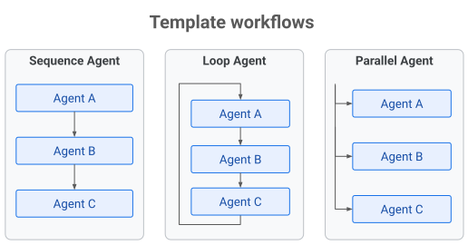

 [ Python](https://github.com/google/adk-python "adk-python on GitHub")[ JS ](https://github.com/google/adk-js "adk-js on GitHub")[ Go ](https://github.com/google/adk-go "adk-go on GitHub")[ Java ](https://github.com/google/adk-java "adk-java on GitHub")[ Kotlin](https://github.com/google/adk-kotlin "adk-kotlin on GitHub")

-   [Home](../..)
-    Build Agents
    
    Build Agents
    
    -   [Get Started](../../get-started/)
        
        Get Started
        
        -   [Python](../../get-started/python/)
        -   [TypeScript](../../get-started/typescript/)
        -   [Go](../../get-started/go/)
        -   [Java](../../get-started/java/)
        -   [Kotlin](../../get-started/kotlin/)
        -   [Agents CLI](../../get-started/agents-cli/)
        -   [Installation](../../get-started/installation/)
        -   [Google Cloud](../../get-started/google-cloud/)
        -   [Migrate to ADK](../../get-started/migrate/)
        
    -   [Build your Agent](../../tutorials/)
        
        Build your Agent
        
        -   [Multi-tool agent](../../tutorials/multi-tool-agent/)
        -   [Agent team](../../tutorials/agent-team/)
        -   [Code with AI](../../tutorials/coding-with-ai/)
        -   [Agent Config](../config/)
        
    -   [Agents](../)
        
        Agents
        
        -   [Simple agents](../llm-agents/)
        -   [Managed agents](../managed-agents/)
        
    -   [Graph Workflows](../../graphs/)
        
        Graph Workflows
        
        -   [Graph routes](../../graphs/routes/)
        -   [Data handling](../../graphs/data-handling/)
        -   [Human input](../../graphs/human-input/)
        -   [Dynamic workflows](../../graphs/dynamic/)
        
    -   [Multi-Agent Workflows](../../workflows/)
        
        Multi-Agent Workflows
        
        -   [Collaborative workflows](../../workflows/collaboration/)
        -   [Template workflows](./)
            
            Template workflows
            
            -   [Sequential workflow](sequential-agents/)
            -   [Loop workflow](loop-agents/)
            -   [Parallel workflow](parallel-agents/)
            -   [Custom template workflows](../custom-agents/)
            
        -   [Agent routing](../routing/)
        -   [Workflow patterns](../../workflows/patterns/)
        
    -   [Models for Agents](../models/)
        
        Models for Agents
        
        -   [Gemini](../models/google-gemini/)
            
            Gemini
            
            -   [Deferred scheduling](../models/google-gemini/deferred-schedule/)
            
        -   [Gemma](../models/google-gemma/)
        -   [Claude](../models/anthropic/)
        -   [Agent Platform hosted](../models/agent-platform/)
        -   [Apigee AI Gateway](../models/apigee/)
        -   [Model routing](../models/routing/)
        -   [OpenAI](../models/openai/)
        -   [Ollama](../models/ollama/)
        -   [vLLM](../models/vllm/)
        -   [LiteLLM](../models/litellm/)
        -   [LiteRT-LM](../models/litert-lm/)
        
    
-    Run Agents
    
    Run Agents
    
    -   [Agent Runtime](../../runtime/)
        
        Agent Runtime
        
        -   [Web Interface](../../runtime/web-interface/)
            
            Web Interface
            
            -   [Visual Builder](../../visual-builder/)
            
        -   [Command Line](../../runtime/command-line/)
        -   [API Server](../../runtime/api-server/)
        -   [Ambient Agents](../../runtime/ambient-agents/)
        -   [Resume Agents](../../runtime/resume/)
        -   [Cancel Agent Runs](../../runtime/cancel/)
        -   [Runtime Config](../../runtime/runconfig/)
        -   [Event Loop](../../runtime/event-loop/)
        
    -   [Deployment](../../deploy/)
        
        Deployment
        
        -   [Agent Runtime](../../deploy/agent-runtime/)
            
            Agent Runtime
            
            -   [Standard deployment](../../deploy/agent-runtime/deploy/)
            -   [agents-cli](../../deploy/agent-runtime/agents-cli/)
            -   [Test deployed agents](../../deploy/agent-runtime/test/)
            
        -   [Cloud Run](../../deploy/cloud-run/)
        -   [GKE](../../deploy/gke/)
        
    -   [Observability](../../observability/)
        
        Observability
        
        -   [Logging](../../observability/logging/)
        -   [Metrics](../../observability/metrics/)
        -   [Traces](../../observability/traces/)
        
    -   [Evaluation](../../evaluate/)
        
        Evaluation
        
        -   [Criteria](../../evaluate/criteria/)
        -   [User Simulation](../../evaluate/user-sim/)
        -   [Environment Simulation](../../evaluate/environment_simulation/)
        -   [Custom Metrics](../../evaluate/custom_metrics/)
        -   [Optimization](../../optimize/)
        
    -   [Safety and Security](../../safety/)
        
        Safety and Security
        
    
-    Components
    
    Components
    
    -   [Technical Overview](../../get-started/about/)
    -   [Custom Tools](../../tools-custom/)
        
        Custom Tools
        
        -    Function tools
            
            Function tools
            
            -   [Overview](../../tools-custom/function-tools/)
            -   [Tool performance](../../tools-custom/performance/)
            -   [Action confirmations](../../tools-custom/confirmation/)
            
        -   [MCP tools](../../tools-custom/mcp-tools/)
            
            MCP tools
            
            -   [Advanced configuration](../../tools-custom/mcp-tools/advanced/)
            -   [Deployment](../../tools-custom/mcp-tools/deployment/)
            -   [Agent as MCP server](../../tools-custom/mcp-tools/agent-as-server/)
            -   [Sub-agent delegation](../../tools-custom/mcp-tools/agent-managed/)
            
        -   [OpenAPI tools](../../tools-custom/openapi-tools/)
        -   [Authentication](../../tools-custom/authentication/)
        -   [Tool limitations](../../tools/limitations/)
        
    -   [Artifacts](../../artifacts/)
        
        Artifacts
        
    -   [Skills for Agents](../../skills/)
        
        Skills for Agents
        
    -   [App management](../../apps/)
        
        App management
        
        -   [Callbacks](../../callbacks/)
            
            Callbacks
            
            -   [Types of callbacks](../../callbacks/types-of-callbacks/)
            -   [Callback patterns](../../callbacks/design-patterns-and-best-practices/)
            
        -   [Plugins](../../plugins/)
        
    -   [Agent context](../../context/)
        
        Agent context
        
        -   [Conversational context](../../sessions/)
        -   [Sessions](../../sessions/session/)
            
            Sessions
            
            -   [Rewind sessions](../../sessions/session/rewind/)
            -   [Migrate sessions](../../sessions/session/migrate/)
            
        -   [State](../../sessions/state/)
        -   [Events](../../events/)
        -   [Memory](../../sessions/memory/)
        -   [Context compression](../../context/compaction/)
        -   [Model context caching](../../context/caching/)
        
    -   [A2A Protocol](../../a2a/)
        
        A2A Protocol
        
        -   [Introduction to A2A](../../a2a/intro/)
        -    A2A Quickstart (Exposing)
            
            A2A Quickstart (Exposing)
            
            -   [Python](../../a2a/quickstart-exposing/)
            -   [Go](../../a2a/quickstart-exposing-go/)
            -   [Java](../../a2a/quickstart-exposing-java/)
            
        -    A2A Quickstart (Consuming)
            
            A2A Quickstart (Consuming)
            
            -   [Python](../../a2a/quickstart-consuming/)
            -   [Go](../../a2a/quickstart-consuming-go/)
            -   [Java](../../a2a/quickstart-consuming-java/)
            -   [Kotlin](../../a2a/quickstart-consuming-kotlin/)
            
        -   [A2A Extension](../../a2a/a2a-extension/)
        
    -   [Live and Voice Agents](../../live/)
        
        Live and Voice Agents
        
        -   [Get started](../../live/get-started/)
            
            Get started
            
            -   [Python](../../live/get-started/streaming-python/)
            -   [Java](../../live/get-started/streaming-java/)
            
        -    Building
            
            Building
            
            -   [Workflows](../../live/workflows/)
            -   [Tools](../../live/tools/)
            -   [Sessions](../../live/sessions/)
            -   [Events](../../live/events/)
            -   [Audio and video](../../live/audio-video/)
            -   [Configuration](../../live/configuration/)
            
        -    Production
            
            Production
            
            -   [Guardrails](../../live/guardrails/)
            -   [Evaluation](../../live/evaluation/)
            -   [Build a custom server](../../live/custom-server/)
            
        -   [Supported models](../../live/models/)
        
    -   [Grounding](../../grounding/)
        
        Grounding
        
        -   [Google Search Grounding](../../grounding/google_search_grounding/)
        -   [Grounding with Search](../../grounding/grounding_with_search/)
        
    
-   [Integrations](../../integrations/)
    
    Integrations
    
-    Reference
    
    Reference
    
    -   [API Reference](../../api-reference/)
        
        API Reference
        
        -   [Python ADK](../../api-reference/python/)
        -   [TypeScript ADK](../../api-reference/typescript/)
        -    Go ADK
            
            Go ADK
            
            -   [Go v2.x](https://pkg.go.dev/google.golang.org/adk/v2)
            -   [Go v1.x](https://pkg.go.dev/google.golang.org/adk)
            
        -   [Java ADK](../../api-reference/java/)
        -   [Kotlin ADK](../../api-reference/kotlin/)
        -   [CLI Reference](../../api-reference/cli/)
        -   [Agent Config Reference](../../api-reference/agentconfig/)
        -   [REST API](../../api-reference/rest/)
        
    -   [Release Notes](../../release-notes/)
    
-   [Community](../../community/)
    
    Community
    
    -   [Contributing Guide](../../community/contributing-guide/)
    
-   [ADK 2.0](../../2.0/)
    
    ADK 2.0
    

1.  [Home](../..)
2.  [Build Agents](../../get-started/)
3.  [Multi-Agent Workflows](../../workflows/)
4.  [Template workflows](./)

# Template agent workflows[¶](#template-agent-workflows "Permanent link")

Supported in ADKPython v0.1.0TypeScript v0.2.0Go v0.1.0Java v0.1.0

This section introduces *template workflows*, also known as *workflow agents*, which are specialized agents that control the execution flow of one or more sub-agents. Template workflow agents are specialized components designed for orchestrating the execution flow of sub-agents. Their primary role is to manage how and when other agents run, defining the control flow of a process.

Alternative: graph-based workflows

Starting in ADK 2.0 for Python and Go, template workflows have been superseded

by more flexible workflow structures, including [graph-based workflows](/graphs/) and [dynamic workflows](/graphs/dynamic/). These workflow architectures provide more control, flexibility and capability to evolve your agent workflows over time.

**Figure 1.** Execution patterns of template workflows in ADK

Template workflow agents operate based on predefined logic. They determine the execution sequence according to their type, such as sequential, parallel, or loop, without consulting an AI model for assistance with the orchestration. This approach results in deterministic and predictable execution patterns. Template workflows include the following task execution structures, which each implement a distinct task completion pattern:

-   **Sequential Agent workflow**
    
    * * *
    
    Executes sub-agents one after another, in sequence.
    
    [Learn more](sequential-agents/)
    
-   **Loop Agent workflow**
    
    * * *
    
    Repeatedly executes its sub-agents until a specific termination condition is met.
    
    [Learn more](loop-agents/)
    
-   **Parallel Agent workflow**
    
    * * *
    
    Executes multiple sub-agents in parallel.
    
    [Learn more](parallel-agents/)
    

Back to top