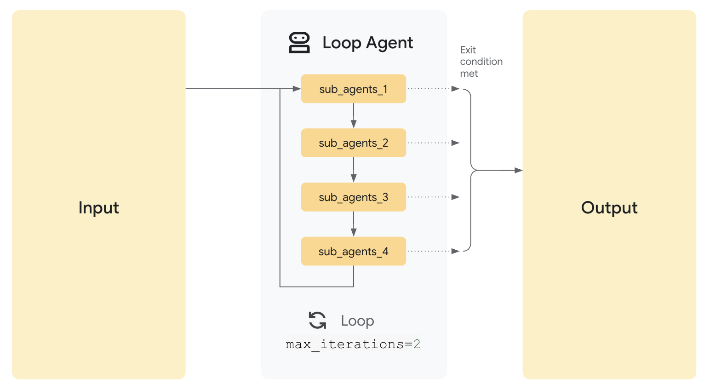

 [ Python](https://github.com/google/adk-python "adk-python on GitHub")[ JS ](https://github.com/google/adk-js "adk-js on GitHub")[ Go ](https://github.com/google/adk-go "adk-go on GitHub")[ Java ](https://github.com/google/adk-java "adk-java on GitHub")[ Kotlin](https://github.com/google/adk-kotlin "adk-kotlin on GitHub")

-   [Home](../../..)
-    Build Agents
    
    Build Agents
    
    -   [Get Started](../../../get-started/)
        
        Get Started
        
        -   [Python](../../../get-started/python/)
        -   [TypeScript](../../../get-started/typescript/)
        -   [Go](../../../get-started/go/)
        -   [Java](../../../get-started/java/)
        -   [Kotlin](../../../get-started/kotlin/)
        -   [Agents CLI](../../../get-started/agents-cli/)
        -   [Installation](../../../get-started/installation/)
        -   [Google Cloud](../../../get-started/google-cloud/)
        -   [Migrate to ADK](../../../get-started/migrate/)
        
    -   [Build your Agent](../../../tutorials/)
        
        Build your Agent
        
        -   [Multi-tool agent](../../../tutorials/multi-tool-agent/)
        -   [Agent team](../../../tutorials/agent-team/)
        -   [Code with AI](../../../tutorials/coding-with-ai/)
        -   [Agent Config](../../config/)
        
    -   [Agents](../../)
        
        Agents
        
        -   [Simple agents](../../llm-agents/)
        -   [Managed agents](../../managed-agents/)
        
    -   [Graph Workflows](../../../graphs/)
        
        Graph Workflows
        
        -   [Graph routes](../../../graphs/routes/)
        -   [Data handling](../../../graphs/data-handling/)
        -   [Human input](../../../graphs/human-input/)
        -   [Dynamic workflows](../../../graphs/dynamic/)
        
    -   [Multi-Agent Workflows](../../../workflows/)
        
        Multi-Agent Workflows
        
        -   [Collaborative workflows](../../../workflows/collaboration/)
        -   [Template workflows](../)
            
            Template workflows
            
            -   [Sequential workflow](../sequential-agents/)
            -    Loop workflow [Loop workflow](./)
                
                Table of contents
                
                -   [Example scenario](#example-scenario)
                -   [How it Works](#how-it-works)
                -   [Full Example: Iterative Document Improvement](#full-example-iterative-document-improvement)
                
            -   [Parallel workflow](../parallel-agents/)
            -   [Custom template workflows](../../custom-agents/)
            
        -   [Agent routing](../../routing/)
        -   [Workflow patterns](../../../workflows/patterns/)
        
    -   [Models for Agents](../../models/)
        
        Models for Agents
        
        -   [Gemini](../../models/google-gemini/)
            
            Gemini
            
            -   [Deferred scheduling](../../models/google-gemini/deferred-schedule/)
            
        -   [Gemma](../../models/google-gemma/)
        -   [Claude](../../models/anthropic/)
        -   [Agent Platform hosted](../../models/agent-platform/)
        -   [Apigee AI Gateway](../../models/apigee/)
        -   [Model routing](../../models/routing/)
        -   [OpenAI](../../models/openai/)
        -   [Ollama](../../models/ollama/)
        -   [vLLM](../../models/vllm/)
        -   [LiteLLM](../../models/litellm/)
        -   [LiteRT-LM](../../models/litert-lm/)
        
    
-    Run Agents
    
    Run Agents
    
    -   [Agent Runtime](../../../runtime/)
        
        Agent Runtime
        
        -   [Web Interface](../../../runtime/web-interface/)
            
            Web Interface
            
            -   [Visual Builder](../../../visual-builder/)
            
        -   [Command Line](../../../runtime/command-line/)
        -   [API Server](../../../runtime/api-server/)
        -   [Ambient Agents](../../../runtime/ambient-agents/)
        -   [Resume Agents](../../../runtime/resume/)
        -   [Cancel Agent Runs](../../../runtime/cancel/)
        -   [Runtime Config](../../../runtime/runconfig/)
        -   [Event Loop](../../../runtime/event-loop/)
        
    -   [Deployment](../../../deploy/)
        
        Deployment
        
        -   [Agent Runtime](../../../deploy/agent-runtime/)
            
            Agent Runtime
            
            -   [Standard deployment](../../../deploy/agent-runtime/deploy/)
            -   [agents-cli](../../../deploy/agent-runtime/agents-cli/)
            -   [Test deployed agents](../../../deploy/agent-runtime/test/)
            
        -   [Cloud Run](../../../deploy/cloud-run/)
        -   [GKE](../../../deploy/gke/)
        
    -   [Observability](../../../observability/)
        
        Observability
        
        -   [Logging](../../../observability/logging/)
        -   [Metrics](../../../observability/metrics/)
        -   [Traces](../../../observability/traces/)
        
    -   [Evaluation](../../../evaluate/)
        
        Evaluation
        
        -   [Criteria](../../../evaluate/criteria/)
        -   [User Simulation](../../../evaluate/user-sim/)
        -   [Environment Simulation](../../../evaluate/environment_simulation/)
        -   [Custom Metrics](../../../evaluate/custom_metrics/)
        -   [Optimization](../../../optimize/)
        
    -   [Safety and Security](../../../safety/)
        
        Safety and Security
        
    
-    Components
    
    Components
    
    -   [Technical Overview](../../../get-started/about/)
    -   [Custom Tools](../../../tools-custom/)
        
        Custom Tools
        
        -    Function tools
            
            Function tools
            
            -   [Overview](../../../tools-custom/function-tools/)
            -   [Tool performance](../../../tools-custom/performance/)
            -   [Action confirmations](../../../tools-custom/confirmation/)
            
        -   [MCP tools](../../../tools-custom/mcp-tools/)
            
            MCP tools
            
            -   [Advanced configuration](../../../tools-custom/mcp-tools/advanced/)
            -   [Deployment](../../../tools-custom/mcp-tools/deployment/)
            -   [Agent as MCP server](../../../tools-custom/mcp-tools/agent-as-server/)
            -   [Sub-agent delegation](../../../tools-custom/mcp-tools/agent-managed/)
            
        -   [OpenAPI tools](../../../tools-custom/openapi-tools/)
        -   [Authentication](../../../tools-custom/authentication/)
        -   [Tool limitations](../../../tools/limitations/)
        
    -   [Artifacts](../../../artifacts/)
        
        Artifacts
        
    -   [Skills for Agents](../../../skills/)
        
        Skills for Agents
        
    -   [App management](../../../apps/)
        
        App management
        
        -   [Callbacks](../../../callbacks/)
            
            Callbacks
            
            -   [Types of callbacks](../../../callbacks/types-of-callbacks/)
            -   [Callback patterns](../../../callbacks/design-patterns-and-best-practices/)
            
        -   [Plugins](../../../plugins/)
        
    -   [Agent context](../../../context/)
        
        Agent context
        
        -   [Conversational context](../../../sessions/)
        -   [Sessions](../../../sessions/session/)
            
            Sessions
            
            -   [Rewind sessions](../../../sessions/session/rewind/)
            -   [Migrate sessions](../../../sessions/session/migrate/)
            
        -   [State](../../../sessions/state/)
        -   [Events](../../../events/)
        -   [Memory](../../../sessions/memory/)
        -   [Context compression](../../../context/compaction/)
        -   [Model context caching](../../../context/caching/)
        
    -   [A2A Protocol](../../../a2a/)
        
        A2A Protocol
        
        -   [Introduction to A2A](../../../a2a/intro/)
        -    A2A Quickstart (Exposing)
            
            A2A Quickstart (Exposing)
            
            -   [Python](../../../a2a/quickstart-exposing/)
            -   [Go](../../../a2a/quickstart-exposing-go/)
            -   [Java](../../../a2a/quickstart-exposing-java/)
            
        -    A2A Quickstart (Consuming)
            
            A2A Quickstart (Consuming)
            
            -   [Python](../../../a2a/quickstart-consuming/)
            -   [Go](../../../a2a/quickstart-consuming-go/)
            -   [Java](../../../a2a/quickstart-consuming-java/)
            -   [Kotlin](../../../a2a/quickstart-consuming-kotlin/)
            
        -   [A2A Extension](../../../a2a/a2a-extension/)
        
    -   [Live and Voice Agents](../../../live/)
        
        Live and Voice Agents
        
        -   [Get started](../../../live/get-started/)
            
            Get started
            
            -   [Python](../../../live/get-started/streaming-python/)
            -   [Java](../../../live/get-started/streaming-java/)
            
        -    Building
            
            Building
            
            -   [Workflows](../../../live/workflows/)
            -   [Tools](../../../live/tools/)
            -   [Sessions](../../../live/sessions/)
            -   [Events](../../../live/events/)
            -   [Audio and video](../../../live/audio-video/)
            -   [Configuration](../../../live/configuration/)
            
        -    Production
            
            Production
            
            -   [Guardrails](../../../live/guardrails/)
            -   [Evaluation](../../../live/evaluation/)
            -   [Build a custom server](../../../live/custom-server/)
            
        -   [Supported models](../../../live/models/)
        
    -   [Grounding](../../../grounding/)
        
        Grounding
        
        -   [Google Search Grounding](../../../grounding/google_search_grounding/)
        -   [Grounding with Search](../../../grounding/grounding_with_search/)
        
    
-   [Integrations](../../../integrations/)
    
    Integrations
    
-    Reference
    
    Reference
    
    -   [API Reference](../../../api-reference/)
        
        API Reference
        
        -   [Python ADK](../../../api-reference/python/)
        -   [TypeScript ADK](../../../api-reference/typescript/)
        -    Go ADK
            
            Go ADK
            
            -   [Go v2.x](https://pkg.go.dev/google.golang.org/adk/v2)
            -   [Go v1.x](https://pkg.go.dev/google.golang.org/adk)
            
        -   [Java ADK](../../../api-reference/java/)
        -   [Kotlin ADK](../../../api-reference/kotlin/)
        -   [CLI Reference](../../../api-reference/cli/)
        -   [Agent Config Reference](../../../api-reference/agentconfig/)
        -   [REST API](../../../api-reference/rest/)
        
    -   [Release Notes](../../../release-notes/)
    
-   [Community](../../../community/)
    
    Community
    
    -   [Contributing Guide](../../../community/contributing-guide/)
    
-   [ADK 2.0](../../../2.0/)
    
    ADK 2.0
    

Table of contents

-   [Example scenario](#example-scenario)
-   [How it Works](#how-it-works)
-   [Full Example: Iterative Document Improvement](#full-example-iterative-document-improvement)

1.  [Home](../../..)
2.  [Build Agents](../../../get-started/)
3.  [Multi-Agent Workflows](../../../workflows/)
4.  [Template workflows](../)

[](https://github.com/google/adk-docs/edit/main/docs/agents/workflow-agents/loop-agents.md "Edit this page on GitHub")[](./index.md "View this page as Markdown")

# Loop template workflow agent[¶](#loop-template-workflow-agent "Permanent link")

Supported in ADKPython v0.1.0TypeScript v0.2.0Go v0.1.0Java v0.2.0

The ***LoopAgent*** class is a [template workflow](/agents/workflow-agents/) agent that executes its sub-agents in a loop for a specified number of iterations or until a termination condition is met. Use the ***LoopAgent*** when your workflow involves repetition or iterative refinement, such as revising code or a document. As with other templated workflows, the execution of a ***LoopAgent*** object is not controlled by an AI model, and is deterministic in how it executes its sub-agents. The sub-agents within the defined loop may or may not utilize AI models, but the overall execution of those sub-agents is ultimately managed by the ***LoopAgent*** object you define.

Alternative: graph-based workflows

Starting in ADK 2.0 for Python and Go, templated workflows have been superseded

by more flexible workflow structures, including [graph-based workflows](/graphs/) and [dynamic workflows](/graphs/dynamic/).

### Example scenario[¶](#example-scenario "Permanent link")

You want to build an agent that can generate images of food, but sometimes when you want to generate a specific number of items, such as bananas, the agent generates a different number of those items in the image, such as an image of 7 bananas. You have two tools: `Generate Image`, `Count Food Items`. If your goal is to keep generating images until it either correctly generates the specified number of items, or after a certain number of iterations, you can build your agent using a ***LoopAgent*** workflow.

### How it Works[¶](#how-it-works "Permanent link")

When the `LoopAgent`'s `Run Async` method is called, it performs the following actions:

1.  **Sub-Agent Execution:** It iterates through the Sub Agents list *in order*. For *each* sub-agent, it calls the agent's `Run Async` method.
2.  **Termination Check:**
    
    *Crucially*, the `LoopAgent` itself does *not* inherently decide when to stop looping. You *must* implement a termination mechanism to prevent infinite loops. Common strategies include:
    
    -   **Max Iterations**: Set a maximum number of iterations in the `LoopAgent`. **The loop will terminate after that many iterations**.
    -   **Escalation from sub-agent**: Design one or more sub-agents to evaluate a condition (e.g., "Is the document quality good enough?", "Has a consensus been reached?"). If the condition is met, the sub-agent can signal termination (e.g., by raising a custom event, setting a flag in a shared context, or returning a specific value).



### Full Example: Iterative Document Improvement[¶](#full-example-iterative-document-improvement "Permanent link")

Imagine a scenario where you want to iteratively improve a document:

-   **Writer Agent:** An `LlmAgent` that generates or refines a draft on a topic.
-   **Critic Agent:** An `LlmAgent` that critiques the draft, identifying areas for improvement.
    
    `[](#__codelineno-0-1)LoopAgent(sub_agents=[WriterAgent, CriticAgent], max_iterations=5)`
    

In this setup, the `LoopAgent` would manage the iterative process. The `CriticAgent` could be **designed to return a "STOP" signal when the document reaches a satisfactory quality level**, preventing further iterations. Alternatively, the `max iterations` parameter could be used to limit the process to a fixed number of cycles, or external logic could be implemented to make stop decisions. The **loop would run at most five times**, ensuring the iterative refinement doesn't continue indefinitely.

Full Code

PythonTypeScriptGoJava

``[](#__codelineno-1-1)from google.adk.agents import LoopAgent, LlmAgent, SequentialAgent [](#__codelineno-1-2)from google.adk.tools.tool_context import ToolContext [](#__codelineno-1-3)from google.adk.agents.callback_context import CallbackContext [](#__codelineno-1-4)[](#__codelineno-1-5)# --- Constants --- [](#__codelineno-1-6)GEMINI_MODEL = "gemini-2.5-flash" [](#__codelineno-1-7)[](#__codelineno-1-8)# --- State Keys --- [](#__codelineno-1-9)STATE_CURRENT_DOC = "current_document" [](#__codelineno-1-10)STATE_CRITICISM = "criticism" [](#__codelineno-1-11)# Define the exact phrase the Critic should use to signal completion [](#__codelineno-1-12)COMPLETION_PHRASE = "No major issues found." [](#__codelineno-1-13)[](#__codelineno-1-14)# --- Tool Definition --- [](#__codelineno-1-15)def exit_loop(tool_context: ToolContext):     [](#__codelineno-1-16)    """Call this function ONLY when the critique indicates no further changes are needed, signaling the iterative process should end."""    [](#__codelineno-1-17)    print(f"  [Tool Call] exit_loop triggered by {tool_context.agent_name}")    [](#__codelineno-1-18)    tool_context.actions.escalate = True    [](#__codelineno-1-19)    tool_context.actions.skip_summarization = True    [](#__codelineno-1-20)    # Return empty dict as tools should typically return JSON-serializable output    [](#__codelineno-1-21)    return {} [](#__codelineno-1-22)[](#__codelineno-1-23)# --- Before Agent Callback --- [](#__codelineno-1-24)def update_initial_topic_state(callback_context: CallbackContext):     [](#__codelineno-1-25)    """Ensure 'initial_topic' is set in state before pipeline starts."""    [](#__codelineno-1-26)    callback_context.state['initial_topic'] = callback_context.state.get('initial_topic', 'a robot developing unexpected emotions') [](#__codelineno-1-27)[](#__codelineno-1-28)# --- Agent Definitions --- [](#__codelineno-1-29)[](#__codelineno-1-30)# STEP 1: Initial Writer Agent (Runs ONCE at the beginning) [](#__codelineno-1-31)initial_writer_agent = LlmAgent(     [](#__codelineno-1-32)    name="InitialWriterAgent",    [](#__codelineno-1-33)    model=GEMINI_MODEL,    [](#__codelineno-1-34)    include_contents='none',    [](#__codelineno-1-35)    instruction=f"""    [](#__codelineno-1-36)    You are a Creative Writing Assistant tasked with starting a story.    [](#__codelineno-1-37)    Write a *very basic* first draft of a short story (just 1-2 simple sentences).    [](#__codelineno-1-38)    Keep it plain and minimal - do NOT add descriptive language yet.    [](#__codelineno-1-39)    Topic: {{initial_topic}} [](#__codelineno-1-40)    [](#__codelineno-1-41)    Output *only* the story/document text. Do not add introductions or explanations.    [](#__codelineno-1-42)    """,    [](#__codelineno-1-43)    description="Writes the initial document draft based on the topic, aiming for some initial substance.",    [](#__codelineno-1-44)    output_key=STATE_CURRENT_DOC [](#__codelineno-1-45)) [](#__codelineno-1-46)[](#__codelineno-1-47)# STEP 2a: Critic Agent (Inside the Refinement Loop) [](#__codelineno-1-48)critic_agent_in_loop = LlmAgent(     [](#__codelineno-1-49)    name="CriticAgent",    [](#__codelineno-1-50)    model=GEMINI_MODEL,    [](#__codelineno-1-51)    include_contents='none',    [](#__codelineno-1-52)    instruction=f"""    [](#__codelineno-1-53)    You are a Constructive Critic AI reviewing a short story draft. [](#__codelineno-1-54)    [](#__codelineno-1-55)    **Document to Review:**    [](#__codelineno-1-56)    ```    [](#__codelineno-1-57)    {{current_document}}    [](#__codelineno-1-58)    ``` [](#__codelineno-1-59)    [](#__codelineno-1-60)    **Completion Criteria (ALL must be met):**    [](#__codelineno-1-61)    1. At least 4 sentences long    [](#__codelineno-1-62)    2. Has a clear beginning, middle, and end    [](#__codelineno-1-63)    3. Includes at least one descriptive detail (sensory or emotional) [](#__codelineno-1-64)    [](#__codelineno-1-65)    **Task:**    [](#__codelineno-1-66)    Check the document against the criteria above. [](#__codelineno-1-67)    [](#__codelineno-1-68)    IF any criteria is NOT met, provide specific feedback on what to add or improve.    [](#__codelineno-1-69)    Output *only* the critique text. [](#__codelineno-1-70)    [](#__codelineno-1-71)    IF ALL criteria are met, respond *exactly* with: "{COMPLETION_PHRASE}"    [](#__codelineno-1-72)    """,    [](#__codelineno-1-73)    description="Reviews the current draft, providing critique if clear improvements are needed, otherwise signals completion.",    [](#__codelineno-1-74)    output_key=STATE_CRITICISM [](#__codelineno-1-75)) [](#__codelineno-1-76)[](#__codelineno-1-77)# STEP 2b: Refiner/Exiter Agent (Inside the Refinement Loop) [](#__codelineno-1-78)refiner_agent_in_loop = LlmAgent(     [](#__codelineno-1-79)    name="RefinerAgent",    [](#__codelineno-1-80)    model=GEMINI_MODEL,    [](#__codelineno-1-81)    # Relies solely on state via placeholders    [](#__codelineno-1-82)    include_contents='none',    [](#__codelineno-1-83)    instruction=f"""    [](#__codelineno-1-84)    You are a Creative Writing Assistant refining a document based on feedback OR exiting the process.    [](#__codelineno-1-85)    **Current Document:**    [](#__codelineno-1-86)    ```    [](#__codelineno-1-87)    {{current_document}}    [](#__codelineno-1-88)    ```    [](#__codelineno-1-89)    **Critique/Suggestions:**    [](#__codelineno-1-90)    {{criticism}} [](#__codelineno-1-91)    [](#__codelineno-1-92)    **Task:**    [](#__codelineno-1-93)    Analyze the 'Critique/Suggestions'.    [](#__codelineno-1-94)    IF the critique is *exactly* "{COMPLETION_PHRASE}":    [](#__codelineno-1-95)    You MUST call the 'exit_loop' function. Do not output any text.    [](#__codelineno-1-96)    ELSE (the critique contains actionable feedback):    [](#__codelineno-1-97)    Carefully apply the suggestions to improve the 'Current Document'. Output *only* the refined document text. [](#__codelineno-1-98)    [](#__codelineno-1-99)    Do not add explanations. Either output the refined document OR call the exit_loop function.    [](#__codelineno-1-100)    """,    [](#__codelineno-1-101)    description="Refines the document based on critique, or calls exit_loop if critique indicates completion.",    [](#__codelineno-1-102)    tools=[exit_loop], # Provide the exit_loop tool    [](#__codelineno-1-103)    output_key=STATE_CURRENT_DOC # Overwrites state['current_document'] with the refined version [](#__codelineno-1-104)) [](#__codelineno-1-105)[](#__codelineno-1-106)# STEP 2: Refinement Loop Agent [](#__codelineno-1-107)refinement_loop = LoopAgent(     [](#__codelineno-1-108)    name="RefinementLoop",    [](#__codelineno-1-109)    # Agent order is crucial: Critique first, then Refine/Exit    [](#__codelineno-1-110)    sub_agents=[        [](#__codelineno-1-111)        critic_agent_in_loop,        [](#__codelineno-1-112)        refiner_agent_in_loop,    [](#__codelineno-1-113)    ],    [](#__codelineno-1-114)    max_iterations=5 # Limit loops [](#__codelineno-1-115)) [](#__codelineno-1-116)[](#__codelineno-1-117)# STEP 3: Overall Sequential Pipeline [](#__codelineno-1-118)# For ADK tools compatibility, the root agent must be named `root_agent` [](#__codelineno-1-119)root_agent = SequentialAgent(     [](#__codelineno-1-120)    name="IterativeWritingPipeline",    [](#__codelineno-1-121)    sub_agents=[        [](#__codelineno-1-122)        initial_writer_agent, # Run first to create initial doc        [](#__codelineno-1-123)        refinement_loop       # Then run the critique/refine loop    [](#__codelineno-1-124)    ],    [](#__codelineno-1-125)    before_agent_callback=update_initial_topic_state, # set initial topic in state    [](#__codelineno-1-126)    description="Writes an initial document and then iteratively refines it with critique using an exit tool." [](#__codelineno-1-127))``

``[](#__codelineno-2-1)// Part of agent.ts --> Follow https://adk.dev/get-started/ to learn the setup [](#__codelineno-2-2)[](#__codelineno-2-3)import { LoopAgent, LlmAgent, SequentialAgent, FunctionTool } from '@google/adk'; [](#__codelineno-2-4)import { z } from 'zod'; [](#__codelineno-2-5)[](#__codelineno-2-6)// --- Constants --- [](#__codelineno-2-7)const GEMINI_MODEL = "gemini-2.5-flash"; [](#__codelineno-2-8)const STATE_INITIAL_TOPIC = "initial_topic"; [](#__codelineno-2-9)[](#__codelineno-2-10)// --- State Keys --- [](#__codelineno-2-11)const STATE_CURRENT_DOC = "current_document"; [](#__codelineno-2-12)const STATE_CRITICISM = "criticism"; [](#__codelineno-2-13)// Define the exact phrase the Critic should use to signal completion [](#__codelineno-2-14)const COMPLETION_PHRASE = "No major issues found."; [](#__codelineno-2-15)[](#__codelineno-2-16)// --- Tool Definition --- [](#__codelineno-2-17)const exitLoopTool = new FunctionTool({     [](#__codelineno-2-18)    name: 'exit_loop',    [](#__codelineno-2-19)    description: 'Call this function ONLY when the critique indicates no further changes are needed, signaling the iterative process should end.',    [](#__codelineno-2-20)    parameters: z.object({}),    [](#__codelineno-2-21)    execute: (input, context) => {        [](#__codelineno-2-22)        if (context) {            [](#__codelineno-2-23)            console.log(`  [Tool Call] exit_loop triggered by ${context.agentName} with input: ${input}`);            [](#__codelineno-2-24)            context.actions.escalate = true;        [](#__codelineno-2-25)        }        [](#__codelineno-2-26)        return {};    [](#__codelineno-2-27)    }, [](#__codelineno-2-28)}); [](#__codelineno-2-29)[](#__codelineno-2-30)// --- Agent Definitions --- [](#__codelineno-2-31)[](#__codelineno-2-32)// STEP 1: Initial Writer Agent (Runs ONCE at the beginning) [](#__codelineno-2-33)const initialWriterAgent = new LlmAgent({     [](#__codelineno-2-34)    name: "InitialWriterAgent",    [](#__codelineno-2-35)    model: GEMINI_MODEL,    [](#__codelineno-2-36)    includeContents: 'none',    [](#__codelineno-2-37)    // MODIFIED Instruction: Ask for a slightly more developed start    [](#__codelineno-2-38)    instruction: `You are a Creative Writing Assistant tasked with starting a story.    [](#__codelineno-2-39)    Write the *first draft* of a short story (aim for 2-4 sentences).    [](#__codelineno-2-40)    Base the content *only* on the topic provided below. Try to introduce a specific element (like a character, a setting detail, or a starting action) to make it engaging.    [](#__codelineno-2-41)    Topic: {{${STATE_INITIAL_TOPIC}}} [](#__codelineno-2-42)    [](#__codelineno-2-43)    Output *only* the story/document text. Do not add introductions or explanations.    [](#__codelineno-2-44)    `,    [](#__codelineno-2-45)    description: "Writes the initial document draft based on the topic, aiming for some initial substance.",    [](#__codelineno-2-46)    outputKey: STATE_CURRENT_DOC [](#__codelineno-2-47)}); [](#__codelineno-2-48)[](#__codelineno-2-49)// STEP 2a: Critic Agent (Inside the Refinement Loop) [](#__codelineno-2-50)const criticAgentInLoop = new LlmAgent({     [](#__codelineno-2-51)    name: "CriticAgent",    [](#__codelineno-2-52)    model: GEMINI_MODEL,    [](#__codelineno-2-53)    includeContents: 'none',    [](#__codelineno-2-54)    // MODIFIED Instruction: More nuanced completion criteria, look for clear improvement paths.    [](#__codelineno-2-55)    instruction: `You are a Constructive Critic AI reviewing a short document draft (typically 2-6 sentences). Your goal is balanced feedback. [](#__codelineno-2-56)    [](#__codelineno-2-57)    **Document to Review:** [](#__codelineno-2-58)    [](#__codelineno-2-59)    {{current_document}} [](#__codelineno-2-60) [](#__codelineno-2-61)    [](#__codelineno-2-62)    **Task:**    [](#__codelineno-2-63)    Review the document for clarity, engagement, and basic coherence according to the initial topic (if known). [](#__codelineno-2-64)    [](#__codelineno-2-65)    IF you identify 1-2 *clear and actionable* ways the document could be improved to better capture the topic or enhance reader engagement (e.g., "Needs a stronger opening sentence", "Clarify the character's goal"):    [](#__codelineno-2-66)    Provide these specific suggestions concisely. Output *only* the critique text. [](#__codelineno-2-67)    [](#__codelineno-2-68)    ELSE IF the document is coherent, addresses the topic adequately for its length, and has no glaring errors or obvious omissions:    [](#__codelineno-2-69)    Respond *exactly* with the phrase "${COMPLETION_PHRASE}" and nothing else. It doesn't need to be perfect, just functionally complete for this stage. Avoid suggesting purely subjective stylistic preferences if the core is sound. [](#__codelineno-2-70)    [](#__codelineno-2-71)    Do not add explanations. Output only the critique OR the exact completion. [](#__codelineno-2-72)`,     [](#__codelineno-2-73)    description: "Reviews the current draft, providing critique if clear improvements are needed, otherwise signals completion.",    [](#__codelineno-2-74)    outputKey: STATE_CRITICISM [](#__codelineno-2-75)}); [](#__codelineno-2-76) [](#__codelineno-2-77)[](#__codelineno-2-78)// STEP 2b: Refiner/Exiter Agent (Inside the Refinement Loop) [](#__codelineno-2-79)const refinerAgentInLoop = new LlmAgent({     [](#__codelineno-2-80)    name: "RefinerAgent",    [](#__codelineno-2-81)    model: GEMINI_MODEL,    [](#__codelineno-2-82)    // Relies solely on state via placeholders    [](#__codelineno-2-83)    includeContents: 'none',    [](#__codelineno-2-84)    instruction: `You are a Creative Writing Assistant refining a document based on feedback OR exiting the process.    [](#__codelineno-2-85)    **Current Document:** [](#__codelineno-2-86)    [](#__codelineno-2-87)    {{current_document}} [](#__codelineno-2-88)    [](#__codelineno-2-89)    **Critique/Suggestions:**    [](#__codelineno-2-90)    {{criticism}} [](#__codelineno-2-91)    [](#__codelineno-2-92)    **Task:**    [](#__codelineno-2-93)    Analyze the 'Critique/Suggestions'.    [](#__codelineno-2-94)    IF the critique is *exactly* "${COMPLETION_PHRASE}":    [](#__codelineno-2-95)    You MUST call the 'exit_loop' function. Do not output any text.    [](#__codelineno-2-96)    ELSE (the critique contains actionable feedback):    [](#__codelineno-2-97)    Carefully apply the suggestions to improve the 'Current Document'. Output *only* the refined document text. [](#__codelineno-2-98)    [](#__codelineno-2-99)    Do not add explanations. Either output the refined document OR call the exit_loop function. [](#__codelineno-2-100)`,     [](#__codelineno-2-101)    tools: [exitLoopTool],    [](#__codelineno-2-102)    description: "Refines the document based on critique, or calls exit_loop if critique indicates completion.",    [](#__codelineno-2-103)    outputKey: STATE_CURRENT_DOC [](#__codelineno-2-104)}); [](#__codelineno-2-105) [](#__codelineno-2-106)[](#__codelineno-2-107)// STEP 2: Refinement Loop Agent [](#__codelineno-2-108)const refinementLoop = new LoopAgent({     [](#__codelineno-2-109)    name: "RefinementLoop",    [](#__codelineno-2-110)    // Agent order is crucial: Critique first, then Refine/Exit    [](#__codelineno-2-111)    subAgents: [        [](#__codelineno-2-112)        criticAgentInLoop,        [](#__codelineno-2-113)        refinerAgentInLoop,    [](#__codelineno-2-114)    ],    [](#__codelineno-2-115)    maxIterations: 5 // Limit loops [](#__codelineno-2-116)}); [](#__codelineno-2-117)[](#__codelineno-2-118)// STEP 3: Overall Sequential Pipeline [](#__codelineno-2-119)// For ADK tools compatibility, the root agent must be named `root_agent` [](#__codelineno-2-120)export const rootAgent = new SequentialAgent({     [](#__codelineno-2-121)    name: "IterativeWritingPipeline",    [](#__codelineno-2-122)    subAgents: [        [](#__codelineno-2-123)        initialWriterAgent, // Run first to create initial doc        [](#__codelineno-2-124)        refinementLoop       // Then run the critique/refine loop    [](#__codelineno-2-125)    ],    [](#__codelineno-2-126)    description: "Writes an initial document and then iteratively refines it with critique using an exit tool." [](#__codelineno-2-127)});``

``[](#__codelineno-3-1)// ExitLoopArgs defines the (empty) arguments for the ExitLoop tool. [](#__codelineno-3-2)type ExitLoopArgs struct{} [](#__codelineno-3-3)[](#__codelineno-3-4)// ExitLoopResults defines the output of the ExitLoop tool. [](#__codelineno-3-5)type ExitLoopResults struct{} [](#__codelineno-3-6)[](#__codelineno-3-7)// ExitLoop is a tool that signals the loop to terminate by setting Escalate to true. [](#__codelineno-3-8)func ExitLoop(ctx agent.Context, input ExitLoopArgs) (ExitLoopResults, error) {     [](#__codelineno-3-9)    fmt.Printf("[Tool Call] exitLoop triggered by %s \n", ctx.AgentName())    [](#__codelineno-3-10)    ctx.Actions().Escalate = true    [](#__codelineno-3-11)    return ExitLoopResults{}, nil [](#__codelineno-3-12)} [](#__codelineno-3-13)[](#__codelineno-3-14)func main() {     [](#__codelineno-3-15)    ctx := context.Background() [](#__codelineno-3-16)    [](#__codelineno-3-17)    if err := runAgent(ctx, "Write a document about a cat"); err != nil {        [](#__codelineno-3-18)        log.Fatalf("Agent execution failed: %v", err)    [](#__codelineno-3-19)    } [](#__codelineno-3-20)} [](#__codelineno-3-21)[](#__codelineno-3-22)func runAgent(ctx context.Context, prompt string) error {     [](#__codelineno-3-23)    model, err := gemini.NewModel(ctx, modelName, &genai.ClientConfig{})    [](#__codelineno-3-24)    if err != nil {        [](#__codelineno-3-25)        return fmt.Errorf("failed to create model: %v", err)    [](#__codelineno-3-26)    } [](#__codelineno-3-27)    [](#__codelineno-3-28)    // STEP 1: Initial Writer Agent (Runs ONCE at the beginning)    [](#__codelineno-3-29)    initialWriterAgent, err := llmagent.New(llmagent.Config{        [](#__codelineno-3-30)        Name:        "InitialWriterAgent",        [](#__codelineno-3-31)        Model:       model,        [](#__codelineno-3-32)        Description: "Writes the initial document draft based on the topic.",        [](#__codelineno-3-33)        Instruction: `You are a Creative Writing Assistant tasked with starting a story. [](#__codelineno-3-34)Write the *first draft* of a short story (aim for 2-4 sentences). [](#__codelineno-3-35)Base the content *only* on the topic provided in the user's prompt. [](#__codelineno-3-36)Output *only* the story/document text. Do not add introductions or explanations.`,         [](#__codelineno-3-37)        OutputKey: stateDoc,    [](#__codelineno-3-38)    })    [](#__codelineno-3-39)    if err != nil {        [](#__codelineno-3-40)        return fmt.Errorf("failed to create initial writer agent: %v", err)    [](#__codelineno-3-41)    } [](#__codelineno-3-42)    [](#__codelineno-3-43)    // STEP 2a: Critic Agent (Inside the Refinement Loop)    [](#__codelineno-3-44)    criticAgentInLoop, err := llmagent.New(llmagent.Config{        [](#__codelineno-3-45)        Name:        "CriticAgent",        [](#__codelineno-3-46)        Model:       model,        [](#__codelineno-3-47)        Description: "Reviews the current draft, providing critique or signaling completion.",        [](#__codelineno-3-48)        Instruction: fmt.Sprintf(`You are a Constructive Critic AI reviewing a short document draft. [](#__codelineno-3-49)**Document to Review:** [](#__codelineno-3-50)""" [](#__codelineno-3-51){%s} [](#__codelineno-3-52)""" [](#__codelineno-3-53)**Task:** [](#__codelineno-3-54)Review the document. [](#__codelineno-3-55)IF you identify 1-2 *clear and actionable* ways it could be improved: [](#__codelineno-3-56)Provide these specific suggestions concisely. Output *only* the critique text. [](#__codelineno-3-57)ELSE IF the document is coherent and addresses the topic adequately: [](#__codelineno-3-58)Respond *exactly* with the phrase "%s" and nothing else.`, stateDoc, donePhrase),         [](#__codelineno-3-59)        OutputKey: stateCrit,    [](#__codelineno-3-60)    })    [](#__codelineno-3-61)    if err != nil {        [](#__codelineno-3-62)        return fmt.Errorf("failed to create critic agent: %v", err)    [](#__codelineno-3-63)    } [](#__codelineno-3-64)    [](#__codelineno-3-65)    exitLoopTool, err := functiontool.New(        [](#__codelineno-3-66)        functiontool.Config{            [](#__codelineno-3-67)            Name:        "exitLoop",            [](#__codelineno-3-68)            Description: "Call this function ONLY when the critique indicates no further changes are needed.",        [](#__codelineno-3-69)        },        [](#__codelineno-3-70)        ExitLoop,    [](#__codelineno-3-71)    )    [](#__codelineno-3-72)    if err != nil {        [](#__codelineno-3-73)        return fmt.Errorf("failed to create exit loop tool: %v", err)    [](#__codelineno-3-74)    } [](#__codelineno-3-75)    [](#__codelineno-3-76)    // STEP 2b: Refiner/Exiter Agent (Inside the Refinement Loop)    [](#__codelineno-3-77)    refinerAgentInLoop, err := llmagent.New(llmagent.Config{        [](#__codelineno-3-78)        Name:  "RefinerAgent",        [](#__codelineno-3-79)        Model: model,        [](#__codelineno-3-80)        Instruction: fmt.Sprintf(`You are a Creative Writing Assistant refining a document based on feedback OR exiting the process. [](#__codelineno-3-81)**Current Document:** [](#__codelineno-3-82)[](#__codelineno-3-83)""" [](#__codelineno-3-84){%s} [](#__codelineno-3-85)""" [](#__codelineno-3-86)[](#__codelineno-3-87)**Critique/Suggestions:** [](#__codelineno-3-88){%s} [](#__codelineno-3-89)**Task:** [](#__codelineno-3-90)Analyze the 'Critique/Suggestions'. [](#__codelineno-3-91)IF the critique is *exactly* "%s": [](#__codelineno-3-92)You MUST call the 'exitLoop' function. Do not output any text. [](#__codelineno-3-93)ELSE (the critique contains actionable feedback): [](#__codelineno-3-94)Carefully apply the suggestions to improve the 'Current Document'. Output *only* the refined document text.`, stateDoc, stateCrit, donePhrase),         [](#__codelineno-3-95)        Description: "Refines the document based on critique, or calls exitLoop if critique indicates completion.",        [](#__codelineno-3-96)        Tools:       []tool.Tool{exitLoopTool},        [](#__codelineno-3-97)        OutputKey:   stateDoc,    [](#__codelineno-3-98)    })    [](#__codelineno-3-99)    if err != nil {        [](#__codelineno-3-100)        return fmt.Errorf("failed to create refiner agent: %v", err)    [](#__codelineno-3-101)    } [](#__codelineno-3-102)    [](#__codelineno-3-103)    // STEP 2: Refinement Loop Agent    [](#__codelineno-3-104)    refinementLoop, err := loopagent.New(loopagent.Config{        [](#__codelineno-3-105)        AgentConfig: agent.Config{            [](#__codelineno-3-106)            Name:      "RefinementLoop",            [](#__codelineno-3-107)            SubAgents: []agent.Agent{criticAgentInLoop, refinerAgentInLoop},        [](#__codelineno-3-108)        },        [](#__codelineno-3-109)        MaxIterations: 5,    [](#__codelineno-3-110)    })    [](#__codelineno-3-111)    if err != nil {        [](#__codelineno-3-112)        return fmt.Errorf("failed to create loop agent: %v", err)    [](#__codelineno-3-113)    } [](#__codelineno-3-114)    [](#__codelineno-3-115)    // STEP 3: Overall Sequential Pipeline    [](#__codelineno-3-116)    iterativeWriterAgent, err := sequentialagent.New(sequentialagent.Config{        [](#__codelineno-3-117)        AgentConfig: agent.Config{            [](#__codelineno-3-118)            Name:      appName,            [](#__codelineno-3-119)            SubAgents: []agent.Agent{initialWriterAgent, refinementLoop},        [](#__codelineno-3-120)        },    [](#__codelineno-3-121)    })    [](#__codelineno-3-122)    if err != nil {        [](#__codelineno-3-123)        return fmt.Errorf("failed to create sequential agent pipeline: %v", err)    [](#__codelineno-3-124)    }``

`[](#__codelineno-4-1)import static com.google.adk.agents.LlmAgent.IncludeContents.NONE; [](#__codelineno-4-2)[](#__codelineno-4-3)import com.google.adk.agents.LlmAgent; [](#__codelineno-4-4)import com.google.adk.agents.LoopAgent; [](#__codelineno-4-5)import com.google.adk.agents.SequentialAgent; [](#__codelineno-4-6)import com.google.adk.events.Event; [](#__codelineno-4-7)import com.google.adk.runner.InMemoryRunner; [](#__codelineno-4-8)import com.google.adk.sessions.Session; [](#__codelineno-4-9)import com.google.adk.tools.Annotations.Schema; [](#__codelineno-4-10)import com.google.adk.tools.FunctionTool; [](#__codelineno-4-11)import com.google.adk.tools.ToolContext; [](#__codelineno-4-12)import com.google.genai.types.Content; [](#__codelineno-4-13)import com.google.genai.types.Part; [](#__codelineno-4-14)import io.reactivex.rxjava3.core.Flowable; [](#__codelineno-4-15)import java.util.Map; [](#__codelineno-4-16)[](#__codelineno-4-17)public class LoopAgentExample { [](#__codelineno-4-18)  [](#__codelineno-4-19)  // --- Constants ---  [](#__codelineno-4-20)  private static final String APP_NAME = "IterativeWritingPipeline";  [](#__codelineno-4-21)  private static final String USER_ID = "test_user_456";  [](#__codelineno-4-22)  private static final String MODEL_NAME = "gemini-2.0-flash"; [](#__codelineno-4-23)  [](#__codelineno-4-24)  // --- State Keys ---  [](#__codelineno-4-25)  private static final String STATE_CURRENT_DOC = "current_document";  [](#__codelineno-4-26)  private static final String STATE_CRITICISM = "criticism"; [](#__codelineno-4-27)  [](#__codelineno-4-28)  public static void main(String[] args) {    [](#__codelineno-4-29)    LoopAgentExample loopAgentExample = new LoopAgentExample();    [](#__codelineno-4-30)    loopAgentExample.runAgent("Write a document about a cat");  [](#__codelineno-4-31)  } [](#__codelineno-4-32)  [](#__codelineno-4-33)  // --- Tool Definition ---  [](#__codelineno-4-34)  @Schema(      [](#__codelineno-4-35)      description =          [](#__codelineno-4-36)          "Call this function ONLY when the critique indicates no further changes are needed,"              [](#__codelineno-4-37)              + " signaling the iterative process should end.")  [](#__codelineno-4-38)  public static Map<String, Object> exitLoop(@Schema(name = "toolContext") ToolContext toolContext) {    [](#__codelineno-4-39)    System.out.printf("[Tool Call] exitLoop triggered by %s \n", toolContext.agentName());    [](#__codelineno-4-40)    toolContext.actions().setEscalate(true);    [](#__codelineno-4-41)    //  Return empty dict as tools should typically return JSON-serializable output    [](#__codelineno-4-42)    return Map.of();  [](#__codelineno-4-43)  } [](#__codelineno-4-44)  [](#__codelineno-4-45)  // --- Agent Definitions ---  [](#__codelineno-4-46)  public void runAgent(String prompt) {    [](#__codelineno-4-47)    // STEP 1: Initial Writer Agent (Runs ONCE at the beginning)    [](#__codelineno-4-48)    LlmAgent initialWriterAgent =        [](#__codelineno-4-49)        LlmAgent.builder()            [](#__codelineno-4-50)            .model(MODEL_NAME)            [](#__codelineno-4-51)            .name("InitialWriterAgent")            [](#__codelineno-4-52)            .description(                [](#__codelineno-4-53)                "Writes the initial document draft based on the topic, aiming for some initial"                    [](#__codelineno-4-54)                    + " substance.")            [](#__codelineno-4-55)            .instruction(                [](#__codelineno-4-56)                """                    [](#__codelineno-4-57)                    You are a Creative Writing Assistant tasked with starting a story.                    [](#__codelineno-4-58)                    Write the *first draft* of a short story (aim for 2-4 sentences).                    [](#__codelineno-4-59)                    Base the content *only* on the topic provided below. Try to introduce a specific element (like a character, a setting detail, or a starting action) to make it engaging. [](#__codelineno-4-60)                    [](#__codelineno-4-61)                    Output *only* the story/document text. Do not add introductions or explanations.                [](#__codelineno-4-62)                """)            [](#__codelineno-4-63)            .outputKey(STATE_CURRENT_DOC)            [](#__codelineno-4-64)            .includeContents(NONE)            [](#__codelineno-4-65)            .build(); [](#__codelineno-4-66)    [](#__codelineno-4-67)    // STEP 2a: Critic Agent (Inside the Refinement Loop)    [](#__codelineno-4-68)    LlmAgent criticAgentInLoop =        [](#__codelineno-4-69)        LlmAgent.builder()            [](#__codelineno-4-70)            .model(MODEL_NAME)            [](#__codelineno-4-71)            .name("CriticAgent")            [](#__codelineno-4-72)            .description(                [](#__codelineno-4-73)                "Reviews the current draft, providing critique if clear improvements are needed,"                    [](#__codelineno-4-74)                    + " otherwise signals completion.")            [](#__codelineno-4-75)            .instruction(                [](#__codelineno-4-76)                """                    [](#__codelineno-4-77)                    You are a Constructive Critic AI reviewing a short document draft (typically 2-6 sentences). Your goal is balanced feedback. [](#__codelineno-4-78)                    [](#__codelineno-4-79)                    **Document to Review:**                    [](#__codelineno-4-80)                    ```                    [](#__codelineno-4-81)                    {{current_document}}                    [](#__codelineno-4-82)                    ``` [](#__codelineno-4-83)                    [](#__codelineno-4-84)                    **Task:**                    [](#__codelineno-4-85)                    Review the document for clarity, engagement, and basic coherence according to the initial topic (if known). [](#__codelineno-4-86)                    [](#__codelineno-4-87)                    IF you identify 1-2 *clear and actionable* ways the document could be improved to better capture the topic or enhance reader engagement (e.g., "Needs a stronger opening sentence", "Clarify the character's goal"):                    [](#__codelineno-4-88)                    Provide these specific suggestions concisely. Output *only* the critique text. [](#__codelineno-4-89)                    [](#__codelineno-4-90)                    ELSE IF the document is coherent, addresses the topic adequately for its length, and has no glaring errors or obvious omissions:                    [](#__codelineno-4-91)                    Respond *exactly* with the phrase "No major issues found." and nothing else. It doesn't need to be perfect, just functionally complete for this stage. Avoid suggesting purely subjective stylistic preferences if the core is sound. [](#__codelineno-4-92)                    [](#__codelineno-4-93)                    Do not add explanations. Output only the critique OR the exact completion phrase.                    [](#__codelineno-4-94)                    """)            [](#__codelineno-4-95)            .outputKey(STATE_CRITICISM)            [](#__codelineno-4-96)            .includeContents(NONE)            [](#__codelineno-4-97)            .build(); [](#__codelineno-4-98)    [](#__codelineno-4-99)    // STEP 2b: Refiner/Exiter Agent (Inside the Refinement Loop)    [](#__codelineno-4-100)    LlmAgent refinerAgentInLoop =        [](#__codelineno-4-101)        LlmAgent.builder()            [](#__codelineno-4-102)            .model(MODEL_NAME)            [](#__codelineno-4-103)            .name("RefinerAgent")            [](#__codelineno-4-104)            .description(                [](#__codelineno-4-105)                "Refines the document based on critique, or calls exitLoop if critique indicates"                    [](#__codelineno-4-106)                    + " completion.")            [](#__codelineno-4-107)            .instruction(                [](#__codelineno-4-108)                """                    [](#__codelineno-4-109)                    You are a Creative Writing Assistant refining a document based on feedback OR exiting the process.                    [](#__codelineno-4-110)                    **Current Document:**                    [](#__codelineno-4-111)                    ```                    [](#__codelineno-4-112)                    {{current_document}}                    [](#__codelineno-4-113)                    ```                    [](#__codelineno-4-114)                    **Critique/Suggestions:**                    [](#__codelineno-4-115)                    {{criticism}} [](#__codelineno-4-116)                    [](#__codelineno-4-117)                    **Task:**                    [](#__codelineno-4-118)                    Analyze the 'Critique/Suggestions'.                    [](#__codelineno-4-119)                    IF the critique is *exactly* "No major issues found.":                    [](#__codelineno-4-120)                    You MUST call the 'exitLoop' function. Do not output any text.                    [](#__codelineno-4-121)                    ELSE (the critique contains actionable feedback):                    [](#__codelineno-4-122)                    Carefully apply the suggestions to improve the 'Current Document'. Output *only* the refined document text. [](#__codelineno-4-123)                    [](#__codelineno-4-124)                    Do not add explanations. Either output the refined document OR call the exitLoop function.                [](#__codelineno-4-125)                """)            [](#__codelineno-4-126)            .outputKey(STATE_CURRENT_DOC)            [](#__codelineno-4-127)            .includeContents(NONE)            [](#__codelineno-4-128)            .tools(FunctionTool.create(LoopAgentExample.class, "exitLoop"))            [](#__codelineno-4-129)            .build(); [](#__codelineno-4-130)    [](#__codelineno-4-131)    // STEP 2: Refinement Loop Agent    [](#__codelineno-4-132)    LoopAgent refinementLoop =        [](#__codelineno-4-133)        LoopAgent.builder()            [](#__codelineno-4-134)            .name("RefinementLoop")            [](#__codelineno-4-135)            .description("Repeatedly refines the document with critique and then exits.")            [](#__codelineno-4-136)            .subAgents(criticAgentInLoop, refinerAgentInLoop)            [](#__codelineno-4-137)            .maxIterations(5)            [](#__codelineno-4-138)            .build(); [](#__codelineno-4-139)    [](#__codelineno-4-140)    // STEP 3: Overall Sequential Pipeline    [](#__codelineno-4-141)    SequentialAgent iterativeWriterAgent =        [](#__codelineno-4-142)        SequentialAgent.builder()            [](#__codelineno-4-143)            .name(APP_NAME)            [](#__codelineno-4-144)            .description(                [](#__codelineno-4-145)                "Writes an initial document and then iteratively refines it with critique using an"                    [](#__codelineno-4-146)                    + " exit tool.")            [](#__codelineno-4-147)            .subAgents(initialWriterAgent, refinementLoop)            [](#__codelineno-4-148)            .build(); [](#__codelineno-4-149)    [](#__codelineno-4-150)    // Create an InMemoryRunner    [](#__codelineno-4-151)    InMemoryRunner runner = new InMemoryRunner(iterativeWriterAgent, APP_NAME);    [](#__codelineno-4-152)    // InMemoryRunner automatically creates a session service. Create a session using the service    [](#__codelineno-4-153)    Session session = runner.sessionService().createSession(APP_NAME, USER_ID).blockingGet();    [](#__codelineno-4-154)    Content userMessage = Content.fromParts(Part.fromText(prompt)); [](#__codelineno-4-155)    [](#__codelineno-4-156)    // Run the agent    [](#__codelineno-4-157)    Flowable<Event> eventStream = runner.runAsync(USER_ID, session.id(), userMessage); [](#__codelineno-4-158)    [](#__codelineno-4-159)    // Stream event response    [](#__codelineno-4-160)    eventStream.blockingForEach(        [](#__codelineno-4-161)        event -> {          [](#__codelineno-4-162)          if (event.finalResponse()) {            [](#__codelineno-4-163)            System.out.println(event.stringifyContent());          [](#__codelineno-4-164)          }        [](#__codelineno-4-165)        });  [](#__codelineno-4-166)  } [](#__codelineno-4-167)}`

Back to top