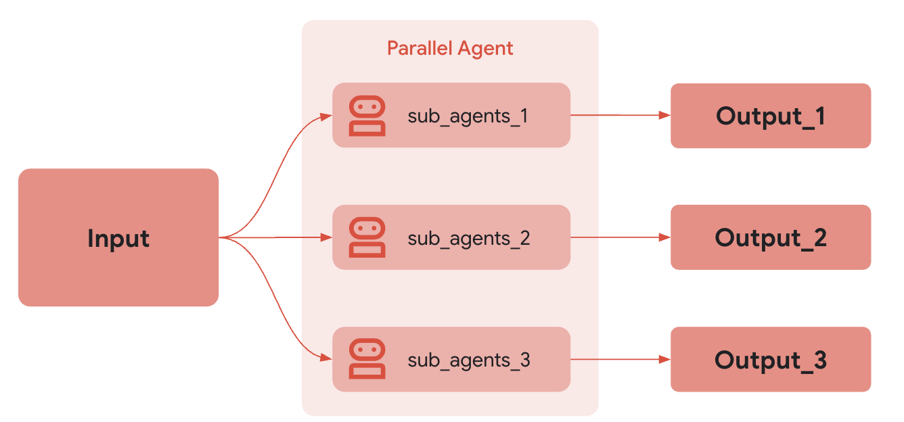

 [ Python](https://github.com/google/adk-python "adk-python on GitHub")[ JS ](https://github.com/google/adk-js "adk-js on GitHub")[ Go ](https://github.com/google/adk-go "adk-go on GitHub")[ Java ](https://github.com/google/adk-java "adk-java on GitHub")[ Kotlin](https://github.com/google/adk-kotlin "adk-kotlin on GitHub")

-   [Home](../../..)
-    Build Agents
    
    Build Agents
    
    -   [Get Started](../../../get-started/)
        
        Get Started
        
        -   [Python](../../../get-started/python/)
        -   [TypeScript](../../../get-started/typescript/)
        -   [Go](../../../get-started/go/)
        -   [Java](../../../get-started/java/)
        -   [Kotlin](../../../get-started/kotlin/)
        -   [Agents CLI](../../../get-started/agents-cli/)
        -   [Installation](../../../get-started/installation/)
        -   [Google Cloud](../../../get-started/google-cloud/)
        -   [Migrate to ADK](../../../get-started/migrate/)
        
    -   [Build your Agent](../../../tutorials/)
        
        Build your Agent
        
        -   [Multi-tool agent](../../../tutorials/multi-tool-agent/)
        -   [Agent team](../../../tutorials/agent-team/)
        -   [Code with AI](../../../tutorials/coding-with-ai/)
        -   [Agent Config](../../config/)
        
    -   [Agents](../../)
        
        Agents
        
        -   [Simple agents](../../llm-agents/)
        -   [Managed agents](../../managed-agents/)
        
    -   [Graph Workflows](../../../graphs/)
        
        Graph Workflows
        
        -   [Graph routes](../../../graphs/routes/)
        -   [Data handling](../../../graphs/data-handling/)
        -   [Human input](../../../graphs/human-input/)
        -   [Dynamic workflows](../../../graphs/dynamic/)
        
    -   [Multi-Agent Workflows](../../../workflows/)
        
        Multi-Agent Workflows
        
        -   [Collaborative workflows](../../../workflows/collaboration/)
        -   [Template workflows](../)
            
            Template workflows
            
            -   [Sequential workflow](../sequential-agents/)
            -   [Loop workflow](../loop-agents/)
            -    Parallel workflow [Parallel workflow](./)
                
                Table of contents
                
                -   [How it works](#how-it-works)
                -   [Independent Execution and State Management](#independent-execution-and-state-management)
                -   [Full Example: Parallel Web Research](#full-example-parallel-web-research)
                
            -   [Custom template workflows](../../custom-agents/)
            
        -   [Agent routing](../../routing/)
        -   [Workflow patterns](../../../workflows/patterns/)
        
    -   [Models for Agents](../../models/)
        
        Models for Agents
        
        -   [Gemini](../../models/google-gemini/)
            
            Gemini
            
            -   [Deferred scheduling](../../models/google-gemini/deferred-schedule/)
            
        -   [Gemma](../../models/google-gemma/)
        -   [Claude](../../models/anthropic/)
        -   [Agent Platform hosted](../../models/agent-platform/)
        -   [Apigee AI Gateway](../../models/apigee/)
        -   [Model routing](../../models/routing/)
        -   [OpenAI](../../models/openai/)
        -   [Ollama](../../models/ollama/)
        -   [vLLM](../../models/vllm/)
        -   [LiteLLM](../../models/litellm/)
        -   [LiteRT-LM](../../models/litert-lm/)
        
    
-    Run Agents
    
    Run Agents
    
    -   [Agent Runtime](../../../runtime/)
        
        Agent Runtime
        
        -   [Web Interface](../../../runtime/web-interface/)
            
            Web Interface
            
            -   [Visual Builder](../../../visual-builder/)
            
        -   [Command Line](../../../runtime/command-line/)
        -   [API Server](../../../runtime/api-server/)
        -   [Ambient Agents](../../../runtime/ambient-agents/)
        -   [Resume Agents](../../../runtime/resume/)
        -   [Cancel Agent Runs](../../../runtime/cancel/)
        -   [Runtime Config](../../../runtime/runconfig/)
        -   [Event Loop](../../../runtime/event-loop/)
        
    -   [Deployment](../../../deploy/)
        
        Deployment
        
        -   [Agent Runtime](../../../deploy/agent-runtime/)
            
            Agent Runtime
            
            -   [Standard deployment](../../../deploy/agent-runtime/deploy/)
            -   [agents-cli](../../../deploy/agent-runtime/agents-cli/)
            -   [Test deployed agents](../../../deploy/agent-runtime/test/)
            
        -   [Cloud Run](../../../deploy/cloud-run/)
        -   [GKE](../../../deploy/gke/)
        
    -   [Observability](../../../observability/)
        
        Observability
        
        -   [Logging](../../../observability/logging/)
        -   [Metrics](../../../observability/metrics/)
        -   [Traces](../../../observability/traces/)
        
    -   [Evaluation](../../../evaluate/)
        
        Evaluation
        
        -   [Criteria](../../../evaluate/criteria/)
        -   [User Simulation](../../../evaluate/user-sim/)
        -   [Environment Simulation](../../../evaluate/environment_simulation/)
        -   [Custom Metrics](../../../evaluate/custom_metrics/)
        -   [Optimization](../../../optimize/)
        
    -   [Safety and Security](../../../safety/)
        
        Safety and Security
        
    
-    Components
    
    Components
    
    -   [Technical Overview](../../../get-started/about/)
    -   [Custom Tools](../../../tools-custom/)
        
        Custom Tools
        
        -    Function tools
            
            Function tools
            
            -   [Overview](../../../tools-custom/function-tools/)
            -   [Tool performance](../../../tools-custom/performance/)
            -   [Action confirmations](../../../tools-custom/confirmation/)
            
        -   [MCP tools](../../../tools-custom/mcp-tools/)
            
            MCP tools
            
            -   [Advanced configuration](../../../tools-custom/mcp-tools/advanced/)
            -   [Deployment](../../../tools-custom/mcp-tools/deployment/)
            -   [Agent as MCP server](../../../tools-custom/mcp-tools/agent-as-server/)
            -   [Sub-agent delegation](../../../tools-custom/mcp-tools/agent-managed/)
            
        -   [OpenAPI tools](../../../tools-custom/openapi-tools/)
        -   [Authentication](../../../tools-custom/authentication/)
        -   [Tool limitations](../../../tools/limitations/)
        
    -   [Artifacts](../../../artifacts/)
        
        Artifacts
        
    -   [Skills for Agents](../../../skills/)
        
        Skills for Agents
        
    -   [App management](../../../apps/)
        
        App management
        
        -   [Callbacks](../../../callbacks/)
            
            Callbacks
            
            -   [Types of callbacks](../../../callbacks/types-of-callbacks/)
            -   [Callback patterns](../../../callbacks/design-patterns-and-best-practices/)
            
        -   [Plugins](../../../plugins/)
        
    -   [Agent context](../../../context/)
        
        Agent context
        
        -   [Conversational context](../../../sessions/)
        -   [Sessions](../../../sessions/session/)
            
            Sessions
            
            -   [Rewind sessions](../../../sessions/session/rewind/)
            -   [Migrate sessions](../../../sessions/session/migrate/)
            
        -   [State](../../../sessions/state/)
        -   [Events](../../../events/)
        -   [Memory](../../../sessions/memory/)
        -   [Context compression](../../../context/compaction/)
        -   [Model context caching](../../../context/caching/)
        
    -   [A2A Protocol](../../../a2a/)
        
        A2A Protocol
        
        -   [Introduction to A2A](../../../a2a/intro/)
        -    A2A Quickstart (Exposing)
            
            A2A Quickstart (Exposing)
            
            -   [Python](../../../a2a/quickstart-exposing/)
            -   [Go](../../../a2a/quickstart-exposing-go/)
            -   [Java](../../../a2a/quickstart-exposing-java/)
            
        -    A2A Quickstart (Consuming)
            
            A2A Quickstart (Consuming)
            
            -   [Python](../../../a2a/quickstart-consuming/)
            -   [Go](../../../a2a/quickstart-consuming-go/)
            -   [Java](../../../a2a/quickstart-consuming-java/)
            -   [Kotlin](../../../a2a/quickstart-consuming-kotlin/)
            
        -   [A2A Extension](../../../a2a/a2a-extension/)
        
    -   [Live and Voice Agents](../../../live/)
        
        Live and Voice Agents
        
        -   [Get started](../../../live/get-started/)
            
            Get started
            
            -   [Python](../../../live/get-started/streaming-python/)
            -   [Java](../../../live/get-started/streaming-java/)
            
        -    Building
            
            Building
            
            -   [Workflows](../../../live/workflows/)
            -   [Tools](../../../live/tools/)
            -   [Sessions](../../../live/sessions/)
            -   [Events](../../../live/events/)
            -   [Audio and video](../../../live/audio-video/)
            -   [Configuration](../../../live/configuration/)
            
        -    Production
            
            Production
            
            -   [Guardrails](../../../live/guardrails/)
            -   [Evaluation](../../../live/evaluation/)
            -   [Build a custom server](../../../live/custom-server/)
            
        -   [Supported models](../../../live/models/)
        
    -   [Grounding](../../../grounding/)
        
        Grounding
        
        -   [Google Search Grounding](../../../grounding/google_search_grounding/)
        -   [Grounding with Search](../../../grounding/grounding_with_search/)
        
    
-   [Integrations](../../../integrations/)
    
    Integrations
    
-    Reference
    
    Reference
    
    -   [API Reference](../../../api-reference/)
        
        API Reference
        
        -   [Python ADK](../../../api-reference/python/)
        -   [TypeScript ADK](../../../api-reference/typescript/)
        -    Go ADK
            
            Go ADK
            
            -   [Go v2.x](https://pkg.go.dev/google.golang.org/adk/v2)
            -   [Go v1.x](https://pkg.go.dev/google.golang.org/adk)
            
        -   [Java ADK](../../../api-reference/java/)
        -   [Kotlin ADK](../../../api-reference/kotlin/)
        -   [CLI Reference](../../../api-reference/cli/)
        -   [Agent Config Reference](../../../api-reference/agentconfig/)
        -   [REST API](../../../api-reference/rest/)
        
    -   [Release Notes](../../../release-notes/)
    
-   [Community](../../../community/)
    
    Community
    
    -   [Contributing Guide](../../../community/contributing-guide/)
    
-   [ADK 2.0](../../../2.0/)
    
    ADK 2.0
    

Table of contents

-   [How it works](#how-it-works)
-   [Independent Execution and State Management](#independent-execution-and-state-management)
-   [Full Example: Parallel Web Research](#full-example-parallel-web-research)

1.  [Home](../../..)
2.  [Build Agents](../../../get-started/)
3.  [Multi-Agent Workflows](../../../workflows/)
4.  [Template workflows](../)

# Parallel template workflow agent[¶](#parallel-template-workflow-agent "Permanent link")

Supported in ADKPython v0.1.0TypeScript v0.2.0Go v0.1.0Java v0.2.0

The ***ParallelAgent*** class is a [template workflow](/agents/workflow-agents/) agent that executes its sub-agents concurrently. This execution strategy can dramatically speed up workflows where two or more tasks can be performed independently. For scenarios prioritizing speed and involving independent, resource-intensive tasks, this templated workflow facilitates parallel execution, which can significantly reduce overall processing time. When using this workflow type, it is important that each sub-agent can operate without depending on the other sub-agents. This workflow type is particularly beneficial for operations like multi-source data retrieval or heavy computations, where parallelization yields substantial performance gains.

As with other templated workflows, the execution of a ***ParallelAgent*** object is not controlled by an AI model, and is deterministic in how it executes its sub-agents. The sub-agents specified in the parallel execution set may or may not utilize AI models, but the overall execution of those sub-agents is ultimately managed by the ***ParallelAgent*** object you define.

Alternative: graph-based workflows

Starting in ADK 2.0 for Python and Go, templated workflows have been superseded

by more flexible workflow structures, including [graph-based workflows](/graphs/) and [dynamic workflows](/graphs/dynamic/).

### How it works[¶](#how-it-works "Permanent link")

When the `ParallelAgent`'s `run_async()` method is called:

1.  **Concurrent Execution:** It initiates the `run_async()` method of *each* sub-agent present in the `sub_agents` list *concurrently*. This means all the agents start running at (approximately) the same time.
2.  **Independent Branches:** Each sub-agent operates in its own execution branch. There is ***no* automatic sharing of conversation history or state between these branches** during execution.
3.  **Result Collection:** The `ParallelAgent` manages the parallel execution and, typically, provides a way to access the results from each sub-agent after they have completed (e.g., through a list of results or events). The order of results may not be deterministic.

### Independent Execution and State Management[¶](#independent-execution-and-state-management "Permanent link")

It's *crucial* to understand that sub-agents within a `ParallelAgent` run independently. If you *need* communication or data sharing between these agents, you must implement it explicitly. Possible approaches include:

-   **Shared `InvocationContext`:** You could pass a shared `InvocationContext` object to each sub-agent. This object could act as a shared data store. However, you'd need to manage concurrent access to this shared context carefully (e.g., using locks) to avoid race conditions.
-   **External State Management:** Use an external database, message queue, or other mechanism to manage shared state and facilitate communication between agents.
-   **Post-Processing:** Collect results from each branch, and then implement logic to coordinate data afterwards.

### Full Example: Parallel Web Research[¶](#full-example-parallel-web-research "Permanent link")

Imagine researching multiple topics simultaneously:

1.  **Researcher Agent 1:** An `LlmAgent` that researches "renewable energy sources."
2.  **Researcher Agent 2:** An `LlmAgent` that researches "electric vehicle technology."
3.  **Researcher Agent 3:** An `LlmAgent` that researches "carbon capture methods."
    
    `ParallelAgent(sub_agents=[ResearcherAgent1, ResearcherAgent2, ResearcherAgent3])`
    

These research tasks are independent. Using a `ParallelAgent` allows them to run concurrently, potentially reducing the total research time significantly compared to running them sequentially. The results from each agent would be collected separately after they finish.

Full Code

PythonTypeScriptGoJava

 ` from google.adk.agents.parallel_agent import ParallelAgent  from google.adk.agents.llm_agent import LlmAgent  from google.adk.agents.sequential_agent import SequentialAgent  from google.adk.tools import google_search   # --- Constants ---  GEMINI_MODEL = "gemini-2.5-flash"   # --- 1. Define Researcher Sub-Agents (to run in parallel) ---  # Researcher 1: Renewable Energy  researcher_agent_1 = LlmAgent(          name="RenewableEnergyResearcher",          model=GEMINI_MODEL,          instruction="""          You are an AI Research Assistant specializing in energy.          Research the latest advancements in 'renewable energy sources'.          Use the Google Search tool provided.          Summarize your key findings concisely (1-2 sentences).          Output *only* the summary.          """,          description="Researches renewable energy sources.",          tools=[google_search],          # Store result in state for the merger agent          output_key="renewable_energy_result"  )   # Researcher 2: Electric Vehicles  researcher_agent_2 = LlmAgent(          name="EVResearcher",          model=GEMINI_MODEL,          instruction="""          You are an AI Research Assistant specializing in transportation.          Research the latest developments in 'electric vehicle technology'.          Use the Google Search tool provided.          Summarize your key findings concisely (1-2 sentences).          Output *only* the summary.          """,          description="Researches electric vehicle technology.",          tools=[google_search],          # Store result in state for the merger agent          output_key="ev_technology_result"  )   # Researcher 3: Carbon Capture  researcher_agent_3 = LlmAgent(          name="CarbonCaptureResearcher",          model=GEMINI_MODEL,          instruction="""          You are an AI Research Assistant specializing in climate solutions.          Research the current state of 'carbon capture methods'.          Use the Google Search tool provided.          Summarize your key findings concisely (1-2 sentences).          Output *only* the summary.          """,          description="Researches carbon capture methods.",          tools=[google_search],          # Store result in state for the merger agent          output_key="carbon_capture_result"  )   # --- 2. Create the ParallelAgent (Runs researchers concurrently) ---  # This agent orchestrates the concurrent execution of the researchers.  # It finishes once all researchers have completed and stored their results in state.  parallel_research_agent = ParallelAgent(          name="ParallelWebResearchAgent",          sub_agents=[researcher_agent_1, researcher_agent_2, researcher_agent_3],          description="Runs multiple research agents in parallel to gather information."  )   # --- 3. Define the Merger Agent (Runs *after* the parallel agents) ---  # This agent takes the results stored in the session state by the parallel agents  # and synthesizes them into a single, structured response with attributions.  merger_agent = LlmAgent(          name="SynthesisAgent",          model=GEMINI_MODEL,  # Or potentially a more powerful model if needed for synthesis          instruction="""          You are an AI Assistant responsible for combining research findings into a structured report.           Your primary task is to synthesize the following research summaries, clearly attributing findings to their source areas. Structure your response using headings for each topic. Ensure the report is coherent and integrates the key points smoothly.           **Crucially: Your entire response MUST be grounded *exclusively* on the information provided in the 'Input Summaries' below. Do NOT add any external knowledge, facts, or details not present in these specific summaries.**           **Input Summaries:**           *   **Renewable Energy:**                  {renewable_energy_result}           *   **Electric Vehicles:**                  {ev_technology_result}           *   **Carbon Capture:**                  {carbon_capture_result}           **Output Format:**           ## Summary of Recent Sustainable Technology Advancements           ### Renewable Energy Findings          (Based on RenewableEnergyResearcher's findings)          [Synthesize and elaborate *only* on the renewable energy input summary provided above.]           ### Electric Vehicle Findings          (Based on EVResearcher's findings)          [Synthesize and elaborate *only* on the EV input summary provided above.]           ### Carbon Capture Findings          (Based on CarbonCaptureResearcher's findings)          [Synthesize and elaborate *only* on the carbon capture input summary provided above.]           ### Overall Conclusion          [Provide a brief (1-2 sentence) concluding statement that connects *only* the findings presented above.]           Output *only* the structured report following this format. Do not include introductory or concluding phrases outside this structure, and strictly adhere to using only the provided input summary content.          """,          description="Combines research findings from parallel agents into a structured, cited report, strictly grounded on provided inputs.",          # No tools needed for merging          # No output_key needed here, as its direct response is the final output of the sequence  )    # --- 4. Create the SequentialAgent (Orchestrates the overall flow) ---  # This is the main agent that will be run. It first executes the ParallelAgent  # to populate the state, and then executes the MergerAgent to produce the final output.  sequential_pipeline_agent = SequentialAgent(          name="ResearchAndSynthesisPipeline",          # Run parallel research first, then merge          sub_agents=[parallel_research_agent, merger_agent],          description="Coordinates parallel research and synthesizes the results."  )   root_agent = sequential_pipeline_agent`

 `` // Part of agent.ts --> Follow https://adk.dev/get-started/ to learn the setup  // --- 1. Define Researcher Sub-Agents (to run in parallel) ---   const researchTools = [GOOGLE_SEARCH];   // Researcher 1: Renewable Energy  const researcherAgent1 = new LlmAgent({          name: "RenewableEnergyResearcher",          model: GEMINI_MODEL,          instruction: `You are an AI Research Assistant specializing in energy.  Research the latest advancements in 'renewable energy sources'.  Use the Google Search tool provided.  Summarize your key findings concisely (1-2 sentences).  Output *only* the summary.  `,          description: "Researches renewable energy sources.",          tools: researchTools,          // Store result in state for the merger agent          outputKey: "renewable_energy_result"  });   // Researcher 2: Electric Vehicles  const researcherAgent2 = new LlmAgent({          name: "EVResearcher",          model: GEMINI_MODEL,          instruction: `You are an AI Research Assistant specializing in transportation.  Research the latest developments in 'electric vehicle technology'.  Use the Google Search tool provided.  Summarize your key findings concisely (1-2 sentences).  Output *only* the summary.  `,          description: "Researches electric vehicle technology.",          tools: researchTools,          // Store result in state for the merger agent          outputKey: "ev_technology_result"  });   // Researcher 3: Carbon Capture  const researcherAgent3 = new LlmAgent({          name: "CarbonCaptureResearcher",          model: GEMINI_MODEL,          instruction: `You are an AI Research Assistant specializing in climate solutions.  Research the current state of 'carbon capture methods'.  Use the Google Search tool provided.  Summarize your key findings concisely (1-2 sentences).  Output *only* the summary.  `,          description: "Researches carbon capture methods.",          tools: researchTools,          // Store result in state for the merger agent          outputKey: "carbon_capture_result"  });   // --- 2. Create the ParallelAgent (Runs researchers concurrently) ---  // This agent orchestrates the concurrent execution of the researchers.  // It finishes once all researchers have completed and stored their results in state.  const parallelResearchAgent = new ParallelAgent({          name: "ParallelWebResearchAgent",          subAgents: [researcherAgent1, researcherAgent2, researcherAgent3],          description: "Runs multiple research agents in parallel to gather information."  });   // --- 3. Define the Merger Agent (Runs *after* the parallel agents) ---  // This agent takes the results stored in the session state by the parallel agents  // and synthesizes them into a single, structured response with attributions.  const mergerAgent = new LlmAgent({          name: "SynthesisAgent",          model: GEMINI_MODEL,  // Or potentially a more powerful model if needed for synthesis          instruction: `You are an AI Assistant responsible for combining research findings into a structured report.   Your primary task is to synthesize the following research summaries, clearly attributing findings to their source areas. Structure your response using headings for each topic. Ensure the report is coherent and integrates the key points smoothly.   **Crucially: Your entire response MUST be grounded *exclusively* on the information provided in the 'Input Summaries' below. Do NOT add any external knowledge, facts, or details not present in these specific summaries.**   **Input Summaries:**   *   **Renewable Energy:**          {renewable_energy_result}   *   **Electric Vehicles:**          {ev_technology_result}   *   **Carbon Capture:**          {carbon_capture_result}   **Output Format:**   ## Summary of Recent Sustainable Technology Advancements   ### Renewable Energy Findings  (Based on RenewableEnergyResearcher's findings)  [Synthesize and elaborate *only* on the renewable energy input summary provided above.]   ### Electric Vehicle Findings  (Based on EVResearcher's findings)  [Synthesize and elaborate *only* on the EV input summary provided above.]   ### Carbon Capture Findings  (Based on CarbonCaptureResearcher's findings)  [Synthesize and elaborate *only* on the carbon capture input summary provided above.]   ### Overall Conclusion  [Provide a brief (1-2 sentence) concluding statement that connects *only* the findings presented above.]   Output *only* the structured report following this format. Do not include introductory or concluding phrases outside this structure, and strictly adhere to using only the provided input summary content.  `,          description: "Combines research findings from parallel agents into a structured, cited report, strictly grounded on provided inputs.",          // No tools needed for merging          // No output_key needed here, as its direct response is the final output of the sequence  });    // --- 4. Create the SequentialAgent (Orchestrates the overall flow) ---  // This is the main agent that will be run. It first executes the ParallelAgent  // to populate the state, and then executes the MergerAgent to produce the final output.  const rootAgent = new SequentialAgent({          name: "ResearchAndSynthesisPipeline",          // Run parallel research first, then merge          subAgents: [parallelResearchAgent, mergerAgent],          description: "Coordinates parallel research and synthesizes the results."  });``

    ``    model, err := gemini.NewModel(ctx, modelName, &genai.ClientConfig{})        if err != nil {                return fmt.Errorf("failed to create model: %v", err)        }         // --- 1. Define Researcher Sub-Agents (to run in parallel) ---        researcher1, err := llmagent.New(llmagent.Config{                Name:  "RenewableEnergyResearcher",                Model: model,                Instruction: `You are an AI Research Assistant specializing in energy.  Research the latest advancements in 'renewable energy sources'.  Use the Google Search tool provided.  Summarize your key findings concisely (1-2 sentences).  Output *only* the summary.`,                Description: "Researches renewable energy sources.",                OutputKey:   "renewable_energy_result",        })        if err != nil {                return err        }        researcher2, err := llmagent.New(llmagent.Config{                Name:  "EVResearcher",                Model: model,                Instruction: `You are an AI Research Assistant specializing in transportation.  Research the latest developments in 'electric vehicle technology'.  Use the Google Search tool provided.  Summarize your key findings concisely (1-2 sentences).  Output *only* the summary.`,                Description: "Researches electric vehicle technology.",                OutputKey:   "ev_technology_result",        })        if err != nil {                return err        }        researcher3, err := llmagent.New(llmagent.Config{                Name:  "CarbonCaptureResearcher",                Model: model,                Instruction: `You are an AI Research Assistant specializing in climate solutions.  Research the current state of 'carbon capture methods'.  Use the Google Search tool provided.  Summarize your key findings concisely (1-2 sentences).  Output *only* the summary.`,                Description: "Researches carbon capture methods.",                OutputKey:   "carbon_capture_result",        })        if err != nil {                return err        }         // --- 2. Create the ParallelAgent (Runs researchers concurrently) ---        parallelResearchAgent, err := parallelagent.New(parallelagent.Config{                AgentConfig: agent.Config{                        Name:        "ParallelWebResearchAgent",                        Description: "Runs multiple research agents in parallel to gather information.",                        SubAgents:   []agent.Agent{researcher1, researcher2, researcher3},                },        })        if err != nil {                return fmt.Errorf("failed to create parallel agent: %v", err)        }         // --- 3. Define the Merger Agent (Runs *after* the parallel agents) ---        synthesisAgent, err := llmagent.New(llmagent.Config{                Name:  "SynthesisAgent",                Model: model,                Instruction: `You are an AI Assistant responsible for combining research findings into a structured report.  Your primary task is to synthesize the following research summaries, clearly attributing findings to their source areas. Structure your response using headings for each topic. Ensure the report is coherent and integrates the key points smoothly.  **Crucially: Your entire response MUST be grounded *exclusively* on the information provided in the 'Input Summaries' below. Do NOT add any external knowledge, facts, or details not present in these specific summaries.**  **Input Summaries:**   *   **Renewable Energy:**          {renewable_energy_result}   *   **Electric Vehicles:**          {ev_technology_result}   *   **Carbon Capture:**          {carbon_capture_result}   **Output Format:**   ## Summary of Recent Sustainable Technology Advancements   ### Renewable Energy Findings  (Based on RenewableEnergyResearcher's findings)  [Synthesize and elaborate *only* on the renewable energy input summary provided above.]   ### Electric Vehicle Findings  (Based on EVResearcher's findings)  [Synthesize and elaborate *only* on the EV input summary provided above.]   ### Carbon Capture Findings  (Based on CarbonCaptureResearcher's findings)  [Synthesize and elaborate *only* on the carbon capture input summary provided above.]   ### Overall Conclusion  [Provide a brief (1-2 sentence) concluding statement that connects *only* the findings presented above.]   Output *only* the structured report following this format. Do not include introductory or concluding phrases outside this structure, and strictly adhere to using only the provided input summary content.`,                Description: "Combines research findings from parallel agents into a structured, cited report, strictly grounded on provided inputs.",        })        if err != nil {                return fmt.Errorf("failed to create synthesis agent: %v", err)        }         // --- 4. Create the SequentialAgent (Orchestrates the overall flow) ---        pipeline, err := sequentialagent.New(sequentialagent.Config{                AgentConfig: agent.Config{                        Name:        "ResearchAndSynthesisPipeline",                        Description: "Coordinates parallel research and synthesizes the results.",                        SubAgents:   []agent.Agent{parallelResearchAgent, synthesisAgent},                },        })        if err != nil {                return fmt.Errorf("failed to create sequential agent pipeline: %v", err)        }``

 ` import com.google.adk.agents.LlmAgent;  import com.google.adk.agents.ParallelAgent;  import com.google.adk.agents.SequentialAgent;  import com.google.adk.events.Event;  import com.google.adk.runner.InMemoryRunner;  import com.google.adk.sessions.Session;  import com.google.adk.tools.GoogleSearchTool;  import com.google.genai.types.Content;  import com.google.genai.types.Part;  import io.reactivex.rxjava3.core.Flowable;   public class ParallelResearchPipeline {       private static final String APP_NAME = "parallel_research_app";      private static final String USER_ID = "research_user_01";      private static final String GEMINI_MODEL = "gemini-2.0-flash";       // Assume google_search is an instance of the GoogleSearchTool      private static final GoogleSearchTool googleSearchTool = new GoogleSearchTool();       public static void main(String[] args) {          String query = "Summarize recent sustainable tech advancements.";          SequentialAgent sequentialPipelineAgent = initAgent();          runAgent(sequentialPipelineAgent, query);      }       public static SequentialAgent initAgent() {          // --- 1. Define Researcher Sub-Agents (to run in parallel) ---          // Researcher 1: Renewable Energy          LlmAgent researcherAgent1 = LlmAgent.builder()                  .name("RenewableEnergyResearcher")                  .model(GEMINI_MODEL)                  .instruction("""                                          You are an AI Research Assistant specializing in energy.                                          Research the latest advancements in 'renewable energy sources'.                                          Use the Google Search tool provided.                                          Summarize your key findings concisely (1-2 sentences).                                          Output *only* the summary.                                          """)                  .description("Researches renewable energy sources.")                  .tools(googleSearchTool)                  .outputKey("renewable_energy_result") // Store result in state                  .build();           // Researcher 2: Electric Vehicles          LlmAgent researcherAgent2 = LlmAgent.builder()                  .name("EVResearcher")                  .model(GEMINI_MODEL)                  .instruction("""                                          You are an AI Research Assistant specializing in transportation.                                          Research the latest developments in 'electric vehicle technology'.                                          Use the Google Search tool provided.                                          Summarize your key findings concisely (1-2 sentences).                                          Output *only* the summary.                                          """)                  .description("Researches electric vehicle technology.")                  .tools(googleSearchTool)                  .outputKey("ev_technology_result") // Store result in state                  .build();           // Researcher 3: Carbon Capture          LlmAgent researcherAgent3 = LlmAgent.builder()                  .name("CarbonCaptureResearcher")                  .model(GEMINI_MODEL)                  .instruction("""                                          You are an AI Research Assistant specializing in climate solutions.                                          Research the current state of 'carbon capture methods'.                                          Use the Google Search tool provided.                                          Summarize your key findings concisely (1-2 sentences).                                          Output *only* the summary.                                          """)                  .description("Researches carbon capture methods.")                  .tools(googleSearchTool)                  .outputKey("carbon_capture_result") // Store result in state                  .build();           // --- 2. Create the ParallelAgent (Runs researchers concurrently) ---          // This agent orchestrates the concurrent execution of the researchers.          // It finishes once all researchers have completed and stored their results in state.          ParallelAgent parallelResearchAgent =                  ParallelAgent.builder()                          .name("ParallelWebResearchAgent")                          .subAgents(researcherAgent1, researcherAgent2, researcherAgent3)                          .description("Runs multiple research agents in parallel to gather information.")                          .build();           // --- 3. Define the Merger Agent (Runs *after* the parallel agents) ---          // This agent takes the results stored in the session state by the parallel agents          // and synthesizes them into a single, structured response with attributions.          LlmAgent mergerAgent =                  LlmAgent.builder()                          .name("SynthesisAgent")                          .model(GEMINI_MODEL)                          .instruction(                                  """                                              You are an AI Assistant responsible for combining research findings into a structured report.                                              Your primary task is to synthesize the following research summaries, clearly attributing findings to their source areas. Structure your response using headings for each topic. Ensure the report is coherent and integrates the key points smoothly.                                              **Crucially: Your entire response MUST be grounded *exclusively* on the information provided in the 'Input Summaries' below. Do NOT add any external knowledge, facts, or details not present in these specific summaries.**                                              **Input Summaries:**                                               *   **Renewable Energy:**                                                      {renewable_energy_result}                                               *   **Electric Vehicles:**                                                      {ev_technology_result}                                               *   **Carbon Capture:**                                                      {carbon_capture_result}                                               **Output Format:**                                               ## Summary of Recent Sustainable Technology Advancements                                               ### Renewable Energy Findings                                              (Based on RenewableEnergyResearcher's findings)                                              [Synthesize and elaborate *only* on the renewable energy input summary provided above.]                                               ### Electric Vehicle Findings                                              (Based on EVResearcher's findings)                                              [Synthesize and elaborate *only* on the EV input summary provided above.]                                               ### Carbon Capture Findings                                              (Based on CarbonCaptureResearcher's findings)                                              [Synthesize and elaborate *only* on the carbon capture input summary provided above.]                                               ### Overall Conclusion                                              [Provide a brief (1-2 sentence) concluding statement that connects *only* the findings presented above.]                                               Output *only* the structured report following this format. Do not include introductory or concluding phrases outside this structure, and strictly adhere to using only the provided input summary content.                                              """)                          .description(                                  "Combines research findings from parallel agents into a structured, cited report, strictly grounded on provided inputs.")                          // No tools needed for merging                          // No output_key needed here, as its direct response is the final output of the sequence                          .build();           // --- 4. Create the SequentialAgent (Orchestrates the overall flow) ---          // This is the main agent that will be run. It first executes the ParallelAgent          // to populate the state, and then executes the MergerAgent to produce the final output.          SequentialAgent sequentialPipelineAgent =                  SequentialAgent.builder()                          .name("ResearchAndSynthesisPipeline")                          // Run parallel research first, then merge                          .subAgents(parallelResearchAgent, mergerAgent)                          .description("Coordinates parallel research and synthesizes the results.")                          .build();           return sequentialPipelineAgent;      }       public static void runAgent(SequentialAgent sequentialPipelineAgent, String query) {          // Create an InMemoryRunner          InMemoryRunner runner = new InMemoryRunner(sequentialPipelineAgent, APP_NAME);          // InMemoryRunner automatically creates a session service. Create a session using the service          Session session = runner.sessionService().createSession(APP_NAME, USER_ID).blockingGet();          Content userMessage = Content.fromParts(Part.fromText(query));           // Run the agent          Flowable<Event> eventStream = runner.runAsync(USER_ID, session.id(), userMessage);           // Stream event response          eventStream.blockingForEach(                  event -> {                      if (event.finalResponse()) {                          System.out.printf("Event Author: %s \n Event Response: %s \n\n\n", event.author(), event.stringifyContent());                      }                  });      }  }`

Back to top