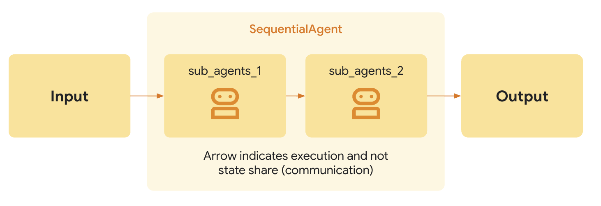

 [ Python](https://github.com/google/adk-python "adk-python on GitHub")[ JS ](https://github.com/google/adk-js "adk-js on GitHub")[ Go ](https://github.com/google/adk-go "adk-go on GitHub")[ Java ](https://github.com/google/adk-java "adk-java on GitHub")[ Kotlin](https://github.com/google/adk-kotlin "adk-kotlin on GitHub")

-   [Home](../../..)
-    Build Agents
    
    Build Agents
    
    -   [Get Started](../../../get-started/)
        
        Get Started
        
        -   [Python](../../../get-started/python/)
        -   [TypeScript](../../../get-started/typescript/)
        -   [Go](../../../get-started/go/)
        -   [Java](../../../get-started/java/)
        -   [Kotlin](../../../get-started/kotlin/)
        -   [Agents CLI](../../../get-started/agents-cli/)
        -   [Installation](../../../get-started/installation/)
        -   [Google Cloud](../../../get-started/google-cloud/)
        -   [Migrate to ADK](../../../get-started/migrate/)
        
    -   [Build your Agent](../../../tutorials/)
        
        Build your Agent
        
        -   [Multi-tool agent](../../../tutorials/multi-tool-agent/)
        -   [Agent team](../../../tutorials/agent-team/)
        -   [Code with AI](../../../tutorials/coding-with-ai/)
        -   [Agent Config](../../config/)
        
    -   [Agents](../../)
        
        Agents
        
        -   [Simple agents](../../llm-agents/)
        -   [Managed agents](../../managed-agents/)
        
    -   [Graph Workflows](../../../graphs/)
        
        Graph Workflows
        
        -   [Graph routes](../../../graphs/routes/)
        -   [Data handling](../../../graphs/data-handling/)
        -   [Human input](../../../graphs/human-input/)
        -   [Dynamic workflows](../../../graphs/dynamic/)
        
    -   [Multi-Agent Workflows](../../../workflows/)
        
        Multi-Agent Workflows
        
        -   [Collaborative workflows](../../../workflows/collaboration/)
        -   [Template workflows](../)
            
            Template workflows
            
            -    Sequential workflow [Sequential workflow](./)
                
                Table of contents
                
                -   [Example scenario](#example-scenario)
                -   [How it works](#how-it-works)
                -   [Full Example: Code Development Pipeline](#full-example-code-development-pipeline)
                
            -   [Loop workflow](../loop-agents/)
            -   [Parallel workflow](../parallel-agents/)
            -   [Custom template workflows](../../custom-agents/)
            
        -   [Agent routing](../../routing/)
        -   [Workflow patterns](../../../workflows/patterns/)
        
    -   [Models for Agents](../../models/)
        
        Models for Agents
        
        -   [Gemini](../../models/google-gemini/)
            
            Gemini
            
            -   [Deferred scheduling](../../models/google-gemini/deferred-schedule/)
            
        -   [Gemma](../../models/google-gemma/)
        -   [Claude](../../models/anthropic/)
        -   [Agent Platform hosted](../../models/agent-platform/)
        -   [Apigee AI Gateway](../../models/apigee/)
        -   [Model routing](../../models/routing/)
        -   [OpenAI](../../models/openai/)
        -   [Ollama](../../models/ollama/)
        -   [vLLM](../../models/vllm/)
        -   [LiteLLM](../../models/litellm/)
        -   [LiteRT-LM](../../models/litert-lm/)
        
    
-    Run Agents
    
    Run Agents
    
    -   [Agent Runtime](../../../runtime/)
        
        Agent Runtime
        
        -   [Web Interface](../../../runtime/web-interface/)
            
            Web Interface
            
            -   [Visual Builder](../../../visual-builder/)
            
        -   [Command Line](../../../runtime/command-line/)
        -   [API Server](../../../runtime/api-server/)
        -   [Ambient Agents](../../../runtime/ambient-agents/)
        -   [Resume Agents](../../../runtime/resume/)
        -   [Cancel Agent Runs](../../../runtime/cancel/)
        -   [Runtime Config](../../../runtime/runconfig/)
        -   [Event Loop](../../../runtime/event-loop/)
        
    -   [Deployment](../../../deploy/)
        
        Deployment
        
        -   [Agent Runtime](../../../deploy/agent-runtime/)
            
            Agent Runtime
            
            -   [Standard deployment](../../../deploy/agent-runtime/deploy/)
            -   [agents-cli](../../../deploy/agent-runtime/agents-cli/)
            -   [Test deployed agents](../../../deploy/agent-runtime/test/)
            
        -   [Cloud Run](../../../deploy/cloud-run/)
        -   [GKE](../../../deploy/gke/)
        
    -   [Observability](../../../observability/)
        
        Observability
        
        -   [Logging](../../../observability/logging/)
        -   [Metrics](../../../observability/metrics/)
        -   [Traces](../../../observability/traces/)
        
    -   [Evaluation](../../../evaluate/)
        
        Evaluation
        
        -   [Criteria](../../../evaluate/criteria/)
        -   [User Simulation](../../../evaluate/user-sim/)
        -   [Environment Simulation](../../../evaluate/environment_simulation/)
        -   [Custom Metrics](../../../evaluate/custom_metrics/)
        -   [Optimization](../../../optimize/)
        
    -   [Safety and Security](../../../safety/)
        
        Safety and Security
        
    
-    Components
    
    Components
    
    -   [Technical Overview](../../../get-started/about/)
    -   [Custom Tools](../../../tools-custom/)
        
        Custom Tools
        
        -    Function tools
            
            Function tools
            
            -   [Overview](../../../tools-custom/function-tools/)
            -   [Tool performance](../../../tools-custom/performance/)
            -   [Action confirmations](../../../tools-custom/confirmation/)
            
        -   [MCP tools](../../../tools-custom/mcp-tools/)
            
            MCP tools
            
            -   [Advanced configuration](../../../tools-custom/mcp-tools/advanced/)
            -   [Deployment](../../../tools-custom/mcp-tools/deployment/)
            -   [Agent as MCP server](../../../tools-custom/mcp-tools/agent-as-server/)
            -   [Sub-agent delegation](../../../tools-custom/mcp-tools/agent-managed/)
            
        -   [OpenAPI tools](../../../tools-custom/openapi-tools/)
        -   [Authentication](../../../tools-custom/authentication/)
        -   [Tool limitations](../../../tools/limitations/)
        
    -   [Artifacts](../../../artifacts/)
        
        Artifacts
        
    -   [Skills for Agents](../../../skills/)
        
        Skills for Agents
        
    -   [App management](../../../apps/)
        
        App management
        
        -   [Callbacks](../../../callbacks/)
            
            Callbacks
            
            -   [Types of callbacks](../../../callbacks/types-of-callbacks/)
            -   [Callback patterns](../../../callbacks/design-patterns-and-best-practices/)
            
        -   [Plugins](../../../plugins/)
        
    -   [Agent context](../../../context/)
        
        Agent context
        
        -   [Conversational context](../../../sessions/)
        -   [Sessions](../../../sessions/session/)
            
            Sessions
            
            -   [Rewind sessions](../../../sessions/session/rewind/)
            -   [Migrate sessions](../../../sessions/session/migrate/)
            
        -   [State](../../../sessions/state/)
        -   [Events](../../../events/)
        -   [Memory](../../../sessions/memory/)
        -   [Context compression](../../../context/compaction/)
        -   [Model context caching](../../../context/caching/)
        
    -   [A2A Protocol](../../../a2a/)
        
        A2A Protocol
        
        -   [Introduction to A2A](../../../a2a/intro/)
        -    A2A Quickstart (Exposing)
            
            A2A Quickstart (Exposing)
            
            -   [Python](../../../a2a/quickstart-exposing/)
            -   [Go](../../../a2a/quickstart-exposing-go/)
            -   [Java](../../../a2a/quickstart-exposing-java/)
            
        -    A2A Quickstart (Consuming)
            
            A2A Quickstart (Consuming)
            
            -   [Python](../../../a2a/quickstart-consuming/)
            -   [Go](../../../a2a/quickstart-consuming-go/)
            -   [Java](../../../a2a/quickstart-consuming-java/)
            -   [Kotlin](../../../a2a/quickstart-consuming-kotlin/)
            
        -   [A2A Extension](../../../a2a/a2a-extension/)
        
    -   [Live and Voice Agents](../../../live/)
        
        Live and Voice Agents
        
        -   [Get started](../../../live/get-started/)
            
            Get started
            
            -   [Python](../../../live/get-started/streaming-python/)
            -   [Java](../../../live/get-started/streaming-java/)
            
        -    Building
            
            Building
            
            -   [Workflows](../../../live/workflows/)
            -   [Tools](../../../live/tools/)
            -   [Sessions](../../../live/sessions/)
            -   [Events](../../../live/events/)
            -   [Audio and video](../../../live/audio-video/)
            -   [Configuration](../../../live/configuration/)
            
        -    Production
            
            Production
            
            -   [Guardrails](../../../live/guardrails/)
            -   [Evaluation](../../../live/evaluation/)
            -   [Build a custom server](../../../live/custom-server/)
            
        -   [Supported models](../../../live/models/)
        
    -   [Grounding](../../../grounding/)
        
        Grounding
        
        -   [Google Search Grounding](../../../grounding/google_search_grounding/)
        -   [Grounding with Search](../../../grounding/grounding_with_search/)
        
    
-   [Integrations](../../../integrations/)
    
    Integrations
    
-    Reference
    
    Reference
    
    -   [API Reference](../../../api-reference/)
        
        API Reference
        
        -   [Python ADK](../../../api-reference/python/)
        -   [TypeScript ADK](../../../api-reference/typescript/)
        -    Go ADK
            
            Go ADK
            
            -   [Go v2.x](https://pkg.go.dev/google.golang.org/adk/v2)
            -   [Go v1.x](https://pkg.go.dev/google.golang.org/adk)
            
        -   [Java ADK](../../../api-reference/java/)
        -   [Kotlin ADK](../../../api-reference/kotlin/)
        -   [CLI Reference](../../../api-reference/cli/)
        -   [Agent Config Reference](../../../api-reference/agentconfig/)
        -   [REST API](../../../api-reference/rest/)
        
    -   [Release Notes](../../../release-notes/)
    
-   [Community](../../../community/)
    
    Community
    
    -   [Contributing Guide](../../../community/contributing-guide/)
    
-   [ADK 2.0](../../../2.0/)
    
    ADK 2.0
    

Table of contents

-   [Example scenario](#example-scenario)
-   [How it works](#how-it-works)
-   [Full Example: Code Development Pipeline](#full-example-code-development-pipeline)

1.  [Home](../../..)
2.  [Build Agents](../../../get-started/)
3.  [Multi-Agent Workflows](../../../workflows/)
4.  [Template workflows](../)

[](https://github.com/google/adk-docs/edit/main/docs/agents/workflow-agents/sequential-agents.md "Edit this page on GitHub")[](./index.md "View this page as Markdown")

# Sequential template workflow agent[¶](#sequential-template-workflow-agent "Permanent link")

Supported in ADKPython v0.1.0TypeScript v0.2.0Go v0.1.0Java v0.2.0

The ***SequentialAgent*** class is a [template workflow](/agents/workflow-agents/) agent that executes its sub-agents in the order they are specified in a list. Use ***SequentialAgent*** when you want execution to occur in a fixed, strict order. As with other templated workflows, the execution of a ***SequentialAgent*** object is not controlled by an AI model, and is deterministic in how it executes its sub-agents. The sub-agents specified in the sequential execution set may or may not utilize AI models, but the overall execution of those sub-agents is ultimately managed by the ***SequentialAgent*** object you define.

Alternative: graph-based workflows

Starting in ADK 2.0 for Python and Go, templated workflows have been superseded

by more flexible workflow structures, including [graph-based workflows](/graphs/) and [dynamic workflows](/graphs/dynamic/).

### Example scenario[¶](#example-scenario "Permanent link")

You want to build an agent that can summarize any webpage, using two tools: **Get Page Contents** and **Summarize Page**. Since the agent must always call **Get Page Contents** before calling **Summarize Page**, you can build your agent using the ***SequentialAgent*** class.

### How it works[¶](#how-it-works "Permanent link")

When the `SequentialAgent`'s `Run Async` method is called, it performs the following actions:

1.  **Iteration:** It iterates through the sub agents list in the order they were provided.
2.  **Sub-Agent Execution:** For each sub-agent in the list, it calls the sub-agent's `Run Async` method.



Shared Invocation Context

The `SequentialAgent` passes the same `InvocationContext` to each of its sub-agents. This means they all share the same session state, including the temporary (`temp:`) namespace, making it easy to pass data between steps within a single turn.

### Full Example: Code Development Pipeline[¶](#full-example-code-development-pipeline "Permanent link")

Consider a simplified code development pipeline:

-   **Code Writer Agent:** An LLM Agent that generates initial code based on a specification.
-   **Code Reviewer Agent:** An LLM Agent that reviews the generated code for errors, style issues, and adherence to best practices. It receives the output of the Code Writer Agent.
-   **Code Refactorer Agent:** An LLM Agent that takes the reviewed code, and the reviewer's comments, and refactors it to improve quality and address issues.

Using a `SequentialAgent` makes it simple to define this execution flow, as shown in the following code snippet:

`[](#__codelineno-0-1)SequentialAgent(sub_agents=[CodeWriterAgent, CodeReviewerAgent, CodeRefactorerAgent])`

This ensures the code is written, *then* reviewed, and *finally* refactored, in a strict, dependable order. **The output from each sub-agent is passed to the next by storing them in state via [Output Key](/agents/llm-agents/##data-handling)**.

Code

PythonTypeScriptGoJava

`[](#__codelineno-1-1)from google.adk.agents.sequential_agent import SequentialAgent [](#__codelineno-1-2)from google.adk.agents.llm_agent import LlmAgent [](#__codelineno-1-3)[](#__codelineno-1-4)# --- Constants --- [](#__codelineno-1-5)GEMINI_MODEL = "gemini-2.5-flash" [](#__codelineno-1-6)[](#__codelineno-1-7)# --- 1. Define Sub-Agents for Each Pipeline Stage --- [](#__codelineno-1-8)[](#__codelineno-1-9)# Code Writer Agent [](#__codelineno-1-10)# Takes the initial specification (from user query) and writes code. [](#__codelineno-1-11)code_writer_agent = LlmAgent(     [](#__codelineno-1-12)    name="CodeWriterAgent",    [](#__codelineno-1-13)    model=GEMINI_MODEL,    [](#__codelineno-1-14)    instruction="""    [](#__codelineno-1-15)    You are a Python Code Generator.    [](#__codelineno-1-16)    Based *only* on the user's request, write Python code that fulfills the requirement.    [](#__codelineno-1-17)    Output *only* the complete Python code block, enclosed in triple backticks (```python ... ```).    [](#__codelineno-1-18)    Do not add any other text before or after the code block.    [](#__codelineno-1-19)    """,    [](#__codelineno-1-20)    description="Writes initial Python code based on a specification.",    [](#__codelineno-1-21)    output_key="generated_code" [](#__codelineno-1-22)) [](#__codelineno-1-23)[](#__codelineno-1-24)# Code Reviewer Agent [](#__codelineno-1-25)# Takes the code generated by the previous agent (read from state) and provides feedback. [](#__codelineno-1-26)code_reviewer_agent = LlmAgent(     [](#__codelineno-1-27)    name="CodeReviewerAgent",    [](#__codelineno-1-28)    model=GEMINI_MODEL,    [](#__codelineno-1-29)    instruction="""    [](#__codelineno-1-30)    You are an expert Python Code Reviewer.    [](#__codelineno-1-31)    Your task is to provide constructive feedback on the provided code. [](#__codelineno-1-32)    [](#__codelineno-1-33)    **Code to Review:**    [](#__codelineno-1-34)    ```python    [](#__codelineno-1-35)    {generated_code}    [](#__codelineno-1-36)    ``` [](#__codelineno-1-37)    [](#__codelineno-1-38)    **Review Criteria:**    [](#__codelineno-1-39)    1.  **Correctness:** Does the code work as intended? Are there logic errors?    [](#__codelineno-1-40)    2.  **Readability:** Is the code clear and easy to understand? Follows PEP 8 style guidelines?    [](#__codelineno-1-41)    3.  **Efficiency:** Is the code reasonably efficient? Any obvious performance bottlenecks?    [](#__codelineno-1-42)    4.  **Edge Cases:** Does the code handle potential edge cases or invalid inputs gracefully?    [](#__codelineno-1-43)    5.  **Best Practices:** Does the code follow common Python best practices? [](#__codelineno-1-44)    [](#__codelineno-1-45)    **Output:**    [](#__codelineno-1-46)    Provide your feedback as a concise, bulleted list. Focus on the most important points for improvement.    [](#__codelineno-1-47)    If the code is excellent and requires no changes, simply state: "No major issues found."    [](#__codelineno-1-48)    Output *only* the review comments or the "No major issues" statement.    [](#__codelineno-1-49)    """,    [](#__codelineno-1-50)    description="Reviews code and provides feedback.",    [](#__codelineno-1-51)    output_key="review_comments" [](#__codelineno-1-52)) [](#__codelineno-1-53) [](#__codelineno-1-54)[](#__codelineno-1-55)# Code Refactorer Agent [](#__codelineno-1-56)# Takes the original code and the review comments (read from state) and refactors the code. [](#__codelineno-1-57)code_refactorer_agent = LlmAgent(     [](#__codelineno-1-58)    name="CodeRefactorerAgent",    [](#__codelineno-1-59)    model=GEMINI_MODEL,    [](#__codelineno-1-60)    instruction="""    [](#__codelineno-1-61)    You are a Python Code Refactoring AI.    [](#__codelineno-1-62)    Your goal is to improve the given Python code based on the provided review comments. [](#__codelineno-1-63)    [](#__codelineno-1-64)    **Original Code:**    [](#__codelineno-1-65)    ```python    [](#__codelineno-1-66)    {generated_code}    [](#__codelineno-1-67)    ``` [](#__codelineno-1-68)    [](#__codelineno-1-69)    **Review Comments:**    [](#__codelineno-1-70)    {review_comments} [](#__codelineno-1-71)    [](#__codelineno-1-72)    **Task:**    [](#__codelineno-1-73)    Carefully apply the suggestions from the review comments to refactor the original code.    [](#__codelineno-1-74)    If the review comments state "No major issues found," return the original code unchanged.    [](#__codelineno-1-75)    Ensure the final code is complete, functional, and includes necessary imports and docstrings. [](#__codelineno-1-76)    [](#__codelineno-1-77)    **Output:**    [](#__codelineno-1-78)    Output *only* the final, refactored Python code block, enclosed in triple backticks (```python ... ```).    [](#__codelineno-1-79)    Do not add any other text before or after the code block.    [](#__codelineno-1-80)    """,    [](#__codelineno-1-81)    description="Refactors code based on review comments.",    [](#__codelineno-1-82)    output_key="refactored_code" [](#__codelineno-1-83)) [](#__codelineno-1-84) [](#__codelineno-1-85)[](#__codelineno-1-86)# --- 2. Create the SequentialAgent --- [](#__codelineno-1-87)# This agent orchestrates the pipeline by running the sub_agents in order. [](#__codelineno-1-88)code_pipeline_agent = SequentialAgent(     [](#__codelineno-1-89)    name="CodePipelineAgent",    [](#__codelineno-1-90)    sub_agents=[code_writer_agent, code_reviewer_agent, code_refactorer_agent],    [](#__codelineno-1-91)    description="Executes a sequence of code writing, reviewing, and refactoring.", [](#__codelineno-1-92)) [](#__codelineno-1-93)[](#__codelineno-1-94)root_agent = code_pipeline_agent`

``[](#__codelineno-2-1)// Part of agent.ts --> Follow https://adk.dev/get-started/ to learn the setup [](#__codelineno-2-2)[](#__codelineno-2-3)// --- 1. Define Sub-Agents for Each Pipeline Stage --- [](#__codelineno-2-4)[](#__codelineno-2-5)// Code Writer Agent [](#__codelineno-2-6)// Takes the initial specification (from user query) and writes code. [](#__codelineno-2-7)const codeWriterAgent = new LlmAgent({     [](#__codelineno-2-8)    name: "CodeWriterAgent",    [](#__codelineno-2-9)    model: GEMINI_MODEL,    [](#__codelineno-2-10)    instruction: `You are a Python Code Generator. [](#__codelineno-2-11)Based *only* on the user's request, write Python code that fulfills the requirement. [](#__codelineno-2-12)Output *only* the complete Python code block, enclosed in triple backticks (\`\`\`python ... \`\`\`). [](#__codelineno-2-13)Do not add any other text before or after the code block. [](#__codelineno-2-14)`,     [](#__codelineno-2-15)    description: "Writes initial Python code based on a specification.",    [](#__codelineno-2-16)    outputKey: "generated_code" // Stores output in state['generated_code'] [](#__codelineno-2-17)}); [](#__codelineno-2-18)[](#__codelineno-2-19)// Code Reviewer Agent [](#__codelineno-2-20)// Takes the code generated by the previous agent (read from state) and provides feedback. [](#__codelineno-2-21)const codeReviewerAgent = new LlmAgent({     [](#__codelineno-2-22)    name: "CodeReviewerAgent",    [](#__codelineno-2-23)    model: GEMINI_MODEL,    [](#__codelineno-2-24)    instruction: `You are an expert Python Code Reviewer.    [](#__codelineno-2-25)    Your task is to provide constructive feedback on the provided code. [](#__codelineno-2-26)    [](#__codelineno-2-27)    **Code to Review:**    [](#__codelineno-2-28)    \`\`\`python    [](#__codelineno-2-29)    {generated_code}    [](#__codelineno-2-30)    \`\`\` [](#__codelineno-2-31)[](#__codelineno-2-32)**Review Criteria:** [](#__codelineno-2-33)1.  **Correctness:** Does the code work as intended? Are there logic errors? [](#__codelineno-2-34)2.  **Readability:** Is the code clear and easy to understand? Follows PEP 8 style guidelines? [](#__codelineno-2-35)3.  **Efficiency:** Is the code reasonably efficient? Any obvious performance bottlenecks? [](#__codelineno-2-36)4.  **Edge Cases:** Does the code handle potential edge cases or invalid inputs gracefully? [](#__codelineno-2-37)5.  **Best Practices:** Does the code follow common Python best practices? [](#__codelineno-2-38)[](#__codelineno-2-39)**Output:** [](#__codelineno-2-40)Provide your feedback as a concise, bulleted list. Focus on the most important points for improvement. [](#__codelineno-2-41)If the code is excellent and requires no changes, simply state: "No major issues found." [](#__codelineno-2-42)Output *only* the review comments or the "No major issues" statement. [](#__codelineno-2-43)`,     [](#__codelineno-2-44)    description: "Reviews code and provides feedback.",    [](#__codelineno-2-45)    outputKey: "review_comments", // Stores output in state['review_comments'] [](#__codelineno-2-46)}); [](#__codelineno-2-47) [](#__codelineno-2-48)[](#__codelineno-2-49)// Code Refactorer Agent [](#__codelineno-2-50)// Takes the original code and the review comments (read from state) and refactors the code. [](#__codelineno-2-51)const codeRefactorerAgent = new LlmAgent({     [](#__codelineno-2-52)    name: "CodeRefactorerAgent",    [](#__codelineno-2-53)    model: GEMINI_MODEL,    [](#__codelineno-2-54)    instruction: `You are a Python Code Refactoring AI. [](#__codelineno-2-55)Your goal is to improve the given Python code based on the provided review comments. [](#__codelineno-2-56)  [](#__codelineno-2-57)  **Original Code:**  [](#__codelineno-2-58)  \`\`\`python  [](#__codelineno-2-59)  {generated_code}  [](#__codelineno-2-60)  \`\`\` [](#__codelineno-2-61)  [](#__codelineno-2-62)  **Review Comments:**  [](#__codelineno-2-63)  {review_comments} [](#__codelineno-2-64)[](#__codelineno-2-65)**Task:** [](#__codelineno-2-66)Carefully apply the suggestions from the review comments to refactor the original code. [](#__codelineno-2-67)If the review comments state "No major issues found," return the original code unchanged. [](#__codelineno-2-68)Ensure the final code is complete, functional, and includes necessary imports and docstrings. [](#__codelineno-2-69)[](#__codelineno-2-70)**Output:** [](#__codelineno-2-71)Output *only* the final, refactored Python code block, enclosed in triple backticks (\`\`\`python ... \`\`\`). [](#__codelineno-2-72)Do not add any other text before or after the code block. [](#__codelineno-2-73)`,     [](#__codelineno-2-74)    description: "Refactors code based on review comments.",    [](#__codelineno-2-75)    outputKey: "refactored_code", // Stores output in state['refactored_code'] [](#__codelineno-2-76)}); [](#__codelineno-2-77) [](#__codelineno-2-78)[](#__codelineno-2-79)// --- 2. Create the SequentialAgent --- [](#__codelineno-2-80)// This agent orchestrates the pipeline by running the sub_agents in order. [](#__codelineno-2-81)const rootAgent = new SequentialAgent({     [](#__codelineno-2-82)    name: "CodePipelineAgent",    [](#__codelineno-2-83)    subAgents: [codeWriterAgent, codeReviewerAgent, codeRefactorerAgent],    [](#__codelineno-2-84)    description: "Executes a sequence of code writing, reviewing, and refactoring.",    [](#__codelineno-2-85)    // The agents will run in the order provided: Writer -> Reviewer -> Refactorer [](#__codelineno-2-86)});``

    ``[](#__codelineno-3-1)    model, err := gemini.NewModel(ctx, modelName, &genai.ClientConfig{})    [](#__codelineno-3-2)    if err != nil {        [](#__codelineno-3-3)        return fmt.Errorf("failed to create model: %v", err)    [](#__codelineno-3-4)    } [](#__codelineno-3-5)    [](#__codelineno-3-6)    codeWriterAgent, err := llmagent.New(llmagent.Config{        [](#__codelineno-3-7)        Name:        "CodeWriterAgent",        [](#__codelineno-3-8)        Model:       model,        [](#__codelineno-3-9)        Description: "Writes initial Go code based on a specification.",        [](#__codelineno-3-10)        Instruction: `You are a Go Code Generator. [](#__codelineno-3-11)Based *only* on the user's request, write Go code that fulfills the requirement. [](#__codelineno-3-12)Output *only* the complete Go code block, enclosed in triple backticks ('''go ... '''). [](#__codelineno-3-13)Do not add any other text before or after the code block.`,         [](#__codelineno-3-14)        OutputKey: "generated_code",    [](#__codelineno-3-15)    })    [](#__codelineno-3-16)    if err != nil {        [](#__codelineno-3-17)        return fmt.Errorf("failed to create code writer agent: %v", err)    [](#__codelineno-3-18)    } [](#__codelineno-3-19)    [](#__codelineno-3-20)    codeReviewerAgent, err := llmagent.New(llmagent.Config{        [](#__codelineno-3-21)        Name:        "CodeReviewerAgent",        [](#__codelineno-3-22)        Model:       model,        [](#__codelineno-3-23)        Description: "Reviews code and provides feedback.",        [](#__codelineno-3-24)        Instruction: `You are an expert Go Code Reviewer. [](#__codelineno-3-25)Your task is to provide constructive feedback on the provided code. [](#__codelineno-3-26)[](#__codelineno-3-27)**Code to Review:** [](#__codelineno-3-28)'''go [](#__codelineno-3-29){generated_code} [](#__codelineno-3-30)''' [](#__codelineno-3-31)[](#__codelineno-3-32)**Review Criteria:** [](#__codelineno-3-33)1.  **Correctness:** Does the code work as intended? Are there logic errors? [](#__codelineno-3-34)2.  **Readability:** Is the code clear and easy to understand? Follows Go style guidelines? [](#__codelineno-3-35)3.  **Idiomatic Go:** Does the code use Go's features in a natural and standard way? [](#__codelineno-3-36)4.  **Edge Cases:** Does the code handle potential edge cases or invalid inputs gracefully? [](#__codelineno-3-37)5.  **Best Practices:** Does the code follow common Go best practices? [](#__codelineno-3-38)[](#__codelineno-3-39)**Output:** [](#__codelineno-3-40)Provide your feedback as a concise, bulleted list. Focus on the most important points for improvement. [](#__codelineno-3-41)If the code is excellent and requires no changes, simply state: "No major issues found." [](#__codelineno-3-42)Output *only* the review comments or the "No major issues" statement.`,         [](#__codelineno-3-43)        OutputKey: "review_comments",    [](#__codelineno-3-44)    })    [](#__codelineno-3-45)    if err != nil {        [](#__codelineno-3-46)        return fmt.Errorf("failed to create code reviewer agent: %v", err)    [](#__codelineno-3-47)    } [](#__codelineno-3-48)    [](#__codelineno-3-49)    codeRefactorerAgent, err := llmagent.New(llmagent.Config{        [](#__codelineno-3-50)        Name:        "CodeRefactorerAgent",        [](#__codelineno-3-51)        Model:       model,        [](#__codelineno-3-52)        Description: "Refactors code based on review comments.",        [](#__codelineno-3-53)        Instruction: `You are a Go Code Refactoring AI. [](#__codelineno-3-54)Your goal is to improve the given Go code based on the provided review comments. [](#__codelineno-3-55)[](#__codelineno-3-56)**Original Code:** [](#__codelineno-3-57)'''go [](#__codelineno-3-58){generated_code} [](#__codelineno-3-59)''' [](#__codelineno-3-60)[](#__codelineno-3-61)**Review Comments:** [](#__codelineno-3-62){review_comments} [](#__codelineno-3-63)[](#__codelineno-3-64)**Task:** [](#__codelineno-3-65)Carefully apply the suggestions from the review comments to refactor the original code. [](#__codelineno-3-66)If the review comments state "No major issues found," return the original code unchanged. [](#__codelineno-3-67)Ensure the final code is complete, functional, and includes necessary imports. [](#__codelineno-3-68)[](#__codelineno-3-69)**Output:** [](#__codelineno-3-70)Output *only* the final, refactored Go code block, enclosed in triple backticks ('''go ... '''). [](#__codelineno-3-71)Do not add any other text before or after the code block.`,         [](#__codelineno-3-72)        OutputKey: "refactored_code",    [](#__codelineno-3-73)    })    [](#__codelineno-3-74)    if err != nil {        [](#__codelineno-3-75)        return fmt.Errorf("failed to create code refactorer agent: %v", err)    [](#__codelineno-3-76)    } [](#__codelineno-3-77)    [](#__codelineno-3-78)    codePipelineAgent, err := sequentialagent.New(sequentialagent.Config{        [](#__codelineno-3-79)        AgentConfig: agent.Config{            [](#__codelineno-3-80)            Name:        appName,            [](#__codelineno-3-81)            Description: "Executes a sequence of code writing, reviewing, and refactoring.",            [](#__codelineno-3-82)            SubAgents: []agent.Agent{                [](#__codelineno-3-83)                codeWriterAgent,                [](#__codelineno-3-84)                codeReviewerAgent,                [](#__codelineno-3-85)                codeRefactorerAgent,            [](#__codelineno-3-86)            },        [](#__codelineno-3-87)        },    [](#__codelineno-3-88)    })    [](#__codelineno-3-89)    if err != nil {        [](#__codelineno-3-90)        return fmt.Errorf("failed to create sequential agent: %v", err)    [](#__codelineno-3-91)    }``

`[](#__codelineno-4-1)import com.google.adk.agents.LlmAgent; [](#__codelineno-4-2)import com.google.adk.agents.SequentialAgent; [](#__codelineno-4-3)import com.google.adk.events.Event; [](#__codelineno-4-4)import com.google.adk.runner.InMemoryRunner; [](#__codelineno-4-5)import com.google.adk.sessions.Session; [](#__codelineno-4-6)import com.google.genai.types.Content; [](#__codelineno-4-7)import com.google.genai.types.Part; [](#__codelineno-4-8)import io.reactivex.rxjava3.core.Flowable; [](#__codelineno-4-9)[](#__codelineno-4-10)public class SequentialAgentExample { [](#__codelineno-4-11)  [](#__codelineno-4-12)  private static final String APP_NAME = "CodePipelineAgent";  [](#__codelineno-4-13)  private static final String USER_ID = "test_user_456";  [](#__codelineno-4-14)  private static final String MODEL_NAME = "gemini-2.0-flash"; [](#__codelineno-4-15)  [](#__codelineno-4-16)  public static void main(String[] args) {    [](#__codelineno-4-17)    SequentialAgentExample sequentialAgentExample = new SequentialAgentExample();    [](#__codelineno-4-18)    sequentialAgentExample.runAgent(        [](#__codelineno-4-19)        "Write a Java function to calculate the factorial of a number.");  [](#__codelineno-4-20)  } [](#__codelineno-4-21)  [](#__codelineno-4-22)  public void runAgent(String prompt) { [](#__codelineno-4-23)    [](#__codelineno-4-24)    LlmAgent codeWriterAgent =        [](#__codelineno-4-25)        LlmAgent.builder()            [](#__codelineno-4-26)            .model(MODEL_NAME)            [](#__codelineno-4-27)            .name("CodeWriterAgent")            [](#__codelineno-4-28)            .description("Writes initial Java code based on a specification.")            [](#__codelineno-4-29)            .instruction(                [](#__codelineno-4-30)                """                [](#__codelineno-4-31)                You are a Java Code Generator.                [](#__codelineno-4-32)                Based *only* on the user's request, write Java code that fulfills the requirement.                [](#__codelineno-4-33)                Output *only* the complete Java code block, enclosed in triple backticks (```java ... ```).                [](#__codelineno-4-34)                Do not add any other text before or after the code block.                [](#__codelineno-4-35)                """)            [](#__codelineno-4-36)            .outputKey("generated_code")            [](#__codelineno-4-37)            .build(); [](#__codelineno-4-38)    [](#__codelineno-4-39)    LlmAgent codeReviewerAgent =        [](#__codelineno-4-40)        LlmAgent.builder()            [](#__codelineno-4-41)            .model(MODEL_NAME)            [](#__codelineno-4-42)            .name("CodeReviewerAgent")            [](#__codelineno-4-43)            .description("Reviews code and provides feedback.")            [](#__codelineno-4-44)            .instruction(                [](#__codelineno-4-45)                """                    [](#__codelineno-4-46)                    You are an expert Java Code Reviewer.                    [](#__codelineno-4-47)                    Your task is to provide constructive feedback on the provided code. [](#__codelineno-4-48)                    [](#__codelineno-4-49)                    **Code to Review:**                    [](#__codelineno-4-50)                    ```java                    [](#__codelineno-4-51)                    {generated_code}                    [](#__codelineno-4-52)                    ``` [](#__codelineno-4-53)                    [](#__codelineno-4-54)                    **Review Criteria:**                    [](#__codelineno-4-55)                    1.  **Correctness:** Does the code work as intended? Are there logic errors?                    [](#__codelineno-4-56)                    2.  **Readability:** Is the code clear and easy to understand? Follows Java style guidelines?                    [](#__codelineno-4-57)                    3.  **Efficiency:** Is the code reasonably efficient? Any obvious performance bottlenecks?                    [](#__codelineno-4-58)                    4.  **Edge Cases:** Does the code handle potential edge cases or invalid inputs gracefully?                    [](#__codelineno-4-59)                    5.  **Best Practices:** Does the code follow common Java best practices? [](#__codelineno-4-60)                    [](#__codelineno-4-61)                    **Output:**                    [](#__codelineno-4-62)                    Provide your feedback as a concise, bulleted list. Focus on the most important points for improvement.                    [](#__codelineno-4-63)                    If the code is excellent and requires no changes, simply state: "No major issues found."                    [](#__codelineno-4-64)                    Output *only* the review comments or the "No major issues" statement.                [](#__codelineno-4-65)                """)            [](#__codelineno-4-66)            .outputKey("review_comments")            [](#__codelineno-4-67)            .build(); [](#__codelineno-4-68)    [](#__codelineno-4-69)    LlmAgent codeRefactorerAgent =        [](#__codelineno-4-70)        LlmAgent.builder()            [](#__codelineno-4-71)            .model(MODEL_NAME)            [](#__codelineno-4-72)            .name("CodeRefactorerAgent")            [](#__codelineno-4-73)            .description("Refactors code based on review comments.")            [](#__codelineno-4-74)            .instruction(                [](#__codelineno-4-75)                """                [](#__codelineno-4-76)                You are a Java Code Refactoring AI.                [](#__codelineno-4-77)                Your goal is to improve the given Java code based on the provided review comments. [](#__codelineno-4-78)                  [](#__codelineno-4-79)                  **Original Code:**                  [](#__codelineno-4-80)                  ```java                  [](#__codelineno-4-81)                  {generated_code}                  [](#__codelineno-4-82)                  ``` [](#__codelineno-4-83)                  [](#__codelineno-4-84)                  **Review Comments:**                  [](#__codelineno-4-85)                  {review_comments} [](#__codelineno-4-86)                [](#__codelineno-4-87)                **Task:**                [](#__codelineno-4-88)                Carefully apply the suggestions from the review comments to refactor the original code.                [](#__codelineno-4-89)                If the review comments state "No major issues found," return the original code unchanged.                [](#__codelineno-4-90)                Ensure the final code is complete, functional, and includes necessary imports and docstrings. [](#__codelineno-4-91)                [](#__codelineno-4-92)                **Output:**                [](#__codelineno-4-93)                Output *only* the final, refactored Java code block, enclosed in triple backticks (```java ... ```).                [](#__codelineno-4-94)                Do not add any other text before or after the code block.                [](#__codelineno-4-95)                """)            [](#__codelineno-4-96)            .outputKey("refactored_code")            [](#__codelineno-4-97)            .build(); [](#__codelineno-4-98)    [](#__codelineno-4-99)    SequentialAgent codePipelineAgent =        [](#__codelineno-4-100)        SequentialAgent.builder()            [](#__codelineno-4-101)            .name(APP_NAME)            [](#__codelineno-4-102)            .description("Executes a sequence of code writing, reviewing, and refactoring.")            [](#__codelineno-4-103)            // The agents will run in the order provided: Writer -> Reviewer -> Refactorer            [](#__codelineno-4-104)            .subAgents(codeWriterAgent, codeReviewerAgent, codeRefactorerAgent)            [](#__codelineno-4-105)            .build(); [](#__codelineno-4-106)    [](#__codelineno-4-107)    // Create an InMemoryRunner    [](#__codelineno-4-108)    InMemoryRunner runner = new InMemoryRunner(codePipelineAgent, APP_NAME);    [](#__codelineno-4-109)    // InMemoryRunner automatically creates a session service. Create a session using the service    [](#__codelineno-4-110)    Session session = runner.sessionService().createSession(APP_NAME, USER_ID).blockingGet();    [](#__codelineno-4-111)    Content userMessage = Content.fromParts(Part.fromText(prompt)); [](#__codelineno-4-112)    [](#__codelineno-4-113)    // Run the agent    [](#__codelineno-4-114)    Flowable<Event> eventStream = runner.runAsync(USER_ID, session.id(), userMessage); [](#__codelineno-4-115)    [](#__codelineno-4-116)    // Stream event response    [](#__codelineno-4-117)    eventStream.blockingForEach(        [](#__codelineno-4-118)        event -> {          [](#__codelineno-4-119)          if (event.finalResponse()) {            [](#__codelineno-4-120)            System.out.println(event.stringifyContent());          [](#__codelineno-4-121)          }        [](#__codelineno-4-122)        });  [](#__codelineno-4-123)  } [](#__codelineno-4-124)}`

Back to top