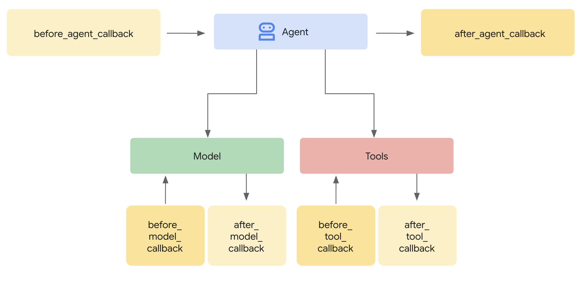

 [ Python](https://github.com/google/adk-python "adk-python on GitHub")[ JS ](https://github.com/google/adk-js "adk-js on GitHub")[ Go ](https://github.com/google/adk-go "adk-go on GitHub")[ Java ](https://github.com/google/adk-java "adk-java on GitHub")[ Kotlin](https://github.com/google/adk-kotlin "adk-kotlin on GitHub")

-   [Home](..)
-    Build Agents
    
    Build Agents
    
    -   [Get Started](../get-started/)
        
        Get Started
        
        -   [Python](../get-started/python/)
        -   [TypeScript](../get-started/typescript/)
        -   [Go](../get-started/go/)
        -   [Java](../get-started/java/)
        -   [Kotlin](../get-started/kotlin/)
        -   [Agents CLI](../get-started/agents-cli/)
        -   [Installation](../get-started/installation/)
        -   [Google Cloud](../get-started/google-cloud/)
        -   [Migrate to ADK](../get-started/migrate/)
        
    -   [Build your Agent](../tutorials/)
        
        Build your Agent
        
        -   [Multi-tool agent](../tutorials/multi-tool-agent/)
        -   [Agent team](../tutorials/agent-team/)
        -   [Code with AI](../tutorials/coding-with-ai/)
        -   [Agent Config](../agents/config/)
        
    -   [Agents](../agents/)
        
        Agents
        
        -   [Simple agents](../agents/llm-agents/)
        -   [Managed agents](../agents/managed-agents/)
        
    -   [Graph Workflows](../graphs/)
        
        Graph Workflows
        
        -   [Graph routes](../graphs/routes/)
        -   [Data handling](../graphs/data-handling/)
        -   [Human input](../graphs/human-input/)
        -   [Dynamic workflows](../graphs/dynamic/)
        
    -   [Multi-Agent Workflows](../workflows/)
        
        Multi-Agent Workflows
        
        -   [Collaborative workflows](../workflows/collaboration/)
        -   [Template workflows](../agents/workflow-agents/)
            
            Template workflows
            
            -   [Sequential workflow](../agents/workflow-agents/sequential-agents/)
            -   [Loop workflow](../agents/workflow-agents/loop-agents/)
            -   [Parallel workflow](../agents/workflow-agents/parallel-agents/)
            -   [Custom template workflows](../agents/custom-agents/)
            
        -   [Agent routing](../agents/routing/)
        -   [Workflow patterns](../workflows/patterns/)
        
    -   [Models for Agents](../agents/models/)
        
        Models for Agents
        
        -   [Gemini](../agents/models/google-gemini/)
            
            Gemini
            
            -   [Deferred scheduling](../agents/models/google-gemini/deferred-schedule/)
            
        -   [Gemma](../agents/models/google-gemma/)
        -   [Claude](../agents/models/anthropic/)
        -   [Agent Platform hosted](../agents/models/agent-platform/)
        -   [Apigee AI Gateway](../agents/models/apigee/)
        -   [Model routing](../agents/models/routing/)
        -   [OpenAI](../agents/models/openai/)
        -   [Ollama](../agents/models/ollama/)
        -   [vLLM](../agents/models/vllm/)
        -   [LiteLLM](../agents/models/litellm/)
        -   [LiteRT-LM](../agents/models/litert-lm/)
        
    
-    Run Agents
    
    Run Agents
    
    -   [Agent Runtime](../runtime/)
        
        Agent Runtime
        
        -   [Web Interface](../runtime/web-interface/)
            
            Web Interface
            
            -   [Visual Builder](../visual-builder/)
            
        -   [Command Line](../runtime/command-line/)
        -   [API Server](../runtime/api-server/)
        -   [Ambient Agents](../runtime/ambient-agents/)
        -   [Resume Agents](../runtime/resume/)
        -   [Cancel Agent Runs](../runtime/cancel/)
        -   [Runtime Config](../runtime/runconfig/)
        -   [Event Loop](../runtime/event-loop/)
        
    -   [Deployment](../deploy/)
        
        Deployment
        
        -   [Agent Runtime](../deploy/agent-runtime/)
            
            Agent Runtime
            
            -   [Standard deployment](../deploy/agent-runtime/deploy/)
            -   [agents-cli](../deploy/agent-runtime/agents-cli/)
            -   [Test deployed agents](../deploy/agent-runtime/test/)
            
        -   [Cloud Run](../deploy/cloud-run/)
        -   [GKE](../deploy/gke/)
        
    -   [Observability](../observability/)
        
        Observability
        
        -   [Logging](../observability/logging/)
        -   [Metrics](../observability/metrics/)
        -   [Traces](../observability/traces/)
        
    -   [Evaluation](../evaluate/)
        
        Evaluation
        
        -   [Criteria](../evaluate/criteria/)
        -   [User Simulation](../evaluate/user-sim/)
        -   [Environment Simulation](../evaluate/environment_simulation/)
        -   [Custom Metrics](../evaluate/custom_metrics/)
        -   [Optimization](../optimize/)
        
    -   [Safety and Security](../safety/)
        
        Safety and Security
        
    
-    Components
    
    Components
    
    -   [Technical Overview](../get-started/about/)
    -   [Custom Tools](../tools-custom/)
        
        Custom Tools
        
        -    Function tools
            
            Function tools
            
            -   [Overview](../tools-custom/function-tools/)
            -   [Tool performance](../tools-custom/performance/)
            -   [Action confirmations](../tools-custom/confirmation/)
            
        -   [MCP tools](../tools-custom/mcp-tools/)
            
            MCP tools
            
            -   [Advanced configuration](../tools-custom/mcp-tools/advanced/)
            -   [Deployment](../tools-custom/mcp-tools/deployment/)
            -   [Agent as MCP server](../tools-custom/mcp-tools/agent-as-server/)
            -   [Sub-agent delegation](../tools-custom/mcp-tools/agent-managed/)
            
        -   [OpenAPI tools](../tools-custom/openapi-tools/)
        -   [Authentication](../tools-custom/authentication/)
        -   [Tool limitations](../tools/limitations/)
        
    -   [Artifacts](../artifacts/)
        
        Artifacts
        
    -   [Skills for Agents](../skills/)
        
        Skills for Agents
        
    -   [App management](../apps/)
        
        App management
        
        -   [Callbacks](./)
            
            Callbacks
            
            -   [Types of callbacks](types-of-callbacks/)
            -   [Callback patterns](design-patterns-and-best-practices/)
            
        -   [Plugins](../plugins/)
        
    -   [Agent context](../context/)
        
        Agent context
        
        -   [Conversational context](../sessions/)
        -   [Sessions](../sessions/session/)
            
            Sessions
            
            -   [Rewind sessions](../sessions/session/rewind/)
            -   [Migrate sessions](../sessions/session/migrate/)
            
        -   [State](../sessions/state/)
        -   [Events](../events/)
        -   [Memory](../sessions/memory/)
        -   [Context compression](../context/compaction/)
        -   [Model context caching](../context/caching/)
        
    -   [A2A Protocol](../a2a/)
        
        A2A Protocol
        
        -   [Introduction to A2A](../a2a/intro/)
        -    A2A Quickstart (Exposing)
            
            A2A Quickstart (Exposing)
            
            -   [Python](../a2a/quickstart-exposing/)
            -   [Go](../a2a/quickstart-exposing-go/)
            -   [Java](../a2a/quickstart-exposing-java/)
            
        -    A2A Quickstart (Consuming)
            
            A2A Quickstart (Consuming)
            
            -   [Python](../a2a/quickstart-consuming/)
            -   [Go](../a2a/quickstart-consuming-go/)
            -   [Java](../a2a/quickstart-consuming-java/)
            -   [Kotlin](../a2a/quickstart-consuming-kotlin/)
            
        -   [A2A Extension](../a2a/a2a-extension/)
        
    -   [Live and Voice Agents](../live/)
        
        Live and Voice Agents
        
        -   [Get started](../live/get-started/)
            
            Get started
            
            -   [Python](../live/get-started/streaming-python/)
            -   [Java](../live/get-started/streaming-java/)
            
        -    Building
            
            Building
            
            -   [Workflows](../live/workflows/)
            -   [Tools](../live/tools/)
            -   [Sessions](../live/sessions/)
            -   [Events](../live/events/)
            -   [Audio and video](../live/audio-video/)
            -   [Configuration](../live/configuration/)
            
        -    Production
            
            Production
            
            -   [Guardrails](../live/guardrails/)
            -   [Evaluation](../live/evaluation/)
            -   [Build a custom server](../live/custom-server/)
            
        -   [Supported models](../live/models/)
        
    -   [Grounding](../grounding/)
        
        Grounding
        
        -   [Google Search Grounding](../grounding/google_search_grounding/)
        -   [Grounding with Search](../grounding/grounding_with_search/)
        
    
-   [Integrations](../integrations/)
    
    Integrations
    
-    Reference
    
    Reference
    
    -   [API Reference](../api-reference/)
        
        API Reference
        
        -   [Python ADK](../api-reference/python/)
        -   [TypeScript ADK](../api-reference/typescript/)
        -    Go ADK
            
            Go ADK
            
            -   [Go v2.x](https://pkg.go.dev/google.golang.org/adk/v2)
            -   [Go v1.x](https://pkg.go.dev/google.golang.org/adk)
            
        -   [Java ADK](../api-reference/java/)
        -   [Kotlin ADK](../api-reference/kotlin/)
        -   [CLI Reference](../api-reference/cli/)
        -   [Agent Config Reference](../api-reference/agentconfig/)
        -   [REST API](../api-reference/rest/)
        
    -   [Release Notes](../release-notes/)
    
-   [Community](../community/)
    
    Community
    
    -   [Contributing Guide](../community/contributing-guide/)
    
-   [ADK 2.0](../2.0/)
    
    ADK 2.0
    

Table of contents

-   [The Callback Mechanism: Interception and Control](#the-callback-mechanism-interception-and-control)

1.  [Home](..)
2.  [Components](../get-started/about/)
3.  [App management](../apps/)
4.  [Callbacks](./)

# Callbacks: Observe, Customize, and Control Agent Behavior[¶](#callbacks-observe-customize-and-control-agent-behavior "Permanent link")

Supported in ADKPython v0.1.0TypeScript v0.2.0Go v0.1.0Java v0.1.0Kotlin v0.1.0

Callbacks are a cornerstone feature of ADK, providing a powerful mechanism to hook into an agent's execution process. They allow you to observe, customize, and even control the agent's behavior at specific, predefined points without modifying the core ADK framework code.

**What are they?** In essence, callbacks are standard functions that you define. You then associate these functions with an agent when you create it. The ADK framework automatically calls your functions at key stages, letting you observe or intervene. Think of it like checkpoints during the agent's process:

-   **Before the agent starts its main work on a request, and after it finishes:** When you ask an agent to do something (e.g., answer a question), it runs its internal logic to figure out the response.
-   The `Before Agent` callback executes *right before* this main work begins for that specific request.
-   The `After Agent` callback executes *right after* the agent has finished all its steps for that request and has prepared the final result, but just before the result is returned.
-   This "main work" encompasses the agent's *entire* process for handling that single request. This might involve deciding to call an LLM, actually calling the LLM, deciding to use a tool, using the tool, processing the results, and finally putting together the answer. These callbacks essentially wrap the whole sequence from receiving the input to producing the final output for that one interaction.
-   **Before sending a request to, or after receiving a response from, the Large Language Model (LLM):** These callbacks (`Before Model`, `After Model`) allow you to inspect or modify the data going to and coming from the LLM specifically.
-   **Before executing a tool (like a Python function or another agent) or after it finishes:** Similarly, `Before Tool` and `After Tool` callbacks give you control points specifically around the execution of tools invoked by the agent.

**Why use them?** Callbacks unlock significant flexibility and enable advanced agent capabilities:

-   **Observe & Debug:** Log detailed information at critical steps for monitoring and troubleshooting.
-   **Customize & Control:** Modify data flowing through the agent (like LLM requests or tool results) or even bypass certain steps entirely based on your logic.
-   **Implement Guardrails:** Enforce safety rules, validate inputs/outputs, or prevent disallowed operations.
-   **Manage State:** Read or dynamically update the agent's session state during execution.
-   **Integrate & Enhance:** Trigger external actions (API calls, notifications) or add features like caching.

Tip

When implementing security guardrails and policies, use ADK Plugins for better modularity and flexibility than Callbacks. For more details, see [Callbacks and Plugins for Security Guardrails](/safety/#callbacks-and-plugins-for-security-guardrails).

**How are they added:**

Code

PythonTypeScriptGoJavaKotlin

`from google.adk.agents import LlmAgent from google.adk.agents.callback_context import CallbackContext from google.adk.models import LlmResponse, LlmRequest from typing import Optional # --- Define your callback function --- def my_before_model_logic(         callback_context: CallbackContext, llm_request: LlmRequest ) -> Optional[LlmResponse]:         print(f"Callback running before model call for agent: {callback_context.agent_name}")        # ... your custom logic here ...        return None # Allow the model call to proceed # --- Register it during Agent creation --- my_agent = LlmAgent(         name="MyCallbackAgent",        model="gemini-2.0-flash", # Or your desired model        instruction="Be helpful.",        # Other agent parameters...        before_model_callback=my_before_model_logic # Pass the function here )`

``import { LlmAgent, InMemoryRunner, Context, LlmRequest, LlmResponse, Event, isFinalResponse } from '@google/adk'; import { createUserContent } from "@google/genai"; import type { Content } from "@google/genai"; const MODEL_NAME = "gemini-2.5-flash"; const APP_NAME = "basic_callback_app"; const USER_ID = "test_user_basic"; const SESSION_ID = "session_basic_001";  // --- Define your callback function --- function myBeforeModelLogic({     context,    request, }: {     context: Context;    request: LlmRequest; }): LlmResponse | undefined {     console.log(        `Callback running before model call for agent: ${context.agentName}`    );    // ... your custom logic here ...    return undefined; // Allow the model call to proceed } // --- Register it during Agent creation --- const myAgent = new LlmAgent({     name: "MyCallbackAgent",    model: MODEL_NAME,    instruction: "Be helpful.",    beforeModelCallback: myBeforeModelLogic, });``

`package main import (         "context"        "fmt"        "log"        "strings"         "google.golang.org/adk/v2/agent"        "google.golang.org/adk/v2/agent/llmagent"        "google.golang.org/adk/v2/model"        "google.golang.org/adk/v2/model/gemini"        "google.golang.org/adk/v2/runner"        "google.golang.org/adk/v2/session"        "google.golang.org/genai" )   // onBeforeModel is a callback function that gets triggered before an LLM call. func onBeforeModel(ctx agent.Context, req *model.LLMRequest) (*model.LLMResponse, error) {         log.Println("--- onBeforeModel Callback Triggered ---")        log.Printf("Model Request to be sent: %v\n", req)        // Returning nil allows the default LLM call to proceed.        return nil, nil } func runBasicExample() {         const (                appName = "CallbackBasicApp"                userID  = "test_user_123"        )        ctx := context.Background()        geminiModel, err := gemini.NewModel(ctx, modelName, &genai.ClientConfig{})        if err != nil {                log.Fatalf("Failed to create model: %v", err)        }         // Register the callback function in the agent configuration.        agentCfg := llmagent.Config{                Name:                 "SimpleAgent",                Model:                geminiModel,                BeforeModelCallbacks: []llmagent.BeforeModelCallback{onBeforeModel},        }        simpleAgent, err := llmagent.New(agentCfg)        if err != nil {                log.Fatalf("Failed to create agent: %v", err)        }         sessionService := session.InMemoryService()        r, err := runner.New(runner.Config{                AppName:        appName,                Agent:          simpleAgent,                SessionService: sessionService,        })        if err != nil {                log.Fatalf("Failed to create runner: %v", err)        }`

`import com.google.adk.agents.CallbackContext; import com.google.adk.agents.Callbacks; import com.google.adk.agents.LlmAgent; import com.google.adk.models.LlmRequest; import java.util.Optional; public class AgentWithBeforeModelCallback {     public static void main(String[] args) {        // --- Define your callback logic ---        Callbacks.BeforeModelCallbackSync myBeforeModelLogic =                (CallbackContext callbackContext, LlmRequest llmRequest) -> {                    System.out.println(                            "Callback running before model call for agent: " + callbackContext.agentName());                    // ... your custom logic here ...                     // Return Optional.empty() to allow the model call to proceed,                    // similar to returning None in the Python example.                    // If you wanted to return a response and skip the model call,                    // you would return Optional.of(yourLlmResponse).                    return Optional.empty();                };         // --- Register it during Agent creation ---        LlmAgent myAgent =                LlmAgent.builder()                        .name("MyCallbackAgent")                        .model("gemini-2.0-flash") // Or your desired model                        .instruction("Be helpful.")                        // Other agent parameters...                        .beforeModelCallbackSync(myBeforeModelLogic) // Pass the callback implementation here                        .build();    } }`

`val agent =         LlmAgent(                name = "callback_agent",                model = Gemini(name = "gemini-flash-latest"),                beforeAgentCallbacks =                        listOf(                                BeforeAgentCallback { context ->                                        println("Before Agent Callback triggered")                                        CallbackChoice.Continue(context.eventActions)                                },                        ),                afterAgentCallbacks =                        listOf(                                AfterAgentCallback { context ->                                        println("After Agent Callback triggered")                                        CallbackChoice.Continue(Unit)                                },                        ),                beforeModelCallbacks =                        listOf(                                BeforeModelCallback { context, request ->                                        println("Before Model Callback triggered")                                        CallbackChoice.Continue(request)                                },                        ),                afterModelCallbacks =                        listOf(                                AfterModelCallback { context, response ->                                        println("After Model Callback triggered")                                        response                                },                        ),                beforeToolCallbacks =                        listOf(                                BeforeToolCallback { context, tool, args ->                                        println("Before Tool Callback triggered for ${tool.name}")                                        CallbackChoice.Continue(args)                                },                        ),                afterToolCallbacks =                        listOf(                                AfterToolCallback { context, tool, args, result ->                                        println("After Tool Callback triggered for ${tool.name}")                                        result                                },                        ),        )`

## The Callback Mechanism: Interception and Control[¶](#the-callback-mechanism-interception-and-control "Permanent link")

When the ADK framework encounters a point where a callback can run (e.g., just before calling the LLM), it checks if you provided a corresponding callback function for that agent. If you did, the framework executes your function.

**Context is Key:** Your callback function isn't called in isolation. The framework provides special **context objects** (`CallbackContext` or `ToolContext`) as arguments. These objects contain vital information about the current state of the agent's execution, including the invocation details, session state, and potentially references to services like artifacts or memory. You use these context objects to understand the situation and interact with the framework. (See the dedicated "Context Objects" section for full details).

**Controlling the Flow (The Core Mechanism):** The most powerful aspect of callbacks lies in how their **return value** influences the agent's subsequent actions. This is how you intercept and control the execution flow:

1.  **`return None` (Allow Default Behavior):**
    
    -   The specific return type can vary depending on the language. In Java, the equivalent return type is `Optional.empty()`. In Kotlin, it is `CallbackChoice.Continue(value)` (for `before_*` callbacks) or returning the original object (for `after_*` callbacks). Refer to the API documentation for language specific guidance.
    -   This is the standard way to signal that your callback has finished its work (e.g., logging, inspection, minor modifications to input arguments) and that the ADK agent should **proceed with its normal operation**.
    -   For `before_*` callbacks (`before_agent`, `before_model`, `before_tool`), returning `None` means the next step in the sequence occurs, whether that step is running the agent logic, calling the LLM, or executing the tool.
    -   For `after_*` callbacks (`after_agent`, `after_model`, `after_tool`), returning `None` leaves the result just produced untouched, whether that result is the agent's output, the LLM's response, or the tool's result. In Python, returning that result back instead of `None` is not equivalent for `after_agent_callback`: ADK emits a second event carrying the same content.
2.  **`return <Specific Object>` (Override Default Behavior):**
    
    -   Returning a *specific type of object* (instead of signaling "Continue") is how you **override** the ADK agent's default behavior. In Kotlin, this is achieved by returning `CallbackChoice.Break(value)` (for `before_*` callbacks) or a replacement object (for `after_*` callbacks). The framework will use the object you return and *skip* the step that would normally follow or *replace* the result that was just generated.
    -   **`before_agent_callback` → `Content`**: Skips the agent's main execution logic. The returned `Content` object is immediately treated as the agent's final output for this turn. Useful for handling simple requests directly or enforcing access control.
    -   **`before_model_callback` → `LlmResponse`**: Skips the call to the external Large Language Model. The returned `LlmResponse` object is processed as if it were the actual response from the LLM. Ideal for implementing input guardrails, prompt validation, or serving cached responses.
    -   **`before_tool_callback` → Python: `dict`, Kotlin: `Map<String, Any>`**: Skips the execution of the actual tool function (or sub-agent). The returned `dict` or `Map` is used as the result of the tool call, which is then passed back to the LLM. The behavior allows for validating tool arguments, applying policy restrictions, or returning mocked/cached tool results.
    -   **`after_agent_callback` → `Content`**: *Appends* the returned `Content` as an additional event after the output the agent's run logic already produced. It does not replace that output; use `after_model_callback` to change a model response.
    -   **`after_model_callback` → `LlmResponse`**: *Replaces* the `LlmResponse` received from the LLM. Useful for sanitizing outputs, adding standard disclaimers, or modifying the LLM's response structure.
    -   **`after_tool_callback` → Python: `dict`, Kotlin: `Map<String, Any>`**: *Replaces* the result returned by the tool. Allows for post-processing or standardization of tool outputs before they are sent back to the LLM.

**Conceptual Code Example (Guardrail):**

This example demonstrates the common pattern for a guardrail using `before_model_callback`.

Code

PythonTypeScriptGoJavaKotlin

`# Copyright 2025 Google LLC # # Licensed under the Apache License, Version 2.0 (the "License"); # you may not use this file except in compliance with the License. # You may obtain a copy of the License at # #     http://www.apache.org/licenses/LICENSE-2.0 # # Unless required by applicable law or agreed to in writing, software # distributed under the License is distributed on an "AS IS" BASIS, # WITHOUT WARRANTIES OR CONDITIONS OF ANY KIND, either express or implied. # See the License for the specific language governing permissions and # limitations under the License. from google.adk.agents import LlmAgent from google.adk.agents.callback_context import CallbackContext from google.adk.models import LlmResponse, LlmRequest from google.adk.runners import Runner from typing import Optional from google.genai import types  from google.adk.sessions import InMemorySessionService GEMINI_2_FLASH="gemini-2.0-flash" # --- Define the Callback Function --- def simple_before_model_modifier(         callback_context: CallbackContext, llm_request: LlmRequest ) -> Optional[LlmResponse]:         """Inspects/modifies the LLM request or skips the call."""        agent_name = callback_context.agent_name        print(f"[Callback] Before model call for agent: {agent_name}")         # Inspect the last user message in the request contents        last_user_message = ""        if llm_request.contents and llm_request.contents[-1].role == 'user':                  if llm_request.contents[-1].parts:                        last_user_message = llm_request.contents[-1].parts[0].text        print(f"[Callback] Inspecting last user message: '{last_user_message}'")         # --- Modification Example ---        # Add a prefix to the system instruction        original_instruction = llm_request.config.system_instruction or types.Content(role="system", parts=[])        prefix = "[Modified by Callback] "        # Ensure system_instruction is Content and parts list exists        if not isinstance(original_instruction, types.Content):                  # Handle case where it might be a string (though config expects Content)                  original_instruction = types.Content(role="system", parts=[types.Part(text=str(original_instruction))])        if not original_instruction.parts:                original_instruction.parts.append(types.Part(text="")) # Add an empty part if none exist         # Modify the text of the first part        modified_text = prefix + (original_instruction.parts[0].text or "")        original_instruction.parts[0].text = modified_text        llm_request.config.system_instruction = original_instruction        print(f"[Callback] Modified system instruction to: '{modified_text}'")         # --- Skip Example ---        # Check if the last user message contains "BLOCK"        if "BLOCK" in last_user_message.upper():                print("[Callback] 'BLOCK' keyword found. Skipping LLM call.")                # Return an LlmResponse to skip the actual LLM call                return LlmResponse(                        content=types.Content(                                role="model",                                parts=[types.Part(text="LLM call was blocked by before_model_callback.")],                        )                )        else:                print("[Callback] Proceeding with LLM call.")                # Return None to allow the (modified) request to go to the LLM                return None  # Create LlmAgent and Assign Callback my_llm_agent = LlmAgent(                 name="ModelCallbackAgent",                model=GEMINI_2_FLASH,                instruction="You are a helpful assistant.", # Base instruction                description="An LLM agent demonstrating before_model_callback",                before_model_callback=simple_before_model_modifier # Assign the function here ) APP_NAME = "guardrail_app" USER_ID = "user_1" SESSION_ID = "session_001" # Session and Runner async def setup_session_and_runner():         session_service = InMemorySessionService()        session = await session_service.create_session(app_name=APP_NAME, user_id=USER_ID, session_id=SESSION_ID)        runner = Runner(agent=my_llm_agent, app_name=APP_NAME, session_service=session_service)        return session, runner  # Agent Interaction async def call_agent_async(query):         content = types.Content(role='user', parts=[types.Part(text=query)])        session, runner = await setup_session_and_runner()        events = runner.run_async(user_id=USER_ID, session_id=SESSION_ID, new_message=content)         async for event in events:                if event.is_final_response():                        final_response = event.content.parts[0].text                        print("Agent Response: ", final_response) # Note: In Colab, you can directly use 'await' at the top level. # If running this code as a standalone Python script, you'll need to use asyncio.run() or manage the event loop. await call_agent_async("write a joke on BLOCK")`

``/**   * Copyright 2025 Google LLC  *  * Licensed under the Apache License, Version 2.0 (the "License");  * you may not use this file except in compliance with the License.  * You may obtain a copy of the License at  *  *     http://www.apache.org/licenses/LICENSE-2.0  *  * Unless required by applicable law or agreed to in writing, software  * distributed under the License is distributed on an "AS IS" BASIS,  * WITHOUT WARRANTIES OR CONDITIONS OF ANY KIND, either express or implied.  * See the License for the specific language governing permissions and  * limitations under the License.  */ import { LlmAgent, InMemoryRunner, Context, isFinalResponse } from '@google/adk'; import { createUserContent } from "@google/genai"; const MODEL_NAME = "gemini-2.5-flash"; const APP_NAME = "before_model_callback_app"; const USER_ID = "test_user_before_model"; const SESSION_ID_BLOCK = "session_block_model_call"; const SESSION_ID_NORMAL = "session_normal_model_call"; // --- Define the Callback Function --- function simpleBeforeModelModifier({     context,    request, }: {     context: Context;    request: any; }): any | undefined {     console.log(`[Callback] Before model call for agent: ${context.agentName}`);     // Inspect the last user message in the request contents    const lastUserMessage = request.contents?.at(-1)?.parts?.[0]?.text ?? "";    console.log(`[Callback] Inspecting last user message: '${lastUserMessage}'`);     // --- Modification Example ---    // Add a prefix to the system instruction.    // We create a deep copy to avoid modifying the original agent's config object.    const modifiedConfig = JSON.parse(JSON.stringify(request.config));    const originalInstructionText =        modifiedConfig.systemInstruction?.parts?.[0]?.text ?? "";    const prefix = "[Modified by Callback] ";    modifiedConfig.systemInstruction = {        role: "system",        parts: [{ text: prefix + originalInstructionText }],    };    request.config = modifiedConfig; // Assign the modified config back to the request    console.log(        `[Callback] Modified system instruction to: '${modifiedConfig.systemInstruction.parts[0].text}'`    );     // --- Skip Example ---    // Check if the last user message contains "BLOCK"    if (lastUserMessage.toUpperCase().includes("BLOCK")) {        console.log("[Callback] 'BLOCK' keyword found. Skipping LLM call.");        // Return an LlmResponse to skip the actual LLM call        return {            content: {                role: "model",                parts: [                    { text: "LLM call was blocked by the before_model_callback." },                ],            },        };    }     console.log("[Callback] Proceeding with LLM call.");    // Return undefined to allow the (modified) request to go to the LLM    return undefined; } // --- Create LlmAgent and Assign Callback --- const myLlmAgent = new LlmAgent({     name: "ModelCallbackAgent",    model: MODEL_NAME,    instruction: "You are a helpful assistant.", // Base instruction    description: "An LLM agent demonstrating before_model_callback",    beforeModelCallback: simpleBeforeModelModifier, // Assign the function here }); // --- Agent Interaction Logic --- async function callAgentAndPrint(     runner: InMemoryRunner,    query: string,    sessionId: string ) {     console.log(`\n>>> Calling Agent with query: "${query}"`);     let finalResponseContent = "No final response received.";    const events = runner.runAsync({ userId: USER_ID, sessionId, newMessage: createUserContent(query) });     for await (const event of events) {        if (isFinalResponse(event) && event.content?.parts?.length) {            finalResponseContent = event.content.parts                .map((part: { text?: string }) => part.text ?? "")                .join("");        }    }    console.log("<<< Agent Response: ", finalResponseContent); } // --- Run Interactions --- async function main() {     const runner = new InMemoryRunner({ agent: myLlmAgent, appName: APP_NAME });     // Scenario 1: The callback will find "BLOCK" and skip the model call    await runner.sessionService.createSession({        appName: APP_NAME,        userId: USER_ID,        sessionId: SESSION_ID_BLOCK,    });    await callAgentAndPrint(        runner,        "write a joke about BLOCK",        SESSION_ID_BLOCK    );     // Scenario 2: The callback will modify the instruction and proceed    await runner.sessionService.createSession({        appName: APP_NAME,        userId: USER_ID,        sessionId: SESSION_ID_NORMAL,    });    await callAgentAndPrint(runner, "write a short poem", SESSION_ID_NORMAL); } main();``

`package main import (         "context"        "fmt"        "log"        "strings"         "google.golang.org/adk/v2/agent"        "google.golang.org/adk/v2/agent/llmagent"        "google.golang.org/adk/v2/model"        "google.golang.org/adk/v2/model/gemini"        "google.golang.org/adk/v2/runner"        "google.golang.org/adk/v2/session"        "google.golang.org/genai" )   // onBeforeModelGuardrail is a callback that inspects the LLM request. // If it contains a forbidden topic, it blocks the request and returns a // predefined response. Otherwise, it allows the request to proceed. func onBeforeModelGuardrail(ctx agent.Context, req *model.LLMRequest) (*model.LLMResponse, error) {         log.Println("--- onBeforeModelGuardrail Callback Triggered ---")         // Inspect the request content for forbidden topics.        for _, content := range req.Contents {                for _, part := range content.Parts {                        if strings.Contains(part.Text, "finance") {                                log.Println("Forbidden topic 'finance' detected. Blocking LLM call.")                                // By returning a non-nil response, we override the default behavior                                // and prevent the actual LLM call.                                return &model.LLMResponse{                                        Content: &genai.Content{                                                Parts: []*genai.Part{{Text: "I'm sorry, but I cannot discuss financial topics."}},                                                Role:  "model",                                        },                                }, nil                        }                }        }         log.Println("No forbidden topics found. Allowing LLM call to proceed.")        // Returning nil allows the default LLM call to proceed.        return nil, nil } func runGuardrailExample() {         const (                appName = "GuardrailApp"                userID  = "test_user_456"        )        ctx := context.Background()        geminiModel, err := gemini.NewModel(ctx, modelName, &genai.ClientConfig{})        if err != nil {                log.Fatalf("Failed to create model: %v", err)        }         agentCfg := llmagent.Config{                Name:                 "ChatAgent",                Model:                geminiModel,                BeforeModelCallbacks: []llmagent.BeforeModelCallback{onBeforeModelGuardrail},        }        chatAgent, err := llmagent.New(agentCfg)        if err != nil {                log.Fatalf("Failed to create agent: %v", err)        }         sessionService := session.InMemoryService()        r, err := runner.New(runner.Config{                AppName:        appName,                Agent:          chatAgent,                SessionService: sessionService,        })        if err != nil {                log.Fatalf("Failed to create runner: %v", err)        }`

`import com.google.adk.agents.CallbackContext; import com.google.adk.agents.LlmAgent; import com.google.adk.events.Event; import com.google.adk.models.LlmRequest; import com.google.adk.models.LlmResponse; import com.google.adk.runner.InMemoryRunner; import com.google.adk.sessions.Session; import com.google.genai.types.Content; import com.google.genai.types.GenerateContentConfig; import com.google.genai.types.Part; import io.reactivex.rxjava3.core.Flowable; import java.util.ArrayList; import java.util.List; import java.util.Optional; import java.util.stream.Collectors; public class BeforeModelGuardrailExample {     private static final String MODEL_ID = "gemini-2.0-flash";    private static final String APP_NAME = "guardrail_app";    private static final String USER_ID = "user_1";     public static void main(String[] args) {        BeforeModelGuardrailExample example = new BeforeModelGuardrailExample();        example.defineAgentAndRun("Tell me about quantum computing. This is a test.");    }     // --- Define your callback logic ---    // Looks for the word "BLOCK" in the user prompt and blocks the call to LLM if found.    // Otherwise the LLM call proceeds as usual.    public Optional<LlmResponse> simpleBeforeModelModifier(            CallbackContext callbackContext, LlmRequest llmRequest) {        System.out.println("[Callback] Before model call for agent: " + callbackContext.agentName());         // Inspect the last user message in the request contents        String lastUserMessageText = "";        List<Content> requestContents = llmRequest.contents();        if (requestContents != null && !requestContents.isEmpty()) {            Content lastContent = requestContents.get(requestContents.size() - 1);            if (lastContent.role().isPresent() && "user".equals(lastContent.role().get())) {                lastUserMessageText =                        lastContent.parts().orElse(List.of()).stream()                                .flatMap(part -> part.text().stream())                                .collect(Collectors.joining(" ")); // Concatenate text from all parts            }        }        System.out.println("[Callback] Inspecting last user message: '" + lastUserMessageText + "'");         String prefix = "[Modified by Callback] ";        GenerateContentConfig currentConfig =                llmRequest.config().orElse(GenerateContentConfig.builder().build());        Optional<Content> optOriginalSystemInstruction = currentConfig.systemInstruction();         Content conceptualModifiedSystemInstruction;        if (optOriginalSystemInstruction.isPresent()) {            Content originalSystemInstruction = optOriginalSystemInstruction.get();            List<Part> originalParts =                    new ArrayList<>(originalSystemInstruction.parts().orElse(List.of()));            String originalText = "";             if (!originalParts.isEmpty()) {                Part firstPart = originalParts.get(0);                if (firstPart.text().isPresent()) {                    originalText = firstPart.text().get();                }                originalParts.set(0, Part.fromText(prefix + originalText));            } else {                originalParts.add(Part.fromText(prefix));            }            conceptualModifiedSystemInstruction =                    originalSystemInstruction.toBuilder().parts(originalParts).build();        } else {            conceptualModifiedSystemInstruction =                    Content.builder()                            .role("system")                            .parts(List.of(Part.fromText(prefix)))                            .build();        }         // This demonstrates building a new LlmRequest with the modified config.        llmRequest =                llmRequest.toBuilder()                        .config(                                currentConfig.toBuilder()                                        .systemInstruction(conceptualModifiedSystemInstruction)                                        .build())                        .build();         System.out.println(                "[Callback] Conceptually modified system instruction is: '"                        + llmRequest.config().get().systemInstruction().get().parts().get().get(0).text().get());         // --- Skip Example ---        // Check if the last user message contains "BLOCK"        if (lastUserMessageText.toUpperCase().contains("BLOCK")) {            System.out.println("[Callback] 'BLOCK' keyword found. Skipping LLM call.");            LlmResponse skipResponse =                    LlmResponse.builder()                            .content(                                    Content.builder()                                            .role("model")                                            .parts(                                                    List.of(                                                            Part.builder()                                                                    .text("LLM call was blocked by before_model_callback.")                                                                    .build()))                                            .build())                            .build();            return Optional.of(skipResponse);        }        System.out.println("[Callback] Proceeding with LLM call.");        // Return Optional.empty() to allow the (modified) request to go to the LLM        return Optional.empty();    }     public void defineAgentAndRun(String prompt) {        // --- Create LlmAgent and Assign Callback ---        LlmAgent myLlmAgent =                LlmAgent.builder()                        .name("ModelCallbackAgent")                        .model(MODEL_ID)                        .instruction("You are a helpful assistant.") // Base instruction                        .description("An LLM agent demonstrating before_model_callback")                        .beforeModelCallbackSync(this::simpleBeforeModelModifier) // Assign the callback here                        .build();         // Session and Runner        InMemoryRunner runner = new InMemoryRunner(myLlmAgent, APP_NAME);        // InMemoryRunner automatically creates a session service. Create a session using the service        Session session = runner.sessionService().createSession(APP_NAME, USER_ID).blockingGet();        Content userMessage =                Content.fromParts(Part.fromText(prompt));         // Run the agent        Flowable<Event> eventStream = runner.runAsync(USER_ID, session.id(), userMessage);         // Stream event response        eventStream.blockingForEach(                event -> {                    if (event.finalResponse()) {                        System.out.println(event.stringifyContent());                    }                });    } }`

`val guardrailCallback =         BeforeModelCallback { context, request ->                val userQuery = request.contents.lastOrNull()?.parts?.firstOrNull()?.text ?: ""                 if (userQuery.contains("sensitive info", ignoreCase = true)) {                        println("Guardrail triggered: Sensitive information requested.")                        CallbackChoice.Break(                                LlmResponse(                                        content =                                                Content(                                                        role = Role.MODEL,                                                        parts =                                                                listOf(                                                                        Part(                                                                                text = "I'm sorry, I cannot provide sensitive information.",                                                                        ),                                                                ),                                                ),                                ),                        )                } else {                        CallbackChoice.Continue(request)                }        }`

By understanding this mechanism of returning `None` versus returning specific objects, you can precisely control the agent's execution path, making callbacks an essential tool for building sophisticated and reliable agents with ADK.

Back to top