 [ Python](https://github.com/google/adk-python "adk-python on GitHub")[ JS ](https://github.com/google/adk-js "adk-js on GitHub")[ Go ](https://github.com/google/adk-go "adk-go on GitHub")[ Java ](https://github.com/google/adk-java "adk-java on GitHub")[ Kotlin](https://github.com/google/adk-kotlin "adk-kotlin on GitHub")

-   [Home](..)
-    Build Agents
    
    Build Agents
    
    -   [Get Started](../get-started/)
        
        Get Started
        
        -   [Python](../get-started/python/)
        -   [TypeScript](../get-started/typescript/)
        -   [Go](../get-started/go/)
        -   [Java](../get-started/java/)
        -   [Kotlin](../get-started/kotlin/)
        -   [Agents CLI](../get-started/agents-cli/)
        -   [Installation](../get-started/installation/)
        -   [Google Cloud](../get-started/google-cloud/)
        -   [Migrate to ADK](../get-started/migrate/)
        
    -   [Build your Agent](../tutorials/)
        
        Build your Agent
        
        -   [Multi-tool agent](../tutorials/multi-tool-agent/)
        -   [Agent team](../tutorials/agent-team/)
        -   [Code with AI](../tutorials/coding-with-ai/)
        -   [Agent Config](../agents/config/)
        
    -   [Agents](../agents/)
        
        Agents
        
        -   [Simple agents](../agents/llm-agents/)
        -   [Managed agents](../agents/managed-agents/)
        
    -   [Graph Workflows](../graphs/)
        
        Graph Workflows
        
        -   [Graph routes](../graphs/routes/)
        -   [Data handling](../graphs/data-handling/)
        -   [Human input](../graphs/human-input/)
        -   [Dynamic workflows](../graphs/dynamic/)
        
    -   [Multi-Agent Workflows](../workflows/)
        
        Multi-Agent Workflows
        
        -   [Collaborative workflows](../workflows/collaboration/)
        -   [Template workflows](../agents/workflow-agents/)
            
            Template workflows
            
            -   [Sequential workflow](../agents/workflow-agents/sequential-agents/)
            -   [Loop workflow](../agents/workflow-agents/loop-agents/)
            -   [Parallel workflow](../agents/workflow-agents/parallel-agents/)
            -   [Custom template workflows](../agents/custom-agents/)
            
        -   [Agent routing](../agents/routing/)
        -   [Workflow patterns](../workflows/patterns/)
        
    -   [Models for Agents](../agents/models/)
        
        Models for Agents
        
        -   [Gemini](../agents/models/google-gemini/)
            
            Gemini
            
            -   [Deferred scheduling](../agents/models/google-gemini/deferred-schedule/)
            
        -   [Gemma](../agents/models/google-gemma/)
        -   [Claude](../agents/models/anthropic/)
        -   [Agent Platform hosted](../agents/models/agent-platform/)
        -   [Apigee AI Gateway](../agents/models/apigee/)
        -   [Model routing](../agents/models/routing/)
        -   [OpenAI](../agents/models/openai/)
        -   [Ollama](../agents/models/ollama/)
        -   [vLLM](../agents/models/vllm/)
        -   [LiteLLM](../agents/models/litellm/)
        -   [LiteRT-LM](../agents/models/litert-lm/)
        
    
-    Run Agents
    
    Run Agents
    
    -   [Agent Runtime](../runtime/)
        
        Agent Runtime
        
        -   [Web Interface](../runtime/web-interface/)
            
            Web Interface
            
            -   [Visual Builder](../visual-builder/)
            
        -   [Command Line](../runtime/command-line/)
        -   [API Server](../runtime/api-server/)
        -   [Ambient Agents](../runtime/ambient-agents/)
        -   [Resume Agents](../runtime/resume/)
        -   [Cancel Agent Runs](../runtime/cancel/)
        -   [Runtime Config](../runtime/runconfig/)
        -   [Event Loop](../runtime/event-loop/)
        
    -   [Deployment](../deploy/)
        
        Deployment
        
        -   [Agent Runtime](../deploy/agent-runtime/)
            
            Agent Runtime
            
            -   [Standard deployment](../deploy/agent-runtime/deploy/)
            -   [agents-cli](../deploy/agent-runtime/agents-cli/)
            -   [Test deployed agents](../deploy/agent-runtime/test/)
            
        -   [Cloud Run](../deploy/cloud-run/)
        -   [GKE](../deploy/gke/)
        
    -   [Observability](../observability/)
        
        Observability
        
        -   [Logging](../observability/logging/)
        -   [Metrics](../observability/metrics/)
        -   [Traces](../observability/traces/)
        
    -   [Evaluation](../evaluate/)
        
        Evaluation
        
        -   [Criteria](../evaluate/criteria/)
        -   [User Simulation](../evaluate/user-sim/)
        -   [Environment Simulation](../evaluate/environment_simulation/)
        -   [Custom Metrics](../evaluate/custom_metrics/)
        -   [Optimization](../optimize/)
        
    -   [Safety and Security](../safety/)
        
        Safety and Security
        
    
-    Components
    
    Components
    
    -   [Technical Overview](../get-started/about/)
    -   [Custom Tools](../tools-custom/)
        
        Custom Tools
        
        -    Function tools
            
            Function tools
            
            -   [Overview](../tools-custom/function-tools/)
            -   [Tool performance](../tools-custom/performance/)
            -   [Action confirmations](../tools-custom/confirmation/)
            
        -   [MCP tools](../tools-custom/mcp-tools/)
            
            MCP tools
            
            -   [Advanced configuration](../tools-custom/mcp-tools/advanced/)
            -   [Deployment](../tools-custom/mcp-tools/deployment/)
            -   [Agent as MCP server](../tools-custom/mcp-tools/agent-as-server/)
            -   [Sub-agent delegation](../tools-custom/mcp-tools/agent-managed/)
            
        -   [OpenAPI tools](../tools-custom/openapi-tools/)
        -   [Authentication](../tools-custom/authentication/)
        -   [Tool limitations](../tools/limitations/)
        
    -   [Artifacts](../artifacts/)
        
        Artifacts
        
    -   [Skills for Agents](../skills/)
        
        Skills for Agents
        
    -   [App management](../apps/)
        
        App management
        
        -   [Callbacks](../callbacks/)
            
            Callbacks
            
            -   [Types of callbacks](../callbacks/types-of-callbacks/)
            -   [Callback patterns](../callbacks/design-patterns-and-best-practices/)
            
        -   [Plugins](../plugins/)
        
    -   [Agent context](../context/)
        
        Agent context
        
        -   [Conversational context](../sessions/)
        -   [Sessions](../sessions/session/)
            
            Sessions
            
            -   [Rewind sessions](../sessions/session/rewind/)
            -   [Migrate sessions](../sessions/session/migrate/)
            
        -   [State](../sessions/state/)
        -   [Events](../events/)
        -   [Memory](../sessions/memory/)
        -   [Context compression](../context/compaction/)
        -   [Model context caching](../context/caching/)
        
    -   [A2A Protocol](../a2a/)
        
        A2A Protocol
        
        -   [Introduction to A2A](../a2a/intro/)
        -    A2A Quickstart (Exposing)
            
            A2A Quickstart (Exposing)
            
            -   [Python](../a2a/quickstart-exposing/)
            -   [Go](../a2a/quickstart-exposing-go/)
            -   [Java](../a2a/quickstart-exposing-java/)
            
        -    A2A Quickstart (Consuming)
            
            A2A Quickstart (Consuming)
            
            -   [Python](../a2a/quickstart-consuming/)
            -   [Go](../a2a/quickstart-consuming-go/)
            -   [Java](../a2a/quickstart-consuming-java/)
            -   [Kotlin](../a2a/quickstart-consuming-kotlin/)
            
        -   [A2A Extension](../a2a/a2a-extension/)
        
    -   [Live and Voice Agents](../live/)
        
        Live and Voice Agents
        
        -   [Get started](../live/get-started/)
            
            Get started
            
            -   [Python](../live/get-started/streaming-python/)
            -   [Java](../live/get-started/streaming-java/)
            
        -    Building
            
            Building
            
            -   [Workflows](../live/workflows/)
            -   [Tools](../live/tools/)
            -   [Sessions](../live/sessions/)
            -   [Events](../live/events/)
            -   [Audio and video](../live/audio-video/)
            -   [Configuration](../live/configuration/)
            
        -    Production
            
            Production
            
            -   [Guardrails](../live/guardrails/)
            -   [Evaluation](../live/evaluation/)
            -   [Build a custom server](../live/custom-server/)
            
        -   [Supported models](../live/models/)
        
    -   [Grounding](../grounding/)
        
        Grounding
        
        -   [Google Search Grounding](../grounding/google_search_grounding/)
        -   [Grounding with Search](../grounding/grounding_with_search/)
        
    
-   [Integrations](../integrations/)
    
    Integrations
    
-    Reference
    
    Reference
    
    -   [API Reference](../api-reference/)
        
        API Reference
        
        -   [Python ADK](../api-reference/python/)
        -   [TypeScript ADK](../api-reference/typescript/)
        -    Go ADK
            
            Go ADK
            
            -   [Go v2.x](https://pkg.go.dev/google.golang.org/adk/v2)
            -   [Go v1.x](https://pkg.go.dev/google.golang.org/adk)
            
        -   [Java ADK](../api-reference/java/)
        -   [Kotlin ADK](../api-reference/kotlin/)
        -   [CLI Reference](../api-reference/cli/)
        -   [Agent Config Reference](../api-reference/agentconfig/)
        -   [REST API](../api-reference/rest/)
        
    -   [Release Notes](../release-notes/)
    
-   [Community](./)
    
    Community
    
    -   [Contributing Guide](contributing-guide/)
    
-   [ADK 2.0](../2.0/)
    
    ADK 2.0
    

Table of contents

-   [Join the Community](#join-the-community)
-   [Getting Started](#getting-started)
-   [ADK Community Calls](#adk-community-calls)
-   [Courses & Deep Dives](#courses-deep-dives)
-   [Agent Tutorials and Demos](#agent-tutorials-and-demos)
-   [ADK for Java](#adk-for-java)
-   [Translations](#translations)
-   [Contributing Your Resource](#contributing-your-resource)

1.  [Home](..)
2.  [Community](./)

# Community Resources[¶](#community-resources "Permanent link")

Welcome! This page highlights resources built and maintained by the Agent Development Kit community.

Info

Google and the ADK team do not provide support for the content linked in these external community resources.

## Join the Community[¶](#join-the-community "Permanent link")

-   Want to discuss ADK, ask questions, or talk about all things agents? Head to **[r/agentdevelopmentkit](https://www.reddit.com/r/agentdevelopmentkit/)** on Reddit.
-   Want updates on the monthly community call? Join the **[ADK Community Google Group](https://groups.google.com/g/adk-community)**.
-   Want to file a bug or contribute to the ADK framework? Check out the **[Contributing Guide](/community/contributing-guide/)** to find the right repo and get started.

## Getting Started[¶](#getting-started "Permanent link")

[

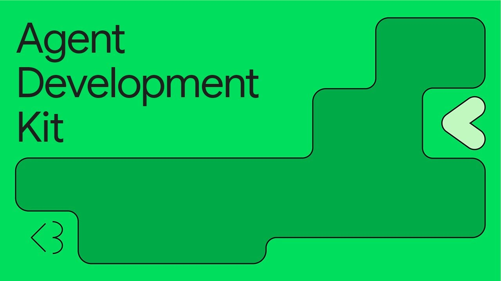

Video Demo

### 📺 Introducing Agent Development Kit

A demo of building a multi-agent travel planner, showcasing core design principles.

](https://www.youtube.com/watch?v=zgrOwow_uTQ)[

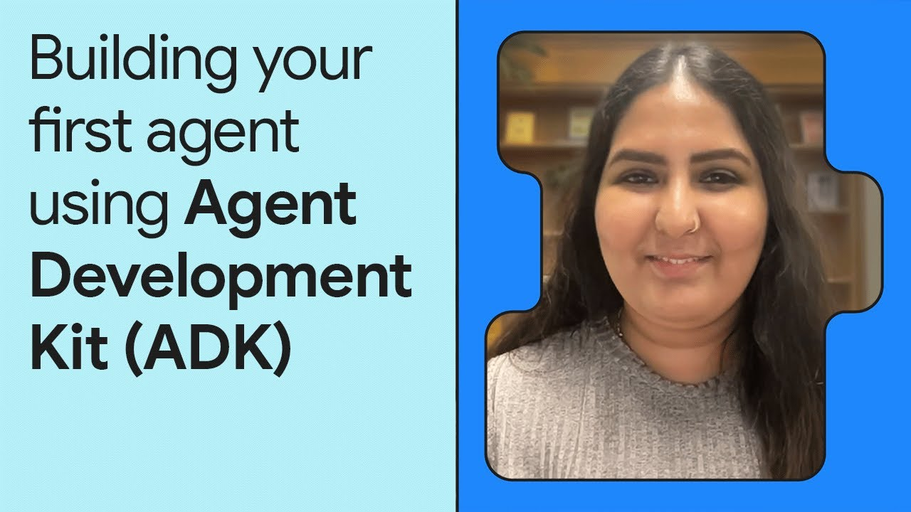

Video

### 📺 Getting started with Agent Development Kit

Learn the fundamentals of agent definition and how to run and debug your first agent.

](https://www.youtube.com/watch?v=44C8u0CDtSo)[

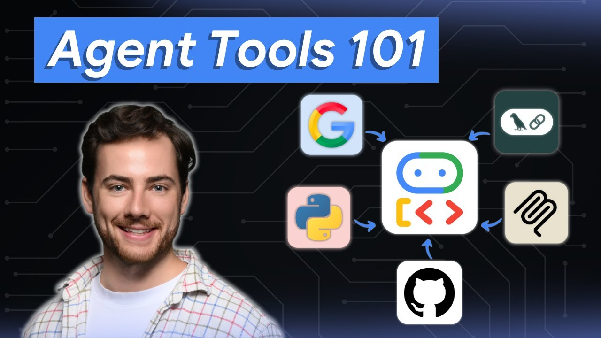

Video

### 📺 Getting Started with ADK Tools

A guide to building a software bug assistant using tools like MCP and Google Search.

](https://www.youtube.com/watch?v=5ZmaWY7UX6k)

## ADK Community Calls[¶](#adk-community-calls "Permanent link")

Join the [ADK Community Google Group](https://groups.google.com/g/adk-community) for updates on the next call. Recent recordings are below, or browse the full [YouTube playlist](https://www.youtube.com/playlist?list=PLwi6PfxEP7zZbBPmWiZ8QbPcuKyAY5RR3).

[

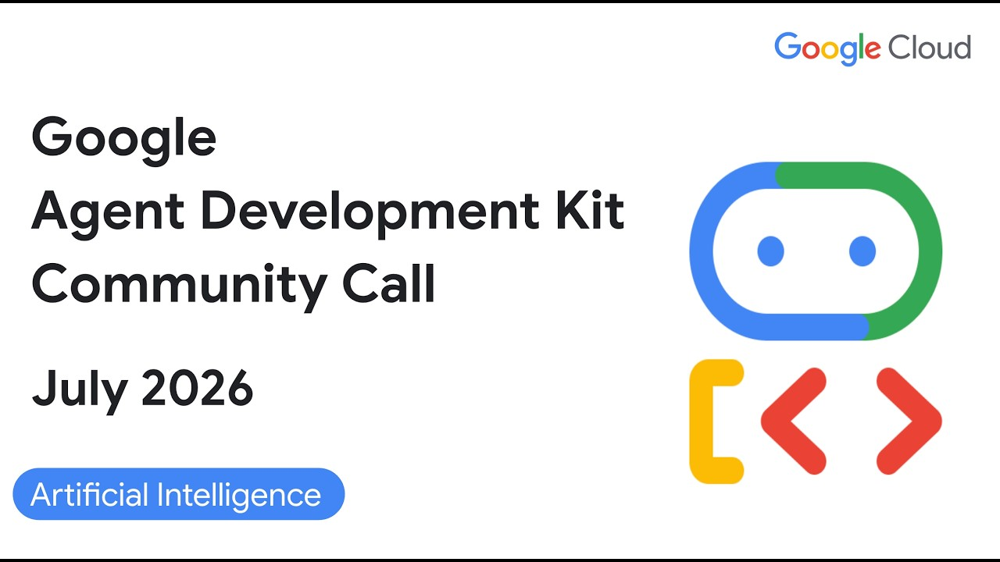

Community Call

### 📞 July 2026 Recording

Discussions include the ADK Go 2.0 release, the Agents CLI reaching GA with automated evaluations, using ADK to automate PR and issue triage, the new Managed Agents and Antigravity integration, and a community spotlight on CopilotKit with the AG-UI and A2UI protocols.

](https://www.youtube.com/watch?v=-L8ys-nKCWc)[

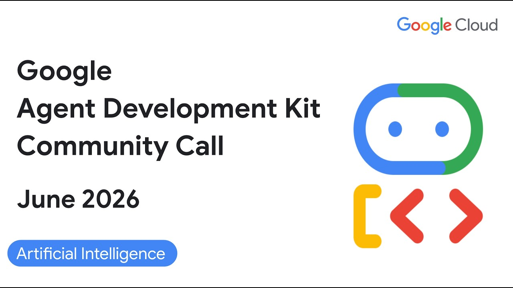

Community Call

### 📞 June 2026 Recording

Discussions include multi-language SDK support, native GCS integration, the new ADK Environments feature, the Agents CLI and Agent Eval CLI, and a community spotlight on a prompt optimization taxonomy plugin.

](https://www.youtube.com/watch?v=XAvXSACGdEQ)[

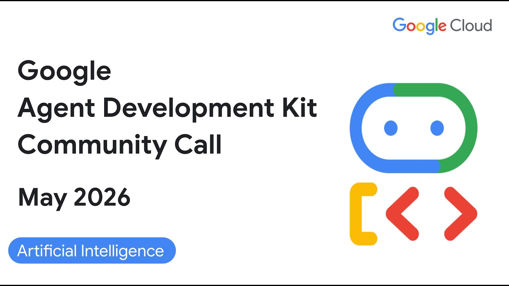

Community Call

### 📞 May 2026 Recording

Discussions include the ADK Python 2.0 GA release, initial release of ADK for Kotlin and Android, demos of Agents CLI and Skills for dynamic capability loading, and a community spotlight on Beever Atlas.

](https://www.youtube.com/watch?v=vbqKmK0rArI)

## Courses & Deep Dives[¶](#courses-deep-dives "Permanent link")

[

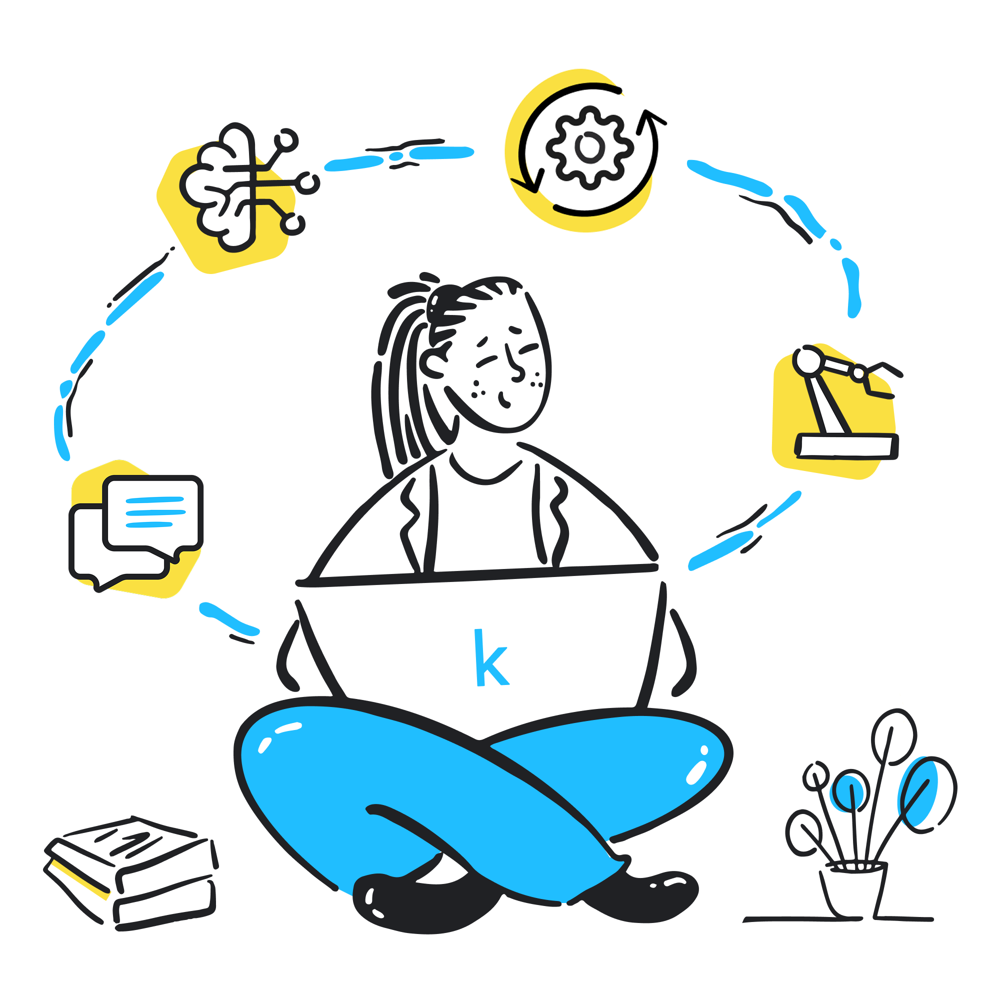

Online Course

### 🎓 5-Day AI Agents Intensive Course with Google

Build with core ADK agent components including, models, tools, memory, evaluation, and deployment.

](https://www.kaggle.com/learn-guide/5-day-agents)[

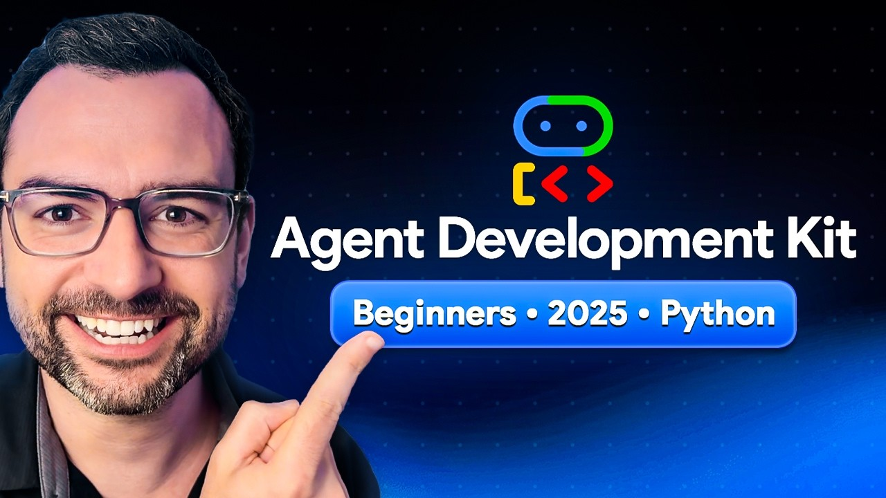

Video Course

### 🎓 ADK Masterclass: Build AI Agents & Automate Workflows

A complete crash course that takes you from beginner to expert with 12 hands-on examples.

](https://www.youtube.com/watch?v=P4VFL9nIaIA)[

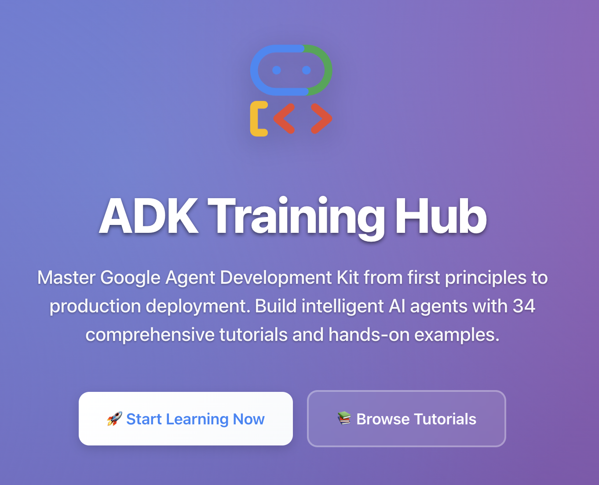

Website

### 🎓 ADK Training Hub

Master ADK from first principles to production with comprehensive tutorials and examples.

](https://raphaelmansuy.github.io/adk_training/)[

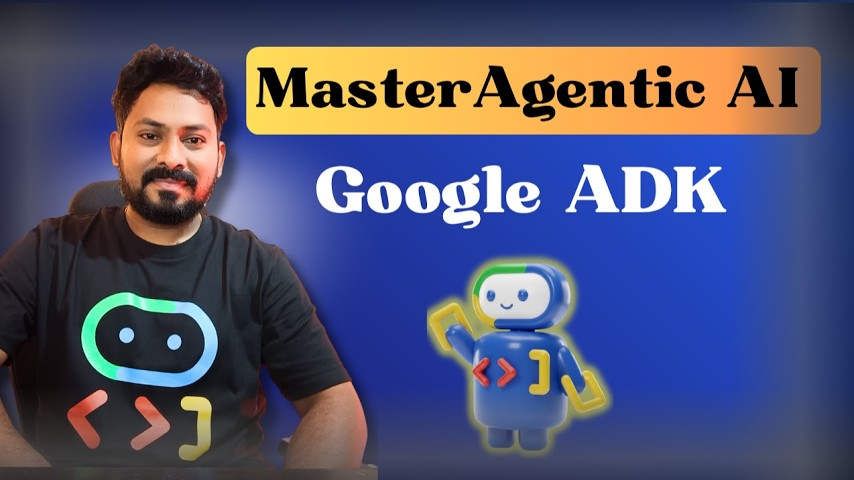

YouTube Playlist

### 🎓 Master Agentic AI with ADK

A step-by-step playlist covering everything from setup to deploying and scaling agents.

](https://www.youtube.com/playlist?list=PLLrA_pU9-Gz2HwepRUVpq1TEPuYWo_fSi)[

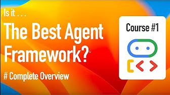

YouTube Playlist

### 🎓 Google ADK End-to-end Course

Build, deploy, and scale production-ready agents with this in-depth course series.

](https://www.youtube.com/playlist?list=PL6tW9BrhiPTAZts0W5nQS9dbW6VMnLKab)[

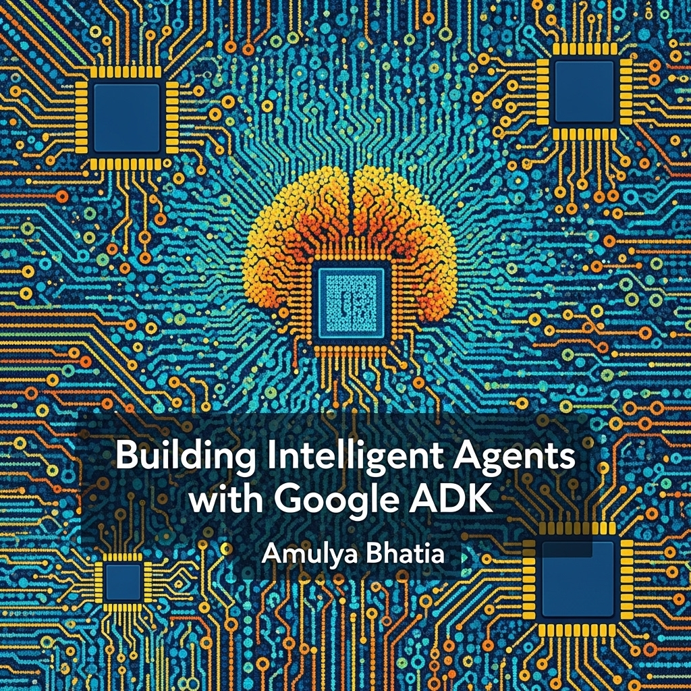

Blog Series

### 🎓 Building Intelligent Agents with Google ADK

A developer's guide to building intelligent agents with Google's code-first Python toolkit.

](https://iamulya.one/tags/building-intelligent-agents-with-google-adk/)[

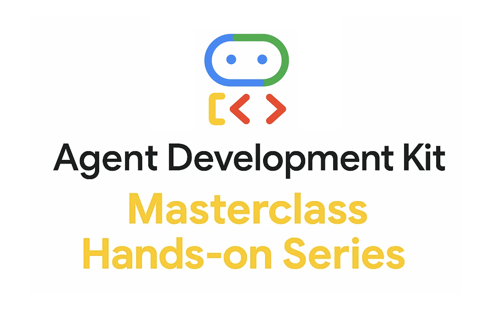

Online Course

### 🎓 Google ADK Masterclass: Hands-on Series

Build production-ready AI agents with 20 modules covering agents, workflows, tools, memory, and MCP integrations.

](https://github.com/arjunprabhulal/google-adk-masterclass)[

YouTube Playlist

### 📻️ ADK News - ADK Podcast in Japanese

An auto-generated Japanese podcast about ADK, created by an ADK agent that covers commit logs, release notes, and blog posts.

](https://www.youtube.com/playlist?list=PL0Zc2RFDZsM_MkHOzWNJpaT4EH5fQxA8n)[

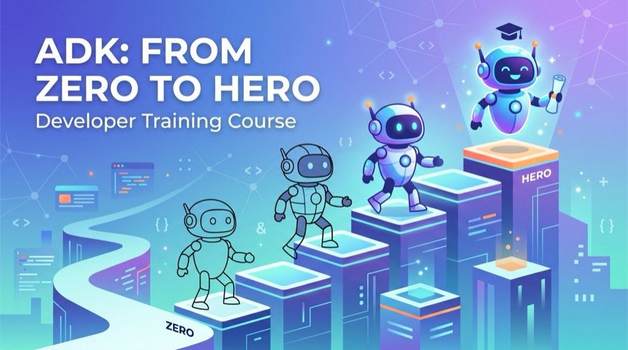

Online Course

### 🎓 ADK: From Zero to Hero

A 40+ module, hands-on ADK 2.0 curriculum (Python) built around real challenge labs — theory, a lab you actually have to solve, then a hidden solution. From your first agent to distributed, enterprise-grade multi-agent systems with full observability.

](https://mauripsale.github.io/doc-adk-training/)

## Agent Tutorials and Demos[¶](#agent-tutorials-and-demos "Permanent link")

[

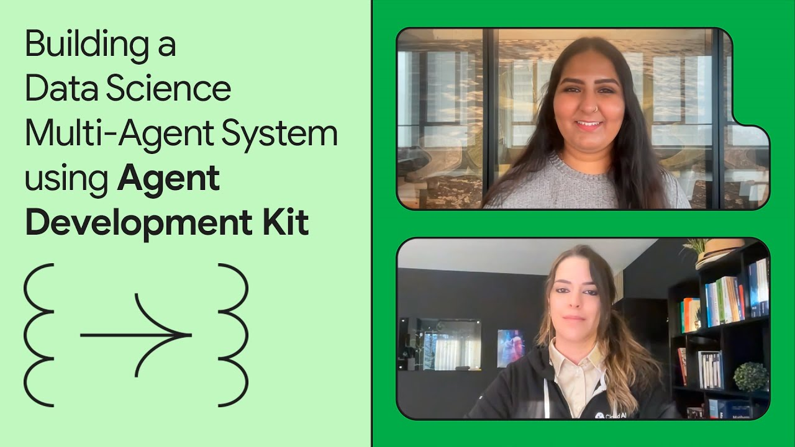

Video Tutorial

### 📖 How to Build a Data Science Agent with ADK

A deep dive into building a multi-agent system for database queries, Python analysis, and BigQuery ML.

](https://www.youtube.com/watch?v=efcUXoMX818)[

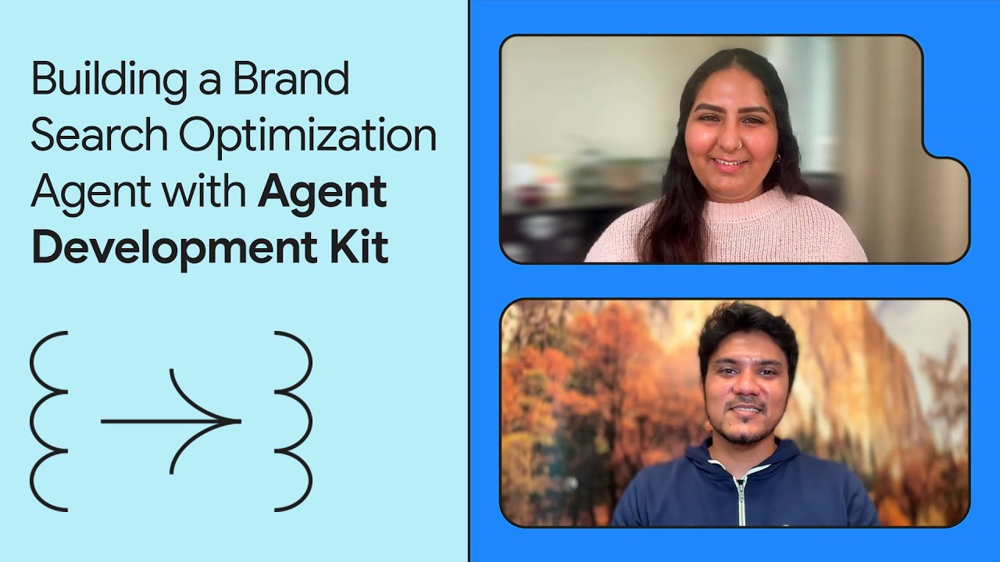

Video Tutorial

### 📖 Build a Browser Use Agent with ADK and Selenium

Learn to build an agent that enhances a retail website's product data by filling in missing information.

](https://www.youtube.com/watch?v=hPzjkQFV5yI)[

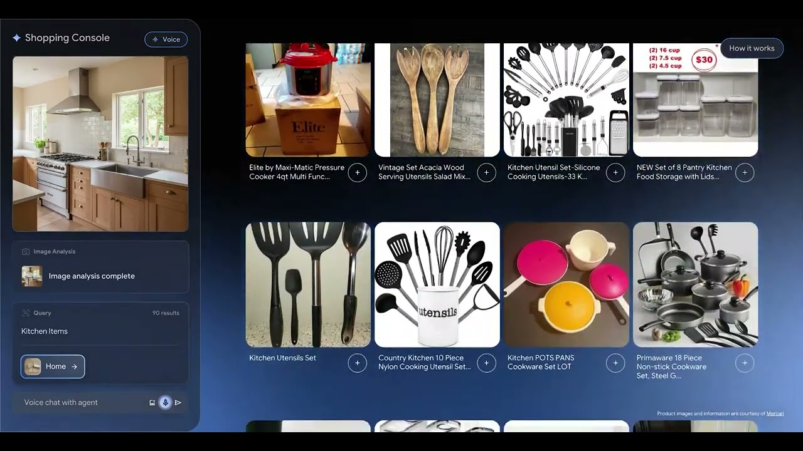

Jupyter Notebook

### 📖 Build an E-commerce Recommendation Agent

A tutorial on creating a simple multi-agent system for generative e-commerce recommendations.

](https://github.com/google/adk-docs/blob/main/examples/python/notebooks/shop_agent.ipynb)[

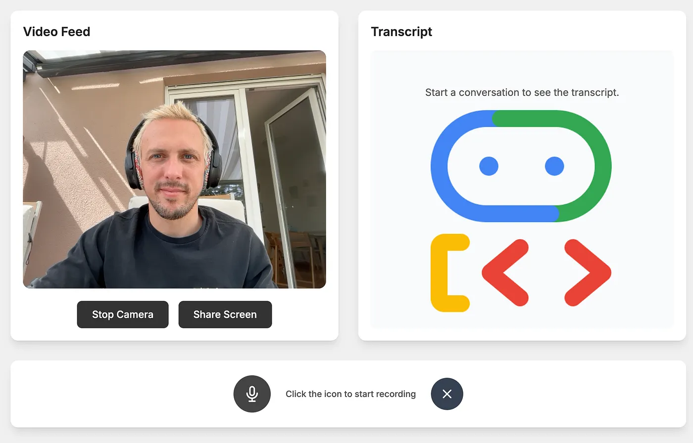

Blog Post

### 📖 Google ADK + Gemini Live API

Go beyond the ADK CLI by building real-time, streaming experiences with the Live API.

](https://medium.com/google-cloud/google-adk-vertex-ai-live-api-125238982d5e)[

Video Demo

### 📺 Shopper's Concierge Demo

See how AI agents can revolutionize shopping with personalized, real-time recommendations.

](https://www.youtube.com/watch?v=LwHPYyw7u6U)[

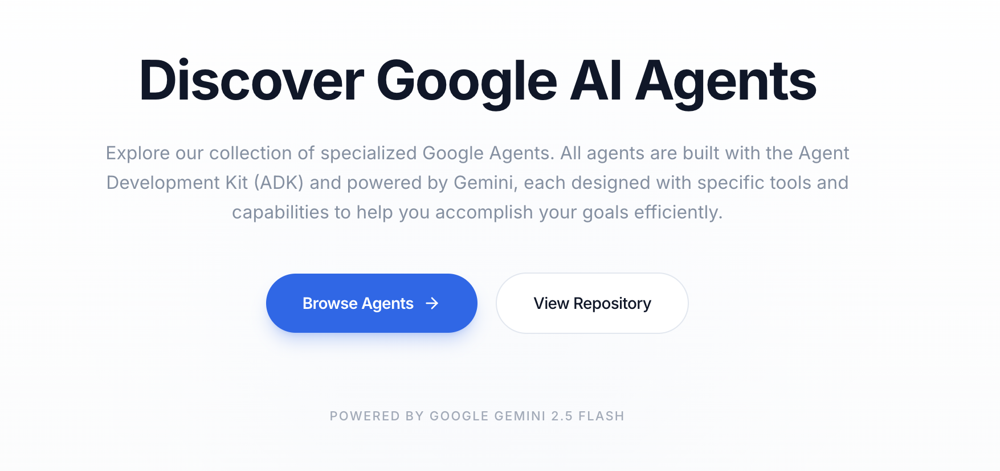

Gallery

### 📖 ADK Agent Directory

Discover and test production-ready ADK agents for web search, image generation, research, and more.

](https://agentdirectory.folch.ai/)

## ADK for Java[¶](#adk-for-java "Permanent link")

[

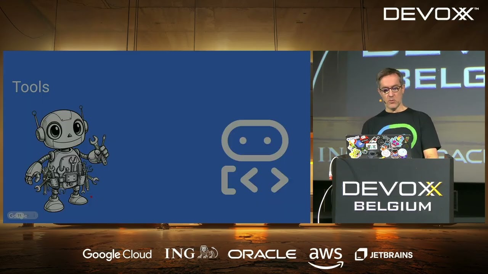

Video Talk

### ☕ Discover ADK Java for Building AI Agents

A presentation to help you build your first AI agents in Java.

](https://www.youtube.com/watch?v=L6V6aQixOZU)[

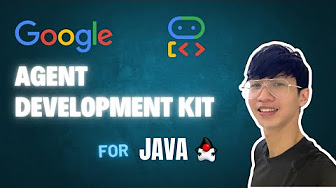

YouTube Playlist

### ☕ Google ADK for Java Tutorials

Step-by-step tutorials covering A2A, MCP, multi-agent systems, and callbacks in Java.

](https://www.youtube.com/playlist?list=PLLMxXO6kMiNhP87WYQ8CeC3xpV3EnF9cu)[

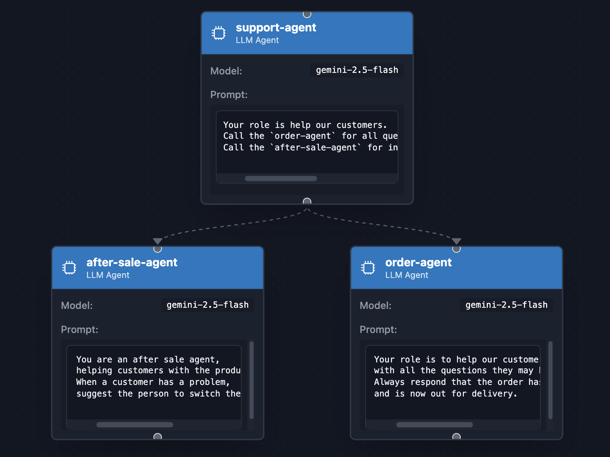

Codelab

### ☕ Build AI Agents with ADK for Java

Move beyond simple LLM calls to create autonomous Java agents that reason, plan, and use tools.

](https://codelabs.developers.google.com/adk-java-getting-started)

## Translations[¶](#translations "Permanent link")

Community-provided translations of the ADK documentation.

-   [🇨🇳 Chinese (中文) Documentation](https://adk.wiki/)
-   [🇰🇷 Korean (한국어) Documentation](https://adk-labs.github.io/adk-docs/ko/)
-   [🇯🇵 Japanese (日本語) Documentation](https://adk-labs.github.io/adk-docs/ja/)
-   [🇪🇸 Spanish (Español) Documentation](https://adk-es.fabian-castro-c.dev/)

## Contributing Your Resource[¶](#contributing-your-resource "Permanent link")

Have an ADK resource to share (tutorial, translation, tool, video, or example)?

Refer to the steps in the **[Contributing Guide](/community/contributing-guide/)** for more information on how to get involved!

Thank you for your contributions to Agent Development Kit! ❤️

Back to top