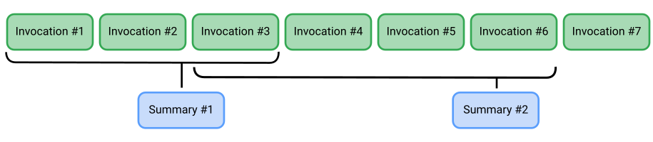

 [ Python](https://github.com/google/adk-python "adk-python on GitHub")[ JS ](https://github.com/google/adk-js "adk-js on GitHub")[ Go ](https://github.com/google/adk-go "adk-go on GitHub")[ Java ](https://github.com/google/adk-java "adk-java on GitHub")[ Kotlin](https://github.com/google/adk-kotlin "adk-kotlin on GitHub")

-   [Home](../..)
-    Build Agents
    
    Build Agents
    
    -   [Get Started](../../get-started/)
        
        Get Started
        
        -   [Python](../../get-started/python/)
        -   [TypeScript](../../get-started/typescript/)
        -   [Go](../../get-started/go/)
        -   [Java](../../get-started/java/)
        -   [Kotlin](../../get-started/kotlin/)
        -   [Agents CLI](../../get-started/agents-cli/)
        -   [Installation](../../get-started/installation/)
        -   [Google Cloud](../../get-started/google-cloud/)
        -   [Migrate to ADK](../../get-started/migrate/)
        
    -   [Build your Agent](../../tutorials/)
        
        Build your Agent
        
        -   [Multi-tool agent](../../tutorials/multi-tool-agent/)
        -   [Agent team](../../tutorials/agent-team/)
        -   [Code with AI](../../tutorials/coding-with-ai/)
        -   [Agent Config](../../agents/config/)
        
    -   [Agents](../../agents/)
        
        Agents
        
        -   [Simple agents](../../agents/llm-agents/)
        -   [Managed agents](../../agents/managed-agents/)
        
    -   [Graph Workflows](../../graphs/)
        
        Graph Workflows
        
        -   [Graph routes](../../graphs/routes/)
        -   [Data handling](../../graphs/data-handling/)
        -   [Human input](../../graphs/human-input/)
        -   [Dynamic workflows](../../graphs/dynamic/)
        
    -   [Multi-Agent Workflows](../../workflows/)
        
        Multi-Agent Workflows
        
        -   [Collaborative workflows](../../workflows/collaboration/)
        -   [Template workflows](../../agents/workflow-agents/)
            
            Template workflows
            
            -   [Sequential workflow](../../agents/workflow-agents/sequential-agents/)
            -   [Loop workflow](../../agents/workflow-agents/loop-agents/)
            -   [Parallel workflow](../../agents/workflow-agents/parallel-agents/)
            -   [Custom template workflows](../../agents/custom-agents/)
            
        -   [Agent routing](../../agents/routing/)
        -   [Workflow patterns](../../workflows/patterns/)
        
    -   [Models for Agents](../../agents/models/)
        
        Models for Agents
        
        -   [Gemini](../../agents/models/google-gemini/)
            
            Gemini
            
            -   [Deferred scheduling](../../agents/models/google-gemini/deferred-schedule/)
            
        -   [Gemma](../../agents/models/google-gemma/)
        -   [Claude](../../agents/models/anthropic/)
        -   [Agent Platform hosted](../../agents/models/agent-platform/)
        -   [Apigee AI Gateway](../../agents/models/apigee/)
        -   [Model routing](../../agents/models/routing/)
        -   [OpenAI](../../agents/models/openai/)
        -   [Ollama](../../agents/models/ollama/)
        -   [vLLM](../../agents/models/vllm/)
        -   [LiteLLM](../../agents/models/litellm/)
        -   [LiteRT-LM](../../agents/models/litert-lm/)
        
    
-    Run Agents
    
    Run Agents
    
    -   [Agent Runtime](../../runtime/)
        
        Agent Runtime
        
        -   [Web Interface](../../runtime/web-interface/)
            
            Web Interface
            
            -   [Visual Builder](../../visual-builder/)
            
        -   [Command Line](../../runtime/command-line/)
        -   [API Server](../../runtime/api-server/)
        -   [Ambient Agents](../../runtime/ambient-agents/)
        -   [Resume Agents](../../runtime/resume/)
        -   [Cancel Agent Runs](../../runtime/cancel/)
        -   [Runtime Config](../../runtime/runconfig/)
        -   [Event Loop](../../runtime/event-loop/)
        
    -   [Deployment](../../deploy/)
        
        Deployment
        
        -   [Agent Runtime](../../deploy/agent-runtime/)
            
            Agent Runtime
            
            -   [Standard deployment](../../deploy/agent-runtime/deploy/)
            -   [agents-cli](../../deploy/agent-runtime/agents-cli/)
            -   [Test deployed agents](../../deploy/agent-runtime/test/)
            
        -   [Cloud Run](../../deploy/cloud-run/)
        -   [GKE](../../deploy/gke/)
        
    -   [Observability](../../observability/)
        
        Observability
        
        -   [Logging](../../observability/logging/)
        -   [Metrics](../../observability/metrics/)
        -   [Traces](../../observability/traces/)
        
    -   [Evaluation](../../evaluate/)
        
        Evaluation
        
        -   [Criteria](../../evaluate/criteria/)
        -   [User Simulation](../../evaluate/user-sim/)
        -   [Environment Simulation](../../evaluate/environment_simulation/)
        -   [Custom Metrics](../../evaluate/custom_metrics/)
        -   [Optimization](../../optimize/)
        
    -   [Safety and Security](../../safety/)
        
        Safety and Security
        
    
-    Components
    
    Components
    
    -   [Technical Overview](../../get-started/about/)
    -   [Custom Tools](../../tools-custom/)
        
        Custom Tools
        
        -    Function tools
            
            Function tools
            
            -   [Overview](../../tools-custom/function-tools/)
            -   [Tool performance](../../tools-custom/performance/)
            -   [Action confirmations](../../tools-custom/confirmation/)
            
        -   [MCP tools](../../tools-custom/mcp-tools/)
            
            MCP tools
            
            -   [Advanced configuration](../../tools-custom/mcp-tools/advanced/)
            -   [Deployment](../../tools-custom/mcp-tools/deployment/)
            -   [Agent as MCP server](../../tools-custom/mcp-tools/agent-as-server/)
            -   [Sub-agent delegation](../../tools-custom/mcp-tools/agent-managed/)
            
        -   [OpenAPI tools](../../tools-custom/openapi-tools/)
        -   [Authentication](../../tools-custom/authentication/)
        -   [Tool limitations](../../tools/limitations/)
        
    -   [Artifacts](../../artifacts/)
        
        Artifacts
        
    -   [Skills for Agents](../../skills/)
        
        Skills for Agents
        
    -   [App management](../../apps/)
        
        App management
        
        -   [Callbacks](../../callbacks/)
            
            Callbacks
            
            -   [Types of callbacks](../../callbacks/types-of-callbacks/)
            -   [Callback patterns](../../callbacks/design-patterns-and-best-practices/)
            
        -   [Plugins](../../plugins/)
        
    -   [Agent context](../)
        
        Agent context
        
        -   [Conversational context](../../sessions/)
        -   [Sessions](../../sessions/session/)
            
            Sessions
            
            -   [Rewind sessions](../../sessions/session/rewind/)
            -   [Migrate sessions](../../sessions/session/migrate/)
            
        -   [State](../../sessions/state/)
        -   [Events](../../events/)
        -   [Memory](../../sessions/memory/)
        -    Context compression [Context compression](./)
            
            Table of contents
            
            -   [Choose your strategy](#choose-your-strategy)
            -   [Token-based compaction](#token-based-compaction)
                
                -   [Configuration settings](#configuration-settings)
                
            -   [Sliding window compaction](#sliding-window-compaction)
            -   [Configure context compaction](#configure-context-compaction)
            -   [Example of context compaction](#example-of-context-compaction)
            -   [Configuration settings](#configuration-settings_1)
                
                -   [Define a Summarizer](#define-summarizer)
                
            
        -   [Model context caching](../caching/)
        
    -   [A2A Protocol](../../a2a/)
        
        A2A Protocol
        
        -   [Introduction to A2A](../../a2a/intro/)
        -    A2A Quickstart (Exposing)
            
            A2A Quickstart (Exposing)
            
            -   [Python](../../a2a/quickstart-exposing/)
            -   [Go](../../a2a/quickstart-exposing-go/)
            -   [Java](../../a2a/quickstart-exposing-java/)
            
        -    A2A Quickstart (Consuming)
            
            A2A Quickstart (Consuming)
            
            -   [Python](../../a2a/quickstart-consuming/)
            -   [Go](../../a2a/quickstart-consuming-go/)
            -   [Java](../../a2a/quickstart-consuming-java/)
            -   [Kotlin](../../a2a/quickstart-consuming-kotlin/)
            
        -   [A2A Extension](../../a2a/a2a-extension/)
        
    -   [Live and Voice Agents](../../live/)
        
        Live and Voice Agents
        
        -   [Get started](../../live/get-started/)
            
            Get started
            
            -   [Python](../../live/get-started/streaming-python/)
            -   [Java](../../live/get-started/streaming-java/)
            
        -    Building
            
            Building
            
            -   [Workflows](../../live/workflows/)
            -   [Tools](../../live/tools/)
            -   [Sessions](../../live/sessions/)
            -   [Events](../../live/events/)
            -   [Audio and video](../../live/audio-video/)
            -   [Configuration](../../live/configuration/)
            
        -    Production
            
            Production
            
            -   [Guardrails](../../live/guardrails/)
            -   [Evaluation](../../live/evaluation/)
            -   [Build a custom server](../../live/custom-server/)
            
        -   [Supported models](../../live/models/)
        
    -   [Grounding](../../grounding/)
        
        Grounding
        
        -   [Google Search Grounding](../../grounding/google_search_grounding/)
        -   [Grounding with Search](../../grounding/grounding_with_search/)
        
    
-   [Integrations](../../integrations/)
    
    Integrations
    
-    Reference
    
    Reference
    
    -   [API Reference](../../api-reference/)
        
        API Reference
        
        -   [Python ADK](../../api-reference/python/)
        -   [TypeScript ADK](../../api-reference/typescript/)
        -    Go ADK
            
            Go ADK
            
            -   [Go v2.x](https://pkg.go.dev/google.golang.org/adk/v2)
            -   [Go v1.x](https://pkg.go.dev/google.golang.org/adk)
            
        -   [Java ADK](../../api-reference/java/)
        -   [Kotlin ADK](../../api-reference/kotlin/)
        -   [CLI Reference](../../api-reference/cli/)
        -   [Agent Config Reference](../../api-reference/agentconfig/)
        -   [REST API](../../api-reference/rest/)
        
    -   [Release Notes](../../release-notes/)
    
-   [Community](../../community/)
    
    Community
    
    -   [Contributing Guide](../../community/contributing-guide/)
    
-   [ADK 2.0](../../2.0/)
    
    ADK 2.0
    

Table of contents

-   [Choose your strategy](#choose-your-strategy)
-   [Token-based compaction](#token-based-compaction)
    
    -   [Configuration settings](#configuration-settings)
    
-   [Sliding window compaction](#sliding-window-compaction)
-   [Configure context compaction](#configure-context-compaction)
-   [Example of context compaction](#example-of-context-compaction)
-   [Configuration settings](#configuration-settings_1)
    
    -   [Define a Summarizer](#define-summarizer)
    

1.  [Home](../..)
2.  [Components](../../get-started/about/)
3.  [Agent context](../)

# Compress agent context for performance[¶](#compress-agent-context-for-performance "Permanent link")

Supported in ADKPython v1.16.0Go v2.3.0Java v0.2.0TypeScript v0.6.0Kotlin v0.7.0

As an ADK agent runs it collects *context* information, including user instructions, retrieved data, tool responses, and generated content. As the size of this context data grows, agent processing times typically also increase. More and more data is sent to the generative AI model used by the agent, increasing processing time and slowing down responses. ADK Context Compaction feature is designed to reduce the size of context as an agent is running by summarizing older session history—including instructions, inputs, and model responses. By maintaining a compact context window, this process **optimizes latency and reduces costs** while ensuring the agent retains access to essential recent interactions.

Compaction is integrated directly into SingleFlow via the `CompactionRequestProcessor`, allowing automatic event compaction based on the rules you set in the `EventsCompactionConfig`.

## Choose your strategy[¶](#choose-your-strategy "Permanent link")

You can manage your session's data using the following strategies within `EventsCompactionConfig`:

-   **Token-Based (Primary)**: Triggers cleanup based on the actual volume of tokens consumed. This acts as an absolute safety net and is ideal for unpredictable workloads, like when users paste massive code blocks or upload large files.
-   **Sliding Window (Turn-Based)**: Triggers cleanup after a fixed number of conversational turns. This is useful for regular, predictable text chats.

If you configure both compaction strategies, the system prioritizes token-based compaction. When the session length exceeds your defined token threshold, the system triggers token-based compaction and skips sliding-window compaction for that turn.

## Token-based compaction[¶](#token-based-compaction "Permanent link")

Token-based compaction triggers context management based on the volume of tokens or data, rather than the number of events or turns.

### Configuration settings[¶](#configuration-settings "Permanent link")

Add token-based compaction to your agent workflow by adding an `EventsCompactionConfig` setting to the App object. You must specify the following:

-   **`token_threshold`**: The safety limit of tokens that automatically triggers tail-retention compaction once reached.
-   **`event_retention_size`**: The number of recent events/interactions kept in "raw" un-compacted format when compaction is triggered. This maintains immediate conversational context and pronoun resolution.

To implement this in your project, use the following configuration:

`# 1. Correct the import path to use the google.adk namespace from google.adk.apps.app import App, EventsCompactionConfig from google.adk.agents import Agent # 2. Initialize your root agent (required for App setup) root_agent = Agent(         name="my_root_agent",        description="Main coordinating agent for the workflow." ) # 3. Token-based configuration: Activates the priority/pre-call layer compaction_config = EventsCompactionConfig(         token_threshold=4000,     # Triggers compaction when actual token count exceeds this        event_retention_size=5    # Number of recent raw events to keep intact when token limit is hit ) # 4. Register with required name and root_agent fields, and the config object app = App(         name="my_compacting_agent_app",        root_agent=root_agent,        events_compaction_config=compaction_config )`

## Sliding window compaction[¶](#sliding-window-compaction "Permanent link")

The Context Compaction feature uses a *sliding window* approach for collecting and summarizing agent workflow event data within a [Session](/sessions/session/). When you configure this feature in your agent, it summarizes data from older events once it reaches a threshold of a specific number of workflow events, or invocations, with the current Session.

`# (Optional) Event-based, sliding window as supplementary setting compaction_config = EventsCompactionConfig(         compaction_interval=10,   # Number of turns between standard compactions        overlap_size=2            # Number of events to retain as overlapping context )`

## Configure context compaction[¶](#configure-context-compaction "Permanent link")

Add context compaction to your agent workflow by adding an Events Compaction Configuration setting to the App object (Python/Java/Kotlin), by configuring `contextCompactors` on the `LlmAgent` (TypeScript), or by setting `Compaction` on the runner configuration (Go). As part of the configuration, you must specify a compaction interval and overlap size (Python/Java), a compaction interval and optionally an overlap size (Go), or a token threshold and event retention size (TypeScript/Kotlin/Go), as shown in the following sample code:

PythonJavaTypeScriptKotlinGo

`from google.adk.apps.app import App from google.adk.apps.app import EventsCompactionConfig app = App(         name='my-agent',        root_agent=root_agent,        events_compaction_config=EventsCompactionConfig(                compaction_interval=3,  # Trigger compaction every 3 new invocations.                overlap_size=1          # Include last invocation from the previous window.        ), )`

`import com.google.adk.apps.App; import com.google.adk.summarizer.EventsCompactionConfig; App app = App.builder()         .name("my-agent")        .rootAgent(rootAgent)        .eventsCompactionConfig(EventsCompactionConfig.builder()                .compactionInterval(3)  // Trigger compaction every 3 new invocations.                .overlapSize(1)         // Include last invocation from the previous window.                .build())        .build();`

`import {Gemini, LlmAgent, LlmSummarizer, TokenBasedContextCompactor} from '@google/adk'; const agent = new LlmAgent({     name: 'my-agent',    model: 'gemini-flash-latest',    contextCompactors: [        new TokenBasedContextCompactor({            tokenThreshold: 1000, // Trigger compaction when session exceeds 1000 tokens.            eventRetentionSize: 1, // Keep at least 1 raw event (overlap).            summarizer: new LlmSummarizer({                llm: new Gemini({model: 'gemini-flash-latest'}),            }),        }),    ], });`

`import com.google.adk.kt.apps.App import com.google.adk.kt.summarizer.EventsCompactionConfig // tokenThreshold and eventRetentionSize must be set together; either alone throws. // Kotlin also accepts the compactionInterval/overlapSize pair used in the other tabs. val app =         App(                appName = "my-agent",                rootAgent = rootAgent,                eventsCompactionConfig =                        EventsCompactionConfig(                                tokenThreshold = 1000, // Compact when the last prompt exceeds 1000 tokens.                                eventRetentionSize = 1, // Keep at least 1 raw event.                        ),        )`

`import (         "google.golang.org/adk/v2/runner"        "google.golang.org/adk/v2/session/compaction" ) // Compaction is set on the runner rather than on an App object. r, err := runner.New(runner.Config{         AppName:        "my-agent",        Agent:          rootAgent,        SessionService: sessionService,        Compaction: &compaction.Config{                CompactionInterval: 3, // Trigger compaction every 3 new invocations.                OverlapSize:        1, // Include last invocation from the previous window.        }, })`

Once configured, the ADK `Runner` handles the compaction process in the background each time the session reaches the interval.

## Example of context compaction[¶](#example-of-context-compaction "Permanent link")

If you set `compaction_interval` to 3 and `overlap_size` to 1, the event data is compressed upon completion of events 3, 6, 9, and so on. The overlap setting increases size of the second summary compression, and each summary afterwards, as shown in Figure 1.

 **Figure 1.** Illustration of event compaction configuration with an interval of 3 and overlap of 1.

With this example configuration, the context compression tasks happen as follows:

1.  **Event 3 completes**: All 3 events are compressed into a summary
2.  **Event 6 completes**: Events 3 to 6 are compressed, including the overlap of 1 prior event
3.  **Event 9 completes**: Events 6 to 9 are compressed, including the overlap of 1 prior event

## Configuration settings[¶](#configuration-settings_1 "Permanent link")

The configuration settings for this feature control how frequently event data is compressed and how much data is retained as the agent workflow runs. Optionally, you can configure a compactor object

-   **`compaction_interval`**: Set the number of completed events that triggers compaction of the prior event data.
-   **`overlap_size`**: Set how many of the previously compacted events are included in a newly compacted context set.
-   **`summarizer`**: (Optional) Define a summarizer object including a specific AI model to use for summarization. For more information, see [Define a Summarizer](#define-summarizer).

### Define a Summarizer[¶](#define-summarizer "Permanent link")

You can customize the process of context compression by defining a summarizer. The `LlmEventSummarizer` (Python, Java and Kotlin), `LlmSummarizer` (TypeScript) or `LLMSummarizer` (Go) class allows you to specify a particular model for summarization. The following code example demonstrates how to define and configure a custom summarizer:

PythonJavaTypeScriptKotlinGo

`from google.adk.apps.app import App, EventsCompactionConfig from google.adk.apps.llm_event_summarizer import LlmEventSummarizer from google.adk.models import Gemini # Define the AI model to be used for summarization: summarization_llm = Gemini(model="gemini-flash-latest") # Create the summarizer with the custom model: my_summarizer = LlmEventSummarizer(llm=summarization_llm) # Configure the App with the custom summarizer and compaction settings: app = App(         name='my-agent',        root_agent=root_agent,        events_compaction_config=EventsCompactionConfig(                compaction_interval=3,                overlap_size=1,                summarizer=my_summarizer,        ), )`

`import com.google.adk.apps.App; import com.google.adk.models.Gemini; import com.google.adk.summarizer.EventsCompactionConfig; import com.google.adk.summarizer.LlmEventSummarizer; // Define the AI model to be used for summarization: Gemini summarizationLlm = Gemini.builder()         .model("gemini-flash-latest")        .build(); // Create the summarizer with the custom model: LlmEventSummarizer mySummarizer = new LlmEventSummarizer(summarizationLlm); // Configure the App with the custom summarizer and compaction settings: App app = App.builder()         .name("my-agent")        .rootAgent(rootAgent)        .eventsCompactionConfig(EventsCompactionConfig.builder()                .compactionInterval(3)                .overlapSize(1)                .summarizer(mySummarizer)                .build())        .build();`

`import {Gemini, LlmAgent, LlmSummarizer, TokenBasedContextCompactor} from '@google/adk'; // Define the AI model to be used for summarization: const summarizationLlm = new Gemini({model: 'gemini-flash-latest'}); // Create the summarizer with the custom model: const mySummarizer = new LlmSummarizer({llm: summarizationLlm}); // Configure the agent with the custom summarizer and compaction settings: const agent = new LlmAgent({     name: 'my-agent',    model: 'gemini-flash-latest',    contextCompactors: [        new TokenBasedContextCompactor({            tokenThreshold: 1000,            eventRetentionSize: 1,            summarizer: mySummarizer,        }),    ], });`

`import com.google.adk.kt.apps.App import com.google.adk.kt.models.Gemini import com.google.adk.kt.summarizer.EventsCompactionConfig import com.google.adk.kt.summarizer.LlmEventSummarizer // Define the AI model to be used for summarization: val summarizationLlm = Gemini(name = "gemini-flash-latest") // Create the summarizer with the custom model: val mySummarizer = LlmEventSummarizer(model = summarizationLlm) // Configure the App with the custom summarizer and compaction settings: val app =         App(                appName = "my-agent",                rootAgent = rootAgent,                eventsCompactionConfig =                        EventsCompactionConfig(                                compactionInterval = 3,                                overlapSize = 1,                                summarizer = mySummarizer,                        ),        )`

`import (         "google.golang.org/adk/v2/model/gemini"        "google.golang.org/adk/v2/runner"        "google.golang.org/adk/v2/session/compaction" ) // Define the AI model to be used for summarization: summarizationLLM, err := gemini.NewModel(ctx, "gemini-flash-latest", nil) // Create the summarizer with the custom model: mySummarizer, err := compaction.NewLLMSummarizer(compaction.LLMSummarizerConfig{         Model: summarizationLLM, }) // Configure the runner with the custom summarizer and compaction settings: r, err := runner.New(runner.Config{         AppName:        "my-agent",        Agent:          rootAgent,        SessionService: sessionService,        Compaction: &compaction.Config{                CompactionInterval: 3,                OverlapSize:        1,                Summarizer:         mySummarizer,        }, })`

You can further refine the compactor by modifying its summarizer. In Python, Java and Kotlin, customize the prompt template on `LlmEventSummarizer` — the property is `prompt_template` in Python, and `promptTemplate` in Java and Kotlin. In TypeScript, customize the `prompt` on `LlmSummarizer`. In Go, set `PromptTemplate` on `LLMSummarizerConfig`; it must contain the `{conversation_history}` placeholder. For more details, see the [`LlmEventSummarizer` code](https://github.com/google/adk-python/blob/main/src/google/adk/apps/llm_event_summarizer.py#L60) or [`LlmSummarizer` code](https://github.com/google/adk-js/blob/main/core/src/context/summarizers/llm_summarizer.ts).

Back to top