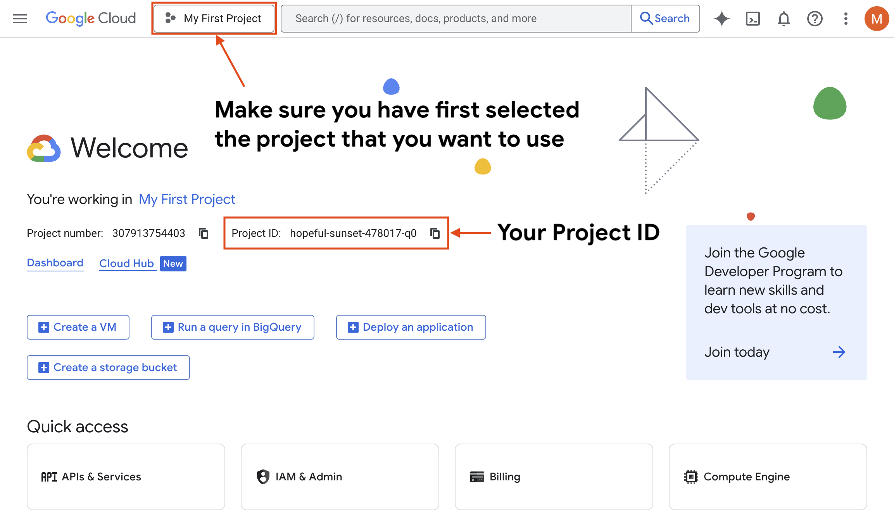

 [ Python](https://github.com/google/adk-python "adk-python on GitHub")[ JS ](https://github.com/google/adk-js "adk-js on GitHub")[ Go ](https://github.com/google/adk-go "adk-go on GitHub")[ Java ](https://github.com/google/adk-java "adk-java on GitHub")[ Kotlin](https://github.com/google/adk-kotlin "adk-kotlin on GitHub")

-   [Home](../../..)
-    Build Agents
    
    Build Agents
    
    -   [Get Started](../../../get-started/)
        
        Get Started
        
        -   [Python](../../../get-started/python/)
        -   [TypeScript](../../../get-started/typescript/)
        -   [Go](../../../get-started/go/)
        -   [Java](../../../get-started/java/)
        -   [Kotlin](../../../get-started/kotlin/)
        -   [Agents CLI](../../../get-started/agents-cli/)
        -   [Installation](../../../get-started/installation/)
        -   [Google Cloud](../../../get-started/google-cloud/)
        -   [Migrate to ADK](../../../get-started/migrate/)
        
    -   [Build your Agent](../../../tutorials/)
        
        Build your Agent
        
        -   [Multi-tool agent](../../../tutorials/multi-tool-agent/)
        -   [Agent team](../../../tutorials/agent-team/)
        -   [Code with AI](../../../tutorials/coding-with-ai/)
        -   [Agent Config](../../../agents/config/)
        
    -   [Agents](../../../agents/)
        
        Agents
        
        -   [Simple agents](../../../agents/llm-agents/)
        -   [Managed agents](../../../agents/managed-agents/)
        
    -   [Graph Workflows](../../../graphs/)
        
        Graph Workflows
        
        -   [Graph routes](../../../graphs/routes/)
        -   [Data handling](../../../graphs/data-handling/)
        -   [Human input](../../../graphs/human-input/)
        -   [Dynamic workflows](../../../graphs/dynamic/)
        
    -   [Multi-Agent Workflows](../../../workflows/)
        
        Multi-Agent Workflows
        
        -   [Collaborative workflows](../../../workflows/collaboration/)
        -   [Template workflows](../../../agents/workflow-agents/)
            
            Template workflows
            
            -   [Sequential workflow](../../../agents/workflow-agents/sequential-agents/)
            -   [Loop workflow](../../../agents/workflow-agents/loop-agents/)
            -   [Parallel workflow](../../../agents/workflow-agents/parallel-agents/)
            -   [Custom template workflows](../../../agents/custom-agents/)
            
        -   [Agent routing](../../../agents/routing/)
        -   [Workflow patterns](../../../workflows/patterns/)
        
    -   [Models for Agents](../../../agents/models/)
        
        Models for Agents
        
        -   [Gemini](../../../agents/models/google-gemini/)
            
            Gemini
            
            -   [Deferred scheduling](../../../agents/models/google-gemini/deferred-schedule/)
            
        -   [Gemma](../../../agents/models/google-gemma/)
        -   [Claude](../../../agents/models/anthropic/)
        -   [Agent Platform hosted](../../../agents/models/agent-platform/)
        -   [Apigee AI Gateway](../../../agents/models/apigee/)
        -   [Model routing](../../../agents/models/routing/)
        -   [OpenAI](../../../agents/models/openai/)
        -   [Ollama](../../../agents/models/ollama/)
        -   [vLLM](../../../agents/models/vllm/)
        -   [LiteLLM](../../../agents/models/litellm/)
        -   [LiteRT-LM](../../../agents/models/litert-lm/)
        
    
-    Run Agents
    
    Run Agents
    
    -   [Agent Runtime](../../../runtime/)
        
        Agent Runtime
        
        -   [Web Interface](../../../runtime/web-interface/)
            
            Web Interface
            
            -   [Visual Builder](../../../visual-builder/)
            
        -   [Command Line](../../../runtime/command-line/)
        -   [API Server](../../../runtime/api-server/)
        -   [Ambient Agents](../../../runtime/ambient-agents/)
        -   [Resume Agents](../../../runtime/resume/)
        -   [Cancel Agent Runs](../../../runtime/cancel/)
        -   [Runtime Config](../../../runtime/runconfig/)
        -   [Event Loop](../../../runtime/event-loop/)
        
    -   [Deployment](../../)
        
        Deployment
        
        -   [Agent Runtime](../)
            
            Agent Runtime
            
            -    Standard deployment [Standard deployment](./)
                
                Table of contents
                
                -   [Setup Google Cloud project](#setup-cloud-project)
                -   [Set up your coding environment](#prerequisites-coding-env)
                    
                    -   [Authenticate your coding environment with Google Cloud](#authenticate-your-coding-environment-with-google-cloud)
                    -   [Define your agent](#define-your-agent)
                    
                -   [Deploy the agent](#deploy-agent)
                    
                    -   [Deploy command output](#deploy-command-output)
                    
                -   [Using an agent on Agent Runtime](#using-an-agent-on-agent-runtime)
                    
                    -   [Monitoring and verification](#monitoring-and-verification)
                    
                -   [Test deployed agents](#test-deployed-agents)
                
            -   [agents-cli](../agents-cli/)
            -   [Test deployed agents](../test/)
            
        -   [Cloud Run](../../cloud-run/)
        -   [GKE](../../gke/)
        
    -   [Observability](../../../observability/)
        
        Observability
        
        -   [Logging](../../../observability/logging/)
        -   [Metrics](../../../observability/metrics/)
        -   [Traces](../../../observability/traces/)
        
    -   [Evaluation](../../../evaluate/)
        
        Evaluation
        
        -   [Criteria](../../../evaluate/criteria/)
        -   [User Simulation](../../../evaluate/user-sim/)
        -   [Environment Simulation](../../../evaluate/environment_simulation/)
        -   [Custom Metrics](../../../evaluate/custom_metrics/)
        -   [Optimization](../../../optimize/)
        
    -   [Safety and Security](../../../safety/)
        
        Safety and Security
        
    
-    Components
    
    Components
    
    -   [Technical Overview](../../../get-started/about/)
    -   [Custom Tools](../../../tools-custom/)
        
        Custom Tools
        
        -    Function tools
            
            Function tools
            
            -   [Overview](../../../tools-custom/function-tools/)
            -   [Tool performance](../../../tools-custom/performance/)
            -   [Action confirmations](../../../tools-custom/confirmation/)
            
        -   [MCP tools](../../../tools-custom/mcp-tools/)
            
            MCP tools
            
            -   [Advanced configuration](../../../tools-custom/mcp-tools/advanced/)
            -   [Deployment](../../../tools-custom/mcp-tools/deployment/)
            -   [Agent as MCP server](../../../tools-custom/mcp-tools/agent-as-server/)
            -   [Sub-agent delegation](../../../tools-custom/mcp-tools/agent-managed/)
            
        -   [OpenAPI tools](../../../tools-custom/openapi-tools/)
        -   [Authentication](../../../tools-custom/authentication/)
        -   [Tool limitations](../../../tools/limitations/)
        
    -   [Artifacts](../../../artifacts/)
        
        Artifacts
        
    -   [Skills for Agents](../../../skills/)
        
        Skills for Agents
        
    -   [App management](../../../apps/)
        
        App management
        
        -   [Callbacks](../../../callbacks/)
            
            Callbacks
            
            -   [Types of callbacks](../../../callbacks/types-of-callbacks/)
            -   [Callback patterns](../../../callbacks/design-patterns-and-best-practices/)
            
        -   [Plugins](../../../plugins/)
        
    -   [Agent context](../../../context/)
        
        Agent context
        
        -   [Conversational context](../../../sessions/)
        -   [Sessions](../../../sessions/session/)
            
            Sessions
            
            -   [Rewind sessions](../../../sessions/session/rewind/)
            -   [Migrate sessions](../../../sessions/session/migrate/)
            
        -   [State](../../../sessions/state/)
        -   [Events](../../../events/)
        -   [Memory](../../../sessions/memory/)
        -   [Context compression](../../../context/compaction/)
        -   [Model context caching](../../../context/caching/)
        
    -   [A2A Protocol](../../../a2a/)
        
        A2A Protocol
        
        -   [Introduction to A2A](../../../a2a/intro/)
        -    A2A Quickstart (Exposing)
            
            A2A Quickstart (Exposing)
            
            -   [Python](../../../a2a/quickstart-exposing/)
            -   [Go](../../../a2a/quickstart-exposing-go/)
            -   [Java](../../../a2a/quickstart-exposing-java/)
            
        -    A2A Quickstart (Consuming)
            
            A2A Quickstart (Consuming)
            
            -   [Python](../../../a2a/quickstart-consuming/)
            -   [Go](../../../a2a/quickstart-consuming-go/)
            -   [Java](../../../a2a/quickstart-consuming-java/)
            -   [Kotlin](../../../a2a/quickstart-consuming-kotlin/)
            
        -   [A2A Extension](../../../a2a/a2a-extension/)
        
    -   [Live and Voice Agents](../../../live/)
        
        Live and Voice Agents
        
        -   [Get started](../../../live/get-started/)
            
            Get started
            
            -   [Python](../../../live/get-started/streaming-python/)
            -   [Java](../../../live/get-started/streaming-java/)
            
        -    Building
            
            Building
            
            -   [Workflows](../../../live/workflows/)
            -   [Tools](../../../live/tools/)
            -   [Sessions](../../../live/sessions/)
            -   [Events](../../../live/events/)
            -   [Audio and video](../../../live/audio-video/)
            -   [Configuration](../../../live/configuration/)
            
        -    Production
            
            Production
            
            -   [Guardrails](../../../live/guardrails/)
            -   [Evaluation](../../../live/evaluation/)
            -   [Build a custom server](../../../live/custom-server/)
            
        -   [Supported models](../../../live/models/)
        
    -   [Grounding](../../../grounding/)
        
        Grounding
        
        -   [Google Search Grounding](../../../grounding/google_search_grounding/)
        -   [Grounding with Search](../../../grounding/grounding_with_search/)
        
    
-   [Integrations](../../../integrations/)
    
    Integrations
    
-    Reference
    
    Reference
    
    -   [API Reference](../../../api-reference/)
        
        API Reference
        
        -   [Python ADK](../../../api-reference/python/)
        -   [TypeScript ADK](../../../api-reference/typescript/)
        -    Go ADK
            
            Go ADK
            
            -   [Go v2.x](https://pkg.go.dev/google.golang.org/adk/v2)
            -   [Go v1.x](https://pkg.go.dev/google.golang.org/adk)
            
        -   [Java ADK](../../../api-reference/java/)
        -   [Kotlin ADK](../../../api-reference/kotlin/)
        -   [CLI Reference](../../../api-reference/cli/)
        -   [Agent Config Reference](../../../api-reference/agentconfig/)
        -   [REST API](../../../api-reference/rest/)
        
    -   [Release Notes](../../../release-notes/)
    
-   [Community](../../../community/)
    
    Community
    
    -   [Contributing Guide](../../../community/contributing-guide/)
    
-   [ADK 2.0](../../../2.0/)
    
    ADK 2.0
    

Table of contents

-   [Setup Google Cloud project](#setup-cloud-project)
-   [Set up your coding environment](#prerequisites-coding-env)
    
    -   [Authenticate your coding environment with Google Cloud](#authenticate-your-coding-environment-with-google-cloud)
    -   [Define your agent](#define-your-agent)
    
-   [Deploy the agent](#deploy-agent)
    
    -   [Deploy command output](#deploy-command-output)
    
-   [Using an agent on Agent Runtime](#using-an-agent-on-agent-runtime)
    
    -   [Monitoring and verification](#monitoring-and-verification)
    
-   [Test deployed agents](#test-deployed-agents)

1.  [Home](../../..)
2.  [Run Agents](../../../runtime/)
3.  [Deployment](../../)
4.  [Agent Runtime](../)

# Deploy to Agent Runtime[¶](#deploy-to-agent-runtime "Permanent link")

Supported in ADKPythonGo v1.2.0

This deployment procedure describes how to perform a standard deployment of ADK agent code to Google Cloud [Agent Runtime](https://cloud.google.com/vertex-ai/generative-ai/docs/agent-engine/overview). You should follow this deployment path if you have an existing Google Cloud project and if you want to carefully manage deploying an ADK agent to Agent Runtime environment. These instructions use Cloud Console, the gcloud command line interface, and the ADK command line interface (ADK CLI). This path is recommended for users who are already familiar with configuring Google Cloud projects, and users preparing for production deployments.

These instructions describe how to deploy an ADK project to Google Cloud Agent Runtime environment, which includes the following stages:

-   [Setup Google Cloud project](#setup-cloud-project)
-   [Prepare agent project folder](#define-your-agent)
-   [Deploy the agent](#deploy-agent)

## Setup Google Cloud project[¶](#setup-cloud-project "Permanent link")

To deploy your agent to Agent Runtime, you need a Google Cloud project:

1.  **Sign into Google Cloud**:
    
    -   If you're an **existing user** of Google Cloud:
        -   Sign in via [https://console.cloud.google.com](https://console.cloud.google.com)
        -   If you previously used a Free Trial that has expired, you may need to upgrade to a [Paid billing account](https://docs.cloud.google.com/free/docs/free-cloud-features#how-to-upgrade).
    -   If you are a **new user** of Google Cloud:
        -   You can sign up for the [Free Trial program](https://docs.cloud.google.com/free/docs/free-cloud-features). The Free Trial gets you a $300 Welcome credit to spend over 91 days on various [Google Cloud products](https://docs.cloud.google.com/free/docs/free-cloud-features#during-free-trial) and you won't be billed. During the Free Trial, you also get access to the [Google Cloud Free Tier](https://docs.cloud.google.com/free/docs/free-cloud-features#free-tier), which gives you free usage of select products up to specified monthly limits, and to product-specific free trials.
2.  **Create a Google Cloud project**
    
    -   If you already have an existing Google Cloud project, you can use it, but be aware this process is likely to add new services to the project.
    -   If you want to create a new Google Cloud project, you can create a new one on the [Create Project](https://console.cloud.google.com/projectcreate) page.
3.  **Get your Google Cloud Project ID**
    
    -   You need your Google Cloud Project ID, which you can find on your GCP homepage. Make sure to note the Project ID (alphanumeric with hyphens), *not* the project number (numeric).
    
    
    
4.  **Enable Agent Platform in your project**
    
    -   To use Agent Runtime, you need to [enable the Agent Platform API](https://console.cloud.google.com/apis/library/aiplatform.googleapis.com). Click on the "Enable" button to enable the API. Once enabled, it should say "API Enabled".
5.  **Enable Cloud Resource Manager API in your project**
    
    -   To use Agent Runtime, you need to [enable the Cloud Resource Manager API](https://console.developers.google.com/apis/api/cloudresourcemanager.googleapis.com/overview). Click on the "Enable" button to enable the API. Once enabled, it should say "API Enabled".

## Set up your coding environment[¶](#prerequisites-coding-env "Permanent link")

Now that you prepared your Google Cloud project, you can return to your coding environment. These steps require access to a terminal within your coding environment to run command line instructions.

### Authenticate your coding environment with Google Cloud[¶](#authenticate-your-coding-environment-with-google-cloud "Permanent link")

-   You need to authenticate your coding environment so that you and your code can interact with Google Cloud. To do so, you need the gcloud CLI. If you have never used the gcloud CLI, you need to first [download and install it](https://docs.cloud.google.com/sdk/docs/install-sdk) before continuing with the steps below:
    
-   Run the following command in your terminal to access your Google Cloud project as a user:
    
    `gcloud auth login`
    
    After authenticating, you should see the message `You are now authenticated with the gcloud CLI!`.
    
-   Run the following command to authenticate your code so that it can work with Google Cloud:
    
    `gcloud auth application-default login`
    
    After authenticating, you should see the message `You are now authenticated with the gcloud CLI!`.
    
-   (Optional) If you need to set or change your default project in gcloud, you can use:
    
    `gcloud config set project MY-PROJECT-ID`
    

### Define your agent[¶](#define-your-agent "Permanent link")

With your Google Cloud and coding environment prepared, you're ready to deploy your agent. The instructions assume that you have an agent project folder, such as:

PythonGo

`multi_tool_agent/ ├── .env ├── __init__.py └── agent.py`

For more details on the project files and format, see the [multi\_tool\_agent](https://github.com/google/adk-docs/tree/main/examples/python/snippets/get-started/multi_tool_agent) code sample.

`multi_tool_agent/ ├── go.mod ├── go.sum └── main.go`

## Deploy the agent[¶](#deploy-agent "Permanent link")

You can deploy from your terminal using the `adk deploy` command line tool. This process packages your code, builds it into a container, and deploys it to the managed Agent Runtime service. This process can take several minutes.

The following example deploy command uses the `multi_tool_agent` sample code as the project to be deployed:

PythonGo

`PROJECT_ID=my-project-id LOCATION_ID=us-central1 adk deploy agent_engine \                 --project=$PROJECT_ID \                --region=$LOCATION_ID \                --display_name="My First Agent" \                multi_tool_agent`

`PROJECT_ID=my-project-id LOCATION_ID=us-central1 adkgo deploy agentengine \         -e ./main.go \        -s "multi_tool_agent" \        -p $PROJECT_ID \        -r $LOCATION_ID \        -d .`

For `region`, you can find a list of the supported regions on the [Agent Builder locations page](https://docs.cloud.google.com/agent-builder/locations#supported-regions-agent-engine).

PythonGo

To learn about the CLI options for the `adk deploy agent_engine` command, see the [ADK CLI Reference](/api-reference/cli/#adk-deploy-agent-engine).

To learn about the CLI options for the `adkgo deploy agentengine` command you can run `adkgo help deploy agentengine` which will display available options. The most important are:

`-e, --entry_point_path string   Path to an entry point (go 'main') -s, --name string               Agent Engine name -p, --project_name string       GCP Project Name -r, --region string             GCP Region -d, --source_dir string         Directory to archive, defaults to current working directory`

### Deploy command output[¶](#deploy-command-output "Permanent link")

Once successfully deployed, you should see the following output:

PythonGo

`Creating AgentEngine Create AgentEngine backing LRO: projects/123456789/locations/us-central1/reasoningEngines/751619551677906944/operations/2356952072064073728 View progress and logs at https://console.cloud.google.com/logs/query?project=hopeful-sunset-478017-q0 AgentEngine created. Resource name: projects/123456789/locations/us-central1/reasoningEngines/751619551677906944 To use this AgentEngine in another session: agent_engine = vertexai.agent_engines.get('projects/123456789/locations/us-central1/reasoningEngines/751619551677906944') Cleaning up the temp folder: /var/folders/k5/pv70z5m92s30k0n7hfkxszfr00mz24/T/agent_engine_deploy_src/20251219_134245`

`Computing flags & preparing temp : Starting ...         >  [Deployed Reasoning Engine: projects/887748635400/locations/us-central1/reasoningEngines/751619551677906944]        >  [Display Name: simpleText] Deploying to Agent Engine : Finished successfully Cleaning temp : Starting         >  [Clean temp starting with /tmp/agentEngine_20260424_141040__2470352066] Cleaning temp : Finished successfully`

Note that you now have a `RESOURCE_ID` where your agent has been deployed (which in the example above is `751619551677906944`). You need this ID number along with the other values to use your agent on Agent Runtime.

## Using an agent on Agent Runtime[¶](#using-an-agent-on-agent-runtime "Permanent link")

Once you have completed deployment of your ADK project, you can query the agent using the Agent Platform SDK, Python requests library, or a REST API client. This section provides some information on what you need to interact with your agent and how to construct URLs to interact with your agent's REST API.

To interact with your agent on Agent Runtime, you need the following:

-   **PROJECT\_ID** (example: "my-project-id") which you can find on your [project details page](https://console.cloud.google.com/iam-admin/settings)
-   **LOCATION\_ID** (example: "us-central1"), that you used to deploy your agent
-   **RESOURCE\_ID** (example: "751619551677906944"), which you can find on the [Agent Runtime UI](https://console.cloud.google.com/vertex-ai/agents/agent-engines)

The query URL structure is as follows:

`https://$(LOCATION_ID)-aiplatform.googleapis.com/v1/projects/$(PROJECT_ID)/locations/$(LOCATION_ID)/reasoningEngines/$(RESOURCE_ID):query`

You can make requests from your agent using this URL structure. For more information on how to make requests, see the instructions in the Agent Runtime documentation [Use an Agent Development Kit agent](https://docs.cloud.google.com/agent-builder/agent-engine/use/adk#rest-api). You can also check the Agent Runtime documentation to learn about how to manage your [deployed agent](https://docs.cloud.google.com/agent-builder/agent-engine/manage/overview). For more information on testing and interacting with a deployed agent, see [Test deployed agents in Agent Runtime](/deploy/agent-runtime/test/).

### Monitoring and verification[¶](#monitoring-and-verification "Permanent link")

-   You can monitor the deployment status in the [Agent Runtime UI](https://console.cloud.google.com/vertex-ai/agents/agent-engines) in the Google Cloud Console.
-   For additional details, you can visit the Agent Runtime documentation [deploying an agent](https://cloud.google.com/vertex-ai/generative-ai/docs/agent-engine/deploy) and [managing deployed agents](https://cloud.google.com/vertex-ai/generative-ai/docs/agent-engine/manage/overview).

## Test deployed agents[¶](#test-deployed-agents "Permanent link")

After completing deployment of your ADK agent you should test the workflow in its new hosted environment. For more information on testing an ADK agent deployed to Agent Runtime, see [Test deployed agents in Agent Runtime](/deploy/agent-runtime/test/).

Back to top