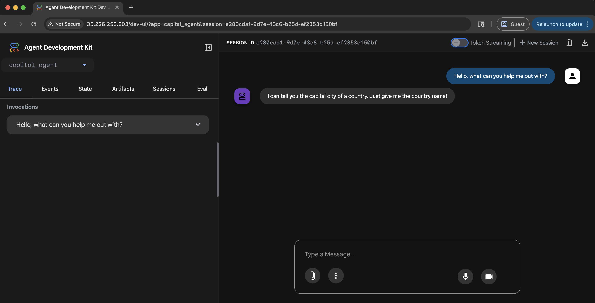

 [ Python](https://github.com/google/adk-python "adk-python on GitHub")[ JS ](https://github.com/google/adk-js "adk-js on GitHub")[ Go ](https://github.com/google/adk-go "adk-go on GitHub")[ Java ](https://github.com/google/adk-java "adk-java on GitHub")[ Kotlin](https://github.com/google/adk-kotlin "adk-kotlin on GitHub")

-   [Home](../..)
-    Build Agents
    
    Build Agents
    
    -   [Get Started](../../get-started/)
        
        Get Started
        
        -   [Python](../../get-started/python/)
        -   [TypeScript](../../get-started/typescript/)
        -   [Go](../../get-started/go/)
        -   [Java](../../get-started/java/)
        -   [Kotlin](../../get-started/kotlin/)
        -   [Agents CLI](../../get-started/agents-cli/)
        -   [Installation](../../get-started/installation/)
        -   [Google Cloud](../../get-started/google-cloud/)
        -   [Migrate to ADK](../../get-started/migrate/)
        
    -   [Build your Agent](../../tutorials/)
        
        Build your Agent
        
        -   [Multi-tool agent](../../tutorials/multi-tool-agent/)
        -   [Agent team](../../tutorials/agent-team/)
        -   [Code with AI](../../tutorials/coding-with-ai/)
        -   [Agent Config](../../agents/config/)
        
    -   [Agents](../../agents/)
        
        Agents
        
        -   [Simple agents](../../agents/llm-agents/)
        -   [Managed agents](../../agents/managed-agents/)
        
    -   [Graph Workflows](../../graphs/)
        
        Graph Workflows
        
        -   [Graph routes](../../graphs/routes/)
        -   [Data handling](../../graphs/data-handling/)
        -   [Human input](../../graphs/human-input/)
        -   [Dynamic workflows](../../graphs/dynamic/)
        
    -   [Multi-Agent Workflows](../../workflows/)
        
        Multi-Agent Workflows
        
        -   [Collaborative workflows](../../workflows/collaboration/)
        -   [Template workflows](../../agents/workflow-agents/)
            
            Template workflows
            
            -   [Sequential workflow](../../agents/workflow-agents/sequential-agents/)
            -   [Loop workflow](../../agents/workflow-agents/loop-agents/)
            -   [Parallel workflow](../../agents/workflow-agents/parallel-agents/)
            -   [Custom template workflows](../../agents/custom-agents/)
            
        -   [Agent routing](../../agents/routing/)
        -   [Workflow patterns](../../workflows/patterns/)
        
    -   [Models for Agents](../../agents/models/)
        
        Models for Agents
        
        -   [Gemini](../../agents/models/google-gemini/)
            
            Gemini
            
            -   [Deferred scheduling](../../agents/models/google-gemini/deferred-schedule/)
            
        -   [Gemma](../../agents/models/google-gemma/)
        -   [Claude](../../agents/models/anthropic/)
        -   [Agent Platform hosted](../../agents/models/agent-platform/)
        -   [Apigee AI Gateway](../../agents/models/apigee/)
        -   [Model routing](../../agents/models/routing/)
        -   [OpenAI](../../agents/models/openai/)
        -   [Ollama](../../agents/models/ollama/)
        -   [vLLM](../../agents/models/vllm/)
        -   [LiteLLM](../../agents/models/litellm/)
        -   [LiteRT-LM](../../agents/models/litert-lm/)
        
    
-    Run Agents
    
    Run Agents
    
    -   [Agent Runtime](../../runtime/)
        
        Agent Runtime
        
        -   [Web Interface](../../runtime/web-interface/)
            
            Web Interface
            
            -   [Visual Builder](../../visual-builder/)
            
        -   [Command Line](../../runtime/command-line/)
        -   [API Server](../../runtime/api-server/)
        -   [Ambient Agents](../../runtime/ambient-agents/)
        -   [Resume Agents](../../runtime/resume/)
        -   [Cancel Agent Runs](../../runtime/cancel/)
        -   [Runtime Config](../../runtime/runconfig/)
        -   [Event Loop](../../runtime/event-loop/)
        
    -   [Deployment](../)
        
        Deployment
        
        -   [Agent Runtime](../agent-runtime/)
            
            Agent Runtime
            
            -   [Standard deployment](../agent-runtime/deploy/)
            -   [agents-cli](../agent-runtime/agents-cli/)
            -   [Test deployed agents](../agent-runtime/test/)
            
        -   [Cloud Run](../cloud-run/)
        -    GKE [GKE](./)
            
            Table of contents
            
            -   [Set environment variables](#set-environment-variables)
            -   [Enable APIs and permissions](#enable-apis-and-permissions)
            -   [Deployment payload](#payload)
            -   [Deployment options](#deployment-options)
            -   [Option 1: Manual deployment using gcloud and kubectl](#option-1-manual-deployment-using-gcloud-and-kubectl)
                
                -   [Create a GKE cluster](#create-a-gke-cluster)
                -   [Create your agent](#create-your-agent)
                -   [Code files](#code-files)
                -   [Build the container image](#build-the-container-image)
                -   [Configure Kubernetes service account for Agent Platform](#configure-kubernetes-service-account-for-agent-platform)
                -   [Create the Kubernetes manifest files](#create-the-kubernetes-manifest-files)
                -   [Deploy the Application](#deploy-the-application)
                
            -   [Option 2: Automated Deployment using adk deploy gke](#option-2-automated-deployment-using-adk-deploy-gke)
                
                -   [Prerequisites](#prerequisites)
                -   [Configure Workload Identity for Agent Platform](#configure-workload-identity-for-agent-platform)
                -   [The deploy gke Command](#the-deploy-gke-command)
                    
                    -   [Syntax](#syntax)
                    
                -   [Arguments & options](#arguments-options)
                -   [How it works](#how-it-works)
                -   [Example of use](#example-of-use)
                -   [Verify your deployment](#verify-your-deployment)
                
            -   [Test your agent](#test-your-agent)
                
                -   [UI Testing](#ui-testing)
                -   [API Testing (curl)](#api-testing-curl)
                    
                    -   [Set the application URL](#set-the-application-url)
                    -   [List available apps](#list-available-apps)
                    -   [Create or Update a Session](#create-or-update-a-session)
                    -   [Run the Agent](#run-the-agent)
                    
                
            -   [Troubleshooting](#troubleshooting)
                
                -   [403 Permission Denied for Gemini's models](#403-permission-denied-for-geminis-models)
                -   [404 or Not Found response](#404-or-not-found-response)
                -   [Attempt to write a readonly database](#attempt-to-write-a-readonly-database)
                -   [Insufficient Permission to Stream Logs ERROR: (gcloud.builds.submit)](#insufficient-permission-to-stream-logs-error-gcloudbuildssubmit)
                -   [Gemini models not supported in Live Api](#gemini-models-not-supported-in-live-api)
                
            -   [Cleanup](#cleanup)
            
        
    -   [Observability](../../observability/)
        
        Observability
        
        -   [Logging](../../observability/logging/)
        -   [Metrics](../../observability/metrics/)
        -   [Traces](../../observability/traces/)
        
    -   [Evaluation](../../evaluate/)
        
        Evaluation
        
        -   [Criteria](../../evaluate/criteria/)
        -   [User Simulation](../../evaluate/user-sim/)
        -   [Environment Simulation](../../evaluate/environment_simulation/)
        -   [Custom Metrics](../../evaluate/custom_metrics/)
        -   [Optimization](../../optimize/)
        
    -   [Safety and Security](../../safety/)
        
        Safety and Security
        
    
-    Components
    
    Components
    
    -   [Technical Overview](../../get-started/about/)
    -   [Custom Tools](../../tools-custom/)
        
        Custom Tools
        
        -    Function tools
            
            Function tools
            
            -   [Overview](../../tools-custom/function-tools/)
            -   [Tool performance](../../tools-custom/performance/)
            -   [Action confirmations](../../tools-custom/confirmation/)
            
        -   [MCP tools](../../tools-custom/mcp-tools/)
            
            MCP tools
            
            -   [Advanced configuration](../../tools-custom/mcp-tools/advanced/)
            -   [Deployment](../../tools-custom/mcp-tools/deployment/)
            -   [Agent as MCP server](../../tools-custom/mcp-tools/agent-as-server/)
            -   [Sub-agent delegation](../../tools-custom/mcp-tools/agent-managed/)
            
        -   [OpenAPI tools](../../tools-custom/openapi-tools/)
        -   [Authentication](../../tools-custom/authentication/)
        -   [Tool limitations](../../tools/limitations/)
        
    -   [Artifacts](../../artifacts/)
        
        Artifacts
        
    -   [Skills for Agents](../../skills/)
        
        Skills for Agents
        
    -   [App management](../../apps/)
        
        App management
        
        -   [Callbacks](../../callbacks/)
            
            Callbacks
            
            -   [Types of callbacks](../../callbacks/types-of-callbacks/)
            -   [Callback patterns](../../callbacks/design-patterns-and-best-practices/)
            
        -   [Plugins](../../plugins/)
        
    -   [Agent context](../../context/)
        
        Agent context
        
        -   [Conversational context](../../sessions/)
        -   [Sessions](../../sessions/session/)
            
            Sessions
            
            -   [Rewind sessions](../../sessions/session/rewind/)
            -   [Migrate sessions](../../sessions/session/migrate/)
            
        -   [State](../../sessions/state/)
        -   [Events](../../events/)
        -   [Memory](../../sessions/memory/)
        -   [Context compression](../../context/compaction/)
        -   [Model context caching](../../context/caching/)
        
    -   [A2A Protocol](../../a2a/)
        
        A2A Protocol
        
        -   [Introduction to A2A](../../a2a/intro/)
        -    A2A Quickstart (Exposing)
            
            A2A Quickstart (Exposing)
            
            -   [Python](../../a2a/quickstart-exposing/)
            -   [Go](../../a2a/quickstart-exposing-go/)
            -   [Java](../../a2a/quickstart-exposing-java/)
            
        -    A2A Quickstart (Consuming)
            
            A2A Quickstart (Consuming)
            
            -   [Python](../../a2a/quickstart-consuming/)
            -   [Go](../../a2a/quickstart-consuming-go/)
            -   [Java](../../a2a/quickstart-consuming-java/)
            -   [Kotlin](../../a2a/quickstart-consuming-kotlin/)
            
        -   [A2A Extension](../../a2a/a2a-extension/)
        
    -   [Live and Voice Agents](../../live/)
        
        Live and Voice Agents
        
        -   [Get started](../../live/get-started/)
            
            Get started
            
            -   [Python](../../live/get-started/streaming-python/)
            -   [Java](../../live/get-started/streaming-java/)
            
        -    Building
            
            Building
            
            -   [Workflows](../../live/workflows/)
            -   [Tools](../../live/tools/)
            -   [Sessions](../../live/sessions/)
            -   [Events](../../live/events/)
            -   [Audio and video](../../live/audio-video/)
            -   [Configuration](../../live/configuration/)
            
        -    Production
            
            Production
            
            -   [Guardrails](../../live/guardrails/)
            -   [Evaluation](../../live/evaluation/)
            -   [Build a custom server](../../live/custom-server/)
            
        -   [Supported models](../../live/models/)
        
    -   [Grounding](../../grounding/)
        
        Grounding
        
        -   [Google Search Grounding](../../grounding/google_search_grounding/)
        -   [Grounding with Search](../../grounding/grounding_with_search/)
        
    
-   [Integrations](../../integrations/)
    
    Integrations
    
-    Reference
    
    Reference
    
    -   [API Reference](../../api-reference/)
        
        API Reference
        
        -   [Python ADK](../../api-reference/python/)
        -   [TypeScript ADK](../../api-reference/typescript/)
        -    Go ADK
            
            Go ADK
            
            -   [Go v2.x](https://pkg.go.dev/google.golang.org/adk/v2)
            -   [Go v1.x](https://pkg.go.dev/google.golang.org/adk)
            
        -   [Java ADK](../../api-reference/java/)
        -   [Kotlin ADK](../../api-reference/kotlin/)
        -   [CLI Reference](../../api-reference/cli/)
        -   [Agent Config Reference](../../api-reference/agentconfig/)
        -   [REST API](../../api-reference/rest/)
        
    -   [Release Notes](../../release-notes/)
    
-   [Community](../../community/)
    
    Community
    
    -   [Contributing Guide](../../community/contributing-guide/)
    
-   [ADK 2.0](../../2.0/)
    
    ADK 2.0
    

Table of contents

-   [Set environment variables](#set-environment-variables)
-   [Enable APIs and permissions](#enable-apis-and-permissions)
-   [Deployment payload](#payload)
-   [Deployment options](#deployment-options)
-   [Option 1: Manual deployment using gcloud and kubectl](#option-1-manual-deployment-using-gcloud-and-kubectl)
    
    -   [Create a GKE cluster](#create-a-gke-cluster)
    -   [Create your agent](#create-your-agent)
    -   [Code files](#code-files)
    -   [Build the container image](#build-the-container-image)
    -   [Configure Kubernetes service account for Agent Platform](#configure-kubernetes-service-account-for-agent-platform)
    -   [Create the Kubernetes manifest files](#create-the-kubernetes-manifest-files)
    -   [Deploy the Application](#deploy-the-application)
    
-   [Option 2: Automated Deployment using adk deploy gke](#option-2-automated-deployment-using-adk-deploy-gke)
    
    -   [Prerequisites](#prerequisites)
    -   [Configure Workload Identity for Agent Platform](#configure-workload-identity-for-agent-platform)
    -   [The deploy gke Command](#the-deploy-gke-command)
        
        -   [Syntax](#syntax)
        
    -   [Arguments & options](#arguments-options)
    -   [How it works](#how-it-works)
    -   [Example of use](#example-of-use)
    -   [Verify your deployment](#verify-your-deployment)
    
-   [Test your agent](#test-your-agent)
    
    -   [UI Testing](#ui-testing)
    -   [API Testing (curl)](#api-testing-curl)
        
        -   [Set the application URL](#set-the-application-url)
        -   [List available apps](#list-available-apps)
        -   [Create or Update a Session](#create-or-update-a-session)
        -   [Run the Agent](#run-the-agent)
        
    
-   [Troubleshooting](#troubleshooting)
    
    -   [403 Permission Denied for Gemini's models](#403-permission-denied-for-geminis-models)
    -   [404 or Not Found response](#404-or-not-found-response)
    -   [Attempt to write a readonly database](#attempt-to-write-a-readonly-database)
    -   [Insufficient Permission to Stream Logs ERROR: (gcloud.builds.submit)](#insufficient-permission-to-stream-logs-error-gcloudbuildssubmit)
    -   [Gemini models not supported in Live Api](#gemini-models-not-supported-in-live-api)
    
-   [Cleanup](#cleanup)

1.  [Home](../..)
2.  [Run Agents](../../runtime/)
3.  [Deployment](../)

# Deploy to Google Kubernetes Engine (GKE)[¶](#deploy-to-google-kubernetes-engine-gke "Permanent link")

Supported in ADK Python Go

[GKE](https://cloud.google.com/gke) is the Google Cloud managed Kubernetes service. It allows you to deploy and manage containerized applications using Kubernetes.

To deploy your agent you will need to have a Kubernetes cluster running on GKE. You can create a cluster using the Google Cloud Console or the `gcloud` command line tool.

The following example shows you how to deploy a simple agent to GKE. The Python agent is a FastAPI application that uses `Gemini Flash` as the LLM. The Go agent uses the ADK launcher and a statically-linked binary in a minimal container. You can use Agent Platform or AI Studio as the LLM provider with the environment variable `GOOGLE_GENAI_USE_ENTERPRISE`.

## Set environment variables[¶](#set-environment-variables "Permanent link")

Set the variables as described in the [Setup and Installation](../../get-started/installation/) guide. You will also need to install the `kubectl` command line tool. You can find instructions to do so in the [Google Kubernetes Engine Documentation](https://cloud.google.com/kubernetes-engine/docs/how-to/cluster-access-for-kubectl).

`export GOOGLE_CLOUD_PROJECT=your-project-id # Your GCP project ID export GOOGLE_CLOUD_LOCATION=us-central1 # Or your preferred location export GOOGLE_GENAI_USE_ENTERPRISE=true # Set to true if using Agent Platform export GOOGLE_CLOUD_PROJECT_NUMBER=$(gcloud projects describe \     --format json $GOOGLE_CLOUD_PROJECT | jq -r ".projectNumber")`

If you don't have jq installed, you can use the following command to get the project number:

`gcloud projects describe $GOOGLE_CLOUD_PROJECT`

And copy the project number from the output.

`export GOOGLE_CLOUD_PROJECT_NUMBER=YOUR_PROJECT_NUMBER`

## Enable APIs and permissions[¶](#enable-apis-and-permissions "Permanent link")

-   Ensure you have authenticated with Google Cloud (`gcloud auth login` and `gcloud config set project <your-project-id>`).
-   Enable the necessary APIs for your project. You can do this using the `gcloud` command line tool.

`gcloud services enable \         container.googleapis.com \        artifactregistry.googleapis.com \        cloudbuild.googleapis.com \        aiplatform.googleapis.com`

Grant necessary roles to the default compute engine service account required by the `gcloud builds submit` command.

`ROLES_TO_ASSIGN=(         "roles/artifactregistry.writer"        "roles/storage.objectViewer"        "roles/logging.viewer"        "roles/logging.logWriter" ) for ROLE in "${ROLES_TO_ASSIGN[@]}"; do         gcloud projects add-iam-policy-binding "${GOOGLE_CLOUD_PROJECT}" \                --member="serviceAccount:${GOOGLE_CLOUD_PROJECT_NUMBER}-compute@developer.gserviceaccount.com" \                --role="${ROLE}" done`

## Deployment payload[¶](#payload "Permanent link")

When you deploy your ADK agent workflow to the Google Cloud GKE, the following content is uploaded to the service:

-   Your ADK agent code
-   Any dependencies declared in your ADK agent code
-   ADK API server code version used by your agent

The default deployment *does not* include the ADK web user interface libraries, unless you specify it as deployment setting, such as the `--with_ui` option for `adk deploy gke` command.

## Deployment options[¶](#deployment-options "Permanent link")

You can deploy your agent to GKE either **manually using Kubernetes manifests** or **automatically using the `adk deploy gke` command**. Choose the approach that best suits your workflow.

## Option 1: Manual deployment using gcloud and kubectl[¶](#option-1-manual-deployment-using-gcloud-and-kubectl "Permanent link")

### Create a GKE cluster[¶](#create-a-gke-cluster "Permanent link")

You can create a GKE cluster using the `gcloud` command line tool. This example creates an Autopilot cluster named `adk-cluster` in the `us-central1` region.

If you're creating a GKE Standard cluster

Make sure [Workload Identity](https://cloud.google.com/kubernetes-engine/docs/how-to/workload-identity) is enabled. Workload Identity is enabled by default in an AutoPilot cluster.

`gcloud container clusters create-auto adk-cluster \         --location=$GOOGLE_CLOUD_LOCATION \        --project=$GOOGLE_CLOUD_PROJECT`

After creating the cluster, you need to connect to it using `kubectl`. This command configures `kubectl` to use the credentials for your new cluster.

`gcloud container clusters get-credentials adk-cluster \         --location=$GOOGLE_CLOUD_LOCATION \        --project=$GOOGLE_CLOUD_PROJECT`

### Create your agent[¶](#create-your-agent "Permanent link")

Use the `capital_agent` example defined on the [LLM agents](../../agents/llm-agents/) page as a reference.

PythonGo

Organize your project files as follows:

`your-project-directory/ ├── capital_agent/ │   ├── __init__.py │   └── agent.py       # Your agent code ├── main.py            # FastAPI application entry point ├── requirements.txt   # Python dependencies └── Dockerfile         # Container build instructions`

Organize your project files as follows:

`your-project-directory/ ├── main.go       # Agent code and launcher entry point ├── go.mod        # Go module definition ├── go.sum        # Go module checksums └── Dockerfile    # Container build instructions`

### Code files[¶](#code-files "Permanent link")

PythonGo

Create the following files (`main.py`, `requirements.txt`, `Dockerfile`, `capital_agent/agent.py`, `capital_agent/__init__.py`) in the root of `your-project-directory/`.

1.  This is the Capital Agent example inside the `capital_agent` directory
    
    capital\_agent/agent.py
    
    `from google.adk.agents import LlmAgent  # Define a tool function def get_capital_city(country: str) -> str:     """Retrieves the capital city for a given country."""    # Replace with actual logic (e.g., API call, database lookup)    capitals = {"france": "Paris", "japan": "Tokyo", "canada": "Ottawa"}    return capitals.get(country.lower(), f"Sorry, I don't know the capital of {country}.") # Add the tool to the agent capital_agent = LlmAgent(         model="gemini-flash-latest",        name="capital_agent", #name of your agent        description="Answers user questions about the capital city of a given country.",        instruction="""You are an agent that provides the capital city of a country... (previous instruction text)""",        tools=[get_capital_city] # Provide the function directly ) # ADK will discover the root_agent instance root_agent = capital_agent`
    
    Mark your directory as a python package
    
    capital\_agent/\_\_init\_\_.py
    
    `from . import agent`
    
2.  This file sets up the FastAPI application using `get_fast_api_app()` from ADK:
    
    main.py
    
    `import os import uvicorn from fastapi import FastAPI from google.adk.cli.fast_api import get_fast_api_app # Get the directory where main.py is located AGENT_DIR = os.path.dirname(os.path.abspath(__file__)) # Example session service URI (e.g., SQLite) # Note: Use 'sqlite+aiosqlite' instead of 'sqlite' because DatabaseSessionService requires an async driver SESSION_SERVICE_URI = "sqlite+aiosqlite:///./sessions.db" # Example allowed origins for CORS ALLOWED_ORIGINS = ["http://localhost", "http://localhost:8080", "*"] # Set web=True if you intend to serve a web interface, False otherwise SERVE_WEB_INTERFACE = True # Call the function to get the FastAPI app instance # Ensure the agent directory name ('capital_agent') matches your agent folder app: FastAPI = get_fast_api_app(         agents_dir=AGENT_DIR,        session_service_uri=SESSION_SERVICE_URI,        allow_origins=ALLOWED_ORIGINS,        web=SERVE_WEB_INTERFACE, ) if __name__ == "__main__":         # Use the PORT environment variable provided by Cloud Run, defaulting to 8080        uvicorn.run(app, host="0.0.0.0", port=int(os.environ.get("PORT", 8080)))`
    
    *Note: We specify `agent_dir` to the directory `main.py` is in and use `os.environ.get("PORT", 8080)` for Cloud Run compatibility.*
    
3.  List the necessary Python packages:
    
    requirements.txt
    
    `google-adk # Add any other dependencies your agent needs`
    
4.  Define the container image:
    
    Dockerfile
    
    `FROM python:3.13-slim WORKDIR /app COPY requirements.txt . RUN pip install --no-cache-dir -r requirements.txt RUN adduser --disabled-password --gecos "" myuser && \         chown -R myuser:myuser /app COPY . . USER myuser ENV PATH="/home/myuser/.local/bin:$PATH" CMD ["sh", "-c", "uvicorn main:app --host 0.0.0.0 --port $PORT"]`
    

Create the following files in the root of `your-project-directory/`.

1.  Define the agent and embed the ADK launcher. The launcher handles the `web`, `api`, and `webui` subcommands that start the REST API server and web interface:
    
    main.go
    
    ``package main import (         "context"        "fmt"        "log"        "os"        "strings"         "google.golang.org/adk/v2/agent"        "google.golang.org/adk/v2/agent/llmagent"        "google.golang.org/adk/v2/cmd/launcher"        "google.golang.org/adk/v2/cmd/launcher/full"        "google.golang.org/adk/v2/model/gemini"        "google.golang.org/adk/v2/tool"        "google.golang.org/adk/v2/tool/functiontool"        "google.golang.org/genai" ) type getCapitalCityArgs struct {         Country string `json:"country" jsonschema:"The country to look up."` } func getCapitalCity(_ agent.Context, args getCapitalCityArgs) (string, error) {         capitals := map[string]string{                "france":  "Paris",                "japan":   "Tokyo",                "canada":  "Ottawa",        }        capital, ok := capitals[strings.ToLower(args.Country)]        if !ok {                return "", fmt.Errorf("capital not found for %s", args.Country)        }        return capital, nil } func main() {         ctx := context.Background()         model, err := gemini.NewModel(ctx, "gemini-flash-latest", &genai.ClientConfig{                APIKey: os.Getenv("GOOGLE_API_KEY"),        })        if err != nil {                log.Fatalf("Failed to create model: %v", err)        }         capitalTool, err := functiontool.New(                functiontool.Config{                        Name:        "get_capital_city",                        Description: "Retrieves the capital city for a given country.",                },                getCapitalCity,        )        if err != nil {                log.Fatalf("Failed to create tool: %v", err)        }         capitalAgent, err := llmagent.New(llmagent.Config{                Name:        "capital_agent",                Model:       model,                Description: "Answers questions about capital cities.",                Instruction: "You are an agent that provides the capital city of a country.",                Tools:       []tool.Tool{capitalTool},        })        if err != nil {                log.Fatalf("Failed to create agent: %v", err)        }         config := &launcher.Config{                AgentLoader: agent.NewSingleLoader(capitalAgent),        }         l := full.NewLauncher()        if err = l.Execute(ctx, config, os.Args[1:]); err != nil {                log.Fatalf("Run failed: %v\n\n%s", err, l.CommandLineSyntax())        } }``
    
    To use Agent Platform instead of AI Studio, set `genai.ClientConfig` to use the Agent Platform backend:
    
    `model, err := gemini.NewModel(ctx, "gemini-flash-latest", &genai.ClientConfig{         Backend:  genai.BackendVertexAI,        Project:  os.Getenv("GOOGLE_CLOUD_PROJECT"),        Location: os.Getenv("GOOGLE_CLOUD_LOCATION"), })`
    
2.  Define the container image. Go compiles to a self-contained static binary, so the container uses a minimal distroless base image — no runtime dependencies or package manager required:
    
    Dockerfile
    
    `# Stage 1: Build the Go binary FROM golang:1.25 AS builder WORKDIR /app COPY go.mod go.sum ./ RUN go mod download COPY . . # Compile a statically linked Linux/amd64 binary RUN CGO_ENABLED=0 GOOS=linux GOARCH=amd64 \         go build -ldflags="-s -w" -o capital_agent . # Stage 2: Copy the binary into a minimal runtime image FROM gcr.io/distroless/static-debian12 COPY --from=builder /app/capital_agent /app/capital_agent EXPOSE 8080 # Start the API server and web UI CMD ["/app/capital_agent", "web", "-port", "8080", "api", "webui"]`
    

### Build the container image[¶](#build-the-container-image "Permanent link")

You need to create a Google Artifact Registry repository to store your container images. You can do this using the `gcloud` command line tool.

`gcloud artifacts repositories create adk-repo \         --repository-format=docker \        --location=$GOOGLE_CLOUD_LOCATION \        --description="ADK repository"`

Build the container image and push it to Artifact Registry:

PythonGo

Use Cloud Build to build and push the image directly from your source directory:

`gcloud builds submit \         --tag $GOOGLE_CLOUD_LOCATION-docker.pkg.dev/$GOOGLE_CLOUD_PROJECT/adk-repo/adk-agent:latest \        --project=$GOOGLE_CLOUD_PROJECT \        .`

The multi-stage Dockerfile handles compilation inside the builder stage, so you can use Cloud Build without needing a local Go toolchain:

`gcloud builds submit \         --tag $GOOGLE_CLOUD_LOCATION-docker.pkg.dev/$GOOGLE_CLOUD_PROJECT/adk-repo/adk-agent:latest \        --project=$GOOGLE_CLOUD_PROJECT \        .`

Alternatively, compile the binary locally and build a smaller image without the multi-stage Dockerfile — useful if you already have Go installed:

`# Cross-compile for linux/amd64 CGO_ENABLED=0 GOOS=linux GOARCH=amd64 go build -ldflags="-s -w" -o capital_agent . # Build and push the image docker build -t $GOOGLE_CLOUD_LOCATION-docker.pkg.dev/$GOOGLE_CLOUD_PROJECT/adk-repo/adk-agent:latest . docker push $GOOGLE_CLOUD_LOCATION-docker.pkg.dev/$GOOGLE_CLOUD_PROJECT/adk-repo/adk-agent:latest`

Verify the image is built and pushed to the Artifact Registry:

`gcloud artifacts docker images list \     $GOOGLE_CLOUD_LOCATION-docker.pkg.dev/$GOOGLE_CLOUD_PROJECT/adk-repo \    --project=$GOOGLE_CLOUD_PROJECT`

### Configure Kubernetes service account for Agent Platform[¶](#configure-kubernetes-service-account-for-agent-platform "Permanent link")

If your agent uses Agent Platform, you need to create a Kubernetes service account with the necessary permissions. This example creates a service account named `adk-agent-sa` and binds it to the `Agent Platform User` role.

Skip if using AI Studio

If you are using AI Studio and accessing the model with an API key you can skip this step.

`kubectl create serviceaccount adk-agent-sa`

`PROJECT_ID=${GOOGLE_CLOUD_PROJECT} PROJECT_NUM=${GOOGLE_CLOUD_PROJECT_NUMBER} IAM_URL="principal://[iam.googleapis.com/projects/$](https://iam.googleapis.com/projects/$){PROJECT_NUM}" WIP="locations/global/workloadIdentityPools/${PROJECT_ID}.svc.id.goog" SA="subject/ns/default/sa/adk-agent-sa" gcloud projects add-iam-policy-binding projects/${PROJECT_ID} \         --role=roles/aiplatform.user \        --member="${IAM_URL}/${WIP}/${SA}" \        --condition=None`

### Create the Kubernetes manifest files[¶](#create-the-kubernetes-manifest-files "Permanent link")

Create a Kubernetes deployment manifest file named `deployment.yaml` in your project directory. This file defines how to deploy your application on GKE.

deployment.yaml

`cat <<  EOF > deployment.yaml apiVersion: apps/v1 kind: Deployment metadata:     name: adk-agent spec:     replicas: 1    selector:        matchLabels:            app: adk-agent    template:        metadata:            labels:                app: adk-agent        spec:            serviceAccount: adk-agent-sa            containers:            - name: adk-agent                imagePullPolicy: Always                image: $GOOGLE_CLOUD_LOCATION-docker.pkg.dev/$GOOGLE_CLOUD_PROJECT/adk-repo/adk-agent:latest                resources:                    limits:                        memory: "128Mi"                        cpu: "500m"                        ephemeral-storage: "128Mi"                    requests:                        memory: "128Mi"                        cpu: "500m"                        ephemeral-storage: "128Mi"                ports:                - containerPort: 8080                env:                    - name: PORT                        value: "8080"                    - name: GOOGLE_CLOUD_PROJECT                        value: $GOOGLE_CLOUD_PROJECT                    - name: GOOGLE_CLOUD_LOCATION                        value: $GOOGLE_CLOUD_LOCATION                    - name: GOOGLE_GENAI_USE_ENTERPRISE                        value: "$GOOGLE_GENAI_USE_ENTERPRISE"                    # If using AI Studio, set GOOGLE_GENAI_USE_ENTERPRISE to false and set the following:                    # - name: GOOGLE_API_KEY                    #   value: $GOOGLE_API_KEY                    # Add any other necessary environment variables your agent might need --- apiVersion: v1 kind: Service metadata:     name: adk-agent spec:            type: LoadBalancer    ports:        - port: 80            targetPort: 8080    selector:        app: adk-agent EOF`

### Deploy the Application[¶](#deploy-the-application "Permanent link")

Deploy the application using the `kubectl` command line tool. This command applies the deployment and service manifest files to your GKE cluster.

`kubectl apply -f deployment.yaml`

After a few moments, you can check the status of your deployment using:

`kubectl get pods -l=app=adk-agent`

This command lists the pods associated with your deployment. You should see a pod with a status of `Running`.

Once the pod is running, you can check the status of the service using:

`kubectl get service adk-agent`

If the output shows a `External IP`, it means your service is accessible from the internet. It may take a few minutes for the external IP to be assigned. You can get the external IP address of your service using:

`kubectl get svc adk-agent -o=jsonpath='{.status.loadBalancer.ingress[0].ip}'`

## Option 2: Automated Deployment using `adk deploy gke`[¶](#option-2-automated-deployment-using-adk-deploy-gke "Permanent link")

Python only

The `adk deploy gke` command is available for Python only. Go does not have an equivalent CLI command. Go agents must be deployed using the manual approach described in [Option 1](#option-1-manual-deployment-using-gcloud-and-kubectl).

ADK provides a CLI command to streamline GKE deployment. This avoids the need to manually build images, write Kubernetes manifests, or push to Artifact Registry.

#### Prerequisites[¶](#prerequisites "Permanent link")

Before you begin, ensure you have the following set up:

1.  **A running GKE cluster:** You need an active Kubernetes cluster on Google Cloud.
    
2.  **Required CLIs:**
    
    -   **`gcloud` CLI:** The Google Cloud CLI must be installed, authenticated, and configured to use your target project. Run `gcloud auth login` and `gcloud config set project [YOUR_PROJECT_ID]`.
    -   **kubectl:** The Kubernetes CLI must be installed to deploy the application to your cluster.
3.  **Enabled Google Cloud APIs:** Make sure the following APIs are enabled in your Google Cloud project:
    
    -   Kubernetes Engine API (`container.googleapis.com`)
    -   Cloud Build API (`cloudbuild.googleapis.com`)
    -   Container Registry API (`containerregistry.googleapis.com`)
4.  **Required IAM Permissions:** The user or Compute Engine default service account running the command needs, at a minimum, the following roles:
    
5.  **Kubernetes Engine Developer** (`roles/container.developer`): To interact with the GKE cluster.
    
6.  **Storage Object Viewer** (`roles/storage.objectViewer`): To allow Cloud Build to download the source code from the Cloud Storage bucket where gcloud builds submit uploads it.
    
7.  **Artifact Registry Create on Push Writer** (`roles/artifactregistry.createOnPushWriter`): To allow Cloud Build to push the built container image to Artifact Registry. This role also permits the on-the-fly creation of the special gcr.io repository within Artifact Registry if needed on the first push.
    
8.  **Logs Writer** (`roles/logging.logWriter`): To allow Cloud Build to write build logs to Cloud Logging.
    

### Configure Workload Identity for Agent Platform[¶](#configure-workload-identity-for-agent-platform "Permanent link")

If your agent uses Agent Platform, the workload running in your cluster needs permission to call the Agent Platform API. Unlike the manual path, `adk deploy gke` generates a manifest that uses the `default` Kubernetes service account in the `default` namespace. Grant the `Agent Platform User` role to that service account through Workload Identity so the agent can access models such as Gemini.

Skip if using AI Studio

If you are using AI Studio and accessing the model with an API key you can skip this step.

`gcloud projects add-iam-policy-binding projects/${GOOGLE_CLOUD_PROJECT} \         --role=roles/aiplatform.user \        --member=principal://iam.googleapis.com/projects/${GOOGLE_CLOUD_PROJECT_NUMBER}/locations/global/workloadIdentityPools/${GOOGLE_CLOUD_PROJECT}.svc.id.goog/subject/ns/default/sa/default \        --condition=None`

If you are using a Google Cloud project and skip this step, the agent's pods start successfully, but requests to the model fail with a `403 PERMISSION_DENIED` error when verifying your deployment.

### The `deploy gke` Command[¶](#the-deploy-gke-command "Permanent link")

The command takes the path to your agent and parameters specifying the target GKE cluster.

#### Syntax[¶](#syntax "Permanent link")

`adk deploy gke [OPTIONS] AGENT_PATH`

### Arguments & options[¶](#arguments-options "Permanent link")

Argument

Description

Required

AGENT\_PATH

The local file path to your agent's root directory.

Yes

\--project

The Google Cloud Project ID where your GKE cluster is located.

Yes

\--cluster\_name

The name of your GKE cluster.

Yes

\--region

The Google Cloud region of your cluster (e.g., us-central1).

Yes

\--service\_type

The type of Kubernetes service to create. Accepts `ClusterIP` (default) or `LoadBalancer`.

No

\--with\_ui

Deploys both the agent's back-end API and a companion front-end user interface.

No

\--log\_level

Sets the logging level for the deployment process. Options: debug, info, warning, error, critical.

No

### How it works[¶](#how-it-works "Permanent link")

When you run the `adk deploy gke` command, the ADK performs the following steps automatically:

-   **Containerization:** It builds a Docker container image from your agent's source code.
-   **Image Push:** It tags the container image and pushes it to your project's Artifact Registry.
-   **Manifest Generation:** It dynamically generates the necessary Kubernetes manifest files (a `Deployment` and a `Service`).
-   **Cluster Deployment:** It applies these manifests to your specified GKE cluster, which triggers the following:

The `Deployment` instructs GKE to pull the container image from Artifact Registry and run it in one or more Pods.

The `Service` creates a stable network endpoint for your agent. It defaults to a `ClusterIP` service, which is only accessible within the cluster. To expose your agent to the internet with a public IP address, you must specify `--service_type=LoadBalancer`.

### Example of use[¶](#example-of-use "Permanent link")

Here is a practical example of deploying an agent located at `~/agents/multi_tool_agent/` to a GKE cluster named test.

`adk deploy gke \         --project myproject \        --cluster_name test \        --region us-central1 \        --with_ui \        --log_level info \        ~/agents/multi_tool_agent/`

### Verify your deployment[¶](#verify-your-deployment "Permanent link")

If you used `adk deploy gke`, verify the deployment using `kubectl`:

-   **Check the Pods:** Ensure your agent's pods are in the Running state.

`kubectl get pods`

You should see output like `adk-default-service-name-xxxx-xxxx ... 1/1 Running` in the default namespace.

-   **Find the External IP:** Get the public IP address for your agent's service.

`kubectl get service`

By default, the service type is `ClusterIP`, and `EXTERNAL-IP` is `<none>`.

`NAME                       TYPE        CLUSTER-IP      EXTERNAL-IP   PORT(S)   AGE adk-default-service-name   ClusterIP   10.12.1.2       <none>        80/TCP    2m`

To test your agent, you can use port-forwarding:

`kubectl port-forward svc/adk-default-service-name 8080:80`

You can then access your agent at `http://localhost:8080`.

If you deployed with `--service_type=LoadBalancer`, it may take a few minutes for an external IP to be assigned. Once the `EXTERNAL-IP` is available, you can navigate to it to interact with your agent. 

## Test your agent[¶](#test-your-agent "Permanent link")

Once your agent is deployed to GKE, you can interact with it via the deployed UI (if enabled) or directly with its API endpoints using tools like `curl`. You'll need the service URL provided after deployment.

UI TestingAPI Testing (curl)

### UI Testing[¶](#ui-testing "Permanent link")

If you deployed your agent with the UI enabled:

You can test your agent by simply navigating to the kubernetes service URL in your web browser.

The ADK dev UI allows you to interact with your agent, manage sessions, and view execution details directly in the browser.

To verify your agent is working as intended, you can:

1.  Select your agent from the dropdown menu.
2.  Type a message and verify that you receive an expected response from your agent.

If you experience any unexpected behavior, check the pod logs for your agent using:

`kubectl logs -l app=adk-agent`

### API Testing (curl)[¶](#api-testing-curl "Permanent link")

You can interact with the agent's API endpoints using tools like `curl`. This is useful for programmatic interaction or if you deployed without the UI.

#### Set the application URL[¶](#set-the-application-url "Permanent link")

`export APP_URL=$(kubectl get service adk-agent -o jsonpath='{.status.loadBalancer.ingress[0].ip}')`

Go: API path prefix

The Go ADK server serves all REST endpoints under the `/api` path prefix by default. Prepend `/api` to every path in the examples below when testing a Go deployment. For example:

Python

Go

`$APP_URL/list-apps`

`$APP_URL/api/list-apps`

`$APP_URL/apps/…`

`$APP_URL/api/apps/…`

`$APP_URL/run_sse`

`$APP_URL/api/run_sse`

The prefix can be changed at startup with `-path_prefix` on the `api` subcommand, e.g. `CMD ["/app/capital_agent", "web", "-port", "8080", "api", "-path_prefix", ""]` removes the prefix entirely.

#### List available apps[¶](#list-available-apps "Permanent link")

Verify the deployed application name.

`curl -X GET $APP_URL/list-apps`

*(Adjust the `app_name` in the following commands based on this output if needed. The default is often the agent directory name, e.g., `capital_agent`)*.

#### Create or Update a Session[¶](#create-or-update-a-session "Permanent link")

Initialize or update the state for a specific user and session. Replace `capital_agent` with your actual app name if different.

`curl -X POST \         $APP_URL/apps/capital_agent/users/user_123/sessions/session_abc \        -H "Content-Type: application/json" \        -d '{"preferred_language": "English", "visit_count": 5}'`

#### Run the Agent[¶](#run-the-agent "Permanent link")

Send a prompt to your agent. Replace `capital_agent` with your app name and adjust the user/session IDs and prompt as needed.

Go: JSON field names are camelCase

The Python ADK REST API uses `snake_case` field names in the JSON request body (e.g. `app_name`, `user_id`, `new_message`). The Go ADK REST API uses `camelCase` (e.g. `appName`, `userId`, `newMessage`). Use the correct format for your deployment language.

PythonGo

`curl -X POST $APP_URL/run_sse \         -H "Content-Type: application/json" \        -d '{        "app_name": "capital_agent",        "user_id": "user_123",        "session_id": "session_abc",        "new_message": {                "role": "user",                "parts": [{                "text": "What is the capital of Canada?"                }]        },        "streaming": false        }'`

`curl -X POST $APP_URL/api/run_sse \         -H "Content-Type: application/json" \        -d '{        "appName": "capital_agent",        "userId": "user_123",        "sessionId": "session_abc",        "newMessage": {                "role": "user",                "parts": [{                "text": "What is the capital of Canada?"                }]        },        "streaming": false        }'`

-   Set `"streaming": true` if you want to receive Server-Sent Events (SSE).
-   The response will contain the agent's execution events, including the final answer.

## Troubleshooting[¶](#troubleshooting "Permanent link")

These are some common issues you might encounter when deploying your agent to GKE:

### 403 Permission Denied for Gemini's models[¶](#403-permission-denied-for-geminis-models "Permanent link")

This usually means that the Kubernetes service account does not have the necessary permission to access the Agent Platform API. Ensure that you have created the service account and bound it to the `Agent Platform User` role as described in the [Configure Kubernetes Service Account for Agent Platform](#configure-kubernetes-service-account-for-agent-platform) section. If you deployed with `adk deploy gke`, bind the `default` service account instead, as described in the [Configure Workload Identity for Agent Platform](#configure-workload-identity-for-agent-platform) section. If you are using AI Studio, ensure that you have set the `GOOGLE_API_KEY` environment variable in the deployment manifest and it is valid.

### 404 or Not Found response[¶](#404-or-not-found-response "Permanent link")

This usually means there is an error in your request. Check the application logs to diagnose the problem.

`export POD_NAME=$(kubectl get pod -l app=adk-agent -o jsonpath='{.items[0].metadata.name}') kubectl logs $POD_NAME`

### Attempt to write a readonly database[¶](#attempt-to-write-a-readonly-database "Permanent link")

Python only

This error applies to Python deployments that use SQLite for session storage. Go deployments use an in-memory session service by default and are not affected by this issue.

You might see there is no session id created in the UI and the agent does not respond to any messages. This is usually caused by the SQLite database being read-only. This can happen if you run the agent locally and then create the container image which copies the SQLite database into the container. The database is then read-only in the container.

`sqlalchemy.exc.OperationalError: (sqlite3.OperationalError) attempt to write a readonly database [SQL: UPDATE app_states SET state=?, update_time=CURRENT_TIMESTAMP WHERE app_states.app_name = ?]`

To fix this issue, you can either:

Delete the SQLite database file from your local machine before building the container image. This will create a new SQLite database when the container is started.

`rm -f sessions.db`

or (recommended) you can add a `.dockerignore` file to your project directory to exclude the SQLite database from being copied into the container image.

.dockerignore

`sessions.db`

Build the container image and deploy the application again.

### Insufficient Permission to Stream Logs `ERROR: (gcloud.builds.submit)`[¶](#insufficient-permission-to-stream-logs-error-gcloudbuildssubmit "Permanent link")

This error can occur when you don't have sufficient permissions to stream build logs, or your VPC-SC security policy restricts access to the default logs bucket. To check the progress of the build, follow the link provided in the error message or navigate to the Cloud Build page in the Google Cloud Console.

You can also verify the image was built and pushed to the Artifact Registry using the command under the [Build the container image](#build-the-container-image) section.

### Gemini models not supported in Live Api[¶](#gemini-models-not-supported-in-live-api "Permanent link")

When using the ADK Dev UI for your deployed agent, text-based chat works, but voice (e.g., clicking the microphone button) fail. You might see a `websockets.exceptions.ConnectionClosedError` in the pod logs indicating that your model is "not supported in the live api".

This error occurs because the agent is configured with a model (like `gemini-flash-latest` in the example) that does not support the Gemini Live API. The Live API is required for real-time, bidirectional streaming of audio and video.

## Cleanup[¶](#cleanup "Permanent link")

To delete the GKE cluster and all associated resources, run:

`gcloud container clusters delete adk-cluster \         --location=$GOOGLE_CLOUD_LOCATION \        --project=$GOOGLE_CLOUD_PROJECT`

To delete the Artifact Registry repository, run:

`gcloud artifacts repositories delete adk-repo \         --location=$GOOGLE_CLOUD_LOCATION \        --project=$GOOGLE_CLOUD_PROJECT`

You can also delete the project if you no longer need it. This will delete all resources associated with the project, including the GKE cluster, Artifact Registry repository, and any other resources you created.

`gcloud projects delete $GOOGLE_CLOUD_PROJECT`

Back to top