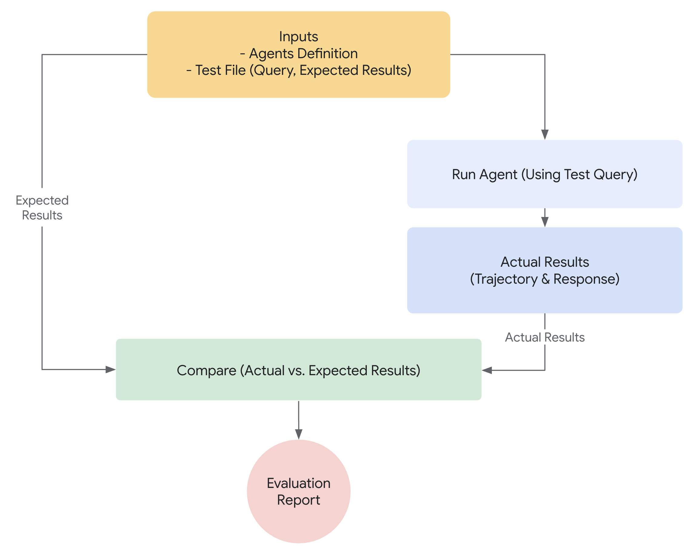
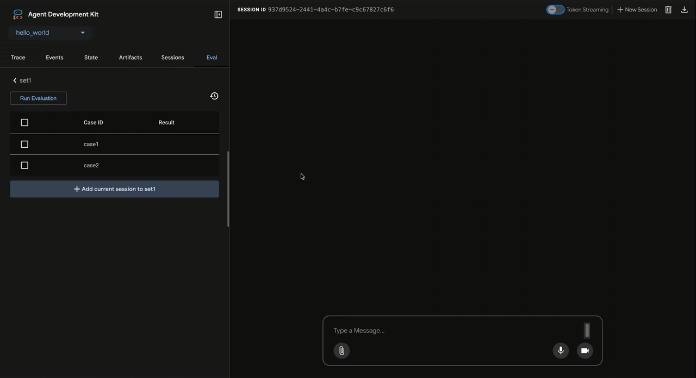
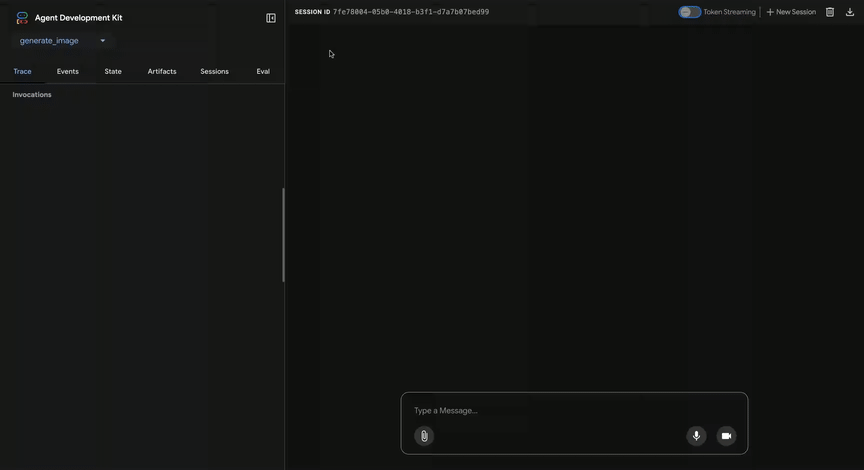
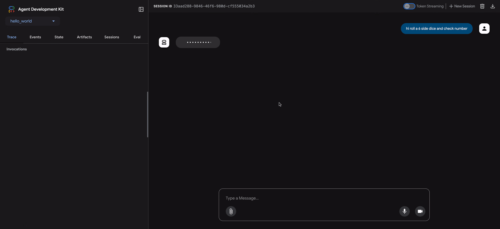
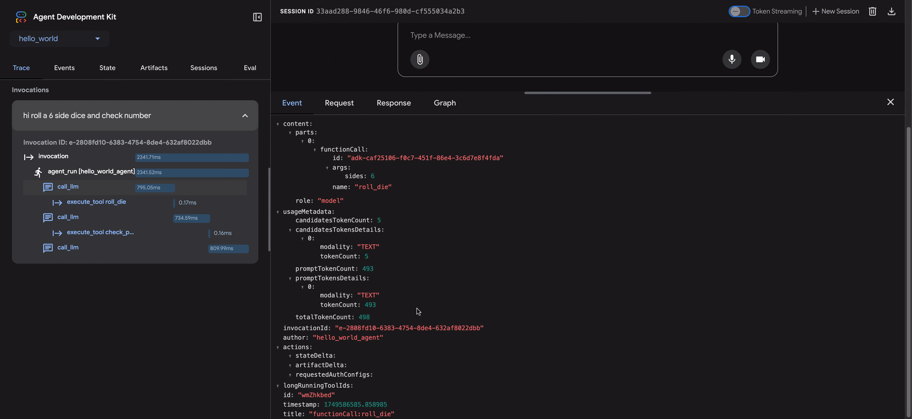

 [ Python](https://github.com/google/adk-python "adk-python on GitHub")[ JS ](https://github.com/google/adk-js "adk-js on GitHub")[ Go ](https://github.com/google/adk-go "adk-go on GitHub")[ Java ](https://github.com/google/adk-java "adk-java on GitHub")[ Kotlin](https://github.com/google/adk-kotlin "adk-kotlin on GitHub")

-   [Home](..)
-    Build Agents
    
    Build Agents
    
    -   [Get Started](../get-started/)
        
        Get Started
        
        -   [Python](../get-started/python/)
        -   [TypeScript](../get-started/typescript/)
        -   [Go](../get-started/go/)
        -   [Java](../get-started/java/)
        -   [Kotlin](../get-started/kotlin/)
        -   [Agents CLI](../get-started/agents-cli/)
        -   [Installation](../get-started/installation/)
        -   [Google Cloud](../get-started/google-cloud/)
        -   [Migrate to ADK](../get-started/migrate/)
        
    -   [Build your Agent](../tutorials/)
        
        Build your Agent
        
        -   [Multi-tool agent](../tutorials/multi-tool-agent/)
        -   [Agent team](../tutorials/agent-team/)
        -   [Code with AI](../tutorials/coding-with-ai/)
        -   [Agent Config](../agents/config/)
        
    -   [Agents](../agents/)
        
        Agents
        
        -   [Simple agents](../agents/llm-agents/)
        -   [Managed agents](../agents/managed-agents/)
        
    -   [Graph Workflows](../graphs/)
        
        Graph Workflows
        
        -   [Graph routes](../graphs/routes/)
        -   [Data handling](../graphs/data-handling/)
        -   [Human input](../graphs/human-input/)
        -   [Dynamic workflows](../graphs/dynamic/)
        
    -   [Multi-Agent Workflows](../workflows/)
        
        Multi-Agent Workflows
        
        -   [Collaborative workflows](../workflows/collaboration/)
        -   [Template workflows](../agents/workflow-agents/)
            
            Template workflows
            
            -   [Sequential workflow](../agents/workflow-agents/sequential-agents/)
            -   [Loop workflow](../agents/workflow-agents/loop-agents/)
            -   [Parallel workflow](../agents/workflow-agents/parallel-agents/)
            -   [Custom template workflows](../agents/custom-agents/)
            
        -   [Agent routing](../agents/routing/)
        -   [Workflow patterns](../workflows/patterns/)
        
    -   [Models for Agents](../agents/models/)
        
        Models for Agents
        
        -   [Gemini](../agents/models/google-gemini/)
            
            Gemini
            
            -   [Deferred scheduling](../agents/models/google-gemini/deferred-schedule/)
            
        -   [Gemma](../agents/models/google-gemma/)
        -   [Claude](../agents/models/anthropic/)
        -   [Agent Platform hosted](../agents/models/agent-platform/)
        -   [Apigee AI Gateway](../agents/models/apigee/)
        -   [Model routing](../agents/models/routing/)
        -   [OpenAI](../agents/models/openai/)
        -   [Ollama](../agents/models/ollama/)
        -   [vLLM](../agents/models/vllm/)
        -   [LiteLLM](../agents/models/litellm/)
        -   [LiteRT-LM](../agents/models/litert-lm/)
        
    
-    Run Agents
    
    Run Agents
    
    -   [Agent Runtime](../runtime/)
        
        Agent Runtime
        
        -   [Web Interface](../runtime/web-interface/)
            
            Web Interface
            
            -   [Visual Builder](../visual-builder/)
            
        -   [Command Line](../runtime/command-line/)
        -   [API Server](../runtime/api-server/)
        -   [Ambient Agents](../runtime/ambient-agents/)
        -   [Resume Agents](../runtime/resume/)
        -   [Cancel Agent Runs](../runtime/cancel/)
        -   [Runtime Config](../runtime/runconfig/)
        -   [Event Loop](../runtime/event-loop/)
        
    -   [Deployment](../deploy/)
        
        Deployment
        
        -   [Agent Runtime](../deploy/agent-runtime/)
            
            Agent Runtime
            
            -   [Standard deployment](../deploy/agent-runtime/deploy/)
            -   [agents-cli](../deploy/agent-runtime/agents-cli/)
            -   [Test deployed agents](../deploy/agent-runtime/test/)
            
        -   [Cloud Run](../deploy/cloud-run/)
        -   [GKE](../deploy/gke/)
        
    -   [Observability](../observability/)
        
        Observability
        
        -   [Logging](../observability/logging/)
        -   [Metrics](../observability/metrics/)
        -   [Traces](../observability/traces/)
        
    -   [Evaluation](./)
        
        Evaluation
        
        -   [Criteria](criteria/)
        -   [User Simulation](user-sim/)
        -   [Environment Simulation](environment_simulation/)
        -   [Custom Metrics](custom_metrics/)
        -   [Optimization](../optimize/)
        
    -   [Safety and Security](../safety/)
        
        Safety and Security
        
    
-    Components
    
    Components
    
    -   [Technical Overview](../get-started/about/)
    -   [Custom Tools](../tools-custom/)
        
        Custom Tools
        
        -    Function tools
            
            Function tools
            
            -   [Overview](../tools-custom/function-tools/)
            -   [Tool performance](../tools-custom/performance/)
            -   [Action confirmations](../tools-custom/confirmation/)
            
        -   [MCP tools](../tools-custom/mcp-tools/)
            
            MCP tools
            
            -   [Advanced configuration](../tools-custom/mcp-tools/advanced/)
            -   [Deployment](../tools-custom/mcp-tools/deployment/)
            -   [Agent as MCP server](../tools-custom/mcp-tools/agent-as-server/)
            -   [Sub-agent delegation](../tools-custom/mcp-tools/agent-managed/)
            
        -   [OpenAPI tools](../tools-custom/openapi-tools/)
        -   [Authentication](../tools-custom/authentication/)
        -   [Tool limitations](../tools/limitations/)
        
    -   [Artifacts](../artifacts/)
        
        Artifacts
        
    -   [Skills for Agents](../skills/)
        
        Skills for Agents
        
    -   [App management](../apps/)
        
        App management
        
        -   [Callbacks](../callbacks/)
            
            Callbacks
            
            -   [Types of callbacks](../callbacks/types-of-callbacks/)
            -   [Callback patterns](../callbacks/design-patterns-and-best-practices/)
            
        -   [Plugins](../plugins/)
        
    -   [Agent context](../context/)
        
        Agent context
        
        -   [Conversational context](../sessions/)
        -   [Sessions](../sessions/session/)
            
            Sessions
            
            -   [Rewind sessions](../sessions/session/rewind/)
            -   [Migrate sessions](../sessions/session/migrate/)
            
        -   [State](../sessions/state/)
        -   [Events](../events/)
        -   [Memory](../sessions/memory/)
        -   [Context compression](../context/compaction/)
        -   [Model context caching](../context/caching/)
        
    -   [A2A Protocol](../a2a/)
        
        A2A Protocol
        
        -   [Introduction to A2A](../a2a/intro/)
        -    A2A Quickstart (Exposing)
            
            A2A Quickstart (Exposing)
            
            -   [Python](../a2a/quickstart-exposing/)
            -   [Go](../a2a/quickstart-exposing-go/)
            -   [Java](../a2a/quickstart-exposing-java/)
            
        -    A2A Quickstart (Consuming)
            
            A2A Quickstart (Consuming)
            
            -   [Python](../a2a/quickstart-consuming/)
            -   [Go](../a2a/quickstart-consuming-go/)
            -   [Java](../a2a/quickstart-consuming-java/)
            -   [Kotlin](../a2a/quickstart-consuming-kotlin/)
            
        -   [A2A Extension](../a2a/a2a-extension/)
        
    -   [Live and Voice Agents](../live/)
        
        Live and Voice Agents
        
        -   [Get started](../live/get-started/)
            
            Get started
            
            -   [Python](../live/get-started/streaming-python/)
            -   [Java](../live/get-started/streaming-java/)
            
        -    Building
            
            Building
            
            -   [Workflows](../live/workflows/)
            -   [Tools](../live/tools/)
            -   [Sessions](../live/sessions/)
            -   [Events](../live/events/)
            -   [Audio and video](../live/audio-video/)
            -   [Configuration](../live/configuration/)
            
        -    Production
            
            Production
            
            -   [Guardrails](../live/guardrails/)
            -   [Evaluation](../live/evaluation/)
            -   [Build a custom server](../live/custom-server/)
            
        -   [Supported models](../live/models/)
        
    -   [Grounding](../grounding/)
        
        Grounding
        
        -   [Google Search Grounding](../grounding/google_search_grounding/)
        -   [Grounding with Search](../grounding/grounding_with_search/)
        
    
-   [Integrations](../integrations/)
    
    Integrations
    
-    Reference
    
    Reference
    
    -   [API Reference](../api-reference/)
        
        API Reference
        
        -   [Python ADK](../api-reference/python/)
        -   [TypeScript ADK](../api-reference/typescript/)
        -    Go ADK
            
            Go ADK
            
            -   [Go v2.x](https://pkg.go.dev/google.golang.org/adk/v2)
            -   [Go v1.x](https://pkg.go.dev/google.golang.org/adk)
            
        -   [Java ADK](../api-reference/java/)
        -   [Kotlin ADK](../api-reference/kotlin/)
        -   [CLI Reference](../api-reference/cli/)
        -   [Agent Config Reference](../api-reference/agentconfig/)
        -   [REST API](../api-reference/rest/)
        
    -   [Release Notes](../release-notes/)
    
-   [Community](../community/)
    
    Community
    
    -   [Contributing Guide](../community/contributing-guide/)
    
-   [ADK 2.0](../2.0/)
    
    ADK 2.0
    

Table of contents

-   [Prepare for agent evaluations](#prepare-for-agent-evaluations)
-   [What to evaluate?](#what-to-evaluate)
    
    -   [Evaluate trajectory and tool use](#evaluate-trajectory-and-tool-use)
    
-   [How evaluation works with ADK](#how-evaluation-works-with-adk)
    
    -   [Evaluate with test files](#evaluate-with-test-files)
        
        -   [How to migrate test files not backed by the Pydantic schema?](#how-to-migrate-test-files-not-backed-by-the-pydantic-schema)
        
    -   [Evaluate with an Evalset File](#evaluate-with-an-evalset-file)
        
        -   [How to migrate eval set files not backed by the Pydantic schema?](#how-to-migrate-eval-set-files-not-backed-by-the-pydantic-schema)
        
    -   [Evaluate with conformance testing](#evaluate-with-conformance-testing)
        
        -   [Prerequisites and setup](#prerequisites-and-setup)
            
            -   [Create the Test Directory Hierarchy](#create-the-test-directory-hierarchy)
            -   [Define the test specification (spec.yaml)](#define-the-test-specification-specyaml)
            
        -   [Automate the baseline](#automate-the-baseline)
        -   [How it works](#how-it-works)
        
    -   [Evaluation criteria](#evaluation-criteria)
        
        -   [Recommendations on criteria](#recommendations-on-criteria)
        
    -   [User simulation](#user-simulation)
    
-   [How to run evaluation with ADK](#how-to-run-evaluation-with-adk)
    
    -   [Run evaluations via the web UI](#run-evaluations-via-the-web-ui)
        
        -   [Step 1: Create and save a test case](#step-1-create-and-save-a-test-case)
        -   [Step 2: View and edit your test case](#step-2-view-and-edit-your-test-case)
        -   [Step 3: Run the evaluation with custom metrics](#step-3-run-the-evaluation-with-custom-metrics)
        -   [Step 4: Analyze results](#step-4-analyze-results)
        
    -   [Debugging with the Trace View](#debugging-with-the-trace-view)
    -   [Run tests programmatically](#run-tests-programmatically)
        
        -   [Example command](#example-command)
        -   [Example test code](#example-test-code)
        
    -   [Run evaluations via the CLI](#run-evaluations-via-the-cli)
    -   [Run conformance tests](#run-conformance-tests)
        
        -   [Run all tests](#run-all-tests)
        -   [Run specific test groups or individual cases](#run-specific-test-groups-or-individual-cases)
        -   [Generate Markdown test reports](#generate-markdown-test-reports)
        -   [Automate with CI/CD](#automate-with-cicd)
        
    

1.  [Home](..)
2.  [Run Agents](../runtime/)
3.  [Evaluation](./)

# Why evaluate agents[¶](#why-evaluate-agents "Permanent link")

Supported in ADKPython

In traditional software development, unit tests and integration tests provide confidence that code functions as expected and remains stable through changes. These tests provide a clear "pass/fail" signal, guiding further development. However, LLM agents introduce a level of variability that makes traditional testing approaches insufficient.

Due to the probabilistic nature of models, deterministic "pass/fail" assertions are often unsuitable for evaluating agent performance. Instead, we need qualitative evaluations of both the final output and the agent's trajectory - the sequence of steps taken to reach the solution. This involves assessing the quality of the agent's decisions, its reasoning process, and the final result.

This may seem like a lot of extra work to set up, but the investment of automating evaluations pays off quickly. If you intend to progress beyond prototype, this is a highly recommended best practice.

## Prepare for agent evaluations[¶](#prepare-for-agent-evaluations "Permanent link")

Before automating agent evaluations, define clear objectives and success criteria:

-   **Define Success:** What constitutes a successful outcome for your agent?
-   **Identify Critical Tasks:** What are the essential tasks your agent must accomplish?
-   **Choose Relevant Metrics:** What metrics will you track to measure performance?

These considerations will guide the creation of evaluation scenarios and enable effective monitoring of agent behavior in real-world deployments.

## What to evaluate?[¶](#what-to-evaluate "Permanent link")

To bridge the gap between a proof-of-concept and a production-ready AI agent, a robust and automated evaluation framework is essential. Unlike evaluating generative models, where the focus is primarily on the final output, agent evaluation requires a deeper understanding of the decision-making process. Agent evaluation can be broken down into two components:

1.  **Evaluate Trajectory and Tool Use:** Analyzing the steps an agent takes to reach a solution, including its choice of tools, strategies, and the efficiency of its approach.
2.  **Evaluate the Final Response:** Assessing the quality, relevance, and correctness of the agent's final output.

The trajectory is just a list of steps the agent took before it returned to the user. We can compare that against the list of steps we expect the agent to have taken.

### Evaluate trajectory and tool use[¶](#evaluate-trajectory-and-tool-use "Permanent link")

Before responding to a user, an agent typically performs a series of actions, which we refer to as a 'trajectory.' It might compare the user input with session history to disambiguate a term, or lookup a policy document, search a knowledge base or invoke an API to save a ticket. We call this a ‘trajectory’ of actions. Evaluating an agent's performance requires comparing its actual trajectory to an expected, or ideal, one. This comparison can reveal errors and inefficiencies in the agent's process. The expected trajectory represents the ground truth -- the list of steps we anticipate the agent should take.

For example:

`# Trajectory evaluation will compare expected_steps = ["determine_intent", "use_tool", "review_results", "report_generation"] actual_steps = ["determine_intent", "use_tool", "review_results", "report_generation"]`

ADK provides both groundtruth based and rubric based tool use evaluation metrics. To select the appropriate metric for your agent's specific requirements and goals, please refer to our [recommendations](#recommendations-on-criteria).

## How evaluation works with ADK[¶](#how-evaluation-works-with-adk "Permanent link")

ADK offers two methods for evaluating agent performance against predefined datasets and evaluation criteria. While conceptually similar, they differ in the amount of data they can process, which typically dictates the appropriate use case for each.

### Evaluate with test files[¶](#evaluate-with-test-files "Permanent link")

This approach involves creating individual test files, each representing a single, simple agent-model interaction (a session). It's most effective during active agent development, serving as a form of unit testing. These tests are designed for rapid execution and should focus on simple session complexity. Each test file contains a single session, which may consist of multiple turns. A turn represents a single interaction between the user and the agent. Each turn includes

-   `User Content`: The user issued query.
-   `Expected Intermediate Tool Use Trajectory`: The tool calls we expect the agent to make in order to respond correctly to the user query.
-   `Expected Intermediate Agent Responses`: These are the natural language responses that the agent (or sub-agents) generates as it moves towards generating a final answer. These natural language responses are usually an artifact of an multi-agent system, where your root agent depends on sub-agents to achieve a goal. These intermediate responses, may or may not be of interest to the end user, but for a developer/owner of the system, are of critical importance, as they give you the confidence that the agent went through the right path to generate final response.
-   `Final Response`: The expected final response from the agent.

You can give the file any name for example `evaluation.test.json`. The framework only checks for the `.test.json` suffix, and the preceding part of the filename is not constrained. The test files are backed by a formal Pydantic data model. The two key schema files are [Eval Set](https://github.com/google/adk-python/blob/main/src/google/adk/evaluation/eval_set.py) and [Eval Case](https://github.com/google/adk-python/blob/main/src/google/adk/evaluation/eval_case.py). Here is a test file with a few examples:

Note

Comments are included for explanatory purposes and should be removed for the JSON to be valid.

``# Do note that some fields are removed for sake of making this doc readable. {     "eval_set_id": "home_automation_agent_light_on_off_set",    "name": "",    "description": "This is an eval set that is used for unit testing `x` behavior of the Agent",    "eval_cases": [        {            "eval_id": "eval_case_id",            "conversation": [                {                    "invocation_id": "b7982664-0ab6-47cc-ab13-326656afdf75", # Unique identifier for the invocation.                    "user_content": { # Content provided by the user in this invocation. This is the query.                        "parts": [                            {                                "text": "Turn off device_2 in the Bedroom."                            }                        ],                        "role": "user"                    },                    "final_response": { # Final response from the agent that acts as a reference of benchmark.                        "parts": [                            {                                "text": "I have set the device_2 status to off."                            }                        ],                        "role": "model"                    },                    "intermediate_data": {                        "tool_uses": [ # Tool use trajectory in chronological order.                            {                                "args": {                                    "location": "Bedroom",                                    "device_id": "device_2",                                    "status": "OFF"                                },                                "name": "set_device_info"                            }                        ],                        "intermediate_responses": [] # Any intermediate sub-agent responses.                    }                }            ],            "session_input": { # Initial session input.                "app_name": "home_automation_agent",                "user_id": "test_user",                "state": {}            }        }    ] }``

Test files can be organized into folders. Optionally, a folder can also include a `test_config.json` file that specifies the evaluation criteria.

#### How to migrate test files not backed by the Pydantic schema?[¶](#how-to-migrate-test-files-not-backed-by-the-pydantic-schema "Permanent link")

Note

If your test files don't adhere to [EvalSet](https://github.com/google/adk-python/blob/main/src/google/adk/evaluation/eval_set.py) schema file, then this section is relevant to you.

Please use `AgentEvaluator.migrate_eval_data_to_new_schema` to migrate your existing `*.test.json` files to the Pydantic backed schema.

The utility takes your current test data file and an optional initial session file, and generates a single output json file with data serialized in the new format. Given that the new schema is more cohesive, both the old test data file and initial session file can be ignored (or removed.)

### Evaluate with an Evalset File[¶](#evaluate-with-an-evalset-file "Permanent link")

The evalset approach utilizes a dedicated dataset called an "evalset" for evaluating agent-model interactions. Similar to a test file, the evalset contains example interactions. However, an evalset can contain multiple, potentially lengthy sessions, making it ideal for simulating complex, multi-turn conversations. Due to its ability to represent complex sessions, the evalset is well-suited for integration tests. These tests are typically run less frequently than unit tests due to their more extensive nature.

An evalset file contains multiple "evals," each representing a distinct session. Each eval consists of one or more "turns," which include the user query, expected tool use, expected intermediate agent responses, and a reference response. These fields have the same meaning as they do in the test file approach. Alternatively, an eval can define a *conversation scenario* which is used to [dynamically simulate](user-sim/) a user interaction with the agent. Each eval is identified by a unique name. Furthermore, each eval includes an associated initial session state.

Creating evalsets manually can be complex, therefore UI tools are provided to help capture relevant sessions and easily convert them into evals within your evalset. Learn more about using the web UI for evaluation below. Here is an example evalset containing two sessions. The eval set files are backed by a formal Pydantic data model. The two key schema files are [Eval Set](https://github.com/google/adk-python/blob/main/src/google/adk/evaluation/eval_set.py) and [Eval Case](https://github.com/google/adk-python/blob/main/src/google/adk/evaluation/eval_case.py).

Note

Comments are included for explanatory purposes and should be removed for the JSON to be valid.

`# Do note that some fields are removed for sake of making this doc readable. {     "eval_set_id": "eval_set_example_with_multiple_sessions",    "name": "Eval set with multiple sessions",    "description": "This eval set is an example that shows that an eval set can have more than one session.",    "eval_cases": [        {            "eval_id": "session_01",            "conversation": [                {                    "invocation_id": "e-0067f6c4-ac27-4f24-81d7-3ab994c28768",                    "user_content": {                        "parts": [                            {                                "text": "What can you do?"                            }                        ],                        "role": "user"                    },                    "final_response": {                        "parts": [                            {                                 "text": "I can roll dice of different sizes and check if numbers are prime."                            }                        ],                        "role": null                    },                    "intermediate_data": {                        "tool_uses": [],                        "intermediate_responses": []                    }                }            ],            "session_input": {                "app_name": "hello_world",                "user_id": "user",                "state": {}            }        },        {            "eval_id": "session_02",            "conversation": [                {                    "invocation_id": "e-92d34c6d-0a1b-452a-ba90-33af2838647a",                    "user_content": {                        "parts": [                            {                                "text": "Roll a 19 sided dice"                            }                        ],                        "role": "user"                    },                    "final_response": {                        "parts": [                            {                                "text": "I rolled a 17."                            }                        ],                        "role": null                    },                    "intermediate_data": {                        "tool_uses": [],                        "intermediate_responses": []                    }                },                {                    "invocation_id": "e-bf8549a1-2a61-4ecc-a4ee-4efbbf25a8ea",                    "user_content": {                        "parts": [                            {                                "text": "Roll a 10 sided dice twice and then check if 9 is a prime or not"                            }                        ],                        "role": "user"                    },                    "final_response": {                        "parts": [                            {                                "text": "I got 4 and 7 from the dice roll, and 9 is not a prime number.\n"                            }                        ],                        "role": null                    },                    "intermediate_data": {                        "tool_uses": [                            {                                "id": "adk-1a3f5a01-1782-4530-949f-07cf53fc6f05",                                "args": {                                    "sides": 10                                },                                "name": "roll_die"                            },                            {                                "id": "adk-52fc3269-caaf-41c3-833d-511e454c7058",                                "args": {                                    "sides": 10                                },                                "name": "roll_die"                            },                            {                                "id": "adk-5274768e-9ec5-4915-b6cf-f5d7f0387056",                                "args": {                                    "nums": [                                        9                                    ]                                },                                "name": "check_prime"                            }                        ],                        "intermediate_responses": [                            [                                "data_processing_agent",                                [                                    {                                        "text": "I have rolled a 10 sided die twice. The first roll is 5 and the second roll is 3.\n"                                    }                                ]                            ]                        ]                    }                }            ],            "session_input": {                "app_name": "hello_world",                "user_id": "user",                "state": {}            }        }    ] }`

#### How to migrate eval set files not backed by the Pydantic schema?[¶](#how-to-migrate-eval-set-files-not-backed-by-the-pydantic-schema "Permanent link")

Note

If your eval set files don't adhere to [EvalSet](https://github.com/google/adk-python/blob/main/src/google/adk/evaluation/eval_set.py) schema file, then this section is relevant to you.

Based on who is maintaining the eval set data, there are two routes:

1.  **Eval set data maintained by ADK UI** If you use ADK UI to maintain your Eval set data then *no action is needed* from you.
    
2.  **Eval set data is developed and maintained manually and used in ADK eval CLI** A migration tool is in the works, until then the ADK eval CLI command will continue to support data in the old format.
    

### Evaluate with conformance testing[¶](#evaluate-with-conformance-testing "Permanent link")

`adk conformance test` command verifies that your AI agents behave consistently over time. It ensures that updates to your codebase or models don't introduce regressions by validating current agent outputs against baseline data.

#### Prerequisites and setup[¶](#prerequisites-and-setup "Permanent link")

Before the `adk conformance` command can execute meaningful regression testing, you must establish an optimal "golden baseline." Conformance testing operates by comparing live agent behavior against these previously recorded, verified interactions.

Follow this workflow to prepare your environment:

##### Create the Test Directory Hierarchy[¶](#create-the-test-directory-hierarchy "Permanent link")

Conformance tests rely on a strict file layout to automatically discover and map test cases. Initialize your testing directory using the following structure:

`tests └── category_name/         └── test_case_name/                ├── spec.yaml                  # Test case specification                ├── generated-recordings.yaml   # Baseline recorded interactions                └── generated-session.yaml      # Baseline session data`

Note

If your agent uses Server-Sent Events (SSE), the testing framework will additionally look for `generated-recordings-sse.yaml` and `generated-session-sse.yaml` within the same folder.

##### Define the test specification (spec.yaml)[¶](#define-the-test-specification-specyaml "Permanent link")

In your target test folder, create a `spec.yaml` file. This file outlines the initial conditions, configurations, and user prompts that the agent will execute during the baseline recording and subsequent conformance runs. Ensure your file matches the following basic schema, this is an example only:

`# Example spec.yaml for a Weather Agent. # The test case name and category are inferred from the folder structure. description: "Verifies the agent correctly identifies location and calls the weather tool." agent: "weather_agent" user_messages:     - text: "What's the temperature in San Francisco right now?"`

#### Automate the baseline[¶](#automate-the-baseline "Permanent link")

Because the background data (like LLM requests and tool calls) is complex, you shouldn't try to write or save the baseline files manually. Instead, let ADK generate them for you.

1.  Start your ADK web server with the recording plugin turned on:

`adk web -v --extra_plugins=google.adk.cli.plugins.recordings_plugin.RecordingsPlugin /path/to/agents`

1.  Next, open a new terminal window and tell ADK to create the baseline files based on your spec.yaml:

`adk conformance record tests/category/test_name none`

The trailing streaming-mode argument is required. Use `none` to record `generated-recordings.yaml` and `generated-session.yaml`, or `sse` to record `generated-recordings-sse.yaml` and `generated-session-sse.yaml` instead. The `bidi` mode is not supported for recording.

This automatically runs the scenario, records all the interactions, and saves the generated-recordings.yaml and generated-session.yaml files exactly where they need to be.

Once these baseline files are locked in, your setup is complete, and the directory is ready to be targeted by `adk conformance` in either **Replay** or **Live** mode.

#### How it works[¶](#how-it-works "Permanent link")

-   **Replay Mode (Default):** The tool runs your agent and compares its live LLM requests, responses, and tool calls directly against your previously recorded interactions to catch unexpected deviations.
-   **Live Mode:** Runs evaluation-based verification against active environments *(Note: This mode is a work in progress)*.

### Evaluation criteria[¶](#evaluation-criteria "Permanent link")

ADK provides several built-in criteria for evaluating agent performance, ranging from tool trajectory matching to LLM-based response quality assessment. For a detailed list of available criteria and guidance on when to use them, please see [Evaluation Criteria](criteria/).

Here is a summary of all the available criteria:

-   **tool\_trajectory\_avg\_score**: Exact match of tool call trajectory.
-   **response\_match\_score**: ROUGE-1 similarity to reference response.
-   **final\_response\_match\_v2**: LLM-judged semantic match to a reference response.
-   **rubric\_based\_final\_response\_quality\_v1**: LLM-judged final response quality based on custom rubrics.
-   **rubric\_based\_tool\_use\_quality\_v1**: LLM-judged tool usage quality based on custom rubrics.
-   **rubric\_based\_multi\_turn\_trajectory\_quality\_v1**: LLM-judged multi-turn trajectory quality based on custom rubrics.
-   **hallucinations\_v1**: LLM-judged groundedness of agent response against context.
-   **safety\_v1**: Safety/harmlessness of agent response.
-   **per\_turn\_user\_simulator\_quality\_v1**: LLM-judged user simulator quality.
-   **multi\_turn\_task\_success\_v1**: Evaluates if agent achieves goal(s) of conversation.
-   **multi\_turn\_trajectory\_quality\_v1**: Evaluates the overall trajectory of the conversation.
-   **multi\_turn\_tool\_use\_quality\_v1**: Evaluates function calls made during a conversation.

The following are *efficiency* criteria. They report a value but never pass or fail an eval case, and they are reported for every eval without being listed in `EvalConfig`:

-   **tool\_call\_count\_v1**: Number of tool calls made.
-   **inference\_call\_count\_v1**: Number of model calls made.
-   **token\_usage\_v1**: Tokens consumed, with a per-type breakdown reported alongside the total.
-   **invocation\_duration\_v1**: Wall-clock seconds the turn took, measured while the agent ran.

Note

Some criteria (such as response quality, safety, and multi-turn quality) require the [Vertex Gen AI Evaluation Service API](https://cloud.google.com/vertex-ai/generative-ai/docs/model-reference/evaluation). To use them, authenticate by setting a `GOOGLE_API_KEY` environment variable, or by using Google Cloud project credentials (`GOOGLE_CLOUD_PROJECT` and `GOOGLE_CLOUD_LOCATION` with Application Default Credentials).

If no evaluation criteria are provided, the following default configuration is used:

-   `tool_trajectory_avg_score`: Defaults to 1.0, requiring a 100% match in the tool usage trajectory.
-   `response_match_score`: Defaults to 0.8, allowing for a small margin of error in the agent's natural language responses.

Here is an example of a `test_config.json` file specifying custom evaluation criteria:

`{     "criteria": {        "tool_trajectory_avg_score": 1.0,        "response_match_score": 0.8    } }`

#### Recommendations on criteria[¶](#recommendations-on-criteria "Permanent link")

Choose criteria based on your evaluation goals:

-   **Enable tests in CI/CD pipelines or regression testing:** Use `tool_trajectory_avg_score` and `response_match_score`. These criteria are fast, predictable, and suitable for frequent automated checks.
-   **Evaluate trusted reference responses:** Use `final_response_match_v2` to evaluate semantic equivalence. This LLM-based check is more flexible than exact matching and better captures whether the agent's response means the same thing as the reference response.
-   **Evaluate response quality without a reference response:** Use `rubric_based_final_response_quality_v1`. This is useful when you don't have a trusted reference, but you can define attributes of a good response (e.g., "The response is concise," "The response has a helpful tone").
-   **Evaluate the correctness of tool usage:** Use `rubric_based_tool_use_quality_v1`. This allows you to validate the agent's reasoning process by checking, for example, that a specific tool was called or that tools were called in the correct order (e.g., "Tool A must be called before Tool B").
-   **Check if responses are grounded in context:** Use `hallucinations_v1` to detect if the agent makes claims that are unsupported by or contradictory to the information available to it (e.g., tool outputs).
-   **Check for harmful content:** Use `safety_v1` to ensure that agent responses are safe and do not violate safety policies.
-   **Evaluate multi-turn goal completion:** Use `multi_turn_task_success_v1` to measure the overall success of a multi-turn conversation in achieving its intended objectives.
-   **Evaluate overall conversation trajectory:** Use `multi_turn_trajectory_quality_v1` to assess the efficiency, effectiveness, and logic of the steps taken during the conversation.
-   **Evaluate tool usage in multi-turn workflows:** Use `multi_turn_tool_use_quality_v1` to assess the quality, relevance, and correctness of tool or function calls made across multiple turns.
-   **Track how expensive an agent is:** The efficiency criteria (`tool_call_count_v1`, `inference_call_count_v1`, `token_usage_v1`, `invocation_duration_v1`) are reported automatically, with no configuration and no extra model calls. Compare them across runs to catch a change that keeps quality flat but doubles token usage. They never fail an eval, so they add no new failure mode to a CI/CD run.

In addition, criteria which require information on expected agent tool use and/or responses are not supported in combination with [User Simulation](user-sim/). The affected criteria include `tool_trajectory_avg_score`, `response_match_score` and `final_response_match_v2`. Support for user simulation is listed per criterion in the support column of [Evaluation Criteria](criteria/).

### User simulation[¶](#user-simulation "Permanent link")

When evaluating conversational agents, it is not always practical to use a fixed set of user prompts, as the conversation can proceed in unexpected ways. For example, if the agent needs the user to supply two values to perform a task, it may ask for those values one at a time or both at once. To resolve this issue, ADK allows you test the behavior of the agent in a specific *conversation scenario* with user prompts that are dynamically generated by an AI model. For details on how to set up an eval with user simulation, see [User Simulation](user-sim/).

## How to run evaluation with ADK[¶](#how-to-run-evaluation-with-adk "Permanent link")

As a developer, you can evaluate your agents using the ADK in the following ways:

-   **Web-based UI (**`adk web`**):** Evaluate agents interactively through a web-based interface.
-   **Programmatically (**`pytest`**)**: Integrate evaluation into your testing pipeline using `pytest` and test files.
-   **Command Line Interface (**`adk eval`**):** Run evaluations on an existing evaluation set file directly from the command line.
-   **Conformance Testing** (**`adk conformance`**):\*\* Execute automated tests against your baseline files to detect unexpected deviations or regressions.

### Run evaluations via the web UI[¶](#run-evaluations-via-the-web-ui "Permanent link")

The web UI provides an interactive way to evaluate agents, generate evaluation datasets, and inspect agent behavior in detail.

#### Step 1: Create and save a test case[¶](#step-1-create-and-save-a-test-case "Permanent link")

1.  Start the web server by running: `adk web <path_to_your_agents_folder>`
2.  In the web interface, select an agent and interact with it to create a session.
3.  Navigate to the **Eval** tab on the right side of the interface.
4.  Create a new eval set or select an existing one.
5.  Click **"Add current session"** to save the conversation as a new evaluation case.

#### Step 2: View and edit your test case[¶](#step-2-view-and-edit-your-test-case "Permanent link")

Once a case is saved, you can click its ID in the list to inspect it. To make changes, click the **Edit current eval case** icon (pencil). This interactive view allows you to:

-   **Modify** agent text responses to refine test scenarios.
-   **Delete** individual agent messages from the conversation.
-   **Delete** the entire evaluation case if it's no longer needed.

#### Step 3: Run the evaluation with custom metrics[¶](#step-3-run-the-evaluation-with-custom-metrics "Permanent link")

1.  Select one or more test cases from your evalset.
2.  Click **Run Evaluation**. An **EVALUATION METRIC** dialog will appear.
3.  In the dialog, use the sliders to configure the thresholds for:
    -   **Tool trajectory avg score**
    -   **Response match score**
4.  Click **Start** to run the evaluation using your custom criteria. The evaluation history will record the metrics used for each run.

#### Step 4: Analyze results[¶](#step-4-analyze-results "Permanent link")

After the run completes, you can analyze the results:

-   **Analyze Run Failures**: Click on any **Pass** or **Fail** result. For failures, you can hover over the `Fail` label to see a side-by-side comparison of the **Actual vs. Expected Output** and the scores that caused the failure.

### Debugging with the Trace View[¶](#debugging-with-the-trace-view "Permanent link")

ADK web UI includes a powerful **Trace** tab for debugging agent behavior. This feature is available for any agent session, not just during evaluation.

The **Trace** tab provides a detailed and interactive way to inspect your agent's execution flow. Traces are automatically grouped by user message, making it easy to follow the chain of events.

Each trace row is interactive:

-   **Hovering** over a trace row highlights the corresponding message in the chat window.
-   **Clicking** on a trace row opens a detailed inspection panel with four tabs:
    -   **Event**: The raw event data.
    -   **Request**: The request sent to the model.
    -   **Response**: The response received from the model.
    -   **Graph**: A visual representation of the tool calls and agent logic flow.

 

Blue rows in the trace view indicate that an event was generated from that interaction. Clicking on these blue rows will open the bottom event detail panel, providing deeper insights into the agent's execution flow.

### Run tests programmatically[¶](#run-tests-programmatically "Permanent link")

You can also use **`pytest`** to run test files as part of your integration tests.

#### Example command[¶](#example-command "Permanent link")

`pytest tests/integration/`

#### Example test code[¶](#example-test-code "Permanent link")

Here is an example of a `pytest` test case that runs a single test file:

`from google.adk.evaluation.agent_evaluator import AgentEvaluator import pytest @pytest.mark.asyncio async def test_with_single_test_file():         """Test the agent's basic ability via a session file."""        await AgentEvaluator.evaluate(                agent_module="home_automation_agent",                eval_dataset_file_path_or_dir="tests/integration/fixture/home_automation_agent/simple_test.test.json",        )`

This approach allows you to integrate agent evaluations into your CI/CD pipelines or larger test suites. If you want to specify the initial session state for your tests, you can do that by storing the session details in a file and passing that to `AgentEvaluator.evaluate` method.

### Run evaluations via the CLI[¶](#run-evaluations-via-the-cli "Permanent link")

You can also run evaluation of an eval set file through the command line interface (CLI). This runs the same evaluation that runs on the UI, but it helps with automation, i.e. you can add this command as a part of your regular build generation and verification process.

Here is the command:

`adk eval \         <AGENT_MODULE_FILE_PATH> \        <EVAL_SET_FILE_PATH_OR_ID>... \        [--config_file_path=<PATH_TO_TEST_JSON_CONFIG_FILE>] \        [--print_detailed_results]`

For example:

`adk eval \         samples_for_testing/hello_world \        samples_for_testing/hello_world/hello_world_eval_set_001.evalset.json`

Here are the details for each command line argument:

-   `AGENT_MODULE_FILE_PATH`: The path to the agent directory, not a file, whose `__init__.py` exposes a module by the name "agent". "agent" module contains a `root_agent`.
-   `EVAL_SET_FILE_PATH_OR_ID`: The path to evaluations file(s), or the id of an eval set managed by ADK and created with `adk eval_set create`. You can specify one or more of either, but you cannot mix file paths and eval set ids in the same command. For each eval set, all evals run by default. If you want to run only specific evals from a eval set, first create a comma separated list of eval names and then add that as a suffix to the eval set file name or id, demarcated by a colon `:` .
-   For example: `sample_eval_set_file.json:eval_1,eval_2,eval_3` `This will only run eval_1, eval_2 and eval_3 from sample_eval_set_file.json`
-   `CONFIG_FILE_PATH`: The path to the config file.
-   `PRINT_DETAILED_RESULTS`: Prints detailed results on the console.

### Run conformance tests[¶](#run-conformance-tests "Permanent link")

You can run all your tests at once, run specific ones, or create a summary report.

#### Run all tests[¶](#run-all-tests "Permanent link")

If you don't type a specific folder path, the tool automatically looks for a tests/ folder in your workspace and runs everything inside it:

`adk conformance test`

#### Run specific test groups or individual cases[¶](#run-specific-test-groups-or-individual-cases "Permanent link")

Pass one or more folder paths to narrow down which tests execute:

`# Test an entire category of tests adk conformance test tests/core # Test one specific case adk conformance test tests/core/description_001`

#### Generate Markdown test reports[¶](#generate-markdown-test-reports "Permanent link")

Add the `--generate_report` flag to produce a clean test summary report. You can optionally specify where to save it using the `--report_dir parameter`:

`# Save the report in a specific folder adk conformance test --generate_report --report_dir=reports`

#### Automate with CI/CD[¶](#automate-with-cicd "Permanent link")

Because adk conformance test is a command-line tool that fails if things don't match, it is highly useful for CI/CD pipelines. You can set it up to run automatically whenever someone opens a pull request, blocking any code from merging if it changes the agent's expected behavior.

Back to top