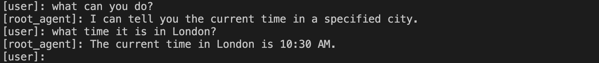

 [ Python](https://github.com/google/adk-python "adk-python on GitHub")[ JS ](https://github.com/google/adk-js "adk-js on GitHub")[ Go ](https://github.com/google/adk-go "adk-go on GitHub")[ Java ](https://github.com/google/adk-java "adk-java on GitHub")[ Kotlin](https://github.com/google/adk-kotlin "adk-kotlin on GitHub")

-   [Home](../..)
-    Build Agents
    
    Build Agents
    
    -   [Get Started](../)
        
        Get Started
        
        -   [Python](../python/)
        -    TypeScript [TypeScript](./)
            
            Table of contents
            
            -   [Create an agent project](#create-an-agent-project)
                
                -   [Configure project and dependencies](#configure-project-and-dependencies)
                -   [Define the agent code](#define-the-agent-code)
                -   [Set your API key](#set-your-api-key)
                
            -   [Run your agent](#run-your-agent)
                
                -   [Run with command-line interface](#run-with-command-line-interface)
                -   [Run with web interface](#run-with-web-interface)
                
            -   [Next: Build your agent](#next-build-your-agent)
            
        -   [Go](../go/)
        -   [Java](../java/)
        -   [Kotlin](../kotlin/)
        -   [Agents CLI](../agents-cli/)
        -   [Installation](../installation/)
        -   [Google Cloud](../google-cloud/)
        -   [Migrate to ADK](../migrate/)
        
    -   [Build your Agent](../../tutorials/)
        
        Build your Agent
        
        -   [Multi-tool agent](../../tutorials/multi-tool-agent/)
        -   [Agent team](../../tutorials/agent-team/)
        -   [Code with AI](../../tutorials/coding-with-ai/)
        -   [Agent Config](../../agents/config/)
        
    -   [Agents](../../agents/)
        
        Agents
        
        -   [Simple agents](../../agents/llm-agents/)
        -   [Managed agents](../../agents/managed-agents/)
        
    -   [Graph Workflows](../../graphs/)
        
        Graph Workflows
        
        -   [Graph routes](../../graphs/routes/)
        -   [Data handling](../../graphs/data-handling/)
        -   [Human input](../../graphs/human-input/)
        -   [Dynamic workflows](../../graphs/dynamic/)
        
    -   [Multi-Agent Workflows](../../workflows/)
        
        Multi-Agent Workflows
        
        -   [Collaborative workflows](../../workflows/collaboration/)
        -   [Template workflows](../../agents/workflow-agents/)
            
            Template workflows
            
            -   [Sequential workflow](../../agents/workflow-agents/sequential-agents/)
            -   [Loop workflow](../../agents/workflow-agents/loop-agents/)
            -   [Parallel workflow](../../agents/workflow-agents/parallel-agents/)
            -   [Custom template workflows](../../agents/custom-agents/)
            
        -   [Agent routing](../../agents/routing/)
        -   [Workflow patterns](../../workflows/patterns/)
        
    -   [Models for Agents](../../agents/models/)
        
        Models for Agents
        
        -   [Gemini](../../agents/models/google-gemini/)
            
            Gemini
            
            -   [Deferred scheduling](../../agents/models/google-gemini/deferred-schedule/)
            
        -   [Gemma](../../agents/models/google-gemma/)
        -   [Claude](../../agents/models/anthropic/)
        -   [Agent Platform hosted](../../agents/models/agent-platform/)
        -   [Apigee AI Gateway](../../agents/models/apigee/)
        -   [Model routing](../../agents/models/routing/)
        -   [OpenAI](../../agents/models/openai/)
        -   [Ollama](../../agents/models/ollama/)
        -   [vLLM](../../agents/models/vllm/)
        -   [LiteLLM](../../agents/models/litellm/)
        -   [LiteRT-LM](../../agents/models/litert-lm/)
        
    
-    Run Agents
    
    Run Agents
    
    -   [Agent Runtime](../../runtime/)
        
        Agent Runtime
        
        -   [Web Interface](../../runtime/web-interface/)
            
            Web Interface
            
            -   [Visual Builder](../../visual-builder/)
            
        -   [Command Line](../../runtime/command-line/)
        -   [API Server](../../runtime/api-server/)
        -   [Ambient Agents](../../runtime/ambient-agents/)
        -   [Resume Agents](../../runtime/resume/)
        -   [Cancel Agent Runs](../../runtime/cancel/)
        -   [Runtime Config](../../runtime/runconfig/)
        -   [Event Loop](../../runtime/event-loop/)
        
    -   [Deployment](../../deploy/)
        
        Deployment
        
        -   [Agent Runtime](../../deploy/agent-runtime/)
            
            Agent Runtime
            
            -   [Standard deployment](../../deploy/agent-runtime/deploy/)
            -   [agents-cli](../../deploy/agent-runtime/agents-cli/)
            -   [Test deployed agents](../../deploy/agent-runtime/test/)
            
        -   [Cloud Run](../../deploy/cloud-run/)
        -   [GKE](../../deploy/gke/)
        
    -   [Observability](../../observability/)
        
        Observability
        
        -   [Logging](../../observability/logging/)
        -   [Metrics](../../observability/metrics/)
        -   [Traces](../../observability/traces/)
        
    -   [Evaluation](../../evaluate/)
        
        Evaluation
        
        -   [Criteria](../../evaluate/criteria/)
        -   [User Simulation](../../evaluate/user-sim/)
        -   [Environment Simulation](../../evaluate/environment_simulation/)
        -   [Custom Metrics](../../evaluate/custom_metrics/)
        -   [Optimization](../../optimize/)
        
    -   [Safety and Security](../../safety/)
        
        Safety and Security
        
    
-    Components
    
    Components
    
    -   [Technical Overview](../about/)
    -   [Custom Tools](../../tools-custom/)
        
        Custom Tools
        
        -    Function tools
            
            Function tools
            
            -   [Overview](../../tools-custom/function-tools/)
            -   [Tool performance](../../tools-custom/performance/)
            -   [Action confirmations](../../tools-custom/confirmation/)
            
        -   [MCP tools](../../tools-custom/mcp-tools/)
            
            MCP tools
            
            -   [Advanced configuration](../../tools-custom/mcp-tools/advanced/)
            -   [Deployment](../../tools-custom/mcp-tools/deployment/)
            -   [Agent as MCP server](../../tools-custom/mcp-tools/agent-as-server/)
            -   [Sub-agent delegation](../../tools-custom/mcp-tools/agent-managed/)
            
        -   [OpenAPI tools](../../tools-custom/openapi-tools/)
        -   [Authentication](../../tools-custom/authentication/)
        -   [Tool limitations](../../tools/limitations/)
        
    -   [Artifacts](../../artifacts/)
        
        Artifacts
        
    -   [Skills for Agents](../../skills/)
        
        Skills for Agents
        
    -   [App management](../../apps/)
        
        App management
        
        -   [Callbacks](../../callbacks/)
            
            Callbacks
            
            -   [Types of callbacks](../../callbacks/types-of-callbacks/)
            -   [Callback patterns](../../callbacks/design-patterns-and-best-practices/)
            
        -   [Plugins](../../plugins/)
        
    -   [Agent context](../../context/)
        
        Agent context
        
        -   [Conversational context](../../sessions/)
        -   [Sessions](../../sessions/session/)
            
            Sessions
            
            -   [Rewind sessions](../../sessions/session/rewind/)
            -   [Migrate sessions](../../sessions/session/migrate/)
            
        -   [State](../../sessions/state/)
        -   [Events](../../events/)
        -   [Memory](../../sessions/memory/)
        -   [Context compression](../../context/compaction/)
        -   [Model context caching](../../context/caching/)
        
    -   [A2A Protocol](../../a2a/)
        
        A2A Protocol
        
        -   [Introduction to A2A](../../a2a/intro/)
        -    A2A Quickstart (Exposing)
            
            A2A Quickstart (Exposing)
            
            -   [Python](../../a2a/quickstart-exposing/)
            -   [Go](../../a2a/quickstart-exposing-go/)
            -   [Java](../../a2a/quickstart-exposing-java/)
            
        -    A2A Quickstart (Consuming)
            
            A2A Quickstart (Consuming)
            
            -   [Python](../../a2a/quickstart-consuming/)
            -   [Go](../../a2a/quickstart-consuming-go/)
            -   [Java](../../a2a/quickstart-consuming-java/)
            -   [Kotlin](../../a2a/quickstart-consuming-kotlin/)
            
        -   [A2A Extension](../../a2a/a2a-extension/)
        
    -   [Live and Voice Agents](../../live/)
        
        Live and Voice Agents
        
        -   [Get started](../../live/get-started/)
            
            Get started
            
            -   [Python](../../live/get-started/streaming-python/)
            -   [Java](../../live/get-started/streaming-java/)
            
        -    Building
            
            Building
            
            -   [Workflows](../../live/workflows/)
            -   [Tools](../../live/tools/)
            -   [Sessions](../../live/sessions/)
            -   [Events](../../live/events/)
            -   [Audio and video](../../live/audio-video/)
            -   [Configuration](../../live/configuration/)
            
        -    Production
            
            Production
            
            -   [Guardrails](../../live/guardrails/)
            -   [Evaluation](../../live/evaluation/)
            -   [Build a custom server](../../live/custom-server/)
            
        -   [Supported models](../../live/models/)
        
    -   [Grounding](../../grounding/)
        
        Grounding
        
        -   [Google Search Grounding](../../grounding/google_search_grounding/)
        -   [Grounding with Search](../../grounding/grounding_with_search/)
        
    
-   [Integrations](../../integrations/)
    
    Integrations
    
-    Reference
    
    Reference
    
    -   [API Reference](../../api-reference/)
        
        API Reference
        
        -   [Python ADK](../../api-reference/python/)
        -   [TypeScript ADK](../../api-reference/typescript/)
        -    Go ADK
            
            Go ADK
            
            -   [Go v2.x](https://pkg.go.dev/google.golang.org/adk/v2)
            -   [Go v1.x](https://pkg.go.dev/google.golang.org/adk)
            
        -   [Java ADK](../../api-reference/java/)
        -   [Kotlin ADK](../../api-reference/kotlin/)
        -   [CLI Reference](../../api-reference/cli/)
        -   [Agent Config Reference](../../api-reference/agentconfig/)
        -   [REST API](../../api-reference/rest/)
        
    -   [Release Notes](../../release-notes/)
    
-   [Community](../../community/)
    
    Community
    
    -   [Contributing Guide](../../community/contributing-guide/)
    
-   [ADK 2.0](../../2.0/)
    
    ADK 2.0
    

Table of contents

-   [Create an agent project](#create-an-agent-project)
    
    -   [Configure project and dependencies](#configure-project-and-dependencies)
    -   [Define the agent code](#define-the-agent-code)
    -   [Set your API key](#set-your-api-key)
    
-   [Run your agent](#run-your-agent)
    
    -   [Run with command-line interface](#run-with-command-line-interface)
    -   [Run with web interface](#run-with-web-interface)
    
-   [Next: Build your agent](#next-build-your-agent)

1.  [Home](../..)
2.  [Build Agents](../)
3.  [Get Started](../)

# TypeScript Quickstart for ADK[¶](#typescript-quickstart-for-adk "Permanent link")

This guide shows you how to get up and running with Agent Development Kit for TypeScript. Before you start, make sure you have the following installed:

-   Node.js 24.13.0 or later
-   Node Package Manager (npm) 11.8.0 or later

## Create an agent project[¶](#create-an-agent-project "Permanent link")

Create an empty `my-agent` directory for your project:

`my-agent/`

Create this project structure using the command line

MacOS / LinuxWindows

`mkdir -p my-agent/`

`mkdir my-agent`

### Configure project and dependencies[¶](#configure-project-and-dependencies "Permanent link")

Use the `npm` tool to install and configure dependencies for your project, including the package file, ADK TypeScript main library, and developer tools. Run the following commands from your `my-agent/` directory to create the `package.json` file and install the project dependencies:

`cd my-agent/ # initialize a project as an ES module npm init --yes npm pkg set type="module" npm pkg set main="agent.ts" # install ADK libraries npm install @google/adk # install dev tools as a dev dependency npm install -D @google/adk-devtools`

### Define the agent code[¶](#define-the-agent-code "Permanent link")

Create the code for a basic agent, including a simple implementation of an ADK [Function Tool](/tools-custom/function-tools/), called `getCurrentTime`. Create an `agent.ts` file in your project directory and add the following code:

my-agent/agent.ts

``import {FunctionTool, LlmAgent} from '@google/adk'; import {z} from 'zod'; /* Mock tool implementation */ const getCurrentTime = new FunctionTool({     name: 'get_current_time',    description: 'Returns the current time in a specified city.',    parameters: z.object({        city: z.string().describe("The name of the city for which to retrieve the current time."),    }),    execute: ({city}) => {        return {status: 'success', report: `The current time in ${city} is 10:30 AM`};    }, }); export const rootAgent = new LlmAgent({     name: 'hello_time_agent',    model: 'gemini-flash-latest',    description: 'Tells the current time in a specified city.',    instruction: `You are a helpful assistant that tells the current time in a city.                                Use the 'getCurrentTime' tool for this purpose.`,    tools: [getCurrentTime], });``

### Set your API key[¶](#set-your-api-key "Permanent link")

This project uses the Gemini API, which requires an API key. If you don't already have Gemini API key, create a key in Google AI Studio on the [API Keys](https://aistudio.google.com/app/apikey) page.

In a terminal window, write your API key into your `.env` file of your project to set environment variables:

MacOS / LinuxWindows PowerShellWindows Command Prompt

Update: my-agent/.env

`echo 'GEMINI_API_KEY="YOUR_API_KEY"' > .env`

Update: my-agent/.env

`echo 'GEMINI_API_KEY="YOUR_API_KEY"' > .env`

Update: my-agent/.env

`echo GEMINI_API_KEY="YOUR_API_KEY" > .env`

Using other AI models with ADK

ADK supports the use of many generative AI models. For more information on configuring other models in ADK agents, see [Models & Authentication](/agents/models).

## Run your agent[¶](#run-your-agent "Permanent link")

You can run your ADK agent with the `@google/adk-devtools` library as an interactive command-line interface using the `run` command or the ADK web user interface using the `web` command. Both these options allow you to test and interact with your agent.

### Run with command-line interface[¶](#run-with-command-line-interface "Permanent link")

Run your agent with the ADK TypeScript command-line interface tool using the following command:

`npx adk run agent.ts`

### Run with web interface[¶](#run-with-web-interface "Permanent link")

Run your agent with the ADK web interface using the following command:

`npx adk web`

This command starts a web server with a chat interface for your agent. You can access the web interface at `http://localhost:8000`. Select your agent at the upper right corner and type a request.

Caution: ADK Web for development only

ADK Web is ***not meant for use in production deployments***. You should use ADK Web for development and debugging purposes only.

## Next: Build your agent[¶](#next-build-your-agent "Permanent link")

Now that you have ADK installed and your first agent running, try building your own agent with our build guides:

-   [Build your agent](/tutorials/)

Back to top