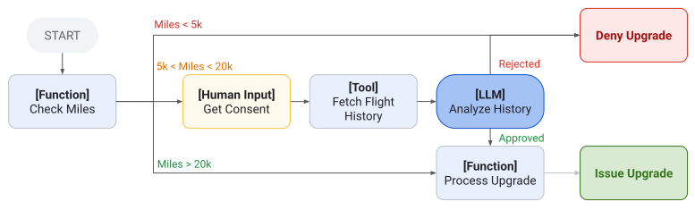
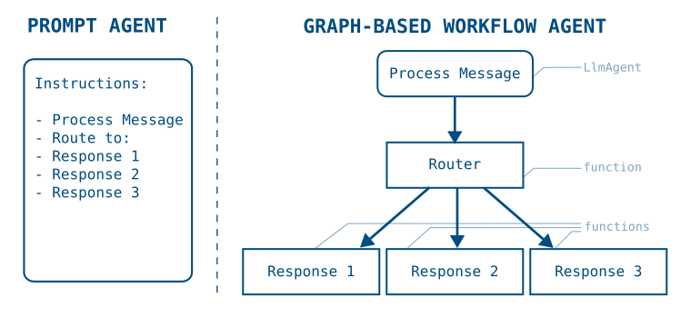

 [ Python](https://github.com/google/adk-python "adk-python on GitHub")[ JS ](https://github.com/google/adk-js "adk-js on GitHub")[ Go ](https://github.com/google/adk-go "adk-go on GitHub")[ Java ](https://github.com/google/adk-java "adk-java on GitHub")[ Kotlin](https://github.com/google/adk-kotlin "adk-kotlin on GitHub")

-   [Home](..)
-    Build Agents
    
    Build Agents
    
    -   [Get Started](../get-started/)
        
        Get Started
        
        -   [Python](../get-started/python/)
        -   [TypeScript](../get-started/typescript/)
        -   [Go](../get-started/go/)
        -   [Java](../get-started/java/)
        -   [Kotlin](../get-started/kotlin/)
        -   [Agents CLI](../get-started/agents-cli/)
        -   [Installation](../get-started/installation/)
        -   [Google Cloud](../get-started/google-cloud/)
        -   [Migrate to ADK](../get-started/migrate/)
        
    -   [Build your Agent](../tutorials/)
        
        Build your Agent
        
        -   [Multi-tool agent](../tutorials/multi-tool-agent/)
        -   [Agent team](../tutorials/agent-team/)
        -   [Code with AI](../tutorials/coding-with-ai/)
        -   [Agent Config](../agents/config/)
        
    -   [Agents](../agents/)
        
        Agents
        
        -   [Simple agents](../agents/llm-agents/)
        -   [Managed agents](../agents/managed-agents/)
        
    -   [Graph Workflows](./)
        
        Graph Workflows
        
        -   [Graph routes](routes/)
        -   [Data handling](data-handling/)
        -   [Human input](human-input/)
        -   [Dynamic workflows](dynamic/)
        
    -   [Multi-Agent Workflows](../workflows/)
        
        Multi-Agent Workflows
        
        -   [Collaborative workflows](../workflows/collaboration/)
        -   [Template workflows](../agents/workflow-agents/)
            
            Template workflows
            
            -   [Sequential workflow](../agents/workflow-agents/sequential-agents/)
            -   [Loop workflow](../agents/workflow-agents/loop-agents/)
            -   [Parallel workflow](../agents/workflow-agents/parallel-agents/)
            -   [Custom template workflows](../agents/custom-agents/)
            
        -   [Agent routing](../agents/routing/)
        -   [Workflow patterns](../workflows/patterns/)
        
    -   [Models for Agents](../agents/models/)
        
        Models for Agents
        
        -   [Gemini](../agents/models/google-gemini/)
            
            Gemini
            
            -   [Deferred scheduling](../agents/models/google-gemini/deferred-schedule/)
            
        -   [Gemma](../agents/models/google-gemma/)
        -   [Claude](../agents/models/anthropic/)
        -   [Agent Platform hosted](../agents/models/agent-platform/)
        -   [Apigee AI Gateway](../agents/models/apigee/)
        -   [Model routing](../agents/models/routing/)
        -   [OpenAI](../agents/models/openai/)
        -   [Ollama](../agents/models/ollama/)
        -   [vLLM](../agents/models/vllm/)
        -   [LiteLLM](../agents/models/litellm/)
        -   [LiteRT-LM](../agents/models/litert-lm/)
        
    
-    Run Agents
    
    Run Agents
    
    -   [Agent Runtime](../runtime/)
        
        Agent Runtime
        
        -   [Web Interface](../runtime/web-interface/)
            
            Web Interface
            
            -   [Visual Builder](../visual-builder/)
            
        -   [Command Line](../runtime/command-line/)
        -   [API Server](../runtime/api-server/)
        -   [Ambient Agents](../runtime/ambient-agents/)
        -   [Resume Agents](../runtime/resume/)
        -   [Cancel Agent Runs](../runtime/cancel/)
        -   [Runtime Config](../runtime/runconfig/)
        -   [Event Loop](../runtime/event-loop/)
        
    -   [Deployment](../deploy/)
        
        Deployment
        
        -   [Agent Runtime](../deploy/agent-runtime/)
            
            Agent Runtime
            
            -   [Standard deployment](../deploy/agent-runtime/deploy/)
            -   [agents-cli](../deploy/agent-runtime/agents-cli/)
            -   [Test deployed agents](../deploy/agent-runtime/test/)
            
        -   [Cloud Run](../deploy/cloud-run/)
        -   [GKE](../deploy/gke/)
        
    -   [Observability](../observability/)
        
        Observability
        
        -   [Logging](../observability/logging/)
        -   [Metrics](../observability/metrics/)
        -   [Traces](../observability/traces/)
        
    -   [Evaluation](../evaluate/)
        
        Evaluation
        
        -   [Criteria](../evaluate/criteria/)
        -   [User Simulation](../evaluate/user-sim/)
        -   [Environment Simulation](../evaluate/environment_simulation/)
        -   [Custom Metrics](../evaluate/custom_metrics/)
        -   [Optimization](../optimize/)
        
    -   [Safety and Security](../safety/)
        
        Safety and Security
        
    
-    Components
    
    Components
    
    -   [Technical Overview](../get-started/about/)
    -   [Custom Tools](../tools-custom/)
        
        Custom Tools
        
        -    Function tools
            
            Function tools
            
            -   [Overview](../tools-custom/function-tools/)
            -   [Tool performance](../tools-custom/performance/)
            -   [Action confirmations](../tools-custom/confirmation/)
            
        -   [MCP tools](../tools-custom/mcp-tools/)
            
            MCP tools
            
            -   [Advanced configuration](../tools-custom/mcp-tools/advanced/)
            -   [Deployment](../tools-custom/mcp-tools/deployment/)
            -   [Agent as MCP server](../tools-custom/mcp-tools/agent-as-server/)
            -   [Sub-agent delegation](../tools-custom/mcp-tools/agent-managed/)
            
        -   [OpenAPI tools](../tools-custom/openapi-tools/)
        -   [Authentication](../tools-custom/authentication/)
        -   [Tool limitations](../tools/limitations/)
        
    -   [Artifacts](../artifacts/)
        
        Artifacts
        
    -   [Skills for Agents](../skills/)
        
        Skills for Agents
        
    -   [App management](../apps/)
        
        App management
        
        -   [Callbacks](../callbacks/)
            
            Callbacks
            
            -   [Types of callbacks](../callbacks/types-of-callbacks/)
            -   [Callback patterns](../callbacks/design-patterns-and-best-practices/)
            
        -   [Plugins](../plugins/)
        
    -   [Agent context](../context/)
        
        Agent context
        
        -   [Conversational context](../sessions/)
        -   [Sessions](../sessions/session/)
            
            Sessions
            
            -   [Rewind sessions](../sessions/session/rewind/)
            -   [Migrate sessions](../sessions/session/migrate/)
            
        -   [State](../sessions/state/)
        -   [Events](../events/)
        -   [Memory](../sessions/memory/)
        -   [Context compression](../context/compaction/)
        -   [Model context caching](../context/caching/)
        
    -   [A2A Protocol](../a2a/)
        
        A2A Protocol
        
        -   [Introduction to A2A](../a2a/intro/)
        -    A2A Quickstart (Exposing)
            
            A2A Quickstart (Exposing)
            
            -   [Python](../a2a/quickstart-exposing/)
            -   [Go](../a2a/quickstart-exposing-go/)
            -   [Java](../a2a/quickstart-exposing-java/)
            
        -    A2A Quickstart (Consuming)
            
            A2A Quickstart (Consuming)
            
            -   [Python](../a2a/quickstart-consuming/)
            -   [Go](../a2a/quickstart-consuming-go/)
            -   [Java](../a2a/quickstart-consuming-java/)
            -   [Kotlin](../a2a/quickstart-consuming-kotlin/)
            
        -   [A2A Extension](../a2a/a2a-extension/)
        
    -   [Live and Voice Agents](../live/)
        
        Live and Voice Agents
        
        -   [Get started](../live/get-started/)
            
            Get started
            
            -   [Python](../live/get-started/streaming-python/)
            -   [Java](../live/get-started/streaming-java/)
            
        -    Building
            
            Building
            
            -   [Workflows](../live/workflows/)
            -   [Tools](../live/tools/)
            -   [Sessions](../live/sessions/)
            -   [Events](../live/events/)
            -   [Audio and video](../live/audio-video/)
            -   [Configuration](../live/configuration/)
            
        -    Production
            
            Production
            
            -   [Guardrails](../live/guardrails/)
            -   [Evaluation](../live/evaluation/)
            -   [Build a custom server](../live/custom-server/)
            
        -   [Supported models](../live/models/)
        
    -   [Grounding](../grounding/)
        
        Grounding
        
        -   [Google Search Grounding](../grounding/google_search_grounding/)
        -   [Grounding with Search](../grounding/grounding_with_search/)
        
    
-   [Integrations](../integrations/)
    
    Integrations
    
-    Reference
    
    Reference
    
    -   [API Reference](../api-reference/)
        
        API Reference
        
        -   [Python ADK](../api-reference/python/)
        -   [TypeScript ADK](../api-reference/typescript/)
        -    Go ADK
            
            Go ADK
            
            -   [Go v2.x](https://pkg.go.dev/google.golang.org/adk/v2)
            -   [Go v1.x](https://pkg.go.dev/google.golang.org/adk)
            
        -   [Java ADK](../api-reference/java/)
        -   [Kotlin ADK](../api-reference/kotlin/)
        -   [CLI Reference](../api-reference/cli/)
        -   [Agent Config Reference](../api-reference/agentconfig/)
        -   [REST API](../api-reference/rest/)
        
    -   [Release Notes](../release-notes/)
    
-   [Community](../community/)
    
    Community
    
    -   [Contributing Guide](../community/contributing-guide/)
    
-   [ADK 2.0](../2.0/)
    
    ADK 2.0
    

Table of contents

-   [Get started](#get-started)
-   [Build processes with graphs](#build-processes-with-graphs)
-   [Known limitations](#known-limitations)

1.  [Home](..)
2.  [Build Agents](../get-started/)
3.  [Graph Workflows](./)

# Graph-based agent workflows[¶](#graph-based-agent-workflows "Permanent link")

Supported in ADKPython v2.0.0TypeScript v2.0.0Go v2.0.0

Graph-based agent workflows in ADK let you build agents with more precise control, creating deterministic processes that combine code logic and AI reasoning capabilities. Graph-based workflows allow you to define your agent logic as a graph of execution nodes and edges, combining AI-powered agent reasoning with deterministic tools and code.

**Figure 1.** A graph-based agent design for flight upgrades, combining workflow nodes of different types, including Functions, human input, Tools, and LLM capabilities.

Prebuilt ADK [template workflows](/agents/workflow-agents/), such as [Sequential Agents](/agents/workflow-agents/sequential-agents/), provide a defined process flow control only across a set of agents. You can continue to build standard ADK agents with long prompts, tools, and use them in graph-based workflow agents. When you need more precise control, workflow agent graphs give you more flexibility over how tasks are routed and executed. Graph-based workflows provide the following advantages:

-   **Define precise logic:** Explicitly map out routing logic to manage transitions between different nodes.
-   **Implement complex structures:** Build agent workflows that support branching and state management.
-   **Run chains of functions without AI:** Call agent tools and your own code without invoking a generative AI model.
-   **Enhance reliability:** Improve the predictability of your agents by relying on structured node definitions rather than prompts alone.

Workflow styles in ADK

ADK offers three complementary ways to compose multi-step work:

-   **Graph-based workflows** (this section): a declarative graph of nodes and edges with explicit routing — best for deterministic, structured processes.
-   **[Dynamic workflows](/graphs/dynamic/):** programmatic orchestration in your own code (loops, conditionals, recursion) — best when the control flow is too complex or iterative for a static graph.
-   **[Prebuilt workflow agents](/agents/workflow-agents/)** (sequential, parallel, loop): higher-level building blocks for common patterns without assembling a graph yourself.

## Get started[¶](#get-started "Permanent link")

This section describes how to get started with graph-based agents. The following example shows how to create a sequential graph-based agent workflow that generates a city name, looks up the current time in that city with a code function, and the final agent reports the information.

PythonTypeScriptGo

`from google.adk import Agent from google.adk import Workflow from google.adk import Event from pydantic import BaseModel city_generator_agent = Agent(         name="city_generator_agent",        model="gemini-flash-latest",        instruction="""Return the name of a random city.            Return only the name, nothing else.""", ) class CityTime(BaseModel):         time_info: str  # time information        city: str       # city name def lookup_time_function(node_input: str):         """Simulate returning the current time in the specified city."""        return CityTime(time_info="10:10 AM", city=node_input) city_report_agent = Agent(         name="city_report_agent",        model="gemini-flash-latest",        input_schema=CityTime,        instruction="""Output following line:        It is {CityTime.time_info} in {CityTime.city} right now.""", ) def completed_message_function(node_input: str):         return Event(                message=f"{node_input}\n WORKFLOW COMPLETED.",        ) root_agent = Workflow(         name="root_agent",        edges=[                ("START", city_generator_agent, lookup_time_function,                    city_report_agent, completed_message_function)        ], )`

In ADK TypeScript v2.0.0, a `Workflow` takes an `edges` array. Each row lists the nodes to run in order. The `node()` function wraps a function, an agent, a tool, or another `Workflow` as a graph node, and sets the node's name and its `inputSchema` and `outputSchema` contracts. Schemas are Zod objects or a genai `Schema`. Each node's return value is passed to the next node as its input, so you do not need to write to session state.

``import {     createEvent,    LlmAgent,    node,    NodeContext,    Workflow, } from '@google/adk'; import { z } from 'zod'; const cityGeneratorAgent = new LlmAgent({     name: 'city_generator_agent',    model: 'gemini-flash-latest',    instruction: `Return the name of a random city.            Return only the name, nothing else.`, }); /** The structured payload handed from the lookup node to the report agent. */ const cityTimeSchema = z.object({     timeInfo: z.string().describe('Time information.'),    city: z.string().describe('City name.'), }); type CityTime = z.infer<typeof cityTimeSchema>; /** Simulates returning the current time in the specified city. */ function lookupTimeFunction(_ctx: NodeContext, nodeInput: string): CityTime {     return { timeInfo: '10:10 AM', city: nodeInput.trim() }; } const cityReportAgent = new LlmAgent({     name: 'city_report_agent',    model: 'gemini-flash-latest',    instruction: `Output the following line:        It is {CityTime.timeInfo} in {CityTime.city} right now.`, }); function completedMessageFunction(_ctx: NodeContext, nodeInput: string) {     return createEvent({        content: {            role: 'model',            parts: [{ text: `${nodeInput}\n WORKFLOW COMPLETED.` }],        },    }); } export const rootAgent = new Workflow({     name: 'root_agent',    edges: [        [            'START',            cityGeneratorAgent,            node(lookupTimeFunction, {                name: 'lookup_time_function',                outputSchema: cityTimeSchema,            }),            node(cityReportAgent, { inputSchema: cityTimeSchema }),            node(completedMessageFunction, { name: 'completed_message_function' }),        ],    ], });``

In ADK Go v2.0.0, sequential workflows use the graph engine: `workflow.NewFunctionNode` wraps each step, and `workflow.Chain` wires the nodes into a sequential `edges` slice. The framework automatically passes each node's typed return value to the next node via `event.Output` — no session state writes are needed. The whole graph is wrapped in `workflowagent.New`, which produces a standard `agent.Agent`.

`// cityTime holds the data passed from the lookup step to the report step. type cityTime struct {         City     string        TimeInfo string } // newSequentialGetStarted builds a three-node sequential workflow using the // v2 graph engine. Each node is a workflow.NewFunctionNode whose return value // is automatically wrapped in session.Event.Output and forwarded to the next // node as its typed input. // // This is the Go equivalent of the Python Workflow example: // //  root_agent = Workflow( //      name="root_agent", //      edges=[("START", city_generator_agent, lookup_time_function, //               city_report_agent, completed_message_function)], //  ) func newSequentialGetStarted() (agent.Agent, error) {         // Step 1: return a city name. The string is set as event.Output and        // becomes the typed input of the next node.        cityGeneratorNode := workflow.NewFunctionNode("city_generator_agent",                func(_ agent.Context, _ any) (string, error) {                        return "Tokyo", nil                },                workflow.NodeConfig{},        )         // Step 2: receive the city name and return structured time data.        lookupTimeNode := workflow.NewFunctionNode("lookup_time_function",                func(_ agent.Context, city string) (cityTime, error) {                        return cityTime{City: city, TimeInfo: "10:10 AM"}, nil                },                workflow.NodeConfig{},        )         // Step 3: receive the cityTime struct and produce the final report string.        cityReportNode := workflow.NewFunctionNode("city_report_agent",                func(_ agent.Context, ct cityTime) (string, error) {                        return fmt.Sprintf("It is %s in %s right now.\nWORKFLOW COMPLETED.",                                ct.TimeInfo, ct.City), nil                },                workflow.NodeConfig{},        )         // workflow.Chain wires START → cityGeneratorNode → lookupTimeNode → cityReportNode.        // Data flows through event.Output: no session state writes needed.        return workflowagent.New(workflowagent.Config{                Name:        "root_agent",                Description: "Sequential workflow: generate city → look up time → report.",                Edges:       workflow.Chain(workflow.Start, cityGeneratorNode, lookupTimeNode, cityReportNode),        }) }`

This sample code demonstrates how you can assemble a simple, sequential workflow and alternate between agent processing and code execution. While you could perform these steps using a single agent with a longer prompt and a tool call, the graph-based approach gives you precise control over the task execution order and the data output from each step.

For more information about data handling with graph-based workflows, see [Data handling with workflow nodes and agents](/graphs/data-handling/).

## Build processes with graphs[¶](#build-processes-with-graphs "Permanent link")

You can use prompt-based agents to define multiple step processes with descriptions of tasks and procedures using the instructions field of an ADK agent. However, as your instructions and procedures become longer and more complicated, making sure that the agent is following each step and guideline becomes more complicated and less reliable.

Graph-based workflow agents provide a significant advantage over prompt-based agents by allowing you to specifically define the overall process workflow in code. With graph-based agent workflows, each step of the process can be defined as an execution ***Node*** in a graph and each node can be an AI agent, Tool, or your programmed code. The following diagram illustrates how a simple prompt-based agent would translate into a workflow agent graph:

**Figure 2.** Structure of prompt-based agent instructions translated into a graph-based workflow.

Moving from prompt-based agents to graph-based workflow agents allows you to explicitly break out the tasks of a procedure to define a specific execution flow. Once defined, the agent application flows the steps in the graph, switching between non-deterministic AI-powered agents and deterministic code as needed.

The following code sample shows how the workflow graph in Figure 2 could be translated into a graph-based agent:

PythonTypeScriptGo

`process_message = Agent(         name="process_message",        model="gemini-flash-latest",        instruction="""Classify user message into either "BUG", "CUSTOMER_SUPPORT",            or "LOGISTICS". If you think a message applies to more than one category,            reply with a comma separated list of categories.      """, ) def router(node_input: str):         routes = node_input.split(",")        routes = [route.strip() for route in routes]        return Event(route=routes) def response_1_bug():         return Event(message="Handling bug...") def response_2_support():         return Event(message="Handling customer support...") def response_3_logistics():         return Event(message="Handling logistics...") root_agent = Workflow(       name="routing_workflow",      edges=[              ("START", process_message, router),              ( router,                      {                              "BUG": response_1_bug,                              "CUSTOMER_SUPPORT": response_2_support,                              "LOGISTICS": response_3_logistics,                      }              )      ], )`

In ADK TypeScript v2.0.0, a router node returns an event carrying a `route` value, created with `createEvent({route})`. A second edge row maps each route value to the node that handles it. Setting `route` to an array dispatches to every matching branch, which lets the classifier in this example return more than one category. The `DEFAULT_ROUTE` setting catches any value that no branch matched.

``import {     createEvent,    DEFAULT_ROUTE,    LlmAgent,    node,    NodeContext,    Workflow, } from '@google/adk'; /** The routes this graph has edges for. */ const ROUTES = ['BUG', 'CUSTOMER_SUPPORT', 'LOGISTICS'] as const; const processMessage = new LlmAgent({     name: 'process_message',    model: 'gemini-flash-latest',    instruction: `Classify user message into either "BUG", "CUSTOMER_SUPPORT",            or "LOGISTICS". If you think a message applies to more than one category,            reply with a comma separated list of categories.            Reply with the categories only, nothing else.`, }); const router = node(     (_ctx: NodeContext, nodeInput: string) => {        const text = String(nodeInput).toUpperCase();        const matched = ROUTES.filter((route) =>            new RegExp(`\\b${route}\\b`).test(text),        );        return createEvent({ route: matched.length > 0 ? matched : DEFAULT_ROUTE });    },    { name: 'router' }, ); /** Emits a user-facing message: `content`, with no `output`. */ const message = (text: string) =>     createEvent({ content: { role: 'model', parts: [{ text }] } }); const response1Bug = node(() => message('Handling bug...'), {     name: 'response_1_bug', }); const response2Support = node(() => message('Handling customer support...'), {     name: 'response_2_support', }); const response3Logistics = node(() => message('Handling logistics...'), {     name: 'response_3_logistics', }); const responseUnknown = node(     (_ctx: NodeContext, nodeInput: string) =>        message(`Could not classify that (classifier said: ${nodeInput}).`),    { name: 'response_unknown' }, ); export const rootAgent = new Workflow({     name: 'routing_workflow',    edges: [        ['START', processMessage, router],        [            router,            {                BUG: response1Bug,                CUSTOMER_SUPPORT: response2Support,                LOGISTICS: response3Logistics,                [DEFAULT_ROUTE]: responseUnknown,            },        ],    ], });``

In ADK Go v2.0.0, conditional routing uses `workflow.NewEmittingFunctionNode` to set `event.Routes` and `workflow.StringRoute` edges to dispatch to the matching handler — the direct equivalent of Python's `router` function and dict dispatch. `workflow.Concat` merges the chain and the conditional edges into a single `edges` slice passed to `workflowagent.New`.

`// classifyMessage is the router node. It emits ev.Routes to select which // branch to follow — the Go equivalent of Python's: // //  def router(node_input: str): //      return Event(route=["BUG"]) func classifyMessage(ctx agent.Context, msg string, emit func(*session.Event) error) (any, error) {         // In a real workflow this step calls an LLM; here we classify by keyword.        category := "LOGISTICS"        lower := strings.ToLower(msg)        switch {        case strings.Contains(lower, "bug") || strings.Contains(lower, "error"):                category = "BUG"        case strings.Contains(lower, "help") || strings.Contains(lower, "support"):                category = "CUSTOMER_SUPPORT"        }         ev := session.NewEvent(ctx, ctx.InvocationID())        ev.Routes = []string{category} // drives edge dispatch        ev.Output = msg                // forward original message to the chosen handler        if err := emit(ev); err != nil {                return nil, err        }        return nil, nil // nil suppresses the automatic terminal event } // newProcessPipeline builds a classification + conditional-routing workflow // using the v2 graph engine. The classifyMessage emitting node sets // ev.Routes, and the graph engine dispatches to the matching handler via // workflow.StringRoute. // // This is the Go equivalent of the Python Workflow example: // //  root_agent = Workflow( //      name="routing_workflow", //      edges=[ //          ("START", process_message, router), //          (router, { //              "BUG": response_1_bug, //              "CUSTOMER_SUPPORT": response_2_support, //              "LOGISTICS": response_3_logistics, //          }), //      ], //  ) func newProcessPipeline() (agent.Agent, error) {         classifyNode := workflow.NewEmittingFunctionNode(                "process_message", classifyMessage, workflow.NodeConfig{},        )         bugNode := workflow.NewFunctionNode("response_1_bug",                func(_ agent.Context, _ any) (string, error) {                        return "Handling bug...", nil                },                workflow.NodeConfig{},        )         supportNode := workflow.NewFunctionNode("response_2_support",                func(_ agent.Context, _ any) (string, error) {                        return "Handling customer support...", nil                },                workflow.NodeConfig{},        )         logisticsNode := workflow.NewFunctionNode("response_3_logistics",                func(_ agent.Context, _ any) (string, error) {                        return "Handling logistics...", nil                },                workflow.NodeConfig{},        )         // workflow.Concat merges the sequential chain with the conditional edges.        // Each workflow.Edge carries a workflow.StringRoute matcher that the engine        // checks against ev.Routes emitted by classifyNode.        edges := workflow.Concat(                workflow.Chain(workflow.Start, classifyNode),                []workflow.Edge{                        {From: classifyNode, To: bugNode, Route: workflow.StringRoute("BUG")},                        {From: classifyNode, To: supportNode, Route: workflow.StringRoute("CUSTOMER_SUPPORT")},                        {From: classifyNode, To: logisticsNode, Route: workflow.StringRoute("LOGISTICS")},                },        )         return workflowagent.New(workflowagent.Config{                Name:        "routing_workflow",                Description: "Classifies a message and routes it to the appropriate handler.",                Edges:       edges,        }) }`

This sample code demonstrates how you can compose a sequence of agents to define a graph with routes between a set of *nodes*, which are discrete tasks that can include agents, Tools, your code, and even additional workflow agents. For information about building advanced pipelines, see [Build graph routes for workflow agents](/graphs/routes/).

## Known limitations[¶](#known-limitations "Permanent link")

There are some known limitations with graph-based workflows. They are *not compatible* with the following ADK features:

-   **Integrations:** Some third-party [integrations](/integrations/) may not be compatible with graph-based workflows.

Go: graph workflow API

The `workflow` package in ADK Go v2.0.0 is the direct equivalent of the Python `Workflow` class. Use `workflow.NewFunctionNode` and `workflow.NewAgentNode` to define nodes, `workflow.Chain` or `workflow.Concat` with `[]workflow.Edge` to wire them, and `workflowagent.New` to wrap the graph as a runnable agent. Conditional routing uses `workflow.StringRoute`, `workflow.IntRoute`, or `workflow.BoolRoute` matched against `event.Routes`. Fan-in is handled by `workflow.NewJoinNode`.

For advanced routing patterns and fan-out/join examples, see [Build graph routes for workflow agents](/graphs/routes/). For prebuilt higher-level alternatives (sequential, parallel, loop), see [Prebuilt workflow agents](/agents/workflow-agents/).

Back to top