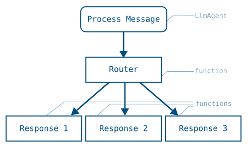
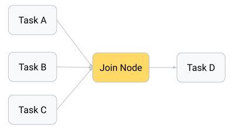
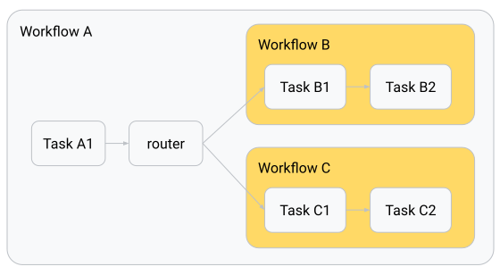

 [ Python](https://github.com/google/adk-python "adk-python on GitHub")[ JS ](https://github.com/google/adk-js "adk-js on GitHub")[ Go ](https://github.com/google/adk-go "adk-go on GitHub")[ Java ](https://github.com/google/adk-java "adk-java on GitHub")[ Kotlin](https://github.com/google/adk-kotlin "adk-kotlin on GitHub")

-   [Home](../..)
-    Build Agents
    
    Build Agents
    
    -   [Get Started](../../get-started/)
        
        Get Started
        
        -   [Python](../../get-started/python/)
        -   [TypeScript](../../get-started/typescript/)
        -   [Go](../../get-started/go/)
        -   [Java](../../get-started/java/)
        -   [Kotlin](../../get-started/kotlin/)
        -   [Agents CLI](../../get-started/agents-cli/)
        -   [Installation](../../get-started/installation/)
        -   [Google Cloud](../../get-started/google-cloud/)
        -   [Migrate to ADK](../../get-started/migrate/)
        
    -   [Build your Agent](../../tutorials/)
        
        Build your Agent
        
        -   [Multi-tool agent](../../tutorials/multi-tool-agent/)
        -   [Agent team](../../tutorials/agent-team/)
        -   [Code with AI](../../tutorials/coding-with-ai/)
        -   [Agent Config](../../agents/config/)
        
    -   [Agents](../../agents/)
        
        Agents
        
        -   [Simple agents](../../agents/llm-agents/)
        -   [Managed agents](../../agents/managed-agents/)
        
    -   [Graph Workflows](../)
        
        Graph Workflows
        
        -    Graph routes [Graph routes](./)
            
            Table of contents
            
            -   [Nodes](#nodes)
            -   [Workflow graphs syntax](#workflow-graphs-syntax)
                
                -   [Route sequences](#route-sequences)
                -   [Route branches and conditional execution](#route-branches-and-conditional-execution)
                
            -   [Parallel tasks: fan out and join paths](#parallel-tasks-fan-out-and-join-paths)
            -   [Nested workflows](#nested-workflows)
                
                -   [Nested workflow data output](#nested-workflow-data-output)
                
            -   [Loop and escalation exit](#loop-and-escalation-exit)
            
        -   [Data handling](../data-handling/)
        -   [Human input](../human-input/)
        -   [Dynamic workflows](../dynamic/)
        
    -   [Multi-Agent Workflows](../../workflows/)
        
        Multi-Agent Workflows
        
        -   [Collaborative workflows](../../workflows/collaboration/)
        -   [Template workflows](../../agents/workflow-agents/)
            
            Template workflows
            
            -   [Sequential workflow](../../agents/workflow-agents/sequential-agents/)
            -   [Loop workflow](../../agents/workflow-agents/loop-agents/)
            -   [Parallel workflow](../../agents/workflow-agents/parallel-agents/)
            -   [Custom template workflows](../../agents/custom-agents/)
            
        -   [Agent routing](../../agents/routing/)
        -   [Workflow patterns](../../workflows/patterns/)
        
    -   [Models for Agents](../../agents/models/)
        
        Models for Agents
        
        -   [Gemini](../../agents/models/google-gemini/)
            
            Gemini
            
            -   [Deferred scheduling](../../agents/models/google-gemini/deferred-schedule/)
            
        -   [Gemma](../../agents/models/google-gemma/)
        -   [Claude](../../agents/models/anthropic/)
        -   [Agent Platform hosted](../../agents/models/agent-platform/)
        -   [Apigee AI Gateway](../../agents/models/apigee/)
        -   [Model routing](../../agents/models/routing/)
        -   [OpenAI](../../agents/models/openai/)
        -   [Ollama](../../agents/models/ollama/)
        -   [vLLM](../../agents/models/vllm/)
        -   [LiteLLM](../../agents/models/litellm/)
        -   [LiteRT-LM](../../agents/models/litert-lm/)
        
    
-    Run Agents
    
    Run Agents
    
    -   [Agent Runtime](../../runtime/)
        
        Agent Runtime
        
        -   [Web Interface](../../runtime/web-interface/)
            
            Web Interface
            
            -   [Visual Builder](../../visual-builder/)
            
        -   [Command Line](../../runtime/command-line/)
        -   [API Server](../../runtime/api-server/)
        -   [Ambient Agents](../../runtime/ambient-agents/)
        -   [Resume Agents](../../runtime/resume/)
        -   [Cancel Agent Runs](../../runtime/cancel/)
        -   [Runtime Config](../../runtime/runconfig/)
        -   [Event Loop](../../runtime/event-loop/)
        
    -   [Deployment](../../deploy/)
        
        Deployment
        
        -   [Agent Runtime](../../deploy/agent-runtime/)
            
            Agent Runtime
            
            -   [Standard deployment](../../deploy/agent-runtime/deploy/)
            -   [agents-cli](../../deploy/agent-runtime/agents-cli/)
            -   [Test deployed agents](../../deploy/agent-runtime/test/)
            
        -   [Cloud Run](../../deploy/cloud-run/)
        -   [GKE](../../deploy/gke/)
        
    -   [Observability](../../observability/)
        
        Observability
        
        -   [Logging](../../observability/logging/)
        -   [Metrics](../../observability/metrics/)
        -   [Traces](../../observability/traces/)
        
    -   [Evaluation](../../evaluate/)
        
        Evaluation
        
        -   [Criteria](../../evaluate/criteria/)
        -   [User Simulation](../../evaluate/user-sim/)
        -   [Environment Simulation](../../evaluate/environment_simulation/)
        -   [Custom Metrics](../../evaluate/custom_metrics/)
        -   [Optimization](../../optimize/)
        
    -   [Safety and Security](../../safety/)
        
        Safety and Security
        
    
-    Components
    
    Components
    
    -   [Technical Overview](../../get-started/about/)
    -   [Custom Tools](../../tools-custom/)
        
        Custom Tools
        
        -    Function tools
            
            Function tools
            
            -   [Overview](../../tools-custom/function-tools/)
            -   [Tool performance](../../tools-custom/performance/)
            -   [Action confirmations](../../tools-custom/confirmation/)
            
        -   [MCP tools](../../tools-custom/mcp-tools/)
            
            MCP tools
            
            -   [Advanced configuration](../../tools-custom/mcp-tools/advanced/)
            -   [Deployment](../../tools-custom/mcp-tools/deployment/)
            -   [Agent as MCP server](../../tools-custom/mcp-tools/agent-as-server/)
            -   [Sub-agent delegation](../../tools-custom/mcp-tools/agent-managed/)
            
        -   [OpenAPI tools](../../tools-custom/openapi-tools/)
        -   [Authentication](../../tools-custom/authentication/)
        -   [Tool limitations](../../tools/limitations/)
        
    -   [Artifacts](../../artifacts/)
        
        Artifacts
        
    -   [Skills for Agents](../../skills/)
        
        Skills for Agents
        
    -   [App management](../../apps/)
        
        App management
        
        -   [Callbacks](../../callbacks/)
            
            Callbacks
            
            -   [Types of callbacks](../../callbacks/types-of-callbacks/)
            -   [Callback patterns](../../callbacks/design-patterns-and-best-practices/)
            
        -   [Plugins](../../plugins/)
        
    -   [Agent context](../../context/)
        
        Agent context
        
        -   [Conversational context](../../sessions/)
        -   [Sessions](../../sessions/session/)
            
            Sessions
            
            -   [Rewind sessions](../../sessions/session/rewind/)
            -   [Migrate sessions](../../sessions/session/migrate/)
            
        -   [State](../../sessions/state/)
        -   [Events](../../events/)
        -   [Memory](../../sessions/memory/)
        -   [Context compression](../../context/compaction/)
        -   [Model context caching](../../context/caching/)
        
    -   [A2A Protocol](../../a2a/)
        
        A2A Protocol
        
        -   [Introduction to A2A](../../a2a/intro/)
        -    A2A Quickstart (Exposing)
            
            A2A Quickstart (Exposing)
            
            -   [Python](../../a2a/quickstart-exposing/)
            -   [Go](../../a2a/quickstart-exposing-go/)
            -   [Java](../../a2a/quickstart-exposing-java/)
            
        -    A2A Quickstart (Consuming)
            
            A2A Quickstart (Consuming)
            
            -   [Python](../../a2a/quickstart-consuming/)
            -   [Go](../../a2a/quickstart-consuming-go/)
            -   [Java](../../a2a/quickstart-consuming-java/)
            -   [Kotlin](../../a2a/quickstart-consuming-kotlin/)
            
        -   [A2A Extension](../../a2a/a2a-extension/)
        
    -   [Live and Voice Agents](../../live/)
        
        Live and Voice Agents
        
        -   [Get started](../../live/get-started/)
            
            Get started
            
            -   [Python](../../live/get-started/streaming-python/)
            -   [Java](../../live/get-started/streaming-java/)
            
        -    Building
            
            Building
            
            -   [Workflows](../../live/workflows/)
            -   [Tools](../../live/tools/)
            -   [Sessions](../../live/sessions/)
            -   [Events](../../live/events/)
            -   [Audio and video](../../live/audio-video/)
            -   [Configuration](../../live/configuration/)
            
        -    Production
            
            Production
            
            -   [Guardrails](../../live/guardrails/)
            -   [Evaluation](../../live/evaluation/)
            -   [Build a custom server](../../live/custom-server/)
            
        -   [Supported models](../../live/models/)
        
    -   [Grounding](../../grounding/)
        
        Grounding
        
        -   [Google Search Grounding](../../grounding/google_search_grounding/)
        -   [Grounding with Search](../../grounding/grounding_with_search/)
        
    
-   [Integrations](../../integrations/)
    
    Integrations
    
-    Reference
    
    Reference
    
    -   [API Reference](../../api-reference/)
        
        API Reference
        
        -   [Python ADK](../../api-reference/python/)
        -   [TypeScript ADK](../../api-reference/typescript/)
        -    Go ADK
            
            Go ADK
            
            -   [Go v2.x](https://pkg.go.dev/google.golang.org/adk/v2)
            -   [Go v1.x](https://pkg.go.dev/google.golang.org/adk)
            
        -   [Java ADK](../../api-reference/java/)
        -   [Kotlin ADK](../../api-reference/kotlin/)
        -   [CLI Reference](../../api-reference/cli/)
        -   [Agent Config Reference](../../api-reference/agentconfig/)
        -   [REST API](../../api-reference/rest/)
        
    -   [Release Notes](../../release-notes/)
    
-   [Community](../../community/)
    
    Community
    
    -   [Contributing Guide](../../community/contributing-guide/)
    
-   [ADK 2.0](../../2.0/)
    
    ADK 2.0
    

Table of contents

-   [Nodes](#nodes)
-   [Workflow graphs syntax](#workflow-graphs-syntax)
    
    -   [Route sequences](#route-sequences)
    -   [Route branches and conditional execution](#route-branches-and-conditional-execution)
    
-   [Parallel tasks: fan out and join paths](#parallel-tasks-fan-out-and-join-paths)
-   [Nested workflows](#nested-workflows)
    
    -   [Nested workflow data output](#nested-workflow-data-output)
    
-   [Loop and escalation exit](#loop-and-escalation-exit)

1.  [Home](../..)
2.  [Build Agents](../../get-started/)
3.  [Graph Workflows](../)

# Build graph routes for agent workflows[¶](#build-graph-routes-for-agent-workflows "Permanent link")

Supported in ADKPython v2.0.0TypeScript v2.0.0Go v2.0.0

Graph-based workflows in ADK define agent logic as a graph of execution nodes and edges, allowing you to build more reliable processes that combine artificial intelligence (AI) reasoning and code logic. These workflows allow you to create logical routes of execution nodes that can encapsulate code functions, AI-powered agents, Tools, and human input. By explicitly mapping out routing logic, this approach allows you to define a specific, step-wise process workflow in code, providing improved precision and reliability over purely prompt-based agents.

**Figure 1.** Visualization of a task graph and the routing code to implement it.

PythonTypeScriptGo

`root_agent = Workflow(     name="routing_workflow",    edges=[        ("START", process_message, router),        (router,            {                "output-1": response_1,                "output-2": response_2,                "output-3": response_3,            },        ),    ], )`

`export const rootAgent = new Workflow({     name: 'routing_workflow',    edges: [        ['START', processMessage, router],        [            router,            {                'output-1': response1,                'output-2': response2,                'output-3': response3,            },        ],    ], });`

ADK Go v2.0.0 provides the following approach to graph-based workflows:

**Graph engine** (`workflowagent` + `workflow.Edge`): A node-and-edges graph API that maps directly to Python's `Workflow(edges=[...])`. Nodes are defined with `workflow.NewFunctionNode`, `workflow.NewAgentNode`, or `workflow.NewDynamicNode`, edges are declared as `[]workflow.Edge`, and the whole graph is wrapped in a `workflowagent.New` call:

`edges := workflow.Concat(         workflow.Chain(workflow.Start, classifyNode),        []workflow.Edge{                {From: classifyNode, To: responseA, Route: workflow.StringRoute("output-1")},                {From: classifyNode, To: responseB, Route: workflow.StringRoute("output-2")},                {From: classifyNode, To: responseC, Route: workflow.StringRoute("output-3")},        }, ) rootAgent, _ := workflowagent.New(workflowagent.Config{         Name:  "routing_workflow",        Edges: edges, })`

The advantage of using a graph-based agent workflow is the significant increase in control, predictability, and reliability over prompt-based agents. By defining the overall process workflow in code, you gain more control over how tasks are routed and executed. This structured node definition improves the predictability of agents and enhances reliability for complex tasks that require defined steps and process management.

Get started with graph-based workflows in ADK by checking out [Graph-based agent workflows](/graphs/).

## Nodes[¶](#nodes "Permanent link")

A graph is composed of execution nodes. These *nodes* can be ***Agents***, ADK ***Tools***, human input tasks, or code functions you write. Nodes can take inputs from previously executed nodes, and emit data through ***Event*** objects.

PythonTypeScriptGo

The following shows a simple ***FunctionNode*** that handles text inputs and sends a text output:

`from google.adk import Event def my_function_node(node_input: str):         input_text_modified = node_input.upper()        return Event(output=input_text_modified)`

In ADK TypeScript v2.0.0, the primary node type is a `FunctionNode`, created by passing a function to `node()`. A handler always takes `(ctx, input)` parameters; ADK does not inject values by parameter name. Returning a value directly wraps it in the event's `output` field. Returning `createEvent({output})` is the explicit form, which you need when you also set `route` or `content`:

``import {     createEvent,    node,    NodeContext,    Workflow,    type FunctionNodeHandler, } from '@google/adk'; /** A bare return value: boxed into an event's `output` for you. */ const myFunctionNode: FunctionNodeHandler<string, string> = (     _ctx: NodeContext,    nodeInput: string, ) => {     const inputTextModified = nodeInput.toUpperCase();    return inputTextModified; }; /** The explicit form — identical behaviour, useful when you also set `route`. */ const myExplicitEventNode = (_ctx: NodeContext, nodeInput: string) =>     createEvent({ output: `${nodeInput} IS AWESOME!` }); export const rootAgent = new Workflow({     name: 'function_node_pipeline',    edges: [        [            'START',            node(myFunctionNode, { name: 'my_function_node' }),            node(myExplicitEventNode, { name: 'add_suffix' }),        ],    ], });``

In ADK Go v2.0.0, the primary node type is `workflow.NewFunctionNode`. A `FunctionNode` wraps a plain Go function: the function returns a typed value, and the framework automatically wraps it in a `session.Event`, setting `event.Output`. The successor node receives this value as its typed `input` parameter — no manual state writes or event construction needed:

`// newFunctionNodePipeline demonstrates workflow.NewFunctionNode as the primary // v2 node type. A FunctionNode wraps a plain Go function: the function returns // a typed value, and the framework automatically wraps it in a session.Event, // setting event.Output. The successor node receives this value as its typed // input parameter. // // This is the direct Go equivalent of the Python FunctionNode: // //  def my_function_node(node_input: str): //      return Event(output=node_input.upper()) func newFunctionNodePipeline() (agent.Agent, error) {         upperFn := func(_ agent.Context, input string) (string, error) {                return strings.ToUpper(input), nil        }         suffixFn := func(_ agent.Context, input string) (string, error) {                return input + " IS AWESOME!", nil        }         // workflow.NewFunctionNode wraps each function as a graph node.        // workflow.Chain wires them in order: START → upper → suffix.        // The output of upperFn is delivered as the typed input of suffixFn        // via event.Output — no session state writes are needed.        nodeA := workflow.NewFunctionNode("upper", upperFn, workflow.NodeConfig{})        nodeB := workflow.NewFunctionNode("suffix", suffixFn, workflow.NodeConfig{})         return workflowagent.New(workflowagent.Config{                Name:        "function_node_pipeline",                Description: "Demonstrates workflow.NewFunctionNode data flow via Event.Output.",                Edges:       workflow.Chain(workflow.Start, nodeA, nodeB),        }) }`

For more information about transferring data between nodes, see [Data handling for agent workflows](/graphs/data-handling/).

## Workflow graphs syntax[¶](#workflow-graphs-syntax "Permanent link")

You define a graph by composing workflow agents. This section provides an overview of the common routing patterns.

Caution: Workflow agent limitations

You can add ***LlmAgents*** to graph-based workflows. However, they must be configured for single-turn or task mode. For more information about agent modes, see [Build collaborative agent teams](/workflows/collaboration/#mode-configuration-and-behaviors).

### Route sequences[¶](#route-sequences "Permanent link")

A sequential route runs each node once, in the listed order.

PythonTypeScriptGo

The `edges` array uses the `START` keyword to indicate the beginning of a graph execution, with each listed node executed in sequence:

`edges=[("START", task_A_node)]  # single node run edges=[("START",                 task_A_node,                task_B_node,                task_C_node)]           # 3 nodes run in order`

An `edges` row that starts with `'START'` runs each listed node once, in order, and passes every node's return value to the next node:

`edges: [['START', taskANode]]                       // a single node edges: [['START', taskANode, taskBNode, taskCNode]] // three, in order`

Listing `'START'` in more than one row creates parallel paths instead. For more information, see [fan out and join](#parallel-tasks-fan-out-and-join-paths).

``import { node, NodeContext, Workflow } from '@google/adk'; const taskANode = node(     (_ctx: NodeContext, nodeInput: string) => `Summary: ${nodeInput.trim()}`,    { name: 'task_A_node' }, ); const taskBNode = node(     (_ctx: NodeContext, summary: string) => summary.toUpperCase(),    { name: 'task_B_node' }, ); const taskCNode = node(     (_ctx: NodeContext, shouted: string) => `${shouted} (done)`,    { name: 'task_C_node' }, ); export const rootAgent = new Workflow({     name: 'sequential_workflow',    edges: [['START', taskANode, taskBNode, taskCNode]], });``

`workflow.Chain(workflow.Start, nodeA, nodeB, nodeC)` wires nodes into a sequential edge slice. Each node's typed return value is forwarded to the next node via `event.Output` — no session state writes needed:

`// newSequentialNodes builds a two-step sequential workflow using the v2 graph // engine. workflow.Chain wires the nodes in order; each node's typed return // value is forwarded to the next node via event.Output. // // This is the Go equivalent of: // //  edges=[("START", task_A_node, task_B_node)] func newSequentialNodes() (agent.Agent, error) {         // task_A_node: transforms the user's input.        taskANode := workflow.NewFunctionNode("task_A_node",                func(_ agent.Context, input string) (string, error) {                        return "Summary: " + strings.TrimSpace(input), nil                },                workflow.NodeConfig{},        )         // task_B_node: receives task A's output as its typed input and produces        // the final result. No session state reads needed.        taskBNode := workflow.NewFunctionNode("task_B_node",                func(_ agent.Context, summary string) (string, error) {                        return strings.ToUpper(summary), nil                },                workflow.NodeConfig{},        )         return workflowagent.New(workflowagent.Config{                Name:        "sequential_workflow",                Description: "Runs task A then task B in order via workflow.Chain.",                Edges:       workflow.Chain(workflow.Start, taskANode, taskBNode),        }) }`

### Route branches and conditional execution[¶](#route-branches-and-conditional-execution "Permanent link")

PythonTypeScriptGo

In Python, branching is handled by a `FunctionNode` that returns an `Event(route=...)` value, which the `edges` dict dispatches to different nodes.

`from google.adk import Event, Workflow from google.adk.agents import Agent  def router(node_input: str):         """Route to task B or C based on node_input."""        if condition(node_input):                return Event(route="RUN_TASK_C")        return Event(route="RUN_TASK_B") task_B_node = Agent(name="task_B_agent") # An agent to execute node B def task_C_node(node_input: str):         """A FunctionNode to execute node C."""        return Event(output="Task C completed") root_agent = Workflow(         name="routing_workflow",        edges=[                ("START", task_A_node, router),                (router,                    {                        # "route value": node_to_run                        "RUN_TASK_B": task_B_node,                        "RUN_TASK_C": task_C_node,                    },                ),        ], )`

Branching requires a node that emits a `route` value, and an edge row that maps each route value to the node that handles it. Route values can be strings, numbers, or booleans. The `DEFAULT_ROUTE` setting matches when no other route on the same source node matches. A branch target can be any node-like value: in this example, `taskBNode` is an `LlmAgent` and `taskCNode` is a function.

`import {     createEvent,    LlmAgent,    node,    NodeContext,    Workflow, } from '@google/adk'; const taskANode = node(     (_ctx: NodeContext, nodeInput: string) => nodeInput.trim(),    { name: 'task_A_node' }, ); /** Stands in for an application-specific branch condition. */ const condition = (nodeInput: string) => /\d/.test(nodeInput); /** Routes to task B or C based on nodeInput. */ const router = node(     (_ctx: NodeContext, nodeInput: string) =>        condition(nodeInput)            ? createEvent({ route: 'RUN_TASK_C', output: nodeInput })            : createEvent({ route: 'RUN_TASK_B', output: nodeInput }),    { name: 'router' }, ); const taskBNode = new LlmAgent({     name: 'task_B_agent',    model: 'gemini-flash-latest',    instruction: 'Answer the user in a single short sentence.', }); const taskCNode = node(() => 'Task C completed', { name: 'task_C_node' }); export const rootAgent = new Workflow({     name: 'routing_workflow',    edges: [        ['START', taskANode, router],        [            router,            {                RUN_TASK_B: taskBNode,                RUN_TASK_C: taskCNode,            },        ],    ], });`

In ADK Go v2.0.0, conditional dispatch uses the `workflow` graph engine. A node sets `Event.Routes` to one or more string route keys, and each `workflow.Edge` selects its successor using a `workflow.Route` matcher:

-   `workflow.StringRoute("category")` — matches a single string value
-   `workflow.IntRoute(n)` or `workflow.MultiRoute[int]{1, 2, 3}` — matches integer values
-   `workflow.BoolRoute(true)` — matches a boolean value
-   `workflow.Default` — matches when no other route on the same source node matches

The following pattern is the Go equivalent of the Python router:

`// classifyNode emits an Event with Routes=[]string{"BUG"}, // ["CUSTOMER_SUPPORT"], or ["LOGISTICS"] based on the message. edges := workflow.Concat(         workflow.Chain(workflow.Start, processMessage, classifyNode),        []workflow.Edge{                {From: classifyNode, To: bugHandler,       Route: workflow.StringRoute("BUG")},                {From: classifyNode, To: supportHandler,   Route: workflow.StringRoute("CUSTOMER_SUPPORT")},                {From: classifyNode, To: logisticsHandler, Route: workflow.StringRoute("LOGISTICS")},        }, ) rootAgent, _ := workflowagent.New(workflowagent.Config{         Name:  "routing_workflow",        Edges: edges, })`

`workflow.EdgeBuilder` provides a fluent alternative to assembling the `[]workflow.Edge` slice by hand. The builder's `Add`, `AddFanOut`, and `AddFanIn` methods express the same topology with less repetition:

`eb := workflow.NewEdgeBuilder() eb.Add(workflow.Start, processMessage) eb.Add(processMessage, classifyNode) eb.AddRoute(classifyNode, bugHandler,       workflow.StringRoute("BUG")) eb.AddRoute(classifyNode, supportHandler,   workflow.StringRoute("CUSTOMER_SUPPORT")) eb.AddRoute(classifyNode, logisticsHandler, workflow.StringRoute("LOGISTICS")) rootAgent, _ := workflowagent.New(workflowagent.Config{         Name:  "routing_workflow",        Edges: eb.Build(), })`

For complete, runnable routing examples see: [string routing](https://github.com/google/adk-go/tree/v2/examples/workflow/routing/string), [int / multi-value routing](https://github.com/google/adk-go/tree/v2/examples/workflow/routing/int), and [LLM-driven routing](https://github.com/google/adk-go/tree/v2/examples/workflow/routing/llm).

Prebuilt agents: encoding routing in state

When using `sequentialagent` / `parallelagent` / `loopagent` instead of the graph engine, there is no `Event.Routes` dispatch. Encode the routing decision in session state via `OutputKey` and let downstream agents inspect it in their `Instruction` template, or use a `loopagent` with an `Escalate`\-based exit — see the [loop and escalation example](#loop-and-escalation-exit) below.

## Parallel tasks: fan out and join paths[¶](#parallel-tasks-fan-out-and-join-paths "Permanent link")

You can create graphs that split execution across multiple, parallel nodes, and typically you need to assemble the output of each node for further processing. This task execution pattern has two stages. The workflow first fans out when it starts multiple parallel tasks, and then it re-joins those paths when those tasks are completed before proceeding to the next step.

**Figure 2.** The output of parallel task nodes can be assembled and joined before passing results to the next step.

PythonTypeScriptGo

You accomplish the join step by using a ***JoinNode*** object, which waits for each parallel task to complete and then passes the collection of outputs from these nodes to the next node.

`from google.adk.workflow import JoinNode my_join_node = JoinNode(name="my_join_node") edges=[         ("START", parallel_task_A, my_join_node),        ("START", parallel_task_B, my_join_node),        ("START", parallel_task_C, my_join_node),        (my_join_node, final_task_D), ]`

A `JoinNode` is the fan-in barrier. This logic mechanism waits for every predecessor task to complete, and then passes its successor a record keyed by predecessor node name:

``import { JoinNode, node, NodeContext, Workflow } from '@google/adk'; const parallelTaskA = node(     (_ctx: NodeContext, text: string) => text.toUpperCase(),    { name: 'parallel_task_A' }, ); const parallelTaskB = node((_ctx: NodeContext, text: string) => text.length, {     name: 'parallel_task_B', }); const parallelTaskC = node(     (_ctx: NodeContext, text: string) => text.split('').reverse().join(''),    { name: 'parallel_task_C' }, ); const myJoinNode = new JoinNode({ name: 'my_join_node' }); const finalTaskD = node(     (_ctx: NodeContext, results: Record<string, unknown>) =>        [            `Uppercase: ${results['parallel_task_A']}`,            `Length:    ${results['parallel_task_B']}`,            `Reversed:  ${results['parallel_task_C']}`,        ].join('\n'),    { name: 'final_task_D' }, ); export const rootAgent = new Workflow({     name: 'fan_out_workflow',    edges: [        ['START', parallelTaskA, myJoinNode],        ['START', parallelTaskB, myJoinNode],        ['START', parallelTaskC, myJoinNode],        [myJoinNode, finalTaskD],    ], });``

ADK Go v2.0.0 provides `workflow.NewJoinNode` for true fan-in in the graph engine: fan-out edges from `workflow.Start` (or any shared source node) feed in parallel to the join node, which waits for all of them to complete before emitting a `map[string]any` keyed by predecessor node name to the next node.

`workflow.EdgeBuilder` makes the fan-out / fan-in wiring concise with its dedicated `AddFanOut` and `AddFanIn` helpers (as shown in the [complex workflow example](https://github.com/google/adk-go/tree/v2/examples/workflow/complex)):

`gatherNode := workflow.NewJoinNode("gather") eb := workflow.NewEdgeBuilder() eb.AddFanOut(workflow.Start, researchNodeA, researchNodeB, researchNodeC) eb.AddFanIn(gatherNode, researchNodeA, researchNodeB, researchNodeC) eb.Add(gatherNode, formatNode) eb.Add(formatNode, synthesisNode) rootAgent, _ := workflowagent.New(workflowagent.Config{         Name:  "research_pipeline",        Edges: eb.Build(), })`

The following snippet shows the complete fan-out / join pattern using `workflow.NewJoinNode` and `EdgeBuilder.AddFanOut` / `AddFanIn`:

`// newParallelFanOut builds a fan-out / join workflow using the v2 graph engine. // Three research nodes run in parallel from Start; workflow.NewJoinNode waits // for all of them to complete and emits a map[nodeName]output to the format // node, which assembles the results for a synthesis node. // // Graph topology: // //  START ─┬─> research_A ──┐ //         ├─> research_B ──┼─> gather (JoinNode) ─> format ─> synthesis //         └─> research_C ──┘ // // Python equivalent: // //  edges=[ //      ("START", research_A, my_join_node), //      ("START", research_B, my_join_node), //      ("START", research_C, my_join_node), //      (my_join_node, format_node), //      (format_node, synthesis_node), //  ] func newParallelFanOut() (agent.Agent, error) {         researchA := workflow.NewFunctionNode("research_A",                func(_ agent.Context, _ any) (string, error) {                        return "Fact about renewable energy.", nil                },                workflow.NodeConfig{},        )        researchB := workflow.NewFunctionNode("research_B",                func(_ agent.Context, _ any) (string, error) {                        return "Fact about electric vehicles.", nil                },                workflow.NodeConfig{},        )        researchC := workflow.NewFunctionNode("research_C",                func(_ agent.Context, _ any) (string, error) {                        return "Fact about carbon capture.", nil                },                workflow.NodeConfig{},        )         // workflow.NewJoinNode waits for all predecessors (research_A, research_B,        // research_C) to complete and emits a map[nodeName]output to its successor.        gatherNode := workflow.NewJoinNode("gather")         // formatNode receives map[string]any from gatherNode and assembles a        // combined prompt string.        formatNode := workflow.NewFunctionNode("format",                func(_ agent.Context, results map[string]any) (string, error) {                        return fmt.Sprintf("A: %v\nB: %v\nC: %v",                                results["research_A"],                                results["research_B"],                                results["research_C"],                        ), nil                },                workflow.NodeConfig{},        )         synthesisNode := workflow.NewFunctionNode("synthesis",                func(_ agent.Context, prompt string) (string, error) {                        return "Combined report: " + prompt, nil                },                workflow.NodeConfig{},        )         // EdgeBuilder.AddFanOut fans workflow.Start out to all three research nodes.        // EdgeBuilder.AddFanIn routes all three research nodes into gatherNode.        eb := workflow.NewEdgeBuilder()        eb.AddFanOut(workflow.Start, researchA, researchB, researchC)        eb.AddFanIn(gatherNode, researchA, researchB, researchC)        eb.Add(gatherNode, formatNode)        eb.Add(formatNode, synthesisNode)         return workflowagent.New(workflowagent.Config{                Name:        "fan_out_workflow",                Description: "Parallel research fan-out with JoinNode barrier and synthesis.",                Edges:       eb.Build(),        }) }`

Caution: nodes that feed a JoinNode must produce output

A `JoinNode` releases only after all of its predecessor nodes finish. Make sure that every node that feeds a join has an output of its own, and attach a retry configuration to any node that can fail. A predecessor that finishes without an output leaves the join with no value for that branch, and the resulting failure appears downstream, away from the node that caused it.

## Nested workflows[¶](#nested-workflows "Permanent link")

When building more complex workflows, you may want to encapsulate the functionality for specific tasks into reusable workflows. One or more workflow agents can be used as a sub-agent within another workflow agent to accomplish this goal.

**Figure 3.** Nested workflow agents as sub-agents inside a parent workflow.

PythonTypeScriptGo

`from google.adk import Workflow root_agent = Workflow(         name="parent_workflow",        edges=[              ("START", task_A1, router),              (router, {                        "RUN_WORKFLOW_B": workflow_B,                        "RUN_WORKFLOW_C": workflow_C,                        },              ),        ], )`

#### Nested workflow data output[¶](#nested-workflow-data-output "Permanent link")

Output for nested Workflow objects works slightly differently from individual nodes. When the nested workflow completes one of its nodes, it transmits data to the next node in the nested workflow's graph *and* the system bubbles up the Event for that node to the parent workflow for process traceability. When the nested workflow completes the last node in its process, the parent node extracts data from the final leaf nodes and emits it as the output of the nested workflow.

A `Workflow` is itself a node, so you can use one inside another workflow's edges to encapsulate a reusable sub-process:

``import { createEvent, node, NodeContext, Workflow } from '@google/adk'; const taskA1 = node(     (_ctx: NodeContext, nodeInput: string) => nodeInput.trim(),    {        name: 'task_A1',    }, ); const router = node(     (_ctx: NodeContext, text: string) =>        createEvent({            route: text === text.toUpperCase() ? 'RUN_WORKFLOW_C' : 'RUN_WORKFLOW_B',            output: text,        }),    { name: 'router' }, ); /**   * Upper-cases the first letter of each word.  *  * Unicode-aware on purpose: `\b\w` is ASCII-only, so `ü` never matches — and  * the word boundary it creates before the *next* ASCII letter upper-cases that  * one instead ("strässe" -> "SträSse"). A letter whose uppercase form is more  * than one code point (German `ß` -> "SS") is left alone rather than mangled.  */ const titleCase = (text: string) =>     text.replace(/(^|\P{L})(\p{L})/gu, (_match, sep: string, ch: string) => {        const upper = ch.toUpperCase();        return sep + ([...upper].length === 1 ? upper : ch);    }); const workflowB = new Workflow({     name: 'workflow_B',    edges: [        [            'START',            node((_ctx: NodeContext, text: string) => titleCase(text), {                name: 'b_title_case',            }),            node((_ctx: NodeContext, text: string) => `[B] ${text}`, {                name: 'b_frame',            }),        ],    ], }); const workflowC = new Workflow({     name: 'workflow_C',    edges: [        [            'START',            node((_ctx: NodeContext, text: string) => text.toLowerCase(), {                name: 'c_lower_case',            }),            node((_ctx: NodeContext, text: string) => `[C] ${text}`, {                name: 'c_frame',            }),        ],    ], }); export const rootAgent = new Workflow({     name: 'parent_workflow',    edges: [        ['START', taskA1, router],        [            router,            {                RUN_WORKFLOW_B: workflowB,                RUN_WORKFLOW_C: workflowC,            },        ],    ], });``

**Nested workflow data output.** While the inner workflow runs, each of its node events bubbles up to the parent for traceability. When it finishes, the output of its terminal node becomes the output of the nested-workflow node.

ADK Go v2.0.0 supports nested workflows in two complementary ways:

**Graph engine** (`workflowagent` + `workflow.Edge`): A `workflowagent` created with `workflowagent.New` is itself an `agent.Agent`, so it can be wrapped with `workflow.NewAgentNode` and used as a node inside another workflow's `edges` slice. The inner workflow runs to completion as a single node from the outer graph's perspective, and its terminal output is emitted as the node output on the outer graph's edge:

`innerNode, _ := workflow.NewAgentNode(innerWorkflowAgent, workflow.NodeConfig{}) outerEdges := workflow.Chain(workflow.Start, outerStepNode, innerNode, finalNode) rootAgent, _ := workflowagent.New(workflowagent.Config{         Name:  "parent_workflow",        Edges: outerEdges, })`

The following snippet shows both the inner and outer graph construction. `workflow.NewAgentNode` wraps the inner `workflowagent` so it can be placed in the outer graph's `workflow.Chain`:

`// newNestedWorkflows shows how to nest one workflowagent inside another using // the v2 graph engine. The inner workflowagent is wrapped with // workflow.NewAgentNode and placed as a node in the outer graph's edge slice. // From the outer graph's perspective the inner workflow is a single node that // runs to completion before the edge to finalNode is followed. // // Python equivalent: // //  root_agent = Workflow( //      name="parent_workflow", //      edges=[("START", task_A1, workflow_B, final_node)], //  ) func newNestedWorkflows() (agent.Agent, error) {         // --- Inner workflow B ---        innerStep1 := workflow.NewFunctionNode("inner_step_1",                func(_ agent.Context, input string) (string, error) {                        return "[ES] " + input, nil // simulate translation to Spanish                },                workflow.NodeConfig{},        )        innerStep2 := workflow.NewFunctionNode("inner_step_2",                func(_ agent.Context, spanish string) (string, error) {                        return "[EN] " + spanish, nil // simulate translation back to English                },                workflow.NodeConfig{},        )         // workflowB is a self-contained inner graph.        workflowB, err := workflowagent.New(workflowagent.Config{                Name:        "workflow_B",                Description: "Translates input to Spanish then back to English.",                Edges:       workflow.Chain(workflow.Start, innerStep1, innerStep2),        })        if err != nil {                return nil, fmt.Errorf("workflowB: %w", err)        }         // --- Outer graph ---        taskA1 := workflow.NewFunctionNode("task_A1",                func(_ agent.Context, input string) (string, error) {                        return "Summary: " + strings.TrimSpace(input), nil                },                workflow.NodeConfig{},        )         finalNode := workflow.NewFunctionNode("final_node",                func(_ agent.Context, result string) (string, error) {                        return "Final: " + result, nil                },                workflow.NodeConfig{},        )         // workflow.NewAgentNode wraps workflowB so it can be placed as a node        // in the outer graph's edges slice.        innerNode, err := workflow.NewAgentNode(workflowB, workflow.NodeConfig{})        if err != nil {                return nil, fmt.Errorf("NewAgentNode(workflowB): %w", err)        }         return workflowagent.New(workflowagent.Config{                Name:        "parent_workflow",                Description: "Runs task_A1 then the nested workflow_B then final_node.",                Edges:       workflow.Chain(workflow.Start, taskA1, innerNode, finalNode),                SubAgents:   []agent.Agent{workflowB},        }) }`

## Loop and escalation exit[¶](#loop-and-escalation-exit "Permanent link")

A loop repeats a set of steps until a termination condition is met. In Python this is expressed as a back-edge in the `edges` graph that routes back to an earlier node. In ADK Go v2.0.0, the graph engine supports the same pattern directly: add an edge from a downstream node back to an earlier node with a route condition, and the engine re-activates the target node with a fresh lifecycle on each iteration.

PythonTypeScriptGo

`from google.adk import Event, Workflow  def router(node_input: str):         """Route to task B or C based on node_input."""        if condition(node_input):                return Event(route="RUN_TASK_C")        return Event(route="RUN_TASK_B") root_agent = Workflow(         name="routing_workflow",        edges=[                ("START", task_A_node, router),                (router,                    {                        "RUN_TASK_B": task_B_node,                        "RUN_TASK_C": task_C_node,                    },                ),        ], )`

A loop is a back-edge: a downstream node routes back to an earlier node, and the engine re-activates that node with a fresh lifecycle on each iteration. The loop exits when the router selects the terminal branch:

``import { createEvent, node, NodeContext, Workflow } from '@google/adk'; interface Draft {     topic: string;    bullets: string[]; } /** The critic is satisfied once the draft has at least this many bullets. */ const REQUIRED_BULLETS = 3; const seedDraft = node(     (_ctx: NodeContext, topic: string): Draft => ({        topic: topic.trim(),        bullets: [`${topic.trim()} — point 1`],    }),    { name: 'seed_draft' }, ); const critic = node(     (_ctx: NodeContext, draft: Draft) =>        createEvent({            route: draft.bullets.length >= REQUIRED_BULLETS ? 'DONE' : 'REVISE',            output: draft,        }),    { name: 'critic' }, ); const refine = node(     (_ctx: NodeContext, draft: Draft): Draft => ({        ...draft,        bullets: [            ...draft.bullets,            `${draft.topic} — point ${draft.bullets.length + 1}`,        ],    }),    { name: 'refine' }, ); const finalize = node(     (_ctx: NodeContext, draft: Draft) =>        `Approved after ${draft.bullets.length} bullets:\n` +        draft.bullets.map((b) => `  • ${b}`).join('\n'),    { name: 'finalize' }, ); export const rootAgent = new Workflow({     name: 'loop_workflow',    edges: [        ['START', seedDraft, critic],        [critic, { REVISE: refine, DONE: finalize }],        [refine, critic],    ], });``

The following example uses the graph engine with `workflow.EdgeBuilder`. The critic node returns a verdict, a router node sets `Event.Routes`, and a back-edge from the refiner to the critic creates the loop. When the critic is satisfied it routes to the terminal `done` node instead:

``// draft carries the working document through the refinement loop. type draft struct {         Text string `json:"text"` } // criticResult is emitted by the critic node with the review verdict and // optional suggestions. The router reads Verdict to set Event.Routes. type criticResult struct {         Verdict     string `json:"verdict"`     // "REFINE" or "DONE"        Suggestions string `json:"suggestions"` // non-empty when Verdict == "REFINE" } // writeDraft is the initial writer node: produces the first draft from the // user's topic. Its typed return value becomes the input to the critic node // via Event.Output — no session state writes needed. func writeDraft(_ agent.Context, topic string) (draft, error) {         // In a real workflow this would call an LLM; here we return a stub.        return draft{Text: "Draft about " + topic + ": placeholder content."}, nil } // reviewDraft is the critic node: inspects the draft and returns a verdict. // "DONE" exits the loop; "REFINE" triggers a back-edge to the refiner. func reviewDraft(_ agent.Context, d draft) (criticResult, error) {         // Simulate a critic: approve once the draft contains "improved".        if strings.Contains(d.Text, "improved") {                return criticResult{Verdict: "DONE"}, nil        }        return criticResult{                Verdict:     "REFINE",                Suggestions: "Add more detail and mark the text as improved.",        }, nil } // routeVerdict reads the critic's verdict and sets Event.Routes so the // graph engine dispatches to either the refiner or the done node. // Returning nil suppresses the automatic terminal event. func routeVerdict(ctx agent.Context, r criticResult, emit func(*session.Event) error) (any, error) {         ev := session.NewEvent(ctx, ctx.InvocationID())        ev.Routes = []string{r.Verdict}        ev.Output = r // forward the full result to the chosen successor        if err := emit(ev); err != nil {                return nil, err        }        return nil, nil } // refineDraft applies the critic's suggestions and returns the improved draft. // Its output feeds back to the critic node via the back-edge. func refineDraft(_ agent.Context, r criticResult) (draft, error) {         return draft{Text: "improved draft incorporating: " + r.Suggestions}, nil } // reportDone is the terminal node, reached only when the critic is satisfied. func reportDone(_ agent.Context, r criticResult) (string, error) {         return "Refinement complete. Final verdict: " + r.Verdict, nil } // newLoopEscalate builds an iterative document-refinement workflow using the // graph engine. The critic node emits a route ("REFINE" or "DONE") and the // engine dispatches to either the refiner (which loops back to the critic via // a back-edge) or the terminal done node. // // Graph topology: // //  START → writer → critic → router ─┬─ "REFINE" → refiner ──┐ //                                     └─ "DONE"   → done       │ //                   ▲_______________________________┘ (back-edge) // // Python equivalent: // //  edges=[ //      ("START", writer_node, critic_node, router), //      (router, {"REFINE": refiner_node, "DONE": done_node}), //      (refiner_node, critic_node),  # back-edge creates the loop //  ] func newLoopEscalate() (agent.Agent, error) {         writerNode := workflow.NewFunctionNode("writer", writeDraft, workflow.NodeConfig{})        criticNode := workflow.NewFunctionNode("critic", reviewDraft, workflow.NodeConfig{})        routerNode := workflow.NewEmittingFunctionNode("router", routeVerdict, workflow.NodeConfig{})        refinerNode := workflow.NewFunctionNode("refiner", refineDraft, workflow.NodeConfig{})        doneNode := workflow.NewFunctionNode("done", reportDone, workflow.NodeConfig{})         // Build the edges. The back-edge from refinerNode to criticNode creates        // the loop; the graph engine re-activates criticNode with a fresh        // lifecycle on each iteration.        eb := workflow.NewEdgeBuilder()        eb.Add(workflow.Start, writerNode)        eb.Add(writerNode, criticNode)        eb.Add(criticNode, routerNode)        eb.AddRoute(routerNode, refinerNode, workflow.StringRoute("REFINE"))        eb.AddRoute(routerNode, doneNode, workflow.StringRoute("DONE"))        eb.AddRoute(refinerNode, criticNode, workflow.Default) // back-edge: loop back for another review         return workflowagent.New(workflowagent.Config{                Name:        "iterative_writer",                Description: "Writes then iteratively refines a document using a critic/refiner loop.",                Edges:       eb.Build(),        }) }``

Caution: unbounded graph cycles

A graph cycle is not bounded automatically. Make sure the exit condition eventually becomes true, or express the iteration as a [dynamic workflow](/graphs/dynamic/#loop-route), where the loop runs in your own code and you control its bound.

Back to top