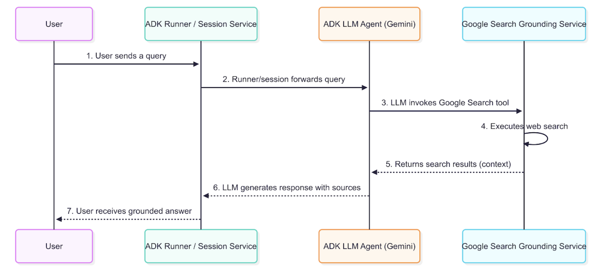

 [ Python](https://github.com/google/adk-python "adk-python on GitHub")[ JS ](https://github.com/google/adk-js "adk-js on GitHub")[ Go ](https://github.com/google/adk-go "adk-go on GitHub")[ Java ](https://github.com/google/adk-java "adk-java on GitHub")[ Kotlin](https://github.com/google/adk-kotlin "adk-kotlin on GitHub")

-   [Home](../..)
-    Build Agents
    
    Build Agents
    
    -   [Get Started](../../get-started/)
        
        Get Started
        
        -   [Python](../../get-started/python/)
        -   [TypeScript](../../get-started/typescript/)
        -   [Go](../../get-started/go/)
        -   [Java](../../get-started/java/)
        -   [Kotlin](../../get-started/kotlin/)
        -   [Agents CLI](../../get-started/agents-cli/)
        -   [Installation](../../get-started/installation/)
        -   [Google Cloud](../../get-started/google-cloud/)
        -   [Migrate to ADK](../../get-started/migrate/)
        
    -   [Build your Agent](../../tutorials/)
        
        Build your Agent
        
        -   [Multi-tool agent](../../tutorials/multi-tool-agent/)
        -   [Agent team](../../tutorials/agent-team/)
        -   [Code with AI](../../tutorials/coding-with-ai/)
        -   [Agent Config](../../agents/config/)
        
    -   [Agents](../../agents/)
        
        Agents
        
        -   [Simple agents](../../agents/llm-agents/)
        -   [Managed agents](../../agents/managed-agents/)
        
    -   [Graph Workflows](../../graphs/)
        
        Graph Workflows
        
        -   [Graph routes](../../graphs/routes/)
        -   [Data handling](../../graphs/data-handling/)
        -   [Human input](../../graphs/human-input/)
        -   [Dynamic workflows](../../graphs/dynamic/)
        
    -   [Multi-Agent Workflows](../../workflows/)
        
        Multi-Agent Workflows
        
        -   [Collaborative workflows](../../workflows/collaboration/)
        -   [Template workflows](../../agents/workflow-agents/)
            
            Template workflows
            
            -   [Sequential workflow](../../agents/workflow-agents/sequential-agents/)
            -   [Loop workflow](../../agents/workflow-agents/loop-agents/)
            -   [Parallel workflow](../../agents/workflow-agents/parallel-agents/)
            -   [Custom template workflows](../../agents/custom-agents/)
            
        -   [Agent routing](../../agents/routing/)
        -   [Workflow patterns](../../workflows/patterns/)
        
    -   [Models for Agents](../../agents/models/)
        
        Models for Agents
        
        -   [Gemini](../../agents/models/google-gemini/)
            
            Gemini
            
            -   [Deferred scheduling](../../agents/models/google-gemini/deferred-schedule/)
            
        -   [Gemma](../../agents/models/google-gemma/)
        -   [Claude](../../agents/models/anthropic/)
        -   [Agent Platform hosted](../../agents/models/agent-platform/)
        -   [Apigee AI Gateway](../../agents/models/apigee/)
        -   [Model routing](../../agents/models/routing/)
        -   [OpenAI](../../agents/models/openai/)
        -   [Ollama](../../agents/models/ollama/)
        -   [vLLM](../../agents/models/vllm/)
        -   [LiteLLM](../../agents/models/litellm/)
        -   [LiteRT-LM](../../agents/models/litert-lm/)
        
    
-    Run Agents
    
    Run Agents
    
    -   [Agent Runtime](../../runtime/)
        
        Agent Runtime
        
        -   [Web Interface](../../runtime/web-interface/)
            
            Web Interface
            
            -   [Visual Builder](../../visual-builder/)
            
        -   [Command Line](../../runtime/command-line/)
        -   [API Server](../../runtime/api-server/)
        -   [Ambient Agents](../../runtime/ambient-agents/)
        -   [Resume Agents](../../runtime/resume/)
        -   [Cancel Agent Runs](../../runtime/cancel/)
        -   [Runtime Config](../../runtime/runconfig/)
        -   [Event Loop](../../runtime/event-loop/)
        
    -   [Deployment](../../deploy/)
        
        Deployment
        
        -   [Agent Runtime](../../deploy/agent-runtime/)
            
            Agent Runtime
            
            -   [Standard deployment](../../deploy/agent-runtime/deploy/)
            -   [agents-cli](../../deploy/agent-runtime/agents-cli/)
            -   [Test deployed agents](../../deploy/agent-runtime/test/)
            
        -   [Cloud Run](../../deploy/cloud-run/)
        -   [GKE](../../deploy/gke/)
        
    -   [Observability](../../observability/)
        
        Observability
        
        -   [Logging](../../observability/logging/)
        -   [Metrics](../../observability/metrics/)
        -   [Traces](../../observability/traces/)
        
    -   [Evaluation](../../evaluate/)
        
        Evaluation
        
        -   [Criteria](../../evaluate/criteria/)
        -   [User Simulation](../../evaluate/user-sim/)
        -   [Environment Simulation](../../evaluate/environment_simulation/)
        -   [Custom Metrics](../../evaluate/custom_metrics/)
        -   [Optimization](../../optimize/)
        
    -   [Safety and Security](../../safety/)
        
        Safety and Security
        
    
-    Components
    
    Components
    
    -   [Technical Overview](../../get-started/about/)
    -   [Custom Tools](../../tools-custom/)
        
        Custom Tools
        
        -    Function tools
            
            Function tools
            
            -   [Overview](../../tools-custom/function-tools/)
            -   [Tool performance](../../tools-custom/performance/)
            -   [Action confirmations](../../tools-custom/confirmation/)
            
        -   [MCP tools](../../tools-custom/mcp-tools/)
            
            MCP tools
            
            -   [Advanced configuration](../../tools-custom/mcp-tools/advanced/)
            -   [Deployment](../../tools-custom/mcp-tools/deployment/)
            -   [Agent as MCP server](../../tools-custom/mcp-tools/agent-as-server/)
            -   [Sub-agent delegation](../../tools-custom/mcp-tools/agent-managed/)
            
        -   [OpenAPI tools](../../tools-custom/openapi-tools/)
        -   [Authentication](../../tools-custom/authentication/)
        -   [Tool limitations](../../tools/limitations/)
        
    -   [Artifacts](../../artifacts/)
        
        Artifacts
        
    -   [Skills for Agents](../../skills/)
        
        Skills for Agents
        
    -   [App management](../../apps/)
        
        App management
        
        -   [Callbacks](../../callbacks/)
            
            Callbacks
            
            -   [Types of callbacks](../../callbacks/types-of-callbacks/)
            -   [Callback patterns](../../callbacks/design-patterns-and-best-practices/)
            
        -   [Plugins](../../plugins/)
        
    -   [Agent context](../../context/)
        
        Agent context
        
        -   [Conversational context](../../sessions/)
        -   [Sessions](../../sessions/session/)
            
            Sessions
            
            -   [Rewind sessions](../../sessions/session/rewind/)
            -   [Migrate sessions](../../sessions/session/migrate/)
            
        -   [State](../../sessions/state/)
        -   [Events](../../events/)
        -   [Memory](../../sessions/memory/)
        -   [Context compression](../../context/compaction/)
        -   [Model context caching](../../context/caching/)
        
    -   [A2A Protocol](../../a2a/)
        
        A2A Protocol
        
        -   [Introduction to A2A](../../a2a/intro/)
        -    A2A Quickstart (Exposing)
            
            A2A Quickstart (Exposing)
            
            -   [Python](../../a2a/quickstart-exposing/)
            -   [Go](../../a2a/quickstart-exposing-go/)
            -   [Java](../../a2a/quickstart-exposing-java/)
            
        -    A2A Quickstart (Consuming)
            
            A2A Quickstart (Consuming)
            
            -   [Python](../../a2a/quickstart-consuming/)
            -   [Go](../../a2a/quickstart-consuming-go/)
            -   [Java](../../a2a/quickstart-consuming-java/)
            -   [Kotlin](../../a2a/quickstart-consuming-kotlin/)
            
        -   [A2A Extension](../../a2a/a2a-extension/)
        
    -   [Live and Voice Agents](../../live/)
        
        Live and Voice Agents
        
        -   [Get started](../../live/get-started/)
            
            Get started
            
            -   [Python](../../live/get-started/streaming-python/)
            -   [Java](../../live/get-started/streaming-java/)
            
        -    Building
            
            Building
            
            -   [Workflows](../../live/workflows/)
            -   [Tools](../../live/tools/)
            -   [Sessions](../../live/sessions/)
            -   [Events](../../live/events/)
            -   [Audio and video](../../live/audio-video/)
            -   [Configuration](../../live/configuration/)
            
        -    Production
            
            Production
            
            -   [Guardrails](../../live/guardrails/)
            -   [Evaluation](../../live/evaluation/)
            -   [Build a custom server](../../live/custom-server/)
            
        -   [Supported models](../../live/models/)
        
    -   [Grounding](../)
        
        Grounding
        
        -    Google Search Grounding [Google Search Grounding](./)
            
            Table of contents
            
            -   [Creating a Grounded Agent](#creating-a-grounded-agent)
            -   [How grounding with Google Search works](#how-grounding-with-google-search-works)
                
                -   [Data Flow Diagram](#data-flow-diagram)
                -   [Detailed Description](#detailed-description)
                -   [Understanding the Error Response and Grounding Metadata](#understanding-the-error-response-and-grounding-metadata)
                    
                    -   [Example of a Grounded Response](#example-of-a-grounded-response)
                    -   [How to Interpret the Response](#how-to-interpret-the-response)
                    
                -   [How to display grounding responses with Google Search](#how-to-display-grounding-responses-with-google-search)
                    
                    -   [Displaying Search Suggestions](#displaying-search-suggestions)
                    
                
            
        -   [Grounding with Search](../grounding_with_search/)
        
    
-   [Integrations](../../integrations/)
    
    Integrations
    
-    Reference
    
    Reference
    
    -   [API Reference](../../api-reference/)
        
        API Reference
        
        -   [Python ADK](../../api-reference/python/)
        -   [TypeScript ADK](../../api-reference/typescript/)
        -    Go ADK
            
            Go ADK
            
            -   [Go v2.x](https://pkg.go.dev/google.golang.org/adk/v2)
            -   [Go v1.x](https://pkg.go.dev/google.golang.org/adk)
            
        -   [Java ADK](../../api-reference/java/)
        -   [Kotlin ADK](../../api-reference/kotlin/)
        -   [CLI Reference](../../api-reference/cli/)
        -   [Agent Config Reference](../../api-reference/agentconfig/)
        -   [REST API](../../api-reference/rest/)
        
    -   [Release Notes](../../release-notes/)
    
-   [Community](../../community/)
    
    Community
    
    -   [Contributing Guide](../../community/contributing-guide/)
    
-   [ADK 2.0](../../2.0/)
    
    ADK 2.0
    

Table of contents

-   [Creating a Grounded Agent](#creating-a-grounded-agent)
-   [How grounding with Google Search works](#how-grounding-with-google-search-works)
    
    -   [Data Flow Diagram](#data-flow-diagram)
    -   [Detailed Description](#detailed-description)
    -   [Understanding the Error Response and Grounding Metadata](#understanding-the-error-response-and-grounding-metadata)
        
        -   [Example of a Grounded Response](#example-of-a-grounded-response)
        -   [How to Interpret the Response](#how-to-interpret-the-response)
        
    -   [How to display grounding responses with Google Search](#how-to-display-grounding-responses-with-google-search)
        
        -   [Displaying Search Suggestions](#displaying-search-suggestions)
        
    

1.  [Home](../..)
2.  [Components](../../get-started/about/)
3.  [Grounding](../)

# Google Search Grounding for agents[¶](#google-search-grounding-for-agents "Permanent link")

Supported in ADKPython v0.1.0TypeScript v0.2.0Java v0.1.0

[Google Search Grounding tool](/integrations/google-search/) is a powerful feature in the Agent Development Kit (ADK) that connects your AI agents directly to Google Search. By giving your agents access to real-time, authoritative information from the web, they can answer questions about recent events, current weather, stock prices, or any other dynamic data that falls outside the model's training window. The agent automatically decides when to search and seamlessly incorporates the results into its responses with proper citations.

## Creating a Grounded Agent[¶](#creating-a-grounded-agent "Permanent link")

To enable Google Search Grounding, you include the search tool in your agent definition.

PythonTypeScriptJava

`from google.adk.agents import Agent from google.adk.tools import google_search root_agent = Agent(         name="google_search_agent",        model="gemini-flash-latest",        instruction="Answer questions using Google Search when needed. Always cite sources.",        description="Professional search assistant with Google Search capabilities",        tools=[google_search] )`

`import { LlmAgent, GOOGLE_SEARCH } from '@google/adk'; const rootAgent = new LlmAgent({         name: "google_search_agent",        model: "gemini-flash-latest",        instruction: "Answer questions using Google Search when needed. Always cite sources.",        description: "Professional search assistant with Google Search capabilities",        tools: [GOOGLE_SEARCH], });`

`import com.google.adk.agents.LlmAgent; import com.google.adk.tools.GoogleSearchTool; LlmAgent rootAgent = LlmAgent.builder()         .name("google_search_agent")        .model("gemini-flash-latest")        .instruction("Answer questions using Google Search when needed. Always cite sources.")        .description("Professional search assistant with Google Search capabilities")        .tools(GoogleSearchTool.INSTANCE)        .build();`

## How grounding with Google Search works[¶](#how-grounding-with-google-search-works "Permanent link")

Grounding is the process that connects your agent to real-time information from the web, allowing it to generate more accurate and current responses. When a user's prompt requires information that the model was not trained on, or that is time-sensitive, the agent's underlying Large Language Model intelligently decides to invoke the `google_search` tool to find the relevant facts.

### Data Flow Diagram[¶](#data-flow-diagram "Permanent link")

This diagram illustrates the step-by-step process of how a user query results in a grounded response.

### Detailed Description[¶](#detailed-description "Permanent link")

The grounding agent uses the data flow described in the diagram to retrieve, process, and incorporate external information into the final answer presented to the user.

1.  **User Query**: An end-user interacts with your agent by asking a question or giving a command.
2.  **ADK Orchestration**: The Agent Development Kit orchestrates the agent's behavior and passes the user's message to the core of your agent.
3.  **LLM Analysis and Tool-Calling**: The agent's LLM (e.g., a Gemini model) analyzes the prompt. If it determines that external, up-to-date information is required, it triggers the grounding mechanism by calling the `google search` tool. This is ideal for answering queries about recent news, weather, or facts not present in the model's training data.
4.  **Grounding Service Interaction**: The `google search` tool interacts with an internal grounding service that formulates and sends one or more queries to the Google Search Index.
5.  **Context Injection**: The grounding service retrieves the relevant web pages and snippets. It then integrates these search results into the model's context before the final response is generated. This crucial step allows the model to "reason" over factual, real-time data.
6.  **Grounded Response Generation**: The LLM, now informed by the fresh search results, generates a response that incorporates the retrieved information.
7.  **Response Presentation with Sources**: The ADK receives the final grounded response, which includes the necessary source URLs and `groundingMetadata`, and presents it to the user with attribution. This allows end-users to verify the information and builds trust in the agent's answers.

### Understanding the Error Response and Grounding Metadata[¶](#understanding-the-error-response-and-grounding-metadata "Permanent link")

When the agent uses Google Search to ground a response, it returns a detailed set of information that includes not only the final text answer but also the sources it used to generate that answer. This metadata is crucial for verifying the response and for providing attribution to the original sources.

#### Example of a Grounded Response[¶](#example-of-a-grounded-response "Permanent link")

The following is an example of the content object returned by the model after a grounded query.

**Final Answer Text:**

`"Yes, Inter Miami won their last game in the FIFA Club World Cup. They defeated FC Porto 2-1 in their second group stage match. Their first game in the tournament was a 0-0 draw against Al Ahly FC. Inter Miami is scheduled to play their third group stage match against Palmeiras on Monday, June 23, 2025."`

**Grounding Metadata Snippet:**

`"groundingMetadata": {     "groundingChunks": [        { "web": { "title": "mlssoccer.com", "uri": "..." } },        { "web": { "title": "intermiamicf.com", "uri": "..." } },        { "web": { "title": "mlssoccer.com", "uri": "..." } }    ],    "groundingSupports": [        {            "groundingChunkIndices": [0, 1],            "segment": {                "startIndex": 65,                "endIndex": 126,                "text": "They defeated FC Porto 2-1 in their second group stage match."            }        },        {            "groundingChunkIndices": [1],            "segment": {                "startIndex": 127,                "endIndex": 196,                "text": "Their first game in the tournament was a 0-0 draw against Al Ahly FC."            }        },        {            "groundingChunkIndices": [0, 2],            "segment": {                "startIndex": 197,                "endIndex": 303,                "text": "Inter Miami is scheduled to play their third group stage match against Palmeiras on Monday, June 23, 2025."            }        }    ],    "searchEntryPoint": { ... } }`

#### How to Interpret the Response[¶](#how-to-interpret-the-response "Permanent link")

The metadata provides a link between the text generated by the model and the sources that support it. Here is a step-by-step breakdown:

1.  **groundingChunks**: This is a list of the web pages the model consulted. Each chunk contains the title of the webpage and a `uri` that links to the source.
2.  **groundingSupports**: This list connects specific sentences in the final answer back to the `groundingChunks`.
3.  **segment**: This object identifies a specific portion of the final text answer, defined by its `startIndex`, `endIndex`, and the text itself.
4.  **groundingChunkIndices**: This array contains the index numbers that correspond to the sources listed in the `groundingChunks`. For example, the sentence "They defeated FC Porto 2-1..." is supported by information from `groundingChunks` at index 0 and 1.

### How to display grounding responses with Google Search[¶](#how-to-display-grounding-responses-with-google-search "Permanent link")

A critical part of using grounding is to correctly display the information, including citations and search suggestions, to the end-user. This builds trust and allows users to verify the information.

#### Displaying Search Suggestions[¶](#displaying-search-suggestions "Permanent link")

The `searchEntryPoint` object in the `groundingMetadata` contains pre-formatted HTML for displaying search query suggestions. These are typically rendered as clickable chips that allow the user to explore related topics.

**Rendered HTML from searchEntryPoint:** The metadata provides the necessary HTML and CSS to render the search suggestions bar, which includes the Google logo and chips for related queries. Integrating this HTML directly into your application's front end will display the suggestions as intended.

For more information, consult [using Google Search Suggestions](https://cloud.google.com/vertex-ai/generative-ai/docs/grounding/grounding-search-suggestions) in Agent Platform documentation.

Back to top