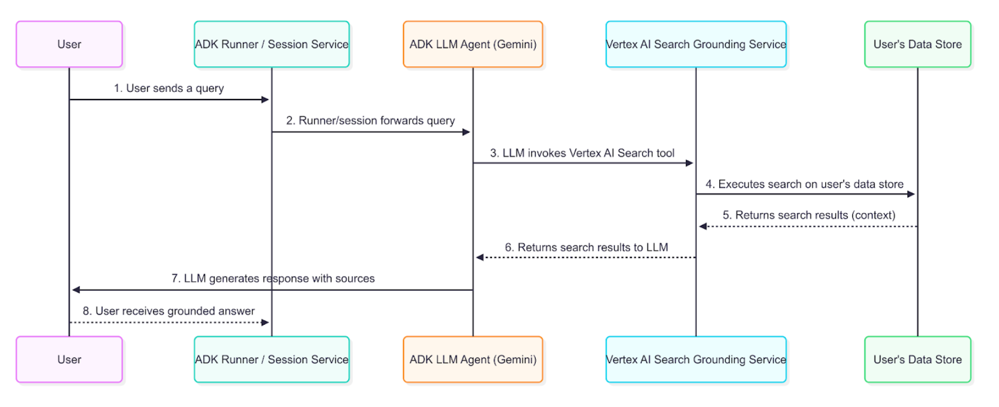

 [ Python](https://github.com/google/adk-python "adk-python on GitHub")[ JS ](https://github.com/google/adk-js "adk-js on GitHub")[ Go ](https://github.com/google/adk-go "adk-go on GitHub")[ Java ](https://github.com/google/adk-java "adk-java on GitHub")[ Kotlin](https://github.com/google/adk-kotlin "adk-kotlin on GitHub")

-   [Home](../..)
-    Build Agents
    
    Build Agents
    
    -   [Get Started](../../get-started/)
        
        Get Started
        
        -   [Python](../../get-started/python/)
        -   [TypeScript](../../get-started/typescript/)
        -   [Go](../../get-started/go/)
        -   [Java](../../get-started/java/)
        -   [Kotlin](../../get-started/kotlin/)
        -   [Agents CLI](../../get-started/agents-cli/)
        -   [Installation](../../get-started/installation/)
        -   [Google Cloud](../../get-started/google-cloud/)
        -   [Migrate to ADK](../../get-started/migrate/)
        
    -   [Build your Agent](../../tutorials/)
        
        Build your Agent
        
        -   [Multi-tool agent](../../tutorials/multi-tool-agent/)
        -   [Agent team](../../tutorials/agent-team/)
        -   [Code with AI](../../tutorials/coding-with-ai/)
        -   [Agent Config](../../agents/config/)
        
    -   [Agents](../../agents/)
        
        Agents
        
        -   [Simple agents](../../agents/llm-agents/)
        -   [Managed agents](../../agents/managed-agents/)
        
    -   [Graph Workflows](../../graphs/)
        
        Graph Workflows
        
        -   [Graph routes](../../graphs/routes/)
        -   [Data handling](../../graphs/data-handling/)
        -   [Human input](../../graphs/human-input/)
        -   [Dynamic workflows](../../graphs/dynamic/)
        
    -   [Multi-Agent Workflows](../../workflows/)
        
        Multi-Agent Workflows
        
        -   [Collaborative workflows](../../workflows/collaboration/)
        -   [Template workflows](../../agents/workflow-agents/)
            
            Template workflows
            
            -   [Sequential workflow](../../agents/workflow-agents/sequential-agents/)
            -   [Loop workflow](../../agents/workflow-agents/loop-agents/)
            -   [Parallel workflow](../../agents/workflow-agents/parallel-agents/)
            -   [Custom template workflows](../../agents/custom-agents/)
            
        -   [Agent routing](../../agents/routing/)
        -   [Workflow patterns](../../workflows/patterns/)
        
    -   [Models for Agents](../../agents/models/)
        
        Models for Agents
        
        -   [Gemini](../../agents/models/google-gemini/)
            
            Gemini
            
            -   [Deferred scheduling](../../agents/models/google-gemini/deferred-schedule/)
            
        -   [Gemma](../../agents/models/google-gemma/)
        -   [Claude](../../agents/models/anthropic/)
        -   [Agent Platform hosted](../../agents/models/agent-platform/)
        -   [Apigee AI Gateway](../../agents/models/apigee/)
        -   [Model routing](../../agents/models/routing/)
        -   [OpenAI](../../agents/models/openai/)
        -   [Ollama](../../agents/models/ollama/)
        -   [vLLM](../../agents/models/vllm/)
        -   [LiteLLM](../../agents/models/litellm/)
        -   [LiteRT-LM](../../agents/models/litert-lm/)
        
    
-    Run Agents
    
    Run Agents
    
    -   [Agent Runtime](../../runtime/)
        
        Agent Runtime
        
        -   [Web Interface](../../runtime/web-interface/)
            
            Web Interface
            
            -   [Visual Builder](../../visual-builder/)
            
        -   [Command Line](../../runtime/command-line/)
        -   [API Server](../../runtime/api-server/)
        -   [Ambient Agents](../../runtime/ambient-agents/)
        -   [Resume Agents](../../runtime/resume/)
        -   [Cancel Agent Runs](../../runtime/cancel/)
        -   [Runtime Config](../../runtime/runconfig/)
        -   [Event Loop](../../runtime/event-loop/)
        
    -   [Deployment](../../deploy/)
        
        Deployment
        
        -   [Agent Runtime](../../deploy/agent-runtime/)
            
            Agent Runtime
            
            -   [Standard deployment](../../deploy/agent-runtime/deploy/)
            -   [agents-cli](../../deploy/agent-runtime/agents-cli/)
            -   [Test deployed agents](../../deploy/agent-runtime/test/)
            
        -   [Cloud Run](../../deploy/cloud-run/)
        -   [GKE](../../deploy/gke/)
        
    -   [Observability](../../observability/)
        
        Observability
        
        -   [Logging](../../observability/logging/)
        -   [Metrics](../../observability/metrics/)
        -   [Traces](../../observability/traces/)
        
    -   [Evaluation](../../evaluate/)
        
        Evaluation
        
        -   [Criteria](../../evaluate/criteria/)
        -   [User Simulation](../../evaluate/user-sim/)
        -   [Environment Simulation](../../evaluate/environment_simulation/)
        -   [Custom Metrics](../../evaluate/custom_metrics/)
        -   [Optimization](../../optimize/)
        
    -   [Safety and Security](../../safety/)
        
        Safety and Security
        
    
-    Components
    
    Components
    
    -   [Technical Overview](../../get-started/about/)
    -   [Custom Tools](../../tools-custom/)
        
        Custom Tools
        
        -    Function tools
            
            Function tools
            
            -   [Overview](../../tools-custom/function-tools/)
            -   [Tool performance](../../tools-custom/performance/)
            -   [Action confirmations](../../tools-custom/confirmation/)
            
        -   [MCP tools](../../tools-custom/mcp-tools/)
            
            MCP tools
            
            -   [Advanced configuration](../../tools-custom/mcp-tools/advanced/)
            -   [Deployment](../../tools-custom/mcp-tools/deployment/)
            -   [Agent as MCP server](../../tools-custom/mcp-tools/agent-as-server/)
            -   [Sub-agent delegation](../../tools-custom/mcp-tools/agent-managed/)
            
        -   [OpenAPI tools](../../tools-custom/openapi-tools/)
        -   [Authentication](../../tools-custom/authentication/)
        -   [Tool limitations](../../tools/limitations/)
        
    -   [Artifacts](../../artifacts/)
        
        Artifacts
        
    -   [Skills for Agents](../../skills/)
        
        Skills for Agents
        
    -   [App management](../../apps/)
        
        App management
        
        -   [Callbacks](../../callbacks/)
            
            Callbacks
            
            -   [Types of callbacks](../../callbacks/types-of-callbacks/)
            -   [Callback patterns](../../callbacks/design-patterns-and-best-practices/)
            
        -   [Plugins](../../plugins/)
        
    -   [Agent context](../../context/)
        
        Agent context
        
        -   [Conversational context](../../sessions/)
        -   [Sessions](../../sessions/session/)
            
            Sessions
            
            -   [Rewind sessions](../../sessions/session/rewind/)
            -   [Migrate sessions](../../sessions/session/migrate/)
            
        -   [State](../../sessions/state/)
        -   [Events](../../events/)
        -   [Memory](../../sessions/memory/)
        -   [Context compression](../../context/compaction/)
        -   [Model context caching](../../context/caching/)
        
    -   [A2A Protocol](../../a2a/)
        
        A2A Protocol
        
        -   [Introduction to A2A](../../a2a/intro/)
        -    A2A Quickstart (Exposing)
            
            A2A Quickstart (Exposing)
            
            -   [Python](../../a2a/quickstart-exposing/)
            -   [Go](../../a2a/quickstart-exposing-go/)
            -   [Java](../../a2a/quickstart-exposing-java/)
            
        -    A2A Quickstart (Consuming)
            
            A2A Quickstart (Consuming)
            
            -   [Python](../../a2a/quickstart-consuming/)
            -   [Go](../../a2a/quickstart-consuming-go/)
            -   [Java](../../a2a/quickstart-consuming-java/)
            -   [Kotlin](../../a2a/quickstart-consuming-kotlin/)
            
        -   [A2A Extension](../../a2a/a2a-extension/)
        
    -   [Live and Voice Agents](../../live/)
        
        Live and Voice Agents
        
        -   [Get started](../../live/get-started/)
            
            Get started
            
            -   [Python](../../live/get-started/streaming-python/)
            -   [Java](../../live/get-started/streaming-java/)
            
        -    Building
            
            Building
            
            -   [Workflows](../../live/workflows/)
            -   [Tools](../../live/tools/)
            -   [Sessions](../../live/sessions/)
            -   [Events](../../live/events/)
            -   [Audio and video](../../live/audio-video/)
            -   [Configuration](../../live/configuration/)
            
        -    Production
            
            Production
            
            -   [Guardrails](../../live/guardrails/)
            -   [Evaluation](../../live/evaluation/)
            -   [Build a custom server](../../live/custom-server/)
            
        -   [Supported models](../../live/models/)
        
    -   [Grounding](../)
        
        Grounding
        
        -   [Google Search Grounding](../google_search_grounding/)
        -    Grounding with Search [Grounding with Search](./)
            
            Table of contents
            
            -   [Preparing Agent Search](#preparing-agent-search)
            -   [Authentication Setup](#authentication-setup)
            -   [Creating a Grounded Agent](#creating-a-grounded-agent)
            -   [How Grounding with Search works](#how-grounding-with-search-works)
                
                -   [Data Flow Diagram](#data-flow-diagram)
                -   [Detailed Description](#detailed-description)
                
            -   [Understanding Grounding with Search response](#understanding-grounding-with-search-response)
                
                -   [Example of a Grounded Response](#example-of-a-grounded-response)
                -   [How to Interpret the Response](#how-to-interpret-the-response)
                
            -   [How to display responses with Grounding with Search](#how-to-display-responses-with-grounding-with-search)
                
                -   [Optional Citation Display](#optional-citation-display)
                -   [Implementation Considerations](#implementation-considerations)
                
            
        
    
-   [Integrations](../../integrations/)
    
    Integrations
    
-    Reference
    
    Reference
    
    -   [API Reference](../../api-reference/)
        
        API Reference
        
        -   [Python ADK](../../api-reference/python/)
        -   [TypeScript ADK](../../api-reference/typescript/)
        -    Go ADK
            
            Go ADK
            
            -   [Go v2.x](https://pkg.go.dev/google.golang.org/adk/v2)
            -   [Go v1.x](https://pkg.go.dev/google.golang.org/adk)
            
        -   [Java ADK](../../api-reference/java/)
        -   [Kotlin ADK](../../api-reference/kotlin/)
        -   [CLI Reference](../../api-reference/cli/)
        -   [Agent Config Reference](../../api-reference/agentconfig/)
        -   [REST API](../../api-reference/rest/)
        
    -   [Release Notes](../../release-notes/)
    
-   [Community](../../community/)
    
    Community
    
    -   [Contributing Guide](../../community/contributing-guide/)
    
-   [ADK 2.0](../../2.0/)
    
    ADK 2.0
    

Table of contents

-   [Preparing Agent Search](#preparing-agent-search)
-   [Authentication Setup](#authentication-setup)
-   [Creating a Grounded Agent](#creating-a-grounded-agent)
-   [How Grounding with Search works](#how-grounding-with-search-works)
    
    -   [Data Flow Diagram](#data-flow-diagram)
    -   [Detailed Description](#detailed-description)
    
-   [Understanding Grounding with Search response](#understanding-grounding-with-search-response)
    
    -   [Example of a Grounded Response](#example-of-a-grounded-response)
    -   [How to Interpret the Response](#how-to-interpret-the-response)
    
-   [How to display responses with Grounding with Search](#how-to-display-responses-with-grounding-with-search)
    
    -   [Optional Citation Display](#optional-citation-display)
    -   [Implementation Considerations](#implementation-considerations)
    

1.  [Home](../..)
2.  [Components](../../get-started/about/)
3.  [Grounding](../)

# Grounding with Search for agents[¶](#grounding-with-search-for-agents "Permanent link")

Supported in ADKPython v0.1.0Java v0.1.0Kotlin v0.2.0

[Agent Search](/integrations/agent-search/) is a powerful tool for the Agent Development Kit (ADK) that enables AI agents to access information from your private enterprise documents and data repositories. By connecting your agents to indexed enterprise content, you can provide users with answers grounded in your organization's knowledge base.

This feature is particularly valuable for enterprise-specific queries requiring information from internal documentation, policies, research papers, or any proprietary content that has been indexed in your [Agent Search](https://cloud.google.com/enterprise-search) datastore. When your agent determines that information from your knowledge base is needed, it automatically searches your indexed documents and incorporates the results into its response with proper attribution.

## Preparing Agent Search[¶](#preparing-agent-search "Permanent link")

Before creating a grounded agent, you must have an existing Agent Search Data Store. If you don't have one, follow the instructions in [Get started with custom search](https://cloud.google.com/generative-ai-app-builder/docs/try-enterprise-search#unstructured-data) to create one. You will need your `Data store ID` (e.g., `projects/YOUR_PROJECT_ID/locations/global/collections/default_collection/dataStores/YOUR_DATASTORE_ID`) to configure the agent.

## Authentication Setup[¶](#authentication-setup "Permanent link")

Agent Search requires your ADK agent to be connected to a Google Cloud project authentication. You can not use a Gemini API Key from Google AI Studio when using this tool. For more information on connecting your ADK agent to Google Cloud projects, see the [Connect to Google Cloud](/get-started/google-cloud/) guide.

-   Set up the [gcloud CLI](https://cloud.google.com/vertex-ai/generative-ai/docs/start/quickstarts/quickstart-multimodal#setup-local)
-   Authenticate to Google Cloud, from the terminal by running `gcloud auth login`.
-   For Python, open the **`.env`** file and specify your project ID and location.
-   For Java and Kotlin, ensure your application environment has Google Cloud default credentials configured (`GOOGLE_APPLICATION_CREDENTIALS`), and set the variables below in that same environment rather than in a `.env` file.

.env

`GOOGLE_GENAI_USE_ENTERPRISE=TRUE GOOGLE_CLOUD_PROJECT=YOUR_PROJECT_ID GOOGLE_CLOUD_LOCATION=LOCATION`

For more information on connecting to Google Cloud from ADK agents, see [Connect to Google Cloud and Agent Platform](/get-started/google-cloud/).

## Creating a Grounded Agent[¶](#creating-a-grounded-agent "Permanent link")

To enable Grounding with Search, you include the search tool in your agent definition, providing the `data_store_id`.

PythonJavaKotlin

`from google.adk.agents import Agent from google.adk.tools import VertexAiSearchTool # Configuration DATASTORE_ID = "projects/YOUR_PROJECT_ID/locations/global/collections/default_collection/dataStores/YOUR_DATASTORE_ID" root_agent = Agent(         name="vertex_search_agent",        model="gemini-flash-latest",        instruction="Answer questions using Agent Search to find information from internal documents. Always cite sources when available.",        description="Enterprise document search assistant with Agent Search capabilities",        tools=[VertexAiSearchTool(data_store_id=DATASTORE_ID)] )`

`import com.google.adk.agents.LlmAgent; import com.google.adk.tools.VertexAiSearchTool; // Configuration String DATASTORE_ID = "projects/YOUR_PROJECT_ID/locations/global/collections/default_collection/dataStores/YOUR_DATASTORE_ID"; LlmAgent rootAgent = LlmAgent.builder()         .name("vertex_search_agent")        .model("gemini-flash-latest")        .instruction("Answer questions using Agent Search to find information from internal documents. Always cite sources when available.")        .description("Enterprise document search assistant with Agent Search capabilities")        .tools(VertexAiSearchTool.builder().dataStoreId(DATASTORE_ID).build())        .build();`

`import com.google.adk.kt.agents.Instruction import com.google.adk.kt.agents.LlmAgent import com.google.adk.kt.models.Gemini import com.google.adk.kt.tools.VertexAiSearchTool // Configuration val DATASTORE_ID =         "projects/YOUR_PROJECT_ID/locations/global/collections/default_collection/dataStores/YOUR_DATASTORE_ID" val rootAgent =         LlmAgent(                name = "vertex_search_agent",                model = Gemini(name = "gemini-flash-latest"),                instruction =                        Instruction(                                "Answer questions using Agent Search to find information from internal " +                                        "documents. Always cite sources when available.",                        ),                description = "Enterprise document search assistant with Agent Search capabilities",                tools = listOf(VertexAiSearchTool(dataStoreId = DATASTORE_ID)),        )`

## How Grounding with Search works[¶](#how-grounding-with-search-works "Permanent link")

Grounding with Search is the process that connects your agent to your organization's indexed documents and data, allowing it to generate accurate responses based on private enterprise content. When a user's prompt requires information from your internal knowledge base, the agent's underlying LLM intelligently decides to invoke the `VertexAiSearchTool` to find relevant facts from your indexed documents.

### Data Flow Diagram[¶](#data-flow-diagram "Permanent link")

This diagram illustrates the step-by-step process of how a user query results in a grounded response.

### Detailed Description[¶](#detailed-description "Permanent link")

The grounding agent uses the data flow described in the diagram to retrieve, process, and incorporate enterprise information into the final answer presented to the user.

1.  **User Query**: An end-user interacts with your agent by asking a question about internal documents or enterprise data.
2.  **ADK Orchestration**: The Agent Development Kit orchestrates the agent's behavior and passes the user's message to the core of your agent.
3.  **LLM Analysis and Tool-Calling**: The agent's LLM (e.g., a Gemini model) analyzes the prompt. If it determines that information from your indexed documents is required, it triggers the grounding mechanism by calling the `VertexAiSearchTool`. This is ideal for answering queries about company policies, technical documentation, or proprietary research.
4.  **Vertex AI Search Service Interaction**: The `VertexAiSearchTool` interacts with your configured Agent Search datastore, which contains your indexed enterprise documents. The service formulates and executes search queries against your private content.
5.  **Document Retrieval & Ranking**: Agent Search retrieves and ranks the most relevant document chunks from your datastore based on semantic similarity and relevance scoring.
6.  **Context Injection**: The search service integrates the retrieved document snippets into the model's context before the final response is generated. This crucial step allows the model to "reason" over your organization's factual data.
7.  **Grounded Response Generation**: The LLM, now informed by relevant enterprise content, generates a response that incorporates the retrieved information from your documents.
8.  **Response Presentation with Sources**: The ADK receives the final grounded response, which includes the necessary source document references and `groundingMetadata`, and presents it to the user with attribution. This allows end-users to verify the information against your enterprise sources.

## Understanding Grounding with Search response[¶](#understanding-grounding-with-search-response "Permanent link")

When the agent uses Agent Search to ground a response, it returns detailed information that includes the final text answer and metadata about the documents used to generate that answer. This metadata is crucial for verifying the response and providing attribution to your enterprise sources.

### Example of a Grounded Response[¶](#example-of-a-grounded-response "Permanent link")

The following is an example of the content object returned by the model after a grounded query against enterprise documents.

**Final Answer Text:**

`"Developing models for a medical scribe presents several significant challenges, primarily due to the complex nature of medical documentation, the sensitive data involved, and the demanding requirements of clinical workflows. Key challenges include: **Accuracy and Reliability:** Medical documentation requires extremely high levels of accuracy, as errors can lead to misdiagnoses, incorrect treatments, and legal repercussions. Ensuring that AI models can reliably capture nuanced medical language, distinguish between subjective and objective information, and accurately transcribe physician-patient interactions is a major hurdle. **Natural Language Understanding (NLU) and Speech Recognition:** Medical conversations are often rapid, involve highly specialized jargon, acronyms, and abbreviations, and can be spoken by individuals with diverse accents or speech patterns... [response continues with detailed analysis of privacy, integration, and technical challenges]"`

**Grounding Metadata Snippet:**

`{     "groundingMetadata": {        "groundingChunks": [            {                "retrievedContext": {                    "title": "AI in Medical Scribing: Technical Challenges",                    "uri": "https://storage.googleapis.com/your-bucket/doc-medical-scribe-ai-tech-challenges.pdf",                    "documentName": "projects/your-project/locations/global/collections/default_collection/dataStores/your-datastore-id/branches/0/documents/doc-medical-scribe-ai-tech-challenges",                    "text": "Medical documentation requires extremely high levels of accuracy, as errors can lead to misdiagnoses..."                }            },            {                "retrievedContext": {                    "title": "Regulatory and Ethical Hurdles for AI in Healthcare",                    "uri": "https://storage.googleapis.com/your-bucket/doc-ai-healthcare-ethics.pdf",                    "documentName": "projects/your-project/locations/global/collections/default_collection/dataStores/your-datastore-id/branches/0/documents/doc-ai-healthcare-ethics",                    "text": "HIPAA compliance imposes strict requirements on how patient data may be stored and processed..."                }            }        ],        "groundingSupports": [            {                "groundingChunkIndices": [0, 1],                "segment": {                    "endIndex": 637,                    "startIndex": 433,                    "text": "Ensuring that AI models can reliably capture nuanced medical language..."                }            }        ],        "retrievalQueries": [            "challenges in natural language processing medical domain",            "AI medical scribe challenges",            "difficulties in developing AI for medical scribes"        ]    } }`

### How to Interpret the Response[¶](#how-to-interpret-the-response "Permanent link")

The metadata provides a link between the text generated by the model and the enterprise documents that support it. Here is a step-by-step breakdown:

-   **groundingChunks**: This is a list of the enterprise documents the model consulted. Each chunk retrieved from your datastore carries a `retrievedContext` object holding the document `title`, its `uri`, the `documentName` (the full Agent Search resource name of the document), and the `text` that was retrieved.
-   **groundingSupports**: This list connects specific sentences in the final answer back to the `groundingChunks`.
-   **segment**: This object identifies a specific portion of the final text answer, defined by its `startIndex`, `endIndex`, and the `text` itself.
-   **groundingChunkIndices**: This array contains the index numbers that correspond to the sources listed in the `groundingChunks`. For example, the text about "HIPAA compliance" is supported by information from `groundingChunks` at index 1 (the "Regulatory and Ethical Hurdles" document).
-   **retrievalQueries**: This array shows the specific search queries that were executed against your datastore to find relevant information.

## How to display responses with Grounding with Search[¶](#how-to-display-responses-with-grounding-with-search "Permanent link")

Unlike Google Search grounding, Grounding with Search does not require specific display components. However, displaying citations and document references builds trust and allows users to verify information against your organization's authoritative sources.

### Optional Citation Display[¶](#optional-citation-display "Permanent link")

Since grounding metadata is provided, you can choose to implement citation displays based on your application needs:

**Simple Text Display (Minimal Implementation):**

PythonJavaKotlin

`for event in events:         if event.is_final_response() and event.content and event.content.parts:                print(event.content.parts[0].text)                 # Optional: Show source count                if event.grounding_metadata and event.grounding_metadata.grounding_chunks:                        print(f"\nBased on {len(event.grounding_metadata.grounding_chunks)} documents")`

`for (Event event : events) {         if (event.finalResponse()) {                System.out.println(event.content().parts().get(0).text());                 // Optional: Show source count                if (event.groundingMetadata().isPresent()) {                        System.out.println("\nBased on " + event.groundingMetadata().get().groundingChunks().size() + " documents");                }        } }`

`events.collect { event ->         if (event.isFinalResponse) {                println(event.content?.parts?.firstOrNull()?.text)                 // Optional: Show source count                val chunks = event.groundingMetadata?.groundingChunks                if (!chunks.isNullOrEmpty()) {                        println("\nBased on ${chunks.size} documents")                }        } }`

**Enhanced Citation Display (Optional):** You can implement interactive citations that show which documents support each statement. The grounding metadata provides all necessary information to map text segments to source documents.

### Implementation Considerations[¶](#implementation-considerations "Permanent link")

When implementing Grounding with Search displays:

1.  **Document Access**: Verify user permissions for referenced documents
2.  **Simple Integration**: Basic text output requires no additional display logic
3.  **Optional Enhancements**: Add citations only if your use case benefits from source attribution
4.  **Document Links**: Convert document URIs to accessible internal links when needed
5.  **Search Queries**: The `retrievalQueries` array shows what searches were performed against your datastore

Back to top