 [ Python](https://github.com/google/adk-python "adk-python on GitHub")[ JS ](https://github.com/google/adk-js "adk-js on GitHub")[ Go ](https://github.com/google/adk-go "adk-go on GitHub")[ Java ](https://github.com/google/adk-java "adk-java on GitHub")[ Kotlin](https://github.com/google/adk-kotlin "adk-kotlin on GitHub")

-   [Home](..)
-    Build Agents
    
    Build Agents
    
    -   [Get Started](../get-started/)
        
        Get Started
        
        -   [Python](../get-started/python/)
        -   [TypeScript](../get-started/typescript/)
        -   [Go](../get-started/go/)
        -   [Java](../get-started/java/)
        -   [Kotlin](../get-started/kotlin/)
        -   [Agents CLI](../get-started/agents-cli/)
        -   [Installation](../get-started/installation/)
        -   [Google Cloud](../get-started/google-cloud/)
        -   [Migrate to ADK](../get-started/migrate/)
        
    -   [Build your Agent](../tutorials/)
        
        Build your Agent
        
        -   [Multi-tool agent](../tutorials/multi-tool-agent/)
        -   [Agent team](../tutorials/agent-team/)
        -   [Code with AI](../tutorials/coding-with-ai/)
        -   [Agent Config](../agents/config/)
        
    -   [Agents](../agents/)
        
        Agents
        
        -   [Simple agents](../agents/llm-agents/)
        -   [Managed agents](../agents/managed-agents/)
        
    -   [Graph Workflows](../graphs/)
        
        Graph Workflows
        
        -   [Graph routes](../graphs/routes/)
        -   [Data handling](../graphs/data-handling/)
        -   [Human input](../graphs/human-input/)
        -   [Dynamic workflows](../graphs/dynamic/)
        
    -   [Multi-Agent Workflows](../workflows/)
        
        Multi-Agent Workflows
        
        -   [Collaborative workflows](../workflows/collaboration/)
        -   [Template workflows](../agents/workflow-agents/)
            
            Template workflows
            
            -   [Sequential workflow](../agents/workflow-agents/sequential-agents/)
            -   [Loop workflow](../agents/workflow-agents/loop-agents/)
            -   [Parallel workflow](../agents/workflow-agents/parallel-agents/)
            -   [Custom template workflows](../agents/custom-agents/)
            
        -   [Agent routing](../agents/routing/)
        -   [Workflow patterns](../workflows/patterns/)
        
    -   [Models for Agents](../agents/models/)
        
        Models for Agents
        
        -   [Gemini](../agents/models/google-gemini/)
            
            Gemini
            
            -   [Deferred scheduling](../agents/models/google-gemini/deferred-schedule/)
            
        -   [Gemma](../agents/models/google-gemma/)
        -   [Claude](../agents/models/anthropic/)
        -   [Agent Platform hosted](../agents/models/agent-platform/)
        -   [Apigee AI Gateway](../agents/models/apigee/)
        -   [Model routing](../agents/models/routing/)
        -   [OpenAI](../agents/models/openai/)
        -   [Ollama](../agents/models/ollama/)
        -   [vLLM](../agents/models/vllm/)
        -   [LiteLLM](../agents/models/litellm/)
        -   [LiteRT-LM](../agents/models/litert-lm/)
        
    
-    Run Agents
    
    Run Agents
    
    -   [Agent Runtime](../runtime/)
        
        Agent Runtime
        
        -   [Web Interface](../runtime/web-interface/)
            
            Web Interface
            
            -   [Visual Builder](../visual-builder/)
            
        -   [Command Line](../runtime/command-line/)
        -   [API Server](../runtime/api-server/)
        -   [Ambient Agents](../runtime/ambient-agents/)
        -   [Resume Agents](../runtime/resume/)
        -   [Cancel Agent Runs](../runtime/cancel/)
        -   [Runtime Config](../runtime/runconfig/)
        -   [Event Loop](../runtime/event-loop/)
        
    -   [Deployment](../deploy/)
        
        Deployment
        
        -   [Agent Runtime](../deploy/agent-runtime/)
            
            Agent Runtime
            
            -   [Standard deployment](../deploy/agent-runtime/deploy/)
            -   [agents-cli](../deploy/agent-runtime/agents-cli/)
            -   [Test deployed agents](../deploy/agent-runtime/test/)
            
        -   [Cloud Run](../deploy/cloud-run/)
        -   [GKE](../deploy/gke/)
        
    -   [Observability](../observability/)
        
        Observability
        
        -   [Logging](../observability/logging/)
        -   [Metrics](../observability/metrics/)
        -   [Traces](../observability/traces/)
        
    -   [Evaluation](../evaluate/)
        
        Evaluation
        
        -   [Criteria](../evaluate/criteria/)
        -   [User Simulation](../evaluate/user-sim/)
        -   [Environment Simulation](../evaluate/environment_simulation/)
        -   [Custom Metrics](../evaluate/custom_metrics/)
        -   [Optimization](../optimize/)
        
    -   [Safety and Security](../safety/)
        
        Safety and Security
        
    
-    Components
    
    Components
    
    -   [Technical Overview](../get-started/about/)
    -   [Custom Tools](../tools-custom/)
        
        Custom Tools
        
        -    Function tools
            
            Function tools
            
            -   [Overview](../tools-custom/function-tools/)
            -   [Tool performance](../tools-custom/performance/)
            -   [Action confirmations](../tools-custom/confirmation/)
            
        -   [MCP tools](../tools-custom/mcp-tools/)
            
            MCP tools
            
            -   [Advanced configuration](../tools-custom/mcp-tools/advanced/)
            -   [Deployment](../tools-custom/mcp-tools/deployment/)
            -   [Agent as MCP server](../tools-custom/mcp-tools/agent-as-server/)
            -   [Sub-agent delegation](../tools-custom/mcp-tools/agent-managed/)
            
        -   [OpenAPI tools](../tools-custom/openapi-tools/)
        -   [Authentication](../tools-custom/authentication/)
        -   [Tool limitations](../tools/limitations/)
        
    -   [Artifacts](../artifacts/)
        
        Artifacts
        
    -   [Skills for Agents](../skills/)
        
        Skills for Agents
        
    -   [App management](../apps/)
        
        App management
        
        -   [Callbacks](../callbacks/)
            
            Callbacks
            
            -   [Types of callbacks](../callbacks/types-of-callbacks/)
            -   [Callback patterns](../callbacks/design-patterns-and-best-practices/)
            
        -   [Plugins](../plugins/)
        
    -   [Agent context](../context/)
        
        Agent context
        
        -   [Conversational context](../sessions/)
        -   [Sessions](../sessions/session/)
            
            Sessions
            
            -   [Rewind sessions](../sessions/session/rewind/)
            -   [Migrate sessions](../sessions/session/migrate/)
            
        -   [State](../sessions/state/)
        -   [Events](../events/)
        -   [Memory](../sessions/memory/)
        -   [Context compression](../context/compaction/)
        -   [Model context caching](../context/caching/)
        
    -   [A2A Protocol](../a2a/)
        
        A2A Protocol
        
        -   [Introduction to A2A](../a2a/intro/)
        -    A2A Quickstart (Exposing)
            
            A2A Quickstart (Exposing)
            
            -   [Python](../a2a/quickstart-exposing/)
            -   [Go](../a2a/quickstart-exposing-go/)
            -   [Java](../a2a/quickstart-exposing-java/)
            
        -    A2A Quickstart (Consuming)
            
            A2A Quickstart (Consuming)
            
            -   [Python](../a2a/quickstart-consuming/)
            -   [Go](../a2a/quickstart-consuming-go/)
            -   [Java](../a2a/quickstart-consuming-java/)
            -   [Kotlin](../a2a/quickstart-consuming-kotlin/)
            
        -   [A2A Extension](../a2a/a2a-extension/)
        
    -   [Live and Voice Agents](../live/)
        
        Live and Voice Agents
        
        -   [Get started](../live/get-started/)
            
            Get started
            
            -   [Python](../live/get-started/streaming-python/)
            -   [Java](../live/get-started/streaming-java/)
            
        -    Building
            
            Building
            
            -   [Workflows](../live/workflows/)
            -   [Tools](../live/tools/)
            -   [Sessions](../live/sessions/)
            -   [Events](../live/events/)
            -   [Audio and video](../live/audio-video/)
            -   [Configuration](../live/configuration/)
            
        -    Production
            
            Production
            
            -   [Guardrails](../live/guardrails/)
            -   [Evaluation](../live/evaluation/)
            -   [Build a custom server](../live/custom-server/)
            
        -   [Supported models](../live/models/)
        
    -   [Grounding](../grounding/)
        
        Grounding
        
        -   [Google Search Grounding](../grounding/google_search_grounding/)
        -   [Grounding with Search](../grounding/grounding_with_search/)
        
    
-   [Integrations](./)
    
    Integrations
    
-    Reference
    
    Reference
    
    -   [API Reference](../api-reference/)
        
        API Reference
        
        -   [Python ADK](../api-reference/python/)
        -   [TypeScript ADK](../api-reference/typescript/)
        -    Go ADK
            
            Go ADK
            
            -   [Go v2.x](https://pkg.go.dev/google.golang.org/adk/v2)
            -   [Go v1.x](https://pkg.go.dev/google.golang.org/adk)
            
        -   [Java ADK](../api-reference/java/)
        -   [Kotlin ADK](../api-reference/kotlin/)
        -   [CLI Reference](../api-reference/cli/)
        -   [Agent Config Reference](../api-reference/agentconfig/)
        -   [REST API](../api-reference/rest/)
        
    -   [Release Notes](../release-notes/)
    
-   [Community](../community/)
    
    Community
    
    -   [Contributing Guide](../community/contributing-guide/)
    
-   [ADK 2.0](../2.0/)
    
    ADK 2.0
    

1.  [Home](..)
2.  [Integrations](./)

# Tools and Integrations for Agents[¶](#tools-and-integrations-for-agents "Permanent link")

Check out the following pre-built tools and integrations that you can use with ADK agents. For information on building custom tools, see [Custom Tools](/tools-custom/). For information on submitting integrations to this catalog, see the [Contribution Guide for Integrations](https://github.com/google/adk-docs/blob/main/CONTRIBUTING.md#integrations).

Filter: All Code Connectors Data Evaluation Google MCP Observability Resilience Search

[

### A2UI

Generate rich, structured UIs from your agents using the Agent-to-UI protocol

](/integrations/a2ui/)[

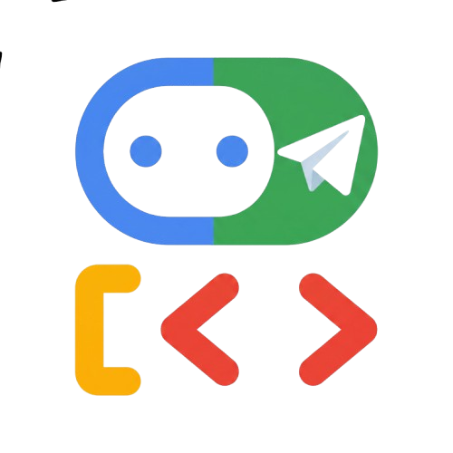

### ADK Connector

Expose ADK agents as chatbots on popular messaging channels with cross-device session sync

](/integrations/adk-connector/)[

### Adspirer

Create, manage, and optimize ad campaigns across Google, Meta, LinkedIn, and TikTok Ads

](/integrations/adspirer/)[

### Aerospike

Store sessions, memory, and artifacts for ADK agents on one Aerospike cluster

](/integrations/aerospike/)[

### AG-UI

Build interactive chat UIs with streaming, state sync, and agentic actions

](/integrations/ag-ui/)[

### Google Cloud Agent Identity

Manage OAuth tokens and API keys for your agents

](/integrations/agent-identity/)[

### Google Cloud Agent Registry

Discover and connect to AI Agents and MCP Servers

](/integrations/agent-registry/)[

### Agent Search

Search across your private, configured data stores in Agent Search

](/integrations/agent-search/)[

### AgentMail

Create email inboxes for AI agents to send, receive, and manage messages

](/integrations/agentmail/)[

### AgentOps

Session replays, metrics, and monitoring for ADK agents

](/integrations/agentops/)[

### AgentPhone

Make phone calls, send SMS, manage numbers, and build AI voice agents

](/integrations/agentphone/)[

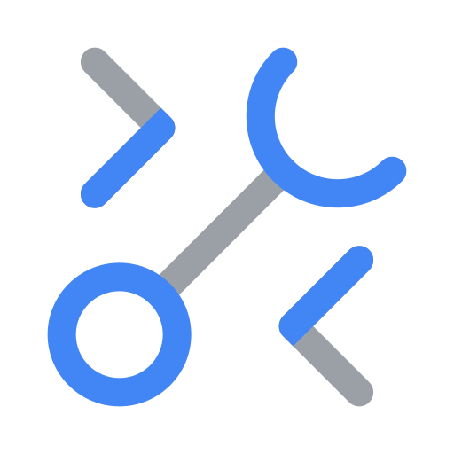

### Google Cloud API Registry

Connect with Google Cloud services as MCP tools

](/integrations/api-registry/)[

### Apigee API Hub

Turn any documented API from Apigee API hub into a tool

](/integrations/apigee-api-hub/)[

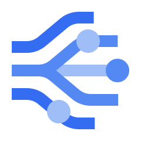

### Application Integration

Link your agents to enterprise apps using Integration Connectors

](/integrations/application-integration/)[

### Arize AX

Production-grade observability, debugging, and improvement of LLM applications

](/integrations/arize-ax/)[

### Asana

Manage projects, tasks, and goals for team collaboration

](/integrations/asana/)[

### Atlan

Search, explore, and govern metadata, lineage, and business knowledge

](/integrations/atlan/)[

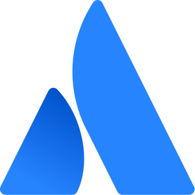

### Atlassian

Manage issues, search pages, and update team content

](/integrations/atlassian/)[

### Agent Threat Rules (ATR)

Open detection rules that block prompt injection and tool-argument attacks in the ADK Runner

](/integrations/atr-guardrail/)[

### Bash Tool

Execute bash commands within a secure, resource-limited local sandbox

](/integrations/bashtool/)[

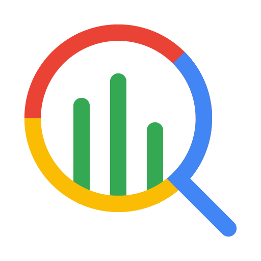

### BigQuery Agent Analytics Plugin

In-depth agent analytics for behavior analysis and logging

](/integrations/bigquery-agent-analytics/)[

### BigQuery Tools

Connect with BigQuery to retrieve data and perform analysis

](/integrations/bigquery/)[

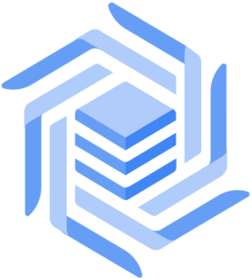

### Bigtable Tools

Interact with Bigtable to retrieve data and execute SQL

](/integrations/bigtable/)[

### CarsXE

Decode VINs and license plates, and fetch vehicle specs, market value, history, and recalls

](/integrations/carsxe/)[

### Cartesia

Generate speech, localize voices, and create audio content

](/integrations/cartesia/)[

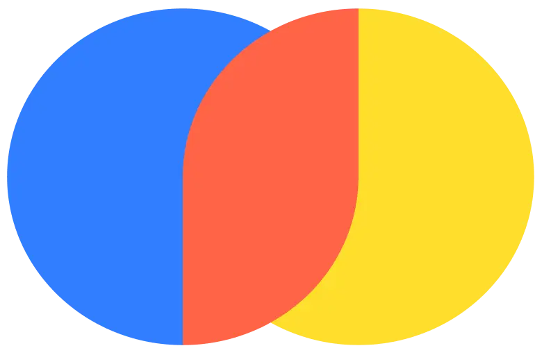

### Chroma

Store and retrieve information using semantic vector search

](/integrations/chroma/)[

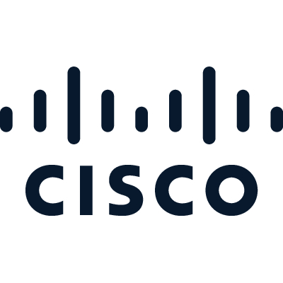

### Cisco AI Defense

Security guardrails to monitor or block agent prompts and tool calls

](/integrations/cisco-ai-defense/)[

### ClickHouse Cloud

Query data, explore schemas, monitor services and costs

](/integrations/clickhouse/)[

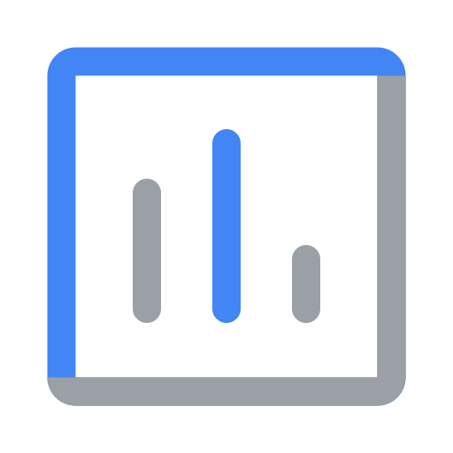

### Google Cloud Trace

Monitor, debug, and trace ADK agent interactions

](/integrations/cloud-trace/)[

### Code Execution Tool with Agent Runtime

Run AI-generated code in a secure and scalable environment

](/integrations/code-exec-agent-runtime/)[

### Code Execution

Execute code and debug using Gemini models

](/integrations/code-execution/)[

### Computer Use

Operate computer user interfaces using Gemini models

](/integrations/computer-use/)[

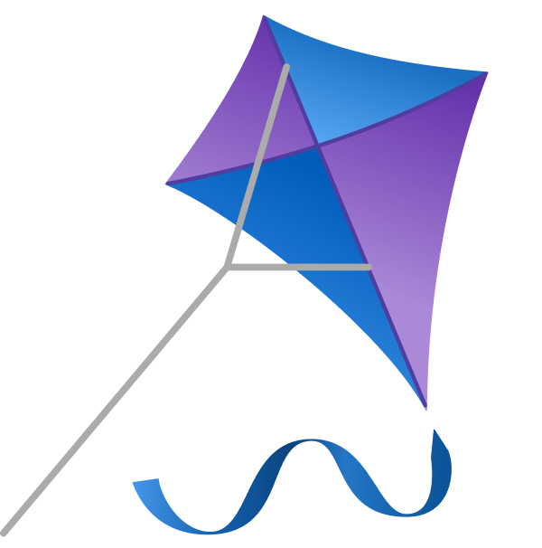

### CopilotKit

Add React, Angular, Vue, mobile, and Slack frontends to your agents

](/integrations/copilotkit/)[

### Couchbase

Query collections, explore schemas, and run SQL++ queries

](/integrations/couchbase/)[

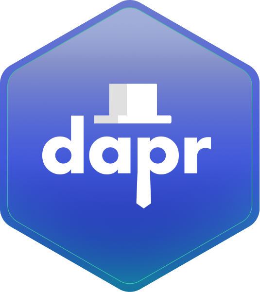

### Dapr

Durable, long-running and self-recovering agents with human approvals and safe versioning

](/integrations/dapr/)[

### Data Agents

Analyze data with AI-powered agents

](/integrations/data-agent/)[

### Database Memory Service

SQL-backed persistent memory for agents

](/integrations/database-memory/)[

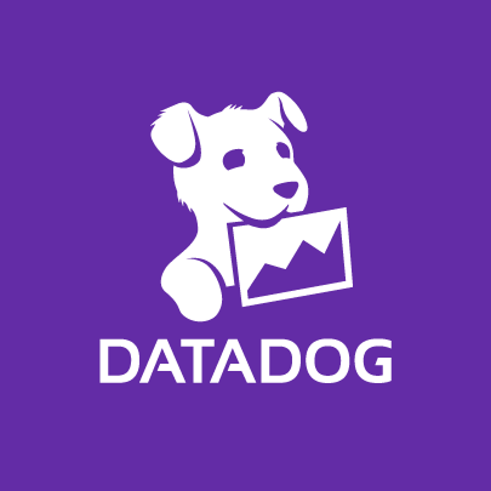

### Datadog

Develop, evaluate, and monitor LLM applications

](/integrations/datadog/)[

### Daytona

Execute code, run shell commands, and manage files in secure sandboxes

](/integrations/daytona/)[

### DBOS

Resilient, scalable, long-running agents with human approvals and safe versioning

](/integrations/dbos/)[

### e2a

Authenticated email gateway for AI agents with human-in-the-loop approval

](/integrations/e2a/)[

### ElevenLabs

Generate speech, clone voices, transcribe audio, and create sound effects

](/integrations/elevenlabs/)[

### Enterprise Web Search

Ground ADK agents with policy-compliant web search results

](/integrations/enterprise-web-search/)[

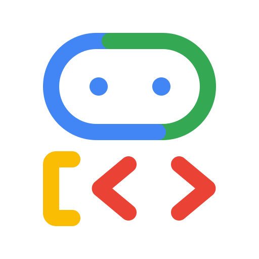

### Environment Toolset

Create local and custom compute environments for files, scripts, and code execution

](/integrations/environment-toolset/)[

### Google Cloud Eventarc Tools

Publish structured CloudEvents to message buses with schema validation

](/integrations/eventarc/)[

### Agent Platform Express Mode

Try development with Agent Platform services at no cost

](/integrations/express-mode/)[

### Files Retrieval Tool

Index and search local documents using vector similarity search

](/integrations/filesretrieval/)[

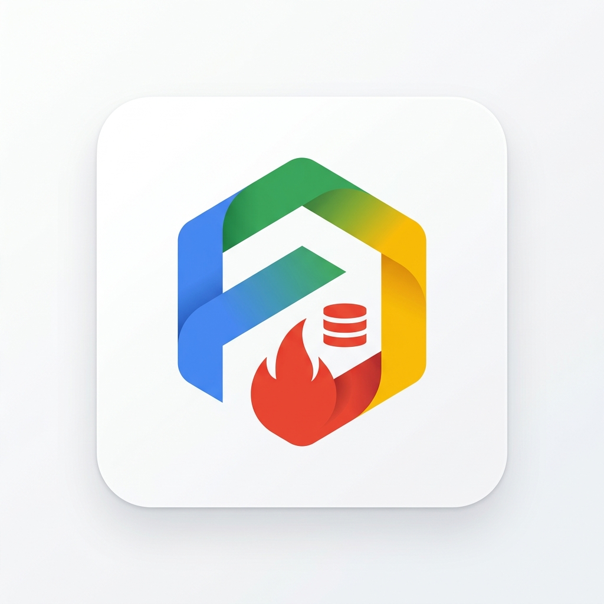

### Firestore Session Service

Session state management for ADK agents using Firestore

](/integrations/firestore-session-service/)[

### Freeplay

Use Freeplay to build, optimize, and evaluate AI agents with end-to-end observability

](/integrations/freeplay/)[

### Future AGI

Trace, evaluate, and improve ADK agents with the traceAI OpenTelemetry integration

](/integrations/future-agi/)[

### Galileo

End-to-end tracing, evaluation, and monitoring for ADK agents

](/integrations/galileo/)[

### Google Cloud Storage

Access and perform operations on Google Cloud Storage buckets and objects

](/integrations/gcs/)[

### GitHub

Analyze code, manage issues and PRs, and automate workflows

](/integrations/github/)[

### GitLab

Perform semantic code search, inspect pipelines, manage merge requests

](/integrations/gitlab/)[

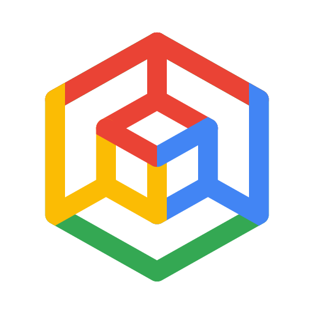

### GKE Code Executor

Run AI-generated code in a secure and scalable GKE environment

](/integrations/gke-code-executor/)[

### GoodMem

Add persistent semantic memory to agents across conversations

](/integrations/goodmem/)[

### Google Developer Knowledge

Search Google's official developer documentation for code and guidance

](/integrations/google-developer-knowledge/)[

### Google Search

Perform web searches using Google Search with Gemini

](/integrations/google-search/)[

### Grafana Cloud

Query metrics, logs, traces, and manage dashboards, alerts, and incidents from Grafana Cloud

](/integrations/grafana-cloud/)[

### Hugging Face

Access models, datasets, research papers, and AI tools

](/integrations/hugging-face/)[

### Knowledge Engine

Perform private data retrieval using Knowledge Engine

](/integrations/knowledge-engine/)[

### Langfuse

Open-source AI engineering platform to debug, analyze, and iterate on LLM applications

](/integrations/langfuse/)[

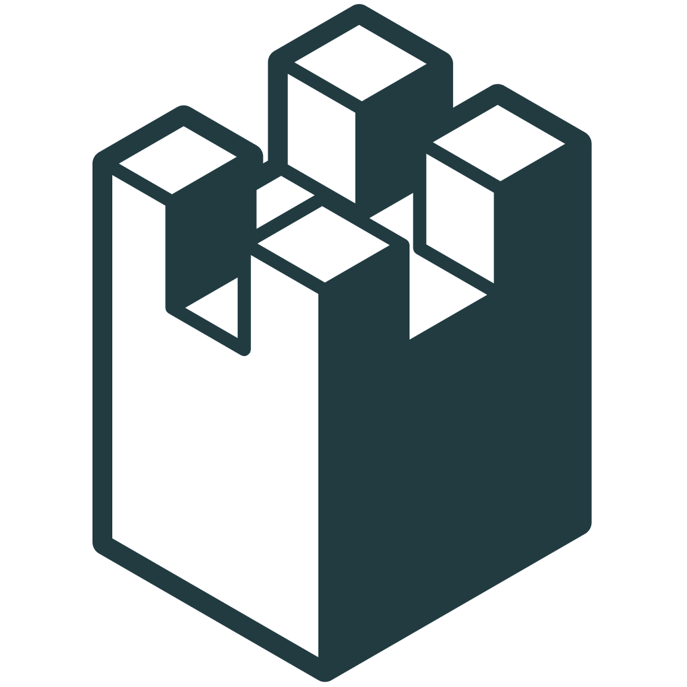

### LangWatch

Observability, tracing, evaluation, and prompt optimization for ADK agents

](/integrations/langwatch/)[

### Latitude

Open-source observability and evaluation for ADK agents

](/integrations/latitude/)[

### Linear

Manage issues, track projects, and streamline development

](/integrations/linear/)[

### LiveKit

Put a live voice agent in a WebRTC room or on a phone call

](/integrations/livekit/)[

### Mailgun

Send emails, track delivery metrics, and manage mailing lists

](/integrations/mailgun/)[

### Markifact

Manage marketing operations across Google Ads, Meta, GA4, TikTok, and 15+ more platforms

](/integrations/markifact/)[

### MCP Toolbox for Databases

Connect over 30 different data sources to your agents

](/integrations/mcp-toolbox-for-databases/)[

### Milvus

Milvus-backed memory and RAG retrieval for ADK agents

](/integrations/milvus/)[

### MLflow AI Gateway

Route LLM requests for multi-provider access with built-in governance

](/integrations/mlflow-gateway/)[

### MLflow Scorers

Use ADK evaluators as MLflow scorers for agent evaluation

](/integrations/mlflow-scorers/)[

### MLflow Tracing

Ingest OpenTelemetry traces for agent runs, tool calls, and model requests

](/integrations/mlflow-tracing/)[

### Model Armor

Screen agent input and output against Google Cloud security templates

](/integrations/model-armor/)[

### Model Consult

Escalate hard reasoning from fast executors to stronger advisor models

](/integrations/model-consult/)[

### MongoDB

Query collections, manage databases, and analyze schemas

](/integrations/mongodb/)[

### Monocle

Open-source observability, tracing, and debugging of LLM applications

](/integrations/monocle/)[

### n8n

Trigger automated workflows, connect apps, and process data

](/integrations/n8n/)[

### Notion

Search workspaces, create pages, and manage tasks and databases

](/integrations/notion/)[

### Google Cloud Parameter Manager

Manage and retrieve runtime configuration parameters and secrets securely for ADK agents.

](/integrations/parameter-manager/)[

### Paypal

Manage payments, send invoices, and handle subscriptions

](/integrations/paypal/)[

### Perseus Vault Memory

Add persistent, local, encrypted cross-session memory to ADK agents

](/integrations/perseus-vault/)[

### Perseus Context

Compile deterministic, workspace-aware context for ADK agents

](/integrations/perseus/)[

### Phoenix

Open-source, self-hosted observability, tracing, and evaluation of LLM applications

](/integrations/phoenix/)[

### Pinecone

Store data, perform semantic search, and rerank results

](/integrations/pinecone/)[

### Postman

Manage API collections, workspaces, and generate client code

](/integrations/postman/)[

### Pub/Sub Tools

Publish, pull, and acknowledge messages from Google Cloud Pub/Sub

](/integrations/pubsub/)[

### Qdrant

Store and retrieve information using semantic vector search

](/integrations/qdrant/)[

### Redis

Vector, hybrid, and SQL search plus session, memory, and semantic cache for agents

](/integrations/redis/)[

### Reflect and Retry Plugin

Automatically retry tool calls that fail

](/integrations/reflect-and-retry/)[

### Respan

Trace, debug, and monitor ADK agents with Respan observability

](/integrations/respan/)[

### Restate

Resilient agent execution and orchestration with durable sessions and human approvals

](/integrations/restate/)[

### Google Cloud Secret Manager

Retrieve secrets at runtime without exposing them to the LLM

](/integrations/secret-manager/)[

### Google Cloud Skill Registry

Dynamically search, discover, and fetch remote Skills

](/integrations/skills-registry/)[

### Slack

Run agents as bots that reply to mentions, DMs, and threads

](/integrations/slack/)[

### Spanner Tools

Interact with Spanner to retrieve data, search, and execute SQL

](/integrations/spanner/)[

### Sprites

Persistent, stateful Linux sandboxes with checkpoint and restore for agent code execution

](/integrations/sprites/)[

### StackOne

Connect agents to 200+ SaaS providers

](/integrations/stackone/)[

### Stripe

Manage payments, customers, subscriptions, and invoices

](/integrations/stripe/)[

### Supermetrics

Consume and analyze your real-time marketing, advertising, and CRM data

](/integrations/supermetrics/)[

### Synap

Add persistent, cross-session long-term memory to ADK agents

](/integrations/synap/)[

### Temporal

Resilient, scalable agents, long-running agents and tools, human approvals, and safe versioning

](/integrations/temporal/)[

### Unstructured

Parse PDFs, Office docs, images, and 40+ file types into structured, AI-ready data

](/integrations/unstructured/)[

### W&B Weave

Log, visualize, and analyze model calls and agent performance

](/integrations/weave/)[

### Windsor.ai

Query and analyze marketing, sales, and customer data from 325+ platforms

](/integrations/windsor-ai/)[

### Zespan

Agent reliability platform to trace, evaluate, and monitor ADK agents

](/integrations/zespan/)[

### ZoomInfo

Find companies, enrich contacts, and surface go-to-market intelligence

](/integrations/zoominfo/)

Back to top