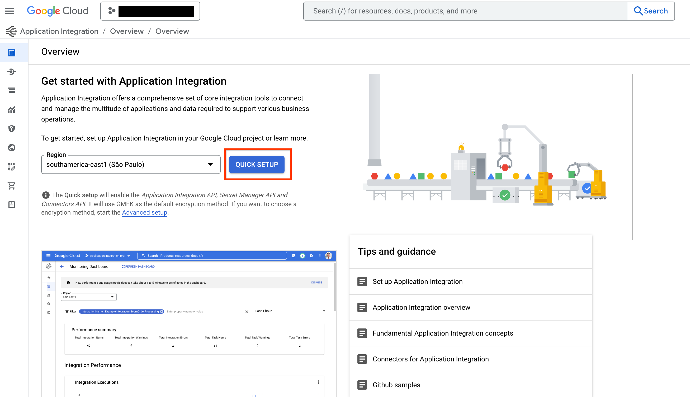
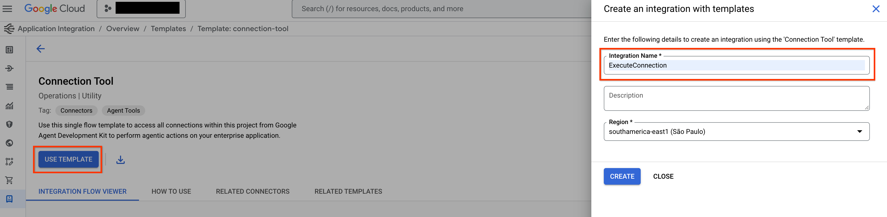
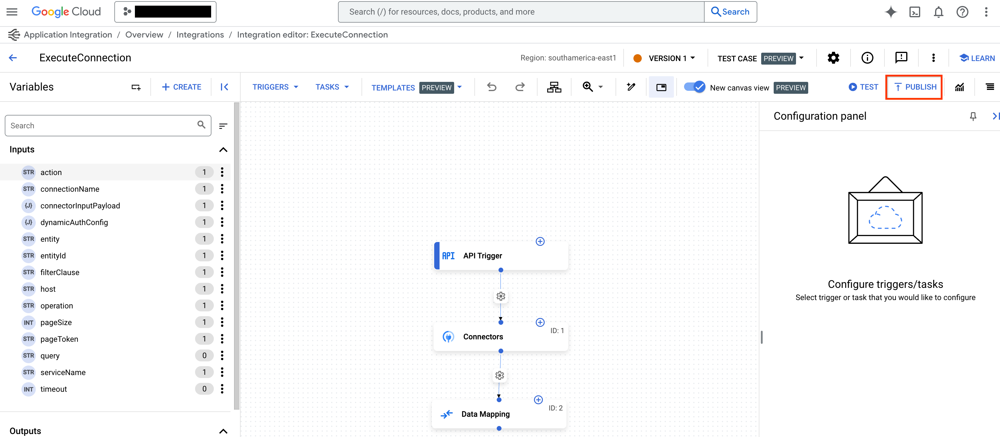

 [ Python](https://github.com/google/adk-python "adk-python on GitHub")[ JS ](https://github.com/google/adk-js "adk-js on GitHub")[ Go ](https://github.com/google/adk-go "adk-go on GitHub")[ Java ](https://github.com/google/adk-java "adk-java on GitHub")[ Kotlin](https://github.com/google/adk-kotlin "adk-kotlin on GitHub")

-   [Home](../..)
-    Build Agents
    
    Build Agents
    
    -   [Get Started](../../get-started/)
        
        Get Started
        
        -   [Python](../../get-started/python/)
        -   [TypeScript](../../get-started/typescript/)
        -   [Go](../../get-started/go/)
        -   [Java](../../get-started/java/)
        -   [Kotlin](../../get-started/kotlin/)
        -   [Agents CLI](../../get-started/agents-cli/)
        -   [Installation](../../get-started/installation/)
        -   [Google Cloud](../../get-started/google-cloud/)
        -   [Migrate to ADK](../../get-started/migrate/)
        
    -   [Build your Agent](../../tutorials/)
        
        Build your Agent
        
        -   [Multi-tool agent](../../tutorials/multi-tool-agent/)
        -   [Agent team](../../tutorials/agent-team/)
        -   [Code with AI](../../tutorials/coding-with-ai/)
        -   [Agent Config](../../agents/config/)
        
    -   [Agents](../../agents/)
        
        Agents
        
        -   [Simple agents](../../agents/llm-agents/)
        -   [Managed agents](../../agents/managed-agents/)
        
    -   [Graph Workflows](../../graphs/)
        
        Graph Workflows
        
        -   [Graph routes](../../graphs/routes/)
        -   [Data handling](../../graphs/data-handling/)
        -   [Human input](../../graphs/human-input/)
        -   [Dynamic workflows](../../graphs/dynamic/)
        
    -   [Multi-Agent Workflows](../../workflows/)
        
        Multi-Agent Workflows
        
        -   [Collaborative workflows](../../workflows/collaboration/)
        -   [Template workflows](../../agents/workflow-agents/)
            
            Template workflows
            
            -   [Sequential workflow](../../agents/workflow-agents/sequential-agents/)
            -   [Loop workflow](../../agents/workflow-agents/loop-agents/)
            -   [Parallel workflow](../../agents/workflow-agents/parallel-agents/)
            -   [Custom template workflows](../../agents/custom-agents/)
            
        -   [Agent routing](../../agents/routing/)
        -   [Workflow patterns](../../workflows/patterns/)
        
    -   [Models for Agents](../../agents/models/)
        
        Models for Agents
        
        -   [Gemini](../../agents/models/google-gemini/)
            
            Gemini
            
            -   [Deferred scheduling](../../agents/models/google-gemini/deferred-schedule/)
            
        -   [Gemma](../../agents/models/google-gemma/)
        -   [Claude](../../agents/models/anthropic/)
        -   [Agent Platform hosted](../../agents/models/agent-platform/)
        -   [Apigee AI Gateway](../../agents/models/apigee/)
        -   [Model routing](../../agents/models/routing/)
        -   [OpenAI](../../agents/models/openai/)
        -   [Ollama](../../agents/models/ollama/)
        -   [vLLM](../../agents/models/vllm/)
        -   [LiteLLM](../../agents/models/litellm/)
        -   [LiteRT-LM](../../agents/models/litert-lm/)
        
    
-    Run Agents
    
    Run Agents
    
    -   [Agent Runtime](../../runtime/)
        
        Agent Runtime
        
        -   [Web Interface](../../runtime/web-interface/)
            
            Web Interface
            
            -   [Visual Builder](../../visual-builder/)
            
        -   [Command Line](../../runtime/command-line/)
        -   [API Server](../../runtime/api-server/)
        -   [Ambient Agents](../../runtime/ambient-agents/)
        -   [Resume Agents](../../runtime/resume/)
        -   [Cancel Agent Runs](../../runtime/cancel/)
        -   [Runtime Config](../../runtime/runconfig/)
        -   [Event Loop](../../runtime/event-loop/)
        
    -   [Deployment](../../deploy/)
        
        Deployment
        
        -   [Agent Runtime](../../deploy/agent-runtime/)
            
            Agent Runtime
            
            -   [Standard deployment](../../deploy/agent-runtime/deploy/)
            -   [agents-cli](../../deploy/agent-runtime/agents-cli/)
            -   [Test deployed agents](../../deploy/agent-runtime/test/)
            
        -   [Cloud Run](../../deploy/cloud-run/)
        -   [GKE](../../deploy/gke/)
        
    -   [Observability](../../observability/)
        
        Observability
        
        -   [Logging](../../observability/logging/)
        -   [Metrics](../../observability/metrics/)
        -   [Traces](../../observability/traces/)
        
    -   [Evaluation](../../evaluate/)
        
        Evaluation
        
        -   [Criteria](../../evaluate/criteria/)
        -   [User Simulation](../../evaluate/user-sim/)
        -   [Environment Simulation](../../evaluate/environment_simulation/)
        -   [Custom Metrics](../../evaluate/custom_metrics/)
        -   [Optimization](../../optimize/)
        
    -   [Safety and Security](../../safety/)
        
        Safety and Security
        
    
-    Components
    
    Components
    
    -   [Technical Overview](../../get-started/about/)
    -   [Custom Tools](../../tools-custom/)
        
        Custom Tools
        
        -    Function tools
            
            Function tools
            
            -   [Overview](../../tools-custom/function-tools/)
            -   [Tool performance](../../tools-custom/performance/)
            -   [Action confirmations](../../tools-custom/confirmation/)
            
        -   [MCP tools](../../tools-custom/mcp-tools/)
            
            MCP tools
            
            -   [Advanced configuration](../../tools-custom/mcp-tools/advanced/)
            -   [Deployment](../../tools-custom/mcp-tools/deployment/)
            -   [Agent as MCP server](../../tools-custom/mcp-tools/agent-as-server/)
            -   [Sub-agent delegation](../../tools-custom/mcp-tools/agent-managed/)
            
        -   [OpenAPI tools](../../tools-custom/openapi-tools/)
        -   [Authentication](../../tools-custom/authentication/)
        -   [Tool limitations](../../tools/limitations/)
        
    -   [Artifacts](../../artifacts/)
        
        Artifacts
        
    -   [Skills for Agents](../../skills/)
        
        Skills for Agents
        
    -   [App management](../../apps/)
        
        App management
        
        -   [Callbacks](../../callbacks/)
            
            Callbacks
            
            -   [Types of callbacks](../../callbacks/types-of-callbacks/)
            -   [Callback patterns](../../callbacks/design-patterns-and-best-practices/)
            
        -   [Plugins](../../plugins/)
        
    -   [Agent context](../../context/)
        
        Agent context
        
        -   [Conversational context](../../sessions/)
        -   [Sessions](../../sessions/session/)
            
            Sessions
            
            -   [Rewind sessions](../../sessions/session/rewind/)
            -   [Migrate sessions](../../sessions/session/migrate/)
            
        -   [State](../../sessions/state/)
        -   [Events](../../events/)
        -   [Memory](../../sessions/memory/)
        -   [Context compression](../../context/compaction/)
        -   [Model context caching](../../context/caching/)
        
    -   [A2A Protocol](../../a2a/)
        
        A2A Protocol
        
        -   [Introduction to A2A](../../a2a/intro/)
        -    A2A Quickstart (Exposing)
            
            A2A Quickstart (Exposing)
            
            -   [Python](../../a2a/quickstart-exposing/)
            -   [Go](../../a2a/quickstart-exposing-go/)
            -   [Java](../../a2a/quickstart-exposing-java/)
            
        -    A2A Quickstart (Consuming)
            
            A2A Quickstart (Consuming)
            
            -   [Python](../../a2a/quickstart-consuming/)
            -   [Go](../../a2a/quickstart-consuming-go/)
            -   [Java](../../a2a/quickstart-consuming-java/)
            -   [Kotlin](../../a2a/quickstart-consuming-kotlin/)
            
        -   [A2A Extension](../../a2a/a2a-extension/)
        
    -   [Live and Voice Agents](../../live/)
        
        Live and Voice Agents
        
        -   [Get started](../../live/get-started/)
            
            Get started
            
            -   [Python](../../live/get-started/streaming-python/)
            -   [Java](../../live/get-started/streaming-java/)
            
        -    Building
            
            Building
            
            -   [Workflows](../../live/workflows/)
            -   [Tools](../../live/tools/)
            -   [Sessions](../../live/sessions/)
            -   [Events](../../live/events/)
            -   [Audio and video](../../live/audio-video/)
            -   [Configuration](../../live/configuration/)
            
        -    Production
            
            Production
            
            -   [Guardrails](../../live/guardrails/)
            -   [Evaluation](../../live/evaluation/)
            -   [Build a custom server](../../live/custom-server/)
            
        -   [Supported models](../../live/models/)
        
    -   [Grounding](../../grounding/)
        
        Grounding
        
        -   [Google Search Grounding](../../grounding/google_search_grounding/)
        -   [Grounding with Search](../../grounding/grounding_with_search/)
        
    
-   [Integrations](../)
    
    Integrations
    
-    Reference
    
    Reference
    
    -   [API Reference](../../api-reference/)
        
        API Reference
        
        -   [Python ADK](../../api-reference/python/)
        -   [TypeScript ADK](../../api-reference/typescript/)
        -    Go ADK
            
            Go ADK
            
            -   [Go v2.x](https://pkg.go.dev/google.golang.org/adk/v2)
            -   [Go v1.x](https://pkg.go.dev/google.golang.org/adk)
            
        -   [Java ADK](../../api-reference/java/)
        -   [Kotlin ADK](../../api-reference/kotlin/)
        -   [CLI Reference](../../api-reference/cli/)
        -   [Agent Config Reference](../../api-reference/agentconfig/)
        -   [REST API](../../api-reference/rest/)
        
    -   [Release Notes](../../release-notes/)
    
-   [Community](../../community/)
    
    Community
    
    -   [Contributing Guide](../../community/contributing-guide/)
    
-   [ADK 2.0](../../2.0/)
    
    ADK 2.0
    

Table of contents

-   [Prerequisites](#prerequisites)
    
    -   [1\. Install ADK](#1-install-adk)
    -   [2\. Install CLI](#2-install-cli)
    -   [3\. Provision Application Integration workflow and publish Connection Tool](#3-provision-application-integration-workflow-and-publish-connection-tool)
    -   [4\. Create project structure](#4-create-project-structure)
    -   [5\. Set roles and permissions](#5-set-roles-and-permissions)
    
-   [Use Integration Connectors](#use-integration-connectors)
    
    -   [Before you begin](#before-you-begin)
    -   [Create an Application Integration Toolset](#create-an-application-integration-toolset)
    
-   [Use Application Integration Workflows](#use-application-integration-workflows)
    
    -   [1\. Create a tool](#1-create-a-tool)
    -   [2\. Add the tool to your agent](#2-add-the-tool-to-your-agent)
    -   [3\. Expose your agent](#3-expose-your-agent)
    -   [4\. Use your agent](#4-use-your-agent)
    

# Google Cloud Application Integration tool for ADK[¶](#google-cloud-application-integration-tool-for-adk "Permanent link")

Supported in ADKPython v0.1.0Java v0.3.0

With **ApplicationIntegrationToolset**, you can seamlessly give your agents secure and governed access to enterprise applications using Integration Connectors' 100+ pre-built connectors for systems like Salesforce, ServiceNow, JIRA, SAP, and more.

It supports both on-premise and SaaS applications. In addition, you can turn your existing Application Integration process automations into agentic workflows by providing application integration workflows as tools to your ADK agents.

Federated search within Application Integration lets you use ADK agents to query multiple enterprise applications and data sources simultaneously.

[See how ADK Federated Search in Application Integration works in this video walkthrough](https://www.youtube.com/watch?v=JdlWOQe5RgU)

## Prerequisites[¶](#prerequisites "Permanent link")

### 1\. Install ADK[¶](#1-install-adk "Permanent link")

Install Agent Development Kit following the steps in the [installation guide](/get-started/installation/).

### 2\. Install CLI[¶](#2-install-cli "Permanent link")

Install the [Google Cloud CLI](https://cloud.google.com/sdk/docs/install#installation_instructions). To use the tool with default credentials, run the following commands:

`gcloud config set project <project-id> gcloud auth application-default login gcloud auth application-default set-quota-project <project-id>`

Replace `<project-id>` with the unique ID of your Google Cloud project.

### 3\. Provision Application Integration workflow and publish Connection Tool[¶](#3-provision-application-integration-workflow-and-publish-connection-tool "Permanent link")

Use an existing [Application Integration](https://cloud.google.com/application-integration/docs/overview) workflow or [Integrations Connector](https://cloud.google.com/integration-connectors/docs/overview) connection you want to use with your agent. You can also create a new [Application Integration workflow](https://cloud.google.com/application-integration/docs/setup-application-integration) or a [connection](https://cloud.google.com/integration-connectors/docs/connectors/neo4j/configure#configure-the-connector).

Import and publish the [Connection Tool](https://console.cloud.google.com/integrations/templates/connection-tool/locations/global) from the template library.

**Note**: To use a connector from Integration Connectors, you need to provision the Application Integration in the same region as your connection.

### 4\. Create project structure[¶](#4-create-project-structure "Permanent link")

PythonJava

Set up your project structure and create the required files:

`project_root_folder ├── .env └── my_agent         ├── __init__.py        ├── agent.py        └── tools.py`

When running the agent, make sure to run `adk web` from the `project_root_folder`.

Set up your project structure and create the required files:

  `  project_root_folder    └── my_agent            ├── agent.java            └── pom.xml`

When running the agent, make sure to run the commands from the `project_root_folder`.

### 5\. Set roles and permissions[¶](#5-set-roles-and-permissions "Permanent link")

To get the permissions that you need to set up **ApplicationIntegrationToolset**, you must have the following IAM roles on the project (common to both Integration Connectors and Application Integration Workflows):

`- roles/integrations.integrationEditor - roles/connectors.invoker - roles/secretmanager.secretAccessor`

**Note:** When using Agent Runtime for deployment, don't use `roles/integrations.integrationInvoker`, as it can result in 403 errors. Use `roles/integrations.integrationEditor` instead.

## Use Integration Connectors[¶](#use-integration-connectors "Permanent link")

Connect your agent to enterprise applications using [Integration Connectors](https://cloud.google.com/integration-connectors/docs/overview).

### Before you begin[¶](#before-you-begin "Permanent link")

**Note:** The *ExecuteConnection* integration is typically created automatically when you provision Application Integration in a given region. If the *ExecuteConnection* doesn't exist in the [list of integrations](https://console.cloud.google.com/integrations/list), you must follow these steps to create it:

1.  To use a connector from Integration Connectors, click **QUICK SETUP** and [provision](https://console.cloud.google.com/integrations) Application Integration in the same region as your connection.

1.  Go to the [Connection Tool](https://console.cloud.google.com/integrations/templates/connection-tool/locations/us-central1) template in the template library and click **USE TEMPLATE**.
    
    
    
2.  Enter the Integration Name as *ExecuteConnection* (it is mandatory to use this exact integration name only). Then, select the region to match your connection region and click **CREATE**.
    
3.  Click **PUBLISH** to publish the integration in the *Application Integration* editor.
    
    
    

### Create an Application Integration Toolset[¶](#create-an-application-integration-toolset "Permanent link")

To create an Application Integration Toolset for Integration Connectors, follow these steps:

1.  Create a tool with `ApplicationIntegrationToolset` in the `tools.py` file:
    
    `from google.adk.tools.application_integration_tool.application_integration_toolset import ApplicationIntegrationToolset connector_tool = ApplicationIntegrationToolset(         project="test-project", # TODO: replace with GCP project of the connection        location="us-central1", #TODO: replace with location of the connection        connection="test-connection", #TODO: replace with connection name        entity_operations={"Entity_One": ["LIST","CREATE"], "Entity_Two": []},#empty list for actions means all operations on the entity are supported.        actions=["action1"], #TODO: replace with actions        service_account_json='{...}', # optional. Stringified json for service account key        tool_name_prefix="tool_prefix2",        tool_instructions="..." )`
    
    **Note:**
    
    -   You can provide a service account to be used instead of default credentials by generating a [Service Account Key](https://cloud.google.com/iam/docs/keys-create-delete#creating), and providing the right [Application Integration and Integration Connector IAM roles](#prerequisites) to the service account.
    -   To find the list of supported entities and actions for a connection, use the Connectors APIs: [listActions](https://cloud.google.com/integration-connectors/docs/reference/rest/v1/projects.locations.connections.connectionSchemaMetadata/listActions) or [listEntityTypes](https://cloud.google.com/integration-connectors/docs/reference/rest/v1/projects.locations.connections.connectionSchemaMetadata/listEntityTypes).
    -   To use custom workflows, override the default `ExecuteConnection` integration with the `connection_template_override` parameter.
        
        Language Support
        
        This parameter requires **Python SDK v1.21.0** or higher.
        
    
    `from google.adk.tools.application_integration_tool.application_integration_toolset import ApplicationIntegrationToolset connector_tool = ApplicationIntegrationToolset(         project="YOUR_PROJECT_ID",        location="YOUR_LOCATION", # e.g., "us-central1"        connection="YOUR_CONNECTION_NAME",        connection_template_override="YOUR_CUSTOM_INTEGRATION_NAME", )`
    
    `ApplicationIntegrationToolset` supports `auth_scheme` and `auth_credential` for **dynamic OAuth2 authentication** for Integration Connectors. To use it, create a tool similar to this in the `tools.py` file:
    
    `from google.adk.tools.application_integration_tool.application_integration_toolset import ApplicationIntegrationToolset from google.adk.tools.openapi_tool.auth.auth_helpers import dict_to_auth_scheme from google.adk.auth import AuthCredential from google.adk.auth import AuthCredentialTypes from google.adk.auth import OAuth2Auth oauth2_data_google_cloud = {     "type": "oauth2",    "flows": {            "authorizationCode": {                    "authorizationUrl": "https://accounts.google.com/o/oauth2/auth",                    "tokenUrl": "https://oauth2.googleapis.com/token",                    "scopes": {                            "https://www.googleapis.com/auth/cloud-platform": (                                    "View and manage your data across Google Cloud Platform"                                    " services"                            ),                            "https://www.googleapis.com/auth/calendar.readonly": "View your calendars"                    },            }    }, } oauth_scheme = dict_to_auth_scheme(oauth2_data_google_cloud) auth_credential = AuthCredential(     auth_type=AuthCredentialTypes.OAUTH2,    oauth2=OAuth2Auth(            client_id="...", #TODO: replace with client_id            client_secret="...", #TODO: replace with client_secret    ), ) connector_tool = ApplicationIntegrationToolset(         project="test-project", # TODO: replace with GCP project of the connection        location="us-central1", #TODO: replace with location of the connection        connection="test-connection", #TODO: replace with connection name        entity_operations={"Entity_One": ["LIST","CREATE"], "Entity_Two": []},#empty list for actions means all operations on the entity are supported.        actions=["GET_calendars/%7BcalendarId%7D/events"], #TODO: replace with actions. this one is for list events        service_account_json='{...}', # optional. Stringified json for service account key        tool_name_prefix="tool_prefix2",        tool_instructions="...",        auth_scheme=oauth_scheme,        auth_credential=auth_credential )`
    
2.  Update the `agent.py` file and add tool to your agent:
    
    `from google.adk.agents.llm_agent import LlmAgent from .tools import connector_tool root_agent = LlmAgent(         model='gemini-flash-latest',        name='connector_agent',        instruction="Help user, leverage the tools you have access to",        tools=[connector_tool], )`
    
3.  Configure `__init__.py` to expose your agent:
    
    `from . import agent`
    
4.  Start the Google ADK Web UI and use your agent:
    
    ``# make sure to run `adk web` from your project_root_folder adk web``
    

After completing the above steps, go to [http://localhost:8000](http://localhost:8000), and choose `my\_agent` agent (which is the same as the agent folder name).

## Use Application Integration Workflows[¶](#use-application-integration-workflows "Permanent link")

Use an existing [Application Integration](https://cloud.google.com/application-integration/docs/overview) workflow as a tool for your agent or create a new one.

### 1\. Create a tool[¶](#1-create-a-tool "Permanent link")

PythonJava

To create a tool with `ApplicationIntegrationToolset` in the `tools.py` file, use the following code:

    `    integration_tool = ApplicationIntegrationToolset(                project="test-project", # TODO: replace with GCP project of the connection                location="us-central1", #TODO: replace with location of the connection                integration="test-integration", #TODO: replace with integration name                triggers=["api_trigger/test_trigger"],#TODO: replace with trigger id(s). Empty list would mean all api triggers in the integration to be considered.                service_account_json='{...}', #optional. Stringified json for service account key        )`

**Note:** You can provide a service account to be used instead of using default credentials. To do this, generate a [Service Account Key](https://cloud.google.com/iam/docs/keys-create-delete#creating) and provide the correct [Application Integration and Integration Connector IAM roles](#prerequisites) to the service account. For more details about the IAM roles, refer to the [Prerequisites](#prerequisites) section.

**Note:** `tool_name_prefix` and `tool_instructions` apply only when you pass `connection=`. On the `integration=` path they are accepted but silently ignored.

To create a tool with `ApplicationIntegrationToolset` in the `tools.java` file, use the following code:

    `    import com.google.adk.tools.applicationintegrationtoolset.ApplicationIntegrationToolset;        import com.google.common.collect.ImmutableList;        import com.google.common.collect.ImmutableMap;         public class Tools {                private static ApplicationIntegrationToolset integrationTool;                private static ApplicationIntegrationToolset connectionsTool;                 static {                        integrationTool = new ApplicationIntegrationToolset(                                        "test-project",                                        "us-central1",                                        "test-integration",                                        ImmutableList.of("api_trigger/test-api"),                                        null,                                        null,                                        null,                                        "{...}",                                        "tool_prefix1",                                        "...");                         connectionsTool = new ApplicationIntegrationToolset(                                        "test-project",                                        "us-central1",                                        null,                                        null,                                        "test-connection",                                        ImmutableMap.of("Issue", ImmutableList.of("GET")),                                        ImmutableList.of("ExecuteCustomQuery"),                                        "{...}",                                        "tool_prefix",                                        "...");                }        }`

**Note:** You can provide a service account to be used instead of using default credentials. To do this, generate a [Service Account Key](https://cloud.google.com/iam/docs/keys-create-delete#creating) and provide the correct [Application Integration and Integration Connector IAM roles](#prerequisites) to the service account. For more details about the IAM roles, refer to the [Prerequisites](#prerequisites) section.

### 2\. Add the tool to your agent[¶](#2-add-the-tool-to-your-agent "Permanent link")

PythonJava

To update the `agent.py` file and add the tool to your agent, use the following code:

    `    from google.adk.agents.llm_agent import LlmAgent        from .tools import integration_tool, connector_tool         root_agent = LlmAgent(                model='gemini-flash-latest',                name='integration_agent',                instruction="Help user, leverage the tools you have access to",                tools=[integration_tool],        )`

To update the `agent.java` file and add the tool to your agent, use the following code:

    `    import com.google.adk.agents.LlmAgent;        import com.google.adk.tools.BaseTool;        import com.google.common.collect.ImmutableList;             public class MyAgent {                    public static void main(String[] args) {                            // Assuming Tools class is defined as in the previous step                            ImmutableList<BaseTool> tools = ImmutableList.<BaseTool>builder()                                            .add(Tools.integrationTool)                                            .add(Tools.connectionsTool)                                            .build();                             // Finally, create your agent with the tools generated automatically.                            LlmAgent rootAgent = LlmAgent.builder()                                            .name("science-teacher")                                            .description("Science teacher agent")                                            .model("gemini-flash-latest")                                            .instruction(                                                            "Help user, leverage the tools you have access to."                                            )                                            .tools(tools)                                            .build();                             // You can now use rootAgent to interact with the LLM                            // For example, you can start a conversation with the agent.                    }            }`

**Note:** To find the list of supported entities and actions for a connection, use these Connector APIs: `listActions`, `listEntityTypes`.

### 3\. Expose your agent[¶](#3-expose-your-agent "Permanent link")

Python

To configure `__init__.py` to expose your agent, use the following code:

    `    from . import agent`

### 4\. Use your agent[¶](#4-use-your-agent "Permanent link")

PythonJava

To start the Google ADK Web UI and use your agent, use the following commands:

    ``    # make sure to run `adk web` from your project_root_folder        adk web``

After completing the above steps, go to [http://localhost:8000](http://localhost:8000), and choose the `my_agent` agent (which is the same as the agent folder name).

To start the Google ADK Web UI and use your agent, use the following commands:

    `    mvn install         mvn exec:java \                -Dexec.mainClass="com.google.adk.web.AdkWebServer" \                -Dexec.args="--adk.agents.source-dir=src/main/java" \                -Dexec.classpathScope="compile"`

After completing the above steps, go to [http://localhost:8000](http://localhost:8000), and choose the `my_agent` agent (which is the same as the agent folder name).

Back to top