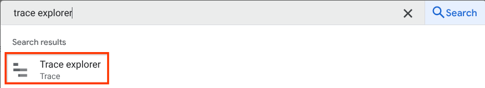
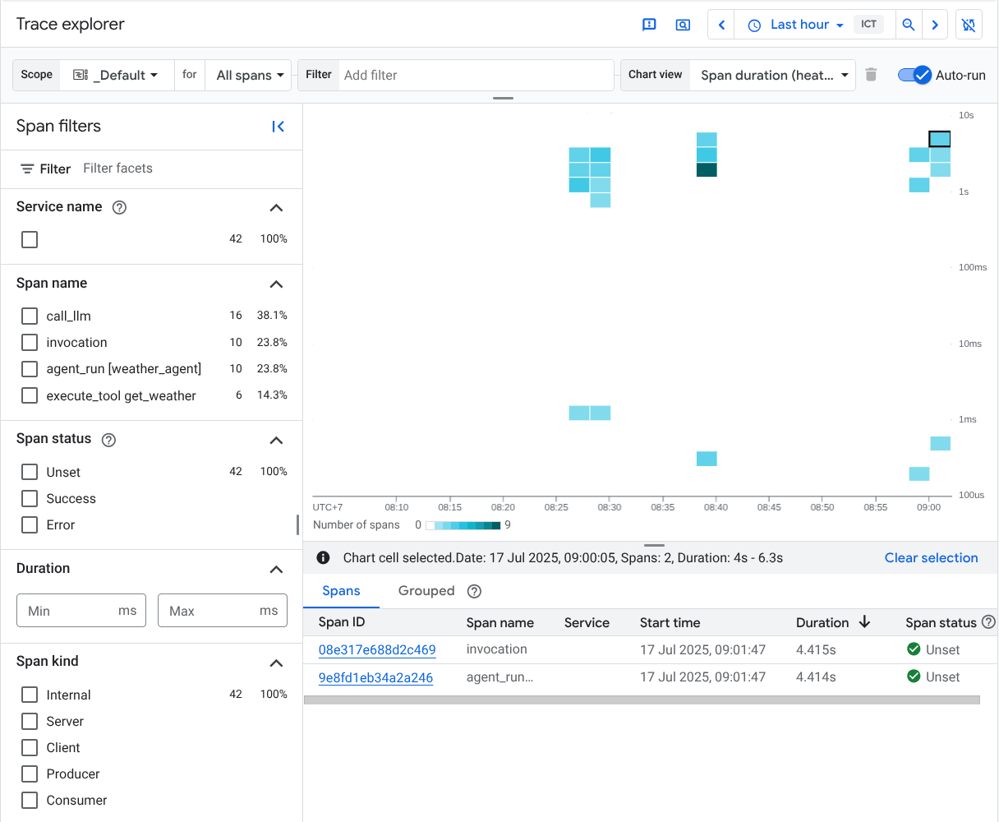
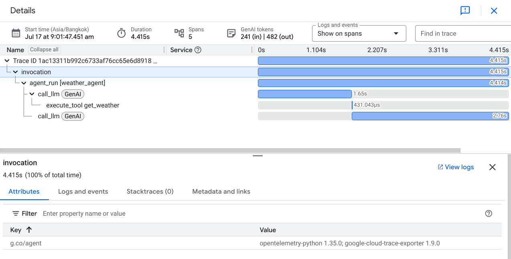

 [ Python](https://github.com/google/adk-python "adk-python on GitHub")[ JS ](https://github.com/google/adk-js "adk-js on GitHub")[ Go ](https://github.com/google/adk-go "adk-go on GitHub")[ Java ](https://github.com/google/adk-java "adk-java on GitHub")[ Kotlin](https://github.com/google/adk-kotlin "adk-kotlin on GitHub")

-   [Home](../..)
-    Build Agents
    
    Build Agents
    
    -   [Get Started](../../get-started/)
        
        Get Started
        
        -   [Python](../../get-started/python/)
        -   [TypeScript](../../get-started/typescript/)
        -   [Go](../../get-started/go/)
        -   [Java](../../get-started/java/)
        -   [Kotlin](../../get-started/kotlin/)
        -   [Agents CLI](../../get-started/agents-cli/)
        -   [Installation](../../get-started/installation/)
        -   [Google Cloud](../../get-started/google-cloud/)
        -   [Migrate to ADK](../../get-started/migrate/)
        
    -   [Build your Agent](../../tutorials/)
        
        Build your Agent
        
        -   [Multi-tool agent](../../tutorials/multi-tool-agent/)
        -   [Agent team](../../tutorials/agent-team/)
        -   [Code with AI](../../tutorials/coding-with-ai/)
        -   [Agent Config](../../agents/config/)
        
    -   [Agents](../../agents/)
        
        Agents
        
        -   [Simple agents](../../agents/llm-agents/)
        -   [Managed agents](../../agents/managed-agents/)
        
    -   [Graph Workflows](../../graphs/)
        
        Graph Workflows
        
        -   [Graph routes](../../graphs/routes/)
        -   [Data handling](../../graphs/data-handling/)
        -   [Human input](../../graphs/human-input/)
        -   [Dynamic workflows](../../graphs/dynamic/)
        
    -   [Multi-Agent Workflows](../../workflows/)
        
        Multi-Agent Workflows
        
        -   [Collaborative workflows](../../workflows/collaboration/)
        -   [Template workflows](../../agents/workflow-agents/)
            
            Template workflows
            
            -   [Sequential workflow](../../agents/workflow-agents/sequential-agents/)
            -   [Loop workflow](../../agents/workflow-agents/loop-agents/)
            -   [Parallel workflow](../../agents/workflow-agents/parallel-agents/)
            -   [Custom template workflows](../../agents/custom-agents/)
            
        -   [Agent routing](../../agents/routing/)
        -   [Workflow patterns](../../workflows/patterns/)
        
    -   [Models for Agents](../../agents/models/)
        
        Models for Agents
        
        -   [Gemini](../../agents/models/google-gemini/)
            
            Gemini
            
            -   [Deferred scheduling](../../agents/models/google-gemini/deferred-schedule/)
            
        -   [Gemma](../../agents/models/google-gemma/)
        -   [Claude](../../agents/models/anthropic/)
        -   [Agent Platform hosted](../../agents/models/agent-platform/)
        -   [Apigee AI Gateway](../../agents/models/apigee/)
        -   [Model routing](../../agents/models/routing/)
        -   [OpenAI](../../agents/models/openai/)
        -   [Ollama](../../agents/models/ollama/)
        -   [vLLM](../../agents/models/vllm/)
        -   [LiteLLM](../../agents/models/litellm/)
        -   [LiteRT-LM](../../agents/models/litert-lm/)
        
    
-    Run Agents
    
    Run Agents
    
    -   [Agent Runtime](../../runtime/)
        
        Agent Runtime
        
        -   [Web Interface](../../runtime/web-interface/)
            
            Web Interface
            
            -   [Visual Builder](../../visual-builder/)
            
        -   [Command Line](../../runtime/command-line/)
        -   [API Server](../../runtime/api-server/)
        -   [Ambient Agents](../../runtime/ambient-agents/)
        -   [Resume Agents](../../runtime/resume/)
        -   [Cancel Agent Runs](../../runtime/cancel/)
        -   [Runtime Config](../../runtime/runconfig/)
        -   [Event Loop](../../runtime/event-loop/)
        
    -   [Deployment](../../deploy/)
        
        Deployment
        
        -   [Agent Runtime](../../deploy/agent-runtime/)
            
            Agent Runtime
            
            -   [Standard deployment](../../deploy/agent-runtime/deploy/)
            -   [agents-cli](../../deploy/agent-runtime/agents-cli/)
            -   [Test deployed agents](../../deploy/agent-runtime/test/)
            
        -   [Cloud Run](../../deploy/cloud-run/)
        -   [GKE](../../deploy/gke/)
        
    -   [Observability](../../observability/)
        
        Observability
        
        -   [Logging](../../observability/logging/)
        -   [Metrics](../../observability/metrics/)
        -   [Traces](../../observability/traces/)
        
    -   [Evaluation](../../evaluate/)
        
        Evaluation
        
        -   [Criteria](../../evaluate/criteria/)
        -   [User Simulation](../../evaluate/user-sim/)
        -   [Environment Simulation](../../evaluate/environment_simulation/)
        -   [Custom Metrics](../../evaluate/custom_metrics/)
        -   [Optimization](../../optimize/)
        
    -   [Safety and Security](../../safety/)
        
        Safety and Security
        
    
-    Components
    
    Components
    
    -   [Technical Overview](../../get-started/about/)
    -   [Custom Tools](../../tools-custom/)
        
        Custom Tools
        
        -    Function tools
            
            Function tools
            
            -   [Overview](../../tools-custom/function-tools/)
            -   [Tool performance](../../tools-custom/performance/)
            -   [Action confirmations](../../tools-custom/confirmation/)
            
        -   [MCP tools](../../tools-custom/mcp-tools/)
            
            MCP tools
            
            -   [Advanced configuration](../../tools-custom/mcp-tools/advanced/)
            -   [Deployment](../../tools-custom/mcp-tools/deployment/)
            -   [Agent as MCP server](../../tools-custom/mcp-tools/agent-as-server/)
            -   [Sub-agent delegation](../../tools-custom/mcp-tools/agent-managed/)
            
        -   [OpenAPI tools](../../tools-custom/openapi-tools/)
        -   [Authentication](../../tools-custom/authentication/)
        -   [Tool limitations](../../tools/limitations/)
        
    -   [Artifacts](../../artifacts/)
        
        Artifacts
        
    -   [Skills for Agents](../../skills/)
        
        Skills for Agents
        
    -   [App management](../../apps/)
        
        App management
        
        -   [Callbacks](../../callbacks/)
            
            Callbacks
            
            -   [Types of callbacks](../../callbacks/types-of-callbacks/)
            -   [Callback patterns](../../callbacks/design-patterns-and-best-practices/)
            
        -   [Plugins](../../plugins/)
        
    -   [Agent context](../../context/)
        
        Agent context
        
        -   [Conversational context](../../sessions/)
        -   [Sessions](../../sessions/session/)
            
            Sessions
            
            -   [Rewind sessions](../../sessions/session/rewind/)
            -   [Migrate sessions](../../sessions/session/migrate/)
            
        -   [State](../../sessions/state/)
        -   [Events](../../events/)
        -   [Memory](../../sessions/memory/)
        -   [Context compression](../../context/compaction/)
        -   [Model context caching](../../context/caching/)
        
    -   [A2A Protocol](../../a2a/)
        
        A2A Protocol
        
        -   [Introduction to A2A](../../a2a/intro/)
        -    A2A Quickstart (Exposing)
            
            A2A Quickstart (Exposing)
            
            -   [Python](../../a2a/quickstart-exposing/)
            -   [Go](../../a2a/quickstart-exposing-go/)
            -   [Java](../../a2a/quickstart-exposing-java/)
            
        -    A2A Quickstart (Consuming)
            
            A2A Quickstart (Consuming)
            
            -   [Python](../../a2a/quickstart-consuming/)
            -   [Go](../../a2a/quickstart-consuming-go/)
            -   [Java](../../a2a/quickstart-consuming-java/)
            -   [Kotlin](../../a2a/quickstart-consuming-kotlin/)
            
        -   [A2A Extension](../../a2a/a2a-extension/)
        
    -   [Live and Voice Agents](../../live/)
        
        Live and Voice Agents
        
        -   [Get started](../../live/get-started/)
            
            Get started
            
            -   [Python](../../live/get-started/streaming-python/)
            -   [Java](../../live/get-started/streaming-java/)
            
        -    Building
            
            Building
            
            -   [Workflows](../../live/workflows/)
            -   [Tools](../../live/tools/)
            -   [Sessions](../../live/sessions/)
            -   [Events](../../live/events/)
            -   [Audio and video](../../live/audio-video/)
            -   [Configuration](../../live/configuration/)
            
        -    Production
            
            Production
            
            -   [Guardrails](../../live/guardrails/)
            -   [Evaluation](../../live/evaluation/)
            -   [Build a custom server](../../live/custom-server/)
            
        -   [Supported models](../../live/models/)
        
    -   [Grounding](../../grounding/)
        
        Grounding
        
        -   [Google Search Grounding](../../grounding/google_search_grounding/)
        -   [Grounding with Search](../../grounding/grounding_with_search/)
        
    
-   [Integrations](../)
    
    Integrations
    
-    Reference
    
    Reference
    
    -   [API Reference](../../api-reference/)
        
        API Reference
        
        -   [Python ADK](../../api-reference/python/)
        -   [TypeScript ADK](../../api-reference/typescript/)
        -    Go ADK
            
            Go ADK
            
            -   [Go v2.x](https://pkg.go.dev/google.golang.org/adk/v2)
            -   [Go v1.x](https://pkg.go.dev/google.golang.org/adk)
            
        -   [Java ADK](../../api-reference/java/)
        -   [Kotlin ADK](../../api-reference/kotlin/)
        -   [CLI Reference](../../api-reference/cli/)
        -   [Agent Config Reference](../../api-reference/agentconfig/)
        -   [REST API](../../api-reference/rest/)
        
    -   [Release Notes](../../release-notes/)
    
-   [Community](../../community/)
    
    Community
    
    -   [Contributing Guide](../../community/contributing-guide/)
    
-   [ADK 2.0](../../2.0/)
    
    ADK 2.0
    

Table of contents

-   [Overview](#overview)
-   [Cloud Trace setup](#cloud-trace-setup)
    
    -   [Use the ADK CLI](#use-the-adk-cli)
    -   [Programmatic setup](#programmatic-setup)
        
        -   [Use ADK app abstractions](#use-adk-app-abstractions)
        -   [Use telemetry modules](#use-telemetry-modules)
        
    
-   [Inspect Cloud Trace data](#inspect-cloud-trace-data)
    
    -   [Captured attributes](#captured-attributes)
    -   [Data privacy and payload redaction](#data-privacy-and-payload-redaction)
    
-   [Resources](#resources)

# Google Cloud Trace observability for ADK[¶](#google-cloud-trace-observability-for-adk "Permanent link")

Supported in ADKPythonTypeScriptGo

During local development, you can inspect agent behavior with the [Trace view in the ADK web UI](/evaluate/#debugging-with-the-trace-view). Once your agent is deployed, you need a way to observe traces from real traffic in one place.

[Cloud Trace](https://cloud.google.com/trace) is the distributed tracing component of Google Cloud Observability. It collects and visualizes trace data so you can monitor latency, debug errors, and improve performance across your applications. For ADK agents, Cloud Trace captures how each request flows through model calls, tool executions, and agent steps, so you can pinpoint bottlenecks and errors in production.

## Overview[¶](#overview "Permanent link")

Cloud Trace is built on [OpenTelemetry](https://opentelemetry.io/), an open-source standard that supports many languages and ingestion methods for generating trace data. This aligns with observability practices for ADK applications, which also leverage OpenTelemetry-compatible instrumentation, allowing you to:

-   **Trace agent interactions**: Cloud Trace continuously gathers and analyzes trace data from your project, enabling you to rapidly diagnose latency issues and errors within your ADK applications. This automatic data collection simplifies the process of identifying problems in complex agent workflows.
-   **Debug issues**: Quickly diagnose latency issues and errors by analyzing detailed traces. These traces are crucial for understanding issues that manifest as increased communication latency across different services or during specific agent actions like tool calls.
-   **In-depth analysis and visualization**: Trace Explorer is the primary tool for analyzing traces, offering visual aids like heatmaps for span duration and line charts for span rates. It also provides a spans table, groupable by service and operation, which gives one-click access to representative traces and a waterfall view to easily identify bottlenecks and sources of errors within your agent's execution path.

The following example will assume the following agent directory structure:

`working_dir/ ├── weather_agent/ │   ├── agent.py │   └── __init__.py └── deploy_agent_engine.py └── deploy_fast_api_app.py └── agent_runner.py`

Python

`# weather_agent/agent.py import os from google.adk.agents import Agent os.environ.setdefault("GOOGLE_CLOUD_PROJECT", "{your-project-id}") os.environ.setdefault("GOOGLE_CLOUD_LOCATION", "global") os.environ.setdefault("GOOGLE_GENAI_USE_ENTERPRISE", "True")  # Define a tool function def get_weather(city: str) -> dict:         """Retrieves the current weather report for a specified city.         Args:                city (str): The name of the city for which to retrieve the weather report.         Returns:                dict: status and result or error msg.        """        if city.lower() == "new york":                return {                        "status": "success",                        "report": (                                "The weather in New York is sunny with a temperature of 25 degrees"                                " Celsius (77 degrees Fahrenheit)."                        ),                }        else:                return {                        "status": "error",                        "error_message": f"Weather information for '{city}' is not available.",                }  # Create an agent with tools root_agent = Agent(         name="weather_agent",        model="gemini-flash-latest",        description="Agent to answer questions using weather tools.",        instruction="You must use the available tools to find an answer.",        tools=[get_weather], )`

## Cloud Trace setup[¶](#cloud-trace-setup "Permanent link")

### Use the ADK CLI[¶](#use-the-adk-cli "Permanent link")

You can enable cloud tracing by adding a flag when deploying or running your agent using the ADK CLI.

PythonGo

When deploying your agent using the `adk deploy` command:

`adk deploy agent_engine \         --project=$GOOGLE_CLOUD_PROJECT \        --region=$GOOGLE_CLOUD_LOCATION \        --otel_to_cloud \        $AGENT_PATH`

When running your agent built with the ADK Go launcher:

`adkgo web -otel_to_cloud`

### Programmatic setup[¶](#programmatic-setup "Permanent link")

#### Use ADK app abstractions[¶](#use-adk-app-abstractions "Permanent link")

Python

If you are using the Agent Platform SDK `AdkApp` abstraction, you can enable cloud tracing by adding `enable_tracing=True`:

`from vertexai.agent_engines import AdkApp adk_app = AdkApp(         agent=root_agent,        enable_tracing=True, )`

#### Use telemetry modules[¶](#use-telemetry-modules "Permanent link")

For fully customized agent runtimes, you can enable cloud tracing by using the built-in telemetry modules.

PythonTypeScriptGo

`from google.adk.telemetry import google_cloud from google.adk.telemetry.setup import maybe_set_otel_providers # Get GCP exporters configuration hooks = google_cloud.get_gcp_exporters(enable_cloud_tracing=True) # Initialize and set global OTel providers maybe_set_otel_providers(otel_hooks_to_setup=[hooks])`

`import { getGcpExporters, maybeSetOtelProviders } from '@google/adk'; // Get GCP exporters configuration const gcpExporters = await getGcpExporters({     enableTracing: true, }); // Initialize and set global OTel providers maybeSetOtelProviders([gcpExporters]); // ... your agent code ...`

`import (         "context"        "log"        "time"         "google.golang.org/adk/v2/telemetry" ) func main() {         ctx := context.Background()         // Initialize telemetry with cloud export enabled.        // By default, the GCP project ID is read from the GOOGLE_CLOUD_PROJECT environment variable.        // You can also specify it explicitly using telemetry.WithGcpResourceProject("my-project").        telemetryProviders, err := telemetry.New(ctx,                telemetry.WithOtelToCloud(true),                // telemetry.WithGcpResourceProject("your-project-id"),        )        if err != nil {                log.Fatalf("failed to initialize telemetry: %v", err)        }        defer func() {                shutdownCtx, cancel := context.WithTimeout(context.Background(), 5*time.Second)                defer cancel()                if err := telemetryProviders.Shutdown(shutdownCtx); err != nil {                        log.Printf("failed to shutdown telemetry: %v", err)                }        }()         // Register as global OTel providers        telemetryProviders.SetGlobalOtelProviders()         // ... your agent code ... }`

## Inspect Cloud Trace data[¶](#inspect-cloud-trace-data "Permanent link")

After the setup is complete, whenever you interact with the agent, it will automatically send trace data to Cloud Trace. You can inspect the traces by visiting the **Trace Explorer** in the [Google Cloud Console](https://console.cloud.google.com/traces/explorer).

You will see all available traces produced by the ADK agent, with span names such as `invoke_agent`, `generate_content`, `call_llm`, and `execute_tool`.

If you click on one of the traces, you will see a waterfall view of the detailed process, similar to the trace view in the local ADK web UI.

### Captured attributes[¶](#captured-attributes "Permanent link")

The Agent Development Kit (ADK) enriches traces with telemetry attributes to help you filter, monitor, and analyze agent behavior.

Attribute

Description

`gen_ai.agent.name`

The name of the agent being executed.

`gcp.vertex.agent.invocation_id`

Unique ID of the invocation.

`gcp.vertex.agent.event_id`

ID of the specific event.

`gen_ai.conversation.id`

The session or conversation ID.

`gcp.vertex.agent.session_id`

The session ID associated with the agent invocation context.

`gcp.vertex.agent.llm_request`

Serialized LLM request containing prompt text and configuration.

`gcp.vertex.agent.llm_response`

Serialized LLM response containing model output.

`gcp.vertex.agent.tool_call_args`

Serialized arguments passed to tool calls.

`gcp.vertex.agent.tool_response`

Serialized result returned by the tool.

`gcp.vertex.agent.data`

Serialized data payloads sent to the agent.

### Data privacy and payload redaction[¶](#data-privacy-and-payload-redaction "Permanent link")

To prevent exposing sensitive data and Personally Identifiable Information (PII) in production:

-   **Deployment default:** When deploying with `adk deploy agent_engine --otel_to_cloud`, ADK automatically sets `ADK_CAPTURE_MESSAGE_CONTENT_IN_SPANS='false'` unless it is already defined in `.env` settings. For other targets like Cloud Run or GKE, set this variable explicitly.
-   **Redacted payloads:** When `ADK_CAPTURE_MESSAGE_CONTENT_IN_SPANS` is `'false'` or `'0'`, payload attributes (`gcp.vertex.agent.llm_request`, `gcp.vertex.agent.llm_response`, `gcp.vertex.agent.tool_call_args`, `gcp.vertex.agent.tool_response`, and `gcp.vertex.agent.data`) are replaced with placeholder values, such as `"{}"` or `"N/A"`.
-   **Enabling capture:** To capture full payloads for local testing or debugging, explicitly set `ADK_CAPTURE_MESSAGE_CONTENT_IN_SPANS='true'` in your `.env` file or environment variables.
-   **OpenTelemetry message capturing:** Set `OTEL_INSTRUMENTATION_GENAI_CAPTURE_MESSAGE_CONTENT='true'` (or `'1'`) to enable logging of prompt and response content in OpenTelemetry events.

## Resources[¶](#resources "Permanent link")

To learn more about tracing, OpenTelemetry, and Google Cloud integrations, explore the following documentation:

-   [Google Cloud Trace Documentation](https://cloud.google.com/trace)
-   [OpenTelemetry Documentation](https://opentelemetry.io/docs/)
-   [Connect to Google Cloud and Agent Platform](/get-started/google-cloud/)

Back to top