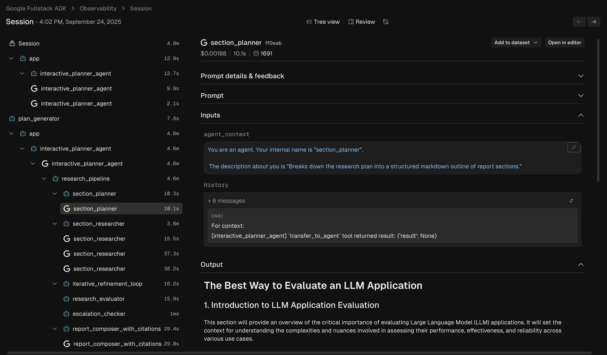
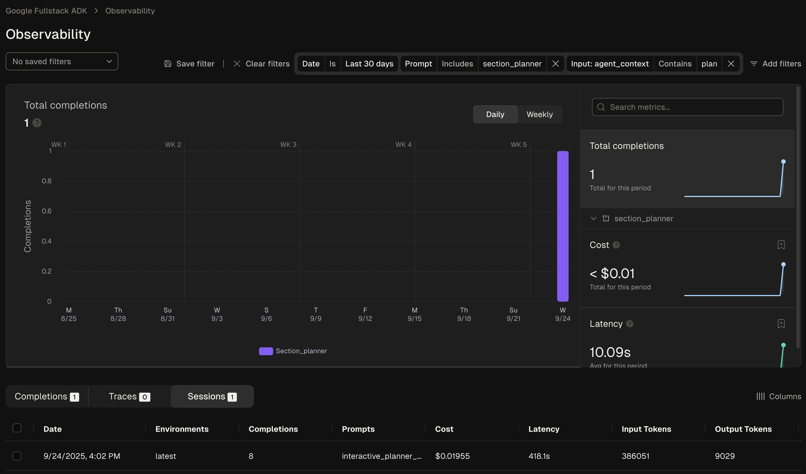
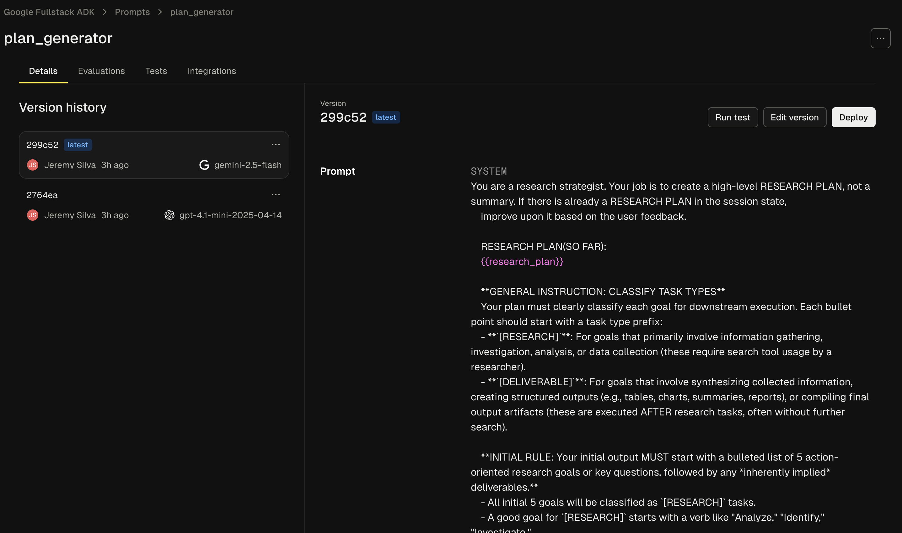
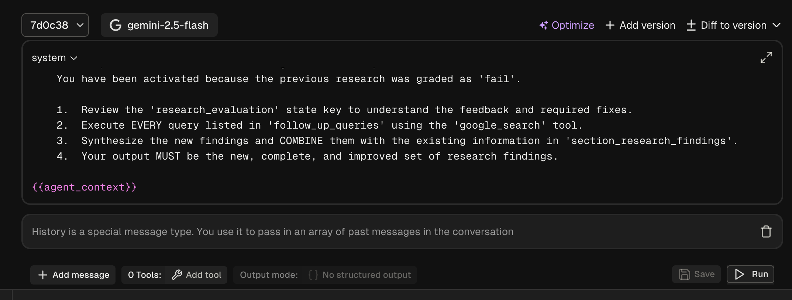
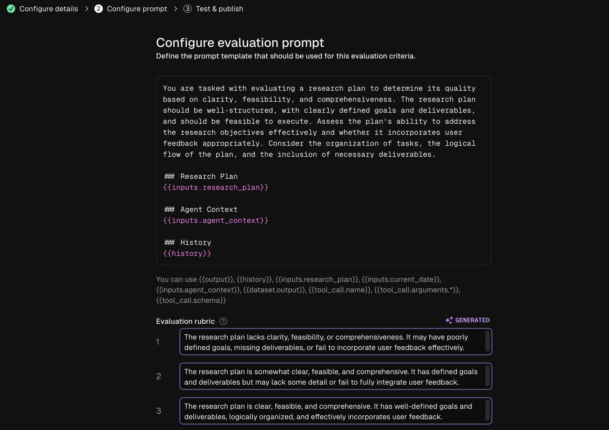
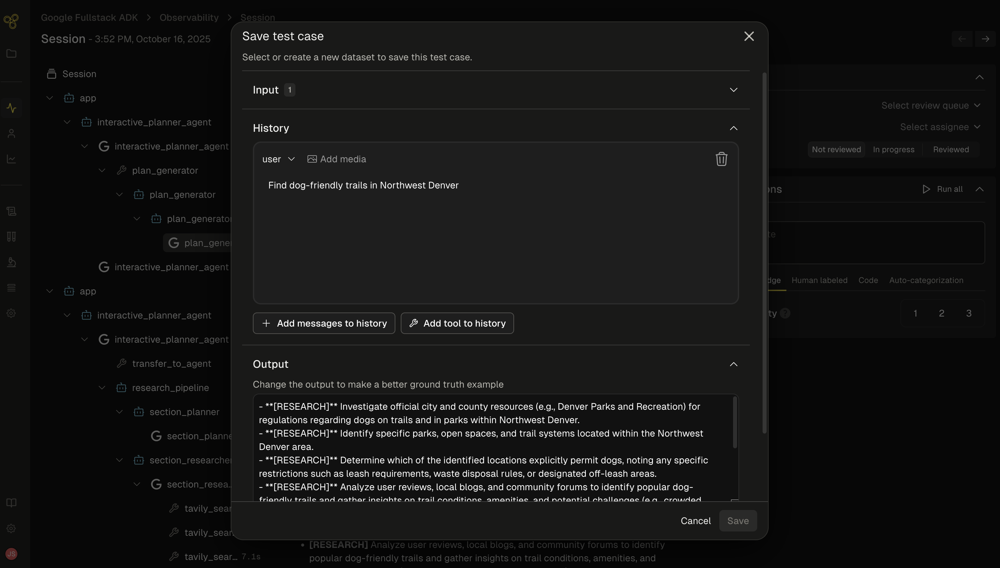

 [ Python](https://github.com/google/adk-python "adk-python on GitHub")[ JS ](https://github.com/google/adk-js "adk-js on GitHub")[ Go ](https://github.com/google/adk-go "adk-go on GitHub")[ Java ](https://github.com/google/adk-java "adk-java on GitHub")[ Kotlin](https://github.com/google/adk-kotlin "adk-kotlin on GitHub")

-   [Home](../..)
-    Build Agents
    
    Build Agents
    
    -   [Get Started](../../get-started/)
        
        Get Started
        
        -   [Python](../../get-started/python/)
        -   [TypeScript](../../get-started/typescript/)
        -   [Go](../../get-started/go/)
        -   [Java](../../get-started/java/)
        -   [Kotlin](../../get-started/kotlin/)
        -   [Agents CLI](../../get-started/agents-cli/)
        -   [Installation](../../get-started/installation/)
        -   [Google Cloud](../../get-started/google-cloud/)
        -   [Migrate to ADK](../../get-started/migrate/)
        
    -   [Build your Agent](../../tutorials/)
        
        Build your Agent
        
        -   [Multi-tool agent](../../tutorials/multi-tool-agent/)
        -   [Agent team](../../tutorials/agent-team/)
        -   [Code with AI](../../tutorials/coding-with-ai/)
        -   [Agent Config](../../agents/config/)
        
    -   [Agents](../../agents/)
        
        Agents
        
        -   [Simple agents](../../agents/llm-agents/)
        -   [Managed agents](../../agents/managed-agents/)
        
    -   [Graph Workflows](../../graphs/)
        
        Graph Workflows
        
        -   [Graph routes](../../graphs/routes/)
        -   [Data handling](../../graphs/data-handling/)
        -   [Human input](../../graphs/human-input/)
        -   [Dynamic workflows](../../graphs/dynamic/)
        
    -   [Multi-Agent Workflows](../../workflows/)
        
        Multi-Agent Workflows
        
        -   [Collaborative workflows](../../workflows/collaboration/)
        -   [Template workflows](../../agents/workflow-agents/)
            
            Template workflows
            
            -   [Sequential workflow](../../agents/workflow-agents/sequential-agents/)
            -   [Loop workflow](../../agents/workflow-agents/loop-agents/)
            -   [Parallel workflow](../../agents/workflow-agents/parallel-agents/)
            -   [Custom template workflows](../../agents/custom-agents/)
            
        -   [Agent routing](../../agents/routing/)
        -   [Workflow patterns](../../workflows/patterns/)
        
    -   [Models for Agents](../../agents/models/)
        
        Models for Agents
        
        -   [Gemini](../../agents/models/google-gemini/)
            
            Gemini
            
            -   [Deferred scheduling](../../agents/models/google-gemini/deferred-schedule/)
            
        -   [Gemma](../../agents/models/google-gemma/)
        -   [Claude](../../agents/models/anthropic/)
        -   [Agent Platform hosted](../../agents/models/agent-platform/)
        -   [Apigee AI Gateway](../../agents/models/apigee/)
        -   [Model routing](../../agents/models/routing/)
        -   [OpenAI](../../agents/models/openai/)
        -   [Ollama](../../agents/models/ollama/)
        -   [vLLM](../../agents/models/vllm/)
        -   [LiteLLM](../../agents/models/litellm/)
        -   [LiteRT-LM](../../agents/models/litert-lm/)
        
    
-    Run Agents
    
    Run Agents
    
    -   [Agent Runtime](../../runtime/)
        
        Agent Runtime
        
        -   [Web Interface](../../runtime/web-interface/)
            
            Web Interface
            
            -   [Visual Builder](../../visual-builder/)
            
        -   [Command Line](../../runtime/command-line/)
        -   [API Server](../../runtime/api-server/)
        -   [Ambient Agents](../../runtime/ambient-agents/)
        -   [Resume Agents](../../runtime/resume/)
        -   [Cancel Agent Runs](../../runtime/cancel/)
        -   [Runtime Config](../../runtime/runconfig/)
        -   [Event Loop](../../runtime/event-loop/)
        
    -   [Deployment](../../deploy/)
        
        Deployment
        
        -   [Agent Runtime](../../deploy/agent-runtime/)
            
            Agent Runtime
            
            -   [Standard deployment](../../deploy/agent-runtime/deploy/)
            -   [agents-cli](../../deploy/agent-runtime/agents-cli/)
            -   [Test deployed agents](../../deploy/agent-runtime/test/)
            
        -   [Cloud Run](../../deploy/cloud-run/)
        -   [GKE](../../deploy/gke/)
        
    -   [Observability](../../observability/)
        
        Observability
        
        -   [Logging](../../observability/logging/)
        -   [Metrics](../../observability/metrics/)
        -   [Traces](../../observability/traces/)
        
    -   [Evaluation](../../evaluate/)
        
        Evaluation
        
        -   [Criteria](../../evaluate/criteria/)
        -   [User Simulation](../../evaluate/user-sim/)
        -   [Environment Simulation](../../evaluate/environment_simulation/)
        -   [Custom Metrics](../../evaluate/custom_metrics/)
        -   [Optimization](../../optimize/)
        
    -   [Safety and Security](../../safety/)
        
        Safety and Security
        
    
-    Components
    
    Components
    
    -   [Technical Overview](../../get-started/about/)
    -   [Custom Tools](../../tools-custom/)
        
        Custom Tools
        
        -    Function tools
            
            Function tools
            
            -   [Overview](../../tools-custom/function-tools/)
            -   [Tool performance](../../tools-custom/performance/)
            -   [Action confirmations](../../tools-custom/confirmation/)
            
        -   [MCP tools](../../tools-custom/mcp-tools/)
            
            MCP tools
            
            -   [Advanced configuration](../../tools-custom/mcp-tools/advanced/)
            -   [Deployment](../../tools-custom/mcp-tools/deployment/)
            -   [Agent as MCP server](../../tools-custom/mcp-tools/agent-as-server/)
            -   [Sub-agent delegation](../../tools-custom/mcp-tools/agent-managed/)
            
        -   [OpenAPI tools](../../tools-custom/openapi-tools/)
        -   [Authentication](../../tools-custom/authentication/)
        -   [Tool limitations](../../tools/limitations/)
        
    -   [Artifacts](../../artifacts/)
        
        Artifacts
        
    -   [Skills for Agents](../../skills/)
        
        Skills for Agents
        
    -   [App management](../../apps/)
        
        App management
        
        -   [Callbacks](../../callbacks/)
            
            Callbacks
            
            -   [Types of callbacks](../../callbacks/types-of-callbacks/)
            -   [Callback patterns](../../callbacks/design-patterns-and-best-practices/)
            
        -   [Plugins](../../plugins/)
        
    -   [Agent context](../../context/)
        
        Agent context
        
        -   [Conversational context](../../sessions/)
        -   [Sessions](../../sessions/session/)
            
            Sessions
            
            -   [Rewind sessions](../../sessions/session/rewind/)
            -   [Migrate sessions](../../sessions/session/migrate/)
            
        -   [State](../../sessions/state/)
        -   [Events](../../events/)
        -   [Memory](../../sessions/memory/)
        -   [Context compression](../../context/compaction/)
        -   [Model context caching](../../context/caching/)
        
    -   [A2A Protocol](../../a2a/)
        
        A2A Protocol
        
        -   [Introduction to A2A](../../a2a/intro/)
        -    A2A Quickstart (Exposing)
            
            A2A Quickstart (Exposing)
            
            -   [Python](../../a2a/quickstart-exposing/)
            -   [Go](../../a2a/quickstart-exposing-go/)
            -   [Java](../../a2a/quickstart-exposing-java/)
            
        -    A2A Quickstart (Consuming)
            
            A2A Quickstart (Consuming)
            
            -   [Python](../../a2a/quickstart-consuming/)
            -   [Go](../../a2a/quickstart-consuming-go/)
            -   [Java](../../a2a/quickstart-consuming-java/)
            -   [Kotlin](../../a2a/quickstart-consuming-kotlin/)
            
        -   [A2A Extension](../../a2a/a2a-extension/)
        
    -   [Live and Voice Agents](../../live/)
        
        Live and Voice Agents
        
        -   [Get started](../../live/get-started/)
            
            Get started
            
            -   [Python](../../live/get-started/streaming-python/)
            -   [Java](../../live/get-started/streaming-java/)
            
        -    Building
            
            Building
            
            -   [Workflows](../../live/workflows/)
            -   [Tools](../../live/tools/)
            -   [Sessions](../../live/sessions/)
            -   [Events](../../live/events/)
            -   [Audio and video](../../live/audio-video/)
            -   [Configuration](../../live/configuration/)
            
        -    Production
            
            Production
            
            -   [Guardrails](../../live/guardrails/)
            -   [Evaluation](../../live/evaluation/)
            -   [Build a custom server](../../live/custom-server/)
            
        -   [Supported models](../../live/models/)
        
    -   [Grounding](../../grounding/)
        
        Grounding
        
        -   [Google Search Grounding](../../grounding/google_search_grounding/)
        -   [Grounding with Search](../../grounding/grounding_with_search/)
        
    
-   [Integrations](../)
    
    Integrations
    
-    Reference
    
    Reference
    
    -   [API Reference](../../api-reference/)
        
        API Reference
        
        -   [Python ADK](../../api-reference/python/)
        -   [TypeScript ADK](../../api-reference/typescript/)
        -    Go ADK
            
            Go ADK
            
            -   [Go v2.x](https://pkg.go.dev/google.golang.org/adk/v2)
            -   [Go v1.x](https://pkg.go.dev/google.golang.org/adk)
            
        -   [Java ADK](../../api-reference/java/)
        -   [Kotlin ADK](../../api-reference/kotlin/)
        -   [CLI Reference](../../api-reference/cli/)
        -   [Agent Config Reference](../../api-reference/agentconfig/)
        -   [REST API](../../api-reference/rest/)
        
    -   [Release Notes](../../release-notes/)
    
-   [Community](../../community/)
    
    Community
    
    -   [Contributing Guide](../../community/contributing-guide/)
    
-   [ADK 2.0](../../2.0/)
    
    ADK 2.0
    

Table of contents

-   [Getting Started](#getting-started)
    
    -   [Create a Freeplay Account](#create-a-freeplay-account)
    -   [Use Freeplay ADK Library](#use-freeplay-adk-library)
    
-   [Observability](#observability)
-   [Prompt Management (optional)](#prompt-management-optional)
    
    -   [System Message](#system-message)
    -   [Agent Context Variable](#agent-context-variable)
    -   [History Block](#history-block)
    
-   [Evaluation](#evaluation)
-   [Dataset Management](#dataset-management)
-   [Batch Testing](#batch-testing)
-   [Sign up now](#sign-up-now)

# Freeplay observability for ADK[¶](#freeplay-observability-for-adk "Permanent link")

Supported in ADKPython

[Freeplay](https://freeplay.ai/) provides an end-to-end workflow for building and optimizing AI agents, and it can be integrated with ADK. With Freeplay your whole team can easily collaborate to iterate on agent instructions (prompts), experiment with and compare different models and agent changes, run evals both offline and online to measure quality, monitor production, and review data by hand.

Key benefits of Freeplay:

-   **Simple observability** - focused on agents, LLM calls and tool calls for easy human review
-   **Online evals/automated scorers** - for error detection in production
-   **Offline evals and experiment comparison** - to test changes before deploying
-   **Prompt management** - supports pushing changes straight from the Freeplay playground to code
-   **Human review workflow** - for collaboration on error analysis and data annotation
-   **Powerful UI** - makes it possible for domain experts to collaborate closely with engineers

Freeplay and ADK complement one another. ADK gives you a powerful and expressive agent orchestration framework while Freeplay plugs in for observability, prompt management, evaluation and testing. Once you integrate with Freeplay, you can update prompts and evals from the Freeplay UI or from code, so that anyone on your team can contribute.

## Getting Started[¶](#getting-started "Permanent link")

Below is a guide for getting started with Freeplay and ADK. You can also find a full sample ADK agent repo [here](https://github.com/228Labs/freeplay-google-demo).

### Create a Freeplay Account[¶](#create-a-freeplay-account "Permanent link")

Sign up for a free [Freeplay account](https://freeplay.ai/signup).

After creating an account, you can define the following environment variables:

`FREEPLAY_PROJECT_ID= FREEPLAY_API_KEY= FREEPLAY_API_URL=`

### Use Freeplay ADK Library[¶](#use-freeplay-adk-library "Permanent link")

Install the Freeplay ADK library:

`pip install freeplay-python-adk`

Freeplay will automatically capture OTel logs from your ADK application when you initialize observability:

`from freeplay_python_adk.client import FreeplayADK FreeplayADK.initialize_observability()`

You'll also want to pass in the Freeplay plugin to your App:

`from app.agent import root_agent from freeplay_python_adk.freeplay_observability_plugin import FreeplayObservabilityPlugin from google.adk.apps import App app = App(         name="app",        root_agent=root_agent,        plugins=[FreeplayObservabilityPlugin()], ) __all__ = ["app"]`

You can now use ADK as you normally would, and you will see logs flowing to Freeplay in the Observability section.

## Observability[¶](#observability "Permanent link")

Freeplay's Observability feature gives you a clear view into how your agent is behaving in production. You can dig into individual agent traces to understand each step and diagnose issues:

You can also use Freeplay's filtering functionality to search and filter the data across any segment of interest:

## Prompt Management (optional)[¶](#prompt-management-optional "Permanent link")

Freeplay offers [native prompt management](https://docs.freeplay.ai/docs/managing-prompts), which simplifies the process of version and testing different prompt versions. It allows you to experiment with changes to ADK agent instructions in the Freeplay UI, test different models, and push updates straight to your code, similar to a feature flag.

To leverage Freeplay's prompt management capabilities alongside ADK, you'll want to use the Freeplay ADK agent wrapper. `FreeplayLLMAgent` extends ADK's base `LlmAgent` class, so instead of having to hard code your prompts as agent instructions, you can version prompts in the Freeplay application.

First define a prompt in Freeplay by going to Prompts -> Create prompt template:

When creating your prompt template you'll need to add 3 elements, as described in the following sections:

### System Message[¶](#system-message "Permanent link")

This corresponds to the "instructions" section in your code.

### Agent Context Variable[¶](#agent-context-variable "Permanent link")

Adding the following to the bottom of your system message will create a variable for the ongoing agent context to be passed through:

`{{agent_context}}`

### History Block[¶](#history-block "Permanent link")

Click new message and change the role to 'history'. This will ensure the past messages are passed through when present.

Now in your code you can use the `FreeplayLLMAgent`:

`from freeplay_python_adk.client import FreeplayADK from freeplay_python_adk.freeplay_llm_agent import (         FreeplayLLMAgent, ) FreeplayADK.initialize_observability() root_agent = FreeplayLLMAgent(         name="social_product_researcher",        tools=[tavily_search], )`

When the `social_product_researcher` is invoked, the prompt will be retrieved from Freeplay and formatted with the proper input variables.

## Evaluation[¶](#evaluation "Permanent link")

Freeplay enables you to define, version, and run [evaluations](https://docs.freeplay.ai/docs/evaluations) from the Freeplay web application. You can define evaluations for any of your prompts or agents by going to Evaluations -> "New evaluation".

These evaluations can be configured to run for both online monitoring and offline evaluation. Datasets for offline evaluation can be uploaded to Freeplay or saved from log examples.

## Dataset Management[¶](#dataset-management "Permanent link")

As you get data flowing into Freeplay, you can use these logs to start building up [datasets](https://docs.freeplay.ai/docs/datasets) to test against on a repeated basis. Use production logs to create golden datasets or collections of failure cases that you can use to test against as you make changes.

## Batch Testing[¶](#batch-testing "Permanent link")

As you iterate on your agent, you can run batch tests (i.e., offline experiments) at both the [prompt](https://docs.freeplay.ai/docs/component-level-test-runs) and [end-to-end](https://docs.freeplay.ai/docs/end-to-end-test-runs) agent level. This allows you to compare multiple different models or prompt changes and quantify changes head to head across your full agent execution.

[Here](https://github.com/freeplayai/freeplay-google-demo/blob/main/examples/example_test_run.py) is a code example for executing a batch test on Freeplay with ADK.

## Sign up now[¶](#sign-up-now "Permanent link")

Go to [Freeplay](https://freeplay.ai/) to sign up for an account, and check out a full Freeplay <> ADK Integration [here](https://github.com/freeplayai/freeplay-google-demo/tree/main)

Back to top