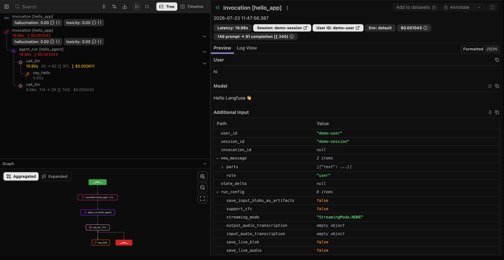

 [ Python](https://github.com/google/adk-python "adk-python on GitHub")[ JS ](https://github.com/google/adk-js "adk-js on GitHub")[ Go ](https://github.com/google/adk-go "adk-go on GitHub")[ Java ](https://github.com/google/adk-java "adk-java on GitHub")[ Kotlin](https://github.com/google/adk-kotlin "adk-kotlin on GitHub")

-   [Home](../..)
-    Build Agents
    
    Build Agents
    
    -   [Get Started](../../get-started/)
        
        Get Started
        
        -   [Python](../../get-started/python/)
        -   [TypeScript](../../get-started/typescript/)
        -   [Go](../../get-started/go/)
        -   [Java](../../get-started/java/)
        -   [Kotlin](../../get-started/kotlin/)
        -   [Agents CLI](../../get-started/agents-cli/)
        -   [Installation](../../get-started/installation/)
        -   [Google Cloud](../../get-started/google-cloud/)
        -   [Migrate to ADK](../../get-started/migrate/)
        
    -   [Build your Agent](../../tutorials/)
        
        Build your Agent
        
        -   [Multi-tool agent](../../tutorials/multi-tool-agent/)
        -   [Agent team](../../tutorials/agent-team/)
        -   [Code with AI](../../tutorials/coding-with-ai/)
        -   [Agent Config](../../agents/config/)
        
    -   [Agents](../../agents/)
        
        Agents
        
        -   [Simple agents](../../agents/llm-agents/)
        -   [Managed agents](../../agents/managed-agents/)
        
    -   [Graph Workflows](../../graphs/)
        
        Graph Workflows
        
        -   [Graph routes](../../graphs/routes/)
        -   [Data handling](../../graphs/data-handling/)
        -   [Human input](../../graphs/human-input/)
        -   [Dynamic workflows](../../graphs/dynamic/)
        
    -   [Multi-Agent Workflows](../../workflows/)
        
        Multi-Agent Workflows
        
        -   [Collaborative workflows](../../workflows/collaboration/)
        -   [Template workflows](../../agents/workflow-agents/)
            
            Template workflows
            
            -   [Sequential workflow](../../agents/workflow-agents/sequential-agents/)
            -   [Loop workflow](../../agents/workflow-agents/loop-agents/)
            -   [Parallel workflow](../../agents/workflow-agents/parallel-agents/)
            -   [Custom template workflows](../../agents/custom-agents/)
            
        -   [Agent routing](../../agents/routing/)
        -   [Workflow patterns](../../workflows/patterns/)
        
    -   [Models for Agents](../../agents/models/)
        
        Models for Agents
        
        -   [Gemini](../../agents/models/google-gemini/)
            
            Gemini
            
            -   [Deferred scheduling](../../agents/models/google-gemini/deferred-schedule/)
            
        -   [Gemma](../../agents/models/google-gemma/)
        -   [Claude](../../agents/models/anthropic/)
        -   [Agent Platform hosted](../../agents/models/agent-platform/)
        -   [Apigee AI Gateway](../../agents/models/apigee/)
        -   [Model routing](../../agents/models/routing/)
        -   [OpenAI](../../agents/models/openai/)
        -   [Ollama](../../agents/models/ollama/)
        -   [vLLM](../../agents/models/vllm/)
        -   [LiteLLM](../../agents/models/litellm/)
        -   [LiteRT-LM](../../agents/models/litert-lm/)
        
    
-    Run Agents
    
    Run Agents
    
    -   [Agent Runtime](../../runtime/)
        
        Agent Runtime
        
        -   [Web Interface](../../runtime/web-interface/)
            
            Web Interface
            
            -   [Visual Builder](../../visual-builder/)
            
        -   [Command Line](../../runtime/command-line/)
        -   [API Server](../../runtime/api-server/)
        -   [Ambient Agents](../../runtime/ambient-agents/)
        -   [Resume Agents](../../runtime/resume/)
        -   [Cancel Agent Runs](../../runtime/cancel/)
        -   [Runtime Config](../../runtime/runconfig/)
        -   [Event Loop](../../runtime/event-loop/)
        
    -   [Deployment](../../deploy/)
        
        Deployment
        
        -   [Agent Runtime](../../deploy/agent-runtime/)
            
            Agent Runtime
            
            -   [Standard deployment](../../deploy/agent-runtime/deploy/)
            -   [agents-cli](../../deploy/agent-runtime/agents-cli/)
            -   [Test deployed agents](../../deploy/agent-runtime/test/)
            
        -   [Cloud Run](../../deploy/cloud-run/)
        -   [GKE](../../deploy/gke/)
        
    -   [Observability](../../observability/)
        
        Observability
        
        -   [Logging](../../observability/logging/)
        -   [Metrics](../../observability/metrics/)
        -   [Traces](../../observability/traces/)
        
    -   [Evaluation](../../evaluate/)
        
        Evaluation
        
        -   [Criteria](../../evaluate/criteria/)
        -   [User Simulation](../../evaluate/user-sim/)
        -   [Environment Simulation](../../evaluate/environment_simulation/)
        -   [Custom Metrics](../../evaluate/custom_metrics/)
        -   [Optimization](../../optimize/)
        
    -   [Safety and Security](../../safety/)
        
        Safety and Security
        
    
-    Components
    
    Components
    
    -   [Technical Overview](../../get-started/about/)
    -   [Custom Tools](../../tools-custom/)
        
        Custom Tools
        
        -    Function tools
            
            Function tools
            
            -   [Overview](../../tools-custom/function-tools/)
            -   [Tool performance](../../tools-custom/performance/)
            -   [Action confirmations](../../tools-custom/confirmation/)
            
        -   [MCP tools](../../tools-custom/mcp-tools/)
            
            MCP tools
            
            -   [Advanced configuration](../../tools-custom/mcp-tools/advanced/)
            -   [Deployment](../../tools-custom/mcp-tools/deployment/)
            -   [Agent as MCP server](../../tools-custom/mcp-tools/agent-as-server/)
            -   [Sub-agent delegation](../../tools-custom/mcp-tools/agent-managed/)
            
        -   [OpenAPI tools](../../tools-custom/openapi-tools/)
        -   [Authentication](../../tools-custom/authentication/)
        -   [Tool limitations](../../tools/limitations/)
        
    -   [Artifacts](../../artifacts/)
        
        Artifacts
        
    -   [Skills for Agents](../../skills/)
        
        Skills for Agents
        
    -   [App management](../../apps/)
        
        App management
        
        -   [Callbacks](../../callbacks/)
            
            Callbacks
            
            -   [Types of callbacks](../../callbacks/types-of-callbacks/)
            -   [Callback patterns](../../callbacks/design-patterns-and-best-practices/)
            
        -   [Plugins](../../plugins/)
        
    -   [Agent context](../../context/)
        
        Agent context
        
        -   [Conversational context](../../sessions/)
        -   [Sessions](../../sessions/session/)
            
            Sessions
            
            -   [Rewind sessions](../../sessions/session/rewind/)
            -   [Migrate sessions](../../sessions/session/migrate/)
            
        -   [State](../../sessions/state/)
        -   [Events](../../events/)
        -   [Memory](../../sessions/memory/)
        -   [Context compression](../../context/compaction/)
        -   [Model context caching](../../context/caching/)
        
    -   [A2A Protocol](../../a2a/)
        
        A2A Protocol
        
        -   [Introduction to A2A](../../a2a/intro/)
        -    A2A Quickstart (Exposing)
            
            A2A Quickstart (Exposing)
            
            -   [Python](../../a2a/quickstart-exposing/)
            -   [Go](../../a2a/quickstart-exposing-go/)
            -   [Java](../../a2a/quickstart-exposing-java/)
            
        -    A2A Quickstart (Consuming)
            
            A2A Quickstart (Consuming)
            
            -   [Python](../../a2a/quickstart-consuming/)
            -   [Go](../../a2a/quickstart-consuming-go/)
            -   [Java](../../a2a/quickstart-consuming-java/)
            -   [Kotlin](../../a2a/quickstart-consuming-kotlin/)
            
        -   [A2A Extension](../../a2a/a2a-extension/)
        
    -   [Live and Voice Agents](../../live/)
        
        Live and Voice Agents
        
        -   [Get started](../../live/get-started/)
            
            Get started
            
            -   [Python](../../live/get-started/streaming-python/)
            -   [Java](../../live/get-started/streaming-java/)
            
        -    Building
            
            Building
            
            -   [Workflows](../../live/workflows/)
            -   [Tools](../../live/tools/)
            -   [Sessions](../../live/sessions/)
            -   [Events](../../live/events/)
            -   [Audio and video](../../live/audio-video/)
            -   [Configuration](../../live/configuration/)
            
        -    Production
            
            Production
            
            -   [Guardrails](../../live/guardrails/)
            -   [Evaluation](../../live/evaluation/)
            -   [Build a custom server](../../live/custom-server/)
            
        -   [Supported models](../../live/models/)
        
    -   [Grounding](../../grounding/)
        
        Grounding
        
        -   [Google Search Grounding](../../grounding/google_search_grounding/)
        -   [Grounding with Search](../../grounding/grounding_with_search/)
        
    
-   [Integrations](../)
    
    Integrations
    
-    Reference
    
    Reference
    
    -   [API Reference](../../api-reference/)
        
        API Reference
        
        -   [Python ADK](../../api-reference/python/)
        -   [TypeScript ADK](../../api-reference/typescript/)
        -    Go ADK
            
            Go ADK
            
            -   [Go v2.x](https://pkg.go.dev/google.golang.org/adk/v2)
            -   [Go v1.x](https://pkg.go.dev/google.golang.org/adk)
            
        -   [Java ADK](../../api-reference/java/)
        -   [Kotlin ADK](../../api-reference/kotlin/)
        -   [CLI Reference](../../api-reference/cli/)
        -   [Agent Config Reference](../../api-reference/agentconfig/)
        -   [REST API](../../api-reference/rest/)
        
    -   [Release Notes](../../release-notes/)
    
-   [Community](../../community/)
    
    Community
    
    -   [Contributing Guide](../../community/contributing-guide/)
    
-   [ADK 2.0](../../2.0/)
    
    ADK 2.0
    

Table of contents

-   [Overview](#overview)
-   [Installation](#installation)
-   [Setup](#setup)
-   [Observe](#observe)
-   [Named and filterable traces](#named-and-filterable-traces)
-   [View traces in Langfuse](#view-traces-in-langfuse)
-   [Support and Resources](#support-and-resources)

# Langfuse observability for ADK[¶](#langfuse-observability-for-adk "Permanent link")

Supported in ADKPython

[Langfuse](https://langfuse.com) is an open-source LLM engineering platform for observability, evaluation, and prompt management. It captures detailed traces from ADK agents using the OpenTelemetry (OTel) protocol, so you can debug, evaluate, and iterate on agent apps in development and production.

## Overview[¶](#overview "Permanent link")

Langfuse captures traces from ADK using OpenTelemetry and supports the [AI Engineering Loop](https://langfuse.com/academy/ai-engineering-loop):

-   **[Trace](https://langfuse.com/academy/tracing)**: Capture the full path of a request, including prompts, retrieved context, tool calls, outputs, latency, and cost
-   **[Monitor](https://langfuse.com/academy/monitoring)**: Track how the system behaves over time and surface the traces that deserve attention, using evaluation methods, user feedback, and cost or latency anomalies
-   **[Build datasets](https://langfuse.com/academy/datasets)**: Turn real scenarios from monitoring and expected scenarios from development into repeatable test cases
-   **[Experiment](https://langfuse.com/academy/experiments)**: Change variables systematically (a prompt, a model, a retrieval strategy) and compare each change against a stable baseline
-   **[Evaluate](https://langfuse.com/academy/evaluate)**: Decide whether results are good enough to ship using manual review, code evaluator checks, or LLM-as-a-judge

## Installation[¶](#installation "Permanent link")

Install the required packages:

`pip install langfuse "google-adk>=2" openinference-instrumentation-google-adk`

`google-adk` 2.x requires Python 3.10 or later. Pinning `"google-adk>=2"` ensures pip installs the current ADK 2.x release.

## Setup[¶](#setup "Permanent link")

Sign up at [cloud.langfuse.com](https://cloud.langfuse.com) or [self-host](https://langfuse.com/self-hosting) the platform, then set your API keys. Get keys from your project settings page. Also set a [Gemini API key](https://aistudio.google.com/app/apikey):

`export LANGFUSE_PUBLIC_KEY="pk-lf-..." export LANGFUSE_SECRET_KEY="sk-lf-..." export LANGFUSE_BASE_URL="https://cloud.langfuse.com"  # EU region # Other regions: https://us.cloud.langfuse.com (US), # https://jp.cloud.langfuse.com (Japan), https://hipaa.cloud.langfuse.com (HIPAA) export GOOGLE_API_KEY="your-gemini-api-key"`

Initialize the Langfuse client and instrument ADK:

`from langfuse import get_client from openinference.instrumentation.google_adk import GoogleADKInstrumentor langfuse = get_client() # Verify connection if langfuse.auth_check():         print("Langfuse client is authenticated and ready!") else:         print("Authentication failed. Please check your credentials and host.") GoogleADKInstrumentor().instrument()`

That's it. All ADK agent activity will now be traced and sent to your Langfuse project automatically.

## Observe[¶](#observe "Permanent link")

With tracing initialized, run your ADK agent as usual and all interactions will appear in Langfuse:

`from google.adk.agents import Agent from google.adk.runners import Runner from google.adk.sessions import InMemorySessionService from google.genai import types def say_hello():         return {"greeting": "Hello Langfuse 👋"} agent = Agent(         name="hello_agent",        model="gemini-3.5-flash",        instruction="Always greet using the say_hello tool.",        tools=[say_hello], ) APP_NAME = "hello_app" USER_ID = "demo-user" SESSION_ID = "demo-session" session_service = InMemorySessionService() # create_session is async → await it in notebooks await session_service.create_session(app_name=APP_NAME, user_id=USER_ID, session_id=SESSION_ID) runner = Runner(agent=agent, app_name=APP_NAME, session_service=session_service) user_msg = types.Content(role="user", parts=[types.Part(text="hi")]) for event in runner.run(user_id=USER_ID, session_id=SESSION_ID, new_message=user_msg):         if event.is_final_response():                if event.content and event.content.parts:                        print(event.content.parts[0].text)                elif event.error_message:                        print(f"Agent error: {event.error_message}")`

Langfuse automatically maps the `user_id` and `session_id` you pass to `runner.run()` to the trace's **user** and **session** — you get [user](https://langfuse.com/docs/observability/features/users) and [session](https://langfuse.com/docs/observability/features/sessions) tracking without any extra code.

## Named and filterable traces[¶](#named-and-filterable-traces "Permanent link")

By default, traces are named after the ADK app. Use [`propagate_attributes`](https://langfuse.com/docs/observability/sdk/instrumentation) to set a descriptive trace name, tags, and metadata so you can filter traces in Langfuse.

Use the async `runner.run_async()` API when setting attributes this way. The synchronous `runner.run()` executes the agent on a background worker thread, so OpenTelemetry context (and attributes from `propagate_attributes`) does not reach the ADK spans:

`from langfuse import propagate_attributes SESSION_ID_2 = "demo-session-2" await session_service.create_session(app_name=APP_NAME, user_id=USER_ID, session_id=SESSION_ID_2) with propagate_attributes(         trace_name="hello-agent-request",        tags=["google-adk", "cookbook"],        metadata={"example": "named-trace"}, ):         async for event in runner.run_async(user_id=USER_ID, session_id=SESSION_ID_2, new_message=user_msg):                if event.is_final_response():                        if event.content and event.content.parts:                                print(event.content.parts[0].text)                        elif event.error_message:                                print(f"Agent error: {event.error_message}")`

## View traces in Langfuse[¶](#view-traces-in-langfuse "Permanent link")

Open your **Langfuse dashboard → Traces** to inspect agent loops, tool calls, and model generations. Traces are filterable by the users, sessions, and tags set above.

For multi-agent pipelines, scoring traces with user feedback, and more examples, see the [Langfuse ADK integration guide](https://langfuse.com/integrations/frameworks/google-adk).

## Support and Resources[¶](#support-and-resources "Permanent link")

-   [Langfuse Documentation](https://langfuse.com/docs)
-   [ADK Integration Guide](https://langfuse.com/integrations/frameworks/google-adk)
-   [Langfuse Repository on GitHub](https://github.com/langfuse/langfuse)

Back to top