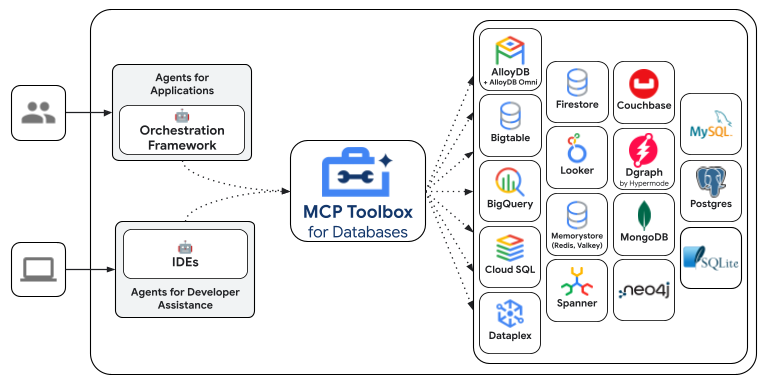

 [ Python](https://github.com/google/adk-python "adk-python on GitHub")[ JS ](https://github.com/google/adk-js "adk-js on GitHub")[ Go ](https://github.com/google/adk-go "adk-go on GitHub")[ Java ](https://github.com/google/adk-java "adk-java on GitHub")[ Kotlin](https://github.com/google/adk-kotlin "adk-kotlin on GitHub")

-   [Home](../..)
-    Build Agents
    
    Build Agents
    
    -   [Get Started](../../get-started/)
        
        Get Started
        
        -   [Python](../../get-started/python/)
        -   [TypeScript](../../get-started/typescript/)
        -   [Go](../../get-started/go/)
        -   [Java](../../get-started/java/)
        -   [Kotlin](../../get-started/kotlin/)
        -   [Agents CLI](../../get-started/agents-cli/)
        -   [Installation](../../get-started/installation/)
        -   [Google Cloud](../../get-started/google-cloud/)
        -   [Migrate to ADK](../../get-started/migrate/)
        
    -   [Build your Agent](../../tutorials/)
        
        Build your Agent
        
        -   [Multi-tool agent](../../tutorials/multi-tool-agent/)
        -   [Agent team](../../tutorials/agent-team/)
        -   [Code with AI](../../tutorials/coding-with-ai/)
        -   [Agent Config](../../agents/config/)
        
    -   [Agents](../../agents/)
        
        Agents
        
        -   [Simple agents](../../agents/llm-agents/)
        -   [Managed agents](../../agents/managed-agents/)
        
    -   [Graph Workflows](../../graphs/)
        
        Graph Workflows
        
        -   [Graph routes](../../graphs/routes/)
        -   [Data handling](../../graphs/data-handling/)
        -   [Human input](../../graphs/human-input/)
        -   [Dynamic workflows](../../graphs/dynamic/)
        
    -   [Multi-Agent Workflows](../../workflows/)
        
        Multi-Agent Workflows
        
        -   [Collaborative workflows](../../workflows/collaboration/)
        -   [Template workflows](../../agents/workflow-agents/)
            
            Template workflows
            
            -   [Sequential workflow](../../agents/workflow-agents/sequential-agents/)
            -   [Loop workflow](../../agents/workflow-agents/loop-agents/)
            -   [Parallel workflow](../../agents/workflow-agents/parallel-agents/)
            -   [Custom template workflows](../../agents/custom-agents/)
            
        -   [Agent routing](../../agents/routing/)
        -   [Workflow patterns](../../workflows/patterns/)
        
    -   [Models for Agents](../../agents/models/)
        
        Models for Agents
        
        -   [Gemini](../../agents/models/google-gemini/)
            
            Gemini
            
            -   [Deferred scheduling](../../agents/models/google-gemini/deferred-schedule/)
            
        -   [Gemma](../../agents/models/google-gemma/)
        -   [Claude](../../agents/models/anthropic/)
        -   [Agent Platform hosted](../../agents/models/agent-platform/)
        -   [Apigee AI Gateway](../../agents/models/apigee/)
        -   [Model routing](../../agents/models/routing/)
        -   [OpenAI](../../agents/models/openai/)
        -   [Ollama](../../agents/models/ollama/)
        -   [vLLM](../../agents/models/vllm/)
        -   [LiteLLM](../../agents/models/litellm/)
        -   [LiteRT-LM](../../agents/models/litert-lm/)
        
    
-    Run Agents
    
    Run Agents
    
    -   [Agent Runtime](../../runtime/)
        
        Agent Runtime
        
        -   [Web Interface](../../runtime/web-interface/)
            
            Web Interface
            
            -   [Visual Builder](../../visual-builder/)
            
        -   [Command Line](../../runtime/command-line/)
        -   [API Server](../../runtime/api-server/)
        -   [Ambient Agents](../../runtime/ambient-agents/)
        -   [Resume Agents](../../runtime/resume/)
        -   [Cancel Agent Runs](../../runtime/cancel/)
        -   [Runtime Config](../../runtime/runconfig/)
        -   [Event Loop](../../runtime/event-loop/)
        
    -   [Deployment](../../deploy/)
        
        Deployment
        
        -   [Agent Runtime](../../deploy/agent-runtime/)
            
            Agent Runtime
            
            -   [Standard deployment](../../deploy/agent-runtime/deploy/)
            -   [agents-cli](../../deploy/agent-runtime/agents-cli/)
            -   [Test deployed agents](../../deploy/agent-runtime/test/)
            
        -   [Cloud Run](../../deploy/cloud-run/)
        -   [GKE](../../deploy/gke/)
        
    -   [Observability](../../observability/)
        
        Observability
        
        -   [Logging](../../observability/logging/)
        -   [Metrics](../../observability/metrics/)
        -   [Traces](../../observability/traces/)
        
    -   [Evaluation](../../evaluate/)
        
        Evaluation
        
        -   [Criteria](../../evaluate/criteria/)
        -   [User Simulation](../../evaluate/user-sim/)
        -   [Environment Simulation](../../evaluate/environment_simulation/)
        -   [Custom Metrics](../../evaluate/custom_metrics/)
        -   [Optimization](../../optimize/)
        
    -   [Safety and Security](../../safety/)
        
        Safety and Security
        
    
-    Components
    
    Components
    
    -   [Technical Overview](../../get-started/about/)
    -   [Custom Tools](../../tools-custom/)
        
        Custom Tools
        
        -    Function tools
            
            Function tools
            
            -   [Overview](../../tools-custom/function-tools/)
            -   [Tool performance](../../tools-custom/performance/)
            -   [Action confirmations](../../tools-custom/confirmation/)
            
        -   [MCP tools](../../tools-custom/mcp-tools/)
            
            MCP tools
            
            -   [Advanced configuration](../../tools-custom/mcp-tools/advanced/)
            -   [Deployment](../../tools-custom/mcp-tools/deployment/)
            -   [Agent as MCP server](../../tools-custom/mcp-tools/agent-as-server/)
            -   [Sub-agent delegation](../../tools-custom/mcp-tools/agent-managed/)
            
        -   [OpenAPI tools](../../tools-custom/openapi-tools/)
        -   [Authentication](../../tools-custom/authentication/)
        -   [Tool limitations](../../tools/limitations/)
        
    -   [Artifacts](../../artifacts/)
        
        Artifacts
        
    -   [Skills for Agents](../../skills/)
        
        Skills for Agents
        
    -   [App management](../../apps/)
        
        App management
        
        -   [Callbacks](../../callbacks/)
            
            Callbacks
            
            -   [Types of callbacks](../../callbacks/types-of-callbacks/)
            -   [Callback patterns](../../callbacks/design-patterns-and-best-practices/)
            
        -   [Plugins](../../plugins/)
        
    -   [Agent context](../../context/)
        
        Agent context
        
        -   [Conversational context](../../sessions/)
        -   [Sessions](../../sessions/session/)
            
            Sessions
            
            -   [Rewind sessions](../../sessions/session/rewind/)
            -   [Migrate sessions](../../sessions/session/migrate/)
            
        -   [State](../../sessions/state/)
        -   [Events](../../events/)
        -   [Memory](../../sessions/memory/)
        -   [Context compression](../../context/compaction/)
        -   [Model context caching](../../context/caching/)
        
    -   [A2A Protocol](../../a2a/)
        
        A2A Protocol
        
        -   [Introduction to A2A](../../a2a/intro/)
        -    A2A Quickstart (Exposing)
            
            A2A Quickstart (Exposing)
            
            -   [Python](../../a2a/quickstart-exposing/)
            -   [Go](../../a2a/quickstart-exposing-go/)
            -   [Java](../../a2a/quickstart-exposing-java/)
            
        -    A2A Quickstart (Consuming)
            
            A2A Quickstart (Consuming)
            
            -   [Python](../../a2a/quickstart-consuming/)
            -   [Go](../../a2a/quickstart-consuming-go/)
            -   [Java](../../a2a/quickstart-consuming-java/)
            -   [Kotlin](../../a2a/quickstart-consuming-kotlin/)
            
        -   [A2A Extension](../../a2a/a2a-extension/)
        
    -   [Live and Voice Agents](../../live/)
        
        Live and Voice Agents
        
        -   [Get started](../../live/get-started/)
            
            Get started
            
            -   [Python](../../live/get-started/streaming-python/)
            -   [Java](../../live/get-started/streaming-java/)
            
        -    Building
            
            Building
            
            -   [Workflows](../../live/workflows/)
            -   [Tools](../../live/tools/)
            -   [Sessions](../../live/sessions/)
            -   [Events](../../live/events/)
            -   [Audio and video](../../live/audio-video/)
            -   [Configuration](../../live/configuration/)
            
        -    Production
            
            Production
            
            -   [Guardrails](../../live/guardrails/)
            -   [Evaluation](../../live/evaluation/)
            -   [Build a custom server](../../live/custom-server/)
            
        -   [Supported models](../../live/models/)
        
    -   [Grounding](../../grounding/)
        
        Grounding
        
        -   [Google Search Grounding](../../grounding/google_search_grounding/)
        -   [Grounding with Search](../../grounding/grounding_with_search/)
        
    
-   [Integrations](../)
    
    Integrations
    
-    Reference
    
    Reference
    
    -   [API Reference](../../api-reference/)
        
        API Reference
        
        -   [Python ADK](../../api-reference/python/)
        -   [TypeScript ADK](../../api-reference/typescript/)
        -    Go ADK
            
            Go ADK
            
            -   [Go v2.x](https://pkg.go.dev/google.golang.org/adk/v2)
            -   [Go v1.x](https://pkg.go.dev/google.golang.org/adk)
            
        -   [Java ADK](../../api-reference/java/)
        -   [Kotlin ADK](../../api-reference/kotlin/)
        -   [CLI Reference](../../api-reference/cli/)
        -   [Agent Config Reference](../../api-reference/agentconfig/)
        -   [REST API](../../api-reference/rest/)
        
    -   [Release Notes](../../release-notes/)
    
-   [Community](../../community/)
    
    Community
    
    -   [Contributing Guide](../../community/contributing-guide/)
    
-   [ADK 2.0](../../2.0/)
    
    ADK 2.0
    

Table of contents

-   [Supported Data Sources](#supported-data-sources)
    
    -   [Google Cloud](#google-cloud)
    -   [Relational & SQL Databases](#relational-sql-databases)
    -   [NoSQL & Key-Value Stores](#nosql-key-value-stores)
    -   [Graph Databases](#graph-databases)
    -   [Data Platforms & Federation](#data-platforms-federation)
    -   [Other](#other)
    
-   [Configure and deploy](#configure-and-deploy)
-   [Install Client SDK for ADK](#install-client-sdk-for-adk)
    
    -   [Loading MCP Toolbox Tools](#loading-mcp-toolbox-tools)
    -   [Authentication](#authentication)
    -   [Advanced Configuration](#advanced-configuration)
    -   [Loading MCP Toolbox Tools](#loading-mcp-toolbox-tools_1)
    -   [Loading MCP Toolbox Tools](#loading-mcp-toolbox-tools_2)
    
-   [Advanced MCP Toolbox Features](#advanced-mcp-toolbox-features)

# MCP Toolbox for Databases tool for ADK[¶](#mcp-toolbox-for-databases-tool-for-adk "Permanent link")

Supported in ADKPythonTypeScriptGo

[MCP Toolbox for Databases](https://github.com/googleapis/mcp-toolbox) is an open source MCP server for databases. It was designed with enterprise-grade and production-quality in mind. It enables you to develop tools easier, faster, and more securely by handling the complexities such as connection pooling, authentication, and more.

Google’s Agent Development Kit (ADK) has built in support for MCP Toolbox. For more information on [getting started](https://mcp-toolbox.dev/documentation/introduction/) or [configuring](https://mcp-toolbox.dev/documentation/configuration/) MCP Toolbox, see the [documentation](https://mcp-toolbox.dev/documentation/introduction/).

## Supported Data Sources[¶](#supported-data-sources "Permanent link")

MCP Toolbox provides out-of-the-box toolsets for the following databases and data platforms:

### Google Cloud[¶](#google-cloud "Permanent link")

-   [BigQuery](https://mcp-toolbox.dev/integrations/bigquery/source/) (including tools for SQL execution, schema discovery, and AI-powered time series forecasting)
-   [AlloyDB](https://mcp-toolbox.dev/integrations/alloydb/source/) (PostgreSQL-compatible, with tools for both standard queries and natural language queries)
-   [AlloyDB Admin](https://mcp-toolbox.dev/integrations/alloydb/source/)
-   [Spanner](https://mcp-toolbox.dev/integrations/spanner/source/) (supporting both GoogleSQL and PostgreSQL dialects)
-   Cloud SQL (with dedicated support for [Cloud SQL for PostgreSQL](https://mcp-toolbox.dev/integrations/cloud-sql-pg/source/), [Cloud SQL for MySQL](https://mcp-toolbox.dev/integrations/cloud-sql-mysql/source/), and [Cloud SQL for SQL Server](https://mcp-toolbox.dev/integrations/cloud-sql-mssql/source/))
-   [Cloud SQL Admin](https://mcp-toolbox.dev/integrations/cloud-sql-admin/source/)
-   [Firestore](https://mcp-toolbox.dev/integrations/firestore/source/)
-   [Bigtable](https://mcp-toolbox.dev/integrations/bigtable/source/)
-   [Knowledge Catalog (previously known as Dataplex)](https://mcp-toolbox.dev/integrations/knowledge-catalog/source/) (for data discovery and metadata search)
-   [Cloud Monitoring](https://mcp-toolbox.dev/integrations/cloudmonitoring/source/)
-   [Cloud Healthcare](https://mcp-toolbox.dev/integrations/cloudhealthcare/source/)
-   [Cloud Logging Admin](https://mcp-toolbox.dev/integrations/cloudloggingadmin/source/)
-   [Dataproc](https://mcp-toolbox.dev/integrations/dataproc/source/)
-   [Serverless Spark](https://mcp-toolbox.dev/integrations/serverless-spark/source/)
-   [Cloud GDA](https://mcp-toolbox.dev/integrations/cloudgda/source/)

### Relational & SQL Databases[¶](#relational-sql-databases "Permanent link")

-   [PostgreSQL](https://mcp-toolbox.dev/integrations/postgres/source/) (generic)
-   [MySQL](https://mcp-toolbox.dev/integrations/mysql/source/) (generic)
-   [Microsoft SQL Server](https://mcp-toolbox.dev/integrations/mssql/source/) (generic)
-   [ClickHouse](https://mcp-toolbox.dev/integrations/clickhouse/source/)
-   [TiDB](https://mcp-toolbox.dev/integrations/tidb/source/)
-   [OceanBase](https://mcp-toolbox.dev/integrations/oceanbase/source/)
-   [Firebird](https://mcp-toolbox.dev/integrations/firebird/source/)
-   [SQLite](https://mcp-toolbox.dev/integrations/sqlite/source/)
-   [YugabyteDB](https://mcp-toolbox.dev/integrations/yuagbytedb/source/)
-   [CockroachDB](https://mcp-toolbox.dev/integrations/cockroachdb/source/)
-   [Oracle](https://mcp-toolbox.dev/integrations/oracle/source/)
-   [SingleStore](https://mcp-toolbox.dev/integrations/singlestore/source/)

### NoSQL & Key-Value Stores[¶](#nosql-key-value-stores "Permanent link")

-   [MongoDB](https://mcp-toolbox.dev/integrations/mongodb/source/)
-   [Couchbase](https://mcp-toolbox.dev/integrations/couchbase/source/)
-   [Redis](https://mcp-toolbox.dev/integrations/redis/source/)
-   [Valkey](https://mcp-toolbox.dev/integrations/valkey/source/)
-   [Cassandra](https://mcp-toolbox.dev/integrations/cassandra/source/)
-   [Elasticsearch](https://mcp-toolbox.dev/integrations/elasticsearch/source/)

### Graph Databases[¶](#graph-databases "Permanent link")

-   [Neo4j](https://mcp-toolbox.dev/integrations/neo4j/source/) (with tools for Cypher queries and schema inspection)
-   [Dgraph](https://mcp-toolbox.dev/integrations/dgraph/source/)

### Data Platforms & Federation[¶](#data-platforms-federation "Permanent link")

-   [Looker](https://mcp-toolbox.dev/integrations/looker/source/) (for running Looks, queries, and building dashboards via the Looker API)
-   [Trino](https://mcp-toolbox.dev/integrations/trino/source/) (for running federated queries across multiple sources)
-   [Snowflake](https://mcp-toolbox.dev/integrations/snowflake/source/)
-   [MindsDB](https://mcp-toolbox.dev/integrations/mindsdb/source/)

### Other[¶](#other "Permanent link")

-   [HTTP](https://mcp-toolbox.dev/integrations/http/source/)

## Configure and deploy[¶](#configure-and-deploy "Permanent link")

MCP Toolbox is an open source server that you deploy and manage yourself. For more instructions on deploying and configuring, see the official Toolbox documentation:

-   [Installing the Server](https://mcp-toolbox.dev/documentation/introduction/)
-   [Configuring MCP Toolbox](https://mcp-toolbox.dev/documentation/configuration/)

## Install Client SDK for ADK[¶](#install-client-sdk-for-adk "Permanent link")

PythonTypeScriptGo

ADK relies on the `toolbox-adk` python package to use MCP Toolbox. Install the package before getting started:

`pip install google-adk[toolbox]`

### Loading MCP Toolbox Tools[¶](#loading-mcp-toolbox-tools "Permanent link")

Once your MCP Toolbox server is configured, up and running, you can load tools from your server using ADK:

`from google.adk import Agent from google.adk.tools.toolbox_toolset import ToolboxToolset toolset = ToolboxToolset(         server_url="http://127.0.0.1:5000" ) root_agent = Agent(         ...,        tools=[toolset] # Provide the toolset to the Agent )`

### Authentication[¶](#authentication "Permanent link")

The `ToolboxToolset` supports various authentication strategies including Workload Identity (ADC), User Identity (OAuth2), and API Keys. For full documentation, see the [MCP Toolbox ADK Authentication Guide](https://github.com/googleapis/mcp-toolbox-sdk-python/tree/main/packages/toolbox-adk#authentication).

**Example: Workload Identity (ADC)**

Recommended for Cloud Run, GKE, or local development with `gcloud auth login`.

`from google.adk.tools.toolbox_toolset import ToolboxToolset from toolbox_adk import CredentialStrategy # target_audience: The URL of your MCP Toolbox server creds = CredentialStrategy.workload_identity(target_audience="<TOOLBOX_URL>") toolset = ToolboxToolset(         server_url="<TOOLBOX_URL>",        credentials=creds )`

### Advanced Configuration[¶](#advanced-configuration "Permanent link")

You can configure parameter binding and additional headers. See the [MCP Toolbox ADK documentation](https://github.com/googleapis/mcp-toolbox-sdk-python/tree/main/packages/toolbox-adk) for details. For example, you can bind values to tool parameters.

Note

These values are hidden from the model.

`toolset = ToolboxToolset(         server_url="...",        bound_params={                "region": "us-central1",                "api_key": lambda: get_api_key() # Can be a callable        } )`

ADK relies on the `@toolbox-sdk/adk` TS package to use MCP Toolbox. Install the package before getting started:

`npm install @toolbox-sdk/adk`

### Loading MCP Toolbox Tools[¶](#loading-mcp-toolbox-tools_1 "Permanent link")

Once your MCP Toolbox server is configured and up and running, you can load tools from your server using ADK:

``import {InMemoryRunner, LlmAgent} from '@google/adk'; import {Content} from '@google/genai'; import {ToolboxClient} from '@toolbox-sdk/adk' const toolboxClient = new ToolboxClient("http://127.0.0.1:5000"); const loadedTools = await toolboxClient.loadToolset(); export const rootAgent = new LlmAgent({     name: 'weather_time_agent',    model: 'gemini-flash-latest',    description:        'Agent to answer questions about the time and weather in a city.',    instruction:        'You are a helpful agent who can answer user questions about the time and weather in a city.',    tools: loadedTools, }); async function main() {     const userId = 'test_user';    const appName = rootAgent.name;    const runner = new InMemoryRunner({agent: rootAgent, appName});    const session = await runner.sessionService.createSession({        appName,        userId,    });     const prompt = 'What is the weather in New York? And the time?';    const content: Content = {        role: 'user',        parts: [{text: prompt}],    };    console.log(content);    for await (const e of runner.runAsync({        userId,        sessionId: session.id,        newMessage: content,    })) {        if (e.content?.parts?.[0]?.text) {            console.log(`${e.author}: ${JSON.stringify(e.content, null, 2)}`);        }    } } main().catch(console.error);``

ADK relies on the `mcp-toolbox-sdk-go` go module to use MCP Toolbox. Install the module before getting started:

`go get github.com/googleapis/mcp-toolbox-sdk-go`

### Loading MCP Toolbox Tools[¶](#loading-mcp-toolbox-tools_2 "Permanent link")

Once your MCP Toolbox server is configured and up and running, you can load tools from your server using ADK:

`package main import (         "context"        "fmt"         "github.com/googleapis/mcp-toolbox-sdk-go/tbadk"        "google.golang.org/adk/v2/agent/llmagent" ) func main() {     toolboxClient, err := tbadk.NewToolboxClient("https://127.0.0.1:5000")        if err != nil {                log.Fatalf("Failed to create MCP Toolbox client: %v", err)        }     // Load a specific set of tools    toolboxtools, err := toolboxClient.LoadToolset("my-toolset-name", ctx)    if err != nil {        return fmt.Sprintln("Could not load MCP Toolbox Toolset", err)    }     toolsList := make([]tool.Tool, len(toolboxtools))        for i := range toolboxtools {            toolsList[i] = &toolboxtools[i]        }     llmagent, err := llmagent.New(llmagent.Config{        ...,        Tools:       toolsList,    })     // Load a single tool    tool, err := client.LoadTool("my-tool-name", ctx)    if err != nil {        return fmt.Sprintln("Could not load MCP Toolbox Tool", err)    }     llmagent, err := llmagent.New(llmagent.Config{        ...,        Tools:       []tool.Tool{&toolboxtool},    }) }`

## Advanced MCP Toolbox Features[¶](#advanced-mcp-toolbox-features "Permanent link")

MCP Toolbox has a variety of features to make developing Gen AI tools for databases. For more information, read more about the following features:

-   [Authenticated Parameters](https://mcp-toolbox.dev/documentation/connect-to/toolbox-sdks/python-sdk/core/#parameter-binding): bind tool inputs to values from OIDC tokens automatically, making it easy to run sensitive queries without potentially leaking data
-   [Authorized Invocations:](https://mcp-toolbox.dev/documentation/connect-to/toolbox-sdks/python-sdk/core/#client-to-server-authentication) restrict access to use a tool based on the users Auth token
-   [OpenTelemetry](https://mcp-toolbox.dev/documentation/connect-to/toolbox-sdks/python-sdk/core/#opentelemetry): get metrics and tracing from Toolbox with OpenTelemetry

Back to top