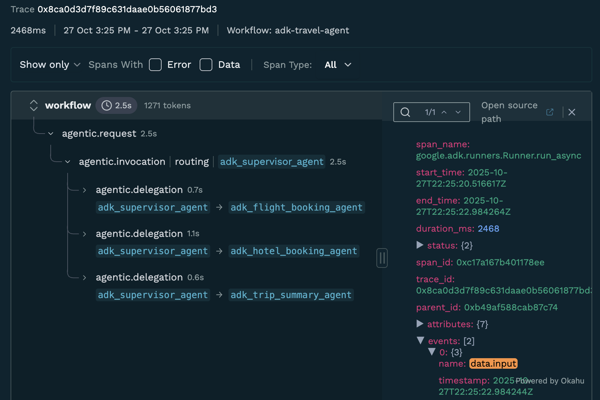

 [ Python](https://github.com/google/adk-python "adk-python on GitHub")[ JS ](https://github.com/google/adk-js "adk-js on GitHub")[ Go ](https://github.com/google/adk-go "adk-go on GitHub")[ Java ](https://github.com/google/adk-java "adk-java on GitHub")[ Kotlin](https://github.com/google/adk-kotlin "adk-kotlin on GitHub")

-   [Home](../..)
-    Build Agents
    
    Build Agents
    
    -   [Get Started](../../get-started/)
        
        Get Started
        
        -   [Python](../../get-started/python/)
        -   [TypeScript](../../get-started/typescript/)
        -   [Go](../../get-started/go/)
        -   [Java](../../get-started/java/)
        -   [Kotlin](../../get-started/kotlin/)
        -   [Agents CLI](../../get-started/agents-cli/)
        -   [Installation](../../get-started/installation/)
        -   [Google Cloud](../../get-started/google-cloud/)
        -   [Migrate to ADK](../../get-started/migrate/)
        
    -   [Build your Agent](../../tutorials/)
        
        Build your Agent
        
        -   [Multi-tool agent](../../tutorials/multi-tool-agent/)
        -   [Agent team](../../tutorials/agent-team/)
        -   [Code with AI](../../tutorials/coding-with-ai/)
        -   [Agent Config](../../agents/config/)
        
    -   [Agents](../../agents/)
        
        Agents
        
        -   [Simple agents](../../agents/llm-agents/)
        -   [Managed agents](../../agents/managed-agents/)
        
    -   [Graph Workflows](../../graphs/)
        
        Graph Workflows
        
        -   [Graph routes](../../graphs/routes/)
        -   [Data handling](../../graphs/data-handling/)
        -   [Human input](../../graphs/human-input/)
        -   [Dynamic workflows](../../graphs/dynamic/)
        
    -   [Multi-Agent Workflows](../../workflows/)
        
        Multi-Agent Workflows
        
        -   [Collaborative workflows](../../workflows/collaboration/)
        -   [Template workflows](../../agents/workflow-agents/)
            
            Template workflows
            
            -   [Sequential workflow](../../agents/workflow-agents/sequential-agents/)
            -   [Loop workflow](../../agents/workflow-agents/loop-agents/)
            -   [Parallel workflow](../../agents/workflow-agents/parallel-agents/)
            -   [Custom template workflows](../../agents/custom-agents/)
            
        -   [Agent routing](../../agents/routing/)
        -   [Workflow patterns](../../workflows/patterns/)
        
    -   [Models for Agents](../../agents/models/)
        
        Models for Agents
        
        -   [Gemini](../../agents/models/google-gemini/)
            
            Gemini
            
            -   [Deferred scheduling](../../agents/models/google-gemini/deferred-schedule/)
            
        -   [Gemma](../../agents/models/google-gemma/)
        -   [Claude](../../agents/models/anthropic/)
        -   [Agent Platform hosted](../../agents/models/agent-platform/)
        -   [Apigee AI Gateway](../../agents/models/apigee/)
        -   [Model routing](../../agents/models/routing/)
        -   [OpenAI](../../agents/models/openai/)
        -   [Ollama](../../agents/models/ollama/)
        -   [vLLM](../../agents/models/vllm/)
        -   [LiteLLM](../../agents/models/litellm/)
        -   [LiteRT-LM](../../agents/models/litert-lm/)
        
    
-    Run Agents
    
    Run Agents
    
    -   [Agent Runtime](../../runtime/)
        
        Agent Runtime
        
        -   [Web Interface](../../runtime/web-interface/)
            
            Web Interface
            
            -   [Visual Builder](../../visual-builder/)
            
        -   [Command Line](../../runtime/command-line/)
        -   [API Server](../../runtime/api-server/)
        -   [Ambient Agents](../../runtime/ambient-agents/)
        -   [Resume Agents](../../runtime/resume/)
        -   [Cancel Agent Runs](../../runtime/cancel/)
        -   [Runtime Config](../../runtime/runconfig/)
        -   [Event Loop](../../runtime/event-loop/)
        
    -   [Deployment](../../deploy/)
        
        Deployment
        
        -   [Agent Runtime](../../deploy/agent-runtime/)
            
            Agent Runtime
            
            -   [Standard deployment](../../deploy/agent-runtime/deploy/)
            -   [agents-cli](../../deploy/agent-runtime/agents-cli/)
            -   [Test deployed agents](../../deploy/agent-runtime/test/)
            
        -   [Cloud Run](../../deploy/cloud-run/)
        -   [GKE](../../deploy/gke/)
        
    -   [Observability](../../observability/)
        
        Observability
        
        -   [Logging](../../observability/logging/)
        -   [Metrics](../../observability/metrics/)
        -   [Traces](../../observability/traces/)
        
    -   [Evaluation](../../evaluate/)
        
        Evaluation
        
        -   [Criteria](../../evaluate/criteria/)
        -   [User Simulation](../../evaluate/user-sim/)
        -   [Environment Simulation](../../evaluate/environment_simulation/)
        -   [Custom Metrics](../../evaluate/custom_metrics/)
        -   [Optimization](../../optimize/)
        
    -   [Safety and Security](../../safety/)
        
        Safety and Security
        
    
-    Components
    
    Components
    
    -   [Technical Overview](../../get-started/about/)
    -   [Custom Tools](../../tools-custom/)
        
        Custom Tools
        
        -    Function tools
            
            Function tools
            
            -   [Overview](../../tools-custom/function-tools/)
            -   [Tool performance](../../tools-custom/performance/)
            -   [Action confirmations](../../tools-custom/confirmation/)
            
        -   [MCP tools](../../tools-custom/mcp-tools/)
            
            MCP tools
            
            -   [Advanced configuration](../../tools-custom/mcp-tools/advanced/)
            -   [Deployment](../../tools-custom/mcp-tools/deployment/)
            -   [Agent as MCP server](../../tools-custom/mcp-tools/agent-as-server/)
            -   [Sub-agent delegation](../../tools-custom/mcp-tools/agent-managed/)
            
        -   [OpenAPI tools](../../tools-custom/openapi-tools/)
        -   [Authentication](../../tools-custom/authentication/)
        -   [Tool limitations](../../tools/limitations/)
        
    -   [Artifacts](../../artifacts/)
        
        Artifacts
        
    -   [Skills for Agents](../../skills/)
        
        Skills for Agents
        
    -   [App management](../../apps/)
        
        App management
        
        -   [Callbacks](../../callbacks/)
            
            Callbacks
            
            -   [Types of callbacks](../../callbacks/types-of-callbacks/)
            -   [Callback patterns](../../callbacks/design-patterns-and-best-practices/)
            
        -   [Plugins](../../plugins/)
        
    -   [Agent context](../../context/)
        
        Agent context
        
        -   [Conversational context](../../sessions/)
        -   [Sessions](../../sessions/session/)
            
            Sessions
            
            -   [Rewind sessions](../../sessions/session/rewind/)
            -   [Migrate sessions](../../sessions/session/migrate/)
            
        -   [State](../../sessions/state/)
        -   [Events](../../events/)
        -   [Memory](../../sessions/memory/)
        -   [Context compression](../../context/compaction/)
        -   [Model context caching](../../context/caching/)
        
    -   [A2A Protocol](../../a2a/)
        
        A2A Protocol
        
        -   [Introduction to A2A](../../a2a/intro/)
        -    A2A Quickstart (Exposing)
            
            A2A Quickstart (Exposing)
            
            -   [Python](../../a2a/quickstart-exposing/)
            -   [Go](../../a2a/quickstart-exposing-go/)
            -   [Java](../../a2a/quickstart-exposing-java/)
            
        -    A2A Quickstart (Consuming)
            
            A2A Quickstart (Consuming)
            
            -   [Python](../../a2a/quickstart-consuming/)
            -   [Go](../../a2a/quickstart-consuming-go/)
            -   [Java](../../a2a/quickstart-consuming-java/)
            -   [Kotlin](../../a2a/quickstart-consuming-kotlin/)
            
        -   [A2A Extension](../../a2a/a2a-extension/)
        
    -   [Live and Voice Agents](../../live/)
        
        Live and Voice Agents
        
        -   [Get started](../../live/get-started/)
            
            Get started
            
            -   [Python](../../live/get-started/streaming-python/)
            -   [Java](../../live/get-started/streaming-java/)
            
        -    Building
            
            Building
            
            -   [Workflows](../../live/workflows/)
            -   [Tools](../../live/tools/)
            -   [Sessions](../../live/sessions/)
            -   [Events](../../live/events/)
            -   [Audio and video](../../live/audio-video/)
            -   [Configuration](../../live/configuration/)
            
        -    Production
            
            Production
            
            -   [Guardrails](../../live/guardrails/)
            -   [Evaluation](../../live/evaluation/)
            -   [Build a custom server](../../live/custom-server/)
            
        -   [Supported models](../../live/models/)
        
    -   [Grounding](../../grounding/)
        
        Grounding
        
        -   [Google Search Grounding](../../grounding/google_search_grounding/)
        -   [Grounding with Search](../../grounding/grounding_with_search/)
        
    
-   [Integrations](../)
    
    Integrations
    
-    Reference
    
    Reference
    
    -   [API Reference](../../api-reference/)
        
        API Reference
        
        -   [Python ADK](../../api-reference/python/)
        -   [TypeScript ADK](../../api-reference/typescript/)
        -    Go ADK
            
            Go ADK
            
            -   [Go v2.x](https://pkg.go.dev/google.golang.org/adk/v2)
            -   [Go v1.x](https://pkg.go.dev/google.golang.org/adk)
            
        -   [Java ADK](../../api-reference/java/)
        -   [Kotlin ADK](../../api-reference/kotlin/)
        -   [CLI Reference](../../api-reference/cli/)
        -   [Agent Config Reference](../../api-reference/agentconfig/)
        -   [REST API](../../api-reference/rest/)
        
    -   [Release Notes](../../release-notes/)
    
-   [Community](../../community/)
    
    Community
    
    -   [Contributing Guide](../../community/contributing-guide/)
    
-   [ADK 2.0](../../2.0/)
    
    ADK 2.0
    

Table of contents

-   [Overview](#overview)
-   [Installation](#installation)
    
    -   [1\. Install Required Packages](#install-required-packages)
    
-   [Setup](#setup)
    
    -   [1\. Configure Monocle Telemetry](#configure-monocle-telemetry)
    -   [2\. Configure Exporters (Optional)](#configure-exporters)
        
        -   [Export to Console (for debugging)](#export-to-console-for-debugging)
        -   [Export to Local Files (default)](#export-to-local-files-default)
        
    
-   [Observe](#observe)
-   [Accessing Traces](#accessing-traces)
-   [Visualizing Traces with VS Code Extension](#visualizing-traces-with-vs-code-extension)
    
    -   [Installation](#installation_1)
    -   [Features](#features)
    -   [Usage](#usage)
    
-   [What Gets Traced](#what-gets-traced)
-   [Support and Resources](#support-and-resources)

# Monocle observability for ADK[¶](#monocle-observability-for-adk "Permanent link")

Supported in ADKPython

[Monocle](https://github.com/monocle2ai/monocle) is an open-source observability platform for monitoring, debugging, and improving LLM applications and AI Agents. It provides comprehensive tracing capabilities for your Google ADK applications through automatic instrumentation. Monocle generates OpenTelemetry-compatible traces that can be exported to various destinations including local files or console output.

## Overview[¶](#overview "Permanent link")

Monocle automatically instruments Google ADK applications, allowing you to:

-   **Trace agent interactions** - Automatically capture every agent run, tool call, and model request with full context and metadata
-   **Monitor execution flow** - Track agent state, delegation events, and execution flow through detailed traces
-   **Debug issues** - Analyze detailed traces to quickly identify bottlenecks, failed tool calls, and unexpected agent behavior
-   **Flexible export options** - Export traces to local files or console for analysis
-   **OpenTelemetry compatible** - Generate standard OpenTelemetry traces that work with any OTLP-compatible backend

Monocle automatically instruments the following Google ADK components:

-   **`BaseAgent.run_async`** - Captures agent execution, agent state, and delegation events
-   **`FunctionTool.run_async`** - Captures tool execution, including tool name, parameters, and results
-   **`Runner.run_async`** - Captures runner execution, including request context and execution flow

## Installation[¶](#installation "Permanent link")

### 1\. Install Required Packages[¶](#install-required-packages "Permanent link")

`pip install monocle_apptrace google-adk`

## Setup[¶](#setup "Permanent link")

### 1\. Configure Monocle Telemetry[¶](#configure-monocle-telemetry "Permanent link")

Monocle automatically instruments Google ADK when you initialize telemetry. Simply call `setup_monocle_telemetry()` at the start of your application:

`from monocle_apptrace import setup_monocle_telemetry # Initialize Monocle telemetry - automatically instruments Google ADK setup_monocle_telemetry(workflow_name="my-adk-app")`

That's it! Monocle will automatically detect and instrument your Google ADK agents, tools, and runners.

### 2\. Configure Exporters (Optional)[¶](#configure-exporters "Permanent link")

By default, Monocle exports traces to local JSON files. You can configure different exporters using environment variables.

#### Export to Console (for debugging)[¶](#export-to-console-for-debugging "Permanent link")

Set the environment variable:

`export MONOCLE_EXPORTER="console"`

#### Export to Local Files (default)[¶](#export-to-local-files-default "Permanent link")

`export MONOCLE_EXPORTER="file"`

Or simply omit the `MONOCLE_EXPORTER` variable - it defaults to `file`.

## Observe[¶](#observe "Permanent link")

Now that you have tracing setup, all Google ADK SDK requests will be automatically traced by Monocle.

`from monocle_apptrace import setup_monocle_telemetry from google.adk.agents import Agent from google.adk.runners import InMemoryRunner from google.genai import types # Initialize Monocle telemetry - must be called before using ADK setup_monocle_telemetry(workflow_name="weather_app") # Define a tool function def get_weather(city: str) -> dict:         """Retrieves the current weather report for a specified city.         Args:                city (str): The name of the city for which to retrieve the weather report.         Returns:                dict: status and result or error msg.        """        if city.lower() == "new york":                return {                        "status": "success",                        "report": (                                "The weather in New York is sunny with a temperature of 25 degrees"                                " Celsius (77 degrees Fahrenheit)."                        ),                }        else:                return {                        "status": "error",                        "error_message": f"Weather information for '{city}' is not available.",                } # Create an agent with tools agent = Agent(         name="weather_agent",        model="gemini-flash-latest",        description="Agent to answer questions using weather tools.",        instruction="You must use the available tools to find an answer.",        tools=[get_weather] ) app_name = "weather_app" user_id = "test_user" session_id = "test_session" runner = InMemoryRunner(agent=agent, app_name=app_name) session_service = runner.session_service await session_service.create_session(         app_name=app_name,        user_id=user_id,        session_id=session_id ) # Run the agent (all interactions will be automatically traced) async for event in runner.run_async(         user_id=user_id,        session_id=session_id,        new_message=types.Content(role="user", parts=[                types.Part(text="What is the weather in New York?")]        ) ):         if event.is_final_response():                print(event.content.parts[0].text.strip())`

## Accessing Traces[¶](#accessing-traces "Permanent link")

By default, Monocle generates traces in JSON files in the local directory `./monocle`. The file name format is:

`monocle_trace_{workflow_name}_{trace_id}_{timestamp}.json`

Each trace file contains an array of OpenTelemetry-compatible spans that capture:

-   **Agent execution spans** - Agent state, delegation events, and execution flow
-   **Tool execution spans** - Tool name, input parameters, and output results
-   **LLM interaction spans** - Model calls, prompts, responses, and token usage (if using Gemini or other LLMs)

You can analyze these trace files using any OpenTelemetry-compatible tool or write custom analysis scripts.

## Visualizing Traces with VS Code Extension[¶](#visualizing-traces-with-vs-code-extension "Permanent link")

The [Okahu Trace Visualizer](https://marketplace.visualstudio.com/items?itemName=OkahuAI.okahu-ai-observability) VS Code extension provides an interactive way to visualize and analyze Monocle-generated traces directly in Visual Studio Code.

### Installation[¶](#installation_1 "Permanent link")

1.  Open VS Code
2.  Press `Ctrl+P` (or `Cmd+P` on Mac) to open Quick Open
3.  Paste the following command and press Enter:

`ext install OkahuAI.okahu-ai-observability`

Alternatively, you can install it from the [VS Code Marketplace](https://marketplace.visualstudio.com/items?itemName=OkahuAI.okahu-ai-observability).

### Features[¶](#features "Permanent link")

The extension provides:

-   **Custom Activity Bar Panel** - Dedicated sidebar for trace file management
-   **Interactive File Tree** - Browse and select trace files with custom React UI
-   **Split View Analysis** - Gantt chart visualization alongside JSON data viewer
-   **Real-time Communication** - Seamless data flow between VS Code and React components
-   **VS Code Theming** - Fully integrated with VS Code's light/dark themes

### Usage[¶](#usage "Permanent link")

1.  After running your ADK application with Monocle tracing enabled, trace files will be generated in the `./monocle` directory
2.  Open the Okahu Trace Visualizer panel from the VS Code Activity Bar
3.  Browse and select trace files from the interactive file tree
4.  View your traces with:
5.  **Gantt chart visualization** - See the timeline and hierarchy of spans
6.  **JSON data viewer** - Inspect detailed span attributes and events
7.  **Token counts** - View token usage for LLM calls
8.  **Error badges** - Quickly identify failed operations

## What Gets Traced[¶](#what-gets-traced "Permanent link")

Monocle automatically captures the following information from Google ADK:

-   **Agent Execution**: Agent state, delegation events, and execution flow
-   **Tool Calls**: Tool name, input parameters, and output results
-   **Runner Execution**: Request context and overall execution flow
-   **Timing Information**: Start time, end time, and duration for each operation
-   **Error Information**: Exceptions and error states

All traces are generated in OpenTelemetry format, making them compatible with any OTLP-compatible observability backend.

## Support and Resources[¶](#support-and-resources "Permanent link")

-   [Monocle Documentation](https://docs.okahu.ai/monocle_overview/)
-   [Monocle GitHub Repository](https://github.com/monocle2ai/monocle)
-   [Google ADK Travel Agent Example](https://github.com/okahu-demos/adk-travel-agent)
-   [Discord Community](https://discord.gg/D8vDbSUhJX)

Back to top