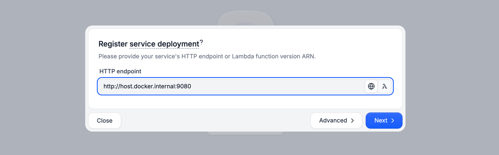
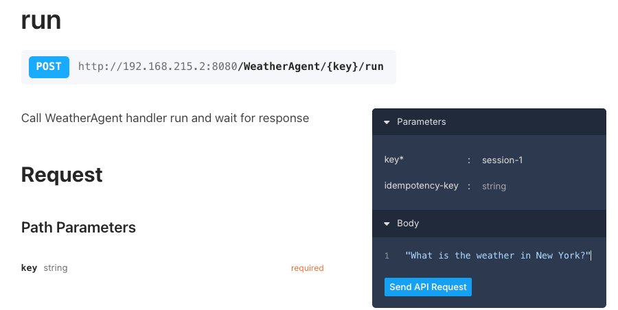
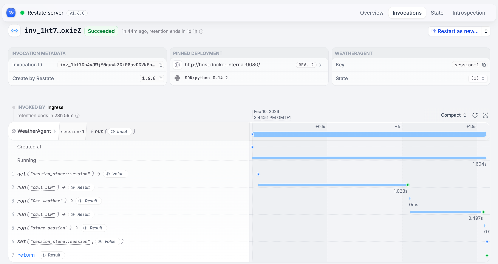

 [ Python](https://github.com/google/adk-python "adk-python on GitHub")[ JS ](https://github.com/google/adk-js "adk-js on GitHub")[ Go ](https://github.com/google/adk-go "adk-go on GitHub")[ Java ](https://github.com/google/adk-java "adk-java on GitHub")[ Kotlin](https://github.com/google/adk-kotlin "adk-kotlin on GitHub")

-   [Home](../..)
-    Build Agents
    
    Build Agents
    
    -   [Get Started](../../get-started/)
        
        Get Started
        
        -   [Python](../../get-started/python/)
        -   [TypeScript](../../get-started/typescript/)
        -   [Go](../../get-started/go/)
        -   [Java](../../get-started/java/)
        -   [Kotlin](../../get-started/kotlin/)
        -   [Agents CLI](../../get-started/agents-cli/)
        -   [Installation](../../get-started/installation/)
        -   [Google Cloud](../../get-started/google-cloud/)
        -   [Migrate to ADK](../../get-started/migrate/)
        
    -   [Build your Agent](../../tutorials/)
        
        Build your Agent
        
        -   [Multi-tool agent](../../tutorials/multi-tool-agent/)
        -   [Agent team](../../tutorials/agent-team/)
        -   [Code with AI](../../tutorials/coding-with-ai/)
        -   [Agent Config](../../agents/config/)
        
    -   [Agents](../../agents/)
        
        Agents
        
        -   [Simple agents](../../agents/llm-agents/)
        -   [Managed agents](../../agents/managed-agents/)
        
    -   [Graph Workflows](../../graphs/)
        
        Graph Workflows
        
        -   [Graph routes](../../graphs/routes/)
        -   [Data handling](../../graphs/data-handling/)
        -   [Human input](../../graphs/human-input/)
        -   [Dynamic workflows](../../graphs/dynamic/)
        
    -   [Multi-Agent Workflows](../../workflows/)
        
        Multi-Agent Workflows
        
        -   [Collaborative workflows](../../workflows/collaboration/)
        -   [Template workflows](../../agents/workflow-agents/)
            
            Template workflows
            
            -   [Sequential workflow](../../agents/workflow-agents/sequential-agents/)
            -   [Loop workflow](../../agents/workflow-agents/loop-agents/)
            -   [Parallel workflow](../../agents/workflow-agents/parallel-agents/)
            -   [Custom template workflows](../../agents/custom-agents/)
            
        -   [Agent routing](../../agents/routing/)
        -   [Workflow patterns](../../workflows/patterns/)
        
    -   [Models for Agents](../../agents/models/)
        
        Models for Agents
        
        -   [Gemini](../../agents/models/google-gemini/)
            
            Gemini
            
            -   [Deferred scheduling](../../agents/models/google-gemini/deferred-schedule/)
            
        -   [Gemma](../../agents/models/google-gemma/)
        -   [Claude](../../agents/models/anthropic/)
        -   [Agent Platform hosted](../../agents/models/agent-platform/)
        -   [Apigee AI Gateway](../../agents/models/apigee/)
        -   [Model routing](../../agents/models/routing/)
        -   [OpenAI](../../agents/models/openai/)
        -   [Ollama](../../agents/models/ollama/)
        -   [vLLM](../../agents/models/vllm/)
        -   [LiteLLM](../../agents/models/litellm/)
        -   [LiteRT-LM](../../agents/models/litert-lm/)
        
    
-    Run Agents
    
    Run Agents
    
    -   [Agent Runtime](../../runtime/)
        
        Agent Runtime
        
        -   [Web Interface](../../runtime/web-interface/)
            
            Web Interface
            
            -   [Visual Builder](../../visual-builder/)
            
        -   [Command Line](../../runtime/command-line/)
        -   [API Server](../../runtime/api-server/)
        -   [Ambient Agents](../../runtime/ambient-agents/)
        -   [Resume Agents](../../runtime/resume/)
        -   [Cancel Agent Runs](../../runtime/cancel/)
        -   [Runtime Config](../../runtime/runconfig/)
        -   [Event Loop](../../runtime/event-loop/)
        
    -   [Deployment](../../deploy/)
        
        Deployment
        
        -   [Agent Runtime](../../deploy/agent-runtime/)
            
            Agent Runtime
            
            -   [Standard deployment](../../deploy/agent-runtime/deploy/)
            -   [agents-cli](../../deploy/agent-runtime/agents-cli/)
            -   [Test deployed agents](../../deploy/agent-runtime/test/)
            
        -   [Cloud Run](../../deploy/cloud-run/)
        -   [GKE](../../deploy/gke/)
        
    -   [Observability](../../observability/)
        
        Observability
        
        -   [Logging](../../observability/logging/)
        -   [Metrics](../../observability/metrics/)
        -   [Traces](../../observability/traces/)
        
    -   [Evaluation](../../evaluate/)
        
        Evaluation
        
        -   [Criteria](../../evaluate/criteria/)
        -   [User Simulation](../../evaluate/user-sim/)
        -   [Environment Simulation](../../evaluate/environment_simulation/)
        -   [Custom Metrics](../../evaluate/custom_metrics/)
        -   [Optimization](../../optimize/)
        
    -   [Safety and Security](../../safety/)
        
        Safety and Security
        
    
-    Components
    
    Components
    
    -   [Technical Overview](../../get-started/about/)
    -   [Custom Tools](../../tools-custom/)
        
        Custom Tools
        
        -    Function tools
            
            Function tools
            
            -   [Overview](../../tools-custom/function-tools/)
            -   [Tool performance](../../tools-custom/performance/)
            -   [Action confirmations](../../tools-custom/confirmation/)
            
        -   [MCP tools](../../tools-custom/mcp-tools/)
            
            MCP tools
            
            -   [Advanced configuration](../../tools-custom/mcp-tools/advanced/)
            -   [Deployment](../../tools-custom/mcp-tools/deployment/)
            -   [Agent as MCP server](../../tools-custom/mcp-tools/agent-as-server/)
            -   [Sub-agent delegation](../../tools-custom/mcp-tools/agent-managed/)
            
        -   [OpenAPI tools](../../tools-custom/openapi-tools/)
        -   [Authentication](../../tools-custom/authentication/)
        -   [Tool limitations](../../tools/limitations/)
        
    -   [Artifacts](../../artifacts/)
        
        Artifacts
        
    -   [Skills for Agents](../../skills/)
        
        Skills for Agents
        
    -   [App management](../../apps/)
        
        App management
        
        -   [Callbacks](../../callbacks/)
            
            Callbacks
            
            -   [Types of callbacks](../../callbacks/types-of-callbacks/)
            -   [Callback patterns](../../callbacks/design-patterns-and-best-practices/)
            
        -   [Plugins](../../plugins/)
        
    -   [Agent context](../../context/)
        
        Agent context
        
        -   [Conversational context](../../sessions/)
        -   [Sessions](../../sessions/session/)
            
            Sessions
            
            -   [Rewind sessions](../../sessions/session/rewind/)
            -   [Migrate sessions](../../sessions/session/migrate/)
            
        -   [State](../../sessions/state/)
        -   [Events](../../events/)
        -   [Memory](../../sessions/memory/)
        -   [Context compression](../../context/compaction/)
        -   [Model context caching](../../context/caching/)
        
    -   [A2A Protocol](../../a2a/)
        
        A2A Protocol
        
        -   [Introduction to A2A](../../a2a/intro/)
        -    A2A Quickstart (Exposing)
            
            A2A Quickstart (Exposing)
            
            -   [Python](../../a2a/quickstart-exposing/)
            -   [Go](../../a2a/quickstart-exposing-go/)
            -   [Java](../../a2a/quickstart-exposing-java/)
            
        -    A2A Quickstart (Consuming)
            
            A2A Quickstart (Consuming)
            
            -   [Python](../../a2a/quickstart-consuming/)
            -   [Go](../../a2a/quickstart-consuming-go/)
            -   [Java](../../a2a/quickstart-consuming-java/)
            -   [Kotlin](../../a2a/quickstart-consuming-kotlin/)
            
        -   [A2A Extension](../../a2a/a2a-extension/)
        
    -   [Live and Voice Agents](../../live/)
        
        Live and Voice Agents
        
        -   [Get started](../../live/get-started/)
            
            Get started
            
            -   [Python](../../live/get-started/streaming-python/)
            -   [Java](../../live/get-started/streaming-java/)
            
        -    Building
            
            Building
            
            -   [Workflows](../../live/workflows/)
            -   [Tools](../../live/tools/)
            -   [Sessions](../../live/sessions/)
            -   [Events](../../live/events/)
            -   [Audio and video](../../live/audio-video/)
            -   [Configuration](../../live/configuration/)
            
        -    Production
            
            Production
            
            -   [Guardrails](../../live/guardrails/)
            -   [Evaluation](../../live/evaluation/)
            -   [Build a custom server](../../live/custom-server/)
            
        -   [Supported models](../../live/models/)
        
    -   [Grounding](../../grounding/)
        
        Grounding
        
        -   [Google Search Grounding](../../grounding/google_search_grounding/)
        -   [Grounding with Search](../../grounding/grounding_with_search/)
        
    
-   [Integrations](../)
    
    Integrations
    
-    Reference
    
    Reference
    
    -   [API Reference](../../api-reference/)
        
        API Reference
        
        -   [Python ADK](../../api-reference/python/)
        -   [TypeScript ADK](../../api-reference/typescript/)
        -    Go ADK
            
            Go ADK
            
            -   [Go v2.x](https://pkg.go.dev/google.golang.org/adk/v2)
            -   [Go v1.x](https://pkg.go.dev/google.golang.org/adk)
            
        -   [Java ADK](../../api-reference/java/)
        -   [Kotlin ADK](../../api-reference/kotlin/)
        -   [CLI Reference](../../api-reference/cli/)
        -   [Agent Config Reference](../../api-reference/agentconfig/)
        -   [REST API](../../api-reference/rest/)
        
    -   [Release Notes](../../release-notes/)
    
-   [Community](../../community/)
    
    Community
    
    -   [Contributing Guide](../../community/contributing-guide/)
    
-   [ADK 2.0](../../2.0/)
    
    ADK 2.0
    

Table of contents

-   [Use cases](#use-cases)
-   [Prerequisites](#prerequisites)
-   [Installation](#installation)
-   [Use with agent](#use-with-agent)
-   [Capabilities](#capabilities)
-   [Additional resources](#additional-resources)

# Restate plugin for ADK[¶](#restate-plugin-for-adk "Permanent link")

Supported in ADKPython

[Restate](https://restate.dev) is a durable execution engine that turns ADK agents into innately resilient, robust systems. It provides persistent sessions, pause/resume for human approvals, resilient multi-agent orchestration, safe versioning, and full observability and control over every execution. All LLM calls and tool executions are journaled, so if anything fails, your agent recovers from exactly where it left off.

## Use cases[¶](#use-cases "Permanent link")

The Restate plugin gives your agents:

-   **Durable execution**: Never lose progress. If your agent crashes, it picks up exactly where it left off, with automatic retries and recovery.
-   **Pause/resume for human-in-the-loop**: Pause execution for days or weeks until a human approves, then resume where you left off.
-   **Durable state**: Agent memory and conversation history persist across restarts with built-in session management.
-   **Observability & Task control**: See exactly what your agent did and kill, pause, and resume agent executions at any time.
-   **Resilient multi-agent orchestration**: Run resilient workflows across multiple agents with parallel execution.
-   **Safe versioning**: Deploy new versions without breaking ongoing executions via immutable deployments.

## Prerequisites[¶](#prerequisites "Permanent link")

-   Python 3.12+
-   A [Gemini API key](https://aistudio.google.com/app/api-keys)

To run the example below, you'll also need:

-   [uv](https://docs.astral.sh/uv/) (Python package manager)
-   [Docker](https://docs.docker.com/get-docker/) (or [Brew/npm/binary](https://docs.restate.dev/develop/local_dev#running-restate-server--cli-locally) for the Restate server)

## Installation[¶](#installation "Permanent link")

Install the Restate SDK for Python:

`pip install "restate-sdk[serde]"`

## Use with agent[¶](#use-with-agent "Permanent link")

Follow these steps to run a durable agent and inspect its execution journal in the Restate UI:

1.  **Clone the [restate-google-adk-example repository](https://github.com/restatedev/restate-google-adk-example) and navigate to the example**
    
    `git clone https://github.com/restatedev/restate-google-adk-example.git cd restate-google-adk-example/examples/hello-world`
    
2.  **Export your Gemini API key**
    
    `export GOOGLE_API_KEY=your-api-key`
    
3.  **Start the weather agent**
    
    `uv run .`
    
4.  **Start Restate in another terminal**
    
    `docker run --name restate --rm -p 8080:8080 -p 9070:9070 -d \     --add-host host.docker.internal:host-gateway \    docker.restate.dev/restatedev/restate:latest`
    
    Other installation methods: [Brew, npm, binary downloads](https://docs.restate.dev/develop/local_dev#running-restate-server--cli-locally)
    
5.  **Register the agent**
    
    Open the Restate UI at `localhost:9070` and register your agent deployment (e.g., `http://host.docker.internal:9080`):
    
    
    
    Safe versioning
    
    Restate registers each deployment as an immutable snapshot. When you deploy a new version, ongoing executions finish on the original deployment while new requests route to the latest one. Learn more about [version-aware routing](https://docs.restate.dev/services/versioning).
    
6.  **Send a request to the agent**
    
    In the Restate UI, select **WeatherAgent**, open the **Playground**, and send a request:
    
    
    
    Durable sessions and retries
    
    This request goes through Restate, which persists it before forwarding to your agent. Each session (here `session-1`) is isolated, stateful, and durable. If the agent crashes mid-execution, Restate automatically retries and resumes from the last journaled step, without losing progress.
    
7.  **Inspect the execution journal**
    
    Click on the **Invocations** tab and then on your invocation to see the execution journal:
    
    
    
    Full control over agent executions
    
    Every LLM call and tool execution is recorded in the journal. From the UI, you can pause, resume, restart from any intermediate step, or kill an execution. Check the **State** tab to inspect your agent's current session data.
    

## Capabilities[¶](#capabilities "Permanent link")

The Restate plugin provides the following capabilities for your ADK agents:

Capability

Description

Durable tool execution

Wraps tool logic with `restate_object_context().run_typed()` so it retries and recovers automatically

Human-in-the-loop

Pauses execution with `restate_object_context().awakeable()` until an external signal (e.g. human approval)

Persistent sessions

`RestateSessionService()` stores agent memory and conversation state durably

Durable LLM calls

`RestatePlugin()` journals LLM calls with automatic retries

Multi-agent communication

Durable cross-agent HTTP calls with `restate_object_context().service_call()`

Parallel execution

Run tools and agents concurrently with `restate.gather()` for deterministic recovery

## Additional resources[¶](#additional-resources "Permanent link")

-   [Restate ADK example repository](https://github.com/restatedev/restate-google-adk-example) - Runnable examples including claims processing with human approval
-   [Restate ADK tutorial](https://docs.restate.dev/tour/google-adk) - Walkthrough of agent development with Restate and ADK
-   [Restate AI documentation](https://docs.restate.dev/ai) - Full reference for durable AI agent patterns
-   [Restate SDK on PyPI](https://pypi.org/project/restate-sdk/) - Python package

Back to top