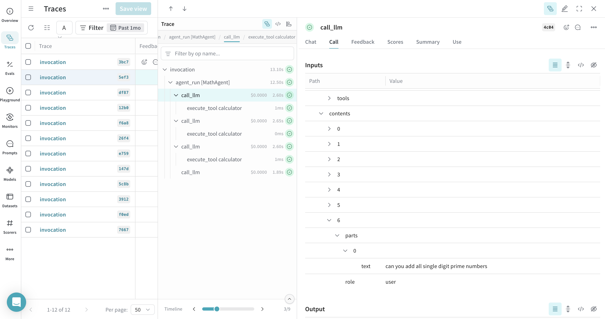
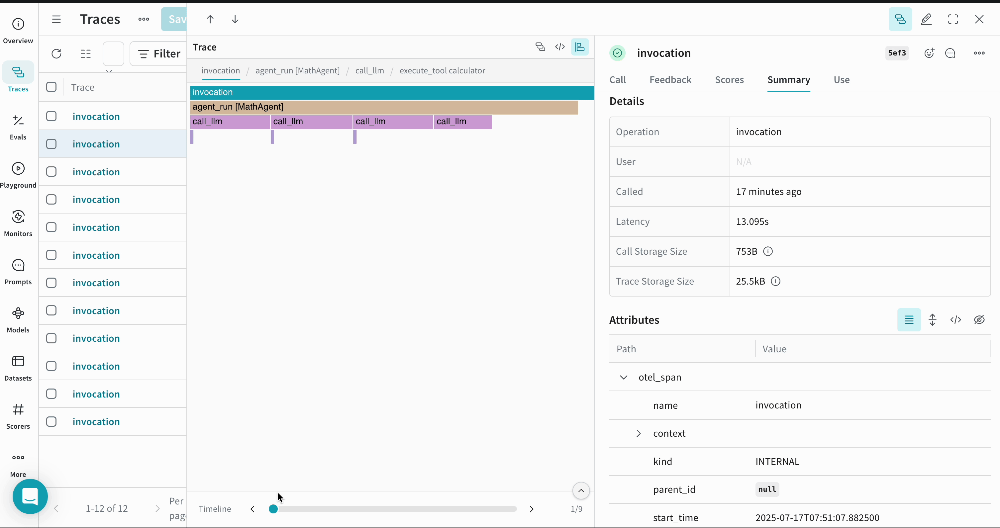

 [ Python](https://github.com/google/adk-python "adk-python on GitHub")[ JS ](https://github.com/google/adk-js "adk-js on GitHub")[ Go ](https://github.com/google/adk-go "adk-go on GitHub")[ Java ](https://github.com/google/adk-java "adk-java on GitHub")[ Kotlin](https://github.com/google/adk-kotlin "adk-kotlin on GitHub")

-   [Home](../..)
-    Build Agents
    
    Build Agents
    
    -   [Get Started](../../get-started/)
        
        Get Started
        
        -   [Python](../../get-started/python/)
        -   [TypeScript](../../get-started/typescript/)
        -   [Go](../../get-started/go/)
        -   [Java](../../get-started/java/)
        -   [Kotlin](../../get-started/kotlin/)
        -   [Agents CLI](../../get-started/agents-cli/)
        -   [Installation](../../get-started/installation/)
        -   [Google Cloud](../../get-started/google-cloud/)
        -   [Migrate to ADK](../../get-started/migrate/)
        
    -   [Build your Agent](../../tutorials/)
        
        Build your Agent
        
        -   [Multi-tool agent](../../tutorials/multi-tool-agent/)
        -   [Agent team](../../tutorials/agent-team/)
        -   [Code with AI](../../tutorials/coding-with-ai/)
        -   [Agent Config](../../agents/config/)
        
    -   [Agents](../../agents/)
        
        Agents
        
        -   [Simple agents](../../agents/llm-agents/)
        -   [Managed agents](../../agents/managed-agents/)
        
    -   [Graph Workflows](../../graphs/)
        
        Graph Workflows
        
        -   [Graph routes](../../graphs/routes/)
        -   [Data handling](../../graphs/data-handling/)
        -   [Human input](../../graphs/human-input/)
        -   [Dynamic workflows](../../graphs/dynamic/)
        
    -   [Multi-Agent Workflows](../../workflows/)
        
        Multi-Agent Workflows
        
        -   [Collaborative workflows](../../workflows/collaboration/)
        -   [Template workflows](../../agents/workflow-agents/)
            
            Template workflows
            
            -   [Sequential workflow](../../agents/workflow-agents/sequential-agents/)
            -   [Loop workflow](../../agents/workflow-agents/loop-agents/)
            -   [Parallel workflow](../../agents/workflow-agents/parallel-agents/)
            -   [Custom template workflows](../../agents/custom-agents/)
            
        -   [Agent routing](../../agents/routing/)
        -   [Workflow patterns](../../workflows/patterns/)
        
    -   [Models for Agents](../../agents/models/)
        
        Models for Agents
        
        -   [Gemini](../../agents/models/google-gemini/)
            
            Gemini
            
            -   [Deferred scheduling](../../agents/models/google-gemini/deferred-schedule/)
            
        -   [Gemma](../../agents/models/google-gemma/)
        -   [Claude](../../agents/models/anthropic/)
        -   [Agent Platform hosted](../../agents/models/agent-platform/)
        -   [Apigee AI Gateway](../../agents/models/apigee/)
        -   [Model routing](../../agents/models/routing/)
        -   [OpenAI](../../agents/models/openai/)
        -   [Ollama](../../agents/models/ollama/)
        -   [vLLM](../../agents/models/vllm/)
        -   [LiteLLM](../../agents/models/litellm/)
        -   [LiteRT-LM](../../agents/models/litert-lm/)
        
    
-    Run Agents
    
    Run Agents
    
    -   [Agent Runtime](../../runtime/)
        
        Agent Runtime
        
        -   [Web Interface](../../runtime/web-interface/)
            
            Web Interface
            
            -   [Visual Builder](../../visual-builder/)
            
        -   [Command Line](../../runtime/command-line/)
        -   [API Server](../../runtime/api-server/)
        -   [Ambient Agents](../../runtime/ambient-agents/)
        -   [Resume Agents](../../runtime/resume/)
        -   [Cancel Agent Runs](../../runtime/cancel/)
        -   [Runtime Config](../../runtime/runconfig/)
        -   [Event Loop](../../runtime/event-loop/)
        
    -   [Deployment](../../deploy/)
        
        Deployment
        
        -   [Agent Runtime](../../deploy/agent-runtime/)
            
            Agent Runtime
            
            -   [Standard deployment](../../deploy/agent-runtime/deploy/)
            -   [agents-cli](../../deploy/agent-runtime/agents-cli/)
            -   [Test deployed agents](../../deploy/agent-runtime/test/)
            
        -   [Cloud Run](../../deploy/cloud-run/)
        -   [GKE](../../deploy/gke/)
        
    -   [Observability](../../observability/)
        
        Observability
        
        -   [Logging](../../observability/logging/)
        -   [Metrics](../../observability/metrics/)
        -   [Traces](../../observability/traces/)
        
    -   [Evaluation](../../evaluate/)
        
        Evaluation
        
        -   [Criteria](../../evaluate/criteria/)
        -   [User Simulation](../../evaluate/user-sim/)
        -   [Environment Simulation](../../evaluate/environment_simulation/)
        -   [Custom Metrics](../../evaluate/custom_metrics/)
        -   [Optimization](../../optimize/)
        
    -   [Safety and Security](../../safety/)
        
        Safety and Security
        
    
-    Components
    
    Components
    
    -   [Technical Overview](../../get-started/about/)
    -   [Custom Tools](../../tools-custom/)
        
        Custom Tools
        
        -    Function tools
            
            Function tools
            
            -   [Overview](../../tools-custom/function-tools/)
            -   [Tool performance](../../tools-custom/performance/)
            -   [Action confirmations](../../tools-custom/confirmation/)
            
        -   [MCP tools](../../tools-custom/mcp-tools/)
            
            MCP tools
            
            -   [Advanced configuration](../../tools-custom/mcp-tools/advanced/)
            -   [Deployment](../../tools-custom/mcp-tools/deployment/)
            -   [Agent as MCP server](../../tools-custom/mcp-tools/agent-as-server/)
            -   [Sub-agent delegation](../../tools-custom/mcp-tools/agent-managed/)
            
        -   [OpenAPI tools](../../tools-custom/openapi-tools/)
        -   [Authentication](../../tools-custom/authentication/)
        -   [Tool limitations](../../tools/limitations/)
        
    -   [Artifacts](../../artifacts/)
        
        Artifacts
        
    -   [Skills for Agents](../../skills/)
        
        Skills for Agents
        
    -   [App management](../../apps/)
        
        App management
        
        -   [Callbacks](../../callbacks/)
            
            Callbacks
            
            -   [Types of callbacks](../../callbacks/types-of-callbacks/)
            -   [Callback patterns](../../callbacks/design-patterns-and-best-practices/)
            
        -   [Plugins](../../plugins/)
        
    -   [Agent context](../../context/)
        
        Agent context
        
        -   [Conversational context](../../sessions/)
        -   [Sessions](../../sessions/session/)
            
            Sessions
            
            -   [Rewind sessions](../../sessions/session/rewind/)
            -   [Migrate sessions](../../sessions/session/migrate/)
            
        -   [State](../../sessions/state/)
        -   [Events](../../events/)
        -   [Memory](../../sessions/memory/)
        -   [Context compression](../../context/compaction/)
        -   [Model context caching](../../context/caching/)
        
    -   [A2A Protocol](../../a2a/)
        
        A2A Protocol
        
        -   [Introduction to A2A](../../a2a/intro/)
        -    A2A Quickstart (Exposing)
            
            A2A Quickstart (Exposing)
            
            -   [Python](../../a2a/quickstart-exposing/)
            -   [Go](../../a2a/quickstart-exposing-go/)
            -   [Java](../../a2a/quickstart-exposing-java/)
            
        -    A2A Quickstart (Consuming)
            
            A2A Quickstart (Consuming)
            
            -   [Python](../../a2a/quickstart-consuming/)
            -   [Go](../../a2a/quickstart-consuming-go/)
            -   [Java](../../a2a/quickstart-consuming-java/)
            -   [Kotlin](../../a2a/quickstart-consuming-kotlin/)
            
        -   [A2A Extension](../../a2a/a2a-extension/)
        
    -   [Live and Voice Agents](../../live/)
        
        Live and Voice Agents
        
        -   [Get started](../../live/get-started/)
            
            Get started
            
            -   [Python](../../live/get-started/streaming-python/)
            -   [Java](../../live/get-started/streaming-java/)
            
        -    Building
            
            Building
            
            -   [Workflows](../../live/workflows/)
            -   [Tools](../../live/tools/)
            -   [Sessions](../../live/sessions/)
            -   [Events](../../live/events/)
            -   [Audio and video](../../live/audio-video/)
            -   [Configuration](../../live/configuration/)
            
        -    Production
            
            Production
            
            -   [Guardrails](../../live/guardrails/)
            -   [Evaluation](../../live/evaluation/)
            -   [Build a custom server](../../live/custom-server/)
            
        -   [Supported models](../../live/models/)
        
    -   [Grounding](../../grounding/)
        
        Grounding
        
        -   [Google Search Grounding](../../grounding/google_search_grounding/)
        -   [Grounding with Search](../../grounding/grounding_with_search/)
        
    
-   [Integrations](../)
    
    Integrations
    
-    Reference
    
    Reference
    
    -   [API Reference](../../api-reference/)
        
        API Reference
        
        -   [Python ADK](../../api-reference/python/)
        -   [TypeScript ADK](../../api-reference/typescript/)
        -    Go ADK
            
            Go ADK
            
            -   [Go v2.x](https://pkg.go.dev/google.golang.org/adk/v2)
            -   [Go v1.x](https://pkg.go.dev/google.golang.org/adk)
            
        -   [Java ADK](../../api-reference/java/)
        -   [Kotlin ADK](../../api-reference/kotlin/)
        -   [CLI Reference](../../api-reference/cli/)
        -   [Agent Config Reference](../../api-reference/agentconfig/)
        -   [REST API](../../api-reference/rest/)
        
    -   [Release Notes](../../release-notes/)
    
-   [Community](../../community/)
    
    Community
    
    -   [Contributing Guide](../../community/contributing-guide/)
    
-   [ADK 2.0](../../2.0/)
    
    ADK 2.0
    

Table of contents

-   [Prerequisites](#prerequisites)
-   [Install Dependencies](#install-dependencies)
-   [Sending Traces to Weave](#sending-traces-to-weave)
-   [View Traces in Weave dashboard](#view-traces-in-weave-dashboard)
-   [Notes](#notes)
-   [Resources](#resources)

# W&B Weave observability for ADK[¶](#wb-weave-observability-for-adk "Permanent link")

Supported in ADKPython

[W&B Weave](https://weave-docs.wandb.ai/) provides a powerful platform for logging and visualizing model calls. By integrating Google ADK with Weave, you can track and analyze your agent's performance and behavior using OpenTelemetry (OTEL) traces.

## Prerequisites[¶](#prerequisites "Permanent link")

1.  Sign up for an account at [WandB](https://wandb.ai).
    
2.  Obtain your API key from [WandB Authorize](https://wandb.ai/authorize).
    
3.  Configure your environment with the required API keys:
    

`export WANDB_API_KEY=<your-wandb-api-key> export GOOGLE_API_KEY=<your-google-api-key>`

## Install Dependencies[¶](#install-dependencies "Permanent link")

Ensure you have the necessary packages installed:

`pip install google-adk opentelemetry-sdk opentelemetry-exporter-otlp-proto-http`

## Sending Traces to Weave[¶](#sending-traces-to-weave "Permanent link")

This example demonstrates how to configure OpenTelemetry to send Google ADK traces to Weave.

`# math_agent/agent.py import base64 import os from opentelemetry.exporter.otlp.proto.http.trace_exporter import OTLPSpanExporter from opentelemetry.sdk import trace as trace_sdk from opentelemetry.sdk.trace.export import SimpleSpanProcessor from opentelemetry import trace from google.adk.agents import LlmAgent from google.adk.tools import FunctionTool from dotenv import load_dotenv load_dotenv() # Configure Weave endpoint and authentication WANDB_BASE_URL = "https://trace.wandb.ai" PROJECT_ID = "your-entity/your-project"  # e.g., "teamid/projectid" OTEL_EXPORTER_OTLP_ENDPOINT = f"{WANDB_BASE_URL}/otel/v1/traces" # Set up authentication WANDB_API_KEY = os.getenv("WANDB_API_KEY") AUTH = base64.b64encode(f"api:{WANDB_API_KEY}".encode()).decode() OTEL_EXPORTER_OTLP_HEADERS = {         "Authorization": f"Basic {AUTH}",        "project_id": PROJECT_ID, } # Create the OTLP span exporter with endpoint and headers exporter = OTLPSpanExporter(         endpoint=OTEL_EXPORTER_OTLP_ENDPOINT,        headers=OTEL_EXPORTER_OTLP_HEADERS, ) # Create a tracer provider and add the exporter tracer_provider = trace_sdk.TracerProvider() tracer_provider.add_span_processor(SimpleSpanProcessor(exporter)) # Set the global tracer provider BEFORE importing/using ADK trace.set_tracer_provider(tracer_provider) # Define a simple tool for demonstration def calculator(a: float, b: float) -> str:         """Add two numbers and return the result.         Args:                a: First number                b: Second number         Returns:                The sum of a and b        """        return str(a + b) calculator_tool = FunctionTool(func=calculator) # Create an LLM agent root_agent = LlmAgent(         name="MathAgent",        model="gemini-flash-latest",        instruction=(                "You are a helpful assistant that can do math. "                "When asked a math problem, use the calculator tool to solve it."        ),        tools=[calculator_tool], )`

## View Traces in Weave dashboard[¶](#view-traces-in-weave-dashboard "Permanent link")

Once the agent runs, all its traces are logged to the corresponding project on [the Weave dashboard](https://wandb.ai/home).

You can view a timeline of calls that your ADK agent made during execution -

## Notes[¶](#notes "Permanent link")

-   **Environment Variables**: Ensure your environment variables are correctly set for both WandB and Google API keys.
-   **Project Configuration**: Replace `<your-entity>/<your-project>` with your actual WandB entity and project name.
-   **Entity Name**: You can find your entity name by visiting your [WandB dashboard](https://wandb.ai/home) and checking the **Teams** field in the left sidebar.
-   **Tracer Provider**: It's critical to set the global tracer provider before using any ADK components to ensure proper tracing.

By following these steps, you can effectively integrate Google ADK with Weave, enabling comprehensive logging and visualization of your AI agents' model calls, tool invocations, and reasoning processes.

## Resources[¶](#resources "Permanent link")

-   **[Send OpenTelemetry Traces to Weave](https://weave-docs.wandb.ai/guides/tracking/otel)** - Comprehensive guide on configuring OTEL with Weave, including authentication and advanced configuration options.
    
-   **[Navigate the Trace View](https://weave-docs.wandb.ai/guides/tracking/trace-tree)** - Learn how to effectively analyze and debug your traces in the Weave UI, including understanding trace hierarchies and span details.
    
-   **[Weave Integrations](https://weave-docs.wandb.ai/guides/integrations/)** - Explore other framework integrations and see how Weave can work with your entire AI stack.
    

Back to top