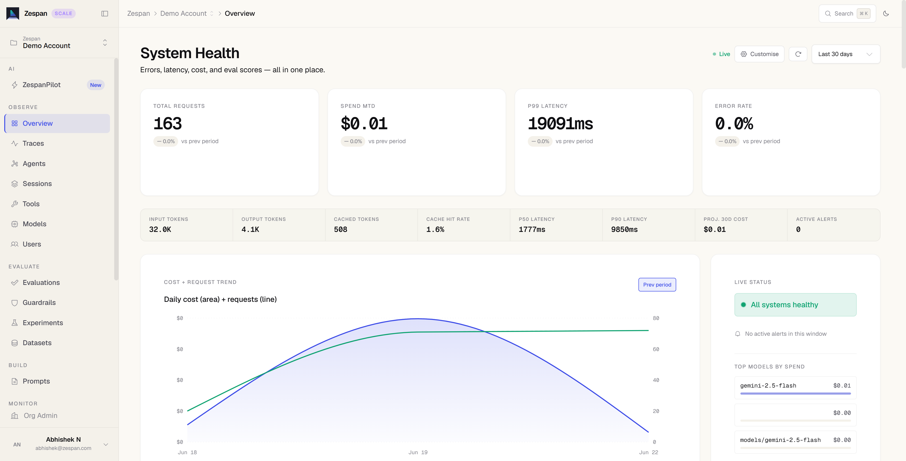
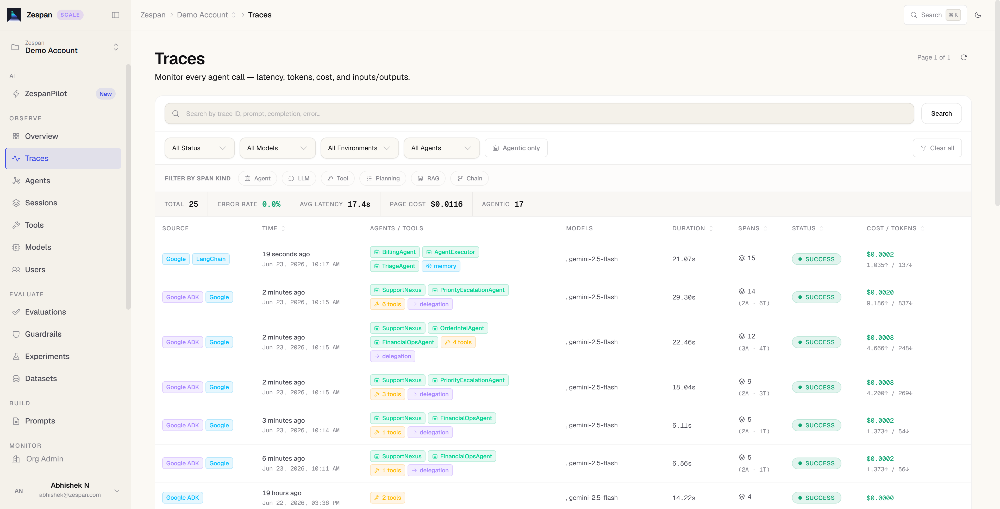

 [ Python](https://github.com/google/adk-python "adk-python on GitHub")[ JS ](https://github.com/google/adk-js "adk-js on GitHub")[ Go ](https://github.com/google/adk-go "adk-go on GitHub")[ Java ](https://github.com/google/adk-java "adk-java on GitHub")[ Kotlin](https://github.com/google/adk-kotlin "adk-kotlin on GitHub")

-   [Home](../..)
-    Build Agents
    
    Build Agents
    
    -   [Get Started](../../get-started/)
        
        Get Started
        
        -   [Python](../../get-started/python/)
        -   [TypeScript](../../get-started/typescript/)
        -   [Go](../../get-started/go/)
        -   [Java](../../get-started/java/)
        -   [Kotlin](../../get-started/kotlin/)
        -   [Agents CLI](../../get-started/agents-cli/)
        -   [Installation](../../get-started/installation/)
        -   [Google Cloud](../../get-started/google-cloud/)
        -   [Migrate to ADK](../../get-started/migrate/)
        
    -   [Build your Agent](../../tutorials/)
        
        Build your Agent
        
        -   [Multi-tool agent](../../tutorials/multi-tool-agent/)
        -   [Agent team](../../tutorials/agent-team/)
        -   [Code with AI](../../tutorials/coding-with-ai/)
        -   [Agent Config](../../agents/config/)
        
    -   [Agents](../../agents/)
        
        Agents
        
        -   [Simple agents](../../agents/llm-agents/)
        -   [Managed agents](../../agents/managed-agents/)
        
    -   [Graph Workflows](../../graphs/)
        
        Graph Workflows
        
        -   [Graph routes](../../graphs/routes/)
        -   [Data handling](../../graphs/data-handling/)
        -   [Human input](../../graphs/human-input/)
        -   [Dynamic workflows](../../graphs/dynamic/)
        
    -   [Multi-Agent Workflows](../../workflows/)
        
        Multi-Agent Workflows
        
        -   [Collaborative workflows](../../workflows/collaboration/)
        -   [Template workflows](../../agents/workflow-agents/)
            
            Template workflows
            
            -   [Sequential workflow](../../agents/workflow-agents/sequential-agents/)
            -   [Loop workflow](../../agents/workflow-agents/loop-agents/)
            -   [Parallel workflow](../../agents/workflow-agents/parallel-agents/)
            -   [Custom template workflows](../../agents/custom-agents/)
            
        -   [Agent routing](../../agents/routing/)
        -   [Workflow patterns](../../workflows/patterns/)
        
    -   [Models for Agents](../../agents/models/)
        
        Models for Agents
        
        -   [Gemini](../../agents/models/google-gemini/)
            
            Gemini
            
            -   [Deferred scheduling](../../agents/models/google-gemini/deferred-schedule/)
            
        -   [Gemma](../../agents/models/google-gemma/)
        -   [Claude](../../agents/models/anthropic/)
        -   [Agent Platform hosted](../../agents/models/agent-platform/)
        -   [Apigee AI Gateway](../../agents/models/apigee/)
        -   [Model routing](../../agents/models/routing/)
        -   [OpenAI](../../agents/models/openai/)
        -   [Ollama](../../agents/models/ollama/)
        -   [vLLM](../../agents/models/vllm/)
        -   [LiteLLM](../../agents/models/litellm/)
        -   [LiteRT-LM](../../agents/models/litert-lm/)
        
    
-    Run Agents
    
    Run Agents
    
    -   [Agent Runtime](../../runtime/)
        
        Agent Runtime
        
        -   [Web Interface](../../runtime/web-interface/)
            
            Web Interface
            
            -   [Visual Builder](../../visual-builder/)
            
        -   [Command Line](../../runtime/command-line/)
        -   [API Server](../../runtime/api-server/)
        -   [Ambient Agents](../../runtime/ambient-agents/)
        -   [Resume Agents](../../runtime/resume/)
        -   [Cancel Agent Runs](../../runtime/cancel/)
        -   [Runtime Config](../../runtime/runconfig/)
        -   [Event Loop](../../runtime/event-loop/)
        
    -   [Deployment](../../deploy/)
        
        Deployment
        
        -   [Agent Runtime](../../deploy/agent-runtime/)
            
            Agent Runtime
            
            -   [Standard deployment](../../deploy/agent-runtime/deploy/)
            -   [agents-cli](../../deploy/agent-runtime/agents-cli/)
            -   [Test deployed agents](../../deploy/agent-runtime/test/)
            
        -   [Cloud Run](../../deploy/cloud-run/)
        -   [GKE](../../deploy/gke/)
        
    -   [Observability](../../observability/)
        
        Observability
        
        -   [Logging](../../observability/logging/)
        -   [Metrics](../../observability/metrics/)
        -   [Traces](../../observability/traces/)
        
    -   [Evaluation](../../evaluate/)
        
        Evaluation
        
        -   [Criteria](../../evaluate/criteria/)
        -   [User Simulation](../../evaluate/user-sim/)
        -   [Environment Simulation](../../evaluate/environment_simulation/)
        -   [Custom Metrics](../../evaluate/custom_metrics/)
        -   [Optimization](../../optimize/)
        
    -   [Safety and Security](../../safety/)
        
        Safety and Security
        
    
-    Components
    
    Components
    
    -   [Technical Overview](../../get-started/about/)
    -   [Custom Tools](../../tools-custom/)
        
        Custom Tools
        
        -    Function tools
            
            Function tools
            
            -   [Overview](../../tools-custom/function-tools/)
            -   [Tool performance](../../tools-custom/performance/)
            -   [Action confirmations](../../tools-custom/confirmation/)
            
        -   [MCP tools](../../tools-custom/mcp-tools/)
            
            MCP tools
            
            -   [Advanced configuration](../../tools-custom/mcp-tools/advanced/)
            -   [Deployment](../../tools-custom/mcp-tools/deployment/)
            -   [Agent as MCP server](../../tools-custom/mcp-tools/agent-as-server/)
            -   [Sub-agent delegation](../../tools-custom/mcp-tools/agent-managed/)
            
        -   [OpenAPI tools](../../tools-custom/openapi-tools/)
        -   [Authentication](../../tools-custom/authentication/)
        -   [Tool limitations](../../tools/limitations/)
        
    -   [Artifacts](../../artifacts/)
        
        Artifacts
        
    -   [Skills for Agents](../../skills/)
        
        Skills for Agents
        
    -   [App management](../../apps/)
        
        App management
        
        -   [Callbacks](../../callbacks/)
            
            Callbacks
            
            -   [Types of callbacks](../../callbacks/types-of-callbacks/)
            -   [Callback patterns](../../callbacks/design-patterns-and-best-practices/)
            
        -   [Plugins](../../plugins/)
        
    -   [Agent context](../../context/)
        
        Agent context
        
        -   [Conversational context](../../sessions/)
        -   [Sessions](../../sessions/session/)
            
            Sessions
            
            -   [Rewind sessions](../../sessions/session/rewind/)
            -   [Migrate sessions](../../sessions/session/migrate/)
            
        -   [State](../../sessions/state/)
        -   [Events](../../events/)
        -   [Memory](../../sessions/memory/)
        -   [Context compression](../../context/compaction/)
        -   [Model context caching](../../context/caching/)
        
    -   [A2A Protocol](../../a2a/)
        
        A2A Protocol
        
        -   [Introduction to A2A](../../a2a/intro/)
        -    A2A Quickstart (Exposing)
            
            A2A Quickstart (Exposing)
            
            -   [Python](../../a2a/quickstart-exposing/)
            -   [Go](../../a2a/quickstart-exposing-go/)
            -   [Java](../../a2a/quickstart-exposing-java/)
            
        -    A2A Quickstart (Consuming)
            
            A2A Quickstart (Consuming)
            
            -   [Python](../../a2a/quickstart-consuming/)
            -   [Go](../../a2a/quickstart-consuming-go/)
            -   [Java](../../a2a/quickstart-consuming-java/)
            -   [Kotlin](../../a2a/quickstart-consuming-kotlin/)
            
        -   [A2A Extension](../../a2a/a2a-extension/)
        
    -   [Live and Voice Agents](../../live/)
        
        Live and Voice Agents
        
        -   [Get started](../../live/get-started/)
            
            Get started
            
            -   [Python](../../live/get-started/streaming-python/)
            -   [Java](../../live/get-started/streaming-java/)
            
        -    Building
            
            Building
            
            -   [Workflows](../../live/workflows/)
            -   [Tools](../../live/tools/)
            -   [Sessions](../../live/sessions/)
            -   [Events](../../live/events/)
            -   [Audio and video](../../live/audio-video/)
            -   [Configuration](../../live/configuration/)
            
        -    Production
            
            Production
            
            -   [Guardrails](../../live/guardrails/)
            -   [Evaluation](../../live/evaluation/)
            -   [Build a custom server](../../live/custom-server/)
            
        -   [Supported models](../../live/models/)
        
    -   [Grounding](../../grounding/)
        
        Grounding
        
        -   [Google Search Grounding](../../grounding/google_search_grounding/)
        -   [Grounding with Search](../../grounding/grounding_with_search/)
        
    
-   [Integrations](../)
    
    Integrations
    
-    Reference
    
    Reference
    
    -   [API Reference](../../api-reference/)
        
        API Reference
        
        -   [Python ADK](../../api-reference/python/)
        -   [TypeScript ADK](../../api-reference/typescript/)
        -    Go ADK
            
            Go ADK
            
            -   [Go v2.x](https://pkg.go.dev/google.golang.org/adk/v2)
            -   [Go v1.x](https://pkg.go.dev/google.golang.org/adk)
            
        -   [Java ADK](../../api-reference/java/)
        -   [Kotlin ADK](../../api-reference/kotlin/)
        -   [CLI Reference](../../api-reference/cli/)
        -   [Agent Config Reference](../../api-reference/agentconfig/)
        -   [REST API](../../api-reference/rest/)
        
    -   [Release Notes](../../release-notes/)
    
-   [Community](../../community/)
    
    Community
    
    -   [Contributing Guide](../../community/contributing-guide/)
    
-   [ADK 2.0](../../2.0/)
    
    ADK 2.0
    

Table of contents

-   [Overview](#overview)
-   [Prerequisites](#prerequisites)
-   [Installation](#installation)
-   [Send traces](#send-traces)
-   [Multi-agent systems](#multi-agent-systems)
-   [View traces in the dashboard](#view-traces-in-the-dashboard)
-   [Resources](#resources)

# Zespan observability for ADK[¶](#zespan-observability-for-adk "Permanent link")

Supported in ADKPythonTypeScript

[Zespan](https://zespan.com) is an agent reliability platform for AI applications. The Zespan SDK instruments ADK agents natively by capturing every agent invocation, model call, tool execution, and multi-agent delegation as linked spans, then shipping them to the [Zespan dashboard](https://app.zespan.com) for inspection, cost attribution, and evaluation.

## Overview[¶](#overview "Permanent link")

Once your ADK agents are instrumented, the Zespan platform provides:

-   **Tracing:** Capture every agent, model, tool, and delegation span with latency, tokens, and cost.
-   **Cost attribution:** Break down spend by model, agent, and time period.
-   **Evaluations:** Score agent behavior with custom metrics, datasets, and simulations.
-   **Guardrails:** Block, redact, or flag unsafe inputs and outputs at runtime.
-   **Prompt management:** Fetch and version prompts with caching and variable substitution.

## Prerequisites[¶](#prerequisites "Permanent link")

Before you begin, set up a Zespan account and credentials:

1.  Sign up at [app.zespan.com](https://app.zespan.com).
2.  Create a project and copy the **API key** from **Onboarding → API Key**.
3.  Set the environment variables:

`export ZESPAN_API_KEY=<your-zespan-api-key> export GOOGLE_API_KEY=<your-google-api-key>`

## Installation[¶](#installation "Permanent link")

Install the Zespan SDK alongside ADK:

PythonTypeScript

`pip install zespan google-adk`

`npm install @zespan/sdk @google/adk`

## Send traces[¶](#send-traces "Permanent link")

Instrument an ADK agent with the Zespan SDK to start capturing traces:

PythonTypeScript

Initialize Zespan once at startup, then create a `ZespanADKCallbackHandler` and spread its `.callbacks` into your `LlmAgent`.

`import asyncio import os import zespan from zespan import ZespanADKCallbackHandler from google.adk.agents import LlmAgent from google.adk.runners import InMemoryRunner from google.genai import types zespan.init(api_key=os.environ["ZESPAN_API_KEY"]) handler = ZespanADKCallbackHandler()  def get_weather(city: str) -> dict:         """Retrieves the current weather report for a specified city."""        if city.lower() == "new york":                return {                        "status": "success",                        "report": "The weather in New York is sunny with a temperature of 25°C.",                }        return {                "status": "error",                "error_message": f"Weather information for '{city}' is not available.",        }  agent = LlmAgent(         name="weather_agent",        model="gemini-flash-latest",        description="Agent to answer weather questions.",        instruction="Use the available tools to find an answer.",        tools=[get_weather],        **handler.callbacks, )  async def main():         runner = InMemoryRunner(agent=agent, app_name="weather_app")        await runner.session_service.create_session(                app_name="weather_app", user_id="user", session_id="session"        )        async for event in runner.run_async(                user_id="user",                session_id="session",                new_message=types.Content(                        role="user",                        parts=[types.Part(text="What is the weather in New York?")],                ),        ):                if event.is_final_response():                        print(event.content.parts[0].text.strip())  if __name__ == "__main__":         asyncio.run(main())`

Two approaches are available.

**`instrumentADK`** wraps coordinator and runner in one call and intercepts the full event stream, including delegations.

``import { zespan, instrumentADK } from "@zespan/sdk"; import { LlmAgent, InMemoryRunner } from "@google/adk"; zespan.init({ apiKey: process.env.ZESPAN_API_KEY! }); function getWeather(city: string): object {     if (city.toLowerCase() === "new york") {        return {            status: "success",            report: "The weather in New York is sunny with a temperature of 25°C.",        };    }    return {        status: "error",        error_message: `Weather information for '${city}' is not available.`,    }; } const coordinator = new LlmAgent({     name: "weather_agent",    model: "gemini-flash-latest",    description: "Agent to answer weather questions.",    instruction: "Use the available tools to find an answer.",    tools: [getWeather], }); const runner = new InMemoryRunner({     agent: coordinator,    appName: "weather_app", }); const { runner: tracedRunner } = instrumentADK({ coordinator, runner }); for await (const event of tracedRunner.runEphemeral({     userId: "user",    newMessage: { parts: [{ text: "What is the weather in New York?" }] }, })) {     if (event.isFinalResponse()) {        console.log(event.content.parts[0].text);    } }``

**`ZespanADKCallbackHandler`** uses ADK's native callback system; spread `.callbacks` into your agent config.

`import { zespan, ZespanADKCallbackHandler } from "@zespan/sdk"; import { LlmAgent, InMemoryRunner } from "@google/adk"; zespan.init({ apiKey: process.env.ZESPAN_API_KEY! }); const handler = new ZespanADKCallbackHandler(); const agent = new LlmAgent({     name: "weather_agent",    model: "gemini-flash-latest",    description: "Agent to answer weather questions.",    instruction: "Use the available tools to find an answer.",    tools: [getWeather],    ...handler.callbacks, }); const runner = new InMemoryRunner({ agent, appName: "weather_app" }); for await (const event of runner.runEphemeral({     userId: "user",    newMessage: { parts: [{ text: "What is the weather in New York?" }] }, })) {     if (event.isFinalResponse()) {        console.log(event.content.parts[0].text);    } }`

## Multi-agent systems[¶](#multi-agent-systems "Permanent link")

Zespan links coordinator and sub-agent spans into a single trace:

PythonTypeScript

Use the **same handler instance** across the coordinator and all sub-agents. Spans are linked under a single trace via the shared ADK invocation ID.

`handler = ZespanADKCallbackHandler() specialist = LlmAgent(         name="lookup_agent",        model="gemini-flash-latest",        tools=[lookup_tool],        **handler.callbacks, ) coordinator = LlmAgent(         name="coordinator",        model="gemini-flash-latest",        sub_agents=[specialist],        **handler.callbacks, )`

With `instrumentADK`, all `subAgents` are wrapped recursively and automatically.

`const specialist = new LlmAgent({     name: "lookup_agent",    model: "gemini-flash-latest",    tools: [lookupTool], }); const coordinator = new LlmAgent({     name: "coordinator",    model: "gemini-flash-latest",    subAgents: [specialist], }); const { runner: tracedRunner } = instrumentADK({     coordinator,    runner: new InMemoryRunner({ agent: coordinator, appName: "my_app" }), });`

With `ZespanADKCallbackHandler`, spread the same instance into every agent.

`const handler = new ZespanADKCallbackHandler(); const specialist = new LlmAgent({     name: "lookup_agent",    model: "gemini-flash-latest",    tools: [lookupTool],    ...handler.callbacks, }); const coordinator = new LlmAgent({     name: "coordinator",    model: "gemini-flash-latest",    subAgents: [specialist],    ...handler.callbacks, });`

## View traces in the dashboard[¶](#view-traces-in-the-dashboard "Permanent link")

Run the agent, then open your project at [app.zespan.com](https://app.zespan.com). Each ADK run produces a hierarchical trace showing:

-   Agent spans with latency and delegation links between coordinator and sub-agents
-   LLM spans with token counts, cost, finish reason, and optional prompt/completion text
-   Tool spans with input arguments and return values

## Resources[¶](#resources "Permanent link")

-   [Zespan](https://zespan.com)
-   [`zespan` on PyPI](https://pypi.org/project/zespan/)
-   [`@zespan/sdk` on npm](https://www.npmjs.com/package/@zespan/sdk)
-   [Zespan documentation](https://docs.zespan.com)

Back to top