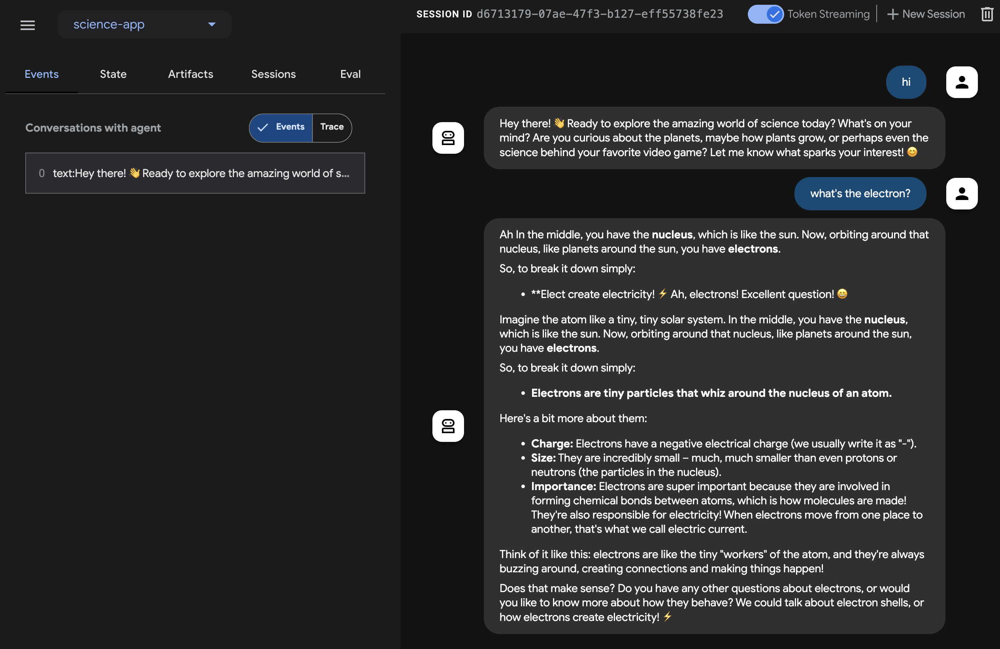

 [ Python](https://github.com/google/adk-python "adk-python on GitHub")[ JS ](https://github.com/google/adk-js "adk-js on GitHub")[ Go ](https://github.com/google/adk-go "adk-go on GitHub")[ Java ](https://github.com/google/adk-java "adk-java on GitHub")[ Kotlin](https://github.com/google/adk-kotlin "adk-kotlin on GitHub")

-   [Home](../../..)
-    Build Agents
    
    Build Agents
    
    -   [Get Started](../../../get-started/)
        
        Get Started
        
        -   [Python](../../../get-started/python/)
        -   [TypeScript](../../../get-started/typescript/)
        -   [Go](../../../get-started/go/)
        -   [Java](../../../get-started/java/)
        -   [Kotlin](../../../get-started/kotlin/)
        -   [Agents CLI](../../../get-started/agents-cli/)
        -   [Installation](../../../get-started/installation/)
        -   [Google Cloud](../../../get-started/google-cloud/)
        -   [Migrate to ADK](../../../get-started/migrate/)
        
    -   [Build your Agent](../../../tutorials/)
        
        Build your Agent
        
        -   [Multi-tool agent](../../../tutorials/multi-tool-agent/)
        -   [Agent team](../../../tutorials/agent-team/)
        -   [Code with AI](../../../tutorials/coding-with-ai/)
        -   [Agent Config](../../../agents/config/)
        
    -   [Agents](../../../agents/)
        
        Agents
        
        -   [Simple agents](../../../agents/llm-agents/)
        -   [Managed agents](../../../agents/managed-agents/)
        
    -   [Graph Workflows](../../../graphs/)
        
        Graph Workflows
        
        -   [Graph routes](../../../graphs/routes/)
        -   [Data handling](../../../graphs/data-handling/)
        -   [Human input](../../../graphs/human-input/)
        -   [Dynamic workflows](../../../graphs/dynamic/)
        
    -   [Multi-Agent Workflows](../../../workflows/)
        
        Multi-Agent Workflows
        
        -   [Collaborative workflows](../../../workflows/collaboration/)
        -   [Template workflows](../../../agents/workflow-agents/)
            
            Template workflows
            
            -   [Sequential workflow](../../../agents/workflow-agents/sequential-agents/)
            -   [Loop workflow](../../../agents/workflow-agents/loop-agents/)
            -   [Parallel workflow](../../../agents/workflow-agents/parallel-agents/)
            -   [Custom template workflows](../../../agents/custom-agents/)
            
        -   [Agent routing](../../../agents/routing/)
        -   [Workflow patterns](../../../workflows/patterns/)
        
    -   [Models for Agents](../../../agents/models/)
        
        Models for Agents
        
        -   [Gemini](../../../agents/models/google-gemini/)
            
            Gemini
            
            -   [Deferred scheduling](../../../agents/models/google-gemini/deferred-schedule/)
            
        -   [Gemma](../../../agents/models/google-gemma/)
        -   [Claude](../../../agents/models/anthropic/)
        -   [Agent Platform hosted](../../../agents/models/agent-platform/)
        -   [Apigee AI Gateway](../../../agents/models/apigee/)
        -   [Model routing](../../../agents/models/routing/)
        -   [OpenAI](../../../agents/models/openai/)
        -   [Ollama](../../../agents/models/ollama/)
        -   [vLLM](../../../agents/models/vllm/)
        -   [LiteLLM](../../../agents/models/litellm/)
        -   [LiteRT-LM](../../../agents/models/litert-lm/)
        
    
-    Run Agents
    
    Run Agents
    
    -   [Agent Runtime](../../../runtime/)
        
        Agent Runtime
        
        -   [Web Interface](../../../runtime/web-interface/)
            
            Web Interface
            
            -   [Visual Builder](../../../visual-builder/)
            
        -   [Command Line](../../../runtime/command-line/)
        -   [API Server](../../../runtime/api-server/)
        -   [Ambient Agents](../../../runtime/ambient-agents/)
        -   [Resume Agents](../../../runtime/resume/)
        -   [Cancel Agent Runs](../../../runtime/cancel/)
        -   [Runtime Config](../../../runtime/runconfig/)
        -   [Event Loop](../../../runtime/event-loop/)
        
    -   [Deployment](../../../deploy/)
        
        Deployment
        
        -   [Agent Runtime](../../../deploy/agent-runtime/)
            
            Agent Runtime
            
            -   [Standard deployment](../../../deploy/agent-runtime/deploy/)
            -   [agents-cli](../../../deploy/agent-runtime/agents-cli/)
            -   [Test deployed agents](../../../deploy/agent-runtime/test/)
            
        -   [Cloud Run](../../../deploy/cloud-run/)
        -   [GKE](../../../deploy/gke/)
        
    -   [Observability](../../../observability/)
        
        Observability
        
        -   [Logging](../../../observability/logging/)
        -   [Metrics](../../../observability/metrics/)
        -   [Traces](../../../observability/traces/)
        
    -   [Evaluation](../../../evaluate/)
        
        Evaluation
        
        -   [Criteria](../../../evaluate/criteria/)
        -   [User Simulation](../../../evaluate/user-sim/)
        -   [Environment Simulation](../../../evaluate/environment_simulation/)
        -   [Custom Metrics](../../../evaluate/custom_metrics/)
        -   [Optimization](../../../optimize/)
        
    -   [Safety and Security](../../../safety/)
        
        Safety and Security
        
    
-    Components
    
    Components
    
    -   [Technical Overview](../../../get-started/about/)
    -   [Custom Tools](../../../tools-custom/)
        
        Custom Tools
        
        -    Function tools
            
            Function tools
            
            -   [Overview](../../../tools-custom/function-tools/)
            -   [Tool performance](../../../tools-custom/performance/)
            -   [Action confirmations](../../../tools-custom/confirmation/)
            
        -   [MCP tools](../../../tools-custom/mcp-tools/)
            
            MCP tools
            
            -   [Advanced configuration](../../../tools-custom/mcp-tools/advanced/)
            -   [Deployment](../../../tools-custom/mcp-tools/deployment/)
            -   [Agent as MCP server](../../../tools-custom/mcp-tools/agent-as-server/)
            -   [Sub-agent delegation](../../../tools-custom/mcp-tools/agent-managed/)
            
        -   [OpenAPI tools](../../../tools-custom/openapi-tools/)
        -   [Authentication](../../../tools-custom/authentication/)
        -   [Tool limitations](../../../tools/limitations/)
        
    -   [Artifacts](../../../artifacts/)
        
        Artifacts
        
    -   [Skills for Agents](../../../skills/)
        
        Skills for Agents
        
    -   [App management](../../../apps/)
        
        App management
        
        -   [Callbacks](../../../callbacks/)
            
            Callbacks
            
            -   [Types of callbacks](../../../callbacks/types-of-callbacks/)
            -   [Callback patterns](../../../callbacks/design-patterns-and-best-practices/)
            
        -   [Plugins](../../../plugins/)
        
    -   [Agent context](../../../context/)
        
        Agent context
        
        -   [Conversational context](../../../sessions/)
        -   [Sessions](../../../sessions/session/)
            
            Sessions
            
            -   [Rewind sessions](../../../sessions/session/rewind/)
            -   [Migrate sessions](../../../sessions/session/migrate/)
            
        -   [State](../../../sessions/state/)
        -   [Events](../../../events/)
        -   [Memory](../../../sessions/memory/)
        -   [Context compression](../../../context/compaction/)
        -   [Model context caching](../../../context/caching/)
        
    -   [A2A Protocol](../../../a2a/)
        
        A2A Protocol
        
        -   [Introduction to A2A](../../../a2a/intro/)
        -    A2A Quickstart (Exposing)
            
            A2A Quickstart (Exposing)
            
            -   [Python](../../../a2a/quickstart-exposing/)
            -   [Go](../../../a2a/quickstart-exposing-go/)
            -   [Java](../../../a2a/quickstart-exposing-java/)
            
        -    A2A Quickstart (Consuming)
            
            A2A Quickstart (Consuming)
            
            -   [Python](../../../a2a/quickstart-consuming/)
            -   [Go](../../../a2a/quickstart-consuming-go/)
            -   [Java](../../../a2a/quickstart-consuming-java/)
            -   [Kotlin](../../../a2a/quickstart-consuming-kotlin/)
            
        -   [A2A Extension](../../../a2a/a2a-extension/)
        
    -   [Live and Voice Agents](../../)
        
        Live and Voice Agents
        
        -   [Get started](../)
            
            Get started
            
            -   [Python](../streaming-python/)
            -    Java [Java](./)
                
                Table of contents
                
                -   [Create your first agent](#create-your-first-agent)
                    
                    -   [Prerequisites](#prerequisites)
                    -   [Prepare the project structure](#prepare-the-project-structure)
                    -   [Running a compilation](#running-a-compilation)
                    -   [Creating an agent](#creating-an-agent)
                    
                -   [Run agent with Dev UI](#run-agent-with-adk-web-server)
                    
                    -   [Define environment variables](#define-environment-variables)
                    -   [Run Dev UI](#run-dev-ui)
                    
                -   [Try Dev UI with voice and video](#try-dev-ui-with-voice-and-video)
                    
                    -   [Caveat](#caveat)
                    -   [Stop the tool](#stop-the-tool)
                    
                -   [Run agent with a custom live audio app](#run-agent-with-live-audio)
                    
                    -   [A Maven pom.xml build file for Live Audio](#a-maven-pomxml-build-file-for-live-audio)
                    -   [Creating Live Audio Run tool](#creating-live-audio-run-tool)
                    -   [Run the Live Audio Run tool](#run-the-live-audio-run-tool)
                    
                
            
        -    Building
            
            Building
            
            -   [Workflows](../../workflows/)
            -   [Tools](../../tools/)
            -   [Sessions](../../sessions/)
            -   [Events](../../events/)
            -   [Audio and video](../../audio-video/)
            -   [Configuration](../../configuration/)
            
        -    Production
            
            Production
            
            -   [Guardrails](../../guardrails/)
            -   [Evaluation](../../evaluation/)
            -   [Build a custom server](../../custom-server/)
            
        -   [Supported models](../../models/)
        
    -   [Grounding](../../../grounding/)
        
        Grounding
        
        -   [Google Search Grounding](../../../grounding/google_search_grounding/)
        -   [Grounding with Search](../../../grounding/grounding_with_search/)
        
    
-   [Integrations](../../../integrations/)
    
    Integrations
    
-    Reference
    
    Reference
    
    -   [API Reference](../../../api-reference/)
        
        API Reference
        
        -   [Python ADK](../../../api-reference/python/)
        -   [TypeScript ADK](../../../api-reference/typescript/)
        -    Go ADK
            
            Go ADK
            
            -   [Go v2.x](https://pkg.go.dev/google.golang.org/adk/v2)
            -   [Go v1.x](https://pkg.go.dev/google.golang.org/adk)
            
        -   [Java ADK](../../../api-reference/java/)
        -   [Kotlin ADK](../../../api-reference/kotlin/)
        -   [CLI Reference](../../../api-reference/cli/)
        -   [Agent Config Reference](../../../api-reference/agentconfig/)
        -   [REST API](../../../api-reference/rest/)
        
    -   [Release Notes](../../../release-notes/)
    
-   [Community](../../../community/)
    
    Community
    
    -   [Contributing Guide](../../../community/contributing-guide/)
    
-   [ADK 2.0](../../../2.0/)
    
    ADK 2.0
    

Table of contents

-   [Create your first agent](#create-your-first-agent)
    
    -   [Prerequisites](#prerequisites)
    -   [Prepare the project structure](#prepare-the-project-structure)
    -   [Running a compilation](#running-a-compilation)
    -   [Creating an agent](#creating-an-agent)
    
-   [Run agent with Dev UI](#run-agent-with-adk-web-server)
    
    -   [Define environment variables](#define-environment-variables)
    -   [Run Dev UI](#run-dev-ui)
    
-   [Try Dev UI with voice and video](#try-dev-ui-with-voice-and-video)
    
    -   [Caveat](#caveat)
    -   [Stop the tool](#stop-the-tool)
    
-   [Run agent with a custom live audio app](#run-agent-with-live-audio)
    
    -   [A Maven pom.xml build file for Live Audio](#a-maven-pomxml-build-file-for-live-audio)
    -   [Creating Live Audio Run tool](#creating-live-audio-run-tool)
    -   [Run the Live Audio Run tool](#run-the-live-audio-run-tool)
    

1.  [Home](../../..)
2.  [Components](../../../get-started/about/)
3.  [Live and Voice Agents](../../)
4.  [Get started](../)

# Build live streaming agent with Java[¶](#build-live-streaming-agent-with-java "Permanent link")

Build a Java agent that holds a low-latency, two-way voice conversation with ADK Streaming.

You will set up Java and Maven, define the project dependencies, and build a `ScienceTeacherAgent`. You will test it as text streaming in the Dev UI first, then turn on live audio and talk to it.

## **Create your first agent**[¶](#create-your-first-agent "Permanent link")

### **Prerequisites**[¶](#prerequisites "Permanent link")

-   In this getting started guide, you will be programming in Java. Check if **Java** is installed on your machine. Ideally, you should be using Java 17 or more (you can check that by typing **java -version**)
    
-   You need the **Maven** build tool for Java, so install [Maven](https://maven.apache.org/install.html) before going further (Cloud Top and Cloud Shell already have it; your local development environment may not).
    

### **Prepare the project structure**[¶](#prepare-the-project-structure "Permanent link")

To get started with ADK Java, let’s create a Maven project with the following directory structure:

`adk-agents/ ├── pom.xml └── src/         └── main/                └── java/                        └── agents/                                └── ScienceTeacherAgent.java`

Follow the instructions in [Installation](../../../get-started/installation/) page to add `pom.xml` for using the ADK package.

Note

Feel free to use whichever name you like for the root directory of your project (instead of adk-agents)

### **Running a compilation**[¶](#running-a-compilation "Permanent link")

Let’s see if Maven is happy with this build, by running a compilation (**mvn compile** command):

`$ mvn compile [INFO] Scanning for projects... [INFO] [INFO] --------------------< adk-agents:adk-agents >-------------------- [INFO] Building adk-agents 1.0-SNAPSHOT [INFO]   from pom.xml [INFO] --------------------------------[ jar ]--------------------------------- [INFO] [INFO] --- resources:3.3.1:resources (default-resources) @ adk-demo --- [INFO] skip non existing resourceDirectory /home/user/adk-demo/src/main/resources [INFO] [INFO] --- compiler:3.13.0:compile (default-compile) @ adk-demo --- [INFO] Nothing to compile - all classes are up to date. [INFO] ------------------------------------------------------------------------ [INFO] BUILD SUCCESS [INFO] ------------------------------------------------------------------------ [INFO] Total time:  1.347 s [INFO] Finished at: 2025-05-06T15:38:08Z [INFO] ------------------------------------------------------------------------`

Looks like the project is set up properly for compilation!

### **Creating an agent**[¶](#creating-an-agent "Permanent link")

Create the **ScienceTeacherAgent.java** file under the `src/main/java/agents/` directory with the following content:

`package samples.liveaudio; import com.google.adk.agents.BaseAgent; import com.google.adk.agents.LlmAgent; /** Science teacher agent. */ public class ScienceTeacherAgent {     // Field expected by the Dev UI to load the agent dynamically    // (the agent must be initialized at declaration time)    public static final BaseAgent ROOT_AGENT = initAgent();     // Please fill in the latest model id that supports live API from    // https://adk.dev/live/get-started/streaming-python/#supported-models    public static BaseAgent initAgent() {        return LlmAgent.builder()                .name("science-app")                .description("Science teacher agent")                .model("...") // Please fill in the latest model id for live API                .instruction("""                        You are a helpful science teacher that explains                        science concepts to kids and teenagers.                        """)                .build();    } }`

We will use `Dev UI` to run this agent later. For the tool to automatically recognize the agent, its Java class has to comply with the following two rules:

-   The agent should be stored in a global **public static** variable named **ROOT\_AGENT** of type **BaseAgent** and initialized at declaration time.
-   The agent definition has to be a **static** method so it can be loaded during the class initialization by the dynamic compiling classloader.

## **Run agent with Dev UI**[¶](#run-agent-with-adk-web-server "Permanent link")

`Dev UI` is a web server where you can quickly run and test your agents for development purpose, without building your own UI application for the agents.

### **Define environment variables**[¶](#define-environment-variables "Permanent link")

To run the server, you’ll need to export two environment variables:

-   a Gemini key that you can [get from AI Studio](https://ai.google.dev/gemini-api/docs/api-key),
-   a variable to specify we’re not using Agent Platform this time.

`export GOOGLE_GENAI_USE_ENTERPRISE=FALSE export GOOGLE_API_KEY=YOUR_API_KEY`

### **Run Dev UI**[¶](#run-dev-ui "Permanent link")

Run the following command from the terminal to launch the Dev UI.

terminal

`mvn exec:java \         -Dexec.mainClass="com.google.adk.web.AdkWebServer" \        -Dexec.args="--adk.agents.source-dir=." \        -Dexec.classpathScope="compile"`

**Step 1:** Open the URL provided (usually `http://localhost:8080` or `http://127.0.0.1:8080`) directly in your browser.

**Step 2.** In the top-left corner of the UI, you can select your agent in the dropdown. Select "science-app".

Troubleshooting

If you do not see "science-app" in the dropdown menu, make sure you are running the `mvn` command from the root of your maven project.

Caution: ADK Web for development only

ADK Web is ***not meant for use in production deployments***. You should use ADK Web for development and debugging purposes only.

## Try Dev UI with voice and video[¶](#try-dev-ui-with-voice-and-video "Permanent link")

With your favorite browser, navigate to: [http://127.0.0.1:8080/](http://127.0.0.1:8080/)

You should see the following interface:

Click the microphone button to enable the voice input, and ask a question `What's the electron?` in voice. You will hear the answer in voice in real-time.

To try with video, reload the web browser, click the camera button to enable the video input, and ask questions like "What do you see?". The agent will answer what they see in the video input.

### Caveat[¶](#caveat "Permanent link")

-   You can not use text chat with the native-audio models. You will see errors when entering text messages on `adk web`.

### Stop the tool[¶](#stop-the-tool "Permanent link")

Stop the tool by pressing `Ctrl-C` on the console.

## **Run agent with a custom live audio app**[¶](#run-agent-with-live-audio "Permanent link")

Now, let's try audio streaming with the agent and a custom live audio application.

### **A Maven pom.xml build file for Live Audio**[¶](#a-maven-pomxml-build-file-for-live-audio "Permanent link")

Replace your existing pom.xml with the following.

`<?xml version="1.0" encoding="UTF-8"?> <project xmlns="http://maven.apache.org/POM/4.0.0"     xmlns:xsi="http://www.w3.org/2001/XMLSchema-instance"    xsi:schemaLocation="http://maven.apache.org/POM/4.0.0 http://maven.apache.org/xsd/maven-4.0.0.xsd">    <modelVersion>4.0.0</modelVersion>     <groupId>com.google.adk.samples</groupId>    <artifactId>google-adk-sample-live-audio</artifactId>    <version>0.1.0</version>    <name>Google ADK - Sample - Live Audio</name>    <description>        A sample application demonstrating a live audio conversation using ADK,        runnable via samples.liveaudio.LiveAudioRun.    </description>    <packaging>jar</packaging>     <properties>        <project.build.sourceEncoding>UTF-8</project.build.sourceEncoding>        <java.version>17</java.version>        <auto-value.version>1.11.0</auto-value.version>        <!-- Main class for exec-maven-plugin -->        <exec.mainClass>samples.liveaudio.LiveAudioRun</exec.mainClass>        <google-adk.version>1.11.0</google-adk.version>    </properties>     <dependencyManagement>        <dependencies>            <dependency>                <groupId>com.google.cloud</groupId>                <artifactId>libraries-bom</artifactId>                <version>26.53.0</version>                <type>pom</type>                <scope>import</scope>            </dependency>        </dependencies>    </dependencyManagement>     <dependencies>        <dependency>            <groupId>com.google.adk</groupId>            <artifactId>google-adk</artifactId>            <version>${google-adk.version}</version>        </dependency>        <dependency>            <groupId>commons-logging</groupId>            <artifactId>commons-logging</artifactId>            <version>1.2</version> <!-- Or use a property if defined in a parent POM -->        </dependency>    </dependencies>     <build>        <plugins>            <plugin>                <groupId>org.apache.maven.plugins</groupId>                <artifactId>maven-compiler-plugin</artifactId>                <version>3.13.0</version>                <configuration>                    <source>${java.version}</source>                    <target>${java.version}</target>                    <parameters>true</parameters>                    <annotationProcessorPaths>                        <path>                            <groupId>com.google.auto.value</groupId>                            <artifactId>auto-value</artifactId>                            <version>${auto-value.version}</version>                        </path>                    </annotationProcessorPaths>                </configuration>            </plugin>            <plugin>                <groupId>org.codehaus.mojo</groupId>                <artifactId>build-helper-maven-plugin</artifactId>                <version>3.6.0</version>                <executions>                    <execution>                        <id>add-source</id>                        <phase>generate-sources</phase>                        <goals>                            <goal>add-source</goal>                        </goals>                        <configuration>                            <sources>                                <source>.</source>                            </sources>                        </configuration>                    </execution>                </executions>            </plugin>            <plugin>                <groupId>org.codehaus.mojo</groupId>                <artifactId>exec-maven-plugin</artifactId>                <version>3.2.0</version>                <configuration>                    <mainClass>${exec.mainClass}</mainClass>                    <classpathScope>runtime</classpathScope>                </configuration>            </plugin>        </plugins>    </build> </project>`

### **Creating Live Audio Run tool**[¶](#creating-live-audio-run-tool "Permanent link")

Create the **LiveAudioRun.java** file under the `src/main/java/` directory with the following content. This tool runs the agent on it with live audio input and output.

`package samples.liveaudio; import com.google.adk.agents.LiveRequestQueue; import com.google.adk.agents.RunConfig; import com.google.adk.events.Event; import com.google.adk.runner.Runner; import com.google.adk.sessions.InMemorySessionService; import com.google.common.collect.ImmutableList; import com.google.genai.types.Blob; import com.google.genai.types.Modality; import com.google.genai.types.PrebuiltVoiceConfig; import com.google.genai.types.Content; import com.google.genai.types.Part; import com.google.genai.types.SpeechConfig; import com.google.genai.types.VoiceConfig; import io.reactivex.rxjava3.core.Flowable; import java.io.ByteArrayOutputStream; import java.io.InputStream; import java.net.URL; import javax.sound.sampled.AudioFormat; import javax.sound.sampled.AudioInputStream; import javax.sound.sampled.AudioSystem; import javax.sound.sampled.DataLine; import javax.sound.sampled.LineUnavailableException; import javax.sound.sampled.Mixer; import javax.sound.sampled.SourceDataLine; import javax.sound.sampled.TargetDataLine; import java.util.UUID; import java.util.concurrent.ExecutorService; import java.util.concurrent.ConcurrentHashMap; import java.util.concurrent.ConcurrentMap; import java.util.concurrent.Executors; import java.util.concurrent.Future; import java.util.concurrent.TimeUnit; import java.util.concurrent.atomic.AtomicBoolean; import agents.ScienceTeacherAgent; /** Main class to demonstrate running the {@link LiveAudioAgent} for a voice conversation. */ public final class LiveAudioRun {     private final String userId;    private final String sessionId;    private final Runner runner;     private static final javax.sound.sampled.AudioFormat MIC_AUDIO_FORMAT =            new javax.sound.sampled.AudioFormat(16000.0f, 16, 1, true, false);     private static final javax.sound.sampled.AudioFormat SPEAKER_AUDIO_FORMAT =            new javax.sound.sampled.AudioFormat(24000.0f, 16, 1, true, false);     private static final int BUFFER_SIZE = 4096;     public LiveAudioRun() {        this.userId = "test_user";        String appName = "LiveAudioApp";        this.sessionId = UUID.randomUUID().toString();         InMemorySessionService sessionService = new InMemorySessionService();        this.runner = new Runner(ScienceTeacherAgent.ROOT_AGENT, appName, null, sessionService);         ConcurrentMap<String, Object> initialState = new ConcurrentHashMap<>();        var unused =                sessionService.createSession(appName, userId, initialState, sessionId).blockingGet();    }     private void runConversation() throws Exception {        System.out.println("Initializing microphone input and speaker output...");         RunConfig runConfig =                RunConfig.builder()                        .setStreamingMode(RunConfig.StreamingMode.BIDI)                        .setResponseModalities(ImmutableList.of(new Modality("AUDIO")))                        .setSpeechConfig(                                SpeechConfig.builder()                                        .voiceConfig(                                                VoiceConfig.builder()                                                        .prebuiltVoiceConfig(                                                                PrebuiltVoiceConfig.builder().voiceName("Aoede").build())                                                        .build())                                        .languageCode("en-US")                                        .build())                        .build();         LiveRequestQueue liveRequestQueue = new LiveRequestQueue();         Flowable<Event> eventStream =                this.runner.runLive(                        runner.sessionService().createSession(userId, sessionId).blockingGet(),                        liveRequestQueue,                        runConfig);         AtomicBoolean isRunning = new AtomicBoolean(true);        AtomicBoolean conversationEnded = new AtomicBoolean(false);        ExecutorService executorService = Executors.newFixedThreadPool(2);         // Task for capturing microphone input        Future<?> microphoneTask =                executorService.submit(() -> captureAndSendMicrophoneAudio(liveRequestQueue, isRunning));         // Task for processing agent responses and playing audio        Future<?> outputTask =                executorService.submit(                        () -> {                            try {                                processAudioOutput(eventStream, isRunning, conversationEnded);                            } catch (Exception e) {                                System.err.println("Error processing audio output: " + e.getMessage());                                e.printStackTrace();                                isRunning.set(false);                            }                        });         // Wait for user to press Enter to stop the conversation        System.out.println("Conversation started. Press Enter to stop...");        System.in.read();         System.out.println("Ending conversation...");        isRunning.set(false);         try {            // Give some time for ongoing processing to complete            microphoneTask.get(2, TimeUnit.SECONDS);            outputTask.get(2, TimeUnit.SECONDS);        } catch (Exception e) {            System.out.println("Stopping tasks...");        }         liveRequestQueue.close();        executorService.shutdownNow();        System.out.println("Conversation ended.");    }     private void captureAndSendMicrophoneAudio(            LiveRequestQueue liveRequestQueue, AtomicBoolean isRunning) {        TargetDataLine micLine = null;        try {            DataLine.Info info = new DataLine.Info(TargetDataLine.class, MIC_AUDIO_FORMAT);            if (!AudioSystem.isLineSupported(info)) {                System.err.println("Microphone line not supported!");                return;            }             micLine = (TargetDataLine) AudioSystem.getLine(info);            micLine.open(MIC_AUDIO_FORMAT);            micLine.start();             System.out.println("Microphone initialized. Start speaking...");             byte[] buffer = new byte[BUFFER_SIZE];            int bytesRead;             while (isRunning.get()) {                bytesRead = micLine.read(buffer, 0, buffer.length);                 if (bytesRead > 0) {                    byte[] audioChunk = new byte[bytesRead];                    System.arraycopy(buffer, 0, audioChunk, 0, bytesRead);                     Blob audioBlob = Blob.builder().data(audioChunk).mimeType("audio/pcm").build();                     liveRequestQueue.realtime(audioBlob);                }            }        } catch (LineUnavailableException e) {            System.err.println("Error accessing microphone: " + e.getMessage());            e.printStackTrace();        } finally {            if (micLine != null) {                micLine.stop();                micLine.close();            }        }    }     private void processAudioOutput(            Flowable<Event> eventStream, AtomicBoolean isRunning, AtomicBoolean conversationEnded) {        SourceDataLine speakerLine = null;        try {            DataLine.Info info = new DataLine.Info(SourceDataLine.class, SPEAKER_AUDIO_FORMAT);            if (!AudioSystem.isLineSupported(info)) {                System.err.println("Speaker line not supported!");                return;            }             final SourceDataLine finalSpeakerLine = (SourceDataLine) AudioSystem.getLine(info);            finalSpeakerLine.open(SPEAKER_AUDIO_FORMAT);            finalSpeakerLine.start();             System.out.println("Speaker initialized.");             for (Event event : eventStream.blockingIterable()) {                if (!isRunning.get()) {                    break;                }                 AtomicBoolean audioReceived = new AtomicBoolean(false);                processEvent(event, audioReceived);                 event.content().ifPresent(content -> content.parts().ifPresent(parts -> parts.forEach(part -> playAudioData(part, finalSpeakerLine))));            }             speakerLine = finalSpeakerLine; // Assign to outer variable for cleanup in finally block        } catch (LineUnavailableException e) {            System.err.println("Error accessing speaker: " + e.getMessage());            e.printStackTrace();        } finally {            if (speakerLine != null) {                speakerLine.drain();                speakerLine.stop();                speakerLine.close();            }            conversationEnded.set(true);        }    }     private void playAudioData(Part part, SourceDataLine speakerLine) {        part.inlineData()                .ifPresent(                        inlineBlob ->                                inlineBlob                                        .data()                                        .ifPresent(                                                audioBytes -> {                                                    if (audioBytes.length > 0) {                                                        System.out.printf(                                                                "Playing audio (%s): %d bytes%n",                                                                inlineBlob.mimeType(),                                                                audioBytes.length);                                                        speakerLine.write(audioBytes, 0, audioBytes.length);                                                    }                                                }));    }     private void processEvent(Event event, java.util.concurrent.atomic.AtomicBoolean audioReceived) {        event                .content()                .ifPresent(                        content ->                                content                                        .parts()                                        .ifPresent(parts -> parts.forEach(part -> logReceivedAudioData(part, audioReceived))));    }     private void logReceivedAudioData(Part part, AtomicBoolean audioReceived) {        part.inlineData()                .ifPresent(                        inlineBlob ->                                inlineBlob                                        .data()                                        .ifPresent(                                                audioBytes -> {                                                    if (audioBytes.length > 0) {                                                        System.out.printf(                                                                "    Audio (%s): received %d bytes.%n",                                                                inlineBlob.mimeType(),                                                                audioBytes.length);                                                        audioReceived.set(true);                                                    } else {                                                        System.out.printf(                                                                "    Audio (%s): received empty audio data.%n",                                                                inlineBlob.mimeType());                                                    }                                                }));    }     public static void main(String[] args) throws Exception {        LiveAudioRun liveAudioRun = new LiveAudioRun();        liveAudioRun.runConversation();        System.out.println("Exiting Live Audio Run.");    } }`

### **Run the Live Audio Run tool**[¶](#run-the-live-audio-run-tool "Permanent link")

To run Live Audio Run tool, use the following command on the `adk-agents` directory:

`mvn compile exec:java`

Then you should see:

`$ mvn compile exec:java ... Initializing microphone input and speaker output... Conversation started. Press Enter to stop... Speaker initialized. Microphone initialized. Start speaking...`

With this message, the tool is ready to take voice input. Talk to the agent with a question like `What's the electron?`.

Caution

When you observe the agent keep speaking by itself and doesn't stop, try using earphones to suppress the echoing.

Next, see [Configuration](../../configuration/) to set the voice and turn detection, and [Tools](../../tools/) to give your live agent tools.

Back to top