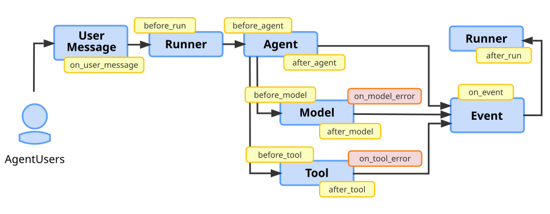

 [ Python](https://github.com/google/adk-python "adk-python on GitHub")[ JS ](https://github.com/google/adk-js "adk-js on GitHub")[ Go ](https://github.com/google/adk-go "adk-go on GitHub")[ Java ](https://github.com/google/adk-java "adk-java on GitHub")[ Kotlin](https://github.com/google/adk-kotlin "adk-kotlin on GitHub")

-   [Home](..)
-    Build Agents
    
    Build Agents
    
    -   [Get Started](../get-started/)
        
        Get Started
        
        -   [Python](../get-started/python/)
        -   [TypeScript](../get-started/typescript/)
        -   [Go](../get-started/go/)
        -   [Java](../get-started/java/)
        -   [Kotlin](../get-started/kotlin/)
        -   [Agents CLI](../get-started/agents-cli/)
        -   [Installation](../get-started/installation/)
        -   [Google Cloud](../get-started/google-cloud/)
        -   [Migrate to ADK](../get-started/migrate/)
        
    -   [Build your Agent](../tutorials/)
        
        Build your Agent
        
        -   [Multi-tool agent](../tutorials/multi-tool-agent/)
        -   [Agent team](../tutorials/agent-team/)
        -   [Code with AI](../tutorials/coding-with-ai/)
        -   [Agent Config](../agents/config/)
        
    -   [Agents](../agents/)
        
        Agents
        
        -   [Simple agents](../agents/llm-agents/)
        -   [Managed agents](../agents/managed-agents/)
        
    -   [Graph Workflows](../graphs/)
        
        Graph Workflows
        
        -   [Graph routes](../graphs/routes/)
        -   [Data handling](../graphs/data-handling/)
        -   [Human input](../graphs/human-input/)
        -   [Dynamic workflows](../graphs/dynamic/)
        
    -   [Multi-Agent Workflows](../workflows/)
        
        Multi-Agent Workflows
        
        -   [Collaborative workflows](../workflows/collaboration/)
        -   [Template workflows](../agents/workflow-agents/)
            
            Template workflows
            
            -   [Sequential workflow](../agents/workflow-agents/sequential-agents/)
            -   [Loop workflow](../agents/workflow-agents/loop-agents/)
            -   [Parallel workflow](../agents/workflow-agents/parallel-agents/)
            -   [Custom template workflows](../agents/custom-agents/)
            
        -   [Agent routing](../agents/routing/)
        -   [Workflow patterns](../workflows/patterns/)
        
    -   [Models for Agents](../agents/models/)
        
        Models for Agents
        
        -   [Gemini](../agents/models/google-gemini/)
            
            Gemini
            
            -   [Deferred scheduling](../agents/models/google-gemini/deferred-schedule/)
            
        -   [Gemma](../agents/models/google-gemma/)
        -   [Claude](../agents/models/anthropic/)
        -   [Agent Platform hosted](../agents/models/agent-platform/)
        -   [Apigee AI Gateway](../agents/models/apigee/)
        -   [Model routing](../agents/models/routing/)
        -   [OpenAI](../agents/models/openai/)
        -   [Ollama](../agents/models/ollama/)
        -   [vLLM](../agents/models/vllm/)
        -   [LiteLLM](../agents/models/litellm/)
        -   [LiteRT-LM](../agents/models/litert-lm/)
        
    
-    Run Agents
    
    Run Agents
    
    -   [Agent Runtime](../runtime/)
        
        Agent Runtime
        
        -   [Web Interface](../runtime/web-interface/)
            
            Web Interface
            
            -   [Visual Builder](../visual-builder/)
            
        -   [Command Line](../runtime/command-line/)
        -   [API Server](../runtime/api-server/)
        -   [Ambient Agents](../runtime/ambient-agents/)
        -   [Resume Agents](../runtime/resume/)
        -   [Cancel Agent Runs](../runtime/cancel/)
        -   [Runtime Config](../runtime/runconfig/)
        -   [Event Loop](../runtime/event-loop/)
        
    -   [Deployment](../deploy/)
        
        Deployment
        
        -   [Agent Runtime](../deploy/agent-runtime/)
            
            Agent Runtime
            
            -   [Standard deployment](../deploy/agent-runtime/deploy/)
            -   [agents-cli](../deploy/agent-runtime/agents-cli/)
            -   [Test deployed agents](../deploy/agent-runtime/test/)
            
        -   [Cloud Run](../deploy/cloud-run/)
        -   [GKE](../deploy/gke/)
        
    -   [Observability](../observability/)
        
        Observability
        
        -   [Logging](../observability/logging/)
        -   [Metrics](../observability/metrics/)
        -   [Traces](../observability/traces/)
        
    -   [Evaluation](../evaluate/)
        
        Evaluation
        
        -   [Criteria](../evaluate/criteria/)
        -   [User Simulation](../evaluate/user-sim/)
        -   [Environment Simulation](../evaluate/environment_simulation/)
        -   [Custom Metrics](../evaluate/custom_metrics/)
        -   [Optimization](../optimize/)
        
    -   [Safety and Security](../safety/)
        
        Safety and Security
        
    
-    Components
    
    Components
    
    -   [Technical Overview](../get-started/about/)
    -   [Custom Tools](../tools-custom/)
        
        Custom Tools
        
        -    Function tools
            
            Function tools
            
            -   [Overview](../tools-custom/function-tools/)
            -   [Tool performance](../tools-custom/performance/)
            -   [Action confirmations](../tools-custom/confirmation/)
            
        -   [MCP tools](../tools-custom/mcp-tools/)
            
            MCP tools
            
            -   [Advanced configuration](../tools-custom/mcp-tools/advanced/)
            -   [Deployment](../tools-custom/mcp-tools/deployment/)
            -   [Agent as MCP server](../tools-custom/mcp-tools/agent-as-server/)
            -   [Sub-agent delegation](../tools-custom/mcp-tools/agent-managed/)
            
        -   [OpenAPI tools](../tools-custom/openapi-tools/)
        -   [Authentication](../tools-custom/authentication/)
        -   [Tool limitations](../tools/limitations/)
        
    -   [Artifacts](../artifacts/)
        
        Artifacts
        
    -   [Skills for Agents](../skills/)
        
        Skills for Agents
        
    -   [App management](../apps/)
        
        App management
        
        -   [Callbacks](../callbacks/)
            
            Callbacks
            
            -   [Types of callbacks](../callbacks/types-of-callbacks/)
            -   [Callback patterns](../callbacks/design-patterns-and-best-practices/)
            
        -    Plugins [Plugins](./)
            
            Table of contents
            
            -   [How do Plugins work?](#how-do-plugins-work)
            -   [Prebuilt Plugins](#prebuilt-plugins)
            -   [Define and register Plugins](#define-and-register-plugins)
                
                -   [Create Plugin class](#create-plugin-class)
                -   [Register Plugin class](#register-plugin-class)
                -   [Run the agent with the Plugin](#run-the-agent-with-the-plugin)
                
            -   [Build workflows with Plugins](#build-workflows-with-plugins)
                
                -   [Agent Callbacks and Plugins](#agent-callbacks-and-plugins)
                
            -   [Plugin callback hooks](#plugin-callback-hooks)
                
                -   [User Message callbacks](#user-message-callbacks)
                -   [Runner start callbacks](#runner-start-callbacks)
                -   [Agent execution callbacks](#agent-execution-callbacks)
                -   [Model callbacks](#model-callbacks)
                    
                    -   [Model on error callback details](#model-on-error-callback-details)
                    
                -   [Tool callbacks](#tool-callbacks)
                    
                    -   [Tool on error callback details](#tool-on-error-callback-details)
                    
                -   [Event callbacks](#event-callbacks)
                -   [Runner end callbacks](#runner-end-callbacks)
                
            -   [Next steps](#next-steps)
            
        
    -   [Agent context](../context/)
        
        Agent context
        
        -   [Conversational context](../sessions/)
        -   [Sessions](../sessions/session/)
            
            Sessions
            
            -   [Rewind sessions](../sessions/session/rewind/)
            -   [Migrate sessions](../sessions/session/migrate/)
            
        -   [State](../sessions/state/)
        -   [Events](../events/)
        -   [Memory](../sessions/memory/)
        -   [Context compression](../context/compaction/)
        -   [Model context caching](../context/caching/)
        
    -   [A2A Protocol](../a2a/)
        
        A2A Protocol
        
        -   [Introduction to A2A](../a2a/intro/)
        -    A2A Quickstart (Exposing)
            
            A2A Quickstart (Exposing)
            
            -   [Python](../a2a/quickstart-exposing/)
            -   [Go](../a2a/quickstart-exposing-go/)
            -   [Java](../a2a/quickstart-exposing-java/)
            
        -    A2A Quickstart (Consuming)
            
            A2A Quickstart (Consuming)
            
            -   [Python](../a2a/quickstart-consuming/)
            -   [Go](../a2a/quickstart-consuming-go/)
            -   [Java](../a2a/quickstart-consuming-java/)
            -   [Kotlin](../a2a/quickstart-consuming-kotlin/)
            
        -   [A2A Extension](../a2a/a2a-extension/)
        
    -   [Live and Voice Agents](../live/)
        
        Live and Voice Agents
        
        -   [Get started](../live/get-started/)
            
            Get started
            
            -   [Python](../live/get-started/streaming-python/)
            -   [Java](../live/get-started/streaming-java/)
            
        -    Building
            
            Building
            
            -   [Workflows](../live/workflows/)
            -   [Tools](../live/tools/)
            -   [Sessions](../live/sessions/)
            -   [Events](../live/events/)
            -   [Audio and video](../live/audio-video/)
            -   [Configuration](../live/configuration/)
            
        -    Production
            
            Production
            
            -   [Guardrails](../live/guardrails/)
            -   [Evaluation](../live/evaluation/)
            -   [Build a custom server](../live/custom-server/)
            
        -   [Supported models](../live/models/)
        
    -   [Grounding](../grounding/)
        
        Grounding
        
        -   [Google Search Grounding](../grounding/google_search_grounding/)
        -   [Grounding with Search](../grounding/grounding_with_search/)
        
    
-   [Integrations](../integrations/)
    
    Integrations
    
-    Reference
    
    Reference
    
    -   [API Reference](../api-reference/)
        
        API Reference
        
        -   [Python ADK](../api-reference/python/)
        -   [TypeScript ADK](../api-reference/typescript/)
        -    Go ADK
            
            Go ADK
            
            -   [Go v2.x](https://pkg.go.dev/google.golang.org/adk/v2)
            -   [Go v1.x](https://pkg.go.dev/google.golang.org/adk)
            
        -   [Java ADK](../api-reference/java/)
        -   [Kotlin ADK](../api-reference/kotlin/)
        -   [CLI Reference](../api-reference/cli/)
        -   [Agent Config Reference](../api-reference/agentconfig/)
        -   [REST API](../api-reference/rest/)
        
    -   [Release Notes](../release-notes/)
    
-   [Community](../community/)
    
    Community
    
    -   [Contributing Guide](../community/contributing-guide/)
    
-   [ADK 2.0](../2.0/)
    
    ADK 2.0
    

Table of contents

-   [How do Plugins work?](#how-do-plugins-work)
-   [Prebuilt Plugins](#prebuilt-plugins)
-   [Define and register Plugins](#define-and-register-plugins)
    
    -   [Create Plugin class](#create-plugin-class)
    -   [Register Plugin class](#register-plugin-class)
    -   [Run the agent with the Plugin](#run-the-agent-with-the-plugin)
    
-   [Build workflows with Plugins](#build-workflows-with-plugins)
    
    -   [Agent Callbacks and Plugins](#agent-callbacks-and-plugins)
    
-   [Plugin callback hooks](#plugin-callback-hooks)
    
    -   [User Message callbacks](#user-message-callbacks)
    -   [Runner start callbacks](#runner-start-callbacks)
    -   [Agent execution callbacks](#agent-execution-callbacks)
    -   [Model callbacks](#model-callbacks)
        
        -   [Model on error callback details](#model-on-error-callback-details)
        
    -   [Tool callbacks](#tool-callbacks)
        
        -   [Tool on error callback details](#tool-on-error-callback-details)
        
    -   [Event callbacks](#event-callbacks)
    -   [Runner end callbacks](#runner-end-callbacks)
    
-   [Next steps](#next-steps)

1.  [Home](..)
2.  [Components](../get-started/about/)
3.  [App management](../apps/)

# Plugins[¶](#plugins "Permanent link")

Supported in ADKPython v1.7.0TypeScript v0.2.5Go v0.4.0Java v0.3.0Kotlin v0.7.0

A Plugin in Agent Development Kit (ADK) is a custom code module that can be executed at various stages of an agent workflow lifecycle using callback hooks. You use Plugins for functionality that is applicable across your agent workflow. Some typical applications of Plugins are as follows:

-   **Logging and tracing**: Create detailed logs of agent, tool, and generative AI model activity for debugging and performance analysis.
-   **Policy enforcement**: Implement security guardrails, such as a function that checks if users are authorized to use a specific tool and prevent its execution if they do not have permission.
-   **Monitoring and metrics**: Collect and export metrics on token usage, execution times, and invocation counts to monitoring systems such as Prometheus or [Google Cloud Observability](https://cloud.google.com/stackdriver/docs) (formerly Stackdriver).
-   **Response caching**: Check if a request has been made before, so you can return a cached response, skipping expensive or time consuming AI model or tool calls.
-   **Request or response modification**: Dynamically add information to AI model prompts or standardize tool output responses.

Tip: Use Plugins for safety features

When implementing security guardrails and policies, use ADK Plugins for better modularity and flexibility than Callbacks. For more details, see [Callbacks and Plugins for Security Guardrails](/safety/#callbacks-and-plugins-for-security-guardrails).

Tip: ADK Integrations

For a list of pre-built plugins and other integrations for ADK, see [Tools and Integrations](/integrations/).

## How do Plugins work?[¶](#how-do-plugins-work "Permanent link")

An ADK Plugin extends the `BasePlugin` class and contains one or more `callback` methods, indicating where in the agent lifecycle the Plugin should be executed. You integrate Plugins into an agent by registering them in your agent's `Runner` class, or in Python in your `App` object. For more information on how and where you can trigger Plugins in your agent application, see [Plugin callback hooks](#plugin-callback-hooks).

Plugin functionality builds on [Callbacks](../callbacks/), which is a key design element of the ADK's extensible architecture. While a typical Agent Callback is configured on a *single agent, a single tool* for a *specific task*, a Plugin is registered *once*, on the `Runner` or in Python on the `App`, and its callbacks apply *globally* to every agent, tool, and LLM call managed by that runner. Plugins let you package related callback functions together to be used across a workflow. This makes Plugins an ideal solution for implementing features that cut across your entire agent application.

## Prebuilt Plugins[¶](#prebuilt-plugins "Permanent link")

ADK includes several plugins that you can add to your agent workflows immediately:

-   [**Reflect and Retry Tools**](/integrations/reflect-and-retry/): Tracks tool failures and intelligently retries tool requests.
-   [**BigQuery Analytics**](/integrations/bigquery-agent-analytics/): Enables agent logging and analysis with BigQuery.
-   [**Model Armor**](/integrations/model-armor/): Screens user input and model output against Google Cloud Model Armor templates.
-   [**Context Filter**](https://github.com/google/adk-python/blob/main/src/google/adk/plugins/context_filter_plugin.py): Filters the generative AI context to reduce its size.
-   [**Global Instruction**](https://github.com/google/adk-python/blob/main/src/google/adk/plugins/global_instruction_plugin.py): Plugin that provides global instructions functionality at the App level.
-   [**Save Files as Artifacts**](https://github.com/google/adk-python/blob/main/src/google/adk/plugins/save_files_as_artifacts_plugin.py): Saves files included in user messages as Artifacts.
-   [**Auto Tracing**](https://github.com/google/adk-python/blob/main/src/google/adk/plugins/auto_tracing_plugin.py): Wraps the functions in your agent's own packages in OpenTelemetry spans.
-   [**Multimodal Tool Results**](https://github.com/google/adk-python/blob/main/src/google/adk/plugins/multimodal_tool_results_plugin.py): Lets function tools return content parts directly to the model.
-   [**Logging**](https://github.com/google/adk-python/blob/main/src/google/adk/plugins/logging_plugin.py): Log important information at each agent workflow callback point.
-   [**Debug Logging**](https://github.com/google/adk-python/blob/main/src/google/adk/plugins/debug_logging_plugin.py): Captures complete debug information for each invocation to a YAML file.
-   [**Reflect and Retry Model**](https://github.com/google/adk-python/blob/main/src/google/adk/plugins/_reflect_retry_model_plugin.py): Asks the model to try again when a response ends with an error, such as a malformed function call.
-   [**Tool Call Integrity**](https://github.com/google/adk-python/blob/main/src/google/adk/plugins/_tool_call_integrity_plugin.py): Signs each function call stored in the session with a secret key, and runs a tool only when its call's signature verifies. Tools that run as workflow nodes are not checked.

Check out the [ADK Integrations](/integrations/) page for more native and third party plugins for your agents.

## Define and register Plugins[¶](#define-and-register-plugins "Permanent link")

This section explains how to define Plugin classes and register them as part of your agent workflow. For a complete code example, see [Plugin Basic](https://github.com/google/adk-python/tree/main/contributing/samples/plugins/plugin_basic) in the repository.

### Create Plugin class[¶](#create-plugin-class "Permanent link")

Start by extending the `BasePlugin` class and add one or more `callback` methods, as shown in the following code example:

PythonTypeScriptJavaGoKotlin

count\_plugin.py

`from google.adk.agents.base_agent import BaseAgent from google.adk.agents.callback_context import CallbackContext from google.adk.models.llm_request import LlmRequest from google.adk.plugins.base_plugin import BasePlugin class CountInvocationPlugin(BasePlugin):         """A custom plugin that counts agent and tool invocations."""         def __init__(self) -> None:                """Initialize the plugin with counters."""                super().__init__(name="count_invocation")                self.agent_count: int = 0                self.tool_count: int = 0                self.llm_request_count: int = 0         async def before_agent_callback(                self, *, agent: BaseAgent, callback_context: CallbackContext        ) -> None:                """Count agent runs."""                self.agent_count += 1                print(f"[Plugin] Agent run count: {self.agent_count}")         async def before_model_callback(                self, *, callback_context: CallbackContext, llm_request: LlmRequest        ) -> None:                """Count LLM requests."""                self.llm_request_count += 1                print(f"[Plugin] LLM request count: {self.llm_request_count}")`

count\_plugin.ts

``import { BaseAgent, BasePlugin, Context } from "@google/adk"; import type { LlmRequest, LlmResponse } from "@google/adk"; import type { Content } from "@google/genai";  /**   * A custom plugin that counts agent and tool invocations.  */ export class CountInvocationPlugin extends BasePlugin {         public agentCount = 0;        public toolCount = 0;        public llmRequestCount = 0;         constructor() {                super("count_invocation");        }         /**          * Count agent runs.          */        async beforeAgentCallback(                agent: BaseAgent,                context: Context        ): Promise<Content | undefined> {                this.agentCount++;                console.log(`[Plugin] Agent run count: ${this.agentCount}`);                return undefined;        }         /**          * Count LLM requests.          */        async beforeModelCallback(                context: Context,                llmRequest: LlmRequest        ): Promise<LlmResponse | undefined> {                this.llmRequestCount++;                console.log(`[Plugin] LLM request count: ${this.llmRequestCount}`);                return undefined;        } }``

CountInvocationPlugin.java

`import com.google.adk.agents.BaseAgent; import com.google.adk.agents.CallbackContext; import com.google.adk.models.LlmRequest; import com.google.adk.models.LlmResponse; import com.google.adk.plugins.BasePlugin; import com.google.genai.types.Content; import io.reactivex.rxjava3.core.Maybe; /** A custom plugin that counts agent and tool invocations. */ public class CountInvocationPlugin extends BasePlugin {     public int agentCount = 0;    public int toolCount = 0;    public int llmRequestCount = 0;     public CountInvocationPlugin() {        super("count_invocation");    }     /** Count agent runs. */    @Override    public Maybe<Content> beforeAgentCallback(BaseAgent agent, CallbackContext callbackContext) {        agentCount++;        System.out.println("[Plugin] Agent run count: " + agentCount);        return Maybe.empty();    }     /** Count LLM requests. */    @Override    public Maybe<LlmResponse> beforeModelCallback(            CallbackContext callbackContext, LlmRequest.Builder llmRequest) {        llmRequestCount++;        System.out.println("[Plugin] LLM request count: " + llmRequestCount);        return Maybe.empty();    } }`

count\_plugin.go

`package main import (         "fmt"         "google.golang.org/adk/v2/agent"        "google.golang.org/adk/v2/agent/llmagent"        "google.golang.org/adk/v2/model"        "google.golang.org/adk/v2/plugin"        "google.golang.org/genai" ) /**   * A custom plugin that counts agent and tool invocations.  */ type CountInvocationPlugin struct {         AgentCount      int        ToolCount       int        LlmRequestCount int } func NewCountInvocationPlugin() (*plugin.Plugin, error) {         p := &CountInvocationPlugin{}        return plugin.New(plugin.Config{                Name:                "count_invocation",                BeforeAgentCallback: p.BeforeAgentCallback,                BeforeModelCallback: p.BeforeModelCallback,        }) } /**   * Count agent runs.  */ func (p *CountInvocationPlugin) BeforeAgentCallback(ctx agent.CallbackContext) (*genai.Content, error) {         p.AgentCount++        fmt.Printf("[Plugin] Agent run count: %d\n", p.AgentCount)        return nil, nil } /**   * Count LLM requests.  */ func (p *CountInvocationPlugin) BeforeModelCallback(ctx agent.CallbackContext, req *model.LLMRequest) (*model.LLMResponse, error) {         p.LlmRequestCount++        fmt.Printf("[Plugin] LLM request count: %d\n", p.LlmRequestCount)        return nil, nil }`

``/** A custom plugin that counts agent runs and LLM requests. */ class CountInvocationPlugin : Plugin {         override val name = "count_invocation"         var agentCount = 0                private set         var llmRequestCount = 0                private set         // Plugin declares one abstract member, `name`; every callback has a default,        // so a plugin only overrides the ones it cares about.        override suspend fun beforeAgent(                context: CallbackContext,        ): CallbackChoice<EventActions, Content> {                agentCount++                println("[Plugin] Agent run count: $agentCount")                return CallbackChoice.Continue(EventActions())        }         override suspend fun beforeModel(                context: CallbackContext,                request: LlmRequest,        ): CallbackChoice<LlmRequest, LlmResponse> {                llmRequestCount++                println("[Plugin] LLM request count: $llmRequestCount")                return CallbackChoice.Continue(request)        } }``

This example code implements callbacks for `before_agent_callback` and `before_model_callback` to count execution of these tasks during the lifecycle of the agent.

### Register Plugin class[¶](#register-plugin-class "Permanent link")

Integrate your Plugin class by registering it during your agent initialization as part of your `Runner` class, or in Python your `App` object, using the `plugins` parameter. You can specify multiple Plugins with this parameter. The following code example shows how to register the `CountInvocationPlugin` plugin defined in the previous section with a simple ADK agent.

Python: Use `App(plugins=...)` and not `Runner(plugins=...)`

In Python, the `plugins` parameter of `Runner` and `InMemoryRunner` is deprecated and raises a `DeprecationWarning`. Set `plugins` on an [`App`](../apps/) instead and pass that `App` to the runner as `InMemoryRunner(app=app)`. Passing both `plugins` and `app` raises a `ValueError`.

PythonTypeScriptJavaGoKotlin

`from google.adk.runners import InMemoryRunner from google.adk import Agent from google.adk.apps import App from google.adk.tools.tool_context import ToolContext from google.genai import types import asyncio # Import the plugin. from .count_plugin import CountInvocationPlugin async def hello_world(tool_context: ToolContext, query: str):         print(f'Hello world: query is [{query}]') root_agent = Agent(         model='gemini-flash-latest',        name='hello_world',        description='Prints hello world with user query.',        instruction="""Use hello_world tool to print hello world and user query.        """,        tools=[hello_world], ) app = App(         name='test_app_with_plugin',        root_agent=root_agent,         # Add your plugin here. You can add multiple plugins.        plugins=[CountInvocationPlugin()], ) async def main():         """Main entry point for the agent."""        prompt = 'hello world'        runner = InMemoryRunner(app=app)         # The rest is the same as starting a regular ADK runner.        session = await runner.session_service.create_session(                user_id='user',                app_name='test_app_with_plugin',        )         async for event in runner.run_async(                user_id='user',                session_id=session.id,                new_message=types.Content(                        role='user', parts=[types.Part.from_text(text=prompt)]                )        ):                print(f'** Got event from {event.author}') if __name__ == "__main__":         asyncio.run(main())`

``import { InMemoryRunner, LlmAgent, FunctionTool } from "@google/adk"; import type { Content } from "@google/genai"; import { z } from "zod"; // Import the plugin. import { CountInvocationPlugin } from "./count_plugin.ts"; const HelloWorldInput = z.object({         query: z.string().describe("The query string to print."), }); async function helloWorld({ query }: z.infer<typeof HelloWorldInput>): Promise<{ result: string }> {         const output = `Hello world: query is [${query}]`;        console.log(output);        // Tools should return a string or JSON-compatible object        return { result: output }; } const helloWorldTool = new FunctionTool({         name: "hello_world",        description: "Prints hello world with user query.",        parameters: HelloWorldInput,        execute: helloWorld, }); const rootAgent = new LlmAgent({         model: "gemini-flash-latest", // Preserved from your Python code        name: "hello_world",        description: "Prints hello world with user query.",        instruction: `Use hello_world tool to print hello world and user query.`,        tools: [helloWorldTool], }); /** * Main entry point for the agent. */ async function main(): Promise<void> {         const prompt = "hello world";        const runner = new InMemoryRunner({                agent: rootAgent,                appName: "test_app_with_plugin",                 // Add your plugin here. You can add multiple plugins.                plugins: [new CountInvocationPlugin()],        });         // The rest is the same as starting a regular ADK runner.        const session = await runner.sessionService.createSession({                userId: "user",                appName: "test_app_with_plugin",        });         // runAsync returns an async iterable stream in TypeScript        const runStream = runner.runAsync({                userId: "user",                sessionId: session.id,                newMessage: {                role: "user",                parts: [{ text: prompt }],                },        });         // Use 'for await...of' to loop through the async stream        for await (const event of runStream) {                console.log(`** Got event from ${event.author}`);        } } main();``

`import com.google.adk.agents.LlmAgent; import com.google.adk.runner.InMemoryRunner; import com.google.adk.sessions.Session; import com.google.adk.tools.Annotations.Schema; import com.google.adk.tools.FunctionTool; import com.google.genai.types.Content; import com.google.genai.types.Part; import java.util.Collections; import java.util.List; import java.util.Map; // Import the plugin. // import com.example.CountInvocationPlugin; public class Main {     public static class HelloTool {        @Schema(name = "hello_world", description = "Prints hello world with user query.")        public static Map<String, Object> helloWorld(                @Schema(name = "query", description = "The query string to print.") String query) {            String output = "Hello world: query is [" + query + "]";            System.out.println(output);            return Map.of("result", output);        }    }     public static void main(String[] args) {        LlmAgent rootAgent = LlmAgent.builder()                .model("gemini-flash-latest")                .name("hello_world")                .description("Prints hello world with user query.")                .instruction("Use hello_world tool to print hello world and user query.")                .tools(FunctionTool.create(HelloTool.class, "helloWorld"))                .build();         // Add your plugin here. You can add multiple plugins.        InMemoryRunner runner = new InMemoryRunner(                rootAgent,                "test_app_with_plugin",                Collections.singletonList(new CountInvocationPlugin())        );         // The rest is the same as starting a regular ADK runner.        Session session = runner.sessionService().createSession(                "test_app_with_plugin",                "user"        ).blockingGet();         String prompt = "hello world";        Content newContent = Content.builder()                .role("user")                .parts(List.of(Part.builder().text(prompt).build()))                .build();         runner.runAsync(                "user",                session.id(),                newContent        ).blockingForEach(event -> {                  if (event.author() != null) {                        System.out.println("** Got event from " + event.author());                }        });    } }`

``package main import (         "context"        "fmt"        "log"         "google.golang.org/adk/v2/agent"        "google.golang.org/adk/v2/agent/llmagent"        "google.golang.org/adk/v2/model/gemini"        "google.golang.org/adk/v2/plugin"        "google.golang.org/adk/v2/runner"        "google.golang.org/adk/v2/session"        "google.golang.org/adk/v2/tool"        "google.golang.org/adk/v2/tool/functiontool"        "google.golang.org/genai" ) type helloWorldArgs struct {         Query string `json:"query"` } type helloWorldResult struct {         Result string `json:"result"` } func helloWorld(ctx agent.Context, args helloWorldArgs) (helloWorldResult, error) {         output := fmt.Sprintf("Hello world: query is [%s]", args.Query)        fmt.Println(output)        return helloWorldResult{Result: output}, nil } func main() {         ctx := context.Background()        model, err := gemini.NewModel(ctx, "gemini-flash-latest", &genai.ClientConfig{})        if err != nil {                log.Fatalf("failed to create model: %v", err)        }         helloWorldTool, err := functiontool.New(functiontool.Config{                Name:        "hello_world",                Description: "Prints hello world with user query.",        }, helloWorld)        if err != nil {                log.Fatalf("failed to create tool: %v", err)        }         rootAgent, err := llmagent.New(llmagent.Config{                Model:       model,                Name:        "hello_world",                Description: "Prints hello world with user query.",                Instruction: "Use hello_world tool to print hello world and user query.",                Tools:       []tool.Tool{helloWorldTool},        })        if err != nil {                log.Fatalf("failed to create agent: %v", err)        }         // Create your plugin.        countPlugin, err := NewCountInvocationPlugin()        if err != nil {                log.Fatalf("failed to create plugin: %v", err)        }         sessionService := session.InMemoryService()        // Add your plugin here. You can add multiple plugins.        r, err := runner.New(runner.Config{                AppName:        "test_app_with_plugin",                Agent:          rootAgent,                SessionService: sessionService,                PluginConfig: runner.PluginConfig{                        Plugins: []*plugin.Plugin{countPlugin},                },        })        if err != nil {                log.Fatalf("failed to create runner: %v", err)        }         // The rest is the same as starting a regular ADK runner.        sessResp, err := sessionService.Create(ctx, &session.CreateRequest{                AppName: "test_app_with_plugin",                UserID:  "user",        })        if err != nil {                log.Fatalf("failed to create session: %v", err)        }        sess := sessResp.Session         prompt := "hello world"        input := genai.NewContentFromText(prompt, genai.RoleUser)         for event, err := range r.Run(ctx, "user", sess.ID(), input, agent.RunConfig{}) {                if err != nil {                        log.Printf("AGENT_ERROR: %v", err)                        continue                }                if event.Author != "" {                        fmt.Printf("** Got event from %s\n", event.Author)                }        } }``

`val rootAgent =         LlmAgent(                name = "hello_world",                model = Gemini(name = "gemini-flash-latest"),                instruction = Instruction("Greet the user."),        ) // Since adk-kotlin 0.7.0 the agent-based InMemoryRunner constructor accepts // plugins directly; before that they had to be set on an App. val runner =         InMemoryRunner(                agent = rootAgent,                appName = "test_app_with_plugin",                plugins = listOf(CountInvocationPlugin()),        )`

In Python, you can also load a Plugin without changing your agent code by passing its import path to `adk web` or `adk api_server` with the `--extra_plugins` option. ADK adds it after any Plugins your `App` registers. Pass a class only if its constructor accepts a `name` argument; otherwise, pass a Plugin instance defined at module level. Repeat the option to load more than one Plugin.

`adk web --extra_plugins=google.adk.plugins.LoggingPlugin /path/to/agents`

### Run the agent with the Plugin[¶](#run-the-agent-with-the-plugin "Permanent link")

Run the plugin as you typically would. The following shows how to run the command line:

PythonTypeScriptJavaGo

`python3 -m path.to.main.py`

`npx ts-node path.to.main.ts`

`./mvnw -q clean compile exec:java -Dexec.mainClass="com.example.Main"`

`go run path/to/main.go`

The output of this previously described agent should look similar to the following:

`[Plugin] Agent run count: 1 [Plugin] LLM request count: 1 ** Got event from hello_world Hello world: query is [hello world] ** Got event from hello_world [Plugin] LLM request count: 2 ** Got event from hello_world`

For more information on running ADK agents, see the [Agent Runtime](/runtime/#ways-to-run-agents) guides.

## Build workflows with Plugins[¶](#build-workflows-with-plugins "Permanent link")

Plugin callback hooks are a mechanism for implementing logic that intercepts, modifies, and even controls the agent's execution lifecycle. Each hook is a specific method in your Plugin class that you can implement to run code at a key moment. You have a choice between two modes of operation based on your hook's return value:

-   **To Observe:** Implement a hook with no return value (`None`). This approach is for tasks such as logging or collecting metrics, as it allows the agent's workflow to proceed to the next step without interruption. For example, you could use `after_tool_callback` in a Plugin to log every tool's result for debugging.
-   **To Intervene:** Implement a hook and return a value. This approach short-circuits the workflow. The `Runner` halts processing, skips any subsequent plugins and the original intended action, like a Model call, and use a Plugin callback's return value as the result. A common use case is implementing `before_model_callback` to return a cached `LlmResponse`, preventing a redundant and costly API call.
-   **To Amend:** Implement a hook and modify the Context object. This approach allows you to modify the context data for the module to be executed without otherwise interrupting the execution of that module. For example, adding additional, standardized prompt text for Model object execution.

**Caution:** Plugin callback functions have precedence over callbacks implemented at the object level. This behavior means that Any Plugin callbacks code is executed *before* any Agent, Model, or Tool objects callbacks are executed. Furthermore, if a Plugin-level agent callback returns any value, and not an empty (`None`) response, the Agent, Model, or Tool-level callback is *not executed* (skipped).

In Python, keep the following behavior in mind when you register more than one Plugin:

-   **Order:** ADK runs each callback in the order the Plugins appear in the `plugins` list, and stops at the first Plugin that returns a value other than `None`.
-   **Names:** Each Plugin needs a unique `name`. Two Plugins with the same name raise a `ValueError` when the `Runner` is created, so give each instance of the same class its own name.
-   **Exceptions:** An exception raised in a Plugin callback reaches your code as a `RuntimeError`, with the original exception as its `__cause__`. The `on_agent_error_callback` and `on_run_error_callback` hooks behave differently: ADK runs them on every Plugin and logs an exception raised in them instead of raising it.

The Plugin design establishes a hierarchy of code execution and separates global concerns from local agent logic. A Plugin is the stateful *module* you build, such as `PerformanceMonitoringPlugin`, while the callback hooks are the specific *functions* within that module that get executed. This architecture differs fundamentally from standard Agent Callbacks in these critical ways:

-   **Scope:** Plugin hooks are *global*. You register a Plugin once on the `Runner`, or in Python on the `App`, and its hooks apply universally to every Agent, Model, and Tool it manages. In contrast, Agent Callbacks are *local*, configured individually on a specific agent instance.
-   **Execution Order:** Plugins have *precedence*. For any given event, the Plugin hooks always run before any corresponding Agent Callback. This system behavior makes Plugins the correct architectural choice for implementing cross-cutting features like security policies, universal caching, and consistent logging across your entire application.

### Agent Callbacks and Plugins[¶](#agent-callbacks-and-plugins "Permanent link")

As mentioned in the previous section, there are some functional similarities between Plugins and Agent Callbacks. The following table compares the differences between Plugins and Agent Callbacks in more detail.

**Plugins**

**Agent Callbacks**

**Scope**

**Global**: Apply to all agents/tools/LLMs in the `Runner`.

**Local**: Apply only to the specific agent instance they are configured on.

**Primary Use Case**

**Horizontal Features**: Logging, policy, monitoring, global caching.

**Specific Agent Logic**: Modifying the behavior or state of a single agent.

**Configuration**

Configure once on the `Runner`, or in Python on the `App`.

Configure individually on each `BaseAgent` instance.

**Execution Order**

Plugin callbacks run **before** Agent Callbacks.

Agent callbacks run **after** Plugin callbacks.

## Plugin callback hooks[¶](#plugin-callback-hooks "Permanent link")

You define when a Plugin is called with the callback functions to define in your Plugin class. Callbacks are available when a user message is received, before and after an `Runner`, `Agent`, `Model`, or `Tool` is called, for `Events`, and when a `Model`, or `Tool` error occurs. In Python, error callbacks also run when an `Agent` raises an exception and when the run itself fails. These callbacks include, and take precedence over, any callbacks defined within your Agent, Model, and Tool classes.

The following diagram illustrates callback points where you can attach and run Plugin functionality during your agents workflow:

 **Figure 1.** Diagram of ADK agent workflow with Plugin callback hook locations.

The following sections describe the available callback hooks for Plugins in more detail.

-   [User Message callbacks](#user-message-callbacks)
-   [Runner start callbacks](#runner-start-callbacks)
-   [Agent execution callbacks](#agent-execution-callbacks)
-   [Model callbacks](#model-callbacks)
-   [Tool callbacks](#tool-callbacks)
-   [Event callbacks](#event-callbacks)
-   [Runner end callbacks](#runner-end-callbacks)

### User Message callbacks[¶](#user-message-callbacks "Permanent link")

*A User Message c*allback (`on_user_message_callback`) happens when a user sends a message. The `on_user_message_callback` is the very first hook to run, giving you a chance to inspect or modify the initial input.\\

-   **When It Runs:** This callback happens immediately after `runner.run()`, before any other processing.
-   **Purpose:** The first opportunity to inspect or modify the user's raw input.
-   **Flow Control:** Returns a `types.Content` object to **replace** the user's original message.

The following code example shows the basic syntax of this callback:

PythonTypeScriptJavaGo

`async def on_user_message_callback(         self,        *,        invocation_context: InvocationContext,        user_message: types.Content, ) -> Optional[types.Content]:`

`async onUserMessageCallback(         invocationContext: InvocationContext,        user_message: Content ): Promise<Content | undefined> {     // Your implementation here }`

`@Override public Maybe<Content> onUserMessageCallback(     InvocationContext invocationContext, Content userMessage) {    // Your implementation here    return Maybe.empty(); }`

`func (p *MyPlugin) OnUserMessageCallback(ctx agent.InvocationContext, msg *genai.Content) (*genai.Content, error) {     // Your implementation here    return nil, nil }`

### Runner start callbacks[¶](#runner-start-callbacks "Permanent link")

A *Runner start* callback (`before_run_callback`) happens when the `Runner` object takes the potentially modified user message and prepares for execution. The `before_run_callback` fires here, allowing for global setup before any agent logic begins.

-   **When It Runs:** After the `on_user_message_callback`, when the `Runner` prepares for execution and before any agent logic begins.
-   **Purpose:** Global setup or initialization before the invocation runs.
-   **Flow Control:** Return a `types.Content` object to **halt execution**: the `Runner` exits early and ends the run with that content as the result. In Python, this early exit applies to every root agent, including an `LlmAgent` or a `Workflow`. Return `None` to proceed normally.

The following code example shows the basic syntax of this callback:

PythonTypeScriptJavaGo

`async def before_run_callback(         self, *, invocation_context: InvocationContext ) -> Optional[types.Content]:`

`async beforeRunCallback(invocationContext: InvocationContext): Promise<Content | undefined> {     // Your implementation here }`

`@Override public Maybe<Content> beforeRunCallback(InvocationContext invocationContext) {     // Your implementation here    return Maybe.empty(); }`

`func (p *MyPlugin) BeforeRunCallback(ctx agent.InvocationContext) (*genai.Content, error) {     // Your implementation here    return nil, nil }`

### Agent execution callbacks[¶](#agent-execution-callbacks "Permanent link")

*Agent execution* callbacks (`before_agent`, `after_agent`) happen when a `Runner` object invokes an agent. The `before_agent_callback` runs immediately before the agent's main work begins. The main work encompasses the agent's entire process for handling the request, which could involve calling models or tools. After the agent has finished all its steps and prepared a result, the `after_agent_callback` runs. In Python, if the agent's run raises an exception, `on_agent_error_callback(*, agent, callback_context, error)` runs instead of `after_agent_callback`. That callback only observes the failure: its return value is ignored and the original exception is still raised.

**Caution:** Plugins that implement these callbacks are executed *before* the Agent-level callbacks are executed. Furthermore, if a Plugin-level agent callback returns anything other than a `None` or null response, the Agent-level callback is *not executed* (skipped).

For more information about Agent callbacks defined as part of an Agent object, see [Types of Callbacks](../callbacks/types-of-callbacks/#agent-lifecycle-callbacks).

### Model callbacks[¶](#model-callbacks "Permanent link")

Model callbacks **(`before_model`, `after_model`, `on_model_error`)** happen before and after a Model object executes, or when the model call fails, as detailed below:

-   If an agent needs to call an AI model, `before_model_callback` runs first.
-   If the model call is successful, `after_model_callback` runs next.
-   If the model call fails with an exception, the `on_model_error_callback` is triggered instead, allowing for graceful recovery.

**Caution:** Plugins that implement the **`before_model`** and **`after_model`** callback methods are executed *before* the Model-level callbacks are executed. Furthermore, if a Plugin-level model callback returns anything other than a `None` or null response, the Model-level callback is *not executed* (skipped).

#### Model on error callback details[¶](#model-on-error-callback-details "Permanent link")

The on error callback for Model objects works as follows:

-   **When It Runs:** When an exception is raised during the model call.
-   **Common Use Cases:** Graceful error handling, logging the specific error, or returning a fallback response, such as "The AI service is currently unavailable."
-   **Flow Control:**
    -   Returns an `LlmResponse` object to **suppress the exception** and provide a fallback result.
    -   Returns `None` to allow the original exception to be raised.

**Note**: If the execution of the Model object returns a `LlmResponse`, the system resumes the execution flow, and `after_model_callback` will be triggered normally.

The following code example shows the basic syntax of this callback:

PythonTypeScriptJavaGo

`async def on_model_error_callback(         self,        *,        callback_context: CallbackContext,        llm_request: LlmRequest,        error: Exception, ) -> Optional[LlmResponse]:`

`async onModelErrorCallback(         context: Context,        llmRequest: LlmRequest,        error: Error ): Promise<LlmResponse | undefined> {         // Your implementation here }`

`@Override public Maybe<LlmResponse> onModelErrorCallback(     CallbackContext callbackContext, LlmRequest.Builder llmRequest, Throwable error) {    // Your implementation here    return Maybe.empty(); }`

`func (p *MyPlugin) OnModelErrorCallback(ctx agent.CallbackContext, req *model.LLMRequest, err error) (*model.LLMResponse, error) {     // Your implementation here    return nil, nil }`

### Tool callbacks[¶](#tool-callbacks "Permanent link")

Tool callbacks **(`before_tool`, `after_tool`, `on_tool_error`)** for Plugins happen before or after the execution of a tool, or when an error occurs, as detailed below:

-   When an agent executes a Tool, `before_tool_callback` runs first.
-   If the tool executes successfully, `after_tool_callback` runs next.
-   If the tool raises an exception, the `on_tool_error_callback` is triggered instead, giving you a chance to handle the failure. If `on_tool_error_callback` returns a dict, `after_tool_callback` will be triggered normally.

**Caution:** Plugins that implement these callbacks are executed *before* the Tool-level callbacks are executed. Furthermore, if a Plugin-level tool callback returns anything other than a `None` or null response, the Tool-level callback is *not executed* (skipped).

#### Tool on error callback details[¶](#tool-on-error-callback-details "Permanent link")

The on error callback for Tool objects works as follows:

-   **When It Runs:** When an exception is raised during the execution of a tool's `run` method.
-   **Purpose:** Catching specific tool exceptions (like `APIError`), logging the failure, and providing a user-friendly error message back to the LLM.
-   **Flow Control:** Return a `dict` to **suppress the exception**, provide a fallback result. Return `None` to allow the original exception to be raised.

**Note**: By returning a `dict`, this resumes the execution flow, and `after_tool_callback` will be triggered normally.

The following code example shows the basic syntax of this callback:

PythonTypeScriptJavaGo

`async def on_tool_error_callback(         self,        *,        tool: BaseTool,        tool_args: dict[str, Any],        tool_context: ToolContext,        error: Exception, ) -> Optional[dict]:`

`async onToolErrorCallback(         tool: BaseTool,        toolArgs: { [key: string]: any },        context: Context,        error: Error ): Promise<{ [key:string]: any } | undefined> {         // Your implementation here }`

`@Override public Maybe<Map<String, Object>> onToolErrorCallback(     BaseTool tool, Map<String, Object> toolArgs, ToolContext toolContext, Throwable error) {    // Your implementation here    return Maybe.empty(); }`

`func (p *MyPlugin) OnToolErrorCallback(ctx agent.Context, t tool.Tool, args map[string]any, err error) (map[string]any, error) {     // Your implementation here    return nil, nil }`

### Event callbacks[¶](#event-callbacks "Permanent link")

An *Event callback* (`on_event_callback`) happens when an agent produces outputs such as a text response or a tool call result, it yields them as `Event` objects. The `on_event_callback` fires for each event, allowing you to modify it before it's streamed to the client.

-   **When It Runs:** After an agent yields an `Event` but before it's sent to the user. An agent's run may produce multiple events.
-   **Purpose:** Useful for modifying or enriching events (e.g., adding metadata) or for triggering side effects based on specific events.
-   **Flow Control:** Return an `Event` object to **override** the original event. In Python, ADK merges your event onto the original: only the fields you set are applied, and `id`, `invocation_id`, and `timestamp` always come from the original event.

The following code example shows the basic syntax of this callback:

PythonTypeScriptJavaGo

`async def on_event_callback(         self, *, invocation_context: InvocationContext, event: Event ) -> Optional[Event]:`

`async onEventCallback(         invocationContext: InvocationContext,        event: Event ): Promise<Event | undefined> {         // Your implementation here }`

`@Override public Maybe<Event> onEventCallback(InvocationContext invocationContext, Event event) {     // Your implementation here    return Maybe.empty(); }`

`func (p *MyPlugin) OnEventCallback(ctx agent.InvocationContext, event *session.Event) (*session.Event, error) {     // Your implementation here    return nil, nil }`

### Runner end callbacks[¶](#runner-end-callbacks "Permanent link")

The *Runner end* callback **(`after_run_callback`)** happens when the agent has finished its entire process and all events have been handled, the `Runner` completes its run. The `after_run_callback` is the final hook, perfect for cleanup and final reporting.

-   **When It Runs:** After the `Runner` fully completes the execution of a request.
-   **Purpose:** Ideal for global cleanup tasks, such as closing connections or finalizing logs and metrics data.
-   **Flow Control:** This callback is for teardown only and cannot alter the final result.

The following code example shows the basic syntax of this callback:

PythonTypeScriptJavaGo

`async def after_run_callback(         self, *, invocation_context: InvocationContext ) -> None:`

`async afterRunCallback(invocationContext: InvocationContext): Promise<void> {         // Your implementation here }`

`@Override public Completable afterRunCallback(InvocationContext invocationContext) {     // Your implementation here    return Completable.complete(); }`

`func (p *MyPlugin) AfterRunCallback(ctx agent.InvocationContext) {     // Your implementation here }`

In Python, ADK notifies your Plugin of two more lifecycle events:

-   **`on_run_error_callback(*, invocation_context, error)`**: Runs instead of `after_run_callback` when the run fails with an unhandled exception. This callback only observes the failure: its return value is ignored and the original exception is still raised.
-   **`close()`**: Runs once per Plugin when you close the `Runner` with `await runner.close()`, not once per run. Use it to release resources the Plugin owns, such as an HTTP client or a metrics exporter. Each `close()` call is bounded by the runner's `plugin_close_timeout`, five seconds by default.

## Next steps[¶](#next-steps "Permanent link")

Check out these resources for developing and applying Plugins to your ADK projects:

-   For more ADK Plugin code examples, see the [ADK Samples repository](https://github.com/google/adk-samples).
-   For information on applying Plugins for security purposes, see [Callbacks and Plugins for Security Guardrails](/safety/#callbacks-and-plugins-for-security-guardrails).

Back to top