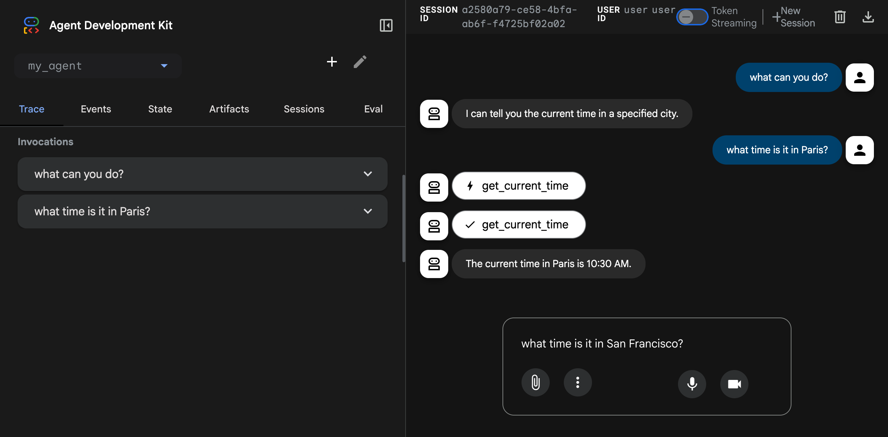

 [ Python](https://github.com/google/adk-python "adk-python on GitHub")[ JS ](https://github.com/google/adk-js "adk-js on GitHub")[ Go ](https://github.com/google/adk-go "adk-go on GitHub")[ Java ](https://github.com/google/adk-java "adk-java on GitHub")[ Kotlin](https://github.com/google/adk-kotlin "adk-kotlin on GitHub")

-   [Home](../..)
-    Build Agents
    
    Build Agents
    
    -   [Get Started](../../get-started/)
        
        Get Started
        
        -   [Python](../../get-started/python/)
        -   [TypeScript](../../get-started/typescript/)
        -   [Go](../../get-started/go/)
        -   [Java](../../get-started/java/)
        -   [Kotlin](../../get-started/kotlin/)
        -   [Agents CLI](../../get-started/agents-cli/)
        -   [Installation](../../get-started/installation/)
        -   [Google Cloud](../../get-started/google-cloud/)
        -   [Migrate to ADK](../../get-started/migrate/)
        
    -   [Build your Agent](../../tutorials/)
        
        Build your Agent
        
        -   [Multi-tool agent](../../tutorials/multi-tool-agent/)
        -   [Agent team](../../tutorials/agent-team/)
        -   [Code with AI](../../tutorials/coding-with-ai/)
        -   [Agent Config](../../agents/config/)
        
    -   [Agents](../../agents/)
        
        Agents
        
        -   [Simple agents](../../agents/llm-agents/)
        -   [Managed agents](../../agents/managed-agents/)
        
    -   [Graph Workflows](../../graphs/)
        
        Graph Workflows
        
        -   [Graph routes](../../graphs/routes/)
        -   [Data handling](../../graphs/data-handling/)
        -   [Human input](../../graphs/human-input/)
        -   [Dynamic workflows](../../graphs/dynamic/)
        
    -   [Multi-Agent Workflows](../../workflows/)
        
        Multi-Agent Workflows
        
        -   [Collaborative workflows](../../workflows/collaboration/)
        -   [Template workflows](../../agents/workflow-agents/)
            
            Template workflows
            
            -   [Sequential workflow](../../agents/workflow-agents/sequential-agents/)
            -   [Loop workflow](../../agents/workflow-agents/loop-agents/)
            -   [Parallel workflow](../../agents/workflow-agents/parallel-agents/)
            -   [Custom template workflows](../../agents/custom-agents/)
            
        -   [Agent routing](../../agents/routing/)
        -   [Workflow patterns](../../workflows/patterns/)
        
    -   [Models for Agents](../../agents/models/)
        
        Models for Agents
        
        -   [Gemini](../../agents/models/google-gemini/)
            
            Gemini
            
            -   [Deferred scheduling](../../agents/models/google-gemini/deferred-schedule/)
            
        -   [Gemma](../../agents/models/google-gemma/)
        -   [Claude](../../agents/models/anthropic/)
        -   [Agent Platform hosted](../../agents/models/agent-platform/)
        -   [Apigee AI Gateway](../../agents/models/apigee/)
        -   [Model routing](../../agents/models/routing/)
        -   [OpenAI](../../agents/models/openai/)
        -   [Ollama](../../agents/models/ollama/)
        -   [vLLM](../../agents/models/vllm/)
        -   [LiteLLM](../../agents/models/litellm/)
        -   [LiteRT-LM](../../agents/models/litert-lm/)
        
    
-    Run Agents
    
    Run Agents
    
    -   [Agent Runtime](../)
        
        Agent Runtime
        
        -   [Web Interface](./)
            
            Web Interface
            
            -   [Visual Builder](../../visual-builder/)
            
        -   [Command Line](../command-line/)
        -   [API Server](../api-server/)
        -   [Ambient Agents](../ambient-agents/)
        -   [Resume Agents](../resume/)
        -   [Cancel Agent Runs](../cancel/)
        -   [Runtime Config](../runconfig/)
        -   [Event Loop](../event-loop/)
        
    -   [Deployment](../../deploy/)
        
        Deployment
        
        -   [Agent Runtime](../../deploy/agent-runtime/)
            
            Agent Runtime
            
            -   [Standard deployment](../../deploy/agent-runtime/deploy/)
            -   [agents-cli](../../deploy/agent-runtime/agents-cli/)
            -   [Test deployed agents](../../deploy/agent-runtime/test/)
            
        -   [Cloud Run](../../deploy/cloud-run/)
        -   [GKE](../../deploy/gke/)
        
    -   [Observability](../../observability/)
        
        Observability
        
        -   [Logging](../../observability/logging/)
        -   [Metrics](../../observability/metrics/)
        -   [Traces](../../observability/traces/)
        
    -   [Evaluation](../../evaluate/)
        
        Evaluation
        
        -   [Criteria](../../evaluate/criteria/)
        -   [User Simulation](../../evaluate/user-sim/)
        -   [Environment Simulation](../../evaluate/environment_simulation/)
        -   [Custom Metrics](../../evaluate/custom_metrics/)
        -   [Optimization](../../optimize/)
        
    -   [Safety and Security](../../safety/)
        
        Safety and Security
        
    
-    Components
    
    Components
    
    -   [Technical Overview](../../get-started/about/)
    -   [Custom Tools](../../tools-custom/)
        
        Custom Tools
        
        -    Function tools
            
            Function tools
            
            -   [Overview](../../tools-custom/function-tools/)
            -   [Tool performance](../../tools-custom/performance/)
            -   [Action confirmations](../../tools-custom/confirmation/)
            
        -   [MCP tools](../../tools-custom/mcp-tools/)
            
            MCP tools
            
            -   [Advanced configuration](../../tools-custom/mcp-tools/advanced/)
            -   [Deployment](../../tools-custom/mcp-tools/deployment/)
            -   [Agent as MCP server](../../tools-custom/mcp-tools/agent-as-server/)
            -   [Sub-agent delegation](../../tools-custom/mcp-tools/agent-managed/)
            
        -   [OpenAPI tools](../../tools-custom/openapi-tools/)
        -   [Authentication](../../tools-custom/authentication/)
        -   [Tool limitations](../../tools/limitations/)
        
    -   [Artifacts](../../artifacts/)
        
        Artifacts
        
    -   [Skills for Agents](../../skills/)
        
        Skills for Agents
        
    -   [App management](../../apps/)
        
        App management
        
        -   [Callbacks](../../callbacks/)
            
            Callbacks
            
            -   [Types of callbacks](../../callbacks/types-of-callbacks/)
            -   [Callback patterns](../../callbacks/design-patterns-and-best-practices/)
            
        -   [Plugins](../../plugins/)
        
    -   [Agent context](../../context/)
        
        Agent context
        
        -   [Conversational context](../../sessions/)
        -   [Sessions](../../sessions/session/)
            
            Sessions
            
            -   [Rewind sessions](../../sessions/session/rewind/)
            -   [Migrate sessions](../../sessions/session/migrate/)
            
        -   [State](../../sessions/state/)
        -   [Events](../../events/)
        -   [Memory](../../sessions/memory/)
        -   [Context compression](../../context/compaction/)
        -   [Model context caching](../../context/caching/)
        
    -   [A2A Protocol](../../a2a/)
        
        A2A Protocol
        
        -   [Introduction to A2A](../../a2a/intro/)
        -    A2A Quickstart (Exposing)
            
            A2A Quickstart (Exposing)
            
            -   [Python](../../a2a/quickstart-exposing/)
            -   [Go](../../a2a/quickstart-exposing-go/)
            -   [Java](../../a2a/quickstart-exposing-java/)
            
        -    A2A Quickstart (Consuming)
            
            A2A Quickstart (Consuming)
            
            -   [Python](../../a2a/quickstart-consuming/)
            -   [Go](../../a2a/quickstart-consuming-go/)
            -   [Java](../../a2a/quickstart-consuming-java/)
            -   [Kotlin](../../a2a/quickstart-consuming-kotlin/)
            
        -   [A2A Extension](../../a2a/a2a-extension/)
        
    -   [Live and Voice Agents](../../live/)
        
        Live and Voice Agents
        
        -   [Get started](../../live/get-started/)
            
            Get started
            
            -   [Python](../../live/get-started/streaming-python/)
            -   [Java](../../live/get-started/streaming-java/)
            
        -    Building
            
            Building
            
            -   [Workflows](../../live/workflows/)
            -   [Tools](../../live/tools/)
            -   [Sessions](../../live/sessions/)
            -   [Events](../../live/events/)
            -   [Audio and video](../../live/audio-video/)
            -   [Configuration](../../live/configuration/)
            
        -    Production
            
            Production
            
            -   [Guardrails](../../live/guardrails/)
            -   [Evaluation](../../live/evaluation/)
            -   [Build a custom server](../../live/custom-server/)
            
        -   [Supported models](../../live/models/)
        
    -   [Grounding](../../grounding/)
        
        Grounding
        
        -   [Google Search Grounding](../../grounding/google_search_grounding/)
        -   [Grounding with Search](../../grounding/grounding_with_search/)
        
    
-   [Integrations](../../integrations/)
    
    Integrations
    
-    Reference
    
    Reference
    
    -   [API Reference](../../api-reference/)
        
        API Reference
        
        -   [Python ADK](../../api-reference/python/)
        -   [TypeScript ADK](../../api-reference/typescript/)
        -    Go ADK
            
            Go ADK
            
            -   [Go v2.x](https://pkg.go.dev/google.golang.org/adk/v2)
            -   [Go v1.x](https://pkg.go.dev/google.golang.org/adk)
            
        -   [Java ADK](../../api-reference/java/)
        -   [Kotlin ADK](../../api-reference/kotlin/)
        -   [CLI Reference](../../api-reference/cli/)
        -   [Agent Config Reference](../../api-reference/agentconfig/)
        -   [REST API](../../api-reference/rest/)
        
    -   [Release Notes](../../release-notes/)
    
-   [Community](../../community/)
    
    Community
    
    -   [Contributing Guide](../../community/contributing-guide/)
    
-   [ADK 2.0](../../2.0/)
    
    ADK 2.0
    

Table of contents

-   [Start the web interface](#start-the-web-interface)
-   [Common options](#common-options)
-   [Usage telemetry](#usage-telemetry)

1.  [Home](../..)
2.  [Run Agents](../)
3.  [Agent Runtime](../)
4.  [Web Interface](./)

# Use the Web Interface[¶](#use-the-web-interface "Permanent link")

Supported in ADKPython v0.1.0TypeScript v0.2.0Go v0.1.0Java v0.1.0

The ADK web interface lets you test your agents directly in the browser. This tool provides a simple way to interactively develop and debug your agents.

Caution: ADK Web for development only

ADK Web is ***not meant for use in production deployments***. You should use ADK Web for development and debugging purposes only.

Key features of the ADK web interface include:

-   **Chat interface**: Send messages to your agents and view responses in real-time
-   **Session management**: Create and switch between sessions
-   **State inspection**: View and modify session state during development
-   **Event history**: Inspect all events generated during agent execution
-   **Visual Builder**: Design agents visually with a drag-and-drop workflow editor and an AI-powered assistant (Python only, [learn more](/visual-builder/))

## Start the web interface[¶](#start-the-web-interface "Permanent link")

Use the following command to start the ADK web interface:

PythonTypeScriptGoJava

`adk web`

`npx adk web`

In Go, the web interface is not a standalone CLI tool. Instead, you embed the launcher directly in your agent's `main.go` and pass arguments at runtime. The `full.NewLauncher()` helper bundles the web server, REST API, and Web UI into a single binary:

main.go

`import (         "google.golang.org/adk/v2/cmd/launcher"        "google.golang.org/adk/v2/cmd/launcher/full" ) func main() {         // ... build your agent and config ...        l := full.NewLauncher()        if err := l.Execute(ctx, config, os.Args[1:]); err != nil {                log.Fatalf("Run failed: %v\n\n%s", err, l.CommandLineSyntax())        } }`

Then start the web interface by passing the `web`, `api`, and `webui` subcommands on the command line:

`go run agent.go web api webui`

The `web` keyword activates the HTTP server. `api` adds the ADK REST API backend, and `webui` serves the browser-based chat interface. Both `api` and `webui` are required to use the web interface together; either can be omitted if you only need the API or UI independently.

Make sure to update the port number.

MavenGradle

With Maven, compile and run the ADK web server:

`mvn compile exec:java \   -Dexec.args="--adk.agents.source-dir=src/main/java/agents --server.port=8000"`

With Gradle, the `build.gradle` or `build.gradle.kts` build file should have the following Java plugin in its plugins section:

`plugins {         id('java')        // other plugins }`

Then, elsewhere in the build file, at the top-level, create a new task:

`tasks.register('runADKWebServer', JavaExec) {         dependsOn classes        classpath = sourceSets.main.runtimeClasspath        mainClass = 'com.google.adk.web.AdkWebServer'        args '--adk.agents.source-dir=src/main/java/agents', '--server.port=8000' }`

Finally, on the command-line, run the following command:

`gradle runADKWebServer`

In Java, the web interface and the API server are bundled together.

Once started, the server prints the access URL to the console. Open it in your browser to use the web interface:

PythonTypeScriptGoJava

`+-----------------------------------------------------------------------------+ | ADK Web Server started                                                      | |                                                                             | | For local testing, access at http://localhost:8000.                         | +-----------------------------------------------------------------------------+`

`+-----------------------------------------------------------------------------+ | ADK Web Server started                                                      | |                                                                             | | For local testing, access at http://localhost:8000.                         | +-----------------------------------------------------------------------------+`

`2025/01/01 00:00:00 Starting the web server: &{port:8080 ...} 2025/01/01 00:00:00 Web servers starts on http://localhost:8080 2025/01/01 00:00:00        webui:  you can access API using http://localhost:8080/ui/ 2025/01/01 00:00:00        api:  you can access API using http://localhost:8080/api`

`+-----------------------------------------------------------------------------+ | ADK Web Server started                                                      | |                                                                             | | For local testing, access at http://localhost:8000.                         | +-----------------------------------------------------------------------------+`

## Common options[¶](#common-options "Permanent link")

PythonTypeScriptGo

Here are some commonly used options for the `adk web` command. Run `adk web --help` to see all available options.

Option

Description

Default

`--port`

Port to run the server on

`8000`

`--host`

Host binding address

`127.0.0.1`

`--session_service_uri`

Custom session storage URI

Per-agent SQLite at `<agents_dir>/<agent>/.adk/session.db`

`--artifact_service_uri`

Custom artifact storage URI

Per-agent directory at `<agents_dir>/<agent>/.adk/artifacts`

`--reload/--no-reload`

Enable auto-reload on code changes

`true`

Pass `--no_use_local_storage` to fall back to in-memory session and artifact services instead of the local `.adk` folder.

For example:

`adk web --port 3000 --session_service_uri "sqlite:///sessions.db"`

Here are some commonly used options for the `adk web` command. Run `adk web --help` to see all available options.

Option

Description

Default

`--port`

Port to run the server on

`8000`

`--host`

Host binding address

`127.0.0.1`

`--session_service_uri`

Custom session storage URI

In-memory

`--artifact_service_uri`

Custom artifact storage URI

Local `.adk/artifacts`

`--reload/--no-reload`

Enable auto-reload on code changes

`true`

For example:

`adk web --port 3000 --session_service_uri "sqlite:///sessions.db"`

Go flags differ from Python/TypeScript

The Go web launcher does not use the same flags as `adk web` in Python or TypeScript. Options like `--host`, `--session_service_uri`, `--artifact_service_uri`, and `--reload` are not available. Session and artifact services are configured in Go code when constructing the `launcher.Config`, not via command-line flags.

Flags are split across the `web`, `api`, and `webui` subcommands. Pass flags after the relevant subcommand keyword.

**`web` subcommand flags** (passed directly after `web`):

Flag

Description

Default

`-port`

Port for the HTTP server

`8080`

`-write-timeout`

Timeout for writing HTTP responses

`15s`

`-read-timeout`

Timeout for reading HTTP requests

`15s`

`-idle-timeout`

Keep-alive idle connection timeout

`60s`

`-shutdown-timeout`

Graceful shutdown wait time

`15s`

`-otel_to_cloud`

Export OpenTelemetry data to GCP

`false`

**`api` subcommand flags** (passed after `api`):

Flag

Description

Default

`-webui_address`

WebUI origin allowed for CORS

`localhost:8080`

`-path_prefix`

URL path prefix for the REST API

`/api`

`-sse-write-timeout`

Timeout for SSE (streaming) responses

`120s`

`-trace_capacity`

Max in-memory traces to retain

`10000`

**`webui` subcommand flags** (passed after `webui`):

Flag

Description

Default

`-api_server_address`

REST API URL as seen from the browser

`http://localhost:8080/api`

For example, to run on port 9090 with a custom API prefix:

`go run agent.go web -port 9090 api -path_prefix /myapi webui -api_server_address http://localhost:9090/myapi`

## Usage telemetry[¶](#usage-telemetry "Permanent link")

The ADK Web UI collects anonymous usage telemetry to understand feature adoption, discover usability issues, and improve your overall developer experience. Data collection is OFF by default until you explicitly choose to enable it.

You can enable or disable usage telemetry at any time by navigating to User Settings, the user icon on the top right of the screen, in the Web UI. This setting updates a single unified preference stored locally on your machine at `~/.adk/config.json`. If you prefer, you can manually deactivate data collection by editing this file directly and setting the `telemetry` attribute to `false`:

`{     "telemetry": false }`

**What data is collected**

When enabled, Web UI telemetry captures standard page events and feature interaction, including:

-   **Standard Navigation**: Page views, session starts, and active session duration.
-   **Environment**: ADK version and runtime language.
-   **Feature Usage**: Using the builder mode feature, using the agent chat, toggling execution trace or event log viewers, creating evaluation sets, and clicking the agent structure graph view.

**What data is not collected**

The Web UI does not collect sensitive, private, or personal data, specifically:

-   Contents of agent prompts, system instructions, or LLM responses.
-   User credentials, usernames, API keys, OAuth tokens, or secrets.
-   Google Cloud Project IDs or Cloud Account details.
-   Personally Identifiable Information (PII).

Back to top