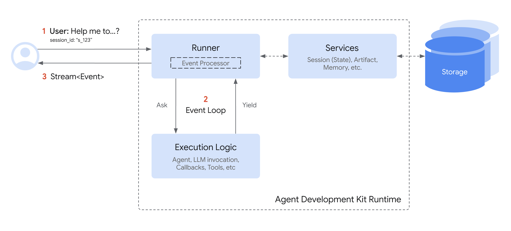

 [ Python](https://github.com/google/adk-python "adk-python on GitHub")[ JS ](https://github.com/google/adk-js "adk-js on GitHub")[ Go ](https://github.com/google/adk-go "adk-go on GitHub")[ Java ](https://github.com/google/adk-java "adk-java on GitHub")[ Kotlin](https://github.com/google/adk-kotlin "adk-kotlin on GitHub")

-   [Home](../..)
-    Build Agents
    
    Build Agents
    
    -   [Get Started](../../get-started/)
        
        Get Started
        
        -   [Python](../../get-started/python/)
        -   [TypeScript](../../get-started/typescript/)
        -   [Go](../../get-started/go/)
        -   [Java](../../get-started/java/)
        -   [Kotlin](../../get-started/kotlin/)
        -   [Agents CLI](../../get-started/agents-cli/)
        -   [Installation](../../get-started/installation/)
        -   [Google Cloud](../../get-started/google-cloud/)
        -   [Migrate to ADK](../../get-started/migrate/)
        
    -   [Build your Agent](../../tutorials/)
        
        Build your Agent
        
        -   [Multi-tool agent](../../tutorials/multi-tool-agent/)
        -   [Agent team](../../tutorials/agent-team/)
        -   [Code with AI](../../tutorials/coding-with-ai/)
        -   [Agent Config](../../agents/config/)
        
    -   [Agents](../../agents/)
        
        Agents
        
        -   [Simple agents](../../agents/llm-agents/)
        -   [Managed agents](../../agents/managed-agents/)
        
    -   [Graph Workflows](../../graphs/)
        
        Graph Workflows
        
        -   [Graph routes](../../graphs/routes/)
        -   [Data handling](../../graphs/data-handling/)
        -   [Human input](../../graphs/human-input/)
        -   [Dynamic workflows](../../graphs/dynamic/)
        
    -   [Multi-Agent Workflows](../../workflows/)
        
        Multi-Agent Workflows
        
        -   [Collaborative workflows](../../workflows/collaboration/)
        -   [Template workflows](../../agents/workflow-agents/)
            
            Template workflows
            
            -   [Sequential workflow](../../agents/workflow-agents/sequential-agents/)
            -   [Loop workflow](../../agents/workflow-agents/loop-agents/)
            -   [Parallel workflow](../../agents/workflow-agents/parallel-agents/)
            -   [Custom template workflows](../../agents/custom-agents/)
            
        -   [Agent routing](../../agents/routing/)
        -   [Workflow patterns](../../workflows/patterns/)
        
    -   [Models for Agents](../../agents/models/)
        
        Models for Agents
        
        -   [Gemini](../../agents/models/google-gemini/)
            
            Gemini
            
            -   [Deferred scheduling](../../agents/models/google-gemini/deferred-schedule/)
            
        -   [Gemma](../../agents/models/google-gemma/)
        -   [Claude](../../agents/models/anthropic/)
        -   [Agent Platform hosted](../../agents/models/agent-platform/)
        -   [Apigee AI Gateway](../../agents/models/apigee/)
        -   [Model routing](../../agents/models/routing/)
        -   [OpenAI](../../agents/models/openai/)
        -   [Ollama](../../agents/models/ollama/)
        -   [vLLM](../../agents/models/vllm/)
        -   [LiteLLM](../../agents/models/litellm/)
        -   [LiteRT-LM](../../agents/models/litert-lm/)
        
    
-    Run Agents
    
    Run Agents
    
    -   [Agent Runtime](../../runtime/)
        
        Agent Runtime
        
        -   [Web Interface](../../runtime/web-interface/)
            
            Web Interface
            
            -   [Visual Builder](../../visual-builder/)
            
        -   [Command Line](../../runtime/command-line/)
        -   [API Server](../../runtime/api-server/)
        -   [Ambient Agents](../../runtime/ambient-agents/)
        -   [Resume Agents](../../runtime/resume/)
        -   [Cancel Agent Runs](../../runtime/cancel/)
        -   [Runtime Config](../../runtime/runconfig/)
        -   [Event Loop](../../runtime/event-loop/)
        
    -   [Deployment](../../deploy/)
        
        Deployment
        
        -   [Agent Runtime](../../deploy/agent-runtime/)
            
            Agent Runtime
            
            -   [Standard deployment](../../deploy/agent-runtime/deploy/)
            -   [agents-cli](../../deploy/agent-runtime/agents-cli/)
            -   [Test deployed agents](../../deploy/agent-runtime/test/)
            
        -   [Cloud Run](../../deploy/cloud-run/)
        -   [GKE](../../deploy/gke/)
        
    -   [Observability](../../observability/)
        
        Observability
        
        -   [Logging](../../observability/logging/)
        -   [Metrics](../../observability/metrics/)
        -   [Traces](../../observability/traces/)
        
    -   [Evaluation](../../evaluate/)
        
        Evaluation
        
        -   [Criteria](../../evaluate/criteria/)
        -   [User Simulation](../../evaluate/user-sim/)
        -   [Environment Simulation](../../evaluate/environment_simulation/)
        -   [Custom Metrics](../../evaluate/custom_metrics/)
        -   [Optimization](../../optimize/)
        
    -   [Safety and Security](../../safety/)
        
        Safety and Security
        
    
-    Components
    
    Components
    
    -   [Technical Overview](../../get-started/about/)
    -   [Custom Tools](../../tools-custom/)
        
        Custom Tools
        
        -    Function tools
            
            Function tools
            
            -   [Overview](../../tools-custom/function-tools/)
            -   [Tool performance](../../tools-custom/performance/)
            -   [Action confirmations](../../tools-custom/confirmation/)
            
        -   [MCP tools](../../tools-custom/mcp-tools/)
            
            MCP tools
            
            -   [Advanced configuration](../../tools-custom/mcp-tools/advanced/)
            -   [Deployment](../../tools-custom/mcp-tools/deployment/)
            -   [Agent as MCP server](../../tools-custom/mcp-tools/agent-as-server/)
            -   [Sub-agent delegation](../../tools-custom/mcp-tools/agent-managed/)
            
        -   [OpenAPI tools](../../tools-custom/openapi-tools/)
        -   [Authentication](../../tools-custom/authentication/)
        -   [Tool limitations](../../tools/limitations/)
        
    -   [Artifacts](../../artifacts/)
        
        Artifacts
        
    -   [Skills for Agents](../../skills/)
        
        Skills for Agents
        
    -   [App management](../../apps/)
        
        App management
        
        -   [Callbacks](../../callbacks/)
            
            Callbacks
            
            -   [Types of callbacks](../../callbacks/types-of-callbacks/)
            -   [Callback patterns](../../callbacks/design-patterns-and-best-practices/)
            
        -   [Plugins](../../plugins/)
        
    -   [Agent context](../../context/)
        
        Agent context
        
        -   [Conversational context](../)
        -   [Sessions](./)
            
            Sessions
            
            -   [Rewind sessions](rewind/)
            -   [Migrate sessions](migrate/)
            
        -   [State](../state/)
        -   [Events](../../events/)
        -   [Memory](../memory/)
        -   [Context compression](../../context/compaction/)
        -   [Model context caching](../../context/caching/)
        
    -   [A2A Protocol](../../a2a/)
        
        A2A Protocol
        
        -   [Introduction to A2A](../../a2a/intro/)
        -    A2A Quickstart (Exposing)
            
            A2A Quickstart (Exposing)
            
            -   [Python](../../a2a/quickstart-exposing/)
            -   [Go](../../a2a/quickstart-exposing-go/)
            -   [Java](../../a2a/quickstart-exposing-java/)
            
        -    A2A Quickstart (Consuming)
            
            A2A Quickstart (Consuming)
            
            -   [Python](../../a2a/quickstart-consuming/)
            -   [Go](../../a2a/quickstart-consuming-go/)
            -   [Java](../../a2a/quickstart-consuming-java/)
            -   [Kotlin](../../a2a/quickstart-consuming-kotlin/)
            
        -   [A2A Extension](../../a2a/a2a-extension/)
        
    -   [Live and Voice Agents](../../live/)
        
        Live and Voice Agents
        
        -   [Get started](../../live/get-started/)
            
            Get started
            
            -   [Python](../../live/get-started/streaming-python/)
            -   [Java](../../live/get-started/streaming-java/)
            
        -    Building
            
            Building
            
            -   [Workflows](../../live/workflows/)
            -   [Tools](../../live/tools/)
            -   [Sessions](../../live/sessions/)
            -   [Events](../../live/events/)
            -   [Audio and video](../../live/audio-video/)
            -   [Configuration](../../live/configuration/)
            
        -    Production
            
            Production
            
            -   [Guardrails](../../live/guardrails/)
            -   [Evaluation](../../live/evaluation/)
            -   [Build a custom server](../../live/custom-server/)
            
        -   [Supported models](../../live/models/)
        
    -   [Grounding](../../grounding/)
        
        Grounding
        
        -   [Google Search Grounding](../../grounding/google_search_grounding/)
        -   [Grounding with Search](../../grounding/grounding_with_search/)
        
    
-   [Integrations](../../integrations/)
    
    Integrations
    
-    Reference
    
    Reference
    
    -   [API Reference](../../api-reference/)
        
        API Reference
        
        -   [Python ADK](../../api-reference/python/)
        -   [TypeScript ADK](../../api-reference/typescript/)
        -    Go ADK
            
            Go ADK
            
            -   [Go v2.x](https://pkg.go.dev/google.golang.org/adk/v2)
            -   [Go v1.x](https://pkg.go.dev/google.golang.org/adk)
            
        -   [Java ADK](../../api-reference/java/)
        -   [Kotlin ADK](../../api-reference/kotlin/)
        -   [CLI Reference](../../api-reference/cli/)
        -   [Agent Config Reference](../../api-reference/agentconfig/)
        -   [REST API](../../api-reference/rest/)
        
    -   [Release Notes](../../release-notes/)
    
-   [Community](../../community/)
    
    Community
    
    -   [Contributing Guide](../../community/contributing-guide/)
    
-   [ADK 2.0](../../2.0/)
    
    ADK 2.0
    

Table of contents

-   [Session objects](#session-objects)
    
    -   [Example: Examining session properties](#example-examining-session-properties)
    
-   [Session lifecycle](#session-lifecycle)
-   [Managing sessions with a SessionService](#managing-sessions-with-a-sessionservice)
-   [SessionService implementations](#sessionservice-implementations)
    
    -   [InMemorySessionService](#inmemorysessionservice)
    -   [VertexAiSessionService](#vertexaisessionservice)
    -   [DatabaseSessionService](#databasesessionservice)
        
        -   [Concurrency and locking](#concurrency-and-locking)
        
    
-   [Troubleshoot session errors](#troubleshoot-session-errors)
    
    -   [SessionNotFoundError](#sessionnotfounderror)
    

1.  [Home](../..)
2.  [Components](../../get-started/about/)
3.  [Agent context](../../context/)
4.  [Sessions](./)

# Session: Tracking individual conversations[¶](#session-tracking-individual-conversations "Permanent link")

Supported in ADKPython v0.1.0TypeScript v0.2.0Go v0.1.0Java v0.1.0Kotlin v0.1.0

A `Session` represents a single conversation thread between a user and your agent. Just like you wouldn't start every text message from scratch, agents need context regarding the ongoing interaction. The `Session` object in ADK is designed specifically to track and manage these individual conversation threads.

## `Session` objects[¶](#session-objects "Permanent link")

When a user starts interacting with your agent, the `SessionService` creates a `Session` object (`google.adk.sessions.Session`). This object acts as the container holding everything related to that *one specific chat thread*. Here are its key properties:

-   **Identification (`id`, `appName`, `userId`):** Unique labels for the conversation.
    -   `id`: A unique identifier for *this specific* conversation thread, essential for retrieving it later. A SessionService object can handle multiple `Session`(s). This field identifies which particular session object are we referring to. For example, "test\_id\_modification".
    -   `app_name`: Identifies which agent application this conversation belongs to. For example, "id\_modifier\_workflow".
    -   `userId`: Links the conversation to a particular user.
-   **History (`events`):** A chronological sequence of all interactions (`Event` objects – user messages, agent responses, tool actions) that have occurred within this specific thread.
-   **Session State (`state`):** A place to store temporary data relevant *only* to this specific, ongoing conversation. This acts as a scratchpad for the agent during the interaction. We will cover how to use and manage `state` in detail in the next section.
-   **Activity Tracking (`lastUpdateTime`):** A timestamp indicating the last time an event occurred in this conversation thread.

### Example: Examining session properties[¶](#example-examining-session-properties "Permanent link")

The following code example demonstrates how to list various values stored in a session object:

PythonTypeScriptGoJavaKotlin

``from google.adk.sessions import InMemorySessionService, Session # Create a simple session to examine its properties temp_service = InMemorySessionService() example_session = await temp_service.create_session(         app_name="my_app",        user_id="example_user",        state={"initial_key": "initial_value"} # State can be initialized ) print(f"--- Examining Session Properties ---") print(f"ID (`id`):                {example_session.id}") print(f"Application Name (`app_name`): {example_session.app_name}") print(f"User ID (`user_id`):         {example_session.user_id}") print(f"State (`state`):           {example_session.state}") # Note: Only shows initial state here print(f"Events (`events`):         {example_session.events}") # Initially empty print(f"Last Update (`last_update_time`): {example_session.last_update_time:.2f}") print(f"---------------------------------") # Clean up (optional for this example) await temp_service.delete_session(app_name=example_session.app_name,                                                         user_id=example_session.user_id, session_id=example_session.id) print("The final status of temp_service - ", temp_service)``

``import { InMemorySessionService } from "@google/adk"; // Create a simple session to examine its properties const tempService = new InMemorySessionService(); const exampleSession = await tempService.createSession({         appName: "my_app",        userId: "example_user",        state: {"initial_key": "initial_value"} // State can be initialized }); console.log("--- Examining Session Properties ---"); console.log(`ID ('id'):                ${exampleSession.id}`); console.log(`Application Name ('appName'): ${exampleSession.appName}`); console.log(`User ID ('userId'):         ${exampleSession.userId}`); console.log(`State ('state'):           ${JSON.stringify(exampleSession.state)}`); // Note: Only shows initial state here console.log(`Events ('events'):         ${JSON.stringify(exampleSession.events)}`); // Initially empty console.log(`Last Update ('lastUpdateTime'): ${exampleSession.lastUpdateTime}`); console.log("---------------------------------"); // Clean up (optional for this example) const finalStatus = await tempService.deleteSession({         appName: exampleSession.appName,        userId: exampleSession.userId,        sessionId: exampleSession.id }); console.log("The final status of temp_service - ", finalStatus);``

``appName := "my_go_app" userID := "example_go_user" initialState := map[string]any{"initial_key": "initial_value"} // Create a session to examine its properties. createResp, err := inMemoryService.Create(ctx, &session.CreateRequest{         AppName: appName,        UserID:  userID,        State:   initialState, }) if err != nil {         log.Fatalf("Failed to create session: %v", err) } exampleSession := createResp.Session fmt.Println("\n--- Examining Session Properties ---") fmt.Printf("ID (`ID()`): %s\n", exampleSession.ID()) fmt.Printf("Application Name (`AppName()`): %s\n", exampleSession.AppName()) // To access state, you call Get(). val, _ := exampleSession.State().Get("initial_key") fmt.Printf("State (`State().Get()`):    initial_key = %v\n", val) // Events are initially empty. fmt.Printf("Events (`Events().Len()`):  %d\n", exampleSession.Events().Len()) fmt.Printf("Last Update (`LastUpdateTime()`): %s\n", exampleSession.LastUpdateTime().Format("2006-01-02 15:04:05")) fmt.Println("---------------------------------") // Clean up the session. err = inMemoryService.Delete(ctx, &session.DeleteRequest{         AppName:   exampleSession.AppName(),        UserID:    exampleSession.UserID(),        SessionID: exampleSession.ID(), }) if err != nil {         log.Fatalf("Failed to delete session: %v", err) } fmt.Println("Session deleted successfully.")``

``import com.google.adk.sessions.InMemorySessionService; import com.google.adk.sessions.Session; import java.util.concurrent.ConcurrentMap; import java.util.concurrent.ConcurrentHashMap; String sessionId = "123"; String appName = "example-app"; // Example app name String userId = "example-user"; // Example user id ConcurrentMap<String, Object> initialState = new ConcurrentHashMap<>(Map.of("newKey", "newValue")); InMemorySessionService exampleSessionService = new InMemorySessionService(); // Create Session Session exampleSession = exampleSessionService.createSession(         appName, userId, initialState, Optional.of(sessionId)).blockingGet(); System.out.println("Session created successfully."); System.out.println("--- Examining Session Properties ---"); System.out.printf("ID (`id`): %s%n", exampleSession.id()); System.out.printf("Application Name (`appName`): %s%n", exampleSession.appName()); System.out.printf("User ID (`userId`): %s%n", exampleSession.userId()); System.out.printf("State (`state`): %s%n", exampleSession.state()); System.out.println("------------------------------------");  // Clean up (optional for this example) var unused = exampleSessionService.deleteSession(appName, userId, sessionId);``

``import com.google.adk.kt.sessions.InMemorySessionService import com.google.adk.kt.sessions.SessionKey val sessionId = "123" val appName = "example-app" val userId = "example-user" val initialState = mapOf("newKey" to "newValue") val sessionService = InMemorySessionService() // Create Session val exampleSession = sessionService.createSession(         key = SessionKey(appName, userId, sessionId),        state = initialState ) println("Session created successfully.") println("--- Examining Session Properties ---") println("ID (`id`):                ${exampleSession.key.id}") println("Application Name (`appName`): ${exampleSession.key.appName}") println("User ID (`userId`):         ${exampleSession.key.userId}") println("State (`state`):           ${exampleSession.state}") println("------------------------------------") // Clean up (optional for this example) sessionService.deleteSession(exampleSession.key)``

*(**Note:* *The state shown above is only the initial state. State updates happen via events, as discussed in the State section.)*

## Session lifecycle[¶](#session-lifecycle "Permanent link")

Here’s a simplified flow of how `Session` and `SessionService` work together during a conversation turn:

1.  **Start or Resume:** Your application needs to use the `SessionService` to either `create_session` (for a new chat) or use an existing session id.
2.  **Context Provided:** The `Runner` gets the appropriate `Session` object from the appropriate service method, providing the agent with access to the corresponding Session's `state` and `events`.
3.  **Agent Processing:** The user prompts the agent with a query. The agent analyzes the query and potentially the session `state` and `events` history to determine the response.
4.  **Response & State Update:** The agent generates a response (and potentially flags data to be updated in the `state`). The `Runner` packages this as an `Event`.
5.  **Save Interaction:** The `Runner` calls `sessionService.append_event(session, event)` with the `session` and the new `event` as the arguments. The service adds the `Event` to the history and updates the session's `state` in storage based on information within the event. The session's `last_update_time` also get updated.
6.  **Ready for Next:** The agent's response goes to the user. The updated `Session` is now stored by the `SessionService`, ready for the next turn (which restarts the cycle at step 1, usually with the continuation of the conversation in the current session).
7.  **End Conversation:** When the conversation is over, your application calls `sessionService.delete_session(...)` to clean up the stored session data if it is no longer required.

This cycle highlights how the `SessionService` ensures conversational continuity by managing the history and state associated with each `Session` object.

## Managing sessions with a `SessionService`[¶](#managing-sessions-with-a-sessionservice "Permanent link")

As seen above, you don't typically create or manage `Session` objects directly. Instead, you use a **`SessionService`**. This service acts as the central manager responsible for the entire lifecycle of your conversation sessions.

Its core responsibilities include:

-   **Starting New Conversations:** Creating fresh `Session` objects when a user begins an interaction.
-   **Resuming Existing Conversations:** Retrieving a specific `Session` (using its ID) so the agent can continue where it left off.
-   **Saving Progress:** Appending new interactions (`Event` objects) to a session's history. This is also the mechanism through which session `state` gets updated (more in the `State` section).
-   **Listing Conversations:** Finding the active session threads for a particular user and application.
-   **Cleaning Up:** Deleting `Session` objects and their associated data when conversations are finished or no longer needed.

## `SessionService` implementations[¶](#sessionservice-implementations "Permanent link")

ADK provides different `SessionService` implementations, allowing you to choose the storage backend that best suits your needs:

### `InMemorySessionService`[¶](#inmemorysessionservice "Permanent link")

-   **How it works:** Stores all session data directly in the application's memory.
-   **Persistence:** None. **All conversation data is lost if the application restarts.**
-   **Requires:** Nothing extra.
-   **Best for:** Quick development, local testing, examples, and scenarios where long-term persistence isn't required.

PythonTypeScriptGoJavaKotlin

`from google.adk.sessions import InMemorySessionService session_service = InMemorySessionService()`

`import { InMemorySessionService } from "@google/adk"; const sessionService = new InMemorySessionService();`

`import "google.golang.org/adk/v2/session" inMemoryService := session.InMemoryService()`

`import com.google.adk.sessions.InMemorySessionService; InMemorySessionService exampleSessionService = new InMemorySessionService();`

`import com.google.adk.kt.sessions.InMemorySessionService val sessionService = InMemorySessionService()`

### `VertexAiSessionService`[¶](#vertexaisessionservice "Permanent link")

Supported in ADKPython v0.1.0Go v0.1.0Java v0.1.0Kotlin v0.7.0

-   **How it works:** Uses Google Cloud Agent Platform infrastructure via API calls for session management.
-   **Persistence:** Yes. Data is managed reliably and scalably via [Agent Runtime](/deploy/agent-runtime/).
-   **Requires:**
    -   A Google Cloud project.
    -   The `gcp` extra, installed with `pip install google-adk[gcp]`.
    -   A Google Cloud storage bucket that can be configured by this [step](https://cloud.google.com/vertex-ai/docs/pipelines/configure-project#storage).
    -   An Agent Runtime resource name/ID that can setup following this [tutorial](/deploy/agent-runtime/).
    -   If you do not have a Google Cloud project and you want to try the VertexAiSessionService, see [Agent Platform Express Mode](/integrations/express-mode/).
-   **Best for:** Scalable production applications deployed on Google Cloud, especially when integrating with other Agent Platform features.

PythonGoJavaKotlin

`# Requires: pip install google-adk[gcp] # Plus GCP setup and authentication from google.adk.sessions import VertexAiSessionService PROJECT_ID = "your-gcp-project-id" LOCATION = "us-central1" # The app_name used with this service should be the Reasoning Engine ID or name REASONING_ENGINE_APP_NAME = "projects/your-gcp-project-id/locations/us-central1/reasoningEngines/your-engine-id" session_service = VertexAiSessionService(project=PROJECT_ID, location=LOCATION) # Use REASONING_ENGINE_APP_NAME when calling service methods, e.g.: # session = await session_service.create_session(app_name=REASONING_ENGINE_APP_NAME, ...)`

`import "google.golang.org/adk/v2/session" // 2. VertexAIService // Before running, ensure your environment is authenticated: // gcloud auth application-default login // export GOOGLE_CLOUD_PROJECT="your-gcp-project-id" // export GOOGLE_CLOUD_LOCATION="your-gcp-location" modelName := "gemini-flash-latest" // Replace with your desired model vertexService, err := session.VertexAIService(ctx, modelName) if err != nil {     log.Printf("Could not initialize VertexAIService (this is expected if the gcloud project is not set): %v", err) } else {     fmt.Println("Successfully initialized VertexAIService.") }`

`// Please look at the set of requirements above, consequently export the following in your bashrc file: // export GOOGLE_CLOUD_PROJECT=my_gcp_project // export GOOGLE_CLOUD_LOCATION=us-central1 // export GOOGLE_API_KEY=my_api_key import com.google.adk.sessions.VertexAiSessionService; import java.util.UUID; String sessionId = UUID.randomUUID().toString(); String reasoningEngineAppName = "123456789"; String userId = "u_123"; // Example user id ConcurrentMap<String, Object> initialState = new         ConcurrentHashMap<>(); // No initial state needed for this example VertexAiSessionService sessionService = new VertexAiSessionService(); Session mySession =         sessionService                .createSession(reasoningEngineAppName, userId, initialState, Optional.of(sessionId))                .blockingGet();`

`VertexAiSessionService` is JVM-only in ADK Kotlin. It is not available on Android; use it from a server-side agent.

``import com.google.adk.kt.sessions.SessionKey import com.google.adk.kt.sessions.VertexAiSessionService import kotlinx.coroutines.runBlocking // The reasoning engine is pinned here, at construction. In the other tabs // the engine is chosen per call, through `app_name`; in Kotlin `appName` // is never parsed for it and is only a label on the session. val sessionService =         VertexAiSessionService(                project = "your-gcp-project-id",                location = "us-central1",                // The bare numeric engine id. A full                // "projects/.../reasoningEngines/..." resource name is rejected;                // project and location are separate arguments.                reasoningEngineId = "1234567890",        ) // Session methods are suspend functions; `runBlocking` here is the // counterpart of the Java tab's `.blockingGet()`. val mySession = runBlocking {         // A null id lets the service assign one.        sessionService.createSession(SessionKey("example-app", "u_123", id = null)) }``

For more information on connecting to Google Cloud from ADK agents, see [Connect to Google Cloud and Agent Platform](/get-started/google-cloud/).

### `DatabaseSessionService`[¶](#databasesessionservice "Permanent link")

Supported in ADKPython v0.1.0Go v0.1.0

-   **How it works:** Connects to a relational database (e.g., PostgreSQL, MySQL, SQLite) to store session data persistently in tables.
-   **Persistence:** Yes. Data survives application restarts.
-   **Requires:** A configured database. In Python, also the `db` extra, installed with `pip install google-adk[db]`. In Go, a [GORM](https://gorm.io/) driver for your database.
-   **Best for:** Applications needing reliable, persistent storage that you manage yourself.

PythonGo

`from google.adk.sessions import DatabaseSessionService # Example using a local SQLite file: # Note: The implementation requires an async database driver. # For SQLite, use 'sqlite+aiosqlite' instead of 'sqlite' to ensure async compatibility. db_url = "sqlite+aiosqlite:///./my_agent_data.db" session_service = DatabaseSessionService(db_url=db_url)`

`import (         "log"        "github.com/glebarez/sqlite"        "gorm.io/gorm"         "google.golang.org/adk/v2/session/database" ) // Example using a local SQLite file. Any GORM dialector works, for // example gorm.io/driver/postgres for PostgreSQL. sessionService, err := database.NewSessionService(sqlite.Open("my_agent_data.db"), &gorm.Config{}) if err != nil {         log.Fatal(err) } // Creates the tables and adds any columns a newer ADK release needs. // Run it every time the application starts. if err := database.AutoMigrate(sessionService); err != nil {         log.Fatal(err) }`

Run `AutoMigrate` on every startup

The Go session service does not create or update its tables. Call `database.AutoMigrate` each time your application starts, before it serves traffic. It creates missing tables and columns and does not drop existing ones, so a database keeps working after an ADK upgrade adds a column. It can also change the type of an existing column to match what ADK expects. If you manage the schema yourself instead of running `AutoMigrate`, add the new columns before deploying the ADK release that introduces them. Otherwise, writes to that table fail.

#### Concurrency and locking[¶](#concurrency-and-locking "Permanent link")

The `DatabaseSessionService` ensures data integrity during concurrent operations through a two-tiered locking architecture:

-   **In-Process locking:** The service uses an internal, in-process lock to serialize `append_event` calls for the same session. This prevents race conditions when multiple requests try to update the same session simultaneously within the same process.
-   **Row-Level locking:** For PostgreSQL, MySQL, and MariaDB, the service uses row-level locking (via `SELECT ... FOR UPDATE`) to prevent race conditions when multiple processes or replicas try to update the same session simultaneously.

Async driver requirement

`DatabaseSessionService` requires an async database driver. When using SQLite, you must use `sqlite+aiosqlite` instead of `sqlite` in your connection string. For other databases (PostgreSQL, MySQL), ensure you're using an async-compatible driver, such as `asyncpg` for PostgreSQL, `aiomysql` for MySQL.

Session database schema change in ADK Python v1.22.0

The schema for the session database changed in ADK Python v1.22.0, which requires migration of the Session Database. For more information, see [Session database schema migration](/sessions/session/migrate/).

## Troubleshoot session errors[¶](#troubleshoot-session-errors "Permanent link")

During execution, ADK can raise specific exceptions to help you identify configuration or state issues.

### `SessionNotFoundError`[¶](#sessionnotfounderror "Permanent link")

Raised when a runner attempts to access or execute a session that does not exist in the active session store. Inherits from `ValueError` for backward compatibility.

-   **Common causes:** an invalid, expired, or missing `session_id`; running a session before it has been created.
-   **How to resolve:** ensure the session exists first via `create_session(...)`, or construct the `Runner` with `auto_create_session=True`.

Back to top