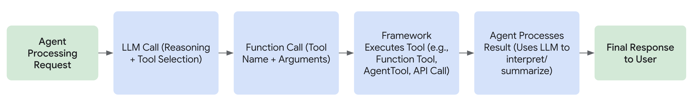

 [ Python](https://github.com/google/adk-python "adk-python on GitHub")[ JS ](https://github.com/google/adk-js "adk-js on GitHub")[ Go ](https://github.com/google/adk-go "adk-go on GitHub")[ Java ](https://github.com/google/adk-java "adk-java on GitHub")[ Kotlin](https://github.com/google/adk-kotlin "adk-kotlin on GitHub")

-   [Home](..)
-    Build Agents
    
    Build Agents
    
    -   [Get Started](../get-started/)
        
        Get Started
        
        -   [Python](../get-started/python/)
        -   [TypeScript](../get-started/typescript/)
        -   [Go](../get-started/go/)
        -   [Java](../get-started/java/)
        -   [Kotlin](../get-started/kotlin/)
        -   [Agents CLI](../get-started/agents-cli/)
        -   [Installation](../get-started/installation/)
        -   [Google Cloud](../get-started/google-cloud/)
        -   [Migrate to ADK](../get-started/migrate/)
        
    -   [Build your Agent](../tutorials/)
        
        Build your Agent
        
        -   [Multi-tool agent](../tutorials/multi-tool-agent/)
        -   [Agent team](../tutorials/agent-team/)
        -   [Code with AI](../tutorials/coding-with-ai/)
        -   [Agent Config](../agents/config/)
        
    -   [Agents](../agents/)
        
        Agents
        
        -   [Simple agents](../agents/llm-agents/)
        -   [Managed agents](../agents/managed-agents/)
        
    -   [Graph Workflows](../graphs/)
        
        Graph Workflows
        
        -   [Graph routes](../graphs/routes/)
        -   [Data handling](../graphs/data-handling/)
        -   [Human input](../graphs/human-input/)
        -   [Dynamic workflows](../graphs/dynamic/)
        
    -   [Multi-Agent Workflows](../workflows/)
        
        Multi-Agent Workflows
        
        -   [Collaborative workflows](../workflows/collaboration/)
        -   [Template workflows](../agents/workflow-agents/)
            
            Template workflows
            
            -   [Sequential workflow](../agents/workflow-agents/sequential-agents/)
            -   [Loop workflow](../agents/workflow-agents/loop-agents/)
            -   [Parallel workflow](../agents/workflow-agents/parallel-agents/)
            -   [Custom template workflows](../agents/custom-agents/)
            
        -   [Agent routing](../agents/routing/)
        -   [Workflow patterns](../workflows/patterns/)
        
    -   [Models for Agents](../agents/models/)
        
        Models for Agents
        
        -   [Gemini](../agents/models/google-gemini/)
            
            Gemini
            
            -   [Deferred scheduling](../agents/models/google-gemini/deferred-schedule/)
            
        -   [Gemma](../agents/models/google-gemma/)
        -   [Claude](../agents/models/anthropic/)
        -   [Agent Platform hosted](../agents/models/agent-platform/)
        -   [Apigee AI Gateway](../agents/models/apigee/)
        -   [Model routing](../agents/models/routing/)
        -   [OpenAI](../agents/models/openai/)
        -   [Ollama](../agents/models/ollama/)
        -   [vLLM](../agents/models/vllm/)
        -   [LiteLLM](../agents/models/litellm/)
        -   [LiteRT-LM](../agents/models/litert-lm/)
        
    
-    Run Agents
    
    Run Agents
    
    -   [Agent Runtime](../runtime/)
        
        Agent Runtime
        
        -   [Web Interface](../runtime/web-interface/)
            
            Web Interface
            
            -   [Visual Builder](../visual-builder/)
            
        -   [Command Line](../runtime/command-line/)
        -   [API Server](../runtime/api-server/)
        -   [Ambient Agents](../runtime/ambient-agents/)
        -   [Resume Agents](../runtime/resume/)
        -   [Cancel Agent Runs](../runtime/cancel/)
        -   [Runtime Config](../runtime/runconfig/)
        -   [Event Loop](../runtime/event-loop/)
        
    -   [Deployment](../deploy/)
        
        Deployment
        
        -   [Agent Runtime](../deploy/agent-runtime/)
            
            Agent Runtime
            
            -   [Standard deployment](../deploy/agent-runtime/deploy/)
            -   [agents-cli](../deploy/agent-runtime/agents-cli/)
            -   [Test deployed agents](../deploy/agent-runtime/test/)
            
        -   [Cloud Run](../deploy/cloud-run/)
        -   [GKE](../deploy/gke/)
        
    -   [Observability](../observability/)
        
        Observability
        
        -   [Logging](../observability/logging/)
        -   [Metrics](../observability/metrics/)
        -   [Traces](../observability/traces/)
        
    -   [Evaluation](../evaluate/)
        
        Evaluation
        
        -   [Criteria](../evaluate/criteria/)
        -   [User Simulation](../evaluate/user-sim/)
        -   [Environment Simulation](../evaluate/environment_simulation/)
        -   [Custom Metrics](../evaluate/custom_metrics/)
        -   [Optimization](../optimize/)
        
    -   [Safety and Security](../safety/)
        
        Safety and Security
        
    
-    Components
    
    Components
    
    -   [Technical Overview](../get-started/about/)
    -   [Custom Tools](./)
        
        Custom Tools
        
        -    Function tools
            
            Function tools
            
            -   [Overview](function-tools/)
            -   [Tool performance](performance/)
            -   [Action confirmations](confirmation/)
            
        -   [MCP tools](mcp-tools/)
            
            MCP tools
            
            -   [Advanced configuration](mcp-tools/advanced/)
            -   [Deployment](mcp-tools/deployment/)
            -   [Agent as MCP server](mcp-tools/agent-as-server/)
            -   [Sub-agent delegation](mcp-tools/agent-managed/)
            
        -   [OpenAPI tools](openapi-tools/)
        -   [Authentication](authentication/)
        -   [Tool limitations](../tools/limitations/)
        
    -   [Artifacts](../artifacts/)
        
        Artifacts
        
    -   [Skills for Agents](../skills/)
        
        Skills for Agents
        
    -   [App management](../apps/)
        
        App management
        
        -   [Callbacks](../callbacks/)
            
            Callbacks
            
            -   [Types of callbacks](../callbacks/types-of-callbacks/)
            -   [Callback patterns](../callbacks/design-patterns-and-best-practices/)
            
        -   [Plugins](../plugins/)
        
    -   [Agent context](../context/)
        
        Agent context
        
        -   [Conversational context](../sessions/)
        -   [Sessions](../sessions/session/)
            
            Sessions
            
            -   [Rewind sessions](../sessions/session/rewind/)
            -   [Migrate sessions](../sessions/session/migrate/)
            
        -   [State](../sessions/state/)
        -   [Events](../events/)
        -   [Memory](../sessions/memory/)
        -   [Context compression](../context/compaction/)
        -   [Model context caching](../context/caching/)
        
    -   [A2A Protocol](../a2a/)
        
        A2A Protocol
        
        -   [Introduction to A2A](../a2a/intro/)
        -    A2A Quickstart (Exposing)
            
            A2A Quickstart (Exposing)
            
            -   [Python](../a2a/quickstart-exposing/)
            -   [Go](../a2a/quickstart-exposing-go/)
            -   [Java](../a2a/quickstart-exposing-java/)
            
        -    A2A Quickstart (Consuming)
            
            A2A Quickstart (Consuming)
            
            -   [Python](../a2a/quickstart-consuming/)
            -   [Go](../a2a/quickstart-consuming-go/)
            -   [Java](../a2a/quickstart-consuming-java/)
            -   [Kotlin](../a2a/quickstart-consuming-kotlin/)
            
        -   [A2A Extension](../a2a/a2a-extension/)
        
    -   [Live and Voice Agents](../live/)
        
        Live and Voice Agents
        
        -   [Get started](../live/get-started/)
            
            Get started
            
            -   [Python](../live/get-started/streaming-python/)
            -   [Java](../live/get-started/streaming-java/)
            
        -    Building
            
            Building
            
            -   [Workflows](../live/workflows/)
            -   [Tools](../live/tools/)
            -   [Sessions](../live/sessions/)
            -   [Events](../live/events/)
            -   [Audio and video](../live/audio-video/)
            -   [Configuration](../live/configuration/)
            
        -    Production
            
            Production
            
            -   [Guardrails](../live/guardrails/)
            -   [Evaluation](../live/evaluation/)
            -   [Build a custom server](../live/custom-server/)
            
        -   [Supported models](../live/models/)
        
    -   [Grounding](../grounding/)
        
        Grounding
        
        -   [Google Search Grounding](../grounding/google_search_grounding/)
        -   [Grounding with Search](../grounding/grounding_with_search/)
        
    
-   [Integrations](../integrations/)
    
    Integrations
    
-    Reference
    
    Reference
    
    -   [API Reference](../api-reference/)
        
        API Reference
        
        -   [Python ADK](../api-reference/python/)
        -   [TypeScript ADK](../api-reference/typescript/)
        -    Go ADK
            
            Go ADK
            
            -   [Go v2.x](https://pkg.go.dev/google.golang.org/adk/v2)
            -   [Go v1.x](https://pkg.go.dev/google.golang.org/adk)
            
        -   [Java ADK](../api-reference/java/)
        -   [Kotlin ADK](../api-reference/kotlin/)
        -   [CLI Reference](../api-reference/cli/)
        -   [Agent Config Reference](../api-reference/agentconfig/)
        -   [REST API](../api-reference/rest/)
        
    -   [Release Notes](../release-notes/)
    
-   [Community](../community/)
    
    Community
    
    -   [Contributing Guide](../community/contributing-guide/)
    
-   [ADK 2.0](../2.0/)
    
    ADK 2.0
    

Table of contents

-   [What is a Tool?](#what-is-a-tool)
    
    -   [Key Characteristics](#key-characteristics)
    
-   [How Agents Use Tools](#how-agents-use-tools)
-   [Tool Types in ADK](#tool-types-in-adk)
-   [Referencing Tool in Agent’s Instructions](#referencing-tool-in-agents-instructions)
    
    -   [Example](#example)
    
-   [Tool Context](#tool-context)
    
    -   [State Management](#state-management)
    -   [Controlling Agent Flow](#controlling-agent-flow)
        
        -   [Example](#example_1)
            
            -   [Explanation](#explanation)
            
        
    -   [Authentication](#authentication)
    -   [Context-Aware Data Access Methods](#context-aware-data-access-methods)
        
        -   [Example](#example_2)
        
    
-   [Defining Effective Tool Functions](#defining-effective-tool-functions)
-   [Toolsets: Grouping and Dynamically Providing Tools](#toolsets-grouping-and-dynamically-providing-tools)
    
    -   [The BaseToolset Interface](#the-basetoolset-interface)
    -   [Using Toolsets with Agents](#using-toolsets-with-agents)
    -   [Example: A Simple Math Toolset](#example-a-simple-math-toolset)
    -   [Filter tools in toolsets](#filter-tools-in-toolsets)
    

1.  [Home](..)
2.  [Components](../get-started/about/)
3.  [Custom Tools](./)

# Custom Tools for ADK[¶](#custom-tools-for-adk "Permanent link")

Supported in ADKPython v0.1.0TypeScript v0.2.0Go v0.1.0Java v0.1.0Kotlin v0.1.0

In an ADK agent workflow, Tools are programming functions with structured input and output that can be called by an ADK Agent to perform actions. ADK Tools function similarly to how you use a [Function Call](https://ai.google.dev/gemini-api/docs/function-calling) with Gemini or other generative AI models. You can perform various actions and programming functions with an ADK Tool, such as:

-   Querying databases
-   Making API requests: getting weather data, booking systems
-   Searching the web
-   Executing code snippets
-   Retrieving information from documents (RAG)
-   Interacting with other software or services

[ADK Tools and Integrations](/integrations/)

Before building your own tools for ADK, check out the **[ADK Tools and Integrations](/integrations/)** for pre-built tools and integrations you can use with ADK Agents.

## What is a Tool?[¶](#what-is-a-tool "Permanent link")

In the context of ADK, a Tool represents a specific capability provided to an AI agent, enabling it to perform actions and interact with the world beyond its core text generation and reasoning abilities. What distinguishes capable agents from basic language models is often their effective use of tools.

Technically, a tool is typically a modular code component—**like a Python, Java, or TypeScript function**, a class method, or even another specialized agent—designed to execute a distinct, predefined task. These tasks often involve interacting with external systems or data.

### Key Characteristics[¶](#key-characteristics "Permanent link")

**Action-Oriented:** Tools perform specific actions for an agent, such as searching for information, calling an API, or performing calculations.

**Extends Agent capabilities:** They empower agents to access real-time information, affect external systems, and overcome the knowledge limitations inherent in their training data.

**Execute predefined logic:** Crucially, tools execute specific, developer-defined logic. They do not possess their own independent reasoning capabilities like the agent's core Large Language Model (LLM). The LLM reasons about which tool to use, when, and with what inputs, but the tool itself just executes its designated function.

## How Agents Use Tools[¶](#how-agents-use-tools "Permanent link")

Agents leverage tools dynamically through mechanisms often involving function calling. The process generally follows these steps:

1.  **Reasoning:** The agent's LLM analyzes its system instruction, conversation history, and user request.
2.  **Selection:** Based on the analysis, the LLM decides on which tool, if any, to execute, based on the tools available to the agent and the docstrings that describes each tool.
3.  **Invocation:** The LLM generates the required arguments (inputs) for the selected tool and triggers its execution.
4.  **Observation:** The agent receives the output (result) returned by the tool.
5.  **Finalization:** The agent incorporates the tool's output into its ongoing reasoning process to formulate the next response, decide the subsequent step, or determine if the goal has been achieved.

Think of the tools as a specialized toolkit that the agent's intelligent core (the LLM) can access and utilize as needed to accomplish complex tasks.

## Tool Types in ADK[¶](#tool-types-in-adk "Permanent link")

ADK offers flexibility by supporting several types of tools:

1.  **[Function Tools](/tools-custom/function-tools/):** Tools created by you, tailored to your specific application's needs.
    -   **[Functions/Methods](/tools-custom/function-tools/#1-function-tool):** Define standard synchronous functions or methods in your code (e.g., Python def).
    -   **[Agents-as-Tools](/tools-custom/function-tools/#3-agent-as-a-tool):** Use another, potentially specialized, agent as a tool for a parent agent.
    -   **[Long Running Function Tools](/tools-custom/function-tools/#2-long-running-function-tool):** Support for tools that perform asynchronous operations or take significant time to complete.
2.  **[Built-in Tools](/integrations/):** Ready-to-use tools provided by the framework for common tasks. Examples: Google Search, Code Execution, Retrieval-Augmented Generation (RAG).
3.  **Third-Party Tools:** Integrate tools seamlessly from popular external libraries.

Navigate to the respective documentation pages linked above for detailed information and examples for each tool type.

## Referencing Tool in Agent’s Instructions[¶](#referencing-tool-in-agents-instructions "Permanent link")

Within an agent's instructions, you can directly reference a tool by using its **function name.** If the tool's **function name** and **docstring** are sufficiently descriptive, your instructions can primarily focus on **when the Large Language Model (LLM) should utilize the tool**. This promotes clarity and helps the model understand the intended use of each tool.

It is **crucial to clearly instruct the agent on how to handle different return values** that a tool might produce. For example, if a tool returns an error message, your instructions should specify whether the agent should retry the operation, give up on the task, or request additional information from the user.

Furthermore, ADK supports the sequential use of tools, where the output of one tool can serve as the input for another. When implementing such workflows, it's important to **describe the intended sequence of tool usage** within the agent's instructions to guide the model through the necessary steps.

### Example[¶](#example "Permanent link")

The following example showcases how an agent can use tools by **referencing their function names in its instructions**. It also demonstrates how to guide the agent to **handle different return values from tools**, such as success or error messages, and how to orchestrate the **sequential use of multiple tools** to accomplish a task.

PythonTypeScriptGoJavaKotlin

`# Copyright 2025 Google LLC # # Licensed under the Apache License, Version 2.0 (the "License"); # you may not use this file except in compliance with the License. # You may obtain a copy of the License at # #     http://www.apache.org/licenses/LICENSE-2.0 # # Unless required by applicable law or agreed to in writing, software # distributed under the License is distributed on an "AS IS" BASIS, # WITHOUT WARRANTIES OR CONDITIONS OF ANY KIND, either express or implied. # See the License for the specific language governing permissions and # limitations under the License. import asyncio from google.adk.agents import Agent from google.adk.tools import FunctionTool from google.adk.runners import Runner from google.adk.sessions import InMemorySessionService from google.genai import types APP_NAME="weather_sentiment_agent" USER_ID="user1234" SESSION_ID="1234" MODEL_ID="gemini-2.0-flash" # Tool 1 def get_weather_report(city: str) -> dict:         """Retrieves the current weather report for a specified city.         Returns:                dict: A dictionary containing the weather information with a 'status' key ('success' or 'error') and a 'report' key with the weather details if successful, or an 'error_message' if an error occurred.        """        if city.lower() == "london":                return {"status": "success", "report": "The current weather in London is cloudy with a temperature of 18 degrees Celsius and a chance of rain."}        elif city.lower() == "paris":                return {"status": "success", "report": "The weather in Paris is sunny with a temperature of 25 degrees Celsius."}        else:                return {"status": "error", "error_message": f"Weather information for '{city}' is not available."} weather_tool = FunctionTool(func=get_weather_report)  # Tool 2 def analyze_sentiment(text: str) -> dict:         """Analyzes the sentiment of the given text.         Returns:                dict: A dictionary with 'sentiment' ('positive', 'negative', or 'neutral') and a 'confidence' score.        """        if "good" in text.lower() or "sunny" in text.lower():                return {"sentiment": "positive", "confidence": 0.8}        elif "rain" in text.lower() or "bad" in text.lower():                return {"sentiment": "negative", "confidence": 0.7}        else:                return {"sentiment": "neutral", "confidence": 0.6} sentiment_tool = FunctionTool(func=analyze_sentiment)  # Agent weather_sentiment_agent = Agent(         model=MODEL_ID,        name='weather_sentiment_agent',        instruction="""You are a helpful assistant that provides weather information and analyzes the sentiment of user feedback. **If the user asks about the weather in a specific city, use the 'get_weather_report' tool to retrieve the weather details.** **If the 'get_weather_report' tool returns a 'success' status, provide the weather report to the user.** **If the 'get_weather_report' tool returns an 'error' status, inform the user that the weather information for the specified city is not available and ask if they have another city in mind.** **After providing a weather report, if the user gives feedback on the weather (e.g., 'That's good' or 'I don't like rain'), use the 'analyze_sentiment' tool to understand their sentiment.** Then, briefly acknowledge their sentiment. You can handle these tasks sequentially if needed.""",         tools=[weather_tool, sentiment_tool] ) async def main():         """Main function to run the agent asynchronously."""        # Session and Runner Setup        session_service = InMemorySessionService()        # Use 'await' to correctly create the session        await session_service.create_session(app_name=APP_NAME, user_id=USER_ID, session_id=SESSION_ID)         runner = Runner(agent=weather_sentiment_agent, app_name=APP_NAME, session_service=session_service)         # Agent Interaction        query = "weather in london?"        print(f"User Query: {query}")        content = types.Content(role='user', parts=[types.Part(text=query)])         # The runner's run method handles the async loop internally        events = runner.run(user_id=USER_ID, session_id=SESSION_ID, new_message=content)         for event in events:                if event.is_final_response():                        final_response = event.content.parts[0].text                        print("Agent Response:", final_response) # Standard way to run the main async function if __name__ == "__main__":         asyncio.run(main())`

``/**   * Copyright 2025 Google LLC  *  * Licensed under the Apache License, Version 2.0 (the "License");  * you may not use this file except in compliance with the License.  * You may obtain a copy of the License at  *  *     http://www.apache.org/licenses/LICENSE-2.0  *  * Unless required by applicable law or agreed to in writing, software  * distributed under the License is distributed on an "AS IS" BASIS,  * WITHOUT WARRANTIES OR CONDITIONS OF ANY KIND, either express or implied.  * See the License for the specific language governing permissions and  * limitations under the License.  */ import { LlmAgent, FunctionTool, InMemoryRunner, isFinalResponse, stringifyContent } from '@google/adk'; import { z } from "zod"; import { Content, createUserContent } from "@google/genai"; /**   * Retrieves the current weather report for a specified city.  */ function getWeatherReport(params: { city: string }): Record<string, any> {         if (params.city.toLowerCase().includes("london")) {                return {                        "status": "success",                        "report": "The current weather in London is cloudy with a " +                                "temperature of 18 degrees Celsius and a chance of rain.",                };        }        if (params.city.toLowerCase().includes("paris")) {                return {                        "status": "success",                        "report": "The weather in Paris is sunny with a temperature of 25 " +                                "degrees Celsius.",                };        }        return {                "status": "error",                "error_message": `Weather information for '${params.city}' is not available.`,        }; } /**   * Analyzes the sentiment of a given text.  */ function analyzeSentiment(params: { text: string }): Record<string, any> {         if (params.text.includes("cloudy") || params.text.includes("rain")) {                return { "status": "success", "sentiment": "negative" };        }        if (params.text.includes("sunny")) {                return { "status": "success", "sentiment": "positive" };        }        return { "status": "success", "sentiment": "neutral" }; } const weatherTool = new FunctionTool({         name: "get_weather_report",        description: "Retrieves the current weather report for a specified city.",        parameters: z.object({                city: z.string().describe("The city to get the weather for."),        }),        execute: getWeatherReport, }); const sentimentTool = new FunctionTool({         name: "analyze_sentiment",        description: "Analyzes the sentiment of a given text.",        parameters: z.object({                text: z.string().describe("The text to analyze the sentiment of."),        }),        execute: analyzeSentiment, }); const instruction = `         You are a helpful assistant that first checks the weather and then analyzes        its sentiment.         Follow these steps:        1. Use the 'get_weather_report' tool to get the weather for the requested              city.        2. If the 'get_weather_report' tool returns an error, inform the user about              the error and stop.        3. If the weather report is available, use the 'analyze_sentiment' tool to              determine the sentiment of the weather report.        4. Finally, provide a summary to the user, including the weather report and              its sentiment.        `; const agent = new LlmAgent({         name: "weather_sentiment_agent",        instruction: instruction,        tools: [weatherTool, sentimentTool],        model: "gemini-2.5-flash" }); async function main() {         const runner = new InMemoryRunner({ agent: agent, appName: "weather_sentiment_app" });         await runner.sessionService.createSession({                appName: "weather_sentiment_app",                userId: "user1",                sessionId: "session1"        });         const newMessage: Content = createUserContent("What is the weather in London?");         for await (const event of runner.runAsync({                userId: "user1",                sessionId: "session1",                newMessage: newMessage,        })) {                if (isFinalResponse(event) && event.content?.parts?.length) {                        const text = stringifyContent(event).trim();                        if (text) {                                console.log(text);                        }                }        } } main();``

``// Copyright 2025 Google LLC // // Licensed under the Apache License, Version 2.0 (the "License"); // you may not use this file except in compliance with the License. // You may obtain a copy of the License at // //     http://www.apache.org/licenses/LICENSE-2.0 // // Unless required by applicable law or agreed to in writing, software // distributed under the License is distributed on an "AS IS" BASIS, // WITHOUT WARRANTIES OR CONDITIONS OF ANY KIND, either express or implied. // See the License for the specific language governing permissions and // limitations under the License. package main import (         "context"        "fmt"        "log"        "strings"         "google.golang.org/adk/v2/agent"        "google.golang.org/adk/v2/agent/llmagent"        "google.golang.org/adk/v2/model/gemini"        "google.golang.org/adk/v2/runner"        "google.golang.org/adk/v2/session"        "google.golang.org/adk/v2/tool"        "google.golang.org/adk/v2/tool/functiontool"        "google.golang.org/genai" ) type getWeatherReportArgs struct {         City string `json:"city" jsonschema:"The city for which to get the weather report."` } type getWeatherReportResult struct {         Status string `json:"status"`        Report string `json:"report,omitempty"` } func getWeatherReport(ctx agent.Context, args getWeatherReportArgs) (getWeatherReportResult, error) {         if strings.ToLower(args.City) == "london" {                return getWeatherReportResult{Status: "success", Report: "The current weather in London is cloudy with a temperature of 18 degrees Celsius and a chance of rain."}, nil        }        if strings.ToLower(args.City) == "paris" {                return getWeatherReportResult{Status: "success", Report: "The weather in Paris is sunny with a temperature of 25 degrees Celsius."}, nil        }        return getWeatherReportResult{}, fmt.Errorf("weather information for '%s' is not available.", args.City) } type analyzeSentimentArgs struct {         Text string `json:"text" jsonschema:"The text to analyze for sentiment."` } type analyzeSentimentResult struct {         Sentiment  string  `json:"sentiment"`        Confidence float64 `json:"confidence"` } func analyzeSentiment(ctx agent.Context, args analyzeSentimentArgs) (analyzeSentimentResult, error) {         if strings.Contains(strings.ToLower(args.Text), "good") || strings.Contains(strings.ToLower(args.Text), "sunny") {                return analyzeSentimentResult{Sentiment: "positive", Confidence: 0.8}, nil        }        if strings.Contains(strings.ToLower(args.Text), "rain") || strings.Contains(strings.ToLower(args.Text), "bad") {                return analyzeSentimentResult{Sentiment: "negative", Confidence: 0.7}, nil        }        return analyzeSentimentResult{Sentiment: "neutral", Confidence: 0.6}, nil } func main() {         ctx := context.Background()        model, err := gemini.NewModel(ctx, "gemini-flash-latest", &genai.ClientConfig{})        if err != nil {                log.Fatal(err)        }         weatherTool, err := functiontool.New(                functiontool.Config{                        Name:        "get_weather_report",                        Description: "Retrieves the current weather report for a specified city.",                },                getWeatherReport,        )        if err != nil {                log.Fatal(err)        }         sentimentTool, err := functiontool.New(                functiontool.Config{                        Name:        "analyze_sentiment",                        Description: "Analyzes the sentiment of the given text.",                },                analyzeSentiment,        )        if err != nil {                log.Fatal(err)        }         weatherSentimentAgent, err := llmagent.New(llmagent.Config{                Name:        "weather_sentiment_agent",                Model:       model,                Instruction: "You are a helpful assistant that provides weather information and analyzes the sentiment of user feedback. **If the user asks about the weather in a specific city, use the 'get_weather_report' tool to retrieve the weather details.** **If the 'get_weather_report' tool returns a 'success' status, provide the weather report to the user.** **If the 'get_weather_report' tool returns an 'error' status, inform the user that the weather information for the specified city is not available and ask if they have another city in mind.** **After providing a weather report, if the user gives feedback on the weather (e.g., 'That's good' or 'I don't like rain'), use the 'analyze_sentiment' tool to understand their sentiment.** Then, briefly acknowledge their sentiment. You can handle these tasks sequentially if needed.",                Tools:       []tool.Tool{weatherTool, sentimentTool},        })        if err != nil {                log.Fatal(err)        }         sessionService := session.InMemoryService()        runner, err := runner.New(runner.Config{                AppName:        "weather_sentiment_agent",                Agent:          weatherSentimentAgent,                SessionService: sessionService,        })        if err != nil {                log.Fatal(err)        }         session, err := sessionService.Create(ctx, &session.CreateRequest{                AppName: "weather_sentiment_agent",                UserID:  "user1234",        })        if err != nil {                log.Fatal(err)        }         run(ctx, runner, session.Session.ID(), "weather in london?")        run(ctx, runner, session.Session.ID(), "I don't like rain.") } func run(ctx context.Context, r *runner.Runner, sessionID string, prompt string) {         fmt.Printf("\n> %s\n", prompt)        events := r.Run(                ctx,                "user1234",                sessionID,                genai.NewContentFromText(prompt, genai.RoleUser),                agent.RunConfig{                        StreamingMode: agent.StreamingModeNone,                },        )        for event, err := range events {                if err != nil {                        log.Fatalf("ERROR during agent execution: %v", err)                }                 if event.Content.Parts[0].Text != "" {                        fmt.Printf("Agent Response: %s\n", event.Content.Parts[0].Text)                }        } }``

`import com.google.adk.agents.BaseAgent; import com.google.adk.agents.LlmAgent; import com.google.adk.runner.Runner; import com.google.adk.sessions.InMemorySessionService; import com.google.adk.sessions.Session; import com.google.adk.tools.Annotations.Schema; import com.google.adk.tools.FunctionTool; import com.google.adk.tools.ToolContext; // Ensure this import is correct import com.google.common.collect.ImmutableList; import com.google.genai.types.Content; import com.google.genai.types.Part; import java.util.HashMap; import java.util.Locale; import java.util.Map; public class WeatherSentimentAgentApp {     private static final String APP_NAME = "weather_sentiment_agent";    private static final String USER_ID = "user1234";    private static final String SESSION_ID = "1234";    private static final String MODEL_ID = "gemini-2.0-flash";     /**      * Retrieves the current weather report for a specified city.      *      * @param city The city for which to retrieve the weather report.      * @param toolContext The context for the tool.      * @return A dictionary containing the weather information.      */    public static Map<String, Object> getWeatherReport(            @Schema(name = "city")            String city,            @Schema(name = "toolContext")            ToolContext toolContext) {        Map<String, Object> response = new HashMap<>();         if (city.toLowerCase(Locale.ROOT).equals("london")) {            response.put("status", "success");            response.put(                    "report",                    "The current weather in London is cloudy with a temperature of 18 degrees Celsius and a"                            + " chance of rain.");        } else if (city.toLowerCase(Locale.ROOT).equals("paris")) {            response.put("status", "success");            response.put(                    "report", "The weather in Paris is sunny with a temperature of 25 degrees Celsius.");        } else {            response.put("status", "error");            response.put(                    "error_message", String.format("Weather information for '%s' is not available.", city));        }        return response;    }     /**      * Analyzes the sentiment of the given text.      *      * @param text The text to analyze.      * @param toolContext The context for the tool.      * @return A dictionary with sentiment and confidence score.      */    public static Map<String, Object> analyzeSentiment(            @Schema(name = "text")            String text,            @Schema(name = "toolContext")            ToolContext toolContext) {        Map<String, Object> response = new HashMap<>();        String lowerText = text.toLowerCase(Locale.ROOT);        if (lowerText.contains("good") || lowerText.contains("sunny")) {            response.put("sentiment", "positive");            response.put("confidence", 0.8);        } else if (lowerText.contains("rain") || lowerText.contains("bad")) {            response.put("sentiment", "negative");            response.put("confidence", 0.7);        } else {            response.put("sentiment", "neutral");            response.put("confidence", 0.6);        }        return response;    }     /**      * Calls the agent with the given query and prints the final response.      *      * @param runner The runner to use.      * @param query The query to send to the agent.      */    public static void callAgent(Runner runner, String query) {        Content content = Content.fromParts(Part.fromText(query));         InMemorySessionService sessionService = (InMemorySessionService) runner.sessionService();        Session session =                sessionService                        .createSession(APP_NAME, USER_ID, /* state= */ null, SESSION_ID)                        .blockingGet();         runner                .runAsync(session.userId(), session.id(), content)                .forEach(                        event -> {                            if (event.finalResponse()                                    && event.content().isPresent()                                    && event.content().get().parts().isPresent()                                    && !event.content().get().parts().get().isEmpty()                                    && event.content().get().parts().get().get(0).text().isPresent()) {                                String finalResponse = event.content().get().parts().get().get(0).text().get();                                System.out.println("Agent Response: " + finalResponse);                            }                        });    }     public static void main(String[] args) throws NoSuchMethodException {        FunctionTool weatherTool =                FunctionTool.create(                        WeatherSentimentAgentApp.class.getMethod(                                "getWeatherReport", String.class, ToolContext.class));        FunctionTool sentimentTool =                FunctionTool.create(                        WeatherSentimentAgentApp.class.getMethod(                                "analyzeSentiment", String.class, ToolContext.class));         BaseAgent weatherSentimentAgent =                LlmAgent.builder()                        .model(MODEL_ID)                        .name("weather_sentiment_agent")                        .description("Weather Sentiment Agent")                        .instruction("""                                        You are a helpful assistant that provides weather information and analyzes the                                        sentiment of user feedback                                        **If the user asks about the weather in a specific city, use the                                        'get_weather_report' tool to retrieve the weather details.**                                        **If the 'get_weather_report' tool returns a 'success' status, provide the                                        weather report to the user.**                                        **If the 'get_weather_report' tool returns an 'error' status, inform the                                        user that the weather information for the specified city is not available                                        and ask if they have another city in mind.**                                        **After providing a weather report, if the user gives feedback on the                                        weather (e.g., 'That's good' or 'I don't like rain'), use the                                        'analyze_sentiment' tool to understand their sentiment.** Then, briefly                                        acknowledge their sentiment.                                        You can handle these tasks sequentially if needed.                                        """)                        .tools(ImmutableList.of(weatherTool, sentimentTool))                        .build();         InMemorySessionService sessionService = new InMemorySessionService();        Runner runner = new Runner(weatherSentimentAgent, APP_NAME, null, sessionService);         // Change the query to ensure the tool is called with a valid city that triggers a "success"        // response from the tool, like "london" (without the question mark).        callAgent(runner, "weather in paris");    } }`

`import com.google.adk.kt.agents.Instruction import com.google.adk.kt.agents.LlmAgent import com.google.adk.kt.annotations.Param import com.google.adk.kt.annotations.Tool import com.google.adk.kt.models.Gemini import com.google.adk.kt.runners.InMemoryRunner import com.google.adk.kt.sessions.InMemorySessionService import com.google.adk.kt.sessions.SessionKey import com.google.adk.kt.types.Content import com.google.adk.kt.types.Part import com.google.adk.kt.types.Role import kotlinx.coroutines.flow.toList import kotlinx.coroutines.runBlocking private const val APP_NAME = "weather_sentiment_agent" private const val USER_ID = "user1234" private const val SESSION_ID = "1234" class WeatherSentimentTools {         /**          * Retrieves the current weather report for a specified city.          *          * Returns a map with a "status" key ("success" or "error"), plus a "report"          * with the weather details on success or an "error_message" on failure.          */        @Tool        fun getWeatherReport(                @Param("The city to retrieve the weather report for.") city: String,        ): Map<String, String> =                when (city.lowercase()) {                        "london" ->                                mapOf(                                        "status" to "success",                                        "report" to                                                "The current weather in London is cloudy with a temperature " +                                                "of 18 degrees Celsius and a chance of rain.",                                )                        "paris" ->                                mapOf(                                        "status" to "success",                                        "report" to                                                "The weather in Paris is sunny with a temperature of " +                                                "25 degrees Celsius.",                                )                        else ->                                mapOf(                                        "status" to "error",                                        "error_message" to "Weather information for '$city' is not available.",                                )                }         /**          * Analyzes the sentiment of the given text.          *          * Returns a map with a "sentiment" ("positive", "negative" or "neutral") and          * a "confidence" score.          */        @Tool        fun analyzeSentiment(                @Param("The text to analyze.") text: String,        ): Map<String, Any> {                val lowered = text.lowercase()                return when {                        "good" in lowered || "sunny" in lowered ->                                mapOf("sentiment" to "positive", "confidence" to 0.8)                        "rain" in lowered || "bad" in lowered ->                                mapOf("sentiment" to "negative", "confidence" to 0.7)                        else -> mapOf("sentiment" to "neutral", "confidence" to 0.6)                }        } } fun main() =         runBlocking {                // The instruction names each tool and says how to handle its return values,                // including chaining one tool's output into the next.                val weatherSentimentAgent =                        LlmAgent(                                name = "weather_sentiment_agent",                                model = Gemini(name = "gemini-flash-latest"),                                instruction =                                        Instruction(                                                """                                                You are a helpful assistant that provides weather information                                                and analyzes the sentiment of user feedback.                                                 If the user asks about the weather in a specific city, use the                                                getWeatherReport tool. If it returns a "success" status, provide                                                the report to the user. If it returns an "error" status, tell the                                                user the information is unavailable and ask for another city.                                                 After providing a weather report, if the user gives feedback on                                                the weather, use the analyzeSentiment tool to understand their                                                sentiment, then briefly acknowledge it.                                                """.trimIndent(),                                        ),                                tools = WeatherSentimentTools().generatedTools(),                        )                 val sessionService = InMemorySessionService()                val runner =                        InMemoryRunner(                                agent = weatherSentimentAgent,                                appName = APP_NAME,                                sessionService = sessionService,                        )                sessionService.createSession(SessionKey(APP_NAME, USER_ID, SESSION_ID))                 val query = "weather in london?"                println("User Query: $query")                val userContent = Content(role = Role.USER, parts = listOf(Part(text = query)))                 val events =                        runner.runAsync(                                userId = USER_ID,                                sessionId = SESSION_ID,                                newMessage = userContent,                        ).toList()                 for (event in events) {                        if (event.isFinalResponse) {                                println("Agent Response: ${event.content?.parts?.firstOrNull()?.text}")                        }                }        }`

## Tool Context[¶](#tool-context "Permanent link")

For more advanced scenarios, ADK allows you to access additional contextual information within your tool function by including the special parameter `tool_context: ToolContext`. By including this in the function signature, ADK will **automatically** provide an **instance of the ToolContext** class when your tool is called during agent execution.

The **ToolContext** provides access to several key pieces of information and control levers:

-   `state: State`: Read and modify the current session's state. Changes made here are tracked and persisted.
    
-   `actions: EventActions`: Influence the agent's subsequent actions after the tool runs (e.g., skip summarization, transfer to another agent).
    
-   `function_call_id: str`: The unique identifier assigned by the framework to this specific invocation of the tool. Useful for tracking and correlating with authentication responses. This can also be helpful when multiple tools are called within a single model response.
    
-   `function_call_event_id: str`: This attribute provides the unique identifier of the **event** that triggered the current tool call. This can be useful for tracking and logging purposes.
    
-   `auth_response: Any`: Contains the authentication response/credentials if an authentication flow was completed before this tool call.
    
-   Access to Services: Methods to interact with configured services like Artifacts and Memory.
    

Note that you shouldn't include the `tool_context` parameter in the tool function docstring. Since `ToolContext` is automatically injected by the ADK framework *after* the LLM decides to call the tool function, it is not relevant for the LLM's decision-making and including it can confuse the LLM.

### **State Management**[¶](#state-management "Permanent link")

The `tool_context.state` attribute provides direct read and write access to the state associated with the current session. It behaves like a dictionary but ensures that any modifications are tracked as deltas and persisted by the session service. This enables tools to maintain and share information across different interactions and agent steps.

-   **Reading State**: Use standard dictionary access (`tool_context.state['my_key']`) or the `.get()` method (`tool_context.state.get('my_key', default_value)`).
    
-   **Writing State**: Assign values directly (`tool_context.state['new_key'] = 'new_value'`). These changes are recorded in the state\_delta of the resulting event.
    
-   **State Prefixes**: Remember the standard state prefixes:
    
    -   `app:*`: Shared across all users of the application.
        
    -   `user:*`: Specific to the current user across all their sessions.
        
    -   (No prefix): Specific to the current session.
        
    -   `temp:*`: Temporary, not persisted across invocations (useful for passing data within a single run call but generally less useful inside a tool context which operates between LLM calls).
        

PythonTypeScriptGoJavaKotlin

`# Copyright 2025 Google LLC # # Licensed under the Apache License, Version 2.0 (the "License"); # you may not use this file except in compliance with the License. # You may obtain a copy of the License at # #     http://www.apache.org/licenses/LICENSE-2.0 # # Unless required by applicable law or agreed to in writing, software # distributed under the License is distributed on an "AS IS" BASIS, # WITHOUT WARRANTIES OR CONDITIONS OF ANY KIND, either express or implied. # See the License for the specific language governing permissions and # limitations under the License. from google.adk.tools import ToolContext, FunctionTool def update_user_preference(preference: str, value: str, tool_context: ToolContext):         """Updates a user-specific preference."""        user_prefs_key = "user:preferences"        # Get current preferences or initialize if none exist        preferences = tool_context.state.get(user_prefs_key, {})        preferences[preference] = value        # Write the updated dictionary back to the state        tool_context.state[user_prefs_key] = preferences        print(f"Tool: Updated user preference '{preference}' to '{value}'")        return {"status": "success", "updated_preference": preference} pref_tool = FunctionTool(func=update_user_preference) # In an Agent: # my_agent = Agent(..., tools=[pref_tool]) # When the LLM calls update_user_preference(preference='theme', value='dark', ...): # The tool_context.state will be updated, and the change will be part of the # resulting tool response event's actions.state_delta.`

``import { Context } from '@google/adk'; // Updates a user-specific preference. export function updateUserThemePreference(     value: string,    context: Context ): Record<string, any> {     const userPrefsKey = "user:preferences";     // Get current preferences or initialize if none exist    const preferences = context.state.get(userPrefsKey, {}) as Record<string, any>;    preferences["theme"] = value;     // Write the updated dictionary back to the state    context.state.set(userPrefsKey, preferences);    console.log(        `Tool: Updated user preference ${userPrefsKey} to ${JSON.stringify(context.state.get(userPrefsKey))}`    );     return {        status: "success",        updated_preference: context.state.get(userPrefsKey),    };    // When the LLM calls updateUserThemePreference("dark"):    // The context.state will be updated, and the change will be part of the    // resulting tool response event's actions.stateDelta. }``

``import (         "fmt"         "google.golang.org/adk/v2/agent" ) type updateUserPreferenceArgs struct {         Preference string `json:"preference" jsonschema:"The name of the preference to set."`        Value      string `json:"value" jsonschema:"The value to set for the preference."` } type updateUserPreferenceResult struct {         UpdatedPreference string `json:"updated_preference"` } func updateUserPreference(ctx agent.Context, args updateUserPreferenceArgs) (*updateUserPreferenceResult, error) {         userPrefsKey := "user:preferences"        val, err := ctx.State().Get(userPrefsKey)        if err != nil {                val = make(map[string]any)        }         preferencesMap, ok := val.(map[string]any)        if !ok {                preferencesMap = make(map[string]any)        }         preferencesMap[args.Preference] = args.Value         if err := ctx.State().Set(userPrefsKey, preferencesMap); err != nil {                return nil, err        }         fmt.Printf("Tool: Updated user preference '%s' to '%s'\n", args.Preference, args.Value)        return &updateUserPreferenceResult{                UpdatedPreference: args.Preference,        }, nil }``

`import com.google.adk.tools.FunctionTool; import com.google.adk.tools.ToolContext; // Updates a user-specific preference. public Map<String, String> updateUserThemePreference(String value, ToolContext toolContext) {     String userPrefsKey = "user:preferences:theme";     // Get current preferences or initialize if none exist    String preference = toolContext.state().getOrDefault(userPrefsKey, "").toString();    if (preference.isEmpty()) {        preference = value;    }     // Write the updated dictionary back to the state    toolContext.state().put("user:preferences", preference);    System.out.printf("Tool: Updated user preference %s to %s", userPrefsKey, preference);     return Map.of("status", "success", "updated_preference", toolContext.state().get(userPrefsKey).toString());    // When the LLM calls updateUserThemePreference("dark"):    // The toolContext.state will be updated, and the change will be part of the    // resulting tool response event's actions.stateDelta. }`

``import com.google.adk.kt.annotations.Param import com.google.adk.kt.annotations.Tool import com.google.adk.kt.tools.ToolContext class UserPreferenceTools {         /**          * Updates a user-specific preference.          */        @Tool        fun updateUserPreference(                @Param("The name of the preference to update.") preference: String,                @Param("The value to set the preference to.") value: String,                context: ToolContext,        ): Map<String, String> {                // One key per preference, so each write stands on its own. The "user:"                // prefix scopes the value to this user across all their sessions.                val userPrefsKey = "user:preferences:$preference"                 // Read through the readonly view of the context.                val previous = context.context.state[userPrefsKey] as? String                 // Kotlin has no mutable `state` on ToolContext. Writing through                // actions.stateDelta is what puts the change on the resulting event, which                // is the same effect as assigning to `tool_context.state` in Python.                context.actions.stateDelta[userPrefsKey] = value                 println("Tool: Updated user preference '$preference' from '$previous' to '$value'")                return mapOf("status" to "success", "updated_preference" to preference)        } } // In an agent: //   LlmAgent(..., tools = UserPreferenceTools().generatedTools()) // // When the LLM calls updateUserPreference(preference = "theme", value = "dark"), // the delta is written to the session state and travels on the resulting tool // response event as actions.stateDelta.``

### **Controlling Agent Flow**[¶](#controlling-agent-flow "Permanent link")

The `tool_context.actions` attribute in Python and TypeScript, `ToolContext.actions()` in Java, and `agent.Context.Actions()` in Go, holds an **EventActions** object. Modifying attributes on this object allows your tool to influence what the agent or framework does after the tool finishes execution.

-   **`skip_summarization: bool`**: (Default: False) If set to True, instructs the ADK to bypass the LLM call that typically summarizes the tool's output. This is useful if your tool's return value is already a user-ready message.
    
-   **`transfer_to_agent: str`**: Set this to the name of another agent. The framework will halt the current agent's execution and **transfer control of the conversation to the specified agent**. This allows tools to dynamically hand off tasks to more specialized agents.
    
-   **`escalate: bool`**: (Default: False) Setting this to True signals that the current agent cannot handle the request and should pass control up to its parent agent (if in a hierarchy). In a LoopAgent, setting **escalate=True** in a sub-agent's tool will terminate the loop.
    

#### Example[¶](#example_1 "Permanent link")

PythonTypeScriptGoJavaKotlin

`# Copyright 2025 Google LLC # # Licensed under the Apache License, Version 2.0 (the "License"); # you may not use this file except in compliance with the License. # You may obtain a copy of the License at # #     http://www.apache.org/licenses/LICENSE-2.0 # # Unless required by applicable law or agreed to in writing, software # distributed under the License is distributed on an "AS IS" BASIS, # WITHOUT WARRANTIES OR CONDITIONS OF ANY KIND, either express or implied. # See the License for the specific language governing permissions and # limitations under the License. from google.adk.agents import Agent from google.adk.tools import FunctionTool from google.adk.runners import Runner from google.adk.sessions import InMemorySessionService from google.adk.tools import ToolContext from google.genai import types APP_NAME="customer_support_agent" USER_ID="user1234" SESSION_ID="1234"  def check_and_transfer(query: str, tool_context: ToolContext) -> str:         """Checks if the query requires escalation and transfers to another agent if needed."""        if "urgent" in query.lower():                print("Tool: Detected urgency, transferring to the support agent.")                tool_context.actions.transfer_to_agent = "support_agent"                return "Transferring to the support agent..."        else:                return f"Processed query: '{query}'. No further action needed." escalation_tool = FunctionTool(func=check_and_transfer) main_agent = Agent(         model='gemini-2.0-flash',        name='main_agent',        instruction="""You are the first point of contact for customer support of an analytics tool. Answer general queries. If the user indicates urgency, use the 'escalation_tool' tool.""",        tools=[escalation_tool] ) support_agent = Agent(         model='gemini-2.0-flash',        name='support_agent',        instruction="""You are the dedicated support agent. Mentioned you are a support handler and please help the user with their urgent issue.""" ) main_agent.sub_agents = [support_agent] # Session and Runner async def setup_session_and_runner():         session_service = InMemorySessionService()        session = await session_service.create_session(app_name=APP_NAME, user_id=USER_ID, session_id=SESSION_ID)        runner = Runner(agent=main_agent, app_name=APP_NAME, session_service=session_service)        return session, runner # Agent Interaction async def call_agent_async(query):         content = types.Content(role='user', parts=[types.Part(text=query)])        session, runner = await setup_session_and_runner()        events = runner.run_async(user_id=USER_ID, session_id=SESSION_ID, new_message=content)         async for event in events:                if event.is_final_response():                        final_response = event.content.parts[0].text                        print("Agent Response: ", final_response) # Note: In Colab, you can directly use 'await' at the top level. # If running this code as a standalone Python script, you'll need to use asyncio.run() or manage the event loop. await call_agent_async("this is urgent, i cant login")`

``/**   * Copyright 2025 Google LLC  *  * Licensed under the Apache License, Version 2.0 (the "License");  * you may not use this file except in compliance with the License.  * You may obtain a copy of the License at  *  *     http://www.apache.org/licenses/LICENSE-2.0  *  * Unless required by applicable law or agreed to in writing, software  * distributed under the License is distributed on an "AS IS" BASIS,  * WITHOUT WARRANTIES OR CONDITIONS OF ANY KIND, either express or implied.  * See the License for the specific language governing permissions and  * limitations under the License.  */ import { LlmAgent, FunctionTool, Context, InMemoryRunner, isFinalResponse, stringifyContent } from '@google/adk'; import { z } from "zod"; import { Content, createUserContent } from "@google/genai"; function checkAndTransfer(     params: { query: string },    context?: Context ): Record<string, any> {     if (!context) {        // This should not happen in a normal ADK flow where the tool is called by an agent.        throw new Error("Context is required to transfer agents.");    }    if (params.query.toLowerCase().includes("urgent")) {        console.log("Tool: Urgent query detected, transferring to support_agent.");        context.actions.transferToAgent = "support_agent";        return { status: "success", message: "Transferring to support agent." };    }     console.log("Tool: Query is not urgent, handling normally.");    return { status: "success", message: "Query will be handled by the main agent." }; } const transferTool = new FunctionTool({     name: "check_and_transfer",    description: "Checks the user's query and transfers to a support agent if urgent.",    parameters: z.object({        query: z.string().describe("The user query to analyze."),    }),    execute: checkAndTransfer, }); const supportAgent = new LlmAgent({     name: "support_agent",    description: "Handles urgent user requests about accounts.",    instruction: "You are the support agent. Handle the user's urgent request.",    model: "gemini-2.5-flash" }); const mainAgent = new LlmAgent({     name: "main_agent",    description: "The main agent that routes non-urgent queries.",    instruction: "You are the main agent. Use the check_and_transfer tool to analyze the user query. If the query is not urgent, handle it yourself.",    tools: [transferTool],    subAgents: [supportAgent],    model: "gemini-2.5-flash" }); async function main() {     const runner = new InMemoryRunner({ agent: mainAgent, appName: "customer_support_app" });     console.log("--- Running with a non-urgent query ---");    await runner.sessionService.createSession({ appName: "customer_support_app", userId: "user1", sessionId: "session1" });    const nonUrgentMessage: Content = createUserContent("I have a general question about my account.");    for await (const event of runner.runAsync({ userId: "user1", sessionId: "session1", newMessage: nonUrgentMessage })) {        if (isFinalResponse(event) && event.content?.parts?.length) {            const text = stringifyContent(event).trim();            if (text) {                console.log(`Final Response: ${text}`);            }        }    }     console.log("\n--- Running with an urgent query ---");    await runner.sessionService.createSession({ appName: "customer_support_app", userId: "user1", sessionId: "session2" });    const urgentMessage: Content = createUserContent("My account is locked and this is urgent!");    for await (const event of runner.runAsync({ userId: "user1", sessionId: "session2", newMessage: urgentMessage })) {        if (isFinalResponse(event) && event.content?.parts?.length) {            const text = stringifyContent(event).trim();            if (text) {                console.log(`Final Response: ${text}`);            }        }    } } main();``

``// Copyright 2025 Google LLC // // Licensed under the Apache License, Version 2.0 (the "License"); // you may not use this file except in compliance with the License. // You may obtain a copy of the License at // //     http://www.apache.org/licenses/LICENSE-2.0 // // Unless required by applicable law or agreed to in writing, software // distributed under the License is distributed on an "AS IS" BASIS, // WITHOUT WARRANTIES OR CONDITIONS OF ANY KIND, either express or implied. // See the License for the specific language governing permissions and // limitations under the License. package main import (         "context"        "fmt"        "log"        "strings"         "google.golang.org/adk/v2/agent"        "google.golang.org/adk/v2/agent/llmagent"        "google.golang.org/adk/v2/model/gemini"        "google.golang.org/adk/v2/runner"        "google.golang.org/adk/v2/session"        "google.golang.org/adk/v2/tool"        "google.golang.org/adk/v2/tool/functiontool"        "google.golang.org/genai" ) type checkAndTransferArgs struct {         Query string `json:"query" jsonschema:"The user's query to check for urgency."` } type checkAndTransferResult struct {         Status string `json:"status"` } func checkAndTransfer(ctx agent.Context, args checkAndTransferArgs) (checkAndTransferResult, error) {         if strings.Contains(strings.ToLower(args.Query), "urgent") {                fmt.Println("Tool: Detected urgency, transferring to the support agent.")                ctx.Actions().TransferToAgent = "support_agent"                return checkAndTransferResult{Status: "Transferring to the support agent..."}, nil        }        return checkAndTransferResult{Status: fmt.Sprintf("Processed query: '%s'. No further action needed.", args.Query)}, nil } func main() {         ctx := context.Background()        model, err := gemini.NewModel(ctx, "gemini-flash-latest", &genai.ClientConfig{})        if err != nil {                log.Fatal(err)        }         supportAgent, err := llmagent.New(llmagent.Config{                Name:        "support_agent",                Model:       model,                Instruction: "You are the dedicated support agent. Mentioned you are a support handler and please help the user with their urgent issue.",        })        if err != nil {                log.Fatal(err)        }         checkAndTransferTool, err := functiontool.New(                functiontool.Config{                        Name:        "check_and_transfer",                        Description: "Checks if the query requires escalation and transfers to another agent if needed.",                },                checkAndTransfer,        )        if err != nil {                log.Fatal(err)        }         mainAgent, err := llmagent.New(llmagent.Config{                Name:        "main_agent",                Model:       model,                Instruction: "You are the first point of contact for customer support of an analytics tool. Answer general queries. If the user indicates urgency, use the 'check_and_transfer' tool.",                Tools:       []tool.Tool{checkAndTransferTool},                SubAgents:   []agent.Agent{supportAgent},        })        if err != nil {                log.Fatal(err)        }         sessionService := session.InMemoryService()        runner, err := runner.New(runner.Config{                AppName:        "customer_support_agent",                Agent:          mainAgent,                SessionService: sessionService,        })        if err != nil {                log.Fatal(err)        }         session, err := sessionService.Create(ctx, &session.CreateRequest{                AppName: "customer_support_agent",                UserID:  "user1234",        })        if err != nil {                log.Fatal(err)        }         run(ctx, runner, session.Session.ID(), "this is urgent, i cant login") } func run(ctx context.Context, r *runner.Runner, sessionID string, prompt string) {         fmt.Printf("\n> %s\n", prompt)        events := r.Run(                ctx,                "user1234",                sessionID,                genai.NewContentFromText(prompt, genai.RoleUser),                agent.RunConfig{                        StreamingMode: agent.StreamingModeNone,                },        )        for event, err := range events {                if err != nil {                        log.Fatalf("ERROR during agent execution: %v", err)                }                 if event.Content.Parts[0].Text != "" {                        fmt.Printf("Agent Response: %s\n", event.Content.Parts[0].Text)                }        } }``

``import com.google.adk.agents.LlmAgent; import com.google.adk.runner.Runner; import com.google.adk.sessions.InMemorySessionService; import com.google.adk.sessions.Session; import com.google.adk.tools.Annotations.Schema; import com.google.adk.tools.FunctionTool; import com.google.adk.tools.ToolContext; import com.google.common.collect.ImmutableList; import com.google.genai.types.Content; import com.google.genai.types.Part; import java.util.HashMap; import java.util.Locale; import java.util.Map; public class CustomerSupportAgentApp {     private static final String APP_NAME = "customer_support_agent";    private static final String USER_ID = "user1234";    private static final String SESSION_ID = "1234";    private static final String MODEL_ID = "gemini-2.0-flash";     /**      * Checks if the query requires escalation and transfers to another agent if needed.      *      * @param query The user's query.      * @param toolContext The context for the tool.      * @return A map indicating the result of the check and transfer.      */    public static Map<String, Object> checkAndTransfer(            @Schema(name = "query", description = "the user query")            String query,            @Schema(name = "toolContext", description = "the tool context")            ToolContext toolContext) {        Map<String, Object> response = new HashMap<>();        if (query.toLowerCase(Locale.ROOT).contains("urgent")) {            System.out.println("Tool: Detected urgency, transferring to the support agent.");            toolContext.actions().setTransferToAgent("support_agent");            response.put("status", "transferring");            response.put("message", "Transferring to the support agent...");        } else {            response.put("status", "processed");            response.put(                    "message", String.format("Processed query: '%s'. No further action needed.", query));        }        return response;    }     /**      * Calls the agent with the given query and prints the final response.      *      * @param runner The runner to use.      * @param query The query to send to the agent.      */    public static void callAgent(Runner runner, String query) {        Content content =                Content.fromParts(Part.fromText(query));         InMemorySessionService sessionService = (InMemorySessionService) runner.sessionService();        // Fixed: session ID does not need to be an optional.        Session session =                sessionService                        .createSession(APP_NAME, USER_ID, /* state= */ null, SESSION_ID)                        .blockingGet();         runner                .runAsync(session.userId(), session.id(), content)                .forEach(                        event -> {                            if (event.finalResponse()                                    && event.content().isPresent()                                    && event.content().get().parts().isPresent()                                    && !event.content().get().parts().get().isEmpty()                                    && event.content().get().parts().get().get(0).text().isPresent()) {                                String finalResponse = event.content().get().parts().get().get(0).text().get();                                System.out.println("Agent Response: " + finalResponse);                            }                        });    }     public static void main(String[] args) throws NoSuchMethodException {        FunctionTool escalationTool =                FunctionTool.create(                        CustomerSupportAgentApp.class.getMethod(                                "checkAndTransfer", String.class, ToolContext.class));         LlmAgent supportAgent =                LlmAgent.builder()                        .model(MODEL_ID)                        .name("support_agent")                        .description("""                                The dedicated support agent.                                Mentions it is a support handler and helps the user with their urgent issue.                        """)                        .instruction("""                                You are the dedicated support agent.                                Mentioned you are a support handler and please help the user with their urgent issue.                        """)                        .build();         LlmAgent mainAgent =                LlmAgent.builder()                        .model(MODEL_ID)                        .name("main_agent")                        .description("""                                The first point of contact for customer support of an analytics tool.                                Answers general queries.                                If the user indicates urgency, uses the 'check_and_transfer' tool.                                """)                        .instruction("""                                You are the first point of contact for customer support of an analytics tool.                                Answer general queries.                                If the user indicates urgency, use the 'check_and_transfer' tool.                                """)                        .tools(ImmutableList.of(escalationTool))                        .subAgents(supportAgent)                        .build();        // Fixed: LlmAgent.subAgents() expects 0 arguments.        // Sub-agents are now added to the main agent via its builder,        // as `subAgents` is a property that should be set during agent construction        // if it's not dynamically managed.         InMemorySessionService sessionService = new InMemorySessionService();        Runner runner = new Runner(mainAgent, APP_NAME, null, sessionService);         // Agent Interaction        callAgent(runner, "this is urgent, i cant login");    } }``

`import com.google.adk.kt.agents.Instruction import com.google.adk.kt.agents.LlmAgent import com.google.adk.kt.annotations.Param import com.google.adk.kt.annotations.Tool import com.google.adk.kt.models.Gemini import com.google.adk.kt.runners.InMemoryRunner import com.google.adk.kt.sessions.InMemorySessionService import com.google.adk.kt.sessions.SessionKey import com.google.adk.kt.tools.ToolContext import com.google.adk.kt.types.Content import com.google.adk.kt.types.Part import com.google.adk.kt.types.Role import kotlinx.coroutines.flow.toList import kotlinx.coroutines.runBlocking private const val APP_NAME = "customer_support_agent" private const val USER_ID = "user1234" private const val SESSION_ID = "1234" class EscalationTools {         /**          * Checks if the query requires escalation and transfers to another agent if needed.          */        @Tool        fun checkAndTransfer(                @Param("The user query to triage.") query: String,                context: ToolContext,        ): String =                if ("urgent" in query.lowercase()) {                        println("Tool: Detected urgency, transferring to the support agent.")                        // Setting transferToAgent on the actions hands control to the named                        // agent once this tool returns.                        context.actions.transferToAgent = "support_agent"                        "Transferring to the support agent..."                } else {                        "Processed query: '$query'. No further action needed."                } } fun main() =         runBlocking {                val supportAgent =                        LlmAgent(                                name = "support_agent",                                model = Gemini(name = "gemini-flash-latest"),                                instruction =                                        Instruction(                                                "You are the dedicated support agent. Mention that you are a " +                                                        "support handler and help the user with their urgent issue.",                                        ),                        )                 val mainAgent =                        LlmAgent(                                name = "main_agent",                                model = Gemini(name = "gemini-flash-latest"),                                instruction =                                        Instruction(                                                "You are the first point of contact for customer support of an " +                                                        "analytics tool. Answer general queries. If the user indicates " +                                                        "urgency, use the checkAndTransfer tool.",                                        ),                                tools = EscalationTools().generatedTools(),                                subAgents = listOf(supportAgent),                        )                 val sessionService = InMemorySessionService()                val runner =                        InMemoryRunner(                                agent = mainAgent,                                appName = APP_NAME,                                sessionService = sessionService,                        )                sessionService.createSession(                        SessionKey(APP_NAME, USER_ID, SESSION_ID),                )                 val query = "this is urgent, i cant login"                val userContent = Content(role = Role.USER, parts = listOf(Part(text = query)))                 val events =                        runner.runAsync(                                userId = USER_ID,                                sessionId = SESSION_ID,                                newMessage = userContent,                        ).toList()                 for (event in events) {                        if (event.isFinalResponse) {                                println("Agent Response: ${event.content?.parts?.firstOrNull()?.text}")                        }                }        }`

##### Explanation[¶](#explanation "Permanent link")

-   We define two agents: `main_agent` and `support_agent`. The `main_agent` is designed to be the initial point of contact.
-   The `check_and_transfer` tool, when called by `main_agent`, examines the user's query.
-   If the query contains the word "urgent", the tool accesses the `tool_context`, specifically **`tool_context.actions`**, and sets the transfer\_to\_agent attribute to `support_agent`.
-   This action signals to the framework to **transfer the control of the conversation to the agent named `support_agent`**.
-   When the `main_agent` processes the urgent query, the `check_and_transfer` tool triggers the transfer. The subsequent response would ideally come from the `support_agent`.
-   For a normal query without urgency, the tool simply processes it without triggering a transfer.

This example illustrates how a tool, through EventActions in its ToolContext, can dynamically influence the flow of the conversation by transferring control to another specialized agent.

### **Authentication**[¶](#authentication "Permanent link")

ToolContext provides mechanisms for tools interacting with authenticated APIs. If your tool needs to handle authentication, you might use the following:

-   **`auth_response`** (in Python): Contains credentials (e.g., a token) if authentication was already handled by the framework before your tool was called (common with RestApiTool and OpenAPI security schemes). In TypeScript, this is retrieved via the getAuthResponse() method.
    
-   **`request_credential(auth_config: dict)`** (in Python) or **`requestCredential(authConfig: AuthConfig)`** (in TypeScript): Call this method if your tool determines authentication is needed but credentials aren't available. This signals the framework to start an authentication flow based on the provided auth\_config.
    
-   **`get_auth_response()`** (in Python) or **`getAuthResponse(authConfig: AuthConfig)`** (in TypeScript): Call this in a subsequent invocation (after request\_credential was successfully handled) to retrieve the credentials the user provided.
    

For detailed explanations of authentication flows, configuration, and examples, please refer to the dedicated Tool Authentication documentation page.

### **Context-Aware Data Access Methods**[¶](#context-aware-data-access-methods "Permanent link")

These methods provide convenient ways for your tool to interact with persistent data associated with the session or user, managed by configured services.

-   **`list_artifacts()`** (in Python) or **`listArtifacts()`** (in Java and TypeScript): Returns a list of filenames (or keys) for all artifacts currently stored for the session via the artifact\_service. Artifacts are typically files (images, documents, etc.) uploaded by the user or generated by tools/agents.
    
-   **`load_artifact(filename: str)`**: Retrieves a specific artifact by its filename from the **artifact\_service**. You can optionally specify a version; if omitted, the latest version is returned. Returns a `google.genai.types.Part` object containing the artifact data and mime type, or None if not found.
    
-   **`save_artifact(filename: str, artifact: types.Part)`**: Saves a new version of an artifact to the artifact\_service. Returns the new version number (starting from 0).
    
-   **`search_memory(query: str)`**: (Support in ADK Python, Go and TypeScript) Queries the user's long-term memory using the configured `memory_service`. This is useful for retrieving relevant information from past interactions or stored knowledge. The structure of the **SearchMemoryResponse** depends on the specific memory service implementation but typically contains relevant text snippets or conversation excerpts.
    

#### Example[¶](#example_2 "Permanent link")

PythonTypeScriptGoJavaKotlin

`# Copyright 2025 Google LLC # # Licensed under the Apache License, Version 2.0 (the "License"); # you may not use this file except in compliance with the License. # You may obtain a copy of the License at # #     http://www.apache.org/licenses/LICENSE-2.0 # # Unless required by applicable law or agreed to in writing, software # distributed under the License is distributed on an "AS IS" BASIS, # WITHOUT WARRANTIES OR CONDITIONS OF ANY KIND, either express or implied. # See the License for the specific language governing permissions and # limitations under the License. from google.adk.tools import ToolContext, FunctionTool from google.genai import types  async def process_document(         document_name: str, analysis_query: str, tool_context: ToolContext ) -> dict:         """Analyzes a document using context from memory."""         # 1. Load the artifact        print(f"Tool: Attempting to load artifact: {document_name}")        document_part = await tool_context.load_artifact(document_name)         if not document_part:                return {"status": "error", "message": f"Document '{document_name}' not found."}         document_text = document_part.text  # Assuming it's text for simplicity        print(f"Tool: Loaded document '{document_name}' ({len(document_text)} chars).")         # 2. Search memory for related context        print(f"Tool: Searching memory for context related to: '{analysis_query}'")        memory_response = await tool_context.search_memory(                f"Context for analyzing document about {analysis_query}"        )        memory_context = "\n".join(                [                        m.events[0].content.parts[0].text                        for m in memory_response.memories                        if m.events and m.events[0].content                ]        )  # Simplified extraction        print(f"Tool: Found memory context: {memory_context[:100]}...")         # 3. Perform analysis (placeholder)        analysis_result = f"Analysis of '{document_name}' regarding '{analysis_query}' using memory context: [Placeholder Analysis Result]"        print("Tool: Performed analysis.")         # 4. Save the analysis result as a new artifact        analysis_part = types.Part.from_text(text=analysis_result)        new_artifact_name = f"analysis_{document_name}"        version = await tool_context.save_artifact(new_artifact_name, analysis_part)        print(f"Tool: Saved analysis result as '{new_artifact_name}' version {version}.")         return {                "status": "success",                "analysis_artifact": new_artifact_name,                "version": version,        }  doc_analysis_tool = FunctionTool(func=process_document) # In an Agent: # Assume artifact 'report.txt' was previously saved. # Assume memory service is configured and has relevant past data. # my_agent = Agent(..., tools=[doc_analysis_tool], artifact_service=..., memory_service=...)`

``import { Part } from "@google/genai"; import { Context } from '@google/adk'; // Analyzes a document using context from memory. export async function processDocument(     params: { documentName: string; analysisQuery: string },    context?: Context ): Promise<Record<string, any>> {     if (!context) {        throw new Error("Context is required for this tool.");    }     // 1. List all available artifacts    const artifacts = await context.listArtifacts();    console.log(`Listing all available artifacts: ${artifacts}`);     // 2. Load an artifact    console.log(`Tool: Attempting to load artifact: ${params.documentName}`);    const documentPart = await context.loadArtifact(params.documentName);    if (!documentPart) {        console.log(`Tool: Document '${params.documentName}' not found.`);        return {            status: "error",            message: `Document '${params.documentName}' not found.`,        };    }     const documentText = documentPart.text ?? "";    console.log(        `Tool: Loaded document '${params.documentName}' (${documentText.length} chars).`    );     // 3. Search memory for related context    console.log(`Tool: Searching memory for context related to '${params.analysisQuery}'`);    const memory_results = await context.searchMemory(params.analysisQuery);    console.log(`Tool: Found ${memory_results.memories.length} relevant memories.`);    const context_from_memory = memory_results.memories        .map((m) => m.content.parts[0].text)        .join("\n");     // 4. Perform analysis (placeholder)    const analysisResult =        `Analysis of '${params.documentName}' regarding '${params.analysisQuery}':\n` +        `Context from Memory:\n${context_from_memory}\n` +        `[Placeholder Analysis Result]`;    console.log("Tool: Performed analysis.");     // 5. Save the analysis result as a new artifact    const analysisPart: Part = { text: analysisResult };    const newArtifactName = `analysis_${params.documentName}`;    await context.saveArtifact(newArtifactName, analysisPart);    console.log(`Tool: Saved analysis result to '${newArtifactName}'.`);     return {        status: "success",        analysis_artifact: newArtifactName,    }; }``

``// Copyright 2025 Google LLC // // Licensed under the Apache License, Version 2.0 (the "License"); // you may not use this file except in compliance with the License. // You may obtain a copy of the License at // //     http://www.apache.org/licenses/LICENSE-2.0 // // Unless required by applicable law or agreed to in writing, software // distributed under the License is distributed on an "AS IS" BASIS, // WITHOUT WARRANTIES OR CONDITIONS OF ANY KIND, either express or implied. // See the License for the specific language governing permissions and // limitations under the License. package main import (         "fmt"         "google.golang.org/adk/v2/agent"        "google.golang.org/genai" ) type processDocumentArgs struct {         DocumentName  string `json:"document_name" jsonschema:"The name of the document to be processed."`        AnalysisQuery string `json:"analysis_query" jsonschema:"The query for the analysis."` } type processDocumentResult struct {         Status           string `json:"status"`        AnalysisArtifact string `json:"analysis_artifact,omitempty"`        Version          int64  `json:"version,omitempty"`        Message          string `json:"message,omitempty"` } func processDocument(ctx agent.Context, args processDocumentArgs) (*processDocumentResult, error) {         fmt.Printf("Tool: Attempting to load artifact: %s\n", args.DocumentName)         // List all artifacts        listResponse, err := ctx.Artifacts().List(ctx)        if err != nil {                return nil, fmt.Errorf("failed to list artifacts")        }         fmt.Println("Tool: Available artifacts:")        for _, file := range listResponse.FileNames {                fmt.Printf(" - %s\n", file)        }         documentPart, err := ctx.Artifacts().Load(ctx, args.DocumentName)        if err != nil {                return nil, fmt.Errorf("document '%s' not found", args.DocumentName)        }         fmt.Printf("Tool: Loaded document '%s' of size %d bytes.\n", args.DocumentName, len(documentPart.Part.InlineData.Data))         // 3. Search memory for related context        fmt.Printf("Tool: Searching memory for context related to: '%s'\n", args.AnalysisQuery)        memoryResp, err := ctx.SearchMemory(ctx, args.AnalysisQuery)        if err != nil {                fmt.Printf("Tool: Error searching memory: %v\n", err)        }        memoryResultCount := 0        if memoryResp != nil {                memoryResultCount = len(memoryResp.Memories)        }        fmt.Printf("Tool: Found %d memory results.\n", memoryResultCount)         analysisResult := fmt.Sprintf("Analysis of '%s' regarding '%s' using memory context: [Placeholder Analysis Result]", args.DocumentName, args.AnalysisQuery)        fmt.Println("Tool: Performed analysis.")         analysisPart := genai.NewPartFromText(analysisResult)        newArtifactName := fmt.Sprintf("analysis_%s", args.DocumentName)        version, err := ctx.Artifacts().Save(ctx, newArtifactName, analysisPart)        if err != nil {                return nil, fmt.Errorf("failed to save artifact")        }        fmt.Printf("Tool: Saved analysis result as '%s' version %d.\n", newArtifactName, version.Version)         return &processDocumentResult{                Status:           "success",                AnalysisArtifact: newArtifactName,                Version:          version.Version,        }, nil }``

`// Analyzes a document using context from memory. // You can also list, load and save artifacts using Callback Context or LoadArtifacts tool. public static @NonNull Maybe<ImmutableMap<String, Object>> processDocument(         @Annotations.Schema(description = "The name of the document to analyze.") String documentName,        @Annotations.Schema(description = "The query for the analysis.") String analysisQuery,        ToolContext toolContext) {     // 1. List all available artifacts    System.out.printf(            "Listing all available artifacts %s:", toolContext.listArtifacts().blockingGet());     // 2. Load an artifact to memory    System.out.println("Tool: Attempting to load artifact: " + documentName);    Part documentPart = toolContext.loadArtifact(documentName, Optional.empty()).blockingGet();    if (documentPart == null) {        System.out.println("Tool: Document '" + documentName + "' not found.");        return Maybe.just(                ImmutableMap.<String, Object>of(                        "status", "error", "message", "Document '" + documentName + "' not found."));    }    String documentText = documentPart.text().orElse("");    System.out.println(            "Tool: Loaded document '" + documentName + "' (" + documentText.length() + " chars).");     // 3. Perform analysis (placeholder)    String analysisResult =            "Analysis of '"                    + documentName                    + "' regarding '"                    + analysisQuery                    + " [Placeholder Analysis Result]";    System.out.println("Tool: Performed analysis.");     // 4. Save the analysis result as a new artifact    Part analysisPart = Part.fromText(analysisResult);    String newArtifactName = "analysis_" + documentName;     toolContext.saveArtifact(newArtifactName, analysisPart);     return Maybe.just(            ImmutableMap.<String, Object>builder()                    .put("status", "success")                    .put("analysis_artifact", newArtifactName)                    .build()); } // FunctionTool processDocumentTool = //      FunctionTool.create(ToolContextArtifactExample.class, "processDocument"); // In the Agent, include this function tool. // LlmAgent agent = LlmAgent().builder().tools(processDocumentTool).build();`

``import com.google.adk.kt.annotations.Param import com.google.adk.kt.annotations.Tool import com.google.adk.kt.tools.ToolContext import com.google.adk.kt.types.Part class DocAnalysisTools {         /**          * Analyzes a document held in the session's artifacts.          *          * Artifact access is suspending in Kotlin, so the tool is a `suspend fun`.          * `searchMemory` is not available on the Kotlin ToolContext; to bring          * long-term memory into a turn, add LoadMemoryTool or PreloadMemoryTool to          * the agent instead.          */        @Tool        suspend fun processDocument(                @Param("The name of the document to analyze.") documentName: String,                @Param("The query for the analysis.") analysisQuery: String,                context: ToolContext,        ): Map<String, String> {                // 1. List all available artifacts.                println("Tool: Available artifacts: ${context.listArtifacts()}")                 // 2. Load the requested artifact.                println("Tool: Attempting to load artifact: $documentName")                val documentPart = context.loadArtifact(documentName)                if (documentPart == null) {                        println("Tool: Document '$documentName' not found.")                        return mapOf(                                "status" to "error",                                "message" to "Document '$documentName' not found.",                        )                }                 val documentText = documentPart.text.orEmpty()                println("Tool: Loaded '$documentName' (${documentText.length} chars).")                 // 3. Perform the analysis (placeholder).                val analysisResult =                        "Analysis of '$documentName' regarding '$analysisQuery' " +                                "[Placeholder Analysis Result]"                println("Tool: Performed analysis.")                 // 4. Save the analysis back as a new artifact. saveArtifact returns the                // new version number and records the change in actions.artifactDelta.                val newArtifactName = "analysis_$documentName"                context.saveArtifact(newArtifactName, Part(text = analysisResult))                 return mapOf(                        "status" to "success",                        "analysis_artifact" to newArtifactName,                )        } }``

By leveraging the **ToolContext**, developers can create more sophisticated and context-aware custom tools that seamlessly integrate with ADK's architecture and enhance the overall capabilities of their agents.

## Defining Effective Tool Functions[¶](#defining-effective-tool-functions "Permanent link")

When using a method or function as an ADK Tool, how you define it significantly impacts the agent's ability to use it correctly. The agent's Large Language Model (LLM) relies heavily on the function's **name**, **parameters (arguments)**, **type hints**, and **docstring** / **source code comments** to understand its purpose and generate the correct call.

Here are key guidelines for defining effective tool functions:

-   **Function Name:**
    
    -   Use descriptive, verb-noun based names that clearly indicate the action (e.g., `get_weather`, `searchDocuments`, `schedule_meeting`).
    -   Avoid generic names like `run`, `process`, `handle_data`, or overly ambiguous names like `doStuff`. Even with a good description, a name like `do_stuff` might confuse the model about when to use the tool versus, for example, `cancelFlight`.
    -   The LLM uses the function name as a primary identifier during tool selection.
-   **Parameters (Arguments):**
    
    -   Your function can have any number of parameters.
    -   Use clear and descriptive names (e.g., `city` instead of `c`, `search_query` instead of `q`).
    -   **Provide type hints in Python** for all parameters (e.g., `city: str`, `user_id: int`, `items: list[str]`). This is essential for ADK to generate the correct schema for the LLM.
    -   Ensure all parameter types are **JSON serializable**. All java primitives as well as standard Python types like `str`, `int`, `float`, `bool`, `list`, `dict`, and their combinations are generally safe. Avoid complex custom class instances as direct parameters unless they have a clear JSON representation.
    -   **Avoid default values for information the model must provide.** E.g., avoid `def my_func(destination: str = "Paris")` if the destination should come from the user or conversation context. Default values can be appropriate for genuinely optional tuning parameters, but do not use them to hide required business inputs from the tool schema.
    -   **`self` / `cls` Handled Automatically:** Implicit parameters like `self` (for instance methods) or `cls` (for class methods) are automatically handled by ADK and excluded from the schema shown to the LLM. You only need to define type hints and descriptions for the logical parameters your tool requires the LLM to provide.
-   **Return Type:**
    
    -   The function's return value **must be a dictionary (`dict`)** in Python, a **Map** in Java, or a plain **object** in TypeScript.
    -   If your function returns a non-dictionary type (e.g., a string, number, list), the ADK framework will automatically wrap it into a dictionary/Map like `{'result': your_original_return_value}` before passing the result back to the model.
    -   Design the dictionary/Map keys and values to be **descriptive and easily understood *by the LLM***. Remember, the model reads this output to decide its next step.
    -   Include meaningful keys. For example, instead of returning just an error code like `500`, return `{'status': 'error', 'error_message': 'Database connection failed'}`.
    -   It's a **highly recommended practice** to include a `status` key (e.g., `'success'`, `'error'`, `'pending'`, `'ambiguous'`) to clearly indicate the outcome of the tool execution for the model.
-   **Docstring / Source Code Comments:**
    
    -   **This is critical.** The docstring is the primary source of descriptive information for the LLM.
    -   **Clearly state what the tool *does*.** Be specific about its purpose and limitations.
    -   **Explain *when* the tool should be used.** Provide context or example scenarios to guide the LLM's decision-making.
    -   **Describe *each parameter* clearly.** Explain what information the LLM needs to provide for that argument.
    -   Describe the **structure and meaning of the expected `dict` return value**, especially the different `status` values and associated data keys.
    -   **Do not describe the injected ToolContext parameter**. Avoid mentioning the optional `tool_context: ToolContext` parameter within the docstring description since it is not a parameter the LLM needs to know about. ToolContext is injected by ADK, *after* the LLM decides to call it.
    
    **Example of a good definition:**
    

PythonTypeScriptGoJavaKotlin

`def lookup_order_status(order_id: str) -> dict:     """Fetches the current status of a customer's order using its ID.     Use this tool ONLY when a user explicitly asks for the status of    a specific order and provides the order ID. Do not use it for    general inquiries.     Args:            order_id: The unique identifier of the order to look up.     Returns:            A dictionary indicating the outcome.            On success, status is 'success' and includes an 'order' dictionary.            On failure, status is 'error' and includes an 'error_message'.            Example success: {'status': 'success', 'order': {'state': 'shipped', 'tracking_number': '1Z9...'}}            Example error: {'status': 'error', 'error_message': 'Order ID not found.'}    """    # ... function implementation to fetch status ...    if status_details := fetch_status_from_backend(order_id):        return {                "status": "success",                "order": {                        "state": status_details.state,                        "tracking_number": status_details.tracking,                },        }    else:        return {"status": "error", "error_message": f"Order ID {order_id} not found."}`

``/**   * Fetches the current status of a customer's order using its ID.  *  * Use this tool ONLY when a user explicitly asks for the status of  * a specific order and provides the order ID. Do not use it for  * general inquiries.  *  * @param params The parameters for the function.  * @param params.order_id The unique identifier of the order to look up.  * @returns A dictionary indicating the outcome.  *          On success, status is 'success' and includes an 'order' dictionary.  *          On failure, status is 'error' and includes an 'error_message'.  *          Example success: {'status': 'success', 'order': {'state': 'shipped', 'tracking_number': '1Z9...'}}  *          Example error: {'status': 'error', 'error_message': 'Order ID not found.'}  */ async function lookupOrderStatus(params: { order_id: string }): Promise<Record<string, any>> {     // ... function implementation to fetch status from a backend ...    const status_details = await fetchStatusFromBackend(params.order_id);    if (status_details) {        return {            "status": "success",            "order": {                "state": status_details.state,                "tracking_number": status_details.tracking,            },        };    } else {        return { "status": "error", "error_message": `Order ID ${params.order_id} not found.` };    } } // Placeholder for a backend call async function fetchStatusFromBackend(order_id: string): Promise<{state: string, tracking: string} | null> {         if (order_id === "12345") {                return { state: "shipped", tracking: "1Z9..." };        }        return null; }``

``import (         "fmt"         "google.golang.org/adk/v2/agent" ) type lookupOrderStatusArgs struct {         OrderID string `json:"order_id" jsonschema:"The ID of the order to look up."` } type order struct {         State          string `json:"state"`        TrackingNumber string `json:"tracking_number"` } type lookupOrderStatusResult struct {         Status string `json:"status"`        Order  order  `json:"order,omitempty"` } func lookupOrderStatus(ctx agent.Context, args lookupOrderStatusArgs) (*lookupOrderStatusResult, error) {         // ... function implementation to fetch status ...        statusDetails, ok := fetchStatusFromBackend(args.OrderID)        if !ok {                return nil, fmt.Errorf("order ID %s not found", args.OrderID)        }        return &lookupOrderStatusResult{                Status: "success",                Order: order{                        State:          statusDetails.State,                        TrackingNumber: statusDetails.Tracking,                },        }, nil }``

`/**   * Retrieves the current weather report for a specified city.  *  * @param city The city for which to retrieve the weather report.  * @param toolContext The context for the tool.  * @return A dictionary containing the weather information.  */ public static Map<String, Object> getWeatherReport(String city, ToolContext toolContext) {         Map<String, Object> response = new HashMap<>();        if (city.toLowerCase(Locale.ROOT).equals("london")) {                response.put("status", "success");                response.put(                                "report",                                "The current weather in London is cloudy with a temperature of 18 degrees Celsius and a"                                                + " chance of rain.");        } else if (city.toLowerCase(Locale.ROOT).equals("paris")) {                response.put("status", "success");                response.put("report", "The weather in Paris is sunny with a temperature of 25 degrees Celsius.");        } else {                response.put("status", "error");                response.put("error_message", String.format("Weather information for '%s' is not available.", city));        }        return response; }`

`import com.google.adk.kt.annotations.Param import com.google.adk.kt.annotations.Tool class OrderTools {         /**          * Fetches the current status of a customer's order using its ID.          *          * Use this tool ONLY when a user explicitly asks for the status of a specific          * order and provides the order ID. Do not use it for general inquiries.          *          * Returns a map indicating the outcome. On success, "status" is "success" and          * an "order" map holds the "state" and "tracking_number". On failure, "status"          * is "error" and "error_message" explains why.          */        @Tool        fun lookupOrderStatus(                @Param("The unique identifier of the order to look up.") orderId: String,        ): Map<String, Any> {                val statusDetails = fetchStatusFromBackend(orderId)                return if (statusDetails != null) {                        mapOf(                                "status" to "success",                                "order" to                                        mapOf(                                                "state" to statusDetails.state,                                                "tracking_number" to statusDetails.tracking,                                        ),                        )                } else {                        mapOf(                                "status" to "error",                                "error_message" to "Order ID $orderId not found.",                        )                }        } } private data class OrderStatusDetails(val state: String, val tracking: String) private fun fetchStatusFromBackend(orderId: String): OrderStatusDetails? =         if (orderId == "1Z9") OrderStatusDetails(state = "shipped", tracking = "1Z9...") else null`

-   **Simplicity and Focus:**
    -   **Keep Tools Focused:** Each tool should ideally perform one well-defined task.
    -   **Fewer Parameters are Better:** Models generally handle tools with fewer, clearly defined parameters more reliably than those with many optional or complex ones.
    -   **Use Simple Data Types:** Prefer basic types (`str`, `int`, `bool`, `float`, `List[str]`, in **Python**; `int`, `byte`, `short`, `long`, `float`, `double`, `boolean` and `char` in **Java**; or `string`, `number`, `boolean`, and arrays like `string[]` in **TypeScript**) over complex custom classes or deeply nested structures as parameters when possible.
    -   **Decompose Complex Tasks:** Break down functions that perform multiple distinct logical steps into smaller, more focused tools. For instance, instead of a single `update_user_profile(profile: ProfileObject)` tool, consider separate tools like `update_user_name(name: str)`, `update_user_address(address: str)`, `update_user_preferences(preferences: list[str])`, etc. This makes it easier for the LLM to select and use the correct capability.

By adhering to these guidelines, you provide the LLM with the clarity and structure it needs to effectively utilize your custom function tools, leading to more capable and reliable agent behavior.

## Toolsets: Grouping and Dynamically Providing Tools[¶](#toolsets-grouping-and-dynamically-providing-tools "Permanent link")

Supported in ADKPython v0.5.0TypeScript v0.2.0Java v0.3.0Kotlin v0.1.0

Beyond individual tools, ADK introduces the concept of a **Toolset** via the `BaseToolset` interface (defined in `google.adk.tools.base_toolset`). A toolset allows you to manage and provide a collection of `BaseTool` instances, often dynamically, to an agent.

This approach is beneficial for:

-   **Organizing Related Tools:** Grouping tools that serve a common purpose (e.g., all tools for mathematical operations, or all tools interacting with a specific API).
-   **Dynamic Tool Availability:** Enabling an agent to have different tools available based on the current context (e.g., user permissions, session state, or other runtime conditions). The `get_tools` method of a toolset can decide which tools to expose.
-   **Integrating External Tool Providers:** Toolsets can act as adapters for tools coming from external systems, like an OpenAPI specification or an MCP server, converting them into ADK-compatible `BaseTool` objects.

### The `BaseToolset` Interface[¶](#the-basetoolset-interface "Permanent link")

Any class acting as a toolset in ADK should implement the `BaseToolset` abstract base class. This interface primarily defines two methods:

-   **`async def get_tools(...) -> list[BaseTool]:`** This is the core method of a toolset. When an ADK agent needs to know its available tools, it will call `get_tools()` on each `BaseToolset` instance provided in its `tools` list.
    
    -   It receives an optional `readonly_context` (an instance of `ReadonlyContext`). This context provides read-only access to information like the current session state (`readonly_context.state`), agent name, and invocation ID. The toolset can use this context to dynamically decide which tools to return.
    -   It **must** return a `list` of `BaseTool` instances (e.g., `FunctionTool`, `RestApiTool`).
-   **`async def close(self) -> None:`** This asynchronous method is called by the ADK framework when the toolset is no longer needed, for example, when an agent server is shutting down or the `Runner` is being closed. Implement this method to perform any necessary cleanup, such as closing network connections, releasing file handles, or cleaning up other resources managed by the toolset.
    

### Using Toolsets with Agents[¶](#using-toolsets-with-agents "Permanent link")

You can include instances of your `BaseToolset` implementations directly in an `LlmAgent`'s `tools` list, alongside individual `BaseTool` instances.

When the agent initializes or needs to determine its available capabilities, the ADK framework will iterate through the `tools` list:

-   If an item is a `BaseTool` instance, it's used directly.
-   If an item is a `BaseToolset` instance, its `get_tools()` method is called (with the current `ReadonlyContext`), and the returned list of `BaseTool`s is added to the agent's available tools.

### Example: A Simple Math Toolset[¶](#example-a-simple-math-toolset "Permanent link")

Let's create a basic example of a toolset that provides simple arithmetic operations.

PythonTypeScriptJavaKotlin

`import asyncio from typing import Optional, List, Dict, Any from google.adk.agents import LlmAgent from google.adk.agents.readonly_context import ReadonlyContext from google.adk.tools import BaseTool, FunctionTool from google.adk.tools.base_toolset import BaseToolset from google.adk.tools.tool_context import ToolContext from google.adk.runners import InMemoryRunner  # 1. Define the individual tool functions def add_numbers(a: int, b: int, tool_context: ToolContext) -> Dict[str, Any]:         """Adds two integer numbers.        Args:                a: The first number.                b: The second number.        Returns:                A dictionary with the sum, e.g., {'status': 'success', 'result': 5}        """        print(f"Tool: add_numbers called with a={a}, b={b}")        result = a + b        # Example: Storing something in tool_context state        tool_context.state["last_math_operation"] = "addition"        return {"status": "success", "result": result}  def subtract_numbers(a: int, b: int) -> Dict[str, Any]:         """Subtracts the second number from the first.        Args:                a: The first number.                b: The second number.        Returns:                A dictionary with the difference, e.g., {'status': 'success', 'result': 1}        """        print(f"Tool: subtract_numbers called with a={a}, b={b}")        return {"status": "success", "result": a - b}  # 2. Create the Toolset by implementing BaseToolset class SimpleMathToolset(BaseToolset):         def __init__(self, prefix: str = "math"):                self.prefix = prefix                super().__init__(tool_name_prefix=self.prefix) # Toolset can customize names by passing a prefix                 # Create FunctionTool instances once                self._add_tool = FunctionTool(                        func=add_numbers,                )                self._subtract_tool = FunctionTool(                        func=subtract_numbers,                )                print(f"SimpleMathToolset initialized with prefix '{self.prefix}'")         async def get_tools(                self, readonly_context: Optional[ReadonlyContext] = None        ) -> List[BaseTool]:                print("SimpleMathToolset.get_tools() called.")                # Example of dynamic behavior:                # Could use readonly_context.state to decide which tools to return                # For instance, if readonly_context.state.get("enable_advanced_math"):                #    return [self._add_tool, self._subtract_tool, self._multiply_tool]                 # For this simple example, always return both tools                tools_to_return = [self._add_tool, self._subtract_tool]                print(f"SimpleMathToolset providing tools: {[t.name for t in tools_to_return]}")                return tools_to_return         async def close(self) -> None:                # No resources to clean up in this simple example                print(f"SimpleMathToolset.close() called for prefix '{self.prefix}'.")                await asyncio.sleep(0)  # Placeholder for async cleanup if needed  # 3. Define an individual tool (not part of the toolset) def greet_user(name: str = "User") -> Dict[str, str]:         """Greets the user."""        print(f"Tool: greet_user called with name={name}")        return {"greeting": f"Hello, {name}!"}  greet_tool = FunctionTool(func=greet_user) # 4. Instantiate the toolset math_toolset_instance = SimpleMathToolset(prefix="calculator") # 5. Define an agent that uses both the individual tool and the toolset calculator_agent = LlmAgent(         name="CalculatorAgent",        model="gemini-flash-latest",  # Replace with your desired model        instruction="You are a helpful calculator and greeter. "        "Use 'greet_user' for greetings. "        "Use 'calculator_add_numbers' to add and 'calculator_subtract_numbers' to subtract. "        "Announce the state of 'last_math_operation' if it's set.",        tools=[greet_tool, math_toolset_instance],  # Individual tool  # Toolset instance ) # 6. Run the agent runner = InMemoryRunner(agent=calculator_agent, app_name="toolset_example_app") async def main():         print("\n--- Query 1: Greeting ---")        await runner.run_debug("Hi there!")        print("\n--- Query 2: Addition ---")        await runner.run_debug("What is 5 plus 3?")        await math_toolset_instance.close() if __name__ == "__main__":         asyncio.run(main())`

``/**   * Copyright 2025 Google LLC  *  * Licensed under the Apache License, Version 2.0 (the "License");  * you may not use this file except in compliance with the License.  * You may obtain a copy of the License at  *  *     http://www.apache.org/licenses/LICENSE-2.0  *  * Unless required by applicable law or agreed to in writing, software  * distributed under the License is distributed on an "AS IS" BASIS,  * WITHOUT WARRANTIES OR CONDITIONS OF ANY KIND, either express or implied.  * See the License for the specific language governing permissions and  * limitations under the License.  */ import { LlmAgent, FunctionTool, Context, BaseToolset, InMemoryRunner, isFinalResponse, BaseTool, stringifyContent } from '@google/adk'; import { z } from "zod"; import { Content, createUserContent } from "@google/genai"; function addNumbers(params: { a: number; b: number }, context?: Context): Record<string, any> {     if (!context) {        throw new Error("Context is required for this tool.");    }    const result = params.a + params.b;    context.state.set("last_math_result", result);    return { result: result }; } function subtractNumbers(params: { a: number; b: number }): Record<string, any> {     return { result: params.a - params.b }; } function greetUser(params: { name: string }): Record<string, any> {     return { greeting: `Hello, ${params.name}!` }; } class SimpleMathToolset extends BaseToolset {     private readonly tools: BaseTool[];     constructor(prefix = "") {        super([]); // No filter        this.tools = [            new FunctionTool({                name: `${prefix}add_numbers`,                description: "Adds two numbers and stores the result in the session state.",                parameters: z.object({ a: z.number(), b: z.number() }),                execute: addNumbers,            }),            new FunctionTool({                name: `${prefix}subtract_numbers`,                description: "Subtracts the second number from the first.",                parameters: z.object({ a: z.number(), b: z.number() }),                execute: subtractNumbers,            }),        ];    }     async getTools(): Promise<BaseTool[]> {        return this.tools;    }     async close(): Promise<void> {        console.log("SimpleMathToolset closed.");    } } async function main() {     const mathToolset = new SimpleMathToolset("calculator_");    const greetTool = new FunctionTool({        name: "greet_user",        description: "Greets the user.",        parameters: z.object({ name: z.string() }),        execute: greetUser,    });     const instruction =        `You are a calculator and a greeter.        If the user asks for a math operation, use the calculator tools.        If the user asks for a greeting, use the greet_user tool.        The result of the last math operation is stored in the 'last_math_result' state variable.`;     const calculatorAgent = new LlmAgent({        name: "calculator_agent",        instruction: instruction,        tools: [greetTool, mathToolset],        model: "gemini-2.5-flash",    });     const runner = new InMemoryRunner({ agent: calculatorAgent, appName: "toolset_app" });    await runner.sessionService.createSession({ appName: "toolset_app", userId: "user1", sessionId: "session1" });     const message: Content = createUserContent("What is 5 + 3?");     for await (const event of runner.runAsync({ userId: "user1", sessionId: "session1", newMessage: message })) {        if (isFinalResponse(event) && event.content?.parts?.length) {            const text = stringifyContent(event).trim();            if (text) {                console.log(`Response from agent: ${text}`);            }        }    }     await mathToolset.close(); } main();``

`import com.google.adk.agents.LlmAgent; import com.google.adk.agents.ReadonlyContext; import com.google.adk.tools.Annotations.Schema; import com.google.adk.tools.BaseTool; import com.google.adk.tools.BaseToolset; import com.google.adk.tools.FunctionTool; import com.google.adk.tools.ToolContext; import io.reactivex.rxjava3.core.Flowable; import java.util.HashMap; import java.util.Map; public class SimpleMathToolsetApp {     // 1. Define the individual tool functions     /**      * Adds two integer numbers.      *      * @param a The first number.      * @param b The second number.      * @param toolContext The tool context.      * @return A map with the sum.      */    public static Map<String, Object> addNumbers(            @Schema(name = "a", description = "The first number") int a,            @Schema(name = "b", description = "The second number") int b,            ToolContext toolContext) {        System.out.println("Tool: add_numbers called with a=" + a + ", b=" + b);        int result = a + b;        // Example: Storing something in tool_context state        toolContext.state().put("last_math_operation", "addition");        Map<String, Object> response = new HashMap<>();        response.put("status", "success");        response.put("result", result);        return response;    }     /**      * Subtracts the second number from the first.      *      * @param a The first number.      * @param b The second number.      * @return A map with the difference.      */    public static Map<String, Object> subtractNumbers(            @Schema(name = "a", description = "The first number") int a,            @Schema(name = "b", description = "The second number") int b) {        System.out.println("Tool: subtract_numbers called with a=" + a + ", b=" + b);        Map<String, Object> response = new HashMap<>();        response.put("status", "success");        response.put("result", a - b);        return response;    }     // 2. Create the Toolset by implementing BaseToolset    public static class SimpleMathToolset implements BaseToolset {        private final BaseTool addTool;        private final BaseTool subtractTool;         public SimpleMathToolset() throws NoSuchMethodException {            // Create FunctionTool instances once            this.addTool =                    FunctionTool.create(                            SimpleMathToolsetApp.class.getMethod(                                    "addNumbers", int.class, int.class, ToolContext.class));            this.subtractTool =                    FunctionTool.create(                            SimpleMathToolsetApp.class.getMethod("subtractNumbers", int.class, int.class));            System.out.println("SimpleMathToolset initialized");        }         @Override        public Flowable<BaseTool> getTools(ReadonlyContext readonlyContext) {            System.out.println("SimpleMathToolset.getTools() called.");            // Example of dynamic behavior:            // Could use readonlyContext to access state and conditionally return tools.            // For this simple example, always return both tools:            return Flowable.just(addTool, subtractTool);        }         @Override        public void close() throws Exception {            // No resources to clean up in this simple example            System.out.println("SimpleMathToolset.close() called.");        }    }     // 3. Define an individual tool (not part of the toolset)     /**      * Greets the user.      *      * @param name The name of the user.      * @return A map with the greeting.      */    public static Map<String, Object> greetUser(            @Schema(name = "name", description = "The name of the user") String name) {        System.out.println("Tool: greetUser called with name=" + name);        Map<String, Object> response = new HashMap<>();        response.put("greeting", "Hello, " + name + "!");        return response;    }     public static void main(String[] args) throws Exception {        BaseTool greetTool =                FunctionTool.create(SimpleMathToolsetApp.class.getMethod("greetUser", String.class));         // 4. Instantiate the toolset        BaseToolset mathToolsetInstance = new SimpleMathToolset();         // 5. Define an agent that uses both the individual tool and the toolset        LlmAgent calculatorAgent =                LlmAgent.builder()                        .name("CalculatorAgent")                        .model("gemini-2.5-flash") // Replace with your desired model                        .instruction(                                "You are a helpful calculator and greeter. "                                        + "Use 'greetUser' for greetings. "                                        + "Use 'addNumbers' to add and 'subtractNumbers' to subtract. "                                        + "Announce the state of 'last_math_operation' if it's set.")                        .tools(greetTool, mathToolsetInstance) // Individual tool and Toolset instance                        .build();         // System.out.println("Agent '" + calculatorAgent.name() + "' created.");         // Runner runner = new Runner(calculatorAgent, ...);        // ... setup and usage ...         // Important: Clean up the toolset if it manages resources        mathToolsetInstance.close();    } }`

``import com.google.adk.kt.agents.Instruction import com.google.adk.kt.agents.LlmAgent import com.google.adk.kt.agents.ReadonlyContext import com.google.adk.kt.annotations.Param import com.google.adk.kt.annotations.Tool import com.google.adk.kt.models.Gemini import com.google.adk.kt.tools.BaseTool import com.google.adk.kt.tools.ToolContext import com.google.adk.kt.tools.ToolFilter import com.google.adk.kt.tools.Toolset import com.google.adk.kt.tools.isToolSelected /** The individual tools, exposed by the @Tool annotation. */ class MathTools {         /**          * Adds two integer numbers.          */        @Tool        fun addNumbers(                @Param("The first number.") a: Int,                @Param("The second number.") b: Int,                context: ToolContext,        ): Map<String, Any> {                // Example: recording something in the session state.                context.actions.stateDelta["last_math_operation"] = "addition"                return mapOf("status" to "success", "result" to a + b)        }         /**          * Subtracts the second number from the first.          */        @Tool        fun subtractNumbers(                @Param("The first number.") a: Int,                @Param("The second number.") b: Int,        ): Map<String, Any> = mapOf("status" to "success", "result" to a - b) } /** An individual tool, defined outside any toolset. */ class GreetTools {         /**          * Greets the user.          */        @Tool        fun greetUser(                @Param("The name of the user to greet.") name: String,        ): Map<String, String> {                println("Tool: greetUser called with name=$name")                return mapOf("greeting" to "Hello, $name!")        } } /**   * A toolset that narrows what it exposes with an optional [ToolFilter].  *  * A null filter selects every tool, so the filter is genuinely optional.  */ class SimpleMathToolset(private val filter: ToolFilter? = null) : Toolset {         private val tools = MathTools().generatedTools()         override suspend fun getTools(readonlyContext: ReadonlyContext?): List<BaseTool> =                tools.filter { filter.isToolSelected(it, readonlyContext) }         /** Releases anything the toolset holds. There is nothing to release here. */        override fun close() {} } /**   * An agent using both an individual tool and a toolset. Kotlin keeps the two  * apart: individual tools go in `tools`, toolsets in `toolsets`.  */ val calculatorAgent =         LlmAgent(                name = "calculator_agent",                model = Gemini(name = "gemini-flash-latest"),                instruction =                        Instruction(                                "You are a helpful calculator and greeter. Use greetUser for " +                                        "greetings. Use addNumbers to add and subtractNumbers to " +                                        "subtract. Announce the state of 'last_math_operation' if it is set.",                        ),                tools = GreetTools().generatedTools(),                toolsets = listOf(SimpleMathToolset()),        )``

In this example:

-   `SimpleMathToolset` implements `BaseToolset` and its `get_tools()` method returns `FunctionTool` instances for `add_numbers` and `subtract_numbers`. It also customizes their names using a prefix.
-   The `calculator_agent` is configured with both an individual `greet_tool` and an instance of `SimpleMathToolset`.
-   When `calculator_agent` is run, ADK will call `math_toolset_instance.get_tools()`. The agent's LLM will then have access to `greet_user`, `calculator_add_numbers`, and `calculator_subtract_numbers` to handle user requests.
-   The `add_numbers` tool demonstrates writing to `tool_context.state`, and the agent's instruction mentions reading this state.
-   The `close()` method is called to ensure any resources held by the toolset are released.
-   The Kotlin example does not prefix the tool names, because adk-kotlin has no prefix mechanism and `BaseTool.name` is read-only. Its tools stay `greetUser`, `addNumbers` and `subtractNumbers`. Kotlin also keeps the two kinds of tool apart: individual tools go in `tools`, toolsets in `toolsets`.

### Filter tools in toolsets[¶](#filter-tools-in-toolsets "Permanent link")

Supported in ADKKotlin v0.7.0

Every SDK lets a toolset narrow what it hands to the model, by name or by a predicate that sees the current context; Python, Java and TypeScript take that filter on `BaseToolset`. The example here is the Kotlin form.

Rather than hard-coding the list inside `getTools()`, a toolset can accept a `ToolFilter` and apply it with `isToolSelected`, as `SimpleMathToolset` does in the Kotlin example above. `ToolFilter.allowList` selects tools by name, while `ToolFilter.Predicate` receives the `ReadonlyContext`, so the tool list can depend on session state or the current user. A null filter selects everything, which is why the same class also works unfiltered.

`// SimpleMathToolset, defined above, applies its optional ToolFilter inside // getTools(). Passing one narrows what the same toolset exposes. // Expose a fixed subset by name. val addOnlyMath = SimpleMathToolset(ToolFilter.allowList("addNumbers")) // Or decide per invocation. The predicate receives the ReadonlyContext, so the // tool list can depend on session state, the user, or anything else on it. val contextAwareMath =         SimpleMathToolset(                ToolFilter.Predicate { tool, context ->                        tool.name == "addNumbers" || context?.state?.get("enable_advanced_math") == true                },        )`

Toolsets offer a powerful way to organize, manage, and dynamically provide collections of tools to your ADK agents, leading to more modular, maintainable, and adaptable agentic applications.

Back to top