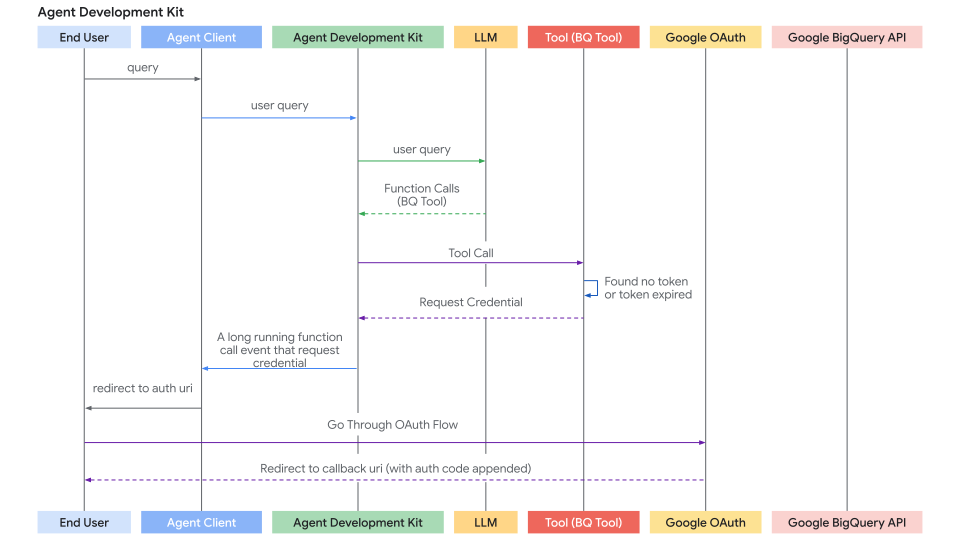
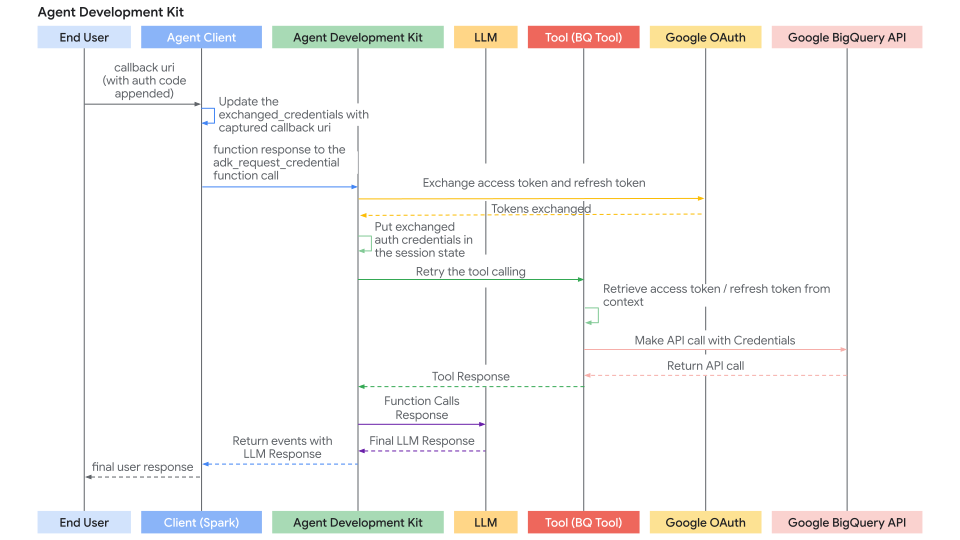

 [ Python](https://github.com/google/adk-python "adk-python on GitHub")[ JS ](https://github.com/google/adk-js "adk-js on GitHub")[ Go ](https://github.com/google/adk-go "adk-go on GitHub")[ Java ](https://github.com/google/adk-java "adk-java on GitHub")[ Kotlin](https://github.com/google/adk-kotlin "adk-kotlin on GitHub")

-   [Home](../..)
-    Build Agents
    
    Build Agents
    
    -   [Get Started](../../get-started/)
        
        Get Started
        
        -   [Python](../../get-started/python/)
        -   [TypeScript](../../get-started/typescript/)
        -   [Go](../../get-started/go/)
        -   [Java](../../get-started/java/)
        -   [Kotlin](../../get-started/kotlin/)
        -   [Agents CLI](../../get-started/agents-cli/)
        -   [Installation](../../get-started/installation/)
        -   [Google Cloud](../../get-started/google-cloud/)
        -   [Migrate to ADK](../../get-started/migrate/)
        
    -   [Build your Agent](../../tutorials/)
        
        Build your Agent
        
        -   [Multi-tool agent](../../tutorials/multi-tool-agent/)
        -   [Agent team](../../tutorials/agent-team/)
        -   [Code with AI](../../tutorials/coding-with-ai/)
        -   [Agent Config](../../agents/config/)
        
    -   [Agents](../../agents/)
        
        Agents
        
        -   [Simple agents](../../agents/llm-agents/)
        -   [Managed agents](../../agents/managed-agents/)
        
    -   [Graph Workflows](../../graphs/)
        
        Graph Workflows
        
        -   [Graph routes](../../graphs/routes/)
        -   [Data handling](../../graphs/data-handling/)
        -   [Human input](../../graphs/human-input/)
        -   [Dynamic workflows](../../graphs/dynamic/)
        
    -   [Multi-Agent Workflows](../../workflows/)
        
        Multi-Agent Workflows
        
        -   [Collaborative workflows](../../workflows/collaboration/)
        -   [Template workflows](../../agents/workflow-agents/)
            
            Template workflows
            
            -   [Sequential workflow](../../agents/workflow-agents/sequential-agents/)
            -   [Loop workflow](../../agents/workflow-agents/loop-agents/)
            -   [Parallel workflow](../../agents/workflow-agents/parallel-agents/)
            -   [Custom template workflows](../../agents/custom-agents/)
            
        -   [Agent routing](../../agents/routing/)
        -   [Workflow patterns](../../workflows/patterns/)
        
    -   [Models for Agents](../../agents/models/)
        
        Models for Agents
        
        -   [Gemini](../../agents/models/google-gemini/)
            
            Gemini
            
            -   [Deferred scheduling](../../agents/models/google-gemini/deferred-schedule/)
            
        -   [Gemma](../../agents/models/google-gemma/)
        -   [Claude](../../agents/models/anthropic/)
        -   [Agent Platform hosted](../../agents/models/agent-platform/)
        -   [Apigee AI Gateway](../../agents/models/apigee/)
        -   [Model routing](../../agents/models/routing/)
        -   [OpenAI](../../agents/models/openai/)
        -   [Ollama](../../agents/models/ollama/)
        -   [vLLM](../../agents/models/vllm/)
        -   [LiteLLM](../../agents/models/litellm/)
        -   [LiteRT-LM](../../agents/models/litert-lm/)
        
    
-    Run Agents
    
    Run Agents
    
    -   [Agent Runtime](../../runtime/)
        
        Agent Runtime
        
        -   [Web Interface](../../runtime/web-interface/)
            
            Web Interface
            
            -   [Visual Builder](../../visual-builder/)
            
        -   [Command Line](../../runtime/command-line/)
        -   [API Server](../../runtime/api-server/)
        -   [Ambient Agents](../../runtime/ambient-agents/)
        -   [Resume Agents](../../runtime/resume/)
        -   [Cancel Agent Runs](../../runtime/cancel/)
        -   [Runtime Config](../../runtime/runconfig/)
        -   [Event Loop](../../runtime/event-loop/)
        
    -   [Deployment](../../deploy/)
        
        Deployment
        
        -   [Agent Runtime](../../deploy/agent-runtime/)
            
            Agent Runtime
            
            -   [Standard deployment](../../deploy/agent-runtime/deploy/)
            -   [agents-cli](../../deploy/agent-runtime/agents-cli/)
            -   [Test deployed agents](../../deploy/agent-runtime/test/)
            
        -   [Cloud Run](../../deploy/cloud-run/)
        -   [GKE](../../deploy/gke/)
        
    -   [Observability](../../observability/)
        
        Observability
        
        -   [Logging](../../observability/logging/)
        -   [Metrics](../../observability/metrics/)
        -   [Traces](../../observability/traces/)
        
    -   [Evaluation](../../evaluate/)
        
        Evaluation
        
        -   [Criteria](../../evaluate/criteria/)
        -   [User Simulation](../../evaluate/user-sim/)
        -   [Environment Simulation](../../evaluate/environment_simulation/)
        -   [Custom Metrics](../../evaluate/custom_metrics/)
        -   [Optimization](../../optimize/)
        
    -   [Safety and Security](../../safety/)
        
        Safety and Security
        
    
-    Components
    
    Components
    
    -   [Technical Overview](../../get-started/about/)
    -   [Custom Tools](../)
        
        Custom Tools
        
        -    Function tools
            
            Function tools
            
            -   [Overview](../function-tools/)
            -   [Tool performance](../performance/)
            -   [Action confirmations](../confirmation/)
            
        -   [MCP tools](../mcp-tools/)
            
            MCP tools
            
            -   [Advanced configuration](../mcp-tools/advanced/)
            -   [Deployment](../mcp-tools/deployment/)
            -   [Agent as MCP server](../mcp-tools/agent-as-server/)
            -   [Sub-agent delegation](../mcp-tools/agent-managed/)
            
        -   [OpenAPI tools](../openapi-tools/)
        -    Authentication [Authentication](./)
            
            Table of contents
            
            -   [Authentication and credential management](#authentication-and-credential-management)
                
                -   [Recommended: Authentication manager services](#authentication-manager)
                -   [Self-managed authentication](#self-managed-authentication)
                -   [Secrets manager services](#secrets-manager)
                -   [Local encrypted secrets storage](#local-encrypted-secrets-storage)
                -   [In-memory secrets](#in-memory-secrets)
                
            -   [Framework components](#framework-components)
                
                -   [Supported initial credential types](#supported-initial-credential-types)
                
            -   [Tools and integrations quick guide](#tools-and-integrations-quick-guide)
            -   [Build agentic applications with authenticated tools](#build-agentic-applications-with-authenticated-tools)
                
                -   [Configure tools with authentication](#configure-tools-with-authentication)
                    
                    -   [Use OpenAPI-based toolsets](#use-openapi-based-toolsets)
                    -   [Use Google API toolsets](#use-google-api-toolsets)
                    -   [Use ID token](#use-id-token)
                        
                        -   [Configuration](#configuration)
                        -   [Key takeaways](#key-takeaways)
                        -   [ServiceAccount configuration parameters](#serviceaccount-configuration-parameters)
                        
                    -   [Use external access tokens](#use-external-access-tokens)
                    -   [Authentication request flow](#authentication-request-flow)
                    
                -   [Authenticate at a toolset level](#authenticate-at-a-toolset-level)
                    
                    -   [How to enable it](#how-to-enable-it)
                    
                -   [Handle the interactive OAuth/OIDC flow (client-side)](#handle-the-interactive-oauthoidc-flow-client-side)
                
            -   [Build custom tools (FunctionTool) requiring authentication](#build-custom-tools-functiontool-requiring-authentication)
                
                -   [Prerequisites](#prerequisites)
                -   [Authentication Logic within the Tool Function](#authentication-logic-within-the-tool-function)
                
            
        -   [Tool limitations](../../tools/limitations/)
        
    -   [Artifacts](../../artifacts/)
        
        Artifacts
        
    -   [Skills for Agents](../../skills/)
        
        Skills for Agents
        
    -   [App management](../../apps/)
        
        App management
        
        -   [Callbacks](../../callbacks/)
            
            Callbacks
            
            -   [Types of callbacks](../../callbacks/types-of-callbacks/)
            -   [Callback patterns](../../callbacks/design-patterns-and-best-practices/)
            
        -   [Plugins](../../plugins/)
        
    -   [Agent context](../../context/)
        
        Agent context
        
        -   [Conversational context](../../sessions/)
        -   [Sessions](../../sessions/session/)
            
            Sessions
            
            -   [Rewind sessions](../../sessions/session/rewind/)
            -   [Migrate sessions](../../sessions/session/migrate/)
            
        -   [State](../../sessions/state/)
        -   [Events](../../events/)
        -   [Memory](../../sessions/memory/)
        -   [Context compression](../../context/compaction/)
        -   [Model context caching](../../context/caching/)
        
    -   [A2A Protocol](../../a2a/)
        
        A2A Protocol
        
        -   [Introduction to A2A](../../a2a/intro/)
        -    A2A Quickstart (Exposing)
            
            A2A Quickstart (Exposing)
            
            -   [Python](../../a2a/quickstart-exposing/)
            -   [Go](../../a2a/quickstart-exposing-go/)
            -   [Java](../../a2a/quickstart-exposing-java/)
            
        -    A2A Quickstart (Consuming)
            
            A2A Quickstart (Consuming)
            
            -   [Python](../../a2a/quickstart-consuming/)
            -   [Go](../../a2a/quickstart-consuming-go/)
            -   [Java](../../a2a/quickstart-consuming-java/)
            -   [Kotlin](../../a2a/quickstart-consuming-kotlin/)
            
        -   [A2A Extension](../../a2a/a2a-extension/)
        
    -   [Live and Voice Agents](../../live/)
        
        Live and Voice Agents
        
        -   [Get started](../../live/get-started/)
            
            Get started
            
            -   [Python](../../live/get-started/streaming-python/)
            -   [Java](../../live/get-started/streaming-java/)
            
        -    Building
            
            Building
            
            -   [Workflows](../../live/workflows/)
            -   [Tools](../../live/tools/)
            -   [Sessions](../../live/sessions/)
            -   [Events](../../live/events/)
            -   [Audio and video](../../live/audio-video/)
            -   [Configuration](../../live/configuration/)
            
        -    Production
            
            Production
            
            -   [Guardrails](../../live/guardrails/)
            -   [Evaluation](../../live/evaluation/)
            -   [Build a custom server](../../live/custom-server/)
            
        -   [Supported models](../../live/models/)
        
    -   [Grounding](../../grounding/)
        
        Grounding
        
        -   [Google Search Grounding](../../grounding/google_search_grounding/)
        -   [Grounding with Search](../../grounding/grounding_with_search/)
        
    
-   [Integrations](../../integrations/)
    
    Integrations
    
-    Reference
    
    Reference
    
    -   [API Reference](../../api-reference/)
        
        API Reference
        
        -   [Python ADK](../../api-reference/python/)
        -   [TypeScript ADK](../../api-reference/typescript/)
        -    Go ADK
            
            Go ADK
            
            -   [Go v2.x](https://pkg.go.dev/google.golang.org/adk/v2)
            -   [Go v1.x](https://pkg.go.dev/google.golang.org/adk)
            
        -   [Java ADK](../../api-reference/java/)
        -   [Kotlin ADK](../../api-reference/kotlin/)
        -   [CLI Reference](../../api-reference/cli/)
        -   [Agent Config Reference](../../api-reference/agentconfig/)
        -   [REST API](../../api-reference/rest/)
        
    -   [Release Notes](../../release-notes/)
    
-   [Community](../../community/)
    
    Community
    
    -   [Contributing Guide](../../community/contributing-guide/)
    
-   [ADK 2.0](../../2.0/)
    
    ADK 2.0
    

Table of contents

-   [Authentication and credential management](#authentication-and-credential-management)
    
    -   [Recommended: Authentication manager services](#authentication-manager)
    -   [Self-managed authentication](#self-managed-authentication)
    -   [Secrets manager services](#secrets-manager)
    -   [Local encrypted secrets storage](#local-encrypted-secrets-storage)
    -   [In-memory secrets](#in-memory-secrets)
    
-   [Framework components](#framework-components)
    
    -   [Supported initial credential types](#supported-initial-credential-types)
    
-   [Tools and integrations quick guide](#tools-and-integrations-quick-guide)
-   [Build agentic applications with authenticated tools](#build-agentic-applications-with-authenticated-tools)
    
    -   [Configure tools with authentication](#configure-tools-with-authentication)
        
        -   [Use OpenAPI-based toolsets](#use-openapi-based-toolsets)
        -   [Use Google API toolsets](#use-google-api-toolsets)
        -   [Use ID token](#use-id-token)
            
            -   [Configuration](#configuration)
            -   [Key takeaways](#key-takeaways)
            -   [ServiceAccount configuration parameters](#serviceaccount-configuration-parameters)
            
        -   [Use external access tokens](#use-external-access-tokens)
        -   [Authentication request flow](#authentication-request-flow)
        
    -   [Authenticate at a toolset level](#authenticate-at-a-toolset-level)
        
        -   [How to enable it](#how-to-enable-it)
        
    -   [Handle the interactive OAuth/OIDC flow (client-side)](#handle-the-interactive-oauthoidc-flow-client-side)
    
-   [Build custom tools (FunctionTool) requiring authentication](#build-custom-tools-functiontool-requiring-authentication)
    
    -   [Prerequisites](#prerequisites)
    -   [Authentication Logic within the Tool Function](#authentication-logic-within-the-tool-function)
    

1.  [Home](../..)
2.  [Components](../../get-started/about/)
3.  [Custom Tools](../)

# Authenticating with tools[¶](#authenticating-with-tools "Permanent link")

Supported in ADKPython v0.1.0

The tools and services you use within ADK agents may require access to protected resources, such as user data in email or calendar applications, or sales records in databases. Getting access to these resources typically requires an authentication process that includes credentials and access keys which must be carefully managed and protected. The requirements for managing authentication data can also change if you are running your agent locally or deploying it to a hosted service. If multiple users, with potentially different access permissions, are interacting with the agent, this creates another layer of authentication management requirements.

WARNING: Credential storage and security risks

Storing sensitive credentials such as access tokens and especially refresh tokens directly in the session state can pose security risks depending on your session storage backend, your ***SessionService*** implementation, and overall application security posture. Carefully consider how you manage credentials in ADK agents before deploying them for general use.

## Authentication and credential management[¶](#authentication-and-credential-management "Permanent link")

There are several ways to manage authentication and credentials in ADK agents. Each of these methods carries some amount of risk, so you should carefully consider which approach best serves your application and customers.

### Recommended: Authentication manager services[¶](#authentication-manager "Permanent link")

When deploying agents to production hosted environments, your agent's ability to properly authenticate to restricted tools and services becomes more challenging and more important to properly manage. This authentication challenge can become even more complicated when users of your agent have varying levels of access to restricted tools and data.

Rather than writing code to handle the authentication process and credential management for various tools used by your agent, use an *authentication manager* service that manages *both* for you. This service should handle the storage of keys and secrets, as well as the acquisition, management, and storage of OAuth access or refresh tokens. Learn more about [Agent Identity integration](/integrations/agent-identity/) with ADK.

### Self-managed authentication[¶](#self-managed-authentication "Permanent link")

If you decide to manage your own authentication process with ADK helper functions and your own code, consider these recommendations:

-   **API keys and client secrets:** For any API keys and client secrets used inside ADK code, when running on a local compute environment use a local `.env` file excluded from version control. When your agent is hosted or otherwise in a production environment, use a secrets manager. For more details on secrets managers, see the [next section](#secrets-manager).
-   **Interactive authentication:** When using interactive three-legged auth (3LO) OAuth or OpenID Connect (OIDC) for authentication to tools, write a service on the client application to acquire, manage access, and refresh tokens. Make sure to store these tokens against an authenticated user identifier in an encrypted database.

### Secrets manager services[¶](#secrets-manager "Permanent link")

For production environments, if you are not using an [authentication manager](#authentication-manager) service, you should store credentials in a dedicated secret manager service to protect that data. With this approach, a secret manager securely stores the credentials for any tools or services accessed by the agent as needed, and those secrets are not resident in agent's operating memory. For example, a custom ADK Tool using this method would have only short-lived access tokens or secure references in session memory, and retrieve longer-lived refresh tokens from the secrets manager when needed. When selecting a secrets manager, consider services from well-established providers, such as [Google Cloud Secret Manager](https://cloud.google.com/security/products/secret-manager) or other secret management services.

### Local encrypted secrets storage[¶](#local-encrypted-secrets-storage "Permanent link")

For agent applications that are less security sensitive, keeping credentials in local, encrypted storage can be a viable option. Consider using dedicated local secrets storage system or encrypting the data in a local database using a robust encryption library, and then managing the encryption keys securely using a key management service. Take care to only keep short-lived access tokens in operating memory and access long-lived credentials and refresh tokens from encrypted local storage only when needed.

### In-memory secrets[¶](#in-memory-secrets "Permanent link")

This method *should only be used in the early development* and testing of your agent. With this approach, credentials are stored in the current ***InMemorySessionService*** instance. The data exists only in session memory and is not persisted. However, you should carefully consider the risks of using this method based on how long an agent session may last, who has access to the agent, and the security of the environment where the agent is running.

## Framework components[¶](#framework-components "Permanent link")

Within the ADK framework, the ***AuthScheme*** and ***AuthCredential*** are the key components for handling authentication methods and managing credential data:

-   ***AuthScheme***: Defines *how* an API expects authentication credentials, such as an API Key in a header or an OAuth 2.0 Bearer token. ADK supports the same types of authentication schemes as OpenAPI 3.0 and uses specific classes for credential types, including ***APIKey***, ***HTTPBearer***, ***OAuth2***, and ***OpenIdConnectWithConfig***. For more details on each OpenAPI credential type, see [OpenAPI doc: Authentication](https://swagger.io/docs/specification/v3_0/authentication/).
    
-   ***AuthCredential***: Holds the *initial* information needed to *start* the authentication process, such as your application's OAuth Client ID or Secret, or an API key value. An instance of this class includes an **auth\_type**, such as `API_KEY`, `OAUTH2`, `SERVICE_ACCOUNT`, specifying the credential type.
    

The general authentication flow involves providing these details when configuring a tool. ADK then attempts to automatically exchange the initial credential, such as an access token, before the tool makes an API call. For flows requiring user interaction, including OAuth consent, ADK triggers a specific interactive process with your ***Agent Client*** application.

### Supported initial credential types[¶](#supported-initial-credential-types "Permanent link")

-   **API\_KEY:** Provides simple key-value authentication, which usually requires no authentication exchange.
-   **HTTP:** Provides Basic Auth which is not recommended and may not be supported for exchange, or already obtained Bearer tokens. Bearer tokens do not require an authentication exchange.
-   **OAUTH2:** Provides standard OAuth 2.0 authentication flows, and requires configuration with client ID, secret, and scopes. This method often triggers an interactive flow for user consent.
-   **OPEN\_ID\_CONNECT:** Provides authentication based on OpenID Connect. Similar to OAuth2, this type often requires configuration and user interaction.
-   **SERVICE\_ACCOUNT:** Provides Google Cloud Service Account credentials as a JSON key or Application Default Credentials. This type typically exchanges a Bearer token.

## Tools and integrations quick guide[¶](#tools-and-integrations-quick-guide "Permanent link")

Here is a quick guide to authentication for key ADK toolsets:

-   [***RestApiTool***](/tools-custom/openapi-tools/): Set `auth_scheme` and `auth_credential` during initialization
-   [***OpenAPIToolset***](/tools-custom/openapi-tools/): Set `auth_scheme` and `auth_credential` during initialization
-   [***APIHubToolset***](/integrations/apigee-api-hub/): Set `auth_scheme` and `auth_credential` during initialization, *if* the API requires authentication.
-   [***ApplicationIntegrationToolset***](/integrations/application-integration/): Set `auth_scheme` and `auth_credential` during initialization, *if* the API requires authentication.
-   [***GoogleApiToolSet***](https://github.com/google/adk-python/blob/main/src/google/adk/tools/google_api_tool/google_api_toolset.py): Use this toolset's specific authentication method.

For more authentication details for other pre-built tools and integrations see the [ADK Integrations](/integrations) catalog.

* * *

## Build agentic applications with authenticated tools[¶](#build-agentic-applications-with-authenticated-tools "Permanent link")

This section focuses on using pre-existing tools (like those from `RestApiTool/ OpenAPIToolset`, `APIHubToolset`, `GoogleApiToolSet`) that require authentication within your agentic application. Your main responsibility is configuring the tools and handling the client-side part of interactive authentication flows (if required by the tool).

### Configure tools with authentication[¶](#configure-tools-with-authentication "Permanent link")

When adding an authenticated tool to your agent, you need to provide its required `AuthScheme` and your application's initial `AuthCredential`.

You can configure authentication differently depending on your toolset type, OpenAPI-based or Google API toolsets, and, for services protected by Cloud IAM, whether the service needs an ID token instead of an access token. The following subsections cover each case.

#### Use OpenAPI-based toolsets[¶](#use-openapi-based-toolsets "Permanent link")

Pass the scheme and credential during toolset initialization. The toolset applies them to all generated tools. Here are few ways to create tools with authentication in ADK.

API KeyOAuth2Service AccountOpenID connect

Create a tool requiring an API Key.

`from google.adk.tools.openapi_tool.auth.auth_helpers import token_to_scheme_credential from google.adk.tools.openapi_tool.openapi_spec_parser.openapi_toolset import OpenAPIToolset auth_scheme, auth_credential = token_to_scheme_credential(         "apikey", "query", "apikey", "YOUR_API_KEY_STRING" ) sample_api_toolset = OpenAPIToolset(         spec_str="...",  # Fill this with an OpenAPI spec string        spec_str_type="yaml",        auth_scheme=auth_scheme,        auth_credential=auth_credential, )`

Create a tool requiring OAuth2.

`from google.adk.tools.openapi_tool.openapi_spec_parser.openapi_toolset import OpenAPIToolset from fastapi.openapi.models import OAuth2 from fastapi.openapi.models import OAuthFlowAuthorizationCode from fastapi.openapi.models import OAuthFlows from google.adk.auth import AuthCredential from google.adk.auth import AuthCredentialTypes from google.adk.auth import OAuth2Auth auth_scheme = OAuth2(         flows=OAuthFlows(                authorizationCode=OAuthFlowAuthorizationCode(                        authorizationUrl="https://accounts.google.com/o/oauth2/auth",                        tokenUrl="https://oauth2.googleapis.com/token",                        scopes={                                "https://www.googleapis.com/auth/calendar": "calendar scope"                        },                )        ) ) auth_credential = AuthCredential(         auth_type=AuthCredentialTypes.OAUTH2,        oauth2=OAuth2Auth(                client_id=YOUR_OAUTH_CLIENT_ID,                client_secret=YOUR_OAUTH_CLIENT_SECRET        ), ) calendar_api_toolset = OpenAPIToolset(         spec_str=google_calendar_openapi_spec_str, # Fill this with an openapi spec        spec_str_type='yaml',        auth_scheme=auth_scheme,        auth_credential=auth_credential, )`

Create a tool requiring Service Account.

`from google.adk.tools.openapi_tool.auth.auth_helpers import service_account_dict_to_scheme_credential from google.adk.tools.openapi_tool.openapi_spec_parser.openapi_toolset import OpenAPIToolset service_account_cred = json.loads(service_account_json_str) auth_scheme, auth_credential = service_account_dict_to_scheme_credential(         config=service_account_cred,        scopes=["https://www.googleapis.com/auth/cloud-platform"], ) sample_toolset = OpenAPIToolset(         spec_str=sa_openapi_spec_str, # Fill this with an openapi spec        spec_str_type='json',        auth_scheme=auth_scheme,        auth_credential=auth_credential, )`

Create a tool requiring OpenID connect.

`from google.adk.auth.auth_schemes import OpenIdConnectWithConfig from google.adk.auth.auth_credential import AuthCredential, AuthCredentialTypes, OAuth2Auth from google.adk.tools.openapi_tool.openapi_spec_parser.openapi_toolset import OpenAPIToolset auth_scheme = OpenIdConnectWithConfig(         authorization_endpoint=OAUTH2_AUTH_ENDPOINT_URL,        token_endpoint=OAUTH2_TOKEN_ENDPOINT_URL,        scopes=['openid', 'YOUR_OAUTH_SCOPES'] ) auth_credential = AuthCredential(         auth_type=AuthCredentialTypes.OPEN_ID_CONNECT,        oauth2=OAuth2Auth(                client_id="...",                client_secret="...",        ) ) userinfo_toolset = OpenAPIToolset(         spec_str=content, # Fill in an actual spec        spec_str_type='yaml',        auth_scheme=auth_scheme,        auth_credential=auth_credential, )`

#### Use Google API toolsets[¶](#use-google-api-toolsets "Permanent link")

These toolsets often have dedicated configuration methods.

Tip: For how to create a Google OAuth Client ID & Secret, see this guide: [Get your Google API Client ID](https://developers.google.com/identity/gsi/web/guides/get-google-api-clientid#get_your_google_api_client_id)

`# Example: Configuring Google Calendar Tools from google.adk.tools.google_api_tool import CalendarToolset client_id = "YOUR_GOOGLE_OAUTH_CLIENT_ID.apps.googleusercontent.com" client_secret = "YOUR_GOOGLE_OAUTH_CLIENT_SECRET" calendar_toolset = CalendarToolset() # Use the specific configure method for this toolset type calendar_toolset.configure_auth(         client_id=client_id, client_secret=client_secret ) # agent = LlmAgent(..., tools=[calendar_toolset])`

#### Use ID token[¶](#use-id-token "Permanent link")

If your agent calls a restricted service, for example a private Cloud Run or Cloud Function, the agent needs to prove your identity, not just your permissions. If you are calling a service that is accessed using Cloud IAM, you should use an ID token.

-   **Access Token (Default)**: It calls Google APIs (Drive, BigQuery). Think of it as your keycard.
    
-   **ID Token**: It calls your own services secured by IAM. Think of it as your passport.
    

##### Configuration[¶](#configuration "Permanent link")

To implement ID token authentication, configure your ServiceAccount with the following parameters, ensuring you specify the target service's URL as the `audience`.

`from google.adk.auth.auth_credential import ServiceAccount from google.adk.tools.openapi_tool.auth.auth_helpers import service_account_scheme_credential from google.adk.tools.openapi_tool.openapi_spec_parser.openapi_toolset import OpenAPIToolset # Configure the ServiceAccount to use ID token authentication. # Replace <YOUR_AUDIENCE_URL> with the URL of the service you are calling. sa_config = ServiceAccount(         use_default_credential=True,        use_id_token=True,        audience="<YOUR_AUDIENCE_URL>", ) auth_scheme, auth_credential = service_account_scheme_credential(sa_config) sample_toolset = OpenAPIToolset(         spec_str=sa_openapi_spec_str, # Fill this with an OpenAPI spec        spec_str_type="json",        auth_scheme=auth_scheme,        auth_credential=auth_credential, )`

Troubleshooting authentication errors

If you receive an authentication error, verify that your service account has the 'Cloud Run Invoker' or equivalent role on the target service.

##### Key takeaways[¶](#key-takeaways "Permanent link")

-   **Audience Requirement**: The `audience` is a security feature that binds the token to a specific destination, preventing it from being "replayed" against other services.
    
-   **No Auto-Refresh**: Unlike standard OAuth2 access tokens for users, service-account ID tokens are fetched at the time of the request. They do not auto-refresh on a background timer.
    
-   **The Flow**: You define the intent and ADK handles the handshake, fetches the token from Google's auth servers, and injects it into your outgoing HTTP headers.
    

##### ServiceAccount configuration parameters[¶](#serviceaccount-configuration-parameters "Permanent link")

-   `service_account_credential` (Optional): Provide the path or dict for your service account JSON key file. Use this if you are running locally or outside of Google Cloud.
    
-   `use_default_credential` (Optional): Set to True to use Application Default Credentials (ADC). Recommended if your agent is already running within Google Cloud, for example on Cloud Run or Cloud Functions, as it avoids the need for local key files.
    
-   `use_id_token` (Required for IAM): Set to True to enable ID token-based authentication. This switches the ADK from requesting an Access Token, for Google APIs, to an ID Token, for your own IAM-secured services.
    
-   `audience` (Required if use\_id\_token=True): The URL of the service you are calling, for example, `https://my-service.run.app`. This is a security binding that ensures the token is valid only for that specific destination.
    
-   `scopes` (Optional): Use it only when requesting Access Tokens for Google Cloud APIs, like Drive or BigQuery. You do not need to set this if you are using ID tokens for private service authentication.
    

Pair `use_id_token` with `audience`

Always use `use_id_token=True` and `audience` together. If you provide one without the other, the ADK will raise an error to prevent accidental misconfiguration.

#### Use external access tokens[¶](#use-external-access-tokens "Permanent link")

The `external_access_token_key` feature allows your agent to use an existing access token provided by the runtime environment, such as a token provided by a frontend application, instead of starting a new authentication flow. When configured, the credential manager skips standard OAuth flows. Instead, retrieves the key in the agent's `tool_context.state` and directly uses the token for authentication. The use of this configuration parameter is mutually exclusive, and cannot include `credentials`, `client_id`, `client_secret`, or scopes parameters in the same configuration block.

Set the key on the credentials configuration of the toolset you are using. The following example uses BigQuery:

`from google.adk.integrations.bigquery import BigQueryCredentialsConfig # Configure the toolset to look for "my_frontend_token" in the session state credentials_config = BigQueryCredentialsConfig(         # Do not hardcode authentication keys in production code        external_access_token_key="my_frontend_token" )`

#### Authentication request flow[¶](#authentication-request-flow "Permanent link")

This diagram visualizes the end-to-end authentication handshake, tracing the path from the initial user query to the point where the ADK captures a credential request, handles the redirection flow, and retries the tool call once authorized.

### Authenticate at a toolset level[¶](#authenticate-at-a-toolset-level "Permanent link")

Supported in ADKPython v1.24.0

Instead of authenticating each tool individually, you can authenticate an entire suite of tools at once at the Toolset level. Under the hood, the `BaseLlmFlow` automatically checks your `BaseToolset` for authentication requirements *before* it even lists or executes any tools; it does this by checking the toolset's `get_auth_config()` method. If your toolset returns an `AuthConfig` object and the session doesn't already have the required credentials, the ADK framework performs the following steps:

1.  **Pause execution:** Safely halts the current flow.
2.  **Request credentials:** Issues an `adk_request_credential` event to the client, similar to the interactive flow detailed in [Handle the interactive OAuth/OIDC flow](#handle-the-interactive-oauthoidc-flow-client-side).

This approach gives you a single, centralized place to define auth requirements for a group of related tools. The framework handles the authentication procedure, ensuring the necessary credentials are resolved before your agent accesses tools in the toolset.

#### How to enable it[¶](#how-to-enable-it "Permanent link")

To set this up, override the `get_auth_config()` method in your custom `BaseToolset` subclass:

`from google.adk.auth import AuthConfig from google.adk.tools.base_toolset import BaseToolset  class MyAuthenticatedToolset(BaseToolset):     async def get_tools(            self, readonly_context: Optional[ReadonlyContext] = None    ) -> list[BaseTool]:        # ADK resolves the credential from get_auth_config() before calling this,        # so the tools you return here can rely on it.        return []  # Replace with the tools in your toolset.         return AuthConfig(                auth_scheme=auth_scheme,                raw_auth_credential=auth_credential,        )`

### Handle the interactive OAuth/OIDC flow (client-side)[¶](#handle-the-interactive-oauthoidc-flow-client-side "Permanent link")

If a tool requires user login/consent (typically OAuth 2.0 or OIDC), the ADK framework pauses execution and signals your ***Agent Client*** application. There are two cases:

-   ***Agent Client*** application runs the agent directly (via `runner.run_async`) in the same process. e.g. UI backend, CLI app, or Spark job etc.
-   ***Agent Client*** application interacts with ADK's fastapi server via `/run` or `/run_sse` endpoint. While ADK's fastapi server could be setup on the same server or different server as ***Agent Client*** application

The second case is a special case of first case, because `/run` or `/run_sse` endpoint also invokes `runner.run_async`. The only differences are:

-   Whether to call a python function to run the agent (first case) or call a service endpoint to run the agent (second case).
-   Whether the result events are in-memory objects (first case) or serialized json string in http response (second case).

Below sections focus on the first case and you should be able to map it to the second case very straightforward. We will also describe some differences to handle for the second case if necessary.

Here's the step-by-step process for your client application:

**Step 1: Run Agent & Detect Auth Request**

-   Initiate the agent interaction using `runner.run_async`.
-   Iterate through the yielded events.
-   Look for a specific function call event whose function call has a special name: `adk_request_credential`. This event signals that user interaction is needed. You can use helper functions to identify this event and extract necessary information. (For the second case, the logic is similar. You deserialize the event from the http response).

`# runner = Runner(...) # session = await session_service.create_session(...) # content = types.Content(...) # User's initial query print("\nRunning agent...") events_async = runner.run_async(         session_id=session.id, user_id='user', new_message=content ) auth_request_function_call_id, auth_config = None, None async for event in events_async:         # Use helper to check for the specific auth request event        if (auth_request_function_call := get_auth_request_function_call(event)):                print("--> Authentication required by agent.")                # Store the ID needed to respond later                if not (auth_request_function_call_id := auth_request_function_call.id):                        raise ValueError(f'Cannot get function call id from function call: {auth_request_function_call}')                # Get the AuthConfig containing the auth_uri etc.                auth_config = get_auth_config(auth_request_function_call)                break # Stop processing events for now, need user interaction if not auth_request_function_call_id:         print("\nAuth not required or agent finished.")        # return # Or handle final response if received`

*Helper functions `helpers.py`:*

`from google.adk.events import Event from google.adk.auth import AuthConfig # Import necessary type from google.genai import types def get_auth_request_function_call(event: Event) -> types.FunctionCall:         # Get the special auth request function call from the event        if not event.content or not event.content.parts:                return        for part in event.content.parts:                if (                        part                        and part.function_call                        and part.function_call.name == 'adk_request_credential'                        and event.long_running_tool_ids                        and part.function_call.id in event.long_running_tool_ids                ):                         return part.function_call def get_auth_config(auth_request_function_call: types.FunctionCall) -> AuthConfig:         # Extracts the AuthConfig object from the arguments of the auth request function call        if not auth_request_function_call.args or not (auth_config := auth_request_function_call.args.get('authConfig')):                raise ValueError(f'Cannot get auth config from function call: {auth_request_function_call}')        if isinstance(auth_config, dict):                auth_config = AuthConfig.model_validate(auth_config)        elif not isinstance(auth_config, AuthConfig):                raise ValueError(f'Cannot get auth config {auth_config} is not an instance of AuthConfig.')        return auth_config`

**Step 2: Redirect User for Authorization**

-   Get the authorization URL (`auth_uri`) from the `auth_config` extracted in the previous step.
-   **Crucially, append your application's** redirect\_uri as a query parameter to this `auth_uri`. This `redirect_uri` must be pre-registered with your OAuth provider (e.g., [Google Cloud Console](https://developers.google.com/identity/protocols/oauth2/web-server#creatingcred), [Okta admin panel](https://developer.okta.com/docs/guides/sign-into-web-app-redirect/spring-boot/main/#create-an-app-integration-in-the-admin-console)).
-   Direct the user to this complete URL (e.g., open it in their browser).

`# (Continuing after detecting auth needed) if auth_request_function_call_id and auth_config:         # Get the base authorization URL from the AuthConfig        base_auth_uri = auth_config.exchanged_auth_credential.oauth2.auth_uri         if base_auth_uri:                redirect_uri = 'http://localhost:8000/callback' # MUST match your OAuth client app config                # Append redirect_uri (use urlencode in production)                auth_request_uri = base_auth_uri + f'&redirect_uri={redirect_uri}'                # Now you need to redirect your end user to this auth_request_uri or ask them to open this auth_request_uri in their browser                # This auth_request_uri should be served by the corresponding auth provider and the end user should login and authorize your application to access their data                # And then the auth provider will redirect the end user to the redirect_uri you provided                # Next step: Get this callback URL from the user (or your web server handler)        else:                  print("ERROR: Auth URI not found in auth_config.")                  # Handle error`

**Step 3. Handle the Redirect Callback (Client):**

-   Your application must have a mechanism (e.g., a web server route at the `redirect_uri`) to receive the user after they authorize the application with the provider.
-   The provider redirects the user to your `redirect_uri` and appends an `authorization_code` (and potentially `state`, `scope`) as query parameters to the URL.
-   Capture the **full callback URL** from this incoming request.
-   (This step happens outside the main agent execution loop, in your web server or equivalent callback handler.)

**Step 4. Send Authentication Result Back to ADK (Client):**

-   Once you have the full callback URL (containing the authorization code), retrieve the `auth_request_function_call_id` and the `auth_config` object saved in Client Step 1.
-   Set the captured callback URL in the `exchanged_auth_credential.oauth2.auth_response_uri` field. Also ensure `exchanged_auth_credential.oauth2.redirect_uri` contains the redirect URI you used.
-   Create a `types.Content` object containing a `types.Part` with a `types.FunctionResponse`.
    -   Set `name` to `"adk_request_credential"`. (Note: This is a special name for ADK to proceed with authentication. Do not use other names.)
    -   Set `id` to the `auth_request_function_call_id` you saved.
    -   Set `response` to the *serialized* (e.g., `.model_dump()`) updated `AuthConfig` object.
-   Call `runner.run_async` **again** for the same session, passing this `FunctionResponse` content as the `new_message`.

`# (Continuing after user interaction)         # Simulate getting the callback URL (e.g., from user paste or web handler)        auth_response_uri = await get_user_input(                f'Paste the full callback URL here:\n> '        )        auth_response_uri = auth_response_uri.strip() # Clean input         if not auth_response_uri:                print("Callback URL not provided. Aborting.")                return         # Update the received AuthConfig with the callback details        auth_config.exchanged_auth_credential.oauth2.auth_response_uri = auth_response_uri        # Also include the redirect_uri used, as the token exchange might need it        auth_config.exchanged_auth_credential.oauth2.redirect_uri = redirect_uri         # Construct the FunctionResponse Content object        auth_content = types.Content(                role='user', # Role can be 'user' when sending a FunctionResponse                parts=[                        types.Part(                                function_response=types.FunctionResponse(                                        id=auth_request_function_call_id,       # Link to the original request                                        name='adk_request_credential', # Special framework function name                                        response=auth_config.model_dump() # Send back the *updated* AuthConfig                                )                        )                ],        )         # --- Resume Execution ---        print("\nSubmitting authentication details back to the agent...")        events_async_after_auth = runner.run_async(                session_id=session.id,                user_id='user',                new_message=auth_content, # Send the FunctionResponse back        )         # --- Process Final Agent Output ---        print("\n--- Agent Response after Authentication ---")        async for event in events_async_after_auth:                # Process events normally, expecting the tool call to succeed now                print(event) # Print the full event for inspection`

Note: Authorization response with Resume feature

If your ADK agent workflow is configured with the [Resume](/runtime/resume/) feature, you also must include the Invocation ID (`invocation_id`) parameter with the authorization response. The Invocation ID you provide must be the same invocation that generated the authorization request, otherwise the system starts a new invocation with the authorization response. If your agent uses the Resume feature, consider including the Invocation ID as a parameter with your authorization request, so it can be included with the authorization response. For more details on using the Resume feature, see [Resume stopped agents](/runtime/resume/).

**Step 5: ADK Handles Token Exchange & Tool Retry and gets Tool result**

-   ADK receives the `FunctionResponse` for `adk_request_credential`.
-   It uses the information in the updated `AuthConfig` (including the callback URL containing the code) to perform the OAuth **token exchange** with the provider's token endpoint, obtaining the access token (and possibly refresh token).
-   ADK internally makes these tokens available by setting them in the session state.
-   ADK **automatically retries** the original tool call (the one that initially failed due to missing auth).
-   This time, the tool finds the valid tokens (via `tool_context.get_auth_response()`) and successfully executes the authenticated API call.
-   The agent receives the actual result from the tool and generates its final response to the user.

* * *

The sequence diagram of auth response flow, where the ***Agent Client*** sends back the auth response and ADK retries the tool, is as follows:

## Build custom tools (`FunctionTool`) requiring authentication[¶](#build-custom-tools-functiontool-requiring-authentication "Permanent link")

This section focuses on implementing the authentication logic *inside* your custom Python function when creating a new ADK Tool. We will implement a `FunctionTool` as an example.

### Prerequisites[¶](#prerequisites "Permanent link")

Your function signature *must* include [`tool_context: ToolContext`](../#tool-context). ADK automatically injects this object, providing access to state and auth mechanisms.

`from google.adk.tools import FunctionTool, ToolContext from typing import Dict def my_authenticated_tool_function(param1: str, ..., tool_context: ToolContext) -> dict:         # ... your logic ...        pass my_tool = FunctionTool(func=my_authenticated_tool_function)`

### Authentication Logic within the Tool Function[¶](#authentication-logic-within-the-tool-function "Permanent link")

Implement the following steps inside your function:

**Step 1: Check for Cached & Valid Credentials:**

Inside your tool function, first check if valid credentials (e.g., access/refresh tokens) are already stored from a previous run in this session. Credentials for the current sessions should be stored in `tool_context.invocation_context.session.state` (a dictionary of state) Check existence of existing credentials by checking `tool_context.invocation_context.session.state.get(credential_name, None)`.

`from google.oauth2.credentials import Credentials from google.auth.transport.requests import Request # Inside your tool function TOKEN_CACHE_KEY = "my_tool_tokens" # Choose a unique key SCOPES = ["scope1", "scope2"] # Define required scopes creds = None cached_token_info = tool_context.state.get(TOKEN_CACHE_KEY) if cached_token_info:         try:                creds = Credentials.from_authorized_user_info(cached_token_info, SCOPES)                if not creds.valid and creds.expired and creds.refresh_token:                        creds.refresh(Request())                        tool_context.state[TOKEN_CACHE_KEY] = json.loads(creds.to_json()) # Update cache                elif not creds.valid:                        creds = None # Invalid, needs re-auth                        tool_context.state[TOKEN_CACHE_KEY] = None        except Exception as e:                print(f"Error loading/refreshing cached creds: {e}")                creds = None                tool_context.state[TOKEN_CACHE_KEY] = None if creds and creds.valid:         # Skip to Step 5: Make Authenticated API Call        pass else:         # Proceed to Step 2...        pass`

**Step 2: Check for Auth Response from Client**

-   If Step 1 didn't yield valid credentials, check if the client just completed the interactive flow by calling `exchanged_credential = tool_context.get_auth_response()`.
-   This returns the updated `exchanged_credential` object sent back by the client (containing the callback URL in `auth_response_uri`).

`# Use auth_scheme and auth_credential configured in the tool. # exchanged_credential: AuthCredential | None exchanged_credential = tool_context.get_auth_response(AuthConfig(     auth_scheme=auth_scheme,    raw_auth_credential=auth_credential, )) # If exchanged_credential is not None, then there is already an exchanged credential from the auth response. if exchanged_credential:       # ADK exchanged the access token already for us                access_token = exchanged_credential.oauth2.access_token                refresh_token = exchanged_credential.oauth2.refresh_token                creds = Credentials(                        token=access_token,                        refresh_token=refresh_token,                        token_uri=auth_scheme.flows.authorizationCode.tokenUrl,                        client_id=auth_credential.oauth2.client_id,                        client_secret=auth_credential.oauth2.client_secret,                        scopes=list(auth_scheme.flows.authorizationCode.scopes.keys()),                )        # Cache the token in session state and call the API, skip to step 5`

**Step 3: Initiate Authentication Request**

If no valid credentials (Step 1.) and no auth response (Step 2.) are found, the tool needs to start the OAuth flow. Define the AuthScheme and initial AuthCredential and call `tool_context.request_credential()`. Return a response indicating authorization is needed.

`# Use auth_scheme and auth_credential configured in the tool.     tool_context.request_credential(AuthConfig(        auth_scheme=auth_scheme,        raw_auth_credential=auth_credential,    ))    return {'pending': true, 'message': 'Awaiting user authentication.'} # By setting request_credential, ADK detects a pending authentication event. It pauses execution and ask end user to login.`

**Step 4: Exchange Authorization Code for Tokens**

ADK automatically generates oauth authorization URL and presents it to your ***Agent Client*** application. your ***Agent Client*** application should follow the same way described in [Build agentic applications with authenticated tools](#build-agentic-applications-with-authenticated-tools) to redirect the user to the authorization URL (with `redirect_uri` appended). Once a user completes the login flow, ADK extracts the authentication callback url from ***Agent Client*** applications, automatically parses the auth code, and generates auth token. At the next Tool call, `tool_context.get_auth_response` in step 2 will contain a valid credential to use in subsequent API calls.

**Step 5: Cache Obtained Credentials**

After successfully obtaining the token from ADK (Step 2) or if the token is still valid (Step 1), **immediately store** the new `Credentials` object in `tool_context.state` (serialized, e.g., as JSON) using your cache key.

`# Inside your tool function, after obtaining 'creds' (either refreshed or newly exchanged) # Cache the new/refreshed tokens tool_context.state[TOKEN_CACHE_KEY] = json.loads(creds.to_json()) print(f"DEBUG: Cached/updated tokens under key: {TOKEN_CACHE_KEY}") # Proceed to Step 6 (Make API Call)`

**Step 6: Make Authenticated API Call**

-   Once you have a valid `Credentials` object (`creds` from Step 1 or Step 4), use it to make the actual call to the protected API using the appropriate client library (e.g., `googleapiclient`, `requests`). Pass the `credentials=creds` argument.
-   Include error handling, especially for `HttpError` 401/403, which might mean the token expired or was revoked between calls. If you get such an error, consider clearing the cached token (`tool_context.state.pop(...)`) and potentially returning the `auth_required` status again to force re-authentication.

`# Inside your tool function, using the valid 'creds' object # Ensure creds is valid before proceeding if not creds or not creds.valid:       return {"status": "error", "error_message": "Cannot proceed without valid credentials."} try:       service = build("calendar", "v3", credentials=creds) # Example      api_result = service.events().list(...).execute()      # Proceed to Step 7 except Exception as e:       # Handle API errors (e.g., check for 401/403, maybe clear cache and re-request auth)      print(f"ERROR: API call failed: {e}")      return {"status": "error", "error_message": f"API call failed: {e}"}`

**Step 7: Return Tool Result**

-   After a successful API call, process the result into a dictionary format that is useful for the LLM.
-   **Crucially, include a** along with the data.

`# Inside your tool function, after successful API call         processed_result = [...] # Process api_result for the LLM        return {"status": "success", "data": processed_result}`

Full Code

Tools and AgentAgent CLIHelperSpec

tools\_and\_agent.py

``# Copyright 2026 Google LLC # # Licensed under the Apache License, Version 2.0 (the "License"); # you may not use this file except in compliance with the License. # You may obtain a copy of the License at # #     http://www.apache.org/licenses/LICENSE-2.0 # # Unless required by applicable law or agreed to in writing, software # distributed under the License is distributed on an "AS IS" BASIS, # WITHOUT WARRANTIES OR CONDITIONS OF ANY KIND, either express or implied. # See the License for the specific language governing permissions and # limitations under the License. import os from google.adk.auth.auth_schemes import OpenIdConnectWithConfig from google.adk.auth.auth_credential import AuthCredential, AuthCredentialTypes, OAuth2Auth from google.adk.tools.openapi_tool.openapi_spec_parser.openapi_toolset import OpenAPIToolset from google.adk.agents.llm_agent import LlmAgent # --- Authentication Configuration --- # This section configures how the agent will handle authentication using OpenID Connect (OIDC), # often layered on top of OAuth 2.0. # Define the Authentication Scheme using OpenID Connect. # This object tells the ADK *how* to perform the OIDC/OAuth2 flow. # It requires details specific to your Identity Provider (IDP), like Google OAuth, Okta, Auth0, etc. # Note: Replace the example Okta URLs and credentials with your actual IDP details. # All following fields are required, and available from your IDP. auth_scheme = OpenIdConnectWithConfig(         # The URL of the IDP's authorization endpoint where the user is redirected to log in.        authorization_endpoint="https://your-endpoint.okta.com/oauth2/v1/authorize",        # The URL of the IDP's token endpoint where the authorization code is exchanged for tokens.        token_endpoint="https://your-token-endpoint.okta.com/oauth2/v1/token",        # The scopes (permissions) your application requests from the IDP.        # 'openid' is standard for OIDC. 'profile' and 'email' request user profile info.        scopes=['openid', 'profile', "email"] ) # Define the Authentication Credentials for your specific application. # This object holds the client identifier and secret that your application uses # to identify itself to the IDP during the OAuth2 flow. # !! SECURITY WARNING: Avoid hardcoding secrets in production code. !! # !! Use environment variables or a secret management system instead. !! auth_credential = AuthCredential(     auth_type=AuthCredentialTypes.OPEN_ID_CONNECT,    oauth2=OAuth2Auth(        client_id="CLIENT_ID",        client_secret="CLIENT_SECRET",    ) )  # --- Toolset Configuration from OpenAPI Specification --- # This section defines a sample set of tools the agent can use, configured with Authentication # from steps above. # This sample set of tools use endpoints protected by Okta and requires an OpenID Connect flow # to acquire end user credentials. with open(os.path.join(os.path.dirname(__file__), 'spec.yaml'), 'r') as f:         spec_content = f.read() userinfo_toolset = OpenAPIToolset(       spec_str=spec_content,      spec_str_type='yaml',      # ** Crucially, associate the authentication scheme and credentials with these tools. **      # This tells the ADK that the tools require the defined OIDC/OAuth2 flow.      auth_scheme=auth_scheme,      auth_credential=auth_credential, ) # --- Agent Configuration --- # Configure and create the main LLM Agent. root_agent = LlmAgent(         model='gemini-2.0-flash',        name='enterprise_assistant',        instruction='Help user integrate with multiple enterprise systems, including retrieving user information which may require authentication.',        tools=[userinfo_toolset], ) # --- Ready for Use --- # The `root_agent` is now configured with tools protected by OIDC/OAuth2 authentication. # When the agent attempts to use one of these tools, the ADK framework will automatically # trigger the authentication flow defined by `auth_scheme` and `auth_credential` # if valid credentials are not already available in the session. # The subsequent interaction flow would guide the user through the login process and handle # token exchanging, and automatically attach the exchanged token to the endpoint defined in # the tool.``

agent\_cli.py

``# Copyright 2026 Google LLC # # Licensed under the Apache License, Version 2.0 (the "License"); # you may not use this file except in compliance with the License. # You may obtain a copy of the License at # #     http://www.apache.org/licenses/LICENSE-2.0 # # Unless required by applicable law or agreed to in writing, software # distributed under the License is distributed on an "AS IS" BASIS, # WITHOUT WARRANTIES OR CONDITIONS OF ANY KIND, either express or implied. # See the License for the specific language governing permissions and # limitations under the License. import asyncio from dotenv import load_dotenv from google.adk.artifacts.in_memory_artifact_service import InMemoryArtifactService from google.adk.runners import Runner from google.adk.sessions import InMemorySessionService from google.genai import types from .helpers import is_pending_auth_event, get_function_call_id, get_function_call_auth_config, get_user_input from .tools_and_agent import root_agent load_dotenv() agent = root_agent async def async_main():     """    Main asynchronous function orchestrating the agent interaction and authentication flow.    """    # --- Step 1: Service Initialization ---    # Use in-memory services for session and artifact storage (suitable for demos/testing).    session_service = InMemorySessionService()    artifacts_service = InMemoryArtifactService()     # Create a new user session to maintain conversation state.    session = await session_service.create_session(            state={},  # Optional state dictionary for session-specific data            app_name='my_app', # Application identifier            user_id='user' # User identifier    )     # --- Step 2: Initial User Query ---    # Define the user's initial request.    query = 'Show me my user info'    print(f"user: {query}")     # Format the query into the Content structure expected by the ADK Runner.    content = types.Content(role='user', parts=[types.Part(text=query)])     # Initialize the ADK Runner    runner = Runner(            app_name='my_app',            agent=agent,            artifact_service=artifacts_service,            session_service=session_service,    )     # --- Step 3: Send Query and Handle Potential Auth Request ---    print("\nRunning agent with initial query...")    events_async = runner.run_async(            session_id=session.id, user_id='user', new_message=content    )     # Variables to store details if an authentication request occurs.    auth_request_event_id, auth_config = None, None     # Iterate through the events generated by the first run.    async for event in events_async:        # Check if this event is the specific 'adk_request_credential' function call.        if is_pending_auth_event(event):            print("--> Authentication required by agent.")            auth_request_event_id = get_function_call_id(event)            auth_config = get_function_call_auth_config(event)            # Once the auth request is found and processed, exit this loop.            # We need to pause execution here to get user input for authentication.            break      # If no authentication request was detected after processing all events, exit.    if not auth_request_event_id or not auth_config:            print("\nAuthentication not required for this query or processing finished.")            return # Exit the main function     # --- Step 4: Manual Authentication Step (Simulated OAuth 2.0 Flow) ---    # This section simulates the user interaction part of an OAuth 2.0 flow.    # In a real web application, this would involve browser redirects.     # Define the Redirect URI. This *must* match one of the URIs registered    # with the OAuth provider for your application. The provider sends the user    # back here after they approve the request.    redirect_uri = 'http://localhost:8000/dev-ui' # Example for local development     # Construct the Authorization URL that the user must visit.    # This typically includes the provider's authorization endpoint URL,    # client ID, requested scopes, response type (e.g., 'code'), and the redirect URI.    # Here, we retrieve the base authorization URI from the AuthConfig provided by ADK    # and append the redirect_uri.    # NOTE: A robust implementation would use urlencode and potentially add state, scope, etc.    auth_request_uri = (            auth_config.exchanged_auth_credential.oauth2.auth_uri            + f'&redirect_uri={redirect_uri}' # Simple concatenation; ensure correct query param format    )     print("\n--- User Action Required ---")    # Prompt the user to visit the authorization URL, log in, grant permissions,    # and then paste the *full* URL they are redirected back to (which contains the auth code).    auth_response_uri = await get_user_input(            f'1. Please open this URL in your browser to log in:\n   {auth_request_uri}\n\n'            f'2. After successful login and authorization, your browser will be redirected.\n'            f'   Copy the *entire* URL from the browser\'s address bar.\n\n'            f'3. Paste the copied URL here and press Enter:\n\n> '    )     # --- Step 5: Prepare Authentication Response for the Agent ---    # Update the AuthConfig object with the information gathered from the user.    # The ADK framework needs the full response URI (containing the code)    # and the original redirect URI to complete the OAuth token exchange process internally.    auth_config.exchanged_auth_credential.oauth2.auth_response_uri = auth_response_uri    auth_config.exchanged_auth_credential.oauth2.redirect_uri = redirect_uri     # Construct a FunctionResponse Content object to send back to the agent/runner.    # This response explicitly targets the 'adk_request_credential' function call    # identified earlier by its ID.    auth_content = types.Content(            role='user',            parts=[                    types.Part(                            function_response=types.FunctionResponse(                                    # Crucially, link this response to the original request using the saved ID.                                    id=auth_request_event_id,                                    # The special name of the function call we are responding to.                                    name='adk_request_credential',                                    # The payload containing all necessary authentication details.                                    response=auth_config.model_dump(),                            )                    )            ],    )     # --- Step 6: Resume Execution with Authentication ---    print("\nSubmitting authentication details back to the agent...")    # Run the agent again, this time providing the `auth_content` (FunctionResponse).    # The ADK Runner intercepts this, processes the 'adk_request_credential' response    # (performs token exchange, stores credentials), and then allows the agent    # to retry the original tool call that required authentication, now succeeding with    # a valid access token embedded.    events_async = runner.run_async(            session_id=session.id,            user_id='user',            new_message=auth_content, # Provide the prepared auth response    )     # Process and print the final events from the agent after authentication is complete.    # This stream now contain the actual result from the tool (e.g., the user info).    print("\n--- Agent Response after Authentication ---")    async for event in events_async:        print(event)  if __name__ == '__main__':     asyncio.run(async_main())``

helpers.py

``# Copyright 2025 Google LLC # # Licensed under the Apache License, Version 2.0 (the "License"); # you may not use this file except in compliance with the License. # You may obtain a copy of the License at # #     http://www.apache.org/licenses/LICENSE-2.0 # # Unless required by applicable law or agreed to in writing, software # distributed under the License is distributed on an "AS IS" BASIS, # WITHOUT WARRANTIES OR CONDITIONS OF ANY KIND, either express or implied. # See the License for the specific language governing permissions and # limitations under the License. from google.adk.auth import AuthConfig from google.adk.events import Event import asyncio # --- Helper Functions --- async def get_user_input(prompt: str) -> str:     """    Asynchronously prompts the user for input in the console.     Uses asyncio's event loop and run_in_executor to avoid blocking the main    asynchronous execution thread while waiting for synchronous `input()`.     Args:        prompt: The message to display to the user.     Returns:        The string entered by the user.    """    loop = asyncio.get_event_loop()    # Run the blocking `input()` function in a separate thread managed by the executor.    return await loop.run_in_executor(None, input, prompt)  def is_pending_auth_event(event: Event) -> bool:     """    Checks if an ADK Event represents a request for user authentication credentials.     The ADK framework emits a specific function call ('adk_request_credential')    when a tool requires authentication that hasn't been previously satisfied.     Args:        event: The ADK Event object to inspect.     Returns:        True if the event is an 'adk_request_credential' function call, False otherwise.    """    # Safely checks nested attributes to avoid errors if event structure is incomplete.    return (            event.content            and event.content.parts            and event.content.parts[0] # Assuming the function call is in the first part            and event.content.parts[0].function_call            # The specific function name indicating an auth request from the ADK framework.            and event.content.parts[0].function_call.name == 'adk_request_credential'    )  def get_function_call_id(event: Event) -> str:     """    Extracts the unique ID of the function call from an ADK Event.     This ID is crucial for correlating a function *response* back to the specific    function *call* that the agent initiated to request for auth credentials.     Args:        event: The ADK Event object containing the function call.     Returns:        The unique identifier string of the function call.     Raises:        ValueError: If the function call ID cannot be found in the event structure.                                (Corrected typo from `contents` to `content` below)    """    # Navigate through the event structure to find the function call ID.    if (            event            and event.content            and event.content.parts            and event.content.parts[0] # Use content, not contents            and event.content.parts[0].function_call            and event.content.parts[0].function_call.id    ):        return event.content.parts[0].function_call.id    # If the ID is missing, raise an error indicating an unexpected event format.    raise ValueError(f'Cannot get function call id from event {event}')  def get_function_call_auth_config(event: Event) -> AuthConfig:     """    Extracts the authentication configuration details from an 'adk_request_credential' event.     Client should use this AuthConfig to necessary authentication details (like OAuth codes and state)    and sent it back to the ADK to continue OAuth token exchanging.     Args:        event: The ADK Event object containing the 'adk_request_credential' call.     Returns:        An AuthConfig object populated with details from the function call arguments.     Raises:        ValueError: If the 'auth_config' argument cannot be found in the event.                                (Corrected typo from `contents` to `content` below)    """    if (            event            and event.content            and event.content.parts            and event.content.parts[0] # Use content, not contents            and event.content.parts[0].function_call            and event.content.parts[0].function_call.args            and event.content.parts[0].function_call.args.get('auth_config')    ):        # Reconstruct the AuthConfig object using the dictionary provided in the arguments.        # The ** operator unpacks the dictionary into keyword arguments for the constructor.        return AuthConfig(                    **event.content.parts[0].function_call.args.get('auth_config')            )    raise ValueError(f'Cannot get auth config from event {event}')``

`openapi: 3.0.1 info: title: Okta User Info API version: 1.0.0 description: |-       API to retrieve user profile information based on a valid Okta OIDC Access Token.      Authentication is handled via OpenID Connect with Okta. contact:       name: API Support      email: support@example.com # Replace with actual contact if available servers: - url: <substitute with your server name>       description: Production Environment paths: /okta-jwt-user-api:       get:            summary: Get Authenticated User Info            description: |-            Fetches profile details for the user            operationId: getUserInfo            tags:            - User Profile            security:            - okta_oidc:                        - openid                        - email                        - profile            responses:            '200':                  description: Successfully retrieved user information.                  content:                        application/json:                        schema:                              type: object                              properties:                                    sub:                                    type: string                                    description: Subject identifier for the user.                                    example: "abcdefg"                                    name:                                    type: string                                    description: Full name of the user.                                    example: "Example LastName"                                    locale:                                    type: string                                    description: User's locale, e.g., en-US or en_US.                                    example: "en_US"                                    email:                                    type: string                                    format: email                                    description: User's primary email address.                                    example: "username@example.com"                                    preferred_username:                                    type: string                                    description: Preferred username of the user (often the email).                                    example: "username@example.com"                                    given_name:                                    type: string                                    description: Given name (first name) of the user.                                    example: "Example"                                    family_name:                                    type: string                                    description: Family name (last name) of the user.                                    example: "LastName"                                    zoneinfo:                                    type: string                                    description: User's timezone, e.g., America/Los_Angeles.                                    example: "America/Los_Angeles"                                    updated_at:                                    type: integer                                    format: int64 # Using int64 for Unix timestamp                                    description: Timestamp when the user's profile was last updated (Unix epoch time).                                    example: 1743617719                                    email_verified:                                    type: boolean                                    description: Indicates if the user's email address has been verified.                                    example: true                              required:                                    - sub                                    - name                                    - locale                                    - email                                    - preferred_username                                    - given_name                                    - family_name                                    - zoneinfo                                    - updated_at                                    - email_verified            '401':                  description: Unauthorized. The provided Bearer token is missing, invalid, or expired.                  content:                        application/json:                        schema:                              $ref: '#/components/schemas/Error'            '403':                  description: Forbidden. The provided token does not have the required scopes or permissions to access this resource.                  content:                        application/json:                        schema:                              $ref: '#/components/schemas/Error' components: securitySchemes:       okta_oidc:            type: openIdConnect            description: Authentication via Okta using OpenID Connect. Requires a Bearer Access Token.            openIdConnectUrl: https://your-endpoint.okta.com/.well-known/openid-configuration schemas:       Error:            type: object            properties:            code:                  type: string                  description: An error code.            message:                  type: string                  description: A human-readable error message.            required:                  - code                  - message`

Back to top