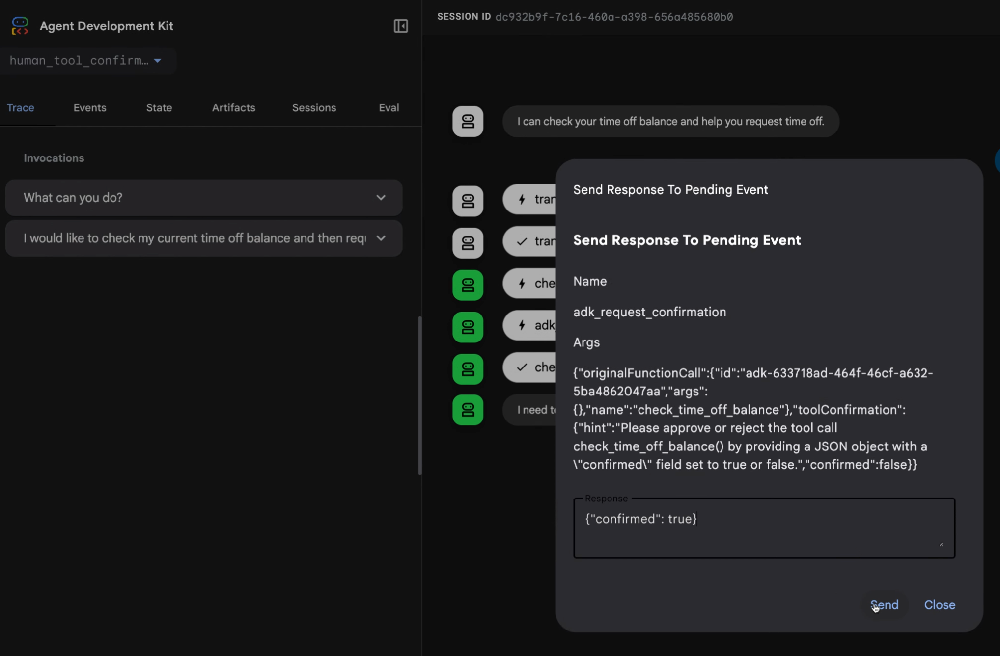

 [ Python](https://github.com/google/adk-python "adk-python on GitHub")[ JS ](https://github.com/google/adk-js "adk-js on GitHub")[ Go ](https://github.com/google/adk-go "adk-go on GitHub")[ Java ](https://github.com/google/adk-java "adk-java on GitHub")[ Kotlin](https://github.com/google/adk-kotlin "adk-kotlin on GitHub")

-   [Home](../..)
-    Build Agents
    
    Build Agents
    
    -   [Get Started](../../get-started/)
        
        Get Started
        
        -   [Python](../../get-started/python/)
        -   [TypeScript](../../get-started/typescript/)
        -   [Go](../../get-started/go/)
        -   [Java](../../get-started/java/)
        -   [Kotlin](../../get-started/kotlin/)
        -   [Agents CLI](../../get-started/agents-cli/)
        -   [Installation](../../get-started/installation/)
        -   [Google Cloud](../../get-started/google-cloud/)
        -   [Migrate to ADK](../../get-started/migrate/)
        
    -   [Build your Agent](../../tutorials/)
        
        Build your Agent
        
        -   [Multi-tool agent](../../tutorials/multi-tool-agent/)
        -   [Agent team](../../tutorials/agent-team/)
        -   [Code with AI](../../tutorials/coding-with-ai/)
        -   [Agent Config](../../agents/config/)
        
    -   [Agents](../../agents/)
        
        Agents
        
        -   [Simple agents](../../agents/llm-agents/)
        -   [Managed agents](../../agents/managed-agents/)
        
    -   [Graph Workflows](../../graphs/)
        
        Graph Workflows
        
        -   [Graph routes](../../graphs/routes/)
        -   [Data handling](../../graphs/data-handling/)
        -   [Human input](../../graphs/human-input/)
        -   [Dynamic workflows](../../graphs/dynamic/)
        
    -   [Multi-Agent Workflows](../../workflows/)
        
        Multi-Agent Workflows
        
        -   [Collaborative workflows](../../workflows/collaboration/)
        -   [Template workflows](../../agents/workflow-agents/)
            
            Template workflows
            
            -   [Sequential workflow](../../agents/workflow-agents/sequential-agents/)
            -   [Loop workflow](../../agents/workflow-agents/loop-agents/)
            -   [Parallel workflow](../../agents/workflow-agents/parallel-agents/)
            -   [Custom template workflows](../../agents/custom-agents/)
            
        -   [Agent routing](../../agents/routing/)
        -   [Workflow patterns](../../workflows/patterns/)
        
    -   [Models for Agents](../../agents/models/)
        
        Models for Agents
        
        -   [Gemini](../../agents/models/google-gemini/)
            
            Gemini
            
            -   [Deferred scheduling](../../agents/models/google-gemini/deferred-schedule/)
            
        -   [Gemma](../../agents/models/google-gemma/)
        -   [Claude](../../agents/models/anthropic/)
        -   [Agent Platform hosted](../../agents/models/agent-platform/)
        -   [Apigee AI Gateway](../../agents/models/apigee/)
        -   [Model routing](../../agents/models/routing/)
        -   [OpenAI](../../agents/models/openai/)
        -   [Ollama](../../agents/models/ollama/)
        -   [vLLM](../../agents/models/vllm/)
        -   [LiteLLM](../../agents/models/litellm/)
        -   [LiteRT-LM](../../agents/models/litert-lm/)
        
    
-    Run Agents
    
    Run Agents
    
    -   [Agent Runtime](../../runtime/)
        
        Agent Runtime
        
        -   [Web Interface](../../runtime/web-interface/)
            
            Web Interface
            
            -   [Visual Builder](../../visual-builder/)
            
        -   [Command Line](../../runtime/command-line/)
        -   [API Server](../../runtime/api-server/)
        -   [Ambient Agents](../../runtime/ambient-agents/)
        -   [Resume Agents](../../runtime/resume/)
        -   [Cancel Agent Runs](../../runtime/cancel/)
        -   [Runtime Config](../../runtime/runconfig/)
        -   [Event Loop](../../runtime/event-loop/)
        
    -   [Deployment](../../deploy/)
        
        Deployment
        
        -   [Agent Runtime](../../deploy/agent-runtime/)
            
            Agent Runtime
            
            -   [Standard deployment](../../deploy/agent-runtime/deploy/)
            -   [agents-cli](../../deploy/agent-runtime/agents-cli/)
            -   [Test deployed agents](../../deploy/agent-runtime/test/)
            
        -   [Cloud Run](../../deploy/cloud-run/)
        -   [GKE](../../deploy/gke/)
        
    -   [Observability](../../observability/)
        
        Observability
        
        -   [Logging](../../observability/logging/)
        -   [Metrics](../../observability/metrics/)
        -   [Traces](../../observability/traces/)
        
    -   [Evaluation](../../evaluate/)
        
        Evaluation
        
        -   [Criteria](../../evaluate/criteria/)
        -   [User Simulation](../../evaluate/user-sim/)
        -   [Environment Simulation](../../evaluate/environment_simulation/)
        -   [Custom Metrics](../../evaluate/custom_metrics/)
        -   [Optimization](../../optimize/)
        
    -   [Safety and Security](../../safety/)
        
        Safety and Security
        
    
-    Components
    
    Components
    
    -   [Technical Overview](../../get-started/about/)
    -   [Custom Tools](../)
        
        Custom Tools
        
        -    Function tools
            
            Function tools
            
            -   [Overview](../function-tools/)
            -   [Tool performance](../performance/)
            -    Action confirmations [Action confirmations](./)
                
                Table of contents
                
                -   [Boolean confirmation](#boolean-confirmation)
                    
                    -   [Require confirmation function](#require-confirmation-function)
                    
                -   [Advanced confirmation](#advanced-confirmation)
                    
                    -   [Confirmation definition](#confirmation-definition)
                    
                -   [Remote confirmation with REST API](#remote-response)
                -   [Known limitations](#known-limitations)
                -   [Next steps](#next-steps)
                
            
        -   [MCP tools](../mcp-tools/)
            
            MCP tools
            
            -   [Advanced configuration](../mcp-tools/advanced/)
            -   [Deployment](../mcp-tools/deployment/)
            -   [Agent as MCP server](../mcp-tools/agent-as-server/)
            -   [Sub-agent delegation](../mcp-tools/agent-managed/)
            
        -   [OpenAPI tools](../openapi-tools/)
        -   [Authentication](../authentication/)
        -   [Tool limitations](../../tools/limitations/)
        
    -   [Artifacts](../../artifacts/)
        
        Artifacts
        
    -   [Skills for Agents](../../skills/)
        
        Skills for Agents
        
    -   [App management](../../apps/)
        
        App management
        
        -   [Callbacks](../../callbacks/)
            
            Callbacks
            
            -   [Types of callbacks](../../callbacks/types-of-callbacks/)
            -   [Callback patterns](../../callbacks/design-patterns-and-best-practices/)
            
        -   [Plugins](../../plugins/)
        
    -   [Agent context](../../context/)
        
        Agent context
        
        -   [Conversational context](../../sessions/)
        -   [Sessions](../../sessions/session/)
            
            Sessions
            
            -   [Rewind sessions](../../sessions/session/rewind/)
            -   [Migrate sessions](../../sessions/session/migrate/)
            
        -   [State](../../sessions/state/)
        -   [Events](../../events/)
        -   [Memory](../../sessions/memory/)
        -   [Context compression](../../context/compaction/)
        -   [Model context caching](../../context/caching/)
        
    -   [A2A Protocol](../../a2a/)
        
        A2A Protocol
        
        -   [Introduction to A2A](../../a2a/intro/)
        -    A2A Quickstart (Exposing)
            
            A2A Quickstart (Exposing)
            
            -   [Python](../../a2a/quickstart-exposing/)
            -   [Go](../../a2a/quickstart-exposing-go/)
            -   [Java](../../a2a/quickstart-exposing-java/)
            
        -    A2A Quickstart (Consuming)
            
            A2A Quickstart (Consuming)
            
            -   [Python](../../a2a/quickstart-consuming/)
            -   [Go](../../a2a/quickstart-consuming-go/)
            -   [Java](../../a2a/quickstart-consuming-java/)
            -   [Kotlin](../../a2a/quickstart-consuming-kotlin/)
            
        -   [A2A Extension](../../a2a/a2a-extension/)
        
    -   [Live and Voice Agents](../../live/)
        
        Live and Voice Agents
        
        -   [Get started](../../live/get-started/)
            
            Get started
            
            -   [Python](../../live/get-started/streaming-python/)
            -   [Java](../../live/get-started/streaming-java/)
            
        -    Building
            
            Building
            
            -   [Workflows](../../live/workflows/)
            -   [Tools](../../live/tools/)
            -   [Sessions](../../live/sessions/)
            -   [Events](../../live/events/)
            -   [Audio and video](../../live/audio-video/)
            -   [Configuration](../../live/configuration/)
            
        -    Production
            
            Production
            
            -   [Guardrails](../../live/guardrails/)
            -   [Evaluation](../../live/evaluation/)
            -   [Build a custom server](../../live/custom-server/)
            
        -   [Supported models](../../live/models/)
        
    -   [Grounding](../../grounding/)
        
        Grounding
        
        -   [Google Search Grounding](../../grounding/google_search_grounding/)
        -   [Grounding with Search](../../grounding/grounding_with_search/)
        
    
-   [Integrations](../../integrations/)
    
    Integrations
    
-    Reference
    
    Reference
    
    -   [API Reference](../../api-reference/)
        
        API Reference
        
        -   [Python ADK](../../api-reference/python/)
        -   [TypeScript ADK](../../api-reference/typescript/)
        -    Go ADK
            
            Go ADK
            
            -   [Go v2.x](https://pkg.go.dev/google.golang.org/adk/v2)
            -   [Go v1.x](https://pkg.go.dev/google.golang.org/adk)
            
        -   [Java ADK](../../api-reference/java/)
        -   [Kotlin ADK](../../api-reference/kotlin/)
        -   [CLI Reference](../../api-reference/cli/)
        -   [Agent Config Reference](../../api-reference/agentconfig/)
        -   [REST API](../../api-reference/rest/)
        
    -   [Release Notes](../../release-notes/)
    
-   [Community](../../community/)
    
    Community
    
    -   [Contributing Guide](../../community/contributing-guide/)
    
-   [ADK 2.0](../../2.0/)
    
    ADK 2.0
    

Table of contents

-   [Boolean confirmation](#boolean-confirmation)
    
    -   [Require confirmation function](#require-confirmation-function)
    
-   [Advanced confirmation](#advanced-confirmation)
    
    -   [Confirmation definition](#confirmation-definition)
    
-   [Remote confirmation with REST API](#remote-response)
-   [Known limitations](#known-limitations)
-   [Next steps](#next-steps)

1.  [Home](../..)
2.  [Components](../../get-started/about/)
3.  [Custom Tools](../)
4.  [Function tools](../function-tools/)

# Get action confirmation for ADK Tools[¶](#get-action-confirmation-for-adk-tools "Permanent link")

Supported in ADKPython v1.14.0TypeScript v0.2.0Go v0.3.0Kotlin v0.1.0Experimental

Some agent workflows require confirmation for decision making, verification, security, or general oversight. In these cases, you want to get a response from a human or supervising system before proceeding with a workflow. The *Tool Confirmation* feature in the Agent Development Kit (ADK) allows an ADK Tool to pause its execution and interact with a user or other system for confirmation or to gather structured data before proceeding. You can use Tool Confirmation with an ADK Tool in the following ways:

-   **[Boolean Confirmation](#boolean-confirmation):** You can configure a tool with a confirmation flag or provider. This option pauses the tool for a yes or no confirmation response.
-   **[Advanced Confirmation](#advanced-confirmation):** For scenarios requiring structured data responses, you can configure a tool with a text prompt to explain the confirmation and an expected response.

Experimental

The Tool Confirmation feature is experimental and has some [known limitations](#known-limitations). We welcome your [feedback](https://github.com/google/adk-python/issues/new?template=feature_request.md&labels=tool%20confirmation)!

You can configure how a request is communicated to a user, and the system can also use [remote responses](#remote-response) sent via the ADK server's REST API. When using the confirmation feature with the ADK web user interface, the agent workflow displays a dialog box to the user to request input, as shown in Figure 1:

**Figure 1.** Example confirmation response request dialog box using an advanced, tool response implementation.

The following sections describe how to use this feature for the confirmation scenarios. For a complete code sample, see the [human\_tool\_confirmation](https://github.com/google/adk-python/blob/fc90ce968f114f84b14829f8117797a4c256d710/contributing/samples/human_tool_confirmation/agent.py) example. There are additional ways to incorporate human input into your agent workflow, for more details, see the [Human-in-the-loop](/workflows/patterns/#human-in-the-loop) agent pattern.

## Boolean confirmation[¶](#boolean-confirmation "Permanent link")

When your tool only requires a simple `yes` or `no` from the user, you can append a confirmation step. In Python, Go, and Java, you can enable this by wrapping the tool with the `FunctionTool` class and setting the `require_confirmation` parameter (or equivalent) to `True`. In Kotlin, you set `requireConfirmation = true` on the tool function's `@Tool` annotation. In TypeScript, you implement this logic manually within the `execute` function using the `ToolContext`.

The following examples show how to enable boolean confirmation:

PythonTypeScriptGoJavaKotlin

`root_agent = Agent(         # ...        tools = [                # Set require_confirmation to True to require user confirmation                # for the tool call.                FunctionTool(reimburse, require_confirmation=True),        ],        # ... ) # This implementation method requires minimal code, but is limited to simple # approvals from the user or confirming system. For a complete example of this # approach, see the following code sample for a more detailed example: # https://github.com/google/adk-python/blob/main/contributing/samples/hitl/human_tool_confirmation/agent.py`

Note

ADK for TypeScript currently requires manual implementation of confirmation logic within the tool's `execute` function.

``/**   * A reimbursement tool with dynamic confirmation logic.  */ export const reimburseTool = new FunctionTool({     name: 'reimburse',    description: 'Reimburse an amount. Large amounts (>1000) require manager approval.',    parameters: z.object({        amount: z.coerce.number().describe('The amount to reimburse.'),    }),    execute: async ({amount}, toolContext) => {        // 1. Check if we already have a confirmed response.        if (toolContext?.toolConfirmation?.confirmed) {            const isLarge = amount > 1000;            return {                status: 'SUCCESS',                message: isLarge                    ? `Large reimbursement of ${amount} approved by manager and processed.`                    : `Reimbursement of ${amount} has been successfully processed.`,            };        }         // 2. Request a tool confirmation.        const isLarge = amount > 1000;        toolContext?.requestConfirmation({            hint: isLarge                ? `The amount ${amount} exceeds the $1000 limit and requires manager approval.`                : `Do you want to reimburse ${amount}?`,            payload: {amount},        });         // 3. Return a status that tells the agent we are waiting.        // Note: The model won't see this until the turn resumes after confirmation.        return {            status: isLarge ? 'AWAITING_MANAGER_APPROVAL' : 'AWAITING_CONFIRMATION',            message: 'This request requires approval to proceed.',        };    }, }); export const rootAgent = new LlmAgent({     name: 'Finance_Assistant',    model: 'gemini-flash-latest',    instruction: `You are a Finance Assistant.    - You MUST use the 'reimburse' tool for ALL reimbursement requests.    - MANDATORY: Every tool call MUST be accompanied by a text response in the same message.    - THRESHOLD LOGIC:        - For amounts <= 1000: Say "I am initiating the reimbursement request for [amount]. Please confirm it to proceed."        - For amounts > 1000: Say "I am initiating the reimbursement request for [amount]. Since this exceeds $1000, manager approval is required. Please confirm the request to submit it for review."    - EXAMPLES:        User: "Reimburse me $45"        Model: "I am initiating the reimbursement request for 45. Please confirm it to proceed." [Tool Call: reimburse(amount=45)]         User: "Reimburse me $2500"        Model: "I am initiating the reimbursement request for 2500. Since this exceeds $1000, manager approval is required. Please confirm the request to submit it for review." [Tool Call: reimburse(amount=2500)]    - If the user provides a currency symbol (like $), ignore it and pass only the number to the tool.    - In the Web UI, the user will see a 'Confirm' button. In the terminal, the user should simulate a confirmation response.`,    tools: [reimburseTool], });``

`reimburseTool, _ := functiontool.New(functiontool.Config{         Name:        "reimburse",        Description: "Reimburse an amount",        // Set RequireConfirmation to true to require user confirmation        // for the tool call.        RequireConfirmation: true, }, func(ctx agent.Context, args ReimburseArgs) (ReimburseResult, error) {         // actual implementation        return ReimburseResult{Status: "ok"}, nil }) rootAgent, _ := llmagent.New(llmagent.Config{         // ...        Tools: []tool.Tool{reimburseTool}, })`

`LlmAgent rootAgent = LlmAgent.builder()         // ...        .tools(                // Set requireConfirmation to true to require user confirmation                // for the tool call.                FunctionTool.create(myClassInstance, "reimburse", true)        )        // ...        .build();`

`class ReimbursementTools {         /** Reimburse an amount. */        @Tool(requireConfirmation = true) // Pause for user confirmation before every call.        fun reimburse(                @Param("The amount to reimburse.") amount: Int,        ): Map<String, Any?> = mapOf("status" to "ok", "reimbursedAmount" to amount) } val reimbursementAgent =         LlmAgent(                name = "reimbursement_agent",                model = Gemini(name = "gemini-flash-latest"),                tools = ReimbursementTools().generatedTools(),        )`

### Require confirmation function[¶](#require-confirmation-function "Permanent link")

You can modify the behavior of the confirmation requirement by using a function that returns a boolean response based on the tool's input. In TypeScript, this is handled by adding conditional logic to your `execute` function. In Kotlin, the `@Tool` annotation's flag is a compile-time constant, so the conditional logic goes inside the tool function.

PythonTypeScriptGoJavaKotlin

`async def confirmation_threshold(         amount: int, tool_context: ToolContext ) -> bool:     """Returns true if the amount is greater than 1000."""    return amount > 1000 root_agent = Agent(         # ...        tools = [                # Pass the threshold function to dynamically require confirmation                FunctionTool(reimburse, require_confirmation=confirmation_threshold),        ],        # ... )`

`/*      Note: In TypeScript, dynamic threshold logic is implemented    directly within the tool's 'execute' function as shown above. */`

`reimburseTool, _ := functiontool.New(functiontool.Config{         Name:        "reimburse",        Description: "Reimburse an amount",        // RequireConfirmationProvider allows for dynamic determination        // of whether user confirmation is needed.        RequireConfirmationProvider: func(args ReimburseArgs) bool {                return args.Amount > 1000        }, }, func(ctx agent.Context, args ReimburseArgs) (ReimburseResult, error) {         // actual implementation        return ReimburseResult{Status: "ok"}, nil })`

`// In ADK Java, dynamic threshold confirmation logic is evaluated directly // inside the tool logic using the ToolContext rather than via a lambda parameter. public Map<String, Object> reimburse(         @Schema(name="amount") int amount, ToolContext toolContext) {     // 1. Dynamic threshold check    if (amount > 1000) {        Optional<ToolConfirmation> toolConfirmation = toolContext.toolConfirmation();        if (toolConfirmation.isEmpty()) {              toolContext.requestConfirmation("Amount > 1000 requires approval.");              return Map.of("status", "Pending manager approval.");        } else if (!toolConfirmation.get().confirmed()) {              return Map.of("status", "Reimbursement rejected.");        }    }     // 2. Proceed with actual tool logic    return Map.of("status", "ok", "reimbursedAmount", amount); } LlmAgent rootAgent = LlmAgent.builder()         // ...        .tools(                // No requireConfirmation flag is set because the custom threshold                // logic is already handled inside the method!                FunctionTool.create(this, "reimburse")        )        // ...        .build();`

`class ReimbursementTools {         /** Reimburse an amount, requiring manager approval above a threshold. */        @Tool        fun reimburse(                context: ToolContext,                @Param("The amount to reimburse.") amount: Int,        ): Map<String, Any?> {                // The @Tool annotation's requireConfirmation flag is a compile-time constant,                // so the threshold is evaluated here using the ToolContext instead.                if (amount > 1000) {                        val confirmation = context.toolConfirmation                        if (confirmation == null) {                                context.requestConfirmation(hint = "Amount > 1000 requires approval.")                                // Return an intermediate status while the confirmation is pending.                                return mapOf("status" to "Pending manager approval.")                        }                        if (!confirmation.confirmed) {                                return mapOf("status" to "Reimbursement rejected.")                        }                }                return mapOf("status" to "ok", "reimbursedAmount" to amount)        } }`

Note

The `@Tool` annotation's `requireConfirmation` flag is a compile-time constant, so a threshold is evaluated inside the tool using the `ToolContext`, as in ADK Java.

## Advanced confirmation[¶](#advanced-confirmation "Permanent link")

When a tool confirmation requires more details for the user or a more complex response, use a tool\_confirmation implementation. This approach extends the `ToolContext` object to add a text description of the request for the user and allows for more complex response data. When implementing tool confirmation this way, you can pause a tool's execution, request specific information, and then resume the tool with the provided data.

This confirmation flow has a request stage where the system assembles and sends an input request human response, and a response stage where the system receives and processes the returned data.

### Confirmation definition[¶](#confirmation-definition "Permanent link")

When creating a Tool with advanced confirmation, use the `Tool Context Request Confirmation` method with `hint` and `payload` parameters:

-   `hint`: Descriptive message that explains what is needed from the user.
-   `payload`: The structure of the data you expect in return. This must be serializable into a JSON-formatted string.

For a complete example of this approach, see the [human\_tool\_confirmation](https://github.com/google/adk-python/blob/fc90ce968f114f84b14829f8117797a4c256d710/contributing/samples/human_tool_confirmation/agent.py) code sample. Keep in mind that the agent workflow tool execution pauses while a confirmation is obtained. After confirmation is received, you can access the confirmation response in the `tool_confirmation.payload` object and then proceed with the execution of the workflow.

The following code shows an example implementation for a tool that processes time off requests for an employee:

PythonTypeScriptGoJavaKotlin

`def request_time_off(days: int, tool_context: ToolContext):         """Request day off for the employee."""        # ...        tool_confirmation = tool_context.tool_confirmation        if not tool_confirmation:                tool_context.request_confirmation(                        hint=(                                'Please approve or reject the tool call request_time_off() by'                                ' responding with a FunctionResponse with an expected'                                ' ToolConfirmation payload.'                        ),                        payload={                                'approved_days': 0,                        },                )                # Return intermediate status indicating that the tool is waiting for                # a confirmation response:                return {'status': 'Manager approval is required.'}         approved_days = tool_confirmation.payload['approved_days']        approved_days = min(approved_days, days)        if approved_days == 0:                return {'status': 'The time off request is rejected.', 'approved_days': 0}        return {                'status': 'ok',                'approved_days': approved_days,        }`

``/**   * A tool that requests time off for an employee.  * It uses the Advanced Confirmation pattern to request manager approval.  */ export const requestTimeOffTool = new FunctionTool({     name: 'request_time_off',    description: 'Request days off for the employee.',    parameters: z.object({        days: z.number().describe('The number of days requested.'),    }),    execute: async ({days}, toolContext) => {        const confirmation = toolContext?.toolConfirmation;         if (!confirmation) {            // Step 1: Request confirmation with a payload            toolContext?.requestConfirmation({                hint:                    'Please approve or reject the tool call request_time_off() by ' +                    'responding with a FunctionResponse with an expected ' +                    'ToolConfirmation payload.',                payload: {                    approved_days: 0,                },            });             // Return a descriptive status to the agent            return {                status: 'PENDING_MANAGER_APPROVAL',                message: `A request for ${days} days is pending manager approval.`,            };        }         // Step 2: Process the confirmation response        if (!confirmation.confirmed) {            return {                status: 'CANCELLED',                message: 'The request was cancelled by the user.',            };        }         let approvedDays = (confirmation.payload as any)['approved_days'] as number;        approvedDays = Math.min(approvedDays, days);         if (approvedDays === 0) {            return {                status: 'REJECTED',                message: 'The time off request was rejected by the manager.',                approved_days: 0,            };        }         return {            status: 'SUCCESS',            message: `The request for ${days} days was approved (Total approved: ${approvedDays}).`,            approved_days: approvedDays,        };    }, }); export const rootAgent = new LlmAgent({     name: 'HR_Assistant',    model: 'gemini-flash-latest',    instruction: `You are an HR Assistant.    1. Use the 'request_time_off' tool to help employees with leave requests.    2. MANDATORY: Every tool call MUST be accompanied by a text response in the same message.    3. EXAMPLE:          User: "I want 5 days off"          Model: "I am initiating your leave request for 5 days. Management approval is required, so please confirm this request." [Tool Call: request_time_off(days=5)]    4. In the terminal, if they want to 'confirm', tell them to simulate a confirmation response.    5. Once confirmed, the system will automatically provide the result of the approval.`,    tools: [requestTimeOffTool], });``

`func requestTimeOff(ctx agent.Context, args RequestTimeOffArgs) (map[string]any, error) {         confirmation := ctx.ToolConfirmation()        if confirmation == nil {                ctx.RequestConfirmation(                        "Please approve or reject the tool call requestTimeOff() by "+                        "responding with a FunctionResponse with an expected "+                        "ToolConfirmation payload.",                        map[string]any{"approved_days": 0},                )                return map[string]any{"status": "Manager approval is required."}, nil        }         payload := confirmation.Payload.(map[string]any)        // Values in map[string]any from JSON are float64 by default in Go        approvedDays := int(payload["approved_days"].(float64))        approvedDays = min(approvedDays, args.Days)         if approvedDays == 0 {                return map[string]any{"status": "The time off request is rejected.", "approved_days": 0}, nil        }         return map[string]any{                "status": "ok",                "approved_days": approvedDays,        }, nil }`

`public Map<String, Object> requestTimeOff(         @Schema(name="days") int days,        ToolContext toolContext) {        // Request day off for the employee.        // ...        Optional<ToolConfirmation> toolConfirmation = toolContext.toolConfirmation();        if (toolConfirmation.isEmpty()) {                toolContext.requestConfirmation(                        "Please approve or reject the tool call requestTimeOff() by " +                        "responding with a FunctionResponse with an expected " +                        "ToolConfirmation payload.",                        Map.of("approved_days", 0)                );                // Return intermediate status indicating that the tool is waiting for                // a confirmation response:                return Map.of("status", "Manager approval is required.");        }         Map<String, Object> payload = (Map<String, Object>) toolConfirmation.get().payload();        int approvedDays = (int) payload.get("approved_days");        approvedDays = Math.min(approvedDays, days);         if (approvedDays == 0) {                return Map.of("status", "The time off request is rejected.", "approved_days", 0);        }         return Map.of(                "status", "ok",                "approved_days", approvedDays        ); }`

`class TimeOffTools {         /** Request day off for the employee. */        @Tool        fun requestTimeOff(                context: ToolContext,                @Param("The number of days requested.") days: Int,        ): Map<String, Any?> {                val confirmation = context.toolConfirmation                if (confirmation == null) {                        context.requestConfirmation(                                hint =                                        "Please approve or reject the tool call requestTimeOff() by responding " +                                                "with a FunctionResponse with an expected ToolConfirmation payload.",                                payload = mapOf("approved_days" to 0),                        )                        // Return an intermediate status indicating that the tool is waiting for                        // a confirmation response:                        return mapOf("status" to "Manager approval is required.")                }                 // The payload comes back decoded from JSON, so the number may arrive as any                // Number subtype. Read it through Number rather than casting straight to Int.                val payload = confirmation.payload as? Map<*, *>                val approvedDays =                        minOf((payload?.get("approved_days") as? Number)?.toInt() ?: 0, days)                if (approvedDays == 0) {                        return mapOf("status" to "The time off request is rejected.", "approved_days" to 0)                }                return mapOf("status" to "ok", "approved_days" to approvedDays)        } }`

## Remote confirmation with REST API[¶](#remote-response "Permanent link")

If there is no active user interface for a human confirmation of an agent workflow, you can handle the confirmation through a command-line interface or by routing it through another channel like email or a chat application. To confirm the tool call, the user or calling application needs to send a `FunctionResponse` event with the tool confirmation data.

You can send the request to the ADK API server's `/run` or `/run_sse` endpoint, or directly to the ADK runner. The following example uses a `curl` command to send the confirmation to the `/run_sse` endpoint:

 ` curl -X POST http://localhost:8000/run_sse \  -H "Content-Type: application/json" \  -d '{        "app_name": "human_tool_confirmation",        "user_id": "user",        "session_id": "7828f575-2402-489f-8079-74ea95b6a300",        "new_message": {                "parts": [                        {                                "function_response": {                                        "id": "adk-13b84a8c-c95c-4d66-b006-d72b30447e35",                                        "name": "adk_request_confirmation",                                        "response": {                                                "confirmed": true,                                                "payload": {                                                        "approved_days": 5                                                }                                        }                                }                        }                ],                "role": "user"        } }'`

A REST-based response for a confirmation must meet the following requirements:

-   The `id` in the `function_response` should match the `function_call_id` from the `adk_request_confirmation` `FunctionCall` event.
-   The `name` should be `adk_request_confirmation`.
-   The `response` object contains the `confirmed` status and any additional `payload` data.
    
    Note: Confirmation with Resume feature
    
    If your ADK agent workflow is configured with the [Resume](/runtime/resume/) feature, you also must include the Invocation ID (`invocation_id`) parameter with the confirmation response. The Invocation ID you provide must be the same invocation that generated the confirmation request, otherwise the system starts a new invocation with the confirmation response. If your agent uses the Resume feature, consider including the Invocation ID as a parameter with your confirmation request, so it can be included with the response. For more details on using the Resume feature, see [Resume stopped agents](/runtime/resume/).
    

## Known limitations[¶](#known-limitations "Permanent link")

The tool confirmation feature has the following limitations:

-   [DatabaseSessionService](/api-reference/python/google-adk.html#google.adk.sessions.DatabaseSessionService) is not supported by this feature.
-   [VertexAiSessionService](/api-reference/python/google-adk.html#google.adk.sessions.VertexAiSessionService) is not supported by this feature.

## Next steps[¶](#next-steps "Permanent link")

For more information on building ADK tools for agent workflows, see [Function tools](/tools-custom/function-tools/).

Back to top